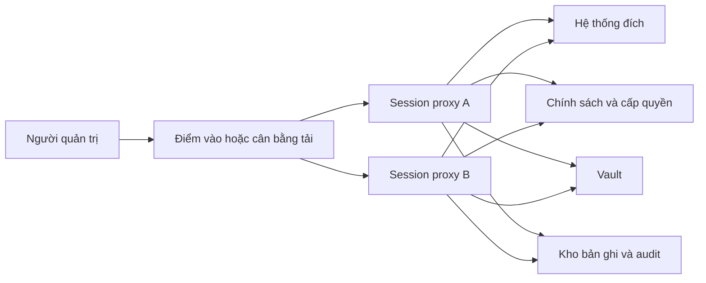

# Session proxy failover

## 1. Mục tiêu và phạm vi

Trong hệ thống Privileged Access Management (PAM), session proxy là thành phần trung gian thiết lập và kiểm soát phiên truy cập đặc quyền đến máy chủ, cơ sở dữ liệu hoặc thiết bị quản trị. Proxy có thể mở kết nối đích bằng credential lấy từ vault, áp dụng chính sách phiên, ghi hình hoặc ghi lệnh, và cung cấp dữ liệu cho giám sát.

**Session proxy failover** là quá trình chuyển khả năng phục vụ từ proxy bị lỗi sang proxy còn khỏe. Mục tiêu không chỉ là mở lại một cổng SSH/RDP. Hệ thống phải tiếp tục xác định đúng người dùng, quyền được cấp, tài khoản đích và bằng chứng của hoạt động quản trị.

Sau bài này, người học có thể:

- Phân biệt khôi phục khả năng mở phiên mới, tái kết nối và di chuyển một phiên đang chạy.
- Thiết kế cân bằng tải, kiểm tra sức khỏe và thu hồi quyền phục vụ của proxy cũ.
- Xác định trạng thái nào cần chia sẻ và dữ liệu nhạy cảm nào không nên sao chép tùy tiện.
- Xử lý các khoảng trống về ghi phiên, quyền JIT/JEA, credential và lệnh có kết quả chưa xác định.
- Xây dựng kịch bản kiểm thử failover có tiêu chí nghiệm thu cụ thể.

Bài học trình bày kiến trúc và hành vi tổng quát. Khả năng nối lại phiên, thời gian phục hồi và cơ chế clustering thực tế phụ thuộc sản phẩm, phiên bản, giao thức và cách triển khai; không được suy ra chỉ từ nhãn “HA”.

## 2. Proxy là một điểm kiểm soát, không chỉ là điểm chuyển tiếp

Một đường truy cập điển hình gồm:



Sơ đồ thể hiện các quan hệ logic, không yêu cầu mọi thành phần dùng chung một mạng hoặc một loại kết nối.

Proxy thường giữ hai phía của một phiên:

1. Kết nối từ người dùng đến proxy.
2. Kết nối từ proxy đến hệ thống đích.

Kết nối phía đích có thể dùng danh tính đặc quyền khác với danh tính đăng nhập của người dùng. Vì vậy, một phiên phục hồi phải giữ được liên kết “ai đã dùng quyền gì, trên tài khoản đích nào, theo phê duyệt nào”.

Nếu proxy A dừng đột ngột, proxy B không tự nhiên có được socket, trạng thái mã hóa, bộ đệm giao thức, ngữ cảnh xác thực và vị trí ghi phiên của A. Một bộ cân bằng tải khỏe chỉ chứng minh có đường cho kết nối mới; nó không chứng minh phiên cũ đã được bảo toàn.

### 2.1. Ba kết quả cần tách riêng

| Kết quả | Điều được phục hồi | Điều chưa được chứng minh |
|---|---|---|
| Phiên mới đi qua proxy B | Người dùng có thể tạo kết nối mới khi A lỗi | Phiên đang chạy trên A còn nguyên |
| Người dùng kết nối lại qua B | Một transport mới được tạo sau khi kiểm tra quyền | Transport cũ đã được di chuyển hoặc thao tác cũ chưa chạy |
| Phiên đang chạy tiếp tục trên B | Trạng thái phiên được chuyển theo cơ chế có hỗ trợ | Toàn bộ audit và quyền thu hồi đều đúng nếu chưa kiểm thử |

“Người dùng vào lại được sau 20 giây” là một quan sát có ích, nhưng cần nói rõ họ đã mở phiên mới, nối lại phiên trên hệ thống đích hay tiếp tục đúng phiên ở lớp proxy.

### 2.2. Các định danh không nên đánh đồng

Một mô hình dễ vận hành có ít nhất các định danh sau:

- `access_request_id`: yêu cầu truy cập hoặc phê duyệt.
- `grant_id`: quyền thực thi đã cấp, có phạm vi và hạn sử dụng.
- `logical_session_id`: hoạt động truy cập được theo dõi ở mức nghiệp vụ.
- `connection_id`: một lần kết nối cụ thể qua một proxy.
- `target_session_id`: phiên mà hệ thống đích quản lý, nếu có thể xác định.
- `recording_segment_id`: một đoạn bản ghi do một nguồn tạo ra.

Một lần kết nối lại có thể giữ liên hệ với logical session cũ nhưng phải có connection ID mới. Không tái sử dụng định danh chỉ để làm báo cáo trông như chưa từng gián đoạn.

## 3. Hiểu đúng giới hạn của từng giao thức

### 3.1. SSH

Khi một SSH proxy kết thúc cả hai phía kết nối, mất proxy thường làm mất transport đang được proxy giữ. Proxy khác không thể nhận tiếp luồng SSH chỉ nhờ có cùng địa chỉ IP hoặc cùng cấu hình.

Trên máy đích, một shell tương tác có thể kết thúc khi kết nối đóng, nhưng tác vụ đã khởi động có thể vẫn chạy tùy cách tạo tiến trình và cấu hình môi trường. Không được coi “proxy đã chết” là bằng chứng “mọi lệnh đặc quyền đã dừng”.

Công cụ giữ phiên trên máy đích có thể giúp người dùng quay lại một môi trường làm việc. Tuy nhiên:

- Đây là duy trì phiên ở hệ thống đích, không phải tự động chuyển transport của proxy.
- Lần truy cập trở lại vẫn phải qua PAM và được kiểm tra quyền.
- Cần xác định hoạt động diễn ra trong khoảng mất kết nối được ghi nhận bằng nguồn nào.
- Không dùng cách này để tạo một kênh quản trị trực tiếp nằm ngoài kiểm soát.

### 3.2. RDP

Một phiên desktop có thể vẫn tồn tại trên máy đích sau khi người dùng mất kết nối. Một kết nối RDP mới đôi khi có thể quay lại phiên đó nếu máy đích, danh tính, broker và chính sách cho phép.

Cần kiểm chứng riêng:

- Người dùng có được nối vào đúng phiên đích cũ hay bị tạo phiên mới?
- Proxy B có chứng minh được quyền truy cập hiện tại không?
- Phần bản ghi trước và sau kết nối lại liên kết bằng thông tin nào?
- Những tác vụ chạy trên desktop trong thời gian mất proxy có còn bằng chứng kiểm toán không?

Không cam kết khả năng reattach cho mọi kiến trúc RDP.

### 3.3. Cơ sở dữ liệu và giao diện quản trị khác

Mất proxy có thể làm phía người dùng không nhận được phản hồi, trong khi phía đích đã nhận câu lệnh. Trạng thái giao dịch và hành vi hủy phụ thuộc giao thức, ứng dụng và máy chủ.

Ví dụ, người quản trị gửi thao tác thay đổi cấu hình, proxy lỗi trước khi trả kết quả. Có ba khả năng:

1. Hệ thống đích chưa nhận thao tác.
2. Hệ thống đích nhận nhưng chưa hoàn tất.
3. Hệ thống đích đã hoàn tất nhưng phản hồi bị mất.

Vì vậy, failover không được tự động gửi lại mọi thao tác ghi. “Không thấy thành công” không đồng nghĩa “chưa thực hiện”.

## 4. Xác định hợp đồng phục hồi trước khi chọn topology

Với mỗi loại phiên, đội vận hành nên ghi rõ:

| Câu hỏi | Ví dụ câu trả lời cần có |
|---|---|
| Khi mất một proxy, phiên đang chạy ra sao? | Ngắt kết nối; phải xác minh kết quả thao tác trước khi nối lại |
| Khi nào có thể mở phiên mới? | Sau khi điểm vào loại proxy lỗi và proxy còn lại vượt readiness |
| Có nối lại phiên đích được không? | Chỉ với nhóm RDP đã kiểm thử và còn quyền hợp lệ |
| Khi mất ghi phiên, có được tiếp tục không? | Theo chính sách của nhóm tài nguyên; phiên bắt buộc ghi phải bị chặn hoặc dừng khi không đáp ứng |
| Ai có thể cưỡng chế dừng phiên cũ? | Bộ điều phối và cơ chế cô lập đường truy cập có quyền đã kiểm chứng |
| Quyền JIT hết hạn giữa lúc phục hồi xử lý thế nào? | Không tạo quyền mới từ phê duyệt cũ đã hết hạn |
| Có khoảng hoạt động không quan sát được không? | Báo rõ trong audit và chuyển xử lý theo quy trình |

Hợp đồng này là đầu vào cho thiết kế. Nếu một nhóm tài nguyên đòi hỏi không mất phiên và không mất bằng chứng, cần xác minh sản phẩm hỗ trợ cả hai điều kiện; thêm proxy đơn thuần không đủ.

## 5. Topology và phân phối tải

### 5.1. Active–passive

Một proxy phục vụ, proxy dự phòng sẵn sàng tiếp quản vai trò.

Ưu điểm là đường phục vụ và chủ sở hữu tương đối rõ. Tuy nhiên, proxy dự phòng phải được kiểm tra thường xuyên; một node không nhận tải nhiều tháng có thể có cấu hình, certificate hoặc đường mạng sai mà chưa ai phát hiện.

Chuyển vai trò phải xét cả khả năng truy cập hệ thống đích và tình trạng các phụ thuộc. “Tiến trình còn chạy” không đủ để nhận quyền phục vụ.

### 5.2. Active–active

Nhiều proxy đồng thời nhận phiên mới. Một phiên cụ thể vẫn thường gắn với node đã thiết lập nó.

Khi A lỗi, B có thể nhận thêm phiên mới nhưng chưa chắc nhận được phiên đang chạy trên A. Cần tách hai khái niệm:

- Cụm có nhiều node phục vụ.
- Một phiên có khả năng chuyển trạng thái giữa các node.

Active–active chỉ khẳng định điều thứ nhất nếu không có bằng chứng khác.

### 5.3. Session affinity

Affinity hoặc sticky routing đưa các yêu cầu liên quan đến cùng một proxy. Điều này có ích khi control request hoặc phiên cần trạng thái tại node.

Affinity không phải cơ chế cấp quyền, cũng không giải quyết mất node. Khi node bị loại khỏi pool, client phải có cách chuyển sang node khỏe. Nếu cookie hoặc token định tuyến vẫn trỏ cứng đến node chết, cụm có thể còn năng lực nhưng người dùng vẫn không vào được.

Cần kiểm tra:

- Affinity hết hiệu lực hoặc bị bỏ qua khi node không sẵn sàng.
- Token dùng để tiếp tục phiên được bảo vệ, có hạn và ràng buộc với danh tính.
- Proxy mới kiểm tra quyền thay vì tin token định tuyến.
- Cân bằng tải chỉ đổi đường cho kết nối mới; luồng TCP đang mở không được giả định là sẽ chuyển theo.

### 5.4. Dự phòng năng lực

Giả sử tải cao điểm cần 120 phiên đồng thời. Mỗi proxy đã được đo an toàn ở 80 phiên với chế độ ghi phiên thực tế.

Hai proxy có tổng năng lực 160 phiên khi bình thường, nhưng chỉ còn 80 phiên khi mất một node. Cụm này chưa đáp ứng yêu cầu chịu mất một node ở tải cao điểm.

Năng lực dự phòng cần tính cả:

- CPU cho mã hóa và xử lý giao thức.
- Băng thông hai phía và đường đẩy bản ghi.
- Bộ nhớ, file descriptor và giới hạn kết nối.
- Dung lượng bộ đệm ghi phiên.
- Tải xác thực, cấp credential và kiểm tra quyền khi nhiều người cùng kết nối lại.
- Các giới hạn của vault, bộ điều phối và hệ thống đích.

Đặt giới hạn tiếp nhận rõ ràng. Quá tải có kiểm soát tốt hơn việc nhận phiên rồi mất ghi hình hoặc mất khả năng dừng phiên.

## 6. Phát hiện lỗi: liveness, readiness và health end-to-end

### 6.1. Liveness

Liveness trả lời: tiến trình có còn hoạt động đủ để không cần khởi động lại không?

Một HTTP endpoint trả 200 có thể chỉ chứng minh vòng lặp web còn đáp ứng. Nó không chứng minh proxy mở được phiên SSH, lấy được credential hoặc ghi được audit.

### 6.2. Readiness

Readiness trả lời: node có thể nhận loại phiên mới được yêu cầu với đầy đủ kiểm soát không?

Các kiểm tra có thể gồm:

- Cấu hình và phiên bản chính sách phù hợp.
- Certificate và danh tính node hợp lệ.
- Đường truy cập hệ thống đích hoặc connector tương ứng.
- Khả năng xác minh grant và trạng thái thu hồi.
- Khả năng lấy credential theo chính sách.
- Khả năng tạo bản ghi hoặc đệm trong giới hạn được phép.
- Dung lượng và năng lực còn lại.

Không nhất thiết một phụ thuộc lỗi sẽ làm toàn bộ node mất readiness cho mọi tài nguyên. Ví dụ, lỗi một connector riêng có thể chỉ ảnh hưởng nhóm đích đó. Ngược lại, mất khả năng kiểm tra quyền có thể phải chặn toàn bộ phiên mới cần kiểm tra trực tuyến.

Readiness cần phản ánh chính sách được phê duyệt, không âm thầm bỏ kiểm tra để giữ node màu xanh.

### 6.3. Kiểm tra từ góc nhìn người dùng

Nên có một synthetic test qua chính điểm vào người dùng sử dụng, đến tài nguyên thử nghiệm và xác minh dấu vết audit. Tài khoản thử phải có quyền tối thiểu và không dùng tài khoản quản trị production chỉ để kiểm tra sức khỏe.

Synthetic test giúp phát hiện những lỗi mà health endpoint cục bộ không nhìn thấy, như:

- Cân bằng tải chọn sai backend hoặc sai cổng.
- Certificate đúng tại node nhưng sai tên khi đi qua điểm vào.
- Đường proxy đến đích bị firewall chặn.
- Phiên mở được nhưng bản ghi không đến kho lưu trữ.
- Truy vấn audit không liên kết được người dùng với phiên.

### 6.4. Ngưỡng phát hiện lỗi

Timeout và số lần kiểm tra thất bại cần cân bằng tốc độ chuyển tải với nguy cơ dao động. Một lần phản hồi chậm không nhất thiết là node chết.

Các giá trị phải xuất phát từ độ trễ đo được và mục tiêu phục hồi. Nếu cấu hình quá nhạy, cụm có thể liên tục loại và đưa node trở lại, làm tăng số phiên ngắt. Nếu quá chậm, nhiều người tiếp tục được đưa đến proxy lỗi.

Theo dõi cả false positive, số lần thay đổi trạng thái và thời gian ổn định sau phục hồi.

## 7. Trạng thái dùng chung và quyền sở hữu phiên

### 7.1. Trạng thái cần bảo toàn

Một mô hình logic có thể lưu:

```yaml
logical_session:
  id: ps-lab-042
  access_request_id: ar-lab-018
  grant_id: grant-lab-018-v2
  principal_id: user-lab-07
  target_id: host-lab-03
  target_account_id: account-lab-admin
  protocol: ssh
  policy_version: policy-27
  grant_expires_at: "2030-01-01T10:20:00Z"
  owner_proxy: proxy-a
  ownership_epoch: 11
  lifecycle: ACTIVE
  recording_required: true
```

Đây là dữ liệu minh họa, không phải cấu hình của sản phẩm cụ thể. Các ID không chứa password, token đăng nhập hoặc private key.

Ngoài các trường trên, có thể cần trạng thái thu hồi, thông tin segment ghi phiên, khả năng tiếp tục, trạng thái thao tác chưa xác định và lịch sử thay đổi chủ sở hữu.

Không lưu credential dạng rõ trong kho trạng thái chỉ vì nhiều proxy cùng cần truy cập. Proxy phục hồi nên lấy quyền truy cập credential theo cơ chế của vault và chính sách tương ứng.

### 7.2. Đồng bộ metadata không bằng đồng bộ transport

Kho trạng thái dùng chung giúp B biết A từng giữ phiên nào. Nó không cung cấp tự động:

- Khóa và trạng thái giao thức đang nằm trong bộ nhớ A.
- Socket phía người dùng và phía đích.
- Nội dung chưa flush của bản ghi.
- Kết quả cuối của lệnh vừa được gửi.
- Khả năng tiếp tục một phiên đích cụ thể.

Bản thiết kế phải nêu rõ phạm vi sao chép trạng thái và những gì không thể khôi phục.

### 7.3. Lease và epoch

Một cơ chế điều phối có thể cấp lease cho chủ sở hữu phiên hoặc một vai trò. Mỗi lần chuyển quyền sở hữu tăng một epoch.

Ví dụ:

- A đang giữ epoch 11.
- A mất khả năng gia hạn lease.
- Bộ điều phối xác lập quyền mới cho B ở epoch 12.
- Các thành phần có hỗ trợ kiểm tra epoch từ chối thao tác của chủ sở hữu cũ.

Lease cần có cách xử lý hết hạn, độ trễ và khởi động lại. Không để một proxy tiếp tục nhận phiên vô hạn sau khi mất khả năng chứng minh quyền phục vụ.

Tuy nhiên, **epoch trong cơ sở dữ liệu không tự chặn được kết nối SSH/RDP mà A đã mở đến máy đích**. Máy đích thông thường không biết epoch của PAM.

Do đó, cần xác định điểm nào thực sự cưỡng chế fencing: cơ chế cluster của sản phẩm, gateway có kiểm tra quyền sở hữu, cô lập node hoặc đường mạng có kiểm soát, hay cơ chế hủy phiên đích đã được kiểm thử. Không mô tả một bản ghi lease như bằng chứng rằng chủ sở hữu cũ đã bị vô hiệu hóa.

## 8. Split-brain và fencing

Split-brain xảy ra khi nhiều node cùng tin rằng mình có quyền điều khiển cùng một vai trò hoặc phiên.

Ví dụ, A vẫn nói chuyện được với máy đích nhưng không đến được bộ điều phối. B thấy A mất heartbeat và được cấp vai trò thay thế. Nếu A tiếp tục nhận yêu cầu từ một đường mạng khác, cả hai có thể thực hiện hoạt động đặc quyền.

Các hậu quả gồm:

- Hai phiên dùng cùng một quyền chỉ được phép sử dụng một lần.
- Các chính sách thu hồi hoặc dừng phiên chỉ đến một phía.
- Credential bị checkout hoặc rotate theo hai luồng xung đột.
- Audit có hai nguồn cùng tự nhận là chủ sở hữu duy nhất.
- Một phiên tiếp tục làm việc sau khi người vận hành tin rằng đã chuyển sang B.

Một thiết kế hợp lệ cần trả lời:

1. Ai quyết định quyền sở hữu khi có phân vùng mạng?
2. Thành phần nào ngăn node cũ tiếp tục hành động?
3. Làm sao biết fencing đã thành công?
4. Có được nhận phiên mới trước khi xác minh fencing không?
5. Nếu không thể fencing, trạng thái an toàn cho loại tài nguyên đó là gì?

Không mặc định restart A là fencing thành công. Nếu lệnh restart chưa đến được A, hoặc A khởi động lại và tái gia nhập với trạng thái cũ, nguy cơ vẫn còn.

Với phiên mà việc có hai bên điều khiển là không chấp nhận được, quy trình phục hồi phải chờ bằng chứng cô lập hoặc thu hồi có hiệu lực. Cụm có thể chọn giảm khả dụng để giữ điều kiện an toàn đó.

## 9. Trình tự failover cho một lần kết nối lại

Một luồng phục hồi có kiểm soát có thể diễn ra như sau:

1. Hệ thống quan sát phát hiện A lỗi hoặc không còn đáp ứng điều kiện phục vụ.
2. Điểm vào ngừng đưa phiên mới đến A.
3. Bộ điều phối đánh dấu các phiên liên quan là gián đoạn hoặc đang xác minh, không giả định đã kết thúc hoàn toàn.
4. Cơ chế fencing xử lý quyền phục vụ cũ theo yêu cầu của loại phiên.
5. Người dùng kết nối lại qua B bằng đường truy cập chính thức.
6. B xác minh danh tính, trạng thái thu hồi, grant, phạm vi JIT/JEA và thời hạn hiện tại.
7. B xác định khả năng reattach hoặc tạo phiên mới, đồng thời xử lý thao tác có kết quả chưa rõ.
8. B lấy credential theo quyền của mình; không dựa vào bản secret sao chép tùy tiện từ A.
9. B tạo connection ID và segment ghi phiên mới, liên kết với lịch sử trước đó.
10. Chỉ khi các điều kiện bắt buộc đạt yêu cầu, B mở hoặc nối lại kết nối đích.
11. Hệ thống xác minh audit, bản ghi và trạng thái cuối của A, sau đó mới đóng sự kiện vận hành.

Trình tự thực tế có thể khác theo sản phẩm, nhưng các điều kiện cấp quyền và bằng chứng không được biến mất giữa bước “đổi proxy” và bước “cho người dùng vào”.

### 9.1. Không kéo dài quyền JIT bằng failover

Giả sử quyền JIT hết hạn lúc 10:20. A lỗi lúc 10:19:50, người dùng đến B lúc 10:20:10.

B không được coi “phiên cũ bắt đầu trước 10:20” là lý do đủ để tạo phiên mới sau khi quyền hết hạn. Hệ thống phải áp dụng hợp đồng đã định nghĩa: kết thúc, yêu cầu cấp quyền mới hoặc xử lý quy tắc tiếp tục phiên đã được phê duyệt.

Quyền tiếp tục một phiên đang chạy và quyền mở một phiên mới có thể khác nhau. Cần ghi rõ trong chính sách, không để cơ chế reconnect tự quyết định.

### 9.2. Không mở rộng JEA khi đổi proxy

Nếu quyền cũ chỉ cho phép một tập thao tác hoặc vai trò hạn chế, B phải áp dụng cùng phạm vi phù hợp. Không đưa người dùng vào tài khoản có shell đầy đủ chỉ vì bộ lọc lệnh hoặc profile JEA tại B chưa được cấu hình.

Failover thành công về kết nối nhưng mở rộng quyền là một thất bại về kiểm soát truy cập.

### 9.3. Thu hồi và dừng phiên

Nếu người dùng bị thu hồi quyền trong lúc A lỗi, B phải nhận biết trước khi chấp nhận kết nối lại. Đồng thời, cần xác minh điều gì xảy ra với phiên còn tồn tại trên máy đích.

Các trạng thái “đã chặn kết nối mới”, “đã yêu cầu ngắt phiên” và “đã xác nhận phiên đích kết thúc” cần được báo cáo riêng. Một lệnh hủy chưa có xác nhận không đủ để đóng sự kiện.

## 10. Credential và phụ thuộc khi chuyển proxy

### 10.1. Danh tính của từng proxy

Mỗi proxy cần danh tính máy hoặc workload identity để giao tiếp với vault, policy service và kho bản ghi. Quyền của proxy phải giới hạn theo nhiệm vụ.

Không sao chép cùng một private key không có kiểm soát sang mọi node chỉ để đơn giản hóa failover. Nếu sản phẩm yêu cầu một bí mật cấp cụm, cần quản lý nó như thành phần của thiết kế sản phẩm: phân phối an toàn, bảo vệ, xoay vòng và kiểm tra khả năng thu hồi node.

### 10.2. Không để credential lease cũ sống ngoài kiểm soát

Nếu A đã checkout credential trước khi lỗi, cần biết:

- Lease của A còn hiệu lực bao lâu?
- B có được checkout đồng thời không?
- Vault có hỗ trợ chuyển hoặc hủy checkout không?
- Ai chịu trách nhiệm trả credential khi A không thể báo hoàn tất?
- Hệ thống đích có tiếp tục chấp nhận credential đó sau khi thu hồi ở vault không?

Thu hồi quyền lấy secret từ vault không nhất thiết làm credential đã được hệ thống đích chấp nhận mất hiệu lực. Tương tự, đổi password không bảo đảm ngắt một phiên đã xác thực.

### 10.3. Rotate có chọn lọc

Không rotate hàng loạt mọi credential chỉ vì một proxy mất heartbeat. Nếu nhiều phiên hoặc dịch vụ đang dùng chung tài khoản, thao tác này có thể làm rộng sự cố.

Quyết định rotate dựa trên tình trạng lộ lọt, chính sách checkout, loại credential và ảnh hưởng đã biết. Có thể cần thu hồi token, certificate ngắn hạn hoặc khóa liên quan; mỗi loại có cơ chế hiệu lực riêng.

Nếu việc rotate được yêu cầu, theo dõi riêng trạng thái tại vault, trạng thái tại hệ thống đích và các phiên còn đang hoạt động.

### 10.4. Phụ thuộc dùng chung vẫn có thể làm cả cụm dừng

Nhiều proxy không loại bỏ điểm lỗi chung tại:

- Identity provider hoặc dịch vụ MFA.
- Policy service và kho grant.
- Vault hoặc dịch vụ cấp certificate.
- DNS, cân bằng tải, mạng đến hệ thống đích.
- Kho trạng thái dùng chung.
- Kho bản ghi, khóa mã hóa hoặc dịch vụ quản lý khóa.

Cần kiểm tra đường phụ thuộc thực tế. B không thể phục hồi truy cập nếu mọi kết nối mới vẫn phải qua một thành phần A duy nhất.

## 11. Bảo toàn audit và recording

### 11.1. Mất phiên và mất bằng chứng là hai sự cố khác nhau

Người dùng có thể mở lại phiên thành công nhưng phần cuối bản ghi của A chưa được lưu. Ngược lại, bản ghi có thể đầy đủ nhưng thao tác đang chạy vẫn chưa xác định kết quả.

Báo cáo failover cần nói rõ cả hai. Không suy ra “recording complete” chỉ vì phiên mới có video.

### 11.2. Phân đoạn bản ghi có thể truy vết

Nên có thông tin để liên kết các segment trước và sau failover:

```yaml
recording_segment:
  id: rec-lab-042-b
  logical_session_id: ps-lab-042
  connection_id: conn-lab-042-b
  source_proxy: proxy-b
  ownership_epoch: 12
  previous_segment_id: rec-lab-042-a
  started_at: "2030-01-01T10:12:17Z"
  predecessor_state: INCOMPLETE
  recovery_reason: PROXY_UNAVAILABLE
```

`previous_segment_id` thể hiện quan hệ, không khẳng định chuỗi trước đó đầy đủ. Nếu không biết chính xác đoạn mất, phải ghi trạng thái chưa xác định thay vì đặt thời lượng mất bằng không.

Dữ liệu kiểm toán nên thể hiện:

- Danh tính người dùng và tài khoản đích.
- Yêu cầu, grant, phiên và từng connection liên quan.
- Proxy phục vụ, phiên bản chính sách và sự kiện đổi chủ sở hữu.
- Thời điểm phát hiện, fencing, reconnect và kết thúc.
- Tình trạng lưu bản ghi, khoảng trống và hành động khắc phục.
- Kết quả thu hồi, dừng phiên hoặc kiểm tra lệnh chưa xác định.

### 11.3. Bộ đệm cục bộ

Bộ đệm có thể giảm ảnh hưởng khi kho ghi phiên tạm thời không đến được. Nhưng phải định nghĩa:

- Giới hạn dung lượng và khoảng thời gian được phép đệm.
- Mã hóa và bảo vệ khóa.
- Xác nhận segment đã được lưu bền vững.
- Hành vi khi hết dung lượng hoặc mất node.
- Thứ tự gửi lại, phát hiện trùng và kiểm tra toàn vẹn.
- Quy trình thu hồi dữ liệu khi node quay lại.

Bản ghi chỉ nằm trong bộ nhớ không phải bằng chứng đã lưu bền vững. Bản ghi trên đĩa A cũng chưa chắc sẵn sàng nếu A mất hoàn toàn cùng ổ đĩa.

Với tài nguyên bắt buộc ghi liên tục, hết khả năng ghi hoặc đệm phải dẫn đến hành vi đã được phê duyệt, như không nhận phiên mới hoặc dừng phiên có kiểm soát. Không chuyển sang truy cập không ghi chỉ để giữ dịch vụ “available”.

### 11.4. Thứ tự và sự kiện trùng

Sau phục hồi, sự kiện của A có thể đến muộn hoặc bị gửi lại. Nên có event ID ổn định, ID nguồn và số thứ tự trong nguồn hoặc segment để nhận diện trùng.

Không dùng timestamp đồng hồ tường làm bằng chứng duy nhất cho thứ tự tuyệt đối giữa các node. Đồng bộ thời gian giúp đối chiếu, nhưng vẫn cần định danh, quan hệ nhân quả và dấu mốc điều phối.

Nếu có checksum hoặc chữ ký cho segment, cần kiểm tra chúng theo cơ chế lưu trữ tương ứng. Một checksum không tự chứng minh không có segment bị thiếu.

## 12. Retry và thao tác có kết quả chưa xác định

Failover thường khiến client retry. Các yêu cầu điều khiển có thể thiết kế idempotent, nhưng lệnh bên trong phiên không vì thế mà idempotent.

Ví dụ, API tạo session có thể dùng `idempotency_key` để tránh tạo hai session khi phản hồi bị mất. Khóa đó phải gắn với người dùng, yêu cầu và nội dung phù hợp; cùng khóa nhưng nội dung khác phải bị xử lý rõ ràng.

Ngược lại, các thao tác sau cần kiểm tra kết quả tại đích trước khi chạy lại:

- Thay đổi cấu hình mạng có thể làm mất đường quản trị.
- Khởi động một đợt triển khai.
- Tạo tài khoản hoặc cấp vai trò.
- Thực hiện lệnh thay đổi dữ liệu.
- Rotate credential của một dịch vụ.

Một quy trình xử lý kết quả chưa rõ gồm:

1. Ghi nhận thao tác cuối cùng đã biết và mức chắc chắn của bằng chứng.
2. Xác minh trạng thái qua hệ thống đích hoặc nguồn có thẩm quyền.
3. Liên kết kết quả kiểm tra với phiên bị gián đoạn.
4. Chỉ thực hiện lại khi đã biết việc lặp là an toàn hoặc được quy trình nghiệp vụ cho phép.

Không thể suy ra “exactly once” chỉ từ một cụm proxy HA. Bảo đảm đó, nếu cần, phải đến từ giao thức và cơ chế xử lý thao tác cụ thể.

## 13. Drain và tái gia nhập cụm

### 13.1. Drain cho bảo trì có kế hoạch

Để nâng cấp hoặc bảo trì một proxy:

1. Ngừng nhận phiên mới trên node.
2. Giữ các phiên hiện có nếu node vẫn đáp ứng đầy đủ điều kiện kiểm soát.
3. Theo dõi phiên còn lại, thời hạn drain và khả năng kết thúc an toàn.
4. Flush bản ghi và xác minh dữ liệu đã được tiếp nhận.
5. Thu hồi vai trò hoặc đưa node ra khỏi cụm theo cơ chế hỗ trợ.
6. Thực hiện bảo trì và kiểm tra readiness trước khi nhận tải trở lại.

Không cắt phiên đang chạy chỉ để làm deployment nhanh hơn nếu hợp đồng vận hành cho phép drain. Ngược lại, drain không phải lý do giữ một node đang mất khả năng kiểm soát phiên.

### 13.2. Node cũ quay lại

A trở lại sau khi B đã phục vụ không được tự nhận tiếp mọi quyền cũ.

Trước khi tái gia nhập, cần:

- Xác minh danh tính node, cấu hình và phiên bản phù hợp.
- Đồng bộ trạng thái quyền sở hữu và thu hồi.
- Không tái sử dụng lease hoặc token đã hết hiệu lực.
- Gửi nốt bản ghi cũ theo quy trình có kiểm tra trùng và toàn vẹn.
- Đối chiếu các phiên chưa có trạng thái kết thúc rõ.
- Vượt kiểm tra sức khỏe và nhận vai trò mới qua bộ điều phối.

Không xóa bộ đệm cũ trước khi xác nhận đã thu hồi dữ liệu cần thiết. Việc dọn bản ghi phải theo chính sách lưu giữ, không là một bước “làm sạch node” tự phát.

### 13.3. Tránh failback dao động

Không nhất thiết chuyển tải ngay về A khi nó vừa lên. Có thể cần khoảng ổn định, kiểm tra phụ thuộc, giới hạn tốc độ nhận phiên và theo dõi lỗi.

Failback là một thay đổi vận hành riêng. Đừng tạo thêm lần gián đoạn chỉ để trở lại phân bố tải ban đầu.

## 14. Đo phục hồi bằng các chỉ số đúng

Tách các mốc:

- `t0`: lỗi bắt đầu.
- `t1`: hệ thống phát hiện lỗi.
- `t2`: điểm vào ngừng gửi phiên mới đến node lỗi.
- `t3`: các điều kiện kiểm soát cho phục hồi đã đạt.
- `t4`: phiên mới hoặc kết nối lại đầu tiên thành công.
- `t5`: audit và trạng thái phiên cũ đã được đối chiếu.

Từ đó có thể đo thời gian phát hiện, thời gian loại backend và thời gian phục hồi truy cập. Thời gian đến `t5` thể hiện hoàn tất xử lý bằng chứng; nó có thể dài hơn thời gian người dùng vào lại được.

| Chỉ số | Ý nghĩa |
|---|---|
| Tỷ lệ mở phiên mới thành công khi mất một node | Khả năng phục vụ sau lỗi |
| Số phiên đang chạy bị gián đoạn | Ảnh hưởng thực tế đến người dùng |
| Thời gian kết nối lại p95/p99 | Trải nghiệm phục hồi, kể cả đuôi chậm |
| Số thao tác có kết quả chưa xác định | Khối lượng cần đối chiếu tại đích |
| Số phiên thiếu hoặc mất recording | Mức bảo toàn bằng chứng |
| Độ trễ thu hồi và số phiên chưa xác nhận kết thúc | Hiệu lực kiểm soát sau lỗi |
| Tỷ lệ lỗi vault/policy khi reconnect đồng loạt | Áp lực lên phụ thuộc |
| Số lần fencing thất bại hoặc chủ sở hữu xung đột | Rủi ro split-brain |

RTO nên gắn với một hành vi cụ thể, chẳng hạn mở phiên mới vào nhóm máy chủ thử nghiệm. Không lấy RTO đó làm cam kết rằng mọi phiên đang chạy không bị mất.

RPO cho recording là lượng bằng chứng có thể mất theo thiết kế và failure domain. Không suy ra RPO bằng không chỉ từ việc có kho lưu trữ tập trung; phần dữ liệu chưa được gửi hoặc xác nhận vẫn cần được tính.

## 15. Tình huống minh họa

Một đội vận hành có hai proxy A và B. Người quản trị đang qua A để thay đổi cấu hình một máy chủ thử nghiệm. Phiên bắt buộc ghi lệnh và quyền JIT còn hiệu lực đến 10:20.

Diễn biến quan sát được:

| Thời điểm | Sự kiện | Cách diễn giải |
|---|---|---|
| 10:12:00 | Người dùng gửi lệnh thay đổi | Chưa thể kết luận kết quả chỉ từ phía client |
| 10:12:02 | A mất kết nối với control plane, vẫn có thể đến máy đích | Có nguy cơ phân vùng mạng, không phải chắc chắn A đã tắt |
| 10:12:08 | Điểm vào ngừng chọn A | Chỉ bảo đảm đường nhận phiên mới qua điểm vào đó |
| 10:12:12 | Cơ chế cô lập A được xác minh | Đạt điều kiện phục hồi theo thiết kế của bài thử |
| 10:12:17 | Người dùng kết nối B, quyền được kiểm tra lại | Tạo connection và segment mới |
| 10:12:25 | Trạng thái cấu hình tại đích được xác minh | Có cơ sở quyết định không chạy lại lệnh |
| 10:14:00 | Bản ghi cuối của A được đối chiếu | Nếu thiếu dữ liệu, báo khoảng trống thay vì ghép giả thành liên tục |

Kết quả vận hành cần ghi:

- Truy cập được khôi phục qua B.
- Transport cũ không được tuyên bố đã chuyển nguyên vẹn.
- Lệnh cuối đã được xác minh tại đích trước mọi hành động lặp.
- Quyền của người dùng được kiểm tra lại và không mở rộng.
- Tình trạng recording được báo độc lập với kết quả kết nối.
- A chỉ tái gia nhập sau khi hoàn tất kiểm tra quyền sở hữu và dữ liệu tồn.

Các mốc là ví dụ cho một lần thử, không phải thông số mặc định hay cam kết của hệ thống PAM.

## 16. Bài thực hành thiết kế và kiểm thử

Thực hiện trong môi trường thử nghiệm được giao quyền, với tài khoản và dữ liệu giả lập. Các bước dưới đây là kế hoạch kiểm thử; bài học không khẳng định đã thực hiện chúng.

### 16.1. Chuẩn bị

Tạo hai proxy thử nghiệm, một điểm vào, một tài nguyên SSH hoặc RDP và đường ghi audit. Cấu hình người dùng thử với quyền hạn chế, một grant có thời hạn và yêu cầu recording rõ ràng.

Ghi lại hành vi dự kiến cho phiên mới, phiên đang chạy, việc thu hồi và mất ghi phiên. Chuẩn bị cách quan sát trạng thái tại máy đích mà không cần mở một đường quản trị vượt kiểm soát.

### 16.2. Ma trận thử nghiệm

| Lỗi được tạo | Cần quan sát | Tiêu chí đạt |
|---|---|---|
| Dừng tiến trình proxy A | Phiên cũ, backend và khả năng mở phiên mới | B phục vụ đúng quyền; phiên cũ có trạng thái rõ |
| A mất đường đến control plane nhưng còn đến đích | Lease, fencing và hoạt động tại đích | Không có quyền điều khiển đồng thời trái chính sách |
| A mất đường đến kho bản ghi | Bộ đệm, cảnh báo và hành vi phiên | Không vượt giới hạn ghi/đệm được phê duyệt |
| Vault không đáp ứng khi người dùng reconnect | Retry và admission | Không dùng credential ngoài chính sách hoặc lặp vô hạn |
| Grant hết hạn trước lúc đến B | Quyết định cấp quyền | Không mở phiên mới bằng grant đã hết hạn |
| Người dùng bị thu hồi khi A lỗi | Kết nối mới và phiên đích cũ | Chặn phục hồi và ghi đúng mức xác nhận kết thúc |
| Tải reconnect tăng đột biến | Năng lực B và phụ thuộc | Giới hạn tải hoạt động, không bỏ kiểm soát bắt buộc |
| A quay lại sau failover | Epoch, bản ghi tồn và readiness | Không nhận lại quyền cũ hoặc tạo audit trùng không kiểm soát |

Với mỗi trường hợp, thu thập thời gian, ID liên quan, sự kiện điểm vào, quyết định policy, kết quả fencing, trạng thái hệ thống đích và tình trạng bản ghi.

### 16.3. Kiểm tra thao tác có kết quả chưa rõ

Chọn một thao tác giả lập có trạng thái quan sát được ở đích, chẳng hạn tạo một dấu mốc thử nghiệm có ID duy nhất. Tạo lỗi sau khi gửi thao tác nhưng trước khi phía người dùng nhận phản hồi.

Sau khi qua B:

1. Xác minh dấu mốc tại đích.
2. Ghi rõ thao tác đã thực hiện, chưa thực hiện hoặc vẫn chưa xác định.
3. Không thực hiện lại chỉ vì client báo lỗi.
4. Kiểm tra liên kết giữa kết quả xác minh và phiên trước failover.

### 16.4. Bằng chứng nghiệm thu

Một báo cáo có ích cần có kết quả thực tế đối chiếu với hợp đồng phục hồi, không chỉ ảnh chụp “proxy B xanh”.

Ví dụ cấu trúc:

```text
Test case: partition-control-plane
Affected logical session: ps-lab-042
New connection: conn-lab-042-b
Old owner isolated: confirmed / failed / unknown
Grant revalidated: pass / fail
Target operation outcome: applied / not applied / unknown
Recording predecessor: complete / incomplete / unknown
New recording segment accepted: yes / no
Recovery objective met: yes / no
Outstanding actions: ...
```

Chỉ điền kết quả sau khi có bằng chứng. Trạng thái `unknown` là thông tin cần xử lý, không phải lỗi báo cáo phải che đi.

## 17. Lỗi thiết kế thường gặp

| Lỗi | Hậu quả | Hướng xử lý |
|---|---|---|
| Cho rằng load balancer chuyển được socket đang chạy | Cam kết sai về tính liên tục của phiên | Kiểm chứng theo giao thức và cơ chế sản phẩm |
| Chỉ kiểm tra process hoặc cổng TCP | Node nhận tải nhưng không kiểm soát được phiên | Readiness theo quyền, recording và đường đến đích |
| Dùng grant cũ để reconnect vô thời hạn | Quyền JIT bị kéo dài ngoài phê duyệt | Kiểm tra hạn, phạm vi và thu hồi tại thời điểm phục hồi |
| Coi lease là fencing cho mọi hệ thống đích | Proxy cũ vẫn có thể điều khiển đích | Xác định điểm cưỡng chế thực tế và bằng chứng cô lập |
| Tự động lặp mọi lệnh khi mất phản hồi | Thao tác đặc quyền bị thực hiện hai lần | Đối chiếu trạng thái đích và xử lý idempotency đúng lớp |
| Chỉ dự phòng proxy, bỏ qua vault và kho audit | Lỗi phụ thuộc làm cả cụm mất dịch vụ | Kiểm tra failure domain và phụ thuộc chung |
| Ghi “recording complete” khi chưa nhận segment cuối | Che mất khoảng trống bằng chứng | Theo dõi segment, xác nhận lưu và trạng thái incomplete |
| Tự động failback ngay khi A khởi động | Dao động tải, thêm gián đoạn | Kiểm tra ổn định và tái gia nhập có điều phối |
| Mở đường truy cập trực tiếp để chữa lỗi PAM | Mất least privilege và giám sát | Dùng quy trình khẩn cấp được cấp quyền, có ghi nhận và hậu kiểm |

## 18. Câu hỏi tự kiểm tra

1. Vì sao hai proxy active–active chưa chứng minh một phiên SSH đang chạy có thể chuyển nguyên vẹn?
2. Nếu A mất control plane nhưng vẫn đến được máy đích, bước nào ngăn A tiếp tục hành động sau khi B nhận vai trò?
3. Người dùng reconnect sau khi grant JIT hết hạn cần được xử lý theo điều kiện nào?
4. Khi client không nhận được phản hồi của lệnh thay đổi, phải thu thập bằng chứng gì trước khi chạy lại?
5. Một segment bản ghi trên đĩa A nhưng chưa đến kho tập trung được tính thế nào trong RPO?
6. Làm sao phân biệt đã chặn phiên mới với đã kết thúc phiên đích?
7. Tại sao readiness của một proxy cần xét recording và policy, thay vì chỉ kiểm tra cổng?
8. Khi A quay lại, điều gì chứng minh nó không dùng lại quyền sở hữu cũ?

Session proxy failover đạt yêu cầu khi khả năng truy cập được phục hồi theo hợp đồng đã định nghĩa, quyền đặc quyền vẫn được kiểm soát và trạng thái bằng chứng được báo trung thực. Việc mở lại một kết nối chỉ là một phần của kết quả đó.
