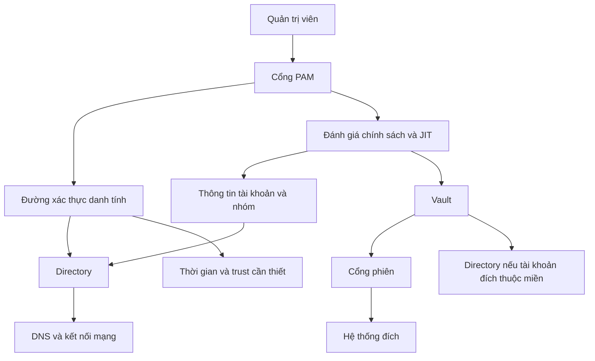

# Directory dependency trong kiến trúc PAM có tính sẵn sàng cao

## 1. Vì sao directory là một phần của thiết kế HA

Một cụm Privileged Access Management (PAM) có hai máy chủ, bộ cân bằng tải và vault dự phòng vẫn có thể ngừng cấp quyền khi dịch vụ thư mục không hoạt động. Nguyên nhân là PAM thường cần directory để xác thực người dùng, tra cứu nhóm, xác định vai trò, tìm tài khoản dịch vụ hoặc kiểm tra điều kiện truy cập.

Directory dependency là sự phụ thuộc của một chức năng PAM vào dịch vụ thư mục và các thành phần cần thiết để sử dụng dịch vụ đó. Directory ở đây có thể là một thư mục doanh nghiệp hỗ trợ LDAP, một hệ thống quản lý miền hoặc nguồn danh tính được một nhà cung cấp định danh sử dụng ở phía sau. Không nên coi mọi hệ thống này có cùng giao thức, cùng cơ chế đồng bộ hay cùng hành vi khi mất kết nối.

Trong bài này, ta dùng một doanh nghiệp giả định có PAM, vault, cổng phiên quản trị và directory doanh nghiệp. Các tên thành phần, thời gian và chính sách minh họa nhằm giúp phân tích thiết kế; chúng không phải cấu hình của một sản phẩm cụ thể.

Sau bài học, người học có thể:

- Lập bản đồ những thao tác PAM thực sự cần directory và những thao tác có thể tiếp tục mà không cần truy vấn trực tiếp.
- Phân biệt directory sẵn sàng, đường kết nối sẵn sàng và quyết định phân quyền còn đủ độ mới.
- Thiết kế chế độ suy giảm có giới hạn, bảo toàn least privilege và khả năng thu hồi quyền.
- Đặt tiêu chí kiểm thử, quan sát và phục hồi cho sự cố directory trong môi trường PAM.

## 2. Phân biệt các nguồn thông tin trong đường cấp quyền

### 2.1. Xác thực không đồng nghĩa với được cấp đặc quyền

Xác thực trả lời câu hỏi: “Đây có phải người hoặc dịch vụ đang khai báo danh tính đó không?”. Phân quyền trả lời câu hỏi: “Danh tính này được thực hiện thao tác nào, trên tài nguyên nào, trong thời gian nào?”.

Một người dùng đã đăng nhập thành công vẫn có thể không đủ điều kiện nhận đặc quyền. Quyết định cuối cùng có thể còn phụ thuộc vào nhóm directory, vai trò PAM, MFA, trạng thái thiết bị, lịch trực, yêu cầu JIT, người phê duyệt và chính sách trên tài khoản đích.

Ngược lại, một phiên quản trị đang chạy không nhất thiết phải truy vấn directory cho từng lệnh. Việc phiên tiếp tục hay bị chấm dứt khi directory mất kết nối phụ thuộc vào kiến trúc và chính sách đã được xác định. Không thể suy ra hành vi đó chỉ từ trạng thái “đã đăng nhập”.

### 2.2. Các nguồn không thể thay thế tùy tiện cho nhau

| Thành phần | Thông tin hoặc chức năng thường cung cấp | Điều không nên suy diễn |
|---|---|---|
| Directory | Danh tính, trạng thái tài khoản, nhóm, quan hệ tổ chức | Có nhóm hợp lệ không có nghĩa yêu cầu JIT đã được duyệt |
| Nhà cung cấp định danh, nếu có | Xác thực liên kết, MFA, phát hành assertion hoặc token | Token còn hạn không chứng minh mọi nhóm ở nguồn vừa được cập nhật |
| Kho chính sách PAM | Vai trò PAM, điều kiện cấp quyền, hạn mức, ánh xạ tài nguyên | Chính sách PAM không tự biết tài khoản ở directory vừa bị vô hiệu hóa |
| Vault | Lưu và cung cấp bí mật theo quyền, bảo vệ khóa và lịch sử | Vault khỏe không chứng minh người xin bí mật còn đủ quyền |
| Cổng phiên | Thiết lập, giám sát và ghi nhận phiên quản trị | Phiên đang chạy không chứng minh quyền mới được tái xác thực |
| Hệ thống đích | Thực thi quyền thực tế trên máy chủ, cơ sở dữ liệu hoặc ứng dụng | PAM từ chối yêu cầu mới không tự động thu hồi mọi quyền đã tồn tại tại đích |

Vì vậy, HA phải được đánh giá theo từng thao tác nghiệp vụ: đăng nhập PAM, xin quyền JIT, lấy credential, mở phiên, gia hạn phiên, luân chuyển credential và thu hồi quyền.

## 3. Lập bản đồ phụ thuộc thay vì chỉ đếm replica

### 3.1. Phụ thuộc trực tiếp và gián tiếp

Một luồng truy cập đặc quyền điển hình có thể đi qua các thành phần sau:



Sơ đồ minh họa các quan hệ có thể tồn tại, không khẳng định mọi PAM đều triển khai đúng chuỗi này. Mục tiêu là tìm ra đường phụ thuộc của hệ thống thực tế.

Phụ thuộc trực tiếp dễ thấy: PAM gọi directory để kiểm tra nhóm. Phụ thuộc gián tiếp thường bị bỏ sót: nhà cung cấp định danh cần directory, tiến trình luân chuyển cần thay đổi mật khẩu tài khoản miền, hoặc bộ phân giải DNS cần hoạt động để tìm máy chủ directory.

### 3.2. Những thành phần cần ghi vào bản đồ

Với mỗi cạnh phụ thuộc, cần ghi rõ:

- Bên gọi và thao tác mà nó đang thực hiện.
- Nguồn danh tính, miền hoặc tenant được phép sử dụng.
- Tên dịch vụ, cơ chế tìm endpoint và đường mạng.
- Giao thức, yêu cầu mã hóa và điều kiện xác thực máy chủ.
- Danh tính máy hoặc tài khoản dịch vụ dùng để kết nối.
- Thông tin đọc hoặc thay đổi, cùng yêu cầu về độ mới.
- Timeout, số lần thử lại, giới hạn đồng thời và hành vi khi thất bại.
- Chủ sở hữu vận hành, bằng chứng và cách kiểm thử.

Ví dụ, dòng “PAM phụ thuộc LDAP” quá chung. Dòng hữu ích hơn là: “Bộ đánh giá quyền của PAM tra cứu nhóm của người yêu cầu JIT tại directory doanh nghiệp; lỗi truy vấn làm yêu cầu mới bị từ chối với mã lỗi phụ thuộc; không được coi là người dùng có nhóm rỗng hoặc có quyền mặc định”.

### 3.3. Tìm điểm lỗi chung

Hai directory replica có thể cùng mất khả dụng nếu chúng phụ thuộc vào cùng DNS, cùng đường mạng, cùng vùng hạ tầng hoặc cùng quy trình quản lý chứng thư. Hai node PAM cũng có thể cùng lỗi vì sử dụng một tài khoản bind vừa hết hạn.

Do đó, việc có nhiều replica chỉ giải quyết một số loại lỗi. Cần xem xét riêng:

| Miền lỗi | Ví dụ | Câu hỏi thiết kế |
|---|---|---|
| Máy chủ | Một directory node ngừng hoạt động | PAM có phát hiện và chọn endpoint khác trong thời gian cho phép không? |
| Mạng | Site PAM bị cô lập khỏi directory | Có đường thay thế được phép và đủ năng lực không? |
| DNS | Không phân giải được tên dịch vụ | Việc dự phòng có còn hoạt động nếu DNS gặp lỗi không? |
| Danh tính kết nối | Tài khoản bind bị khóa hoặc đổi bí mật | Mọi node có cùng thất bại dù directory vẫn khỏe không? |
| Trust | Chứng thư hoặc vật liệu xác minh không còn được tin cậy | Cơ chế cập nhật trust có hoạt động và giữ kiểm tra danh tính máy chủ không? |
| Dữ liệu | Nhóm hoặc trạng thái tài khoản chưa đồng bộ | Replica còn trả lời nhưng có đủ dữ liệu để cấp quyền không? |
| Quản trị | Thay đổi cấu hình sai được triển khai đồng loạt | Có canary, rollback cấu hình và quyền quản trị độc lập không? |

## 4. Xây dựng ma trận phụ thuộc theo thao tác PAM

Không nên quy định một câu chung như “directory lỗi thì PAM vẫn chạy”. Cần mô tả chức năng nào chạy, dưới điều kiện nào và bằng chứng nào chứng minh điều đó.

| Thao tác | Cách có thể phụ thuộc directory | Hành vi cần xác định khi directory mất kết nối |
|---|---|---|
| Đăng nhập mới | Xác thực trực tiếp hoặc xác thực qua hệ thống có dùng directory | Từ chối luồng không có đủ bằng chứng; chỉ cho phép đường khẩn cấp được thiết kế riêng |
| Yêu cầu JIT mới | Kiểm tra tài khoản, nhóm và điều kiện cấp quyền | Không cấp mới khi thiếu thông tin bắt buộc; cache chỉ dùng trong giới hạn được cho phép rõ ràng |
| Lấy credential | Xác thực và phân quyền người lấy, kiểm tra phạm vi tài khoản | Vault hoạt động không đủ để bỏ qua bước phân quyền |
| Mở phiên mới | Dùng danh tính yêu cầu và credential của tài khoản đích | Xem xét cả quyền mở phiên lẫn khả năng xác thực vào đích |
| Phiên đang chạy | Có thể không cần truy vấn directory liên tục | Giữ, giới hạn hoặc kết thúc theo chính sách phiên và yêu cầu tái đánh giá |
| Gia hạn đặc quyền | Kiểm tra lại điều kiện và thời hạn | Không tự gia hạn chỉ vì yêu cầu ban đầu đã được chấp nhận |
| Luân chuyển credential miền | Thay đổi bí mật tại directory và cập nhật vault | Hoãn hoặc xử lý lỗi có kiểm soát, tránh lệch trạng thái giữa vault và tài khoản thật |
| Thu hồi quyền | Đổi trạng thái, xóa cấp quyền, đóng phiên hoặc thay bí mật | Theo dõi riêng từng kênh thu hồi; xác nhận tác động thực tế tại đích |
| Tra cứu inventory | Đọc tài khoản, nhóm, chủ sở hữu | Có thể hiển thị snapshot với thời điểm dữ liệu rõ ràng, không dùng làm bằng chứng cấp quyền mới ngoài chính sách |
| Truy cập của workload | Dùng danh tính máy, tài khoản dịch vụ hoặc bí mật liên quan miền | Đánh giá riêng, không áp dụng tự động chính sách dành cho người dùng |

Ma trận cần phản ánh triển khai thực tế. Nếu một chức năng chưa được kiểm thử trong điều kiện directory lỗi, hãy ghi “chưa xác minh” thay vì coi nó là không phụ thuộc.

## 5. Thiết kế kết nối và chuyển đổi endpoint

### 5.1. Ưu tiên endpoint theo topology

Một thiết kế có thể ưu tiên directory gần site PAM để giảm độ trễ, sau đó chuyển sang endpoint ở site khác khi cần. Tuy nhiên, tuyến dự phòng chỉ có ý nghĩa nếu đã được kiểm tra về firewall, tên dịch vụ, trust, năng lực tải và quyền của danh tính kết nối.

Không chọn máy chủ bất kỳ chỉ vì nó trả lời cùng một giao thức. Endpoint dự phòng phải thuộc đúng nguồn danh tính đã cấu hình. Tên đăng nhập giống nhau ở hai miền hoặc hai tenant không bảo đảm đó là cùng một danh tính.

Khi ánh xạ danh tính, nên dựa trên định danh ổn định của nguồn cùng ngữ cảnh miền hoặc tenant. Nếu hệ thống có hỗ trợ tái tạo tài khoản, đổi tên hoặc di chuyển danh tính, quy trình ánh xạ cần phân biệt tài khoản mới với tài khoản cũ để tránh kế thừa đặc quyền sai.

### 5.2. Kiểm tra sức khỏe theo nhiều mức

TCP kết nối thành công chỉ cho biết có dịch vụ đang lắng nghe. Nó không chứng minh đường xác thực và phân quyền còn sử dụng được.

Một mô hình kiểm tra sức khỏe có thể phân thành:

1. Phân giải tên và thiết lập kết nối.
2. Hoàn tất bảo vệ kênh và xác minh danh tính máy chủ theo cấu hình.
3. Xác thực danh tính dịch vụ cần thiết.
4. Thực hiện một truy vấn đọc nhỏ, có quyền tối thiểu.
5. Đánh giá khả năng hoàn thành luồng nghiệp vụ bằng kiểm thử tổng hợp riêng.

Kiểm tra đọc phải tránh thu thập quá mức dữ liệu cá nhân và tránh dùng tài khoản quản trị miền. Kiểm thử tổng hợp không nên thực hiện đổi mật khẩu thật hoặc mở phiên quản trị sản xuất theo chu kỳ chỉ để kiểm tra sức khỏe.

### 5.3. Phân biệt lỗi xác thực với lỗi phụ thuộc

Những trường hợp sau cần được tách biệt trong xử lý nội bộ:

- Bằng chứng xác thực bị nguồn danh tính từ chối.
- Directory không thể kết nối hoặc không phản hồi trong hạn.
- Danh tính dịch vụ không thể bind hoặc không đủ quyền truy vấn.
- Không thể xác minh endpoint.
- Truy vấn thành công nhưng không tìm thấy đối tượng phù hợp.
- Truy vấn nhóm trả về dữ liệu thiếu hoặc không đáp ứng yêu cầu của quyết định.

Lỗi mạng không phải bằng chứng rằng mật khẩu người dùng sai. Việc lặp lại xác thực người dùng trên mọi endpoint một cách mù quáng có thể làm tăng tải và gây khóa tài khoản tùy cơ chế của directory.

Thông báo bên ngoài có thể được giới hạn để tránh lộ thông tin tài khoản, nhưng log nội bộ và mã tương quan phải giúp vận hành phân biệt lỗi người dùng với lỗi phụ thuộc. Không ghi mật khẩu, token, bind secret hoặc nội dung nhạy cảm của assertion vào log.

### 5.4. Timeout và retry phải nằm trong ngân sách của thao tác

Giả sử một yêu cầu JIT có ngân sách phản hồi 5 giây. Nếu mỗi endpoint được chờ 4 giây và PAM thử tuần tự ba endpoint, người dùng có thể phải chờ hơn ngân sách ngay cả trước khi các bước còn lại bắt đầu.

Với ví dụ này, nhóm vận hành có thể phân bổ một phần ngân sách cho directory, phần còn lại cho đánh giá chính sách, MFA hoặc phản hồi. Các con số cụ thể phải được đo bằng kiểm thử; không lấy ví dụ này làm cấu hình mặc định.

Nguyên tắc cần áp dụng là:

- Có deadline chung cho toàn thao tác và giới hạn riêng cho từng lần gọi.
- Chỉ retry những lỗi được xác định là có thể thử lại.
- Dùng backoff, jitter và giới hạn đồng thời để tránh dồn tải khi phục hồi.
- Không để mỗi lớp trong chuỗi phụ thuộc tự retry nhiều lần mà không xét tổng số lần gọi.
- Không dùng kết quả từ endpoint sai nguồn danh tính để “cứu” một yêu cầu.
- Với thao tác thay đổi trạng thái, xác định kết quả lần trước trước khi thử lại.

Circuit breaker có thể giảm tải lên phụ thuộc đang lỗi, nhưng trạng thái breaker mở phải dẫn đến quyết định suy giảm đã được quy định. Nó không phải tín hiệu cho phép bỏ qua xác thực hoặc cấp quyền mặc định.

## 6. Directory đang trả lời nhưng dữ liệu đã cũ

### 6.1. Sẵn sàng và độ mới là hai thuộc tính khác nhau

Một replica có thể trả lời nhanh nhưng chưa nhận được thay đổi vô hiệu hóa tài khoản. Một cache trong PAM cũng có thể chứa nhóm quản trị vừa bị thu hồi.

Ví dụ:

```text
09:00  Snapshot trong PAM ghi nhận tài khoản A thuộc nhóm vận hành.
09:02  A bị loại khỏi nhóm tại nguồn có thẩm quyền.
09:03  Site PAM mất đường truy cập nguồn và chỉ còn snapshot cũ.
09:04  A yêu cầu quyền quản trị mới.
```

Nếu PAM dùng snapshot mà không kiểm tra độ mới và chính sách, quyền đã bị thu hồi có thể được cấp lại. Rủi ro này không được giải quyết chỉ bằng cách thêm node PAM.

Cần phân biệt ít nhất ba mốc thời gian:

- Thời điểm thay đổi tại nguồn có thẩm quyền.
- Thời điểm replica hoặc bộ đồng bộ quan sát được thay đổi.
- Thời điểm PAM dùng thông tin đó để quyết định.

Thời điểm truy vấn thành công chỉ chứng minh PAM vừa đọc replica. Nó không tự chứng minh replica đã nhận tất cả thay đổi từ nguồn. Nếu không có cách đo độ mới đáng tin cậy, phải ghi rõ giới hạn đó trong chính sách và kịch bản kiểm thử.

### 6.2. Cache cần hợp đồng sử dụng

Cache nên có định danh nguồn, phiên bản hoặc dấu mốc quan sát phù hợp, thời điểm lấy dữ liệu, thời hạn sử dụng và mục đích được phép dùng. Không dùng một cờ `directoryAvailable` duy nhất để quyết định mọi tình huống.

Một hợp đồng cache phải trả lời:

- Dữ liệu nào được cache: hồ sơ, nhóm, kết quả phân quyền hay trạng thái tài khoản?
- Cache dùng để hiển thị hay được dùng cho quyết định cấp quyền?
- Thời hạn tính từ lúc đọc nguồn, lúc phát hành quyết định hay lúc truy cập gần nhất?
- Có được dùng cache khi nguồn không thể truy cập không?
- Thao tác nào bị cấm khi chỉ còn dữ liệu cache?
- Sự kiện thu hồi có thể vô hiệu cache bằng kênh nào?
- Nếu kênh vô hiệu hóa cũng mất kết nối thì hệ thống làm gì?

Đặc biệt, không kéo dài hạn dùng của bằng chứng chỉ vì một lần đọc cache vừa thành công. Nếu gia hạn như vậy, snapshot cũ có thể sống vô thời hạn trong thời gian mất kết nối.

### 6.3. Đặt giới hạn cho cửa sổ quyền cũ

Để đánh giá rủi ro, cần theo dõi riêng độ trễ đồng bộ directory, độ trễ đồng bộ sang PAM, thời hạn cache, thời hạn assertion hoặc token, chu kỳ tái đánh giá quyền và khả năng chấm dứt phiên.

Không nên cộng cơ học tất cả các giá trị thành một công thức duy nhất. Một số bước chạy song song, một số phụ thuộc nối tiếp, và một số loại token hoặc phiên không được kiểm tra lại bằng cùng cơ chế. Hãy dựng timeline cụ thể cho từng đường truy cập và đo thời điểm quyền cũ thực sự hết tác dụng.

Yêu cầu thực tế có thể là: “Sau khi tài khoản thử nghiệm bị vô hiệu hóa, không còn yêu cầu JIT mới nào được chấp nhận sau giới hạn đã duyệt; phiên đang tồn tại được xử lý theo chính sách phiên đã công bố”. Cách diễn đạt này cho phép kiểm thử thay vì chỉ kiểm tra một giá trị TTL.

## 7. Chế độ suy giảm và đường truy cập khẩn cấp

### 7.1. Thiết kế theo mức rủi ro của thao tác

Với thao tác cấp quyền mới có rủi ro cao, nếu thiếu bằng chứng bắt buộc thì quyết định nên là từ chối. Đây là fail closed ở đúng điểm cấp quyền.

Tuy nhiên, fail closed không tự có nghĩa mọi phiên đang hoạt động phải bị đóng tức thì. Việc xử lý phiên cần xét hạn quyền, khả năng quan sát, yêu cầu thu hồi và tác động vận hành. Nếu kiểm soát bắt buộc của một phiên không còn đáp ứng được, hành vi kết thúc hoặc hạn chế phiên phải được xác định trước.

Có thể cho phép một số chức năng ít rủi ro tiếp tục, chẳng hạn xem trạng thái hệ thống hoặc đọc inventory snapshot có nhãn thời điểm. Không suy rộng quyền này sang lấy bí mật, mở phiên hay gia hạn đặc quyền.

### 7.2. Break-glass phải tránh phụ thuộc vòng

Một thiết kế khẩn cấp không hữu ích nếu mọi bước của nó đều cần directory đang lỗi. Ví dụ, tài khoản khẩn cấp lưu trong vault nhưng người lấy tài khoản và cả người phê duyệt đều chỉ đăng nhập qua cùng directory.

Đường break-glass cần được thiết kế và kiểm thử như một luồng độc lập trong phạm vi sự cố đã xác định. Nó có thể sử dụng một nguồn xác thực khẩn cấp hoặc cơ chế truy cập cục bộ được sản phẩm hỗ trợ, nhưng vẫn cần bảo vệ credential, xác minh người sử dụng, giới hạn tài nguyên và lưu bằng chứng.

Độc lập với directory không có nghĩa độc lập với mọi thành phần. Nếu đường khẩn cấp vẫn cần vault, khóa giải mã, MFA, hệ thống phê duyệt hoặc mạng quản trị, các phụ thuộc đó phải xuất hiện trong bản đồ và kịch bản kiểm thử.

Một hợp đồng break-glass cần quy định rõ:

- Ai được kích hoạt và điều kiện sự cố nào cho phép kích hoạt.
- Cách xác minh danh tính và phê duyệt khi các kênh bình thường bị lỗi.
- Tài nguyên, quyền và thời hạn tối đa của lần sử dụng.
- Cách bảo vệ, ghi nhận và chuyển tiếp bằng chứng khi hệ thống log trung tâm chưa truy cập được.
- Cách thu hồi phiên, thay credential và kiểm tra lại tài khoản sau sự cố.

Nếu dùng lưu log cục bộ tạm thời, cần giới hạn dung lượng, bảo vệ khỏi sửa đổi trong phạm vi khả năng của hệ thống và theo dõi thất thoát. Việc có file log không tự chứng minh bằng chứng toàn vẹn hoặc đầy đủ; phải xác minh chuỗi thu thập và đồng bộ sau phục hồi.

### 7.3. Ví dụ chính sách diễn đạt được bằng máy

Đoạn YAML dưới đây chỉ là mô hình học tập để mô tả ý định, không phải schema cấu hình của một sản phẩm PAM:

```yaml
directoryDependencyPolicy:
  identitySource: corp-directory
  newPrivilegedGrant:
    requireAccountEnabledEvidence: true
    requireAuthorizationEvidence: true
    allowCachedEvidenceDuringOutage: false
    dependencyFailureDecision: deny
  existingSession:
    renewalRequiresFreshEvaluation: true
    actionWhenMandatoryControlsUnavailable: restrict_or_terminate
  inventoryView:
    allowSnapshotDuringOutage: true
    showObservedAt: true
  emergencyAccess:
    useDedicatedApprovedWorkflow: true
    requireBoundedPrivilegeAndLifetime: true
    requireAuditEvidence: true
```

Điểm quan trọng là các quyết định được chia theo thao tác. Trường `allowCachedEvidenceDuringOutage: false` trong ví dụ không khẳng định mọi tổ chức phải dùng cùng chính sách; nó mô tả rõ lựa chọn của tình huống học tập này.

## 8. Tài khoản dịch vụ và luân chuyển credential

### 8.1. Tài khoản kết nối directory cũng là một phụ thuộc

Nếu PAM dùng tài khoản dịch vụ để đọc directory, tài khoản đó cần quyền tối thiểu và phạm vi đọc phù hợp. Không cấp quyền quản trị miền chỉ để tránh lỗi truy vấn.

Những sự cố cần đưa vào thiết kế gồm tài khoản bị khóa, bí mật hết hiệu lực, bí mật tại node PAM chưa được cập nhật hoặc chính sách directory thay đổi. Một lần kiểm tra TCP thành công sẽ không phát hiện các lỗi này.

Luân chuyển credential của tài khoản kết nối cần phối hợp giữa nguồn có thẩm quyền và các nơi sử dụng. Việc hỗ trợ hai credential, khoảng chuyển tiếp hoặc cập nhật nguyên tử phụ thuộc vào sản phẩm; nếu không hỗ trợ, cần một quy trình chuyển đổi có kiểm thử và phương án phục hồi rõ ràng.

Không tạo vòng phụ thuộc trong đó PAM chỉ có thể đọc credential kết nối directory sau khi đã dùng chính credential đó để xác thực thao tác đọc. Cách tháo vòng phải dựa trên cơ chế bootstrap và bảo vệ khóa mà hệ thống hỗ trợ, với quyền truy cập vận hành được giới hạn.

### 8.2. Xử lý kết quả không xác định của thao tác đổi mật khẩu

Luân chuyển tài khoản miền là một ví dụ có thay đổi trạng thái tại hệ thống bên ngoài vault:

```text
1. PAM yêu cầu directory đổi credential.
2. Directory có thể đã áp dụng thay đổi.
3. Kết nối bị ngắt trước khi PAM nhận kết quả.
4. Vault chưa biết credential mới đã có hiệu lực hay chưa.
```

Nếu retry mù hoặc ghi lại giá trị cũ vào vault, hệ thống có thể làm tăng mức lệch trạng thái. Cần phân biệt “thao tác thất bại chắc chắn” với “kết quả chưa xác định”.

Quy trình nên đánh dấu job cần đối soát, ngăn các lần luân chuyển xung đột và xác minh trạng thái bằng cơ chế được hỗ trợ. Credential chỉ được cung cấp trở lại theo kết quả đối soát đáng tin cậy và chính sách của hệ thống.

Khi phục hồi từ outage, không đồng loạt chạy lại mọi job bị trì hoãn. Cần giới hạn tốc độ, ưu tiên tài khoản quan trọng, tránh nhiều node cùng xử lý một tài khoản và theo dõi khóa tài khoản hoặc lỗi xác thực phát sinh.

## 9. Quan sát để nhận biết sự cố đúng nguyên nhân

### 9.1. Chỉ số theo từng lớp

| Lớp quan sát | Ví dụ chỉ số | Giá trị chẩn đoán |
|---|---|---|
| Tên dịch vụ và kết nối | Tỷ lệ phân giải tên thành công, lỗi kết nối, độ trễ thiết lập | Phân biệt lỗi tìm endpoint và lỗi directory ứng dụng |
| Xác thực dịch vụ | Tỷ lệ bind thành công, mã lỗi theo loại đã làm sạch | Phát hiện credential dịch vụ hoặc quyền kết nối có vấn đề |
| Truy vấn | Độ trễ và tỷ lệ thành công theo thao tác, nguồn, site | Nhận biết lỗi tập trung tại một endpoint hoặc tuyến |
| Dữ liệu | Tuổi snapshot và độ trễ đồng bộ có thể đo được | Phân biệt dữ liệu cũ với mất kết nối |
| Quyết định PAM | Yêu cầu bị từ chối do thiếu phụ thuộc, grant mới, gia hạn | Đo tác động lên thao tác đặc quyền thực tế |
| Phiên và vault | Phiên bị hạn chế, job rotation chờ đối soát | Phát hiện hậu quả kéo dài sau khi directory đã phục hồi |
| Khẩn cấp | Lần kích hoạt break-glass, thời hạn, bằng chứng thiếu | Kiểm soát việc sử dụng đường phục hồi |

Đừng đánh đồng tỷ lệ đăng nhập thành công với độ sẵn sàng directory. Người dùng nhập sai mật khẩu có thể làm giảm tỷ lệ đó dù directory hoạt động bình thường. Ngược lại, cache có thể làm nhiều đăng nhập thành công trong khi directory đã mất kết nối.

Ví dụ một chỉ số nghiệp vụ có thể là tỷ lệ yêu cầu JIT hợp lệ về đầu vào hoàn thành bước kiểm tra directory trong deadline. Mẫu số, cách nhận diện yêu cầu hợp lệ và cách loại trừ yêu cầu giả lập phải được định nghĩa trước; nếu không, số liệu giữa các đợt kiểm thử sẽ không so sánh được.

### 9.2. Log cần hỗ trợ tương quan

Mỗi quyết định nên có correlation ID để nối log ở cổng PAM, bộ đánh giá quyền, connector và cổng phiên. Những trường hữu ích có thể gồm nguồn danh tính, loại thao tác, endpoint hoặc site, lớp lỗi, thời gian quan sát dữ liệu, việc dùng cache và quyết định cuối cùng.

Chỉ lưu thông tin cần thiết, kiểm soát quyền đọc và hạn lưu log. Có thể dùng định danh nội bộ hoặc giá trị đã được xử lý thay cho dữ liệu nhận dạng trực tiếp khi phù hợp. Không dùng nhãn metric có số lượng giá trị không giới hạn như mỗi username hoặc mỗi session ID.

### 9.3. Cảnh báo theo ảnh hưởng

Cảnh báo “một replica mất kết nối” có thể là cảnh báo dự phòng. Cảnh báo “mọi đường kiểm tra quyền tại site A đã thất bại” có mức tác động khác. Cảnh báo “quyết định cấp mới đang dùng dữ liệu quá hạn” là vấn đề kiểm soát quyền ngay cả khi người dùng chưa báo lỗi.

Một dashboard HA của PAM nên cho thấy đồng thời trạng thái directory, tuổi dữ liệu, quyết định suy giảm và tác động lên phiên hoặc rotation. Chỉ hiển thị số node PAM đang chạy sẽ che mất phần lớn rủi ro phụ thuộc.

## 10. Kiểm thử lỗi trong môi trường cô lập

### 10.1. Điều kiện chuẩn bị

Chuẩn bị tài khoản thử nghiệm, tài nguyên đích không có dữ liệu thật, nhóm directory riêng và đường thu thập bằng chứng. Ghi nhận chính sách đang áp dụng trước khi thử. Chỉ gây lỗi ở phạm vi được cấp quyền; các bài tập dưới đây không yêu cầu tắt directory sản xuất.

Mỗi kịch bản cần có trạng thái ban đầu, cách mô phỏng lỗi, hành vi mong đợi, deadline, bằng chứng và điều kiện hoàn tác. Đồng hồ giữa các thành phần cần đủ nhất quán để so sánh timeline.

### 10.2. Ma trận kiểm thử gợi ý

| Kịch bản | Điều cần quan sát | Tiêu chí đạt trong tình huống mẫu |
|---|---|---|
| Một endpoint ngừng phản hồi | Chuyển endpoint và tổng thời gian thao tác | Dùng đúng nguồn danh tính, hoàn thành hoặc từ chối trong deadline |
| Site PAM mất mọi đường đến directory | Quyết định cho đăng nhập, JIT và gia hạn | Không cấp mới khi thiếu bằng chứng bắt buộc; trả lỗi phụ thuộc có tương quan |
| Directory phản hồi chậm | Hàng đợi, timeout, retry và tài nguyên PAM | Tải được giới hạn, yêu cầu không treo vô hạn |
| Tài khoản bind mất hiệu lực | Kết quả kiểm tra TCP so với truy vấn thực | Phát hiện lớp lỗi dịch vụ, không quy lỗi hàng loạt cho mật khẩu người dùng |
| Endpoint có trust không hợp lệ | Quyết định kết nối và log | Không tự hạ mức xác minh để tiếp tục |
| Một replica chưa nhận thay đổi nhóm | Quyền mới sau thu hồi tại nguồn | Hành vi đúng giới hạn độ mới và cửa sổ thu hồi đã công bố |
| Cache quá hạn khi mất mạng | Thời hạn bằng chứng và quyết định JIT | Cache không tự được gia hạn do có truy cập |
| Phiên đang chạy khi directory lỗi | Tái đánh giá, gia hạn và khả năng giám sát | Tuân thủ chính sách phiên đã duyệt, không tự mở rộng quyền |
| Ngắt kết nối giữa job rotation | Trạng thái vault, đích và job | Nhận diện kết quả chưa xác định, đối soát trước khi xử lý tiếp |
| Directory phục hồi | Tải dồn, đối soát, quyền đã thu hồi | Không chạy ồ ạt backlog, không khôi phục quyền cũ ngoài ý muốn |
| Break-glass khi mất directory | Độc lập phụ thuộc, hạn quyền và audit | Truy cập trong phạm vi được duyệt và có đủ bằng chứng, hậu kiểm |

Kiểm thử lỗi phải bao gồm cả lỗi trả về ngay và lỗi không phản hồi. Hai kiểu này có thể tạo kết quả rất khác về timeout, hàng đợi và chuyển endpoint.

### 10.3. Bài tập đo cửa sổ thu hồi

Thực hiện với danh tính thử nghiệm và một quyền có thể kiểm chứng:

1. Cấp nhóm thử nghiệm đủ điều kiện yêu cầu JIT, xác nhận luồng bình thường.
2. Ghi các mốc lấy dữ liệu và cấp quyền ở PAM.
3. Loại tài khoản khỏi nhóm tại nguồn có thẩm quyền, ghi thời điểm và bằng chứng.
4. Lần lượt kiểm tra yêu cầu mới qua các node hoặc site PAM theo kế hoạch.
5. Mô phỏng việc một site chỉ đọc được replica hoặc cache cũ.
6. Đo lần cuối quyền mới còn được cấp và lần đầu nó bị từ chối ổn định.
7. Kiểm tra riêng phiên tồn tại trước thu hồi, không dùng kết quả phiên để thay thế phép đo cấp quyền mới.
8. Hoàn tác dữ liệu thử nghiệm và lưu kết quả đã làm sạch thông tin nhạy cảm.

Nếu không đo được độ mới của replica, kết quả phải nêu rõ điều đó. Không kết luận “thu hồi tức thì” từ một lần thử thành công trên một node.

## 11. Runbook xử lý sự cố directory ảnh hưởng PAM

### Giai đoạn 1: Xác định phạm vi

Xác định site, loại danh tính và thao tác bị ảnh hưởng. Kiểm tra xem directory, nhà cung cấp định danh, đường mạng, DNS, tài khoản bind hay trust là lớp lỗi đầu tiên. So sánh luồng người dùng mới, phiên hiện có, JIT và rotation để tránh gom mọi lỗi vào một nguyên nhân.

Ưu tiên dùng các kiểm tra đọc ít tác động. Không liên tục thử credential người dùng thật để kiểm tra dịch vụ và không ghi secret vào công cụ chẩn đoán.

### Giai đoạn 2: Duy trì chế độ đã được duyệt

Kích hoạt chế độ suy giảm nếu có điều kiện áp dụng. Giữ các giới hạn cấp quyền mới, thời hạn bằng chứng và phiên. Nếu cần break-glass, dùng quy trình chuyên biệt đã kiểm thử với người chịu trách nhiệm và bằng chứng tương ứng.

Việc sửa sự cố không bao gồm tự ý tắt MFA, bỏ kiểm tra chứng thư, cho phép mọi nhóm hoặc kéo dài token để giảm lỗi. Những thay đổi đó làm thay đổi cơ chế cấp quyền và cần được xử lý như một thay đổi chính sách có thẩm quyền.

### Giai đoạn 3: Phục hồi kết nối và xác minh dữ liệu

Khôi phục đường dịch vụ, kiểm tra đúng nguồn danh tính, quyền truy vấn và các điều kiện trust. Sau đó xác minh dữ liệu nhóm, trạng thái tài khoản và các thay đổi thu hồi phát sinh trong thời gian gián đoạn.

Một health check xanh chưa đủ để mở lại mọi luồng. Cần kiểm thử một thao tác nghiệp vụ đại diện và kiểm tra các bằng chứng đang được dùng có đúng độ mới.

### Giai đoạn 4: Đối soát phần tồn đọng

Đối soát job rotation có kết quả chưa xác định, yêu cầu JIT hết hạn, các quyền đã cấp, phiên đang chạy và log cục bộ. Không tự khôi phục một snapshot vault cũ để sửa lỗi xác thực nếu chưa biết credential thực tế ở directory.

Chạy backlog theo tốc độ giới hạn, kiểm soát một chủ sở hữu cho mỗi job thay đổi trạng thái và giám sát lỗi khóa tài khoản. Thu hồi đường break-glass sau khi luồng thông thường đã được xác minh, thay credential theo quy trình và hoàn tất hậu kiểm.

### Giai đoạn 5: Ghi nhận bằng chứng cải tiến

Lưu timeline gồm thời điểm lỗi bắt đầu, phát hiện, chuyển chế độ, phục hồi kết nối, phục hồi dữ liệu và hoàn tất đối soát. Ghi riêng thời gian hệ thống có thể trả lời với thời gian hệ thống đủ bằng chứng để cấp quyền an toàn.

## 12. Tình huống tổng hợp

Một tổ chức giả định có hai node PAM tại site A, một node tại site B và directory replica ở cả hai site. Chính sách mẫu yêu cầu kiểm tra trạng thái tài khoản và điều kiện nhóm cho mọi lần cấp JIT mới; không dùng cache trong outage để cấp đặc quyền mới.

Trong sự cố, site A mất kết nối đến directory. Cổng PAM vẫn hiển thị trang đăng nhập vì các node ứng dụng còn hoạt động. Inventory snapshot vẫn xem được và có thời điểm quan sát. Các yêu cầu JIT mới tại A bị từ chối với mã lỗi phụ thuộc. Phiên đã tồn tại được xử lý theo chính sách phiên, còn yêu cầu gia hạn cần tái đánh giá nên không được tự chấp nhận.

Site B vẫn truy cập được directory, nhưng trước khi chuyển người dùng sang B, nhóm vận hành xác minh tuyến truy cập, năng lực, cùng nguồn danh tính và việc các thay đổi thu hồi đã được phản ánh đúng. Chuyển site không được biến thành cách dùng replica cũ để vượt qua việc tài khoản đã bị vô hiệu hóa.

Một job luân chuyển tài khoản miền tại A bị ngắt sau khi gửi yêu cầu thay đổi. Job được đánh dấu cần đối soát thay vì retry ngay. Sau khi directory phục hồi, hệ thống xác minh credential thực tế, cập nhật trạng thái qua cơ chế được hỗ trợ, rồi mới tiếp tục lịch rotation.

Bài học từ tình huống này là HA của PAM có ít nhất ba kết quả cần đo riêng: giao diện còn truy cập được, thao tác quản trị còn thực hiện được và quyết định đặc quyền còn đáp ứng yêu cầu kiểm soát. Chúng không luôn xảy ra đồng thời.

## 13. Câu hỏi tự kiểm tra

1. Vì sao thêm node PAM không xử lý được lỗi tài khoản bind dùng chung?
2. Một truy vấn nhóm vừa thành công có chứng minh nhóm đã cập nhật tại mọi replica không?
3. Vì sao lỗi directory không nên được ghi nhận nội bộ như mật khẩu người dùng sai?
4. Cần biết những gì trước khi cho phép dùng cache để cấp JIT trong outage?
5. Tại sao giữ phiên hiện có và cấp quyền mới phải có hai chính sách riêng?
6. Đường break-glass nào vẫn thất bại nếu người phê duyệt chỉ đăng nhập qua directory đang lỗi?
7. Khi yêu cầu đổi mật khẩu không có phản hồi, vì sao chưa thể kết luận thay đổi chưa xảy ra?
8. Sau khi mọi endpoint đã xanh, những dữ liệu và trạng thái nào còn cần đối soát?

Để trả lời tốt, hãy dùng một thao tác PAM cụ thể, nêu nguồn bằng chứng, giới hạn độ mới, quyết định khi thiếu dữ liệu và cách xác minh tại hệ thống đích. Đó là nền tảng để biến directory dependency từ một giả định ẩn thành một phần có thể kiểm thử của kiến trúc HA.
