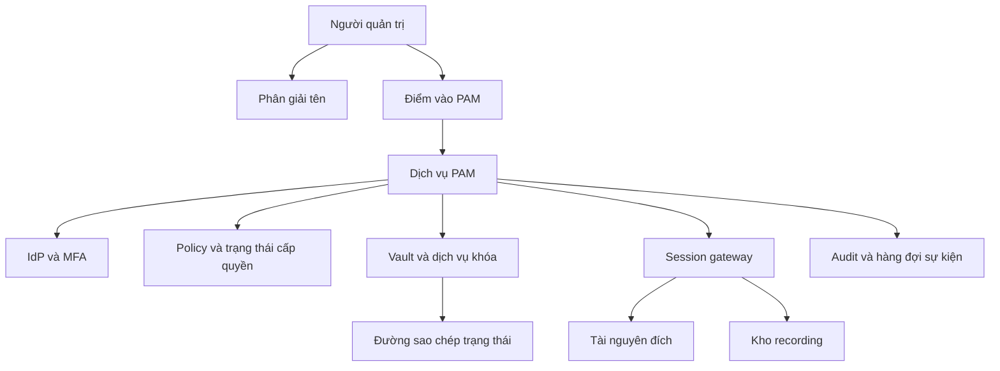
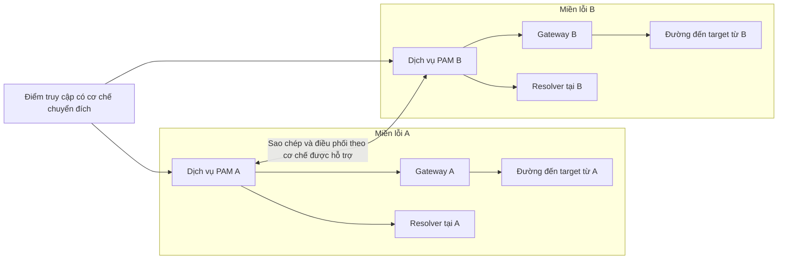

# Phụ thuộc mạng trong kiến trúc PAM có tính sẵn sàng cao

## 1. Vì sao nhiều node PAM vẫn có thể cùng ngừng phục vụ?

Một hệ thống Privileged Access Management (PAM) có thể có nhiều máy chủ ứng dụng, nhiều session gateway và một vault được sao chép dữ liệu, nhưng vẫn không mở được phiên quản trị nào khi một dịch vụ DNS dùng chung gặp lỗi. Tương tự, cả hai site có thể còn đủ tài nguyên nhưng người dùng không đăng nhập được vì đường đến nhà cung cấp danh tính bị gián đoạn.

**Network dependency** là sự phụ thuộc của một chức năng vào khả năng trao đổi qua mạng với những thành phần khác. Trong PAM, điều cần bảo đảm không chỉ là cổng giao diện còn truy cập được. Một yêu cầu hợp lệ còn phải đi qua xác thực, phê duyệt, kiểm tra quyền, lấy credential, kết nối đến tài nguyên đích và ghi bằng chứng theo chính sách.

Vì vậy, câu hỏi thiết kế không dừng ở “có bao nhiêu node?”. Cần hỏi:

- Một thao tác PAM phải gọi những thành phần nào để hoàn tất?
- Những lời gọi nào bắt buộc thành công ngay, những lời gọi nào có thể trì hoãn?
- Hai đường được gọi là dự phòng có thực sự thuộc các miền lỗi khác nhau không?
- Khi mạng chỉ hỏng một phần, hệ thống còn giữ được least privilege, giới hạn JIT/JEA, bảo mật credential và khả năng kiểm toán không?

Mục tiêu của bài là giúp bạn lập bản đồ phụ thuộc mạng, phát hiện điểm lỗi chung, thiết kế hành vi khi kết nối suy giảm và xây dựng bằng chứng kiểm thử HA cho PAM. Các ngưỡng thời gian, sơ đồ và số liệu dưới đây là ví dụ thiết kế; phải điều chỉnh theo hệ thống, chính sách và mục tiêu dịch vụ thực tế.

## 2. Xác định đơn vị cần bảo vệ: hành trình nghiệp vụ

### 2.1. Đừng dùng một trạng thái “PAM healthy” cho mọi chức năng

PAM cung cấp nhiều hành trình với đồ thị phụ thuộc khác nhau:

| Hành trình | Một số phụ thuộc có thể có | Kết quả cần xác minh |
|---|---|---|
| Đăng nhập cổng PAM | DNS, cân bằng tải, IdP, MFA, PKI | Người dùng được xác thực đúng mức |
| Cấp quyền JIT | Dịch vụ policy, kho trạng thái quyền, approval, API tài nguyên | Quyền đúng phạm vi, đúng thời hạn, có thể thu hồi |
| Mở phiên được quản lý | Vault, gateway, mạng đến target, recording | Phiên đến đúng target, có kiểm soát và bằng chứng |
| Luân chuyển credential | Scheduler, vault, connector, target | Target và vault đạt trạng thái nhất quán đã xác nhận |
| Thu hồi khẩn cấp | Kho trạng thái quyền, gateway, API target | Quyền hoặc phiên bị chặn theo mục tiêu ứng phó |
| Truy xuất bằng chứng | Kho ghi hình, index, khóa giải mã, dịch vụ audit | Bằng chứng truy xuất được và kiểm tra được tính toàn vẹn |

Một lần đăng nhập thành công không chứng minh credential rotation đang hoạt động. Một phiên cũ còn chạy không chứng minh hệ thống có thể thu hồi quyền mới cấp. Ngược lại, lỗi kết nối đến một target đơn lẻ không có nghĩa toàn bộ PAM đã mất sẵn sàng.

### 2.2. Phân biệt ba luồng

Để lập bản đồ, có thể tách ba nhóm luồng:

1. **Luồng điều khiển:** đăng nhập, phê duyệt, quyết định policy, cấp và thu hồi quyền, điều phối phiên.
2. **Luồng truy cập:** giao thức phiên từ người dùng qua gateway đến target, hoặc từ connector đến API đích.
3. **Luồng trạng thái và bằng chứng:** sao chép vault, lưu trạng thái lease, ghi hình, audit, chuyển log và truy xuất dữ liệu.

Ba nhóm có thể dùng chung hạ tầng mạng, nhưng có yêu cầu khác nhau. Luồng phiên thường nhạy với gián đoạn kết nối và thông lượng. Quyết định cấp quyền nhạy với độ mới của trạng thái và danh tính. Sao chép trạng thái nhạy với độ trễ, thứ tự và cơ chế nhất quán của sản phẩm.

Việc phân nhóm giúp lựa chọn hành vi suy giảm cụ thể. Nó không cho phép tự ý bỏ luồng bằng chứng hoặc mở quyền khi luồng điều khiển gặp lỗi.

## 3. Lập đồ thị phụ thuộc từ đầu đến cuối

### 3.1. Một sơ đồ khởi đầu



Đây là đồ thị logic, không phải sơ đồ triển khai bắt buộc. Một sản phẩm có thể gộp nhiều vai trò hoặc dùng đường gọi khác. DNS, dịch vụ thời gian, PKI, định tuyến và firewall có thể hỗ trợ nhiều cạnh trong đồ thị, nên không thể hiện đầy đủ chỉ bằng một mũi tên từ người dùng đến DNS.

Điểm cần ghi trên từng cạnh là **chức năng, chiều gọi, định danh đích, điều kiện bảo mật và hành vi khi lỗi**. Chỉ ghi “node A gọi node B” chưa đủ để vận hành.

### 3.2. Phiếu phụ thuộc cho từng cạnh

Một bản kiểm kê có thể dùng mẫu sau:

| Trường | Ví dụ cho gateway gọi vault |
|---|---|
| Chức năng | Lấy credential cho một phiên đã được cho phép |
| Nguồn | Gateway thuộc vùng quản trị A |
| Đích logic | Tên dịch vụ vault nội bộ |
| Đích thực | Các endpoint được phê duyệt, thuộc miền lỗi xác định |
| Giao thức | Kết nối được bảo vệ theo cấu hình của sản phẩm |
| Xác thực | Danh tính workload của gateway, policy của vault |
| Tuyến và trung gian | Route, firewall, NAT hoặc proxy nếu có |
| Phụ thuộc bắc cầu | Resolver, PKI, dịch vụ khóa, trạng thái vault |
| Hạn thời gian | Deadline của lời gọi nằm trong ngân sách mở phiên |
| Hành vi lỗi | Từ chối mở phiên mới nếu không lấy được credential hợp lệ |
| Điều kiện retry | Chỉ retry theo loại thao tác và giới hạn đã định |
| Bằng chứng | Request ID, loại lỗi, thời điểm, endpoint đã thử |
| Chủ sở hữu | Đội PAM cùng đội phụ trách tuyến mạng liên quan |

Không đưa mật khẩu, token hoặc nội dung credential vào phiếu. Với dữ liệu mạng nhạy cảm, lưu bản kiểm kê ở nơi có quyền truy cập phù hợp.

### 3.3. Tìm phụ thuộc bắc cầu và điểm cắt

Giả sử có hai vault endpoint, mỗi endpoint ở một site. Cả hai vẫn có thể phụ thuộc vào cùng một dịch vụ khóa, cùng firewall trung tâm hoặc cùng resolver. Thêm một endpoint không loại bỏ được các điểm lỗi đó.

Một **điểm cắt** là thành phần hoặc tập thành phần mà khi mất đi sẽ làm đứt mọi đường phục vụ một hành trình. Khi review, thử đặt câu hỏi: “Nếu loại bỏ thành phần này, còn đường nào đủ điều kiện bảo mật để hoàn thành yêu cầu không?”.

Không phải mọi điểm dùng chung đều phải nhân đôi bằng mọi giá. Có thể chấp nhận một phụ thuộc nếu rủi ro, thời gian phục hồi, cơ chế suy giảm và trách nhiệm vận hành đã được xác định. Điều nguy hiểm là một phụ thuộc chưa được nhận diện nhưng lại bị bỏ qua khi tuyên bố đạt HA.

## 4. Những nhóm phụ thuộc mạng thường bị bỏ sót

### 4.1. DNS và cơ chế khám phá dịch vụ

DNS lỗi có thể ngăn tạo kết nối mới dù endpoint đích còn hoạt động. Cần kiểm tra resolver mà từng node thực sự dùng, tuyến đến resolver, quy trình cập nhật bản ghi và hành vi cache của ứng dụng.

Các điểm cần làm rõ:

- Hai địa chỉ resolver có nằm sau cùng một điểm mạng hoặc cùng nền tảng quản trị không?
- Ứng dụng có giữ kết nối lâu dài hoặc giữ kết quả phân giải lâu hơn mong đợi không?
- Khi đổi bản ghi để chuyển site, client có phân giải lại và kết nối đến đích mới không?
- Các lớp client, proxy và gateway có cách xử lý lỗi phân giải giống nhau không?
- Chuyển đích có tiếp tục thỏa mãn kiểm tra chứng thư, tên dịch vụ và danh tính workload không?

TTL không phải cam kết rằng mọi client sẽ chuyển trong đúng khoảng thời gian đó. Kết nối đang mở có thể không dùng lại DNS, và hành vi cache còn phụ thuộc các lớp thực thi. Nhiều bản ghi địa chỉ cũng không tự tạo cơ chế kiểm tra sức khỏe nghiệp vụ hoặc đảm bảo failover.

Không dùng địa chỉ IP cố định như một cách chữa chung nếu điều đó làm mất kiểm tra tên chứng thư hoặc bỏ qua cơ chế khám phá dịch vụ đã thiết kế. Endpoint dự phòng phải được chuẩn bị cùng cấu hình TLS và quyền truy cập tương ứng.

### 4.2. Định tuyến, firewall, NAT và các thiết bị trung gian

Một đường kết nối hoạt động ở site chính chưa chắc hoạt động khi dịch vụ chuyển sang site dự phòng. Các nguyên nhân thường gặp gồm:

- Firewall chỉ cho phép dải nguồn của site chính.
- NAT tạo địa chỉ nguồn khác, không được target hoặc vault cho phép.
- Tuyến đi và tuyến về không phù hợp với trạng thái của thiết bị kiểm soát kết nối.
- Tuyến dự phòng có MTU hoặc đặc điểm đường truyền khác, làm lỗi lộ ra với payload lớn.
- Thiết bị trung gian đóng phiên nhàn rỗi sớm hơn các thành phần PAM dự kiến.
- Hai đường mạng logic đi qua cùng một thiết bị, đường trục hoặc cấu hình quản trị.

Kiểm tra thành công một gói nhỏ hoặc một kết nối TCP không chứng minh toàn bộ phiên quản trị và recording sẽ ổn định. Phải thử cả thiết lập kết nối, truyền dữ liệu, duy trì phiên, đóng phiên và truy xuất bằng chứng.

### 4.3. Load balancer, proxy và điểm vào dịch vụ

Load balancer cần phân biệt node còn trả lời mạng với node đủ điều kiện nhận yêu cầu. Nếu node đang mất kết nối với vault hoặc không có trạng thái cấp quyền đủ mới, tiếp tục phân tải yêu cầu mở phiên đến node đó có thể tạo vòng lỗi.

Tuy nhiên, health check quá sâu cũng có thể gây lỗi dây chuyền: một dịch vụ audit tạm chậm làm mọi node cùng bị loại, dù thiết kế có hàng đợi cục bộ hợp lệ. Điều kiện nhận traffic phải gắn với loại yêu cầu, không chỉ tổng hợp mọi phụ thuộc thành một cờ.

Cần xác minh việc thoát tải trước bảo trì, hành vi với kết nối dài, cấu hình thời gian chờ, trạng thái phiên và giới hạn công suất của đường dự phòng. Cơ chế giữ phiên tại load balancer không thay thế cho thiết kế trạng thái hoặc phục hồi phiên của PAM.

### 4.4. IdP, MFA và dịch vụ thư mục

Một cụm PAM khỏe có thể không cấp được phiên mới nếu không thể xác minh danh tính hoặc hoàn tất yếu tố xác thực bắt buộc. Đường đến IdP, MFA hoặc dịch vụ thư mục phải được đánh giá từ tất cả site và tất cả thành phần có gọi chúng.

Phiên người dùng đã đăng nhập có thể có hành vi khác với đăng nhập mới. Điều đó phụ thuộc thời hạn token, nhu cầu xác thực lại, kiểm tra thu hồi và chính sách của hệ thống. Không được suy luận rằng token còn thời hạn luôn đủ để cấp thêm quyền đặc biệt.

Mất kết nối với IdP không phải căn cứ để tự tắt MFA. Nếu tổ chức có cơ chế break-glass, đó phải là một luồng được phê duyệt, phạm vi hẹp, được giám sát và hậu kiểm, với credential và bằng chứng được quản lý riêng.

### 4.5. Thời gian và hạ tầng chứng thư

Đồng bộ thời gian và PKI không phải chỉ là chi tiết cài đặt. Chúng có thể phụ thuộc vào mạng và ảnh hưởng đến xác thực, kiểm tra hiệu lực chứng thư, token, thời hạn JIT, thứ tự sự kiện và điều tra sự cố.

Phải kiểm kê nguồn thời gian của từng node, cảnh báo độ lệch và hành vi khi nguồn không truy cập được. Việc dịch vụ đồng bộ thời gian ngừng trả lời không nhất thiết gây lỗi ngay lập tức, nhưng đồng hồ có thể dần vượt giới hạn chấp nhận của các cơ chế xác thực.

Với PKI, kiểm tra chuỗi tin cậy, tên đích, phân phối chứng thư và các điểm kiểm tra trạng thái chứng thư nếu cấu hình có sử dụng. Cơ chế kiểm tra online hoặc dữ liệu cache, cùng hành vi khi không liên lạc được, phải được xác định rõ. Không tự vô hiệu hóa kiểm tra chứng thư để “đạt HA”.

### 4.6. Dịch vụ khóa, lưu trữ, recording và audit

Vault có dữ liệu nhưng không lấy được khóa giải mã vẫn có thể không phục vụ được. Kho recording hoạt động nhưng đường truy cập khóa hoặc index bị lỗi vẫn có thể khiến bằng chứng không truy xuất được.

Với audit hoặc recording, phân biệt:

- Ghi nhận sự kiện hoặc dữ liệu phiên tại nguồn.
- Lưu tạm bền vững tại nơi được phê duyệt.
- Chuyển tiếp đến kho trung tâm.
- Xác nhận dữ liệu đã được lưu.
- Truy vấn, giải mã và phát lại bằng chứng.

Chuyển tiếp audit chậm có thể được chấp nhận nếu nguồn lưu tạm đáp ứng chính sách. Điều đó khác với mất recording bắt buộc. Nếu hệ thống có vùng đệm, cần giới hạn dung lượng, bảo vệ dữ liệu, phát hiện đầy, xử lý ghi trùng và xác minh chuyển tiếp sau phục hồi.

## 5. Thiết kế dự phòng theo miền lỗi

### 5.1. Dự phòng chỉ có ý nghĩa khi lỗi đủ độc lập

Một miền lỗi có thể là máy chủ, rack, switch, cụm firewall, trung tâm dữ liệu, vùng hạ tầng, tuyến WAN, nền tảng DNS hoặc một thay đổi cấu hình dùng chung.

Hai kết nối khác tên có thể cùng bị cắt bởi một thay đổi ACL. Hai site có thể dùng chung một hệ thống định danh mà không có đường phục vụ khi liên kết giữa các site mất. Hai nhà cung cấp đường truyền vẫn có thể đi chung một đoạn tuyến vật lý.

Khi đánh giá tính độc lập, cần cả bằng chứng kiến trúc và thử nghiệm phù hợp. Không dùng tên thiết bị hoặc nhãn “dual” làm bằng chứng duy nhất.

### 5.2. Một ví dụ bố trí hai site



Sơ đồ chỉ cho thấy ý tưởng phân bố. Còn phải kiểm tra endpoint IdP, vault, dịch vụ khóa, recording và quyền mạng của từng site. Hai site cùng truy cập được target cũng chưa có nghĩa cả hai được phép đồng thời thay đổi credential.

Thiết kế dữ liệu và cơ chế điều phối phải theo khả năng được hỗ trợ của sản phẩm. Không tự thêm một witness rồi kết luận hệ thống đã chống split-brain; witness chỉ có tác dụng nếu tham gia đúng thuật toán và đáp ứng các điều kiện triển khai của cơ chế đó.

### 5.3. Đường dự phòng phải đủ công suất

Sau khi mất một site, site còn lại có thể phải nhận phiên mới, tải recording, công việc rotation và lưu lượng reconnect cùng lúc. Một đường dự phòng chỉ đủ cho heartbeat nhưng thiếu băng thông nghiệp vụ sẽ không đáp ứng mục tiêu HA.

Lập ngân sách cho tải bình thường, tải dồn sau lỗi và tải đồng bộ lại. Có thể cần hạn chế tốc độ mở phiên, phân bổ ưu tiên cho tác vụ thu hồi khẩn cấp hoặc giãn công việc nền. Những biện pháp đó phải giữ nguyên điều kiện cấp quyền và được kiểm thử trước.

## 6. Đọc đúng các con số sẵn sàng

### 6.1. Phụ thuộc nối tiếp làm giảm độ sẵn sàng của hành trình

Trong một mô hình đơn giản, nếu hành trình luôn cần ba dịch vụ độc lập cùng sẵn sàng, mỗi dịch vụ có độ sẵn sàng `99,9%`, thì:

```text
A_hành_trình = 0,999 × 0,999 × 0,999
             = 0,997002999
             ≈ 99,7003%
```

Đây là phép tính minh họa với các giả định mạnh: cùng cửa sổ đo, định nghĩa sẵn sàng phù hợp, mọi phụ thuộc đều bắt buộc cho mỗi yêu cầu và lỗi độc lập. Không lấy mọi thành phần trên sơ đồ rồi nhân cơ học. Cache, phiên tồn tại, hàng đợi hoặc phụ thuộc chỉ xuất hiện ở một số hành trình có thể làm mô hình khác đi.

### 6.2. Hai đường dự phòng không luôn tạo ra mức cải thiện lý tưởng

Với hai đường độc lập, mỗi đường có xác suất không phục vụ được là `0,001`, và chỉ cần một đường đủ dùng:

```text
A_lý_tưởng = 1 - (0,001 × 0,001)
           = 99,9999%
```

Con số đó không tính một firewall, cấu hình hay dịch vụ tên dùng chung. Nếu cả hai đường cùng phụ thuộc một thành phần không sẵn sàng, đường thứ hai không loại bỏ được phần lỗi chung ấy.

Mục đích của phép tính là thấy tác động của cấu trúc phụ thuộc. Cam kết SLO phải dựa trên hành trình thực tế và bằng chứng đo được, không chỉ trên xác suất danh nghĩa của từng node.

### 6.3. Độ trễ có thể là một dạng mất sẵn sàng

Đường mạng không cần đứt hoàn toàn mới gây sự cố. Kết nối chậm có thể giữ worker, connection pool và hàng đợi quá lâu, rồi làm cạn tài nguyên của cả cụm.

Vì thế, theo dõi ít nhất tỷ lệ thành công, độ trễ đuôi, số yêu cầu đang chờ, độ bão hòa pool và số lỗi theo phụ thuộc. Giá trị trung bình tốt có thể che các yêu cầu mở phiên bị chậm quá hạn.

## 7. Timeout, deadline, retry và giới hạn tải

### 7.1. Dùng ngân sách thời gian từ ngoài vào trong

Giả sử yêu cầu mở phiên phải trả kết quả trong khoảng thời gian đã định. Các bước xác thực, kiểm tra policy, lấy credential và kết nối target phải chia sẻ cùng ngân sách, kể cả thời gian xếp hàng và retry.

Ví dụ minh họa cho một phần của hành trình:

```text
Deadline yêu cầu: 8 giây
  Xếp hàng và kiểm tra đầu vào: ngân sách dự kiến 1 giây
  Đọc quyết định policy:       ngân sách dự kiến 2 giây
  Lấy credential:              ngân sách dự kiến 2 giây
  Kết nối target:              ngân sách dự kiến 3 giây
```

Đây không phải cấu hình khuyến nghị chung. Khi một bước dùng nhiều thời gian hơn dự kiến, các bước sau phải nhìn thấy thời gian còn lại. Không để mỗi tầng tự đợi 8 giây rồi lặp lại nhiều lần, khiến thời gian tổng vượt xa deadline.

Phân biệt timeout thiết lập kết nối, timeout của thao tác và thời gian nhàn rỗi của phiên. Một giới hạn phù hợp cho API ngắn không tự phù hợp với phiên quản trị kéo dài.

### 7.2. Retry phải hiểu loại thao tác

Retry có thể giúp vượt lỗi tạm thời, nhưng cũng có thể nhân tải vào thành phần đang yếu. Nếu ba tầng đều tự thử tối đa ba lần, một yêu cầu ngoài có thể tạo tới `3 × 3 × 3 = 27` lần thử ở tầng sâu trong trường hợp xấu nhất.

Với thao tác đọc, chỉ retry khi chính sách của API và loại lỗi cho phép. Dùng số lần hữu hạn, khoảng chờ có giãn cách và jitter, đồng thời không vượt deadline.

Với thao tác làm thay đổi trạng thái, mất phản hồi tạo ra một trạng thái quan trọng: **chưa biết kết quả**. Target có thể đã đổi mật khẩu dù connector chưa nhận được xác nhận. Gửi lại thao tác một cách mù quáng có thể làm trạng thái khó phục hồi hơn.

Cần cơ chế định danh thao tác, chống thực thi trùng hoặc đối soát kết quả tùy khả năng của hệ thống. Một mã request trong log không tự tạo tính idempotent; dịch vụ nhận phải thực sự hỗ trợ semantics tương ứng.

### 7.3. Cô lập lỗi của phụ thuộc

Các cơ chế hữu ích gồm:

- Giới hạn số yêu cầu đồng thời đến từng phụ thuộc để một target lỗi không chiếm hết tài nguyên.
- Giới hạn và giám sát hàng đợi thay vì để tăng không kiểm soát.
- Tạm ngừng gọi một endpoint đang lỗi theo cơ chế circuit breaker được thiết kế.
- Chuyển sang endpoint đã được xác thực là hợp lệ và đủ điều kiện phục vụ.
- Giới hạn tốc độ nối lại sau phục hồi để tránh dồn tải đồng thời.

Circuit breaker không phải một cơ chế bỏ qua kiểm tra quyền. Khi không xác minh được điều kiện bắt buộc, hệ thống phải trả trạng thái có lý do và giữ các ràng buộc bảo mật.

## 8. Mất kết nối một phần và bài toán trạng thái

### 8.1. Partition khác với node chết

Khi mạng giữa hai site bị chia cắt, cả hai bên có thể còn chạy và vẫn nhận được người dùng cục bộ. Mỗi bên nhìn thấy bên kia không phản hồi, nhưng không biết bên kia đã dừng hay chỉ mất kết nối.

Với PAM, nếu cả hai cùng được phép thực hiện thao tác không tương thích, hệ quả có thể là:

- Hai tiến trình rotation cùng thay credential của một tài khoản.
- Một site cấp quyền dựa trên trạng thái đã cũ trong khi site khác vừa thu hồi.
- Quyền độc quyền hoặc giới hạn số phiên không còn được thực thi thống nhất.
- Bằng chứng và trạng thái phiên không được đối soát đầy đủ.

Không giải quyết bằng cách mở cả hai phía và hy vọng dữ liệu sẽ tự khớp sau này. Phải xác định thao tác nào yêu cầu một bên có quyền quyết định, điều kiện trở thành bên đó và cách ngăn bên cũ tiếp tục ghi.

### 8.2. Quorum, fencing và giới hạn thực tế

Quorum có thể giúp một cơ chế phân tán xác định phía được phép tiếp tục quyết định. Fencing nhằm ngăn thành phần không còn quyền tiếp tục thực hiện thao tác có ảnh hưởng. Cả hai phải được thiết kế theo cơ chế cụ thể, không phải chỉ là nhãn trong sơ đồ.

Đối với credential rotation, một khóa điều phối ở tầng ứng dụng chỉ an toàn khi tiến trình mất khóa không thể tiếp tục tạo tác dụng ngoài ý muốn, hoặc có biện pháp kiểm soát và đối soát tương ứng. Target có thể không hiểu token fencing của PAM; phải đánh giá giới hạn đó thay vì giả định toàn bộ chuỗi đã được bảo vệ.

Trong một số tình huống, ngừng cấp quyền hoặc ngừng rotation ở phía thiếu trạng thái nhất quán là hành vi đúng. Hệ thống chưa đạt sẵn sàng cho thao tác ấy, nhưng tránh tạo quyền không kiểm soát hoặc làm hỏng credential.

### 8.3. Phiên đang chạy và yêu cầu mới cần chính sách khác nhau

Một gateway mất kết nối với control plane nhưng còn đường đến target có thể tiếp tục giữ kết nối phiên. Điều đó có được phép hay không phụ thuộc vào khả năng sản phẩm, dữ liệu policy còn hiệu lực và yêu cầu vận hành.

Cần định nghĩa rõ:

- Phiên có bắt buộc được giám sát liên tục không?
- Recording còn hoạt động và còn nơi lưu được bảo vệ không?
- Lease hoặc quyền JIT có thời hạn nào, được cưỡng chế ở đâu?
- Khi không nhận được lệnh thu hồi, thời gian rủi ro tối đa là bao lâu?
- Nếu mất điều kiện bắt buộc, phiên được kết thúc theo cách nào?

Không dùng việc một phiên cũ còn chạy để cho phép mở phiên mới từ policy cache không đủ độ mới. Ngược lại, cũng không mặc định mọi lỗi telemetry đều buộc đóng tất cả phiên nếu thiết kế đã có cơ chế lưu bằng chứng cục bộ được phê duyệt.

## 9. Thiết kế hành vi suy giảm theo từng lỗi

Ma trận dưới đây là một ví dụ để thảo luận thiết kế, không phải chính sách áp dụng chung:

| Sự cố | Yêu cầu mới | Phiên hoặc công việc đang chạy | Điều kiện phục hồi |
|---|---|---|---|
| Không phân giải được tên vault | Không mở phiên cần credential mới nếu không có đường hợp lệ | Có thể khác nhau tùy phụ thuộc còn lại của phiên | Khôi phục phân giải, xác minh endpoint và khả năng phục vụ |
| IdP/MFA không truy cập được | Không tự bỏ yếu tố xác thực bắt buộc | Áp dụng thời hạn và quy tắc xác thực lại đã định | Kiểm tra đăng nhập mới và các trường hợp hết hạn |
| Mất đường đến một target | Từ chối hoặc giới hạn ở target đó | Xác định phiên nào thực sự mất kết nối | Kiểm tra đường từ từng gateway được phép |
| Đường sao chép bị chia cắt | Chỉ phía đủ điều kiện nhận thao tác cần nhất quán | Rotation đang dở cần theo dõi trạng thái chưa biết kết quả | Xác minh quyền ghi, độ mới và đối soát trước mở lại |
| Kho recording trung tâm không nhận | Chỉ tiếp tục nếu cơ chế lưu tạm đáp ứng chính sách | Theo dõi độ bền và dung lượng vùng đệm | Đối soát chuyển tiếp và khả năng phát lại |
| Mất giám sát nhưng dịch vụ còn chạy | Tùy mức giám sát bắt buộc và kiểm soát thay thế | Ghi nhận khoảng thiếu quan sát, dùng kênh độc lập nếu có | Khôi phục tín hiệu và xác minh khoảng trống bằng chứng |
| Đường chính phục hồi sau failover | Chưa tự đưa toàn bộ tải trở lại | Giữ trạng thái đang ổn định, đồng bộ theo kế hoạch | Đạt điều kiện ổn định, dữ liệu và công suất trước failback |

Ma trận cần có chủ sở hữu quyết định, ngưỡng cảnh báo, cách kiểm chứng và quyền kích hoạt chế độ khẩn cấp. “Fail-open cho thuận tiện” không phải một hành vi HA mặc định phù hợp cho quyền đặc biệt.

## 10. Quan sát mạng từ góc nhìn nghiệp vụ

### 10.1. Kết hợp kiểm tra nông và kiểm tra sâu

Kiểm tra nông có thể trả lời node còn chạy hoặc cổng còn mở. Kiểm tra sâu trả lời node có đủ phụ thuộc để hoàn thành một hành trình cụ thể hay không.

Một tập kiểm tra có thể gồm:

- Từ từng site, phân giải tên qua resolver thực sự được cấu hình.
- Kiểm tra kết nối được bảo vệ và danh tính của endpoint dự kiến.
- Kiểm tra khả năng đọc trạng thái policy hoặc vault bằng quyền tối thiểu phù hợp.
- Thử hành trình tổng hợp vào một target thử nghiệm bằng tài khoản chuyên dụng.
- Xác minh sự kiện audit xuất hiện và recording thử nghiệm truy xuất được.

Probe phải có giới hạn tần suất, thông tin xác thực riêng, quyền tối thiểu và dữ liệu không nhạy cảm. Không dùng tài khoản quản trị thật hoặc tự tạo hàng loạt phiên sản xuất để chứng minh hệ thống khỏe.

Liveness của tiến trình và readiness nhận yêu cầu không nên dùng chung một tiêu chí thiếu phân biệt. Khởi động lại liên tục node chỉ vì một phụ thuộc bên ngoài đang lỗi có thể làm sự cố nặng hơn.

### 10.2. Chỉ số cần gắn với cạnh phụ thuộc

| Nhóm chỉ số | Câu hỏi vận hành |
|---|---|
| Thành công theo hành trình | Đăng nhập, mở phiên, rotation và thu hồi có hoàn tất không? |
| Độ trễ theo endpoint và site | Bước nào đang tiêu thụ deadline? |
| DNS và kết nối | Lỗi xảy ra trước hay sau thiết lập kết nối? |
| Kiểm tra TLS và danh tính | Đích có đúng danh tính và còn được tin cậy không? |
| Pool, hàng đợi, retry | Có đang cạn tài nguyên hoặc tự khuếch đại tải không? |
| Sao chép và quyền ghi | Site còn đủ điều kiện xử lý trạng thái hay không? |
| Recording và audit | Có backlog, dữ liệu mất hoặc vùng đệm gần đầy không? |
| Quyền JIT và thu hồi | Thời hạn có được cưỡng chế, lệnh thu hồi có đến đích không? |

Đặt định nghĩa SLI trước khi đo. Tỷ lệ thành công của yêu cầu hợp lệ không nên bị trộn với các lần từ chối đúng policy. Tuy nhiên, cũng không được loại những yêu cầu hợp lệ thất bại do IdP hoặc vault khỏi mẫu đo chỉ để làm đẹp con số.

### 10.3. Ghi nhận đủ để phân biệt nguyên nhân

Một sự kiện lỗi nên liên kết được request hoặc session, site, thành phần gọi, phụ thuộc logic, giai đoạn lỗi, thời gian đã dùng, lần thử và quyết định xử lý. Bảo vệ thông tin định danh và tránh ghi credential vào log.

Phân biệt các trạng thái như không phân giải được tên, kết nối bị từ chối, hết thời gian chờ, xác thực thất bại và thao tác chưa biết kết quả. Gom tất cả thành “network error” làm mất khả năng ra quyết định đúng, đặc biệt với rotation hoặc thu hồi.

## 11. Tình huống: ứng dụng còn khỏe nhưng không mở được phiên

### 11.1. Bối cảnh

Một tổ chức triển khai PAM ở hai site. Mỗi site có gateway và dịch vụ ứng dụng. Vault có cơ chế phục vụ dự phòng đã được cấu hình. Người dùng đăng nhập được, nhưng khi mở phiên đến các máy chủ đích thì yêu cầu chờ lâu rồi thất bại.

Dashboard ứng dụng vẫn xanh vì chỉ kiểm tra tiến trình và cổng. Cả hai site dùng hai resolver có địa chỉ khác nhau, nhưng lưu lượng đến chúng đều đi qua cùng một cụm firewall đang có thay đổi cấu hình. Kết nối hiện hữu đến vault còn hoạt động một thời gian, còn các kết nối mới cần phân giải tên thì thất bại.

### 11.2. Trình tự xác định nguyên nhân

1. Xác định hành trình lỗi là mở phiên mới; không coi đăng nhập thành công là bằng chứng vault còn truy cập được.
2. Theo request ID, thấy yêu cầu dừng trước khi kết nối endpoint vault.
3. Từ ngữ cảnh mạng của từng gateway, kiểm tra phân giải tên và so sánh với node giám sát.
4. Xác nhận hai địa chỉ resolver cùng chịu một miền lỗi của đường truy cập.
5. Đối chiếu thay đổi firewall và khôi phục theo quy trình đã được phê duyệt.
6. Sau khôi phục, thử mở phiên mới từ cả hai site và xác minh bằng chứng.

Nếu gateway chạy trong một môi trường mạng khác với máy quản trị, kiểm tra từ máy quản trị đơn thuần có thể cho kết quả gây hiểu nhầm. Vị trí thực hiện phép đo là một phần của bằng chứng.

### 11.3. Những điều cần sửa trong thiết kế

Thay vì chỉ thêm gateway, nhóm vận hành cần cập nhật đồ thị phụ thuộc, kiểm tra tính độc lập của đường đến resolver, bổ sung probe từ mỗi site và mở rộng tiêu chí readiness phù hợp. Health check không nên tạo tải DNS hoặc vault quá mức, nên cần thiết kế tần suất và giới hạn.

Thử nghiệm tiếp theo phải bao gồm mất từng resolver, mất đường chung, cache hết hạn và hành vi với kết nối mới. Thành công ngay sau một lần thử có thể chỉ phản ánh dữ liệu cache vẫn còn.

## 12. Tình huống: mất phản hồi trong lúc rotation

Một connector gửi yêu cầu đổi credential đến target. Target hoàn tất thay đổi, nhưng đường trả lời bị gián đoạn. Connector chỉ thấy timeout; vault vẫn giữ credential cũ vì chưa có xác nhận.

Ở thời điểm này, “retry trên site B” không phải lúc nào cũng là câu trả lời đúng. Nếu một tiến trình thứ hai tiếp tục thay đổi trong khi tiến trình thứ nhất vẫn hoạt động hoặc trạng thái chưa được xác định, có thể tạo nhiều lần thay đổi cạnh tranh.

Một quy trình phục hồi cần:

1. Ghi trạng thái thao tác chưa biết kết quả và giữ định danh tương quan.
2. Chặn tác vụ cạnh tranh trên cùng tài khoản theo cơ chế điều phối được hỗ trợ.
3. Xác minh tác dụng thực tế bằng phương thức an toàn, có giới hạn và được thiết kế trước.
4. Hoàn tất đồng bộ vault/target hoặc dùng quy trình phục hồi credential được kiểm soát.
5. Ghi đầy đủ kết quả đối soát và chỉ mở lại tác vụ khi đạt điều kiện.

Chi tiết phục hồi phụ thuộc API target và chức năng PAM. Không thử liên tiếp mọi mật khẩu dự đoán để suy ra kết quả; cách đó có thể gây khóa tài khoản, tạo log nhạy cảm hoặc làm tăng rủi ro.

Tình huống cho thấy HA của network path và tính đúng đắn của trạng thái phải được thiết kế cùng nhau. Có thêm đường đến target không tự giải quyết được một giao dịch đang dở.

## 13. Kế hoạch kiểm thử lỗi mạng

### 13.1. Thiết kế phép thử có thể kết luận

Mỗi phép thử cần có mục tiêu, phạm vi, người điều phối, điều kiện bắt đầu, cách tạo lỗi, tiêu chí dừng, cách phục hồi và bằng chứng cần thu. Với hệ thống sản xuất, chỉ thực hiện trong phạm vi đã được cho phép và có phương án phục hồi tương ứng.

Các lỗi nên mô phỏng không chỉ gồm ngắt hoàn toàn. Cần cân nhắc mất gói, tăng độ trễ, kết nối một chiều, lỗi chỉ với một loại lưu lượng và mất kết nối sau khi target đã thực hiện thao tác.

| Phép thử | Điều cần quan sát | Ví dụ tiêu chí đạt |
|---|---|---|
| Mất resolver đang dùng | Cache, thời gian chuyển, lỗi từ từng site | Kết nối mới xử lý theo mục tiêu; không bỏ kiểm tra danh tính |
| Mất tuyến từ site A đến target thử nghiệm | Gateway được chọn và ACL của site B | Chỉ target bị ảnh hưởng, đường hợp lệ còn phục vụ được |
| Tăng độ trễ đến vault | Deadline, pool, hàng đợi, retry | Thời gian hữu hạn, không làm cạn tài nguyên toàn cụm |
| Chia cắt liên kết giữa các site | Quyền quyết định và thao tác ghi | Không phát sinh hai tác vụ rotation cạnh tranh |
| Mất phản hồi sau đổi credential | Trạng thái chưa biết kết quả, đối soát | Không báo thành công giả, có quy trình phục hồi rõ |
| Mất kho recording trung tâm | Vùng đệm, dung lượng, policy phiên | Không mất bằng chứng bắt buộc; ngưỡng đầy được xử lý |
| Mất IdP hoặc MFA | Đăng nhập mới, xác thực lại, luồng khẩn cấp | Giữ đúng yêu cầu xác thực và ghi nhận quyết định |
| Khôi phục đường chính | Dồn reconnect, đồng bộ, failback | Không gây đợt quá tải hoặc đảo vai trò lặp lại |

### 13.2. Đo thời gian phục hồi đúng phạm vi

Thời gian chuyển endpoint không bằng thời gian phục hồi hành trình. Tổng thời gian có thể gồm phát hiện lỗi, ra quyết định, chuyển hướng, thiết lập kết nối, nạp trạng thái và hoàn thành yêu cầu đầu tiên.

RTO cần gắn với hành trình: mở phiên mới, thu hồi quyền hay rotation có thể có mục tiêu khác nhau. Với dữ liệu, xác định loại trạng thái và mức mất mát hoặc chậm đồng bộ chấp nhận được. “RPO bằng 0” cho toàn bộ PAM là một tuyên bố chưa đủ rõ nếu chưa nói đến grant, trạng thái rotation, recording và audit.

Ngoài thời gian phục hồi, phải kiểm tra tính đúng của trạng thái sau lỗi: không có quyền JIT quá hạn, không có credential lệch chưa xử lý, không thiếu bằng chứng bắt buộc và không có phiên bị bỏ quên ngoài giám sát.

### 13.3. Lưu bằng chứng có thể tái kiểm tra

Biên bản cần liên kết thời điểm tạo lỗi và phục hồi với chỉ số, request/session ID, hành vi thực tế và kết luận từng tiêu chí. Nếu có khoảng thiếu audit, phải chỉ rõ phạm vi và kết quả đối soát; không thay bằng nhận xét chung “failover thành công”.

Ghi cả các hành vi bị từ chối đúng thiết kế. Trong một partition, phía thiếu điều kiện nhất quán ngừng cấp quyền có thể là kết quả an toàn mong đợi, dù không phải thành công về sẵn sàng của yêu cầu đó.

## 14. Failback cũng là một lần thay đổi hệ thống

Khi mạng phục hồi, không mặc định chuyển tải ngay về site cũ. Trước failback cần xác minh:

- Endpoint và kết nối ổn định trong khoảng quan sát đã định.
- Trạng thái sao chép, quyền ghi và cơ chế điều phối đã trở lại hợp lệ.
- Các rotation chưa biết kết quả đã được đối soát hoặc tiếp tục bị cách ly.
- Recording và audit trong vùng đệm đã được chuyển tiếp, kiểm tra theo chính sách.
- Cấu hình route, ACL, DNS, TLS và công suất của site nhận tải đều đáp ứng.
- Có kế hoạch thoát tải và xử lý phiên tồn tại phù hợp với khả năng sản phẩm.

Có thể đưa tải trở lại theo từng phần, quan sát rồi tăng dần. Cần cơ chế tránh chuyển qua chuyển lại liên tục khi đường mạng chập chờn. Sau failback, thử lại hành trình nghiệp vụ và truy xuất bằng chứng của cả giai đoạn sự cố.

## 15. Bài thực hành thiết kế

### 15.1. Đề bài

Bạn có hai site A và B. Mỗi site có dịch vụ PAM và gateway. Các đặc điểm hiện tại:

- Mọi node dùng hai resolver đi qua cùng một firewall trung tâm.
- IdP nằm ở site A; site B truy cập IdP qua liên kết liên site.
- Vault có cơ chế dự phòng, nhưng đường đến dịch vụ khóa chưa được kiểm kê.
- Target chỉ cho phép địa chỉ nguồn NAT của gateway tại A.
- Recording có vùng đệm cục bộ, chưa có cảnh báo dung lượng và chưa thử chuyển tiếp sau lỗi.
- Rotation đang được thử lại khi timeout mà không phân biệt thao tác đã có tác dụng hay chưa.

Hãy lập đồ thị phụ thuộc cho mở phiên mới và rotation. Chỉ ra ít nhất bốn điểm có thể làm thất bại tuyên bố “mất một site vẫn truy cập được”. Sau đó chọn ba phép thử và xác định bằng chứng cần thu.

### 15.2. Gợi ý lời giải

Các điểm cần xử lý gồm đường DNS dùng chung, IdP phụ thuộc site A, dịch vụ khóa chưa được nhận diện, ACL target chưa cho phép đường từ B, recording chưa đủ điều kiện vận hành vùng đệm và retry rotation có nguy cơ tạo trạng thái không rõ.

Ba phép thử có giá trị:

1. **Mất site A:** từ B thử đăng nhập mới và mở phiên đến target thử nghiệm. Thu bằng chứng về IdP, phân giải tên, địa chỉ nguồn thực tế, kiểm tra TLS và quyết định policy. Nếu đăng nhập không hoàn tất thì ghi rõ điểm chặn; không coi gateway B còn chạy là đạt.
2. **Mất kho recording trung tâm:** thử một phiên được phê duyệt, quan sát lưu tạm, cảnh báo, điều kiện dừng nhận phiên và khả năng phát lại sau chuyển tiếp. Không kéo dài phép thử vượt giới hạn dung lượng đã xác định.
3. **Mất phản hồi rotation:** trong môi trường thử nghiệm, tạo tình huống target đã đổi nhưng connector không nhận xác nhận. Thu trạng thái thao tác, cơ chế ngăn tác vụ cạnh tranh, quá trình đối soát và kết quả khôi phục vault/target.

Thứ tự khắc phục nên dựa trên hành trình bắt buộc và mức rủi ro. Việc thêm một đường mạng không đủ nếu endpoint dự phòng chưa được cấp quyền, chưa có danh tính hợp lệ hoặc thiếu trạng thái cần thiết.

## 16. Câu hỏi tự kiểm tra

**1. Hai resolver có địa chỉ khác nhau đã đủ chứng minh DNS có HA chưa?**

Chưa. Cần kiểm tra đường mạng, nền tảng phục vụ, cấu hình, miền lỗi dùng chung và cách client thực sự chuyển đổi. Hai địa chỉ có thể cùng mất do một thay đổi firewall.

**2. Vì sao timeout khi đổi mật khẩu không đồng nghĩa thao tác thất bại?**

Vì target có thể đã thực hiện thay đổi trước khi phản hồi bị mất. Trạng thái đúng lúc đó là chưa biết kết quả; cần đối soát hoặc cơ chế chống lặp phù hợp trước khi thử lại.

**3. Có thể giữ phiên đang chạy khi control plane không truy cập được không?**

Chỉ khi khả năng sản phẩm và chính sách cho phép, đồng thời các điều kiện bắt buộc như thời hạn quyền, recording và kiểm soát phiên vẫn được đáp ứng. Phải xác định giới hạn rủi ro của việc không nhận được lệnh thu hồi.

**4. Probe mở được TCP đến gateway có đủ để kết luận mở phiên quản trị thành công không?**

Không. Hành trình còn có thể cần policy, vault, target, PKI và recording. Cần phép thử nghiệp vụ có quyền tối thiểu cùng chỉ số theo từng phụ thuộc.

**5. Vì sao không dùng retry không giới hạn để tăng sẵn sàng?**

Vì retry có thể giữ tài nguyên, khuếch đại tải, vượt deadline và làm lặp thao tác thay đổi trạng thái. Cần giới hạn, phân loại lỗi và xử lý riêng kết quả chưa biết.

**6. Khi mạng giữa hai site bị chia cắt, vì sao ngừng cấp quyền ở một phía có thể là kết quả đúng?**

Vì phía đó có thể không còn đủ trạng thái hoặc quyền quyết định để cấp quyền nhất quán. Tiếp tục ghi ở cả hai phía có thể tạo cấp quyền trái chính sách hoặc rotation cạnh tranh.

## 17. Những nguyên tắc cần mang vào thiết kế

HA của PAM phải được đánh giá trên toàn bộ hành trình quản trị đặc biệt. Danh sách node không thay thế cho bản đồ DNS, định danh, policy, vault, khóa, mạng đến target và bằng chứng.

Mỗi đường dự phòng phải có danh tính, quyền mạng, công suất và trạng thái phù hợp. Mỗi lỗi phải dẫn đến một hành vi đã định nghĩa: tiếp tục trong giới hạn được phê duyệt, trì hoãn có kiểm soát, từ chối hoặc chuyển sang quy trình khẩn cấp được quản lý.

Bằng chứng thuyết phục nhất là kiểm thử có tạo lỗi, có quan sát hành trình thực tế và có đối soát sau phục hồi. Thiết kế tốt bảo vệ được cả khả năng truy cập hợp lệ lẫn tính đúng đắn của quyền, credential và dữ liệu kiểm toán trong lúc mạng hoạt động không hoàn hảo.
