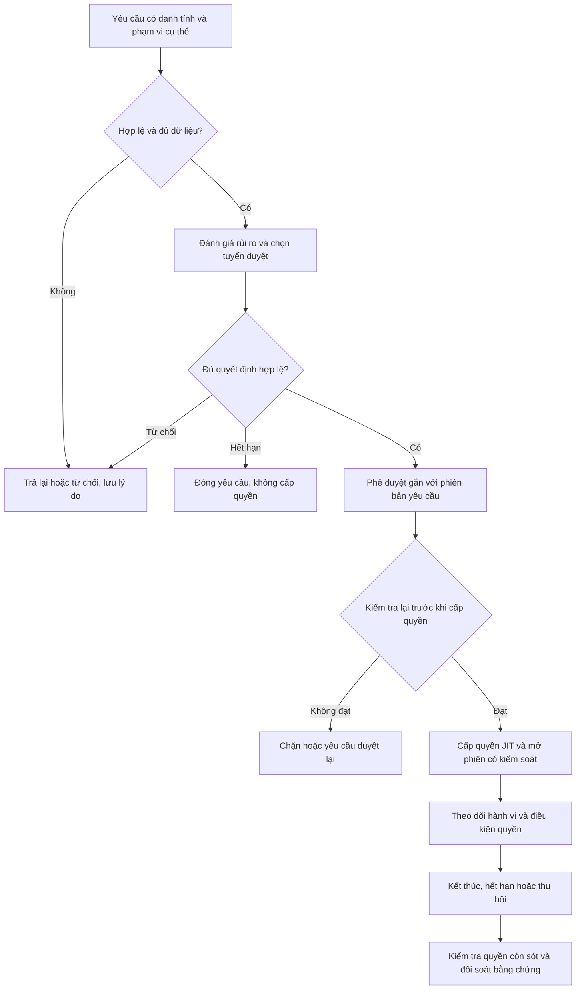

# Vendor approval — Phê duyệt truy cập đặc quyền cho nhà cung cấp

## 1. Phê duyệt vendor là phê duyệt điều gì?

Trong quản lý truy cập đặc quyền (Privileged Access Management — PAM), **vendor approval** là quyết định cho phép một cá nhân hoặc danh tính dịch vụ của nhà cung cấp thực hiện một công việc cụ thể, trên những tài nguyên cụ thể, bằng một tập quyền cụ thể, trong khoảng thời gian có giới hạn. Quyết định phải gắn được với danh tính người chịu trách nhiệm, điều kiện sử dụng và bằng chứng thực thi.

“Công ty này đã ký hợp đồng” không trả lời được câu hỏi “kỹ sư này có được dùng quyền quản trị trên máy chủ này vào tối nay hay không?”. Hợp đồng, đánh giá nhà cung cấp và quy trình onboarding tạo tiền đề cho quan hệ hợp tác; chúng không tự tạo quyền truy cập từng lần. Tương tự, việc vendor đăng nhập thành công chỉ chứng minh một phần về danh tính, không đồng nghĩa đã được phép thực hiện thao tác đặc quyền.

Ví dụ, nhà cung cấp được thuê để hỗ trợ ứng dụng thanh toán. Một kỹ sư cần khởi động lại một dịch vụ trên hai máy chủ ứng dụng trong cửa sổ bảo trì. Phê duyệt hợp lệ cần chỉ rõ hai máy chủ, hành động được phép, cơ chế truy cập, thời gian và người giám sát. Một thông báo “đồng ý cho vendor vào hệ thống” bỏ ngỏ quá nhiều quyền: kỹ sư có được đọc cơ sở dữ liệu, đổi cấu hình mạng, tạo tài khoản mới hoặc lấy credential để dùng ngoài PAM hay không?

Vendor approval trong bài này được đặt trong vòng đời PAM: kiểm kê quyền, least privilege, Just-in-Time (JIT), Just Enough Administration (JEA), vault, luân chuyển credential, giám sát phiên và lưu bằng chứng. Mục tiêu là tạo một quyết định có thể thi hành và kiểm chứng, không chỉ có chữ ký trên ticket.

Sau bài học, người học cần có khả năng:

- Phân biệt phê duyệt quan hệ nhà cung cấp, cấp danh tính, cấp kết nối và cấp đặc quyền.
- Soạn yêu cầu truy cập đủ để người có thẩm quyền quyết định.
- Thiết kế tuyến duyệt theo rủi ro, tách nhiệm vụ và ngăn tự phê duyệt.
- Ràng buộc quyết định với đúng phiên bản yêu cầu, cửa sổ thời gian và phạm vi quyền.
- Xử lý từ chối, thay đổi yêu cầu, hết hạn, thu hồi và tình huống khẩn cấp.
- Đối soát từ ticket đến phiên thực tế, quyền còn tồn tại và bằng chứng thu hồi.

## 2. Bốn lớp cho phép cần phân biệt

| Lớp quyết định | Câu hỏi chính | Ví dụ kết quả | Không được suy diễn thành |
| --- | --- | --- | --- |
| Chấp thuận nhà cung cấp | Tổ chức này có đủ điều kiện cung cấp dịch vụ không? | Hợp đồng còn hiệu lực, có đầu mối và điều kiện bảo mật | Mọi nhân viên vendor đều được truy cập |
| Chấp thuận danh tính | Cá nhân hoặc workload này có đúng chủ thể, còn nhiệm vụ và có người bảo trợ không? | Danh tính định danh riêng, thuộc vendor, có ngày hết hạn | Có thể sử dụng mọi tài khoản quản trị |
| Chấp thuận đường truy cập | Chủ thể được kết nối qua đâu, từ thiết bị hoặc môi trường nào? | Qua cổng truy cập được quản lý, có xác thực và kiểm tra thiết bị | Có quyền quản trị trên toàn mạng đích |
| Chấp thuận đặc quyền cho công việc | Ai được làm gì, trên đâu, khi nào, với điều kiện nào? | Quyền JIT để kiểm tra và khởi động lại dịch vụ trên hai máy chủ | Có quyền lấy secret, tạo backdoor hoặc làm việc khác |

Một nhà cung cấp có thể được chấp thuận ở lớp thứ nhất nhưng một kỹ sư của họ vẫn bị từ chối ở lớp thứ tư. Một tài khoản vendor đã tồn tại cũng không phải lý do bỏ qua phê duyệt công việc mới.

Đối với tài khoản dịch vụ hoặc tác vụ tự động do vendor vận hành, không nên giả lập danh tính người để né quy trình. Yêu cầu phải xác định workload, chủ sở hữu nội bộ, người đại diện vendor, mục đích, phương thức xác thực và phạm vi thực thi. Chính sách cấp quyền tự động có thể được phê duyệt trước cho một công việc lặp lại có biên rõ ràng; mỗi lần thực thi vẫn phải đáp ứng điều kiện của chính sách và có dấu vết.

## 3. Mô hình một yêu cầu có thể phê duyệt

Một yêu cầu tốt mô tả cả nhu cầu nghiệp vụ lẫn quyền hiệu lực. Tên gói quyền “Vendor Support” quá chung chung nếu người duyệt không thấy nó cho phép thực sự những gì.

Có thể biểu diễn phạm vi cần duyệt bằng bộ thông tin:

```text
Chủ thể + Tổ chức vendor + Công việc + Tài nguyên + Hành động
+ Danh tính đặc quyền + Đường truy cập + Khoảng thời gian
+ Điều kiện thực thi + Người chịu trách nhiệm + Phiên bản yêu cầu
```

### 3.1. Danh tính và trách nhiệm

Yêu cầu cần có mã vendor, danh tính định danh riêng của người thực hiện, đầu mối vendor và người bảo trợ nội bộ. Không dùng một địa chỉ email nhóm làm danh tính duy nhất cho nhiều kỹ sư. Một phiên phải truy được về người hoặc workload đã xác thực, kể cả khi tài khoản trên hệ thống đích là tài khoản dùng chung được PAM môi giới.

Người bảo trợ nội bộ xác nhận vendor còn nhiệm vụ và có nhu cầu hợp lệ. Chủ tài nguyên xác nhận mức quyền phù hợp với tài sản mình chịu trách nhiệm. Hai trách nhiệm có thể thuộc cùng người nếu chính sách cho phép, nhưng cần đánh giá xung đột lợi ích và mức rủi ro thay vì mặc định mọi yêu cầu đều giống nhau.

Thông tin định danh cần tối thiểu đủ để phân biệt chủ thể, đối chiếu tổ chức và liên hệ khi xảy ra sự cố. Không đưa mật khẩu, khóa riêng hoặc dữ liệu cá nhân không cần thiết vào mô tả yêu cầu.

### 3.2. Công việc và phạm vi quyền

Các trường quan trọng gồm:

- Mã ticket hoặc thay đổi, lý do nghiệp vụ và kết quả mong đợi.
- Mã tài nguyên ổn định, môi trường và mức độ nhạy cảm.
- Các hành động được phép, các hành động loại trừ và cơ chế cưỡng chế.
- Tài khoản hoặc vai trò hiệu lực trên đích; quyền của chính tài khoản đó.
- Có được xem hoặc xuất credential hay chỉ được sử dụng qua phiên môi giới.
- Có được truyền tệp, dùng clipboard, chuyển cổng, tải dữ liệu hoặc chạy công cụ bên ngoài không.
- Kế hoạch xác minh kết quả, đầu mối giám sát và điều kiện dừng công việc.

Nếu chọn tài khoản `root` hoặc quản trị viên toàn hệ thống cho công việc chỉ cần khởi động lại một dịch vụ, người duyệt phải nhìn thấy độ lệch đó. Một dòng mô tả “chỉ restart service” không làm tài khoản toàn quyền trở thành least privilege. Cần chuyển sang cơ chế giới hạn quyền phù hợp, hoặc xử lý phần quyền dư theo tuyến phê duyệt ngoại lệ.

Phạm vi tài nguyên cũng phải có ý nghĩa tại thời điểm cấp quyền. Nhóm động “tất cả máy chủ ứng dụng” có thể thay đổi sau khi duyệt. Chính sách cần quy định duyệt một tập tài nguyên đã chốt hay một nhóm động có tiêu chí được kiểm soát. Không để một thay đổi thành viên nhóm âm thầm biến quyền trên hai máy thành quyền trên cả cụm.

### 3.3. Thời gian và điều kiện

Phân biệt rõ các mốc sau:

| Mốc | Ý nghĩa | Ví dụ |
| --- | --- | --- |
| Hạn quyết định | Yêu cầu chưa được duyệt đến mốc này phải hết hiệu lực | Hết ca chuẩn bị bảo trì |
| Cửa sổ được bắt đầu truy cập | Khi nào được mở phiên hoặc kích hoạt quyền | 22:00–22:45, có múi giờ |
| Hạn quyền hiệu lực | Thời điểm quyền phải kết thúc | 23:00, kể cả phiên bắt đầu muộn |
| Thời lượng tối đa của phiên | Giới hạn một phiên kể từ khi bắt đầu | Tối đa 45 phút |
| Hạn credential hoặc token | Tuổi thọ của vật mang quyền | Có thể ngắn hơn cửa sổ công việc |
| Hạn quan hệ vendor và danh tính | Điều kiện nền để còn được tham gia | Hợp đồng hoặc nhiệm vụ kết thúc |

Không nên dùng một trường “duration = 1 giờ” để thay thế tất cả các mốc này. Nếu phiên bắt đầu lúc 22:50 nhưng quyền hết hạn lúc 23:00, thời lượng tối đa 45 phút không tự cho phép phiên kéo dài đến 23:35.

Việc tạm mất kết nối, kết nối lại hoặc chuyển sang máy chủ thứ hai có tiêu thụ một lượt cấp quyền mới hay không cũng cần được quy định. Phê duyệt một lần dùng và phê duyệt cho nhiều phiên trong cùng cửa sổ là hai chính sách khác nhau; người duyệt phải biết mình đang chấp thuận chính sách nào.

## 4. Ai duyệt và duyệt trên căn cứ nào?

### 4.1. Vai trò tối thiểu

| Vai trò | Trách nhiệm | Giới hạn cần giữ |
| --- | --- | --- |
| Người yêu cầu/vendor | Nêu công việc, chủ thể và nhu cầu quyền | Không tự duyệt yêu cầu của mình |
| Người bảo trợ nội bộ | Xác nhận nhiệm vụ, quan hệ và đầu mối chịu trách nhiệm | Không thay thế đánh giá quyền của chủ tài nguyên khi không có thẩm quyền |
| Chủ tài nguyên hoặc người được ủy quyền | Chấp thuận mục đích và phạm vi trên tài nguyên | Chỉ quyết định trong miền được giao |
| Người duyệt bảo mật khi chính sách yêu cầu | Đánh giá ngoại lệ hoặc rủi ro cần kiểm soát bổ sung | Không hợp thức hóa quyền vượt thẩm quyền nghiệp vụ |
| Hệ thống PAM và bộ thực thi | Kiểm tra điều kiện, cấp và thu hồi quyền, ghi sự kiện | Không coi ticket “Approved” là đủ để bỏ qua điều kiện |
| Người giám sát hoặc ứng phó sự cố | Theo dõi, yêu cầu dừng và xử lý bất thường | Hành động can thiệp cũng cần được ghi nhận |

Không phải mọi yêu cầu đều cần tất cả vai trò ký từng lần. Tuyến duyệt nên phản ánh rủi ro và khả năng kiểm soát, đồng thời tránh tình trạng quá nhiều bước hình thức khiến người dùng tìm đường vòng.

### 4.2. Tách nhiệm vụ và duyệt độc lập

Tách nhiệm vụ (segregation of duties — SoD) phải dựa trên danh tính thực, không chỉ tên tài khoản. Một người có hai tài khoản vẫn là một người; họ không được vừa yêu cầu vừa tạo “phê duyệt độc lập” bằng tài khoản còn lại.

Với truy cập rủi ro cao, có thể yêu cầu hai quyết định độc lập, chẳng hạn chủ dịch vụ và người duyệt bảo mật. “Hai người cùng thuộc một nhóm có quyền bấm duyệt” chưa chắc bảo đảm hai trách nhiệm độc lập đã được đáp ứng. Hệ thống cần kiểm tra loại vai trò, miền tài nguyên và xung đột cụ thể.

Ủy quyền duyệt phải có phạm vi, thời hạn và dấu vết. Nếu chủ tài nguyên nghỉ phép, một người bất kỳ không được trở thành approver chỉ vì họ trả lời email nhanh. Người được ủy quyền cũng phải đáp ứng quy tắc tách nhiệm vụ của yêu cầu đang xét.

Việc thay đổi chính sách cấp quyền thường có phạm vi rộng hơn một yêu cầu riêng lẻ. Cần tách quyền sửa chính sách khỏi quyền tự duyệt truy cập và lưu dấu thay đổi, để người quản trị quy trình không âm thầm sửa tuyến duyệt rồi cấp quyền cho chính mình.

### 4.3. Phân tuyến theo rủi ro

Bảng sau là ví dụ thiết kế, không phải công thức bắt buộc cho mọi tổ chức:

| Tình huống | Tuyến duyệt gợi ý | Điều kiện thực thi |
| --- | --- | --- |
| Đọc trạng thái trong môi trường thử nghiệm, không có dữ liệu nhạy cảm | Theo chính sách được chủ tài nguyên phê duyệt trước, nếu đủ điều kiện | Vai trò chỉ đọc, cửa sổ ngắn, danh tính còn hiệu lực |
| Khởi động lại dịch vụ production theo kế hoạch | Chủ dịch vụ hoặc người được ủy quyền | Ticket thay đổi, JIT/JEA, kiểm tra trước phiên, lưu bằng chứng |
| Quyền quản trị rộng hoặc cần truy cập dữ liệu nhạy cảm | Chủ tài nguyên và tuyến bảo mật theo chính sách | Lý do quyền dư, giới hạn thời gian, kiểm soát dữ liệu và giám sát tăng cường |
| Tác vụ khẩn cấp ngoài cửa sổ thông thường | Tuyến emergency được định nghĩa trước | Kích hoạt có lý do, cảnh báo, thời hạn chặt, rà soát sau sự kiện |

Phê duyệt tự động chỉ phù hợp khi chính sách có biên rõ ràng: loại chủ thể, tập tài nguyên, hành động, thời gian, điều kiện từ chối và người sở hữu chính sách. Một chính sách “mọi kỹ sư thuộc vendor A đều được admin production” là một quyền thường trực rộng, dù giao diện gọi nó là auto-approval.

Nếu dữ liệu cần để đánh giá điều kiện bị thiếu, ví dụ không kiểm tra được trạng thái danh tính, không nên diễn giải “không có kết quả” thành “đã đáp ứng”. Cách xử lý mặc định và ngoại lệ phải được quy định rõ.

## 5. Từ yêu cầu đến phiên làm việc



### 5.1. Tiếp nhận và kiểm tra

Hệ thống kiểm tra danh tính còn hoạt động, vendor còn quan hệ hợp lệ, ticket tồn tại, tài nguyên có chủ sở hữu, quyền yêu cầu thuộc catalog và thời gian có thể áp dụng. Yêu cầu chưa đủ dữ liệu được trả lại với trường cần bổ sung; không nên “duyệt trước rồi hoàn thiện sau”.

Danh sách approver cần được xác định từ nguồn thẩm quyền được quản lý. Không lấy người duyệt chỉ từ một ô văn bản mà người yêu cầu tự nhập.

### 5.2. Ra quyết định có ngữ cảnh

Người duyệt cần thấy nội dung yêu cầu, quyền hiệu lực, chênh lệch với nhu cầu, lịch sử liên quan và các điều kiện bổ sung. Lý do duyệt không cần dài, nhưng phải đủ liên hệ với công việc và rủi ro. “OK” lặp lại ở mọi ticket ít giúp cho điều tra vì không thể hiện người duyệt đã chấp thuận điều gì.

Nếu điều kiện phê duyệt là “chỉ hai máy chủ, không truyền tệp”, điều kiện đó phải trở thành phần của phạm vi có thể thực thi. Không để điều kiện nằm trong bình luận trong khi gói quyền vẫn cho phép truyền tệp trên mọi máy.

Từ chối cũng là kết quả hợp lệ. Lý do nên chỉ ra vấn đề: sai chủ thể, quyền quá rộng, ngoài thời gian cho phép, thiếu chủ tài nguyên hoặc không bảo đảm bằng chứng. Không tự chuyển một yêu cầu bị từ chối sang approver khác để tìm người dễ đồng ý hơn.

### 5.3. Kiểm tra ngay trước khi sử dụng

Khoảng trống giữa lúc duyệt và lúc mở phiên tạo rủi ro thay đổi điều kiện. Trước khi cấp quyền cần kiểm tra lại ít nhất:

- Chủ thể được xác thực đúng người hoặc workload đã được duyệt.
- Danh tính, quan hệ vendor và người bảo trợ vẫn hợp lệ.
- Yêu cầu không bị sửa, hủy, hết hạn hoặc thu hồi.
- Quyết định duyệt còn hiệu lực, đủ đúng vai trò theo chính sách.
- Tài nguyên, vai trò hiệu lực, đường truy cập và điều kiện không vượt phạm vi.
- Thời gian hiện tại nằm trong cửa sổ, đồng hồ của các thành phần đủ tin cậy.
- Các kiểm soát bắt buộc cho lần truy cập này đã sẵn sàng.

Ví dụ, vendor được duyệt lúc 17:00 nhưng kỹ sư bị offboard lúc 18:00. Một ticket vẫn mang nhãn “Approved” không được cho phép kỹ sư mở phiên lúc 22:00.

Trong yêu cầu rủi ro cao, chính sách có thể yêu cầu xác thực tăng cường gần thời điểm cấp quyền. Một phiên đăng nhập đã tồn tại từ buổi sáng không tự thay thế yêu cầu này.

## 6. Ràng buộc phê duyệt với đúng phiên bản yêu cầu

Một lỗi phổ biến là lưu quyết định duyệt ở mức ticket, trong khi nội dung ticket vẫn sửa được. Người yêu cầu xin quyền đọc trên một máy, được duyệt, rồi đổi sang quyền quản trị trên cả nhóm máy. Nếu quyết định không gắn với phiên bản, hệ thống có thể cấp phạm vi chưa ai xem xét.

Các thay đổi sau thường cần làm mất hiệu lực quyết định cũ hoặc tạo yêu cầu duyệt mới:

- Đổi người thực hiện hoặc danh tính dịch vụ.
- Thêm tài nguyên, đổi môi trường hoặc đổi nhóm tài nguyên theo cách mở rộng quyền.
- Đổi vai trò, tài khoản đích, hành động hoặc phương thức lấy credential.
- Nới cửa sổ thời gian, thời lượng hoặc số lượt sử dụng.
- Bật truyền tệp, xuất dữ liệu, clipboard hoặc đường kết nối bổ sung.
- Bỏ điều kiện giám sát, ghi bằng chứng hoặc phê duyệt thứ hai.

Một sửa lỗi chính tả trong mô tả có thể không cần duyệt lại nếu hệ thống phân biệt được trường không ảnh hưởng quyền và vẫn lưu lịch sử. Quy tắc này cần được định nghĩa; không để người yêu cầu tự tuyên bố thay đổi là “không đáng kể”.

Một thiết kế có thể dùng `request_id`, `request_version`, `scope_digest` và `policy_version` để liên kết quyết định. `scope_digest` là dấu vân tay của các trường ảnh hưởng quyền được chuẩn hóa, không phải bằng chứng thay thế danh tính người duyệt. Nếu sử dụng, phải định nghĩa chính xác trường tham gia, cách chuẩn hóa và cách bảo vệ tính toàn vẹn bản ghi.

```text
Một quyết định chỉ được sử dụng nếu:

decision.request_id      = request.id
decision.request_version = request.version
decision.scope_digest    = digest(request.effective_scope)
decision chưa bị thu hồi và vẫn trong hạn
đủ các vai trò duyệt theo chính sách đang áp dụng
chủ thể và điều kiện hiện tại còn hợp lệ
```

Đoạn trên là mô hình kiểm tra, không phải cấu hình có thể nạp trực tiếp vào một sản phẩm PAM.

Nếu chính sách thay đổi sau phê duyệt, cần xác định yêu cầu cũ được chuyển tiếp hay phải đánh giá lại. Chính sách mới có thể chặn truy cập ngay, nhất là khi thu hẹp quyền hoặc có sự cố. Chỉ ghi `policy_version` vào log mà không có quy tắc xử lý thay đổi chưa giải quyết được vấn đề.

Cần xử lý cả tranh chấp đồng thời: một thao tác đang cấp quyền trong khi thao tác khác thu hồi yêu cầu. Bộ thực thi nên kiểm tra phiên bản hoặc thế hệ thu hồi tại điểm cấp quyền, đồng thời kiểm tra lại trạng thái sau khi tạo grant. Grant lỗi thời vừa được tạo phải được thu hồi và ghi nhận. Tính nhất quán của từng tích hợp cần được kiểm chứng; không giả định một cập nhật trạng thái ticket sẽ tác động tức thì đến mọi hệ thống đích.

## 7. Approval, grant và session là ba đối tượng khác nhau

**Approval** là quyết định có điều kiện. **Grant** là quyền cụ thể được hiện thực hóa, chẳng hạn thành viên nhóm JIT, vai trò có hạn, chứng thư hoặc token giới hạn. **Session** là hoạt động sử dụng quyền qua một kết nối hay phiên làm việc.

Một approval có thể tạo một hoặc nhiều grant theo chính sách. Một grant có thể liên quan nhiều phiên. Vì vậy, chỉ ghi “approval đã đóng” không chứng minh rằng mọi phiên đã dừng và mọi quyền đã biến mất.

Các trạng thái có thể được quản lý riêng:

| Đối tượng | Trạng thái minh họa | Bằng chứng cần có |
| --- | --- | --- |
| Yêu cầu | Draft, Submitted, Pending, Approved, Rejected, Cancelled, Expired | Nội dung từng phiên bản, người chuyển trạng thái, thời điểm |
| Quyết định | Active, Superseded, Expired, Revoked | Người duyệt, phạm vi, điều kiện và liên kết phiên bản |
| Grant | Provisioning, Active, Revoking, Revoked, Failed | Định danh quyền trên đích, thời hạn, kết quả cấp/thu hồi |
| Phiên | Starting, Active, Terminating, Closed, Failed | Chủ thể, tài nguyên, hoạt động, thời điểm và nguyên nhân kết thúc |

Tên trạng thái cụ thể tùy hệ thống. Điều cần giữ là không gộp mọi thứ vào một cờ “Approved = true”.

### 7.1. Cấp quyền phải có bằng chứng

Khi mở quyền, hệ thống nên liên kết được:

```text
vendor_id
  -> subject_id
  -> request_id + request_version
  -> decision_id
  -> grant_id
  -> session_id
  -> target_resource_id + target_account_or_role
```

Không dùng mỗi tên hiển thị vì tên có thể trùng hoặc thay đổi. Nếu tài khoản đích là tài khoản chia sẻ được môi giới, giữ liên kết người đã xác thực với phiên và tài khoản đích.

### 7.2. Thu hồi phải đi đến quyền hiệu lực

Khi hết hạn hoặc thu hồi, cần xử lý những lớp quyền thực sự tồn tại:

- Chặn mở phiên và tạo grant mới.
- Thu hồi nhóm hoặc vai trò JIT đã cấp.
- Kết thúc các phiên thuộc phạm vi cần dừng theo chính sách.
- Thu hồi token hoặc credential ngắn hạn nếu nền tảng hỗ trợ.
- Xử lý credential đã được tiết lộ, bao gồm luân chuyển khi cần và kiểm tra kết quả.
- Kiểm tra các thay đổi bền vững do phiên tạo ra, như tài khoản, khóa, tác vụ định kỳ hoặc quyền mới.

Không phải token nào cũng thu hồi tức thì; không phải giao thức nào cũng dừng được phiên đã thiết lập. Quy trình phải thể hiện giới hạn này và biện pháp bù, chẳng hạn hạn token ngắn, kiểm tra liên tục, chặn đường kết nối hoặc kiểm soát ở hệ thống đích. Khi credential tĩnh đã lộ cho người dùng, việc đóng phiên môi giới không làm credential đó mất giá trị.

Luân chuyển secret có thể ảnh hưởng ứng dụng phụ thuộc, nên phải có quy trình được quản lý và xác minh trên đích. “Đã gửi yêu cầu rotate” khác với “đã rotate thành công và credential cũ không còn sử dụng được”.

## 8. Ví dụ xuyên suốt: vendor bảo trì dịch vụ production

### 8.1. Nhu cầu và yêu cầu ban đầu

Nhà cung cấp giả định `VENDOR-A` hỗ trợ một dịch vụ xử lý giao dịch. Kỹ sư `vendor-a.eng17` cần xác minh bản vá và khởi động lại dịch vụ trên `app-pay-01` và `app-pay-02`.

Yêu cầu ban đầu ghi “cấp admin cho vendor tối nay”. Người tiếp nhận trả lại vì thiếu danh tính riêng, phạm vi máy chủ, hành động, thời gian và phương thức truy cập.

Sau khi làm rõ, nội dung được mô hình hóa như sau:

```yaml
# Ví dụ dữ liệu nghiệp vụ; không phải schema của sản phẩm PAM.
request_id: VREQ-042
request_version: 3
vendor_id: VENDOR-A
subject_id: vendor-a.eng17
internal_sponsor: sponsor-payment
change_ticket: CHG-1842
purpose: Xác minh bản vá và khởi động lại dịch vụ đã được triển khai
environment: production
resources:
  - app-pay-01
  - app-pay-02
allowed_actions:
  - xem_trang_thai_dich_vu
  - xem_log_van_hanh_da_loc
  - khoi_dong_lai_dich_vu_duoc_chi_dinh
privilege_profile: payment-service-maintainer
access_path: managed-session-gateway
credential_disclosure: false
file_transfer: false
clipboard_export: false
window:
  timezone: Asia/Ho_Chi_Minh
  not_before: '2026-12-01T22:00:00+07:00'
  latest_start: '2026-12-01T22:45:00+07:00'
  hard_end: '2026-12-01T23:00:00+07:00'
max_session_minutes: 45
approval_requirements:
  - payment-resource-owner
required_controls:
  - xac_thuc_tang_cuong_truoc_phien
  - ghi_su_kien_va_bang_chung_phien
  - gioi_han_quyen_tren_he_thong_dich
  - co_dau_moi_noi_bo_trong_ca
```

Danh sách hành động tiếng Việt ở đây mô tả nghiệp vụ. Khi triển khai, chúng phải được ánh xạ tới vai trò hoặc điểm thực thi có thể kiểm tra; bản YAML tự nó không giới hạn được lệnh trên máy chủ.

### 8.2. Người duyệt cần xem gì?

Chủ dịch vụ đối chiếu ticket với hai máy chủ và kiểm tra profile `payment-service-maintainer`. Profile phải thực sự giới hạn thao tác cần thiết, không cho vendor mở shell toàn quyền bằng một tiện ích có thể thoát ra shell hoặc chỉnh tệp cấu hình để chạy lệnh tùy ý.

Người duyệt xác nhận log được xem đã có cơ chế hạn chế dữ liệu nhạy cảm phù hợp, việc truyền tệp không cần thiết cho công việc này, cửa sổ bảo trì đã thống nhất và có đầu mối nội bộ. Nếu hệ thống đích không cưỡng chế được giới hạn thao tác, cần điều chỉnh thiết kế hoặc chuyển yêu cầu qua tuyến ngoại lệ cho quyền rộng hơn; không ghi “JEA” chỉ để làm đẹp hồ sơ.

Quyết định duyệt gắn với phiên bản 3. Lúc 22:05, kỹ sư xác thực và hệ thống kiểm tra lại điều kiện trước khi cấp quyền. Phiên được gắn với `VREQ-042`, quyết định duyệt, grant JIT và hai tài nguyên.

### 8.3. Thay đổi giữa chừng

Lúc 22:20, kỹ sư phát hiện cần truy cập máy chủ cơ sở dữ liệu `db-pay-01`. Tài nguyên này không nằm trong phạm vi đã duyệt và yêu cầu quyền khác. Người giám sát không nên thêm máy vào phiên bằng một lời đồng ý qua chat.

Cần tạo yêu cầu bổ sung hoặc phiên bản mới có phạm vi rõ ràng, định tuyến đến đúng chủ tài nguyên và đánh giá lại rủi ro. Quyết định cũ vẫn chỉ có ý nghĩa cho phạm vi cũ nếu chính sách cho phép tiếp tục phần công việc độc lập. Không dùng việc “đã có một approval” để hợp thức hóa quyền mới.

Nếu kỹ sư bắt đầu một phiên hợp lệ khác lúc 22:40, hạn kết thúc vẫn là 23:00. Trạng thái hoàn thành công việc lúc 22:50 có thể kích hoạt thu hồi sớm, thay vì đợi hết cửa sổ.

### 8.4. Đóng công việc

Sau khi xác nhận dịch vụ hoạt động, hệ thống đóng phiên, thu hồi grant và đối soát quyền trên đích. Hồ sơ lưu kết quả kiểm tra dịch vụ, người xác nhận, các phiên thực tế, kết quả thu hồi và mọi ngoại lệ.

Nếu bước gỡ nhóm JIT thất bại, ticket không nên chỉ hiển thị “đã thu hồi thành công”. Cần ghi lỗi, cảnh báo đầu mối, áp dụng biện pháp hạn chế đã định nghĩa và theo dõi đến khi xác nhận quyền hiệu lực đã kết thúc. Kết thúc công việc nghiệp vụ và hoàn tất thu hồi là hai kết quả cần được đối soát.

## 9. Điều kiện phê duyệt phải có nơi cưỡng chế

| Điều kiện được duyệt | Điểm cưỡng chế có thể dùng | Điều cần kiểm chứng |
| --- | --- | --- |
| Đúng kỹ sư vendor | Nhà cung cấp danh tính và cổng truy cập | Danh tính riêng, xác thực, trạng thái còn hoạt động |
| Đúng hai máy chủ | Chính sách môi giới và kiểm soát mạng/đích | Không có đường khác tới tài nguyên ngoài phạm vi |
| Chỉ thao tác dịch vụ xác định | Vai trò trên đích hoặc endpoint quản trị được giới hạn | Quyền hiệu lực và các đường thoát khỏi giới hạn |
| Không xuất secret | Vault và cơ chế cấp credential cho phiên | Secret không hiện ở giao diện, log hay tệp người dùng nhận |
| Không truyền tệp | Kênh phiên và chính sách công cụ | Các kênh thay thế vẫn nằm trong mô hình kiểm soát |
| Kết thúc lúc 23:00 | Bộ thực thi grant, phiên và quyền trên đích | Phiên đang mở, token và nhóm JIT được xử lý đúng |
| Có bằng chứng phiên | Hệ thống ghi sự kiện/ghi phiên | Thu thập hoạt động, tính toàn vẹn, khả năng truy xuất |

Một kiểm soát ở giao diện không đủ nếu có đường truy cập trực tiếp bỏ qua giao diện. Ví dụ, cấm nút tải tệp trong cổng PAM không tự cấm xuất dữ liệu qua một shell còn toàn quyền. Thiết kế phải xuất phát từ quyền và đường truy cập thực tế.

Nếu ghi bằng chứng là điều kiện bắt buộc mà thành phần ghi phiên hỏng, phải thực hiện hành vi đã quy định: chặn phiên mới, dừng có kiểm soát hoặc kích hoạt ngoại lệ khẩn cấp có thẩm quyền. Không âm thầm tiếp tục rồi đánh dấu hồ sơ là đã đáp ứng đầy đủ.

Giám sát phiên hỗ trợ phát hiện và điều tra, nhưng không thay thế least privilege. Một người có thể gây hậu quả nhanh hơn tốc độ người giám sát phản ứng. Điều kiện ngăn chặn cần được đặt ở bộ thực thi khi có thể.

## 10. Khẩn cấp, lỗi hệ thống và phê duyệt ngoài luồng

### 10.1. Emergency approval

Sự cố production có thể cần phản ứng nhanh. Tuyến khẩn cấp nên được thiết kế trước, với vai trò trực, điều kiện kích hoạt, tập quyền, thời hạn và yêu cầu bằng chứng. Nó không nên là một đường quản trị thường trực mà vendor tự chọn khi quy trình thường chậm.

Một yêu cầu khẩn cấp vẫn cần xác định người thực hiện, tài nguyên, mục đích và người chịu trách nhiệm. Có thể rút gọn tuyến duyệt theo chính sách đã được phê duyệt, đồng thời tăng cảnh báo và yêu cầu rà soát sau sự kiện.

Rà soát sau sự kiện nhằm xác định tính hợp lệ, hành động đã làm, quyền đã thu hồi và điều cần cải thiện. Nó không biến một truy cập chưa có thẩm quyền thành truy cập đã được duyệt từ trước. Cần phân biệt rõ mốc quyết định ban đầu và mốc rà soát.

### 10.2. Email hoặc chat có được coi là approval không?

Một kênh ngoài luồng chỉ nên được sử dụng nếu quy trình dự phòng quy định rõ cách xác thực approver, xác định nội dung được duyệt, chống sửa đổi và liên kết với quyền thực thi. Ảnh chụp một câu “đồng ý” thiếu định danh và phạm vi không đủ để cấp quyền tùy ý.

Khi hệ thống chính phục hồi, cần đối soát bản ghi dự phòng với phiên và grant thực tế. Ghi lại thời điểm quyết định gốc; không tạo bản ghi như thể quyết định được đưa ra vào một thời điểm khác.

### 10.3. Các tình huống lỗi cần dự kiến

- **Không liên hệ được approver:** dùng tuyến trực hoặc ủy quyền đã định nghĩa; không để người yêu cầu tự đổi người duyệt.
- **PAM không cấp được quyền:** báo lỗi cấp quyền; approval không đồng nghĩa grant đã tồn tại.
- **Cấp được một phần:** ghi từng grant đã tạo, thu hồi phần không nên tồn tại và chỉ tiếp tục nếu phạm vi còn hợp lệ.
- **Kết nối mất giữa phiên:** kiểm tra phiên trên đích và quyền còn hoạt động; không suy ra đã đóng chỉ từ trạng thái trình duyệt.
- **Thu hồi thất bại:** cảnh báo, hạn chế truy cập theo kế hoạch và xác minh lại trên đích.
- **Vendor bị chấm dứt hợp đồng trong cửa sổ đã duyệt:** hủy khả năng mở mới, xử lý phiên/grant đang hoạt động và giữ bằng chứng theo quy trình.

Mỗi lỗi cần có người chịu trách nhiệm xử lý và điều kiện hoàn tất. Hàng đợi retry không có giám sát có thể để lại quyền đặc quyền lâu hơn toàn bộ cửa sổ đã duyệt.

## 11. Bằng chứng cần giữ để kiểm toán và điều tra

Một hồ sơ tốt cho phép tái dựng sự kiện: ai yêu cầu, ai quyết định, họ đã thấy phạm vi nào, quyền nào được cấp, hoạt động nào xảy ra và khi nào quyền chấm dứt.

Các nhóm bằng chứng thường cần gồm:

1. **Nguồn yêu cầu:** ticket, mục đích, vendor, danh tính, tài nguyên và phiên bản yêu cầu.
2. **Quyết định:** danh tính và vai trò người duyệt, thời điểm, kết quả, lý do, điều kiện, thời hạn, ủy quyền nếu có.
3. **Căn cứ thực thi:** chính sách áp dụng, kiểm tra trước phiên, phạm vi quyền hiệu lực và kết quả cấp grant.
4. **Sử dụng quyền:** phiên nào, tài nguyên nào, tài khoản đích nào, thời điểm, sự kiện thao tác và liên kết bằng chứng phiên.
5. **Kết thúc:** nguyên nhân đóng, kết quả thu hồi từng lớp quyền, lỗi và biện pháp xử lý, người xác nhận hoàn tất.

Timestamp nên có múi giờ hoặc chuẩn thời gian thống nhất. Sự sai lệch đồng hồ giữa hệ thống duyệt, PAM và hệ thống đích có thể làm một phiên trông như được mở trước approval hoặc kết thúc sai cửa sổ. Cần theo dõi sức khỏe đồng bộ thời gian và lưu đủ ngữ cảnh để đối soát.

Log phải được bảo vệ khỏi sửa hoặc xóa trái phép, có quyền truy cập phù hợp và được lưu theo chính sách của tổ chức. Người quản trị truy cập không nên có khả năng âm thầm xóa mọi bằng chứng về chính phiên của mình.

Không ghi mật khẩu, khóa riêng, bearer token hoặc toàn bộ secret vào ticket và audit log. Nếu cần liên kết credential, dùng định danh bản ghi credential hay phiên bản được quản lý thay cho giá trị secret. Bằng chứng phiên có thể chứa dữ liệu nhạy cảm; quyền xem, cách che dữ liệu và thời gian lưu cần được thiết kế phù hợp với công việc.

Một câu hỏi kiểm toán hữu ích là: “Hãy chọn ngẫu nhiên một phiên vendor production và chỉ ra quyết định duyệt đúng phiên bản, quyền thực tế, thời hạn và bằng chứng thu hồi”. Nếu chỉ xuất được danh sách ticket đã duyệt, chuỗi bằng chứng còn thiếu.

## 12. Các lỗi thiết kế thường gặp

### 12.1. Duyệt theo tên công ty, bỏ qua cá nhân

“Vendor A đã được duyệt” không cho biết kỹ sư nào được quyền và còn làm việc hay không. Cần danh tính riêng hoặc workload riêng, quan hệ với vendor và người bảo trợ nội bộ.

### 12.2. Duyệt rộng để tránh phải xin lại

Một approval cả tháng cho tài khoản admin toàn mạng tạo ra quyền thường trực, dù vendor chỉ cần xử lý vài ticket ngắn. Nếu có công việc lặp lại, hãy mô hình hóa chính sách có biên rõ ràng và đánh giá điều kiện mỗi lần cấp quyền.

### 12.3. Duyệt một nội dung, thực thi nội dung khác

Ticket ghi “chỉ đọc” nhưng tài khoản đích có quyền sửa; approver không thấy sự khác biệt. Cần hiển thị quyền hiệu lực và ràng buộc quyết định với gói quyền cụ thể.

### 12.4. Coi approval là đủ để bỏ kiểm tra hiện tại

Danh tính đã bị khóa, thiết bị không còn đáp ứng điều kiện hoặc yêu cầu đã bị thu hồi nhưng phiên vẫn mở được. Cần kiểm tra lại ở thời điểm sử dụng và có cách tác động đến grant/phiên đang tồn tại.

### 12.5. Đóng ticket nhưng để lại credential hoặc nhóm JIT

Quy trình nghiệp vụ hoàn tất không xóa quyền trên đích. Cần đối soát grant, phiên, token và secret theo đúng đặc tính kỹ thuật của từng hệ thống.

### 12.6. Dùng giám sát để hợp thức hóa quyền quá rộng

Ghi hình một phiên toàn quyền không làm mọi hành động trở thành hợp lệ. Phải giảm quyền trước, giám sát trong khi dùng và kiểm tra kết thúc sau đó.

### 12.7. Gia hạn ngầm khi kết nối lại

Mỗi lần reconnect tạo một thời lượng mới nhưng không áp dụng hạn kết thúc chung. Cần tính thời hạn từ approval/grant gốc và phân biệt số lượt sử dụng với thời lượng từng phiên.

### 12.8. Tự phê duyệt qua tài khoản hoặc nhóm khác

Kiểm tra SoD chỉ so sánh tên tài khoản khiến cùng một người vừa xin vừa duyệt. Cần liên kết danh tính thực và kiểm tra quyền ủy quyền, miền tài nguyên, vai trò bắt buộc.

## 13. Vận hành quy trình và đo chất lượng

Quy trình phải đủ nhanh để phục vụ công việc nhưng không khuyến khích người duyệt bấm đồng ý máy móc. Catalog quyền dễ hiểu, thông tin yêu cầu đầy đủ và tuyến duyệt đúng người thường giúp giảm thời gian chờ tốt hơn việc bỏ điều kiện.

Các chỉ số có thể theo dõi:

| Chỉ số | Nó giúp phát hiện gì? | Cách diễn giải cần thận trọng |
| --- | --- | --- |
| Thời gian chờ duyệt theo mức rủi ro | Nút thắt định tuyến hoặc thiếu người trực | Không so yêu cầu production nhạy cảm với yêu cầu thử nghiệm đơn giản |
| Tỷ lệ yêu cầu bị trả lại vì thiếu dữ liệu | Biểu mẫu hoặc hướng dẫn chưa rõ | Tỷ lệ thấp không tự chứng minh kiểm soát tốt |
| Số phiên không liên kết được quyết định hợp lệ | Đường truy cập ngoài quy trình hoặc lỗi tích hợp | Cần đối soát cả hệ thống đích, không chỉ log PAM |
| Độ trễ thu hồi quyền | Quyền tồn tại quá cửa sổ | Đo từ mốc cần thu hồi đến xác nhận quyền hiệu lực đã kết thúc |
| Số lần gia hạn và mở rộng phạm vi | Lập kế hoạch chưa tốt hoặc quyền bị nới dần | Xem lý do và tác động, không tự coi mọi gia hạn là sai |
| Tỷ lệ dùng tuyến khẩn cấp | Quy trình thường có vấn đề hoặc emergency bị lạm dụng | Đối chiếu với sự cố thật và rà soát sau sự kiện |
| Số danh tính vendor không còn sponsor hợp lệ | Khoảng trống vòng đời danh tính | Cần xử lý cả danh tính và grant đang tồn tại |

Không tối ưu riêng “tỷ lệ duyệt nhanh”. Nếu mọi yêu cầu đều được duyệt trong vài giây nhưng không ai xem quyền hiệu lực, quy trình đã nhanh hơn mà chưa kiểm soát tốt hơn.

Cần có người sở hữu catalog quyền, tuyến duyệt và tích hợp thu hồi. Khi chủ tài nguyên, nhân sự vendor hoặc kiến trúc thay đổi, các phần này phải được cập nhật. Danh sách approver và tài khoản vendor cũ có thể trở thành quyền mồ côi nếu chỉ rà soát tài khoản nội bộ.

## 14. Bài tập tình huống

### Tình huống A — Kỹ sư thay ca

Kỹ sư thứ nhất được duyệt nhưng vendor gửi một người khác vào giờ bảo trì. Người thay ca có cùng chức danh và thuộc cùng công ty.

**Cách xử lý:** không chuyển approval theo tên công ty. Xác định danh tính mới, quan hệ và điều kiện của họ, cập nhật phạm vi theo chính sách và có quyết định hợp lệ trước khi cấp quyền. Không chia sẻ tài khoản đăng nhập của người đã được duyệt.

### Tình huống B — Approver sửa cửa sổ sau khi duyệt

Chủ dịch vụ đã duyệt 22:00–23:00, sau đó sửa ticket thành 22:00–02:00 vì công việc chậm.

**Cách xử lý:** việc người sửa có quyền duyệt không có nghĩa bản ghi cũ tự đại diện cho quyết định mới. Ghi phiên bản và quyết định gia hạn rõ ràng, kiểm tra tuyến duyệt và áp dụng hạn mới ở grant/phiên nếu được chấp thuận. Giữ nguyên dấu vết cửa sổ cũ.

### Tình huống C — Phiên đã đóng nhưng quyền nhóm còn lại

PAM báo đóng phiên thành công, nhưng tài khoản vendor vẫn nằm trong nhóm quản trị JIT.

**Cách xử lý:** coi thu hồi quyền chưa hoàn tất. Chặn sử dụng tiếp theo theo khả năng, gỡ quyền trên đích, kiểm tra tài khoản có mở phiên khác không và lưu lỗi tích hợp. Không đánh dấu mọi kiểm soát đã hoàn tất chỉ dựa vào sự kiện đóng phiên.

### Tình huống D — Công cụ ghi phiên không hoạt động

Yêu cầu production bắt buộc lưu bằng chứng phiên, nhưng thành phần ghi phiên lỗi ngay trước giờ mở quyền.

**Cách xử lý:** áp dụng hành vi lỗi đã quy định. Nếu cần chuyển sang tuyến khẩn cấp, phải có người đủ thẩm quyền, điều kiện bù và bản ghi ngoại lệ. Không ghi “recording enabled” khi thực tế không có bằng chứng.

### Tình huống E — Đã duyệt nhưng không sử dụng

Vendor được duyệt một cửa sổ bảo trì, công việc bị hủy và không có phiên nào được mở.

**Cách xử lý:** hủy hoặc để yêu cầu hết hạn theo chính sách, xác minh không có grant đã cấp trước còn tồn tại và ghi kết quả không sử dụng. Approval không được để ở trạng thái có thể tái dùng vô thời hạn cho một ticket khác.

## 15. Tự kiểm tra

1. Vì sao hợp đồng vendor còn hiệu lực không đủ để cấp quyền quản trị cho một kỹ sư?
2. Những trường nào trong yêu cầu cần thay đổi phiên bản khi chỉnh sửa?
3. Tại sao phải kiểm tra lại danh tính và điều kiện sau khi approval đã tồn tại?
4. Nếu công việc chỉ cần restart dịch vụ, điều gì chứng minh quyền đã được giới hạn thực sự?
5. Một phiên bắt đầu muộn có được vượt hạn kết thúc chung không?
6. Một approval bị thu hồi nhưng token còn dùng được thêm một khoảng thời gian cần được xử lý và thể hiện thế nào?
7. Cần những bằng chứng nào để chứng minh một phiên vendor đã kết thúc quyền hiệu lực?

Gợi ý đối chiếu: câu trả lời nên liên kết được nhu cầu nghiệp vụ, danh tính, phạm vi quyền, thẩm quyền quyết định, thời gian, điểm thực thi và bằng chứng. Nếu chỉ nhắc đến trạng thái ticket, mô hình vẫn chưa đi hết vòng đời truy cập.

Vendor approval có giá trị khi quyết định được ràng buộc với đúng chủ thể và công việc, chuyển thành quyền tối thiểu có thời hạn, rồi được đối soát đến khi quyền thực tế kết thúc. Một quy trình tốt cho phép hỗ trợ từ bên ngoài diễn ra có trách nhiệm, đồng thời giữ được khả năng giải thích và can thiệp trong suốt vòng đời phiên.

