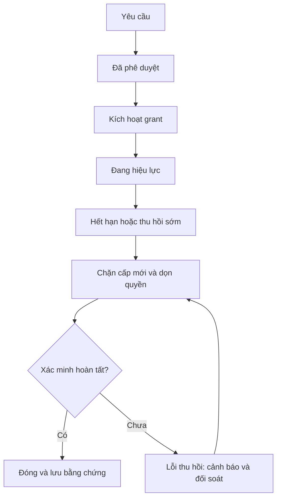

# Vendor time-boxed access: Cấp quyền nhà cung cấp theo khung thời gian

## 1. Mục tiêu bài học

Nhà cung cấp thường cần truy cập hệ thống để bảo trì, chẩn đoán hoặc xử lý sự cố. Một yêu cầu kéo dài 45 phút không nên để lại tài khoản quản trị có thể sử dụng nhiều tuần sau đó. Trong quản lý truy cập đặc quyền, giới hạn thời gian phải được thực thi ở nơi cấp quyền, nơi mở kết nối và nơi duy trì phiên làm việc.

Sau bài này, người học có thể:

- Mô tả một quyền truy cập nhà cung cấp có điểm bắt đầu và kết thúc rõ ràng.
- Phân biệt khung được phê duyệt, thời gian kích hoạt, thời hạn credential và thời hạn phiên.
- Thiết kế luồng cấp quyền ngắn hạn gắn với danh tính cá nhân, công việc và tài nguyên cụ thể.
- Xử lý hết hạn, gia hạn, mất kết nối điều khiển và thu hồi khẩn cấp.
- Xác định bằng chứng cho thấy quyền đã thực sự chấm dứt.

Bài học tập trung vào truy cập của con người thuộc nhà cung cấp. Tác vụ tự động được tạo trong phiên vẫn phải được quản lý, nhưng không thể xem một phiên SSH hoặc RDP ngắn hạn là cơ chế giới hạn thời gian cho mọi tác vụ nền mà người dùng có thể khởi tạo.

## 2. Quyền có thời hạn là gì?

**Vendor time-boxed access** là quyền truy cập của nhà cung cấp chỉ có hiệu lực trong một khoảng thời gian được chấp thuận, với phạm vi công việc, danh tính và tài nguyên xác định. Khi khoảng đó kết thúc, hệ thống phải chặn việc sử dụng quyền theo chính sách đã thiết kế, kể cả khi người dùng chưa chủ động đăng xuất.

Một quyền có thời hạn có thể được biểu diễn bằng bộ giá trị:

> Ai, thuộc nhà cung cấp nào, làm việc gì, trên tài nguyên nào, bằng quyền nào, từ lúc nào đến lúc nào, thông qua đường truy cập nào?

Ví dụ:

> Kỹ sư có danh tính `vendor-a:nguyen.an` được chạy bộ lệnh chẩn đoán trên `app-prod-02`, qua cổng PAM, trong khoảng 20:00–21:00 giờ Việt Nam, phục vụ phiếu thay đổi `CHG-4812`.

Thông tin “hỗ trợ hệ thống trong tháng này” chưa đủ để xác định một quyền thực thi. Nó không chỉ ra phiên nào được phép, máy nào thuộc phạm vi, quyền gì cần thiết và lúc nào phải kết thúc.

Giới hạn thời gian bổ sung cho least privilege, không thay thế least privilege. Quyền quản trị toàn miền trong mười phút vẫn có thể gây hậu quả nghiêm trọng. Một thiết kế tốt đồng thời thu hẹp:

| Chiều giới hạn | Câu hỏi cần trả lời | Ví dụ |
|---|---|---|
| Danh tính | Chính xác người nào được sử dụng? | Một kỹ sư được xác minh, không dùng tài khoản chung của công ty cung cấp |
| Tài nguyên | Đích nào được chạm tới? | Hai máy trong danh sách phê duyệt |
| Hành động | Được thực hiện việc gì? | Đọc log và chạy chẩn đoán, không sửa IAM |
| Thời gian | Lúc nào quyền bắt đầu và kết thúc? | Một giờ trong cửa sổ bảo trì |
| Đường truy cập | Đi qua điểm kiểm soát nào? | Phiên được môi giới qua PAM |
| Điều kiện | Điều gì phải còn đúng khi sử dụng? | Phiếu còn hiệu lực, nhà tài trợ nội bộ còn chịu trách nhiệm |

Thời hạn hợp đồng của nhà cung cấp chỉ là một giới hạn ngoài. Nó không tự động tạo quyền quản trị liên tục cho mọi người thuộc nhà cung cấp đó.

## 3. Những đồng hồ cần phân biệt

Một hệ thống thường có nhiều khái niệm thời gian. Gộp chúng thành một trường “timeout” dễ tạo khoảng trống kiểm soát.

### 3.1. Khung phê duyệt

Đây là khoảng được tổ chức chấp thuận cho một công việc:

- `approved_start`: thời điểm sớm nhất có thể kích hoạt.
- `approved_end`: thời điểm muộn nhất quyền được phép tồn tại theo phê duyệt đó.

Phê duyệt lúc 10:00 cho cửa sổ 20:00–21:00 không đồng nghĩa kỹ sư được quyền truy cập từ 10:00.

### 3.2. Thời điểm kích hoạt và thời hạn grant

Một **grant** là một lần cấp quyền thực tế. Nó có định danh riêng, gắn với yêu cầu và được kích hoạt sau các kiểm tra cần thiết.

Giả sử cửa sổ là 20:00–21:00 và thời lượng grant tối đa là 30 phút. Nếu kỹ sư kích hoạt lúc 20:40, grant phải kết thúc muộn nhất lúc 21:00, không phải 21:10.

Có thể mô tả quy tắc như sau:

```text
grant_end = min(
    approved_end,
    activated_at + maximum_grant_duration,
    vendor_eligibility_end,
    other_applicable_hard_deadlines
)
```

Các mốc không áp dụng không cần xuất hiện trong phép tính. Nếu hạn tính được không sau thời điểm hiện tại, từ chối kích hoạt.

Khởi tạo lại một kết nối không được tự đặt lại thời hạn tuyệt đối của grant. Nếu không có ràng buộc này, người dùng có thể kéo dài quyền bằng cách liên tục ngắt rồi nối lại.

### 3.3. Thời hạn credential hoặc token

Credential có thể là mật khẩu được checkout, token, certificate ngắn hạn hoặc một dạng thông tin xác thực khác. Thời hạn của nó là thời gian nó có thể được chấp nhận cho mục đích tương ứng.

Cần tránh hai suy luận sai:

- Credential hết hạn không bảo đảm mọi phiên đã xác thực trước đó bị đóng.
- Không thể checkout lại credential không có nghĩa credential đã được lộ ra trước đó không còn dùng được.

Nếu credential được phát hành cho grant, thời hạn của nó không nên vượt `grant_end`. Nếu một cơ chế xác thực không thể đáp ứng điều đó, phải có biện pháp thu hồi hoặc cô lập bổ sung, và phải đo được thời gian còn có thể sử dụng.

Với certificate hoặc token tự xác minh, khả năng thu hồi tức thời phụ thuộc vào thiết kế kiểm tra và điểm thực thi. Không được ghi “đã revoke” chỉ vì một bản ghi trong cơ sở dữ liệu trung tâm đã đổi trạng thái.

### 3.4. Thời hạn phiên tuyệt đối

Đây là thời gian tối đa một phiên được phép tồn tại. Một người liên tục gõ lệnh vẫn phải chịu thời hạn tuyệt đối.

Ví dụ, phiên mở lúc 20:55 không được kéo dài đến 21:55 chỉ vì timeout phiên mặc định là một giờ, nếu grant kết thúc lúc 21:00.

```text
session_end = min(
    grant_end,
    session_started_at + maximum_session_duration
)
```

Nếu tài nguyên không hỗ trợ đóng phiên đúng hạn, cần đánh giá một điểm trung gian thực thi được yêu cầu đó hoặc thay đổi mô hình vận hành. Không nên hứa khả năng giới hạn mà đường truy cập thực tế không đáp ứng.

### 3.5. Idle timeout

Idle timeout kết thúc phiên khi không có hoạt động được hệ thống tính là hoạt động hợp lệ trong một khoảng nhất định. Nó xử lý phiên bị bỏ quên, nhưng không thay cho thời hạn tuyệt đối.

Một luồng dữ liệu, heartbeat hoặc đầu ra liên tục có thể được một sản phẩm tính khác với tương tác người dùng. Định nghĩa “idle” phải được kiểm tra trên đường truy cập cụ thể.

### 3.6. Hạn tiếp nhận phiên mới

Có thể đặt thời điểm ngừng tiếp nhận phiên trước khi grant hết hạn để người dùng còn thời gian đóng công việc. Ví dụ, dừng mở phiên mới lúc 20:50 trong khi grant kết thúc lúc 21:00.

Đây là một chính sách riêng. Nó không kéo dài grant và cũng không ngầm bảo đảm mọi công việc đang chạy sẽ hoàn thành trước hạn.

## 4. Thời gian phải có nghĩa thống nhất

Nên lưu mốc thời gian tuyệt đối ở dạng chuẩn, có offset rõ ràng, rồi hiển thị theo múi giờ của người dùng. Ví dụ sau chỉ là dữ liệu minh họa:

```text
Cửa sổ tại Việt Nam: 27/11/2026, 20:00–21:00, UTC+07:00
Mốc lưu tương ứng:  2026-11-27T13:00:00Z–2026-11-27T14:00:00Z
```

Chuỗi “20:00–21:00” đứng riêng không cho biết ngày hoặc múi giờ. Khi nhà cung cấp làm việc ở quốc gia khác, sự thiếu rõ ràng có thể dẫn đến mở quyền sớm hoặc thu hồi muộn.

Một quy ước hữu ích cho quyền là khoảng nửa mở:

```text
approved_start <= current_time < grant_end
```

Tại đúng `grant_end`, quyền đã hết hiệu lực. Dùng cùng quy ước ở nơi quyết định, nơi phát credential và nơi thực thi phiên.

Các thành phần phân tán cần có cách đồng bộ và giám sát độ lệch đồng hồ. Nếu một gateway chậm ba phút, việc ghi log “hết hạn đúng giờ” ở máy chủ điều khiển không chứng minh gateway đã ngừng cho phép truy cập.

Khi chuyển một hạn tuyệt đối thành bộ hẹn giờ cục bộ, cần xử lý việc đồng hồ bị điều chỉnh hoặc tiến trình khởi động lại. Có thể dùng đồng hồ đơn điệu để theo dõi thời lượng trong một tiến trình, nhưng vẫn cần hạn tuyệt đối bền vững để phục hồi. Không được khởi tạo lại toàn bộ TTL sau mỗi lần dịch vụ restart.

Nếu thiết kế chấp nhận sai số đồng hồ hoặc một khoảng đệm, phải ghi rõ tác động của nó lên giới hạn truy cập. Khoảng đệm không được trở thành thời gian cộng thêm không được phê duyệt.

## 5. Một bản cấp quyền cần chứa gì?

Một bản ghi đủ để vận hành nên nối được yêu cầu nghiệp vụ với quyền kỹ thuật. Ví dụ YAML dưới đây là mô hình khái niệm cho bài học, không phải cấu hình của một sản phẩm PAM cụ thể.

```yaml
grant_id: VG-2026-184
request_id: VR-2026-4812
change_id: CHG-4812
policy_revision: 7

subject:
  identity: vendor-a:nguyen.an
  vendor_id: vendor-a
  internal_sponsor: operations-owner

scope:
  resources:
    - app-prod-02
  allowed_actions:
    - read_application_logs
    - run_approved_diagnostics
  access_path: managed-pam-gateway

approval:
  approved_start: "2026-11-27T13:00:00Z"
  approved_end: "2026-11-27T14:00:00Z"
  approved_by: application-owner
  purpose: "Chẩn đoán lỗi trong phiếu CHG-4812"

activation:
  activated_at: "2026-11-27T13:40:00Z"
  expires_at: "2026-11-27T14:00:00Z"

session_policy:
  maximum_session_minutes: 20
  idle_timeout_minutes: 5
  terminate_at_grant_end: true
  warn_before_end_minutes:
    - 10
    - 2

closure:
  require_session_verification: true
  require_entitlement_verification: true
  require_credential_cleanup_evidence: true
```

Những điểm cần đọc từ ví dụ:

- Người được cấp quyền là một danh tính cá nhân, có thể truy nguyên về nhà cung cấp.
- Quyền gắn với một công việc và một nhà tài trợ nội bộ.
- Kích hoạt lúc 20:40 không làm hạn 21:00 bị dịch chuyển.
- Danh sách quyền là ý định chính sách; hệ thống thật phải ánh xạ được từng ý định sang kiểm soát kỹ thuật.
- Các cờ trong YAML chỉ mô tả yêu cầu. Chúng không chứng minh việc đóng phiên hoặc dọn credential đã được thực thi.

Nếu cùng tài khoản đích được dùng bởi nhiều grant, cần giữ được ánh xạ phiên và xử lý việc thu hồi theo phạm vi thích hợp. Xóa thành viên nhóm hoặc đổi mật khẩu một tài khoản dùng chung có thể ảnh hưởng các công việc hợp lệ khác. Ưu tiên cơ chế cô lập quyền theo danh tính hoặc theo grant khi khả thi.

## 6. Luồng vận hành từ yêu cầu đến đóng quyền

### Bước 1: Tiếp nhận yêu cầu cụ thể

Nhà cung cấp hoặc đầu mối nội bộ khai báo người thực hiện, lý do, đích truy cập, mức quyền cần dùng, khung thời gian và phiếu liên quan. Yêu cầu “toàn bộ máy production để kiểm tra khi cần” phải được thu hẹp trước khi cấp.

Kiểm tra danh tính kỹ sư còn được phép đại diện nhà cung cấp. Một người đã đổi dự án hoặc rời công ty không được tiếp tục hưởng quyền chỉ vì hợp đồng của nhà cung cấp còn hiệu lực.

### Bước 2: Phê duyệt phạm vi và thời gian

Chủ tài nguyên hoặc người có thẩm quyền phê duyệt công việc và thời hạn. Vai trò phê duyệt phải đủ độc lập với người yêu cầu theo chính sách của tổ chức.

Cần xem xét liệu công việc có thực sự hoàn thành được trong cửa sổ đề xuất. Một tác vụ có thể kéo dài hai giờ không nên bị che giấu dưới yêu cầu “truy cập mười phút” rồi tự động gia hạn nhiều lần.

### Bước 3: Kích hoạt đúng thời điểm

Khi người dùng bắt đầu, hệ thống xác minh lại danh tính, các điều kiện truy cập đang áp dụng và tính hợp lệ của yêu cầu. Phê duyệt trước đó không thay cho kiểm tra tại thời điểm sử dụng.

Tùy thiết kế, kích hoạt có thể bao gồm xác thực tăng cường, tạo credential ngắn hạn, thêm entitlement tạm thời hoặc tạo khả năng mở phiên qua gateway. Cần tính `grant_end` trước khi phát bất kỳ khả năng truy cập nào.

Nếu một bước kích hoạt thất bại sau khi quyền đã được cấp ở đích, phải có thao tác bù trừ và xác minh dọn quyền. Không để trạng thái “activation failed” che một entitlement đã tồn tại ngoài hệ thống điều khiển.

### Bước 4: Sử dụng qua đường kiểm soát

Mỗi lần mở phiên cần kiểm tra grant còn hiệu lực, đích thuộc phạm vi và điều kiện bắt buộc còn đúng. Đường truy cập trực tiếp ngoài PAM phải được ngăn chặn theo kiến trúc của hệ thống.

Giám sát phiên cần liên kết được danh tính nhà cung cấp, danh tính đích, grant và công việc. Nếu gateway dùng credential được quản lý để đăng nhập thay người dùng, vẫn phải truy nguyên được người điều khiển phiên.

### Bước 5: Cảnh báo trước hạn

Thông báo trước hạn giúp kỹ sư dừng mở thay đổi mới, lưu kết quả và chuyển sang bước kết thúc an toàn. Cảnh báo nên hiển thị hạn thực tế của grant, không chỉ một bộ đếm có thể bị đặt lại.

Nếu người dùng cần thêm thời gian, họ gửi yêu cầu gia hạn theo quy trình ở phần sau. Đang làm dở không tự tạo quyền tiếp tục.

### Bước 6: Thực thi hết hạn

Khi đến hạn, hệ thống từ chối mọi thao tác cấp mới dựa trên grant đó, xử lý phiên hiện hữu theo chính sách và thu hồi các quyền hoặc credential liên quan.

Có thể thực hiện nhiều thao tác dọn dẹp song song, nhưng trạng thái hoàn tất phải dựa vào kết quả thực tế của từng lớp. Gửi lệnh revoke thành công về mặt truyền thông chưa đủ để kết luận đã thu hồi.

### Bước 7: Đối soát và đóng

Sau khi kết thúc, đối chiếu trạng thái mong muốn với trạng thái quan sát tại điểm thực thi và tài nguyên đích. Chỉ đánh dấu đã đóng khi có đủ bằng chứng theo chính sách.

Một yêu cầu đã hoàn tất về nghiệp vụ có thể vẫn còn lỗi thu hồi về kỹ thuật. Hai thông tin này cần được biểu diễn riêng để lỗi không biến mất khi đóng phiếu.

## 7. Theo dõi vòng đời mà không che lỗi thu hồi

Có thể tách vòng đời phê duyệt khỏi tình trạng thực thi:



Điểm quan trọng là quyền đã hết hiệu lực về chính sách ngay khi đến hạn, dù thao tác kỹ thuật còn đang xử lý. Khi có lỗi, hệ thống phải thể hiện đồng thời:

```text
authorization_state = EXPIRED
enforcement_state = REVOCATION_FAILED
```

Không được để quyền tiếp tục được xem là hợp lệ chỉ vì chưa dọn xong. Cũng không được gọi là đã thu hồi hoàn toàn trong khi phiên vẫn sống.

Một worker nền cần retry có kiểm soát và đối soát bền vững. Các thao tác thu hồi nên có tính lặp an toàn: yêu cầu đóng một phiên đã đóng hoặc xóa một entitlement đã hết không được tạo quyền mới hay làm hỏng trạng thái. Trường hợp đã không còn quyền phải được phân biệt với trường hợp không truy vấn được trạng thái.

## 8. Hết hạn phải được thực thi ở nhiều lớp

| Lớp | Việc cần thực hiện | Bằng chứng cần quan sát |
|---|---|---|
| Cổng yêu cầu/PAM | Ngừng kích hoạt, checkout hoặc tạo phiên mới từ grant cũ | Yêu cầu sau hạn bị từ chối với lý do rõ ràng |
| Gateway hoặc broker | Kết thúc phiên do grant quản lý, ngừng chuyển tiếp lưu lượng tương ứng | Phiên đóng và không còn khả năng chuyển tiếp theo grant |
| Quyền trên đích | Gỡ role, nhóm, entitlement hoặc tài khoản tạm theo thiết kế | Đọc lại trạng thái đích và thử phép kiểm tra được phép |
| Credential | Thu hồi token, hủy lease hoặc đổi secret nếu cần | Bằng chứng cơ chế cũ không còn được chấp nhận trong phạm vi xác minh |
| Tác vụ phát sinh | Kiểm kê và xử lý job, tiến trình hoặc ủy quyền được tạo trong phiên | Kết quả đối soát và chủ sở hữu tiếp nhận rõ ràng |

Không phải mọi môi trường đều dùng đủ năm cơ chế theo cùng cách. Điều cần có là một bản đồ chỉ ra mỗi khả năng truy cập được cấp đã bị giới hạn và thu hồi ở đâu.

### 8.1. Tắt tài khoản không bảo đảm đóng phiên

Một dịch vụ có thể chỉ kiểm tra trạng thái tài khoản ở lúc đăng nhập. Phiên đã được xác thực có thể tiếp tục tồn tại cho đến khi một cơ chế khác đóng nó.

Vì vậy cần kiểm tra cả khả năng mở phiên mới và phiên hiện hữu. Tương tự, xóa người dùng khỏi một nhóm không bảo đảm mọi quyền được lưu trong phiên hoặc ngữ cảnh bảo mật đang hoạt động biến mất ngay lập tức.

### 8.2. Đổi mật khẩu không xóa mọi khả năng đã được tạo

Đổi mật khẩu có thể chặn lần đăng nhập mới bằng mật khẩu cũ, nhưng không tự xóa một API key khác, phiên đã mở, credential đã tạo thêm hoặc một tác vụ chạy theo lịch.

Một thiết kế least privilege nên ngăn việc nhà cung cấp tự tạo cơ chế duy trì truy cập không nằm trong phê duyệt. Nếu công việc thật sự cần tạo một danh tính dịch vụ, danh tính đó phải có chủ sở hữu, chính sách và quy trình cấp quyền riêng.

### 8.3. Đóng tunnel không hoàn tác thay đổi

Khi tunnel bị đóng, một thay đổi cấu hình đã áp dụng vẫn tồn tại. Tác vụ từ xa đã được hệ điều hành tiếp nhận cũng có thể tiếp tục chạy.

Do đó, giới hạn thời gian truy cập kiểm soát khả năng tiếp tục tương tác, không thay thế kiểm soát thay đổi, rollback hoặc theo dõi công việc sau phiên. Chọn trước cách kết thúc an toàn: dừng tác vụ, để tác vụ được nội bộ tiếp quản, hay chuyển sang cơ chế chạy tự động đã được phê duyệt.

## 9. Gia hạn là một quyết định cấp quyền mới

Gia hạn cần được xem xét với thông tin hiện tại: công việc còn gì, vì sao chậm, có thay đổi phạm vi không, ai chịu trách nhiệm và hạn mới là bao nhiêu.

Một luồng gia hạn có thể giữ grant hiện tại nếu nền tảng hỗ trợ cập nhật an toàn, nhưng phải tạo được dấu vết về quyết định mới. Cần ghi rõ phiên bản trước, hạn cũ, hạn mới, người phê duyệt và thời điểm hiệu lực.

Các nguyên tắc quan trọng:

- Nhà cung cấp không tự gia hạn quyền của chính mình.
- Yêu cầu đang chờ duyệt không làm dừng đồng hồ hết hạn.
- Một extension được duyệt sau khi grant đã hết hạn không tự hồi sinh phiên cũ.
- Nếu cần cấp lại sau hết hạn, thực hiện kích hoạt lại với kiểm tra hiện hành.
- Gia hạn thời gian không ngầm mở thêm tài nguyên hoặc hành động.
- Một sự kiện thu hồi khẩn cấp có ưu tiên hơn việc gia hạn thông thường.

### 9.1. Tránh tranh chấp giữa gia hạn và tác vụ thu hồi

Giả sử grant phiên bản 7 hết hạn lúc 21:00. Một tác vụ đã được lên lịch để thu hồi phiên bản này. Lúc 20:58, người có thẩm quyền phê duyệt phiên bản 8 kéo dài đến 21:15.

Nếu tác vụ cũ không kiểm tra phiên bản, nó có thể gỡ quyền vừa gia hạn. Ngược lại, nếu gia hạn xử lý thiếu kiểm soát, nó có thể cấp lại quyền sau một quyết định thu hồi khẩn cấp.

Cần cập nhật trạng thái nguyên tử hoặc dùng cơ chế kiểm tra phiên bản tương đương. Tác vụ thu hồi phải so sánh bản ghi hiện tại trước khi hành động. Một cờ thu hồi có hiệu lực phải không bị thao tác gia hạn thông thường xóa đi.

Sau gia hạn, cần phân phối lại hạn mới đến đúng điểm thực thi và nhận xác nhận. Hạn trên giao diện đổi thành 21:15 trong khi gateway vẫn giữ 21:00 là một cập nhật chưa hoàn tất.

Nếu cần mở rộng credential hoặc phiên, phải thực hiện cơ chế được nền tảng hỗ trợ. Sửa một trường trong cơ sở dữ liệu không tự làm certificate đã ký có hạn mới.

## 10. Chính sách khi các thành phần gặp lỗi

### 10.1. Mất kết nối với bộ điều khiển

Điểm thực thi nên có khả năng biết hạn của phiên đang quản lý mà không phải chờ một lệnh đóng duy nhất từ trung tâm.

Nếu bộ điều khiển mất kết nối lúc 20:59, một gateway đã nhận hạn 21:00 cần có hành vi hết hạn cục bộ phù hợp. Không được âm thầm kéo dài vì không liên lạc được máy chủ.

Với cấp quyền mới, không xác minh được phê duyệt hoặc trạng thái thu hồi thì cần từ chối theo thiết kế đã chọn. Nếu tổ chức có luồng truy cập khẩn cấp, luồng đó phải có danh tính, hạn, phê duyệt và bằng chứng riêng.

### 10.2. Gateway khởi động lại

Khi phục hồi, gateway phải lấy lại grant, hạn tuyệt đối và trạng thái thu hồi hiện hành trước khi cho nối lại. Không coi việc reconnect là một phiên hoàn toàn không liên quan rồi cấp thời hạn mới.

Nếu không đủ thông tin để xác định phiên còn được phép, không tiếp tục dựa trên một bản ghi cũ không thể xác minh.

### 10.3. Đích không phản hồi lệnh thu hồi

Một API trả timeout không cho biết thao tác đã xảy ra hay chưa. Cần đọc lại trạng thái khi có thể, dùng khóa định danh thao tác nếu được hỗ trợ và retry theo chính sách.

Trong thời gian chưa xác minh, trạng thái phải thể hiện thu hồi chưa hoàn tất. Có thể cần cô lập đường truy cập liên quan bằng điểm thực thi khác đã được thiết kế trước. Việc cô lập không được mở thêm một lối truy cập quản trị không kiểm soát.

### 10.4. Hết hạn giữa một thay đổi có thể gây gián đoạn

Cách xử lý phải được xác định trước cửa sổ làm việc. Các lựa chọn có thể gồm chuẩn bị bước rollback, có người nội bộ tiếp quản hoặc xin một cửa sổ đủ dài hơn từ đầu.

Không nên thiết kế “grace period cho đến khi làm xong” mà không có hạn cứng. Nếu có khoảng thời gian chỉ dành cho thu dọn, nó phải nằm trong phê duyệt, có hạn rõ ràng và có cơ chế giới hạn tương ứng. Nếu nền tảng không thực thi được chế độ chỉ thu dọn, không được mô tả nó như một bảo đảm kỹ thuật.

## 11. Mã giả cho quyết định và đối soát

Các đoạn sau diễn tả ý định kiểm soát, không phải mã triển khai hoàn chỉnh. Hệ thống thật còn cần cơ chế giao dịch, xác thực thông điệp, quản lý lỗi, kiểm soát đồng thời và bảo vệ dữ liệu.

### 11.1. Kiểm tra trước khi mở phiên

```text
function authorizeNewSession(request, grant, now):
    require request.subject == grant.subject
    require request.resource in grant.approvedResources
    require request.action within grant.approvedActions
    require grant.approvalIsValid
    require grant.activationIsComplete
    require grant.revokedAt is absent
    require grant.start <= now
    require now < grant.end
    require currentConditionsAreSatisfied(request, grant)

    sessionEnd = min(grant.end, now + policy.maximumSessionDuration)
    require sessionEnd > now

    return Decision(
        allow = true,
        grantId = grant.id,
        grantRevision = grant.revision,
        absoluteSessionEnd = sessionEnd
    )
```

Quyết định cho phép cần được ràng buộc với lần tạo phiên tương ứng. Không được kiểm tra lúc 20:59 rồi để một công việc chờ trong hàng đợi tạo phiên sau 21:00 mà không kiểm tra lại.

### 11.2. Đối soát hạn và thu hồi

```text
function reconcileGrant(grantId, now):
    current = loadCurrentGrant(grantId)

    if current.isRevoked or now >= current.end:
        denyNewUse(current.id)

        closeManagedSessions(current.id)
        revokeEntitlementsOwnedByGrant(current.id)
        cleanupCredentialsOwnedByGrant(current.id)

        observed = verifyActualState(current.id)

        if observed.allRequiredControlsSatisfied:
            recordEnforcementComplete(current.id, observed)
        else:
            recordEnforcementIncomplete(current.id, observed)
            alertResponsibleOwner(current.id)
            scheduleBoundedRetry(current.id)
```

“Bounded retry” nghĩa là giới hạn mỗi đợt thử, thời gian và tần suất; không có nghĩa bỏ mặc quyền còn sót sau khi hết số lần thử. Khi tự động hóa chưa xử lý được, phải chuyển sang điều phối xử lý sự cố và tiếp tục theo dõi đến khi có kết luận.

Nếu cùng quyền kỹ thuật đang phục vụ nhiều grant hợp lệ, hàm thu hồi phải hiểu quan hệ sở hữu. Không xóa một tài nguyên dùng chung chỉ dựa trên việc một grant hết hạn.

## 12. Ví dụ vận hành trọn vẹn

Một kỹ sư nhà cung cấp cần đọc log và chạy chẩn đoán trên một máy production. Cửa sổ được duyệt là 20:00–21:00 giờ Việt Nam. Grant tối đa 30 phút; phiên tối đa 20 phút; idle timeout 5 phút. Các con số này chỉ dùng để minh họa cách tính, không phải khuyến nghị chung cho mọi tổ chức.

| Thời điểm | Sự kiện | Kết quả cần có |
|---|---|---|
| 19:55 | Kỹ sư thử kích hoạt | Từ chối vì chưa tới cửa sổ |
| 20:40 | Kích hoạt sau xác thực và kiểm tra điều kiện | Grant kết thúc lúc 21:00 |
| 20:42 | Mở phiên chẩn đoán | Hạn phiên là 21:00, vì sớm hơn 21:02 |
| 20:50 | Cảnh báo trước hạn | Người dùng thấy còn 10 phút |
| 20:57 | Gửi yêu cầu gia hạn | Grant vẫn giữ hạn 21:00 khi chưa duyệt |
| 21:00 | Chưa có phê duyệt mới | Ngừng cấp mới, xử lý phiên và thu hồi quyền |
| 21:01 | Kiểm tra trạng thái thực tế | Ghi nhận kết quả từng lớp, cảnh báo nếu còn quyền |
| 21:05 | Yêu cầu thêm thời gian được duyệt | Cần kích hoạt lại hợp lệ; không tự phục hồi phiên cũ |

Nếu kỹ sư ngắt kết nối lúc 20:48 rồi quay lại lúc 20:56, grant cũ vẫn hết hạn lúc 21:00. Một phiên được mở lại hợp lệ chỉ còn tối đa bốn phút, không được cấp lại 20 hoặc 30 phút.

Nếu công việc hoàn thành lúc 20:47, người dùng có thể kết thúc grant sớm. Kết thúc sớm cần kích hoạt cùng luồng thu hồi và xác minh, không chỉ đổi trạng thái phiếu thành “done”.

Nếu bên vận hành phát hiện hành vi ngoài phạm vi lúc 20:46, họ có thể thu hồi ngay. Khoảng thời gian được phê duyệt là giới hạn trên của quyền, không phải cam kết giữ quyền đến hết giờ bất kể điều kiện nào.

## 13. Bằng chứng và chỉ số cần thu thập

Nhật ký phải cho phép trả lời: ai được duyệt, ai thực sự sử dụng, dùng quyền nào, trên đích nào, tới khi nào và quyền chấm dứt ra sao.

Một chuỗi bằng chứng có thể bao gồm:

- Yêu cầu, mục đích, nhà tài trợ nội bộ và quyết định phê duyệt.
- Thời điểm kích hoạt, hạn được tính, phiên bản chính sách và phiên bản grant.
- Định danh phiên, đích truy cập, thời điểm bắt đầu và kết thúc.
- Sự kiện cảnh báo, gia hạn, từ chối và thu hồi sớm.
- Lệnh thu hồi được gửi, kết quả trả về và trạng thái quan sát lại.
- Bằng chứng dọn credential, entitlement và phiên theo mô hình đã dùng.
- Lỗi còn tồn tại, người chịu trách nhiệm và kết quả khắc phục.

Không đưa mật khẩu, token hay secret thô vào log. Các bản ghi nên dùng định danh hoặc tham chiếu đủ để nối sự kiện mà không tạo thêm nguồn rò rỉ.

Một sự kiện đóng quyền minh họa:

```json
{
  "event": "vendor_grant_enforcement_completed",
  "grantId": "VG-2026-184",
  "subjectId": "vendor-a:nguyen.an",
  "approvedEnd": "2026-11-27T14:00:00Z",
  "trigger": "absolute_expiry",
  "lastManagedSessionClosedAt": "2026-11-27T14:00:01Z",
  "entitlementRemovalVerifiedAt": "2026-11-27T14:00:02Z",
  "credentialCleanupVerifiedAt": "2026-11-27T14:00:02Z",
  "verificationCompletedAt": "2026-11-27T14:00:03Z"
}
```

Ví dụ này thể hiện độ trễ thực thi; nó không chứng minh quyền đã bị chặn chính xác tại 14:00:00 ở mọi lớp. Nếu yêu cầu là không còn khả năng sử dụng sau hạn, phải thiết kế điểm thực thi có hạn cục bộ và kiểm chứng điều đó, thay vì chỉ dựa vào lịch chạy dọn dẹp sau hạn.

Các chỉ số hữu ích gồm tỷ lệ grant được đóng có đủ bằng chứng, số lần thu hồi thất bại, số phiên còn sống sau hạn, thời gian từ hạn đến lần xác minh cuối, số lần gia hạn và số đường truy cập nằm ngoài grant.

Khi đo độ trễ, cần ghi rõ đang đo thời điểm thực sự ngừng quyền hay thời điểm hệ thống quan sát được kết quả. Hai mốc có thể khác nhau. Không đưa các trường hợp thiếu dữ liệu ra khỏi mẫu đo theo cách làm tỷ lệ thành công trông tốt hơn thực tế.

## 14. Sai lầm thường gặp và cách nhận diện

| Sai lầm | Vì sao tạo rủi ro | Cách sửa thiết kế |
|---|---|---|
| Cấp tài khoản có ngày hết hạn nhưng bỏ qua phiên | Phiên đã mở có thể còn dùng được | Kiểm soát thời hạn phiên và xác minh việc kết thúc |
| Lấy idle timeout làm thời hạn duy nhất | Hoạt động liên tục giữ quyền lâu hơn phê duyệt | Thêm hạn tuyệt đối gắn với grant |
| Mỗi lần reconnect lại tính TTL mới | Có thể kéo dài quyền vô hạn | Giữ hạn tuyệt đối qua mọi lần nối lại |
| Cho gia hạn tự động khi chưa xong việc | Phê duyệt mất ý nghĩa | Tạo quyết định mới với lý do, người duyệt và hạn mới |
| Chỉ cập nhật trạng thái trên PAM | Quyền ở đích hoặc gateway có thể chưa bị gỡ | Đối soát từng điểm thực thi |
| Đợi tác vụ quét định kỳ mới chặn quyền | Quyền có thể tồn tại giữa hạn và lượt quét kế tiếp | Thực thi hạn tại điểm truy cập; dùng quét để phát hiện và sửa sai lệch |
| Ghi đã revoke khi API timeout | Không biết trạng thái thực tế | Ghi chưa xác minh và đọc lại trạng thái |
| Dùng một danh tính chung cho cả nhà cung cấp | Khó truy nguyên và thu hồi từng người | Gắn truy cập với danh tính cá nhân |
| Đóng tunnel rồi coi công việc đã chấm dứt | Job nền và thay đổi vẫn tồn tại | Có bước tiếp quản hoặc kiểm kê tác vụ phát sinh |
| Coi hợp đồng còn hạn là quyền luôn hợp lệ | Quyền thường trực vượt nhu cầu công việc | Tách điều kiện đủ tư cách khỏi grant từng công việc |

## 15. Bài tập tình huống

### Tình huống 1: Kích hoạt muộn

Một cửa sổ được duyệt từ 09:00 đến 10:00. Grant tối đa 40 phút, phiên tối đa 30 phút. Kỹ sư kích hoạt lúc 09:45 và mở phiên lúc 09:50.

**Phân tích:** Hạn grant là 10:00, sớm hơn 10:25. Hạn phiên cũng là 10:00, sớm hơn 10:20. Người dùng không được hưởng đủ 40 phút chỉ vì kích hoạt trễ.

### Tình huống 2: Người phê duyệt chưa phản hồi

Grant hết hạn lúc 22:00. Nhà cung cấp yêu cầu thêm 20 phút lúc 21:59, nhưng người duyệt chỉ phản hồi lúc 22:03.

**Phân tích:** Quyền cũ vẫn hết hạn lúc 22:00. Sau quyết định mới, hệ thống thực hiện cấp hoặc kích hoạt lại theo chính sách hiện hành. Không sửa log để làm như quyền luôn liên tục từ trước hạn.

### Tình huống 3: Thu hồi lỗi một phần

PAM đã ngừng cấp phiên mới, gateway đã đóng phiên, nhưng API gỡ role trên đích không phản hồi.

**Phân tích:** Chưa đủ bằng chứng đóng hoàn toàn. Cần ghi nhận trạng thái thu hồi chưa hoàn tất, đối soát role và kiểm tra các đường truy cập còn khả thi. Gateway đã đóng giúp giảm khả năng truy cập theo đường đó nhưng không chứng minh role tại đích đã biến mất.

### Tình huống 4: Tác vụ nền vẫn chạy

Kỹ sư khởi động một tác vụ kiểm tra dữ liệu lúc 20:58. Grant hết hạn lúc 21:00; phiên đã bị đóng nhưng tác vụ vẫn chạy.

**Phân tích:** Hệ thống có thể đã giới hạn đúng phiên nhưng chưa giải quyết vòng đời tác vụ. Cần xác định tác vụ này có được phê duyệt, được ai tiếp quản và có quyền nào còn tồn tại. Nếu tác vụ cần chạy độc lập, dùng cơ chế vận hành được quản lý riêng thay vì kéo dài đặc quyền con người một cách ngầm định.

### Tình huống 5: Tác vụ thu hồi cũ gặp grant mới

Tác vụ thu hồi cho phiên bản 3 đến muộn sau khi phiên bản 4 đã được phê duyệt hợp lệ.

**Phân tích:** Tác vụ cần kiểm tra trạng thái và phiên bản hiện tại trước khi hành động. Nếu phiên bản 4 có hiệu lực, đối soát theo phiên bản đó; nếu đã có thu hồi khẩn cấp, quyết định thu hồi phải tiếp tục có hiệu lực. Mọi thay đổi cần có bằng chứng về thứ tự và kết quả.

## 16. Tiêu chí hoàn thành một thiết kế time-boxed

Một thiết kế có thể giải thích và kiểm chứng được cần trả lời đầy đủ những câu hỏi sau:

1. Có thể chỉ ra chính xác danh tính cá nhân, phạm vi và công việc của từng grant hay không?
2. Mỗi grant có hạn tuyệt đối không bị đặt lại bởi reconnect, refresh token hay restart hay không?
3. Cấp mới, phiên đang chạy, entitlement và credential được giới hạn ở đâu?
4. Gia hạn có quyết định riêng, hạn mới và cơ chế xử lý tranh chấp với thu hồi hay không?
5. Khi bộ điều khiển hoặc tài nguyên lỗi, hệ thống có giữ được giới hạn đã cam kết hay không?
6. Việc thu hồi được xác nhận bằng trạng thái thực tế hay chỉ bằng yêu cầu đã gửi?
7. Các tác vụ và khả năng truy cập phát sinh trong phiên được kiểm kê và tiếp quản như thế nào?

Mục tiêu của vendor time-boxed access là làm cho thời hạn trở thành một thuộc tính có thể thực thi và kiểm chứng của quyền. Phê duyệt xác định giới hạn; kích hoạt gắn giới hạn đó với một grant; các điểm truy cập thực thi giới hạn; đối soát cung cấp bằng chứng rằng khả năng truy cập đã chấm dứt.
