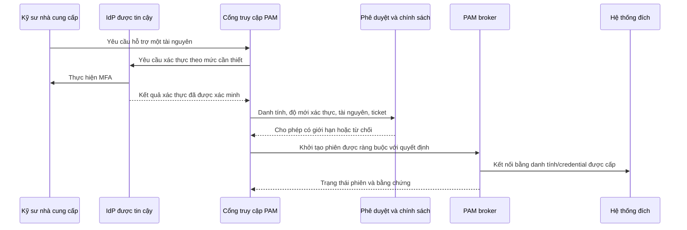

# Vendor MFA: xác thực đa yếu tố cho truy cập đặc quyền của nhà cung cấp

## 1. Vendor MFA bảo vệ quyết định nào?

**Vendor MFA** là việc xác thực đa yếu tố đối với nhân sự nhà cung cấp trước khi họ nhận hoặc sử dụng quyền truy cập vào hệ thống của doanh nghiệp. Trong quản lý truy cập đặc quyền (PAM), mục tiêu không chỉ là thêm một màn hình nhập mã. Hệ thống cần gắn được một người cụ thể, phương thức xác thực đủ mạnh, một yêu cầu công việc và một phiên đặc quyền có giới hạn với nhau.

Ví dụ, kỹ sư của nhà cung cấp cần xử lý lỗi trên máy chủ cơ sở dữ liệu sản xuất. Một lần đăng nhập thành công vào cổng hỗ trợ của nhà cung cấp chưa tự động chứng minh rằng kỹ sư đó:

- Thuộc đúng tổ chức đã ký hợp đồng và còn được phép hỗ trợ.
- Đã sử dụng phương thức MFA đáp ứng chính sách của doanh nghiệp.
- Được phê duyệt truy cập đúng máy chủ, đúng thời gian.
- Đang giữ quyền điều khiển phiên hiện tại.
- Có quyền thực hiện thao tác rủi ro cao trên hệ thống đích.

MFA trả lời một phần câu hỏi **“ai đang xác thực và bằng chứng xác thực mạnh đến đâu?”**. Phê duyệt, least privilege, JIT/JEA, kiểm soát thiết bị và giám sát phiên trả lời các câu hỏi khác. Không thể dùng một kết quả MFA để thay thế tất cả những quyết định đó.

Sau bài học, người học cần có khả năng thiết kế cổng MFA cho nhân sự bên ngoài, phân biệt các điểm cần xác thực lại, kiểm tra mức tin cậy của đăng nhập liên kết và xây dựng đường khôi phục không biến thành lối bỏ qua kiểm soát.

## 2. Vì sao truy cập nhà cung cấp cần chính sách riêng?

Nhân viên nội bộ và kỹ sư nhà cung cấp có thể cùng sử dụng SSH hoặc RDP, nhưng doanh nghiệp thường có mức kiểm soát khác nhau đối với danh tính và thiết bị của họ.

| Đặc điểm | Rủi ro đối với truy cập đặc quyền | Hệ quả thiết kế |
|---|---|---|
| Danh tính do tổ chức khác quản lý | Người đã nghỉ việc hoặc chuyển dự án vẫn nằm trong nhóm hỗ trợ | Có sponsor nội bộ, ngày hết hạn và cơ chế thu hồi độc lập |
| Thiết bị do nhà cung cấp quản lý | Phiên hợp lệ có thể xuất phát từ thiết bị không đáp ứng yêu cầu | Kiểm tra thiết bị và ràng buộc phiên ngoài MFA |
| Hỗ trợ không thường xuyên | Quyền lâu không dùng dễ bị quên | Cấp quyền theo yêu cầu, thời gian ngắn |
| Nhiều kỹ sư cùng một hợp đồng | Tài khoản chung làm mất khả năng quy trách nhiệm | Mỗi người có danh tính riêng tại cổng PAM |
| Liên kết nhiều IdP | Các bên dùng định nghĩa “MFA thành công” khác nhau | Thỏa thuận và kiểm tra chính xác ngữ nghĩa xác thực |
| Áp lực xử lý sự cố | Help desk có thể bị thúc ép reset MFA hoặc mở đường trực tiếp | Quy trình khôi phục và khẩn cấp có người chịu trách nhiệm |

Một mật khẩu bị lộ sẽ khó bị khai thác hơn khi có MFA phù hợp. Tuy nhiên, kẻ tấn công vẫn có thể đánh cắp cookie phiên, chiếm thiết bị đang đăng nhập, lợi dụng quy trình reset hoặc xin quyền vượt phạm vi. Thiết kế Vendor MFA phải tính đến toàn bộ vòng đời truy cập, không chỉ thời điểm nhập mật khẩu.

## 3. Phân biệt yếu tố xác thực và phương thức MFA

### 3.1. Hai bước chưa chắc là hai yếu tố

Các nhóm yếu tố xác thực thường được phân biệt theo bản chất:

- **Điều người dùng biết:** mật khẩu hoặc bí mật ghi nhớ.
- **Vật người dùng sở hữu:** thiết bị hoặc khóa có khả năng chứng minh quyền kiểm soát khóa bí mật.
- **Đặc trưng của người dùng:** sinh trắc học được dùng trong một cơ chế xác thực phù hợp.

Mật khẩu và một câu hỏi bảo mật vẫn thuộc cùng nhóm kiến thức. Hai mật khẩu không tự trở thành MFA. Địa chỉ IP, vị trí và tình trạng thiết bị là tín hiệu rủi ro hữu ích, nhưng không mặc nhiên là yếu tố xác thực của con người.

Một bộ xác thực có thể kết hợp nhiều yếu tố. Chẳng hạn, khóa bảo mật yêu cầu PIN hoặc sinh trắc học để cho phép sử dụng khóa bí mật có thể cung cấp xác thực đa yếu tố nếu cơ chế và cấu hình thực sự đáp ứng điều đó. Việc người dùng chỉ chạm nút để chứng minh sự hiện diện không đồng nghĩa đã có xác minh người dùng bằng PIN hoặc sinh trắc học.

### 3.2. Chọn phương thức theo rủi ro và đặc tính kỹ thuật

| Phương thức | Giá trị bảo vệ | Giới hạn cần nhận diện |
|---|---|---|
| Mật khẩu kết hợp TOTP | Giảm khả năng dùng riêng mật khẩu đánh cắp | Mã có thể bị nhập vào trang giả và chuyển tiếp trong thời gian còn hiệu lực |
| Mật khẩu kết hợp thông báo push | Thuận tiện cho người dùng | Có thể bị lạm dụng bằng yêu cầu liên tục hoặc lừa người dùng chấp thuận |
| Push có đối chiếu số và ngữ cảnh | Giúp giảm chấp thuận nhầm | Không nên mặc định có cùng khả năng chống phishing với xác thực ràng buộc đúng bên xác minh |
| Khóa bảo mật/passkey qua WebAuthn | Ràng buộc xác thực với bên xác minh; phù hợp để chống phishing khi triển khai đúng | Cần kiểm soát đăng ký, yêu cầu xác minh người dùng, khôi phục và chính sách lưu/đồng bộ khóa |
| Mã qua SMS hoặc cuộc gọi | Có thể hỗ trợ tình huống giới hạn | Phụ thuộc thuê bao, chuyển SIM và hạ tầng viễn thông; không phù hợp làm lựa chọn mặc định cho quyền rất nhạy cảm |
| Chứng thư thiết bị hoặc mTLS | Chứng minh quyền kiểm soát khóa của thiết bị hoặc phần mềm | Riêng nó chưa chứng minh người vận hành đã hoàn thành MFA |

Đối với truy cập quản trị sản xuất, doanh nghiệp có thể ưu tiên MFA chống phishing và yêu cầu xác minh người dùng. Cần định nghĩa cụ thể tính chất cần đạt thay vì chỉ ghi “bật MFA”.

“Passkey” cũng không tự có nghĩa là khóa không thể xuất khỏi phần cứng. Khóa có thể gắn với thiết bị hoặc được đồng bộ tùy loại và hệ sinh thái. Nếu phạm vi truy cập yêu cầu khóa phần cứng được quản lý, chính sách phải diễn đạt yêu cầu đó và xác định bằng chứng có thể kiểm tra. Không suy ra đặc tính phần cứng chỉ từ tên phương thức.

### 3.3. Giới hạn bảo vệ phải được hiểu đúng

MFA chống phishing giúp bảo vệ quy trình xác thực trước trang giả hoặc bên xác minh sai. Nó không ngăn mọi hành vi sau khi phiên đã được tạo. Nếu thiết bị bị điều khiển từ xa hoặc token phiên bị đánh cắp, kẻ tấn công có thể lợi dụng một phiên đã xác thực.

Vì vậy, MFA cần đi cùng thời hạn phiên, kiểm soát đường kết nối, thu hồi, giám sát và ràng buộc quyền tối thiểu. Với thao tác đặc biệt nhạy cảm, cần xem xét xác thực lại và kiểm tra quyền tại thời điểm thao tác.

## 4. Đặt MFA tại đúng cổng trong kiến trúc PAM

Một kiến trúc phổ biến gồm danh tính cá nhân của kỹ sư, IdP được tin cậy, cổng truy cập bên ngoài, bộ máy phê duyệt/JIT, PAM broker và hệ thống đích.



Sơ đồ biểu diễn các vai trò logic; một sản phẩm có thể gộp nhiều vai trò trong cùng dịch vụ. Điều quan trọng là không bỏ mất điểm thực thi chính sách khi gộp thành phần.

### 4.1. Xác thực tại cổng PAM

Cổng PAM xác định kỹ sư nào đang yêu cầu truy cập. Nên sử dụng danh tính riêng cho từng người, gắn với đúng nhà cung cấp, sponsor nội bộ và phạm vi hợp đồng. MFA chỉ có ý nghĩa quy trách nhiệm khi kết quả xác thực có thể truy ngược đến người đã được duyệt.

Không cho nhiều kỹ sư dùng một danh tính “vendor-support” rồi chia sẻ thiết bị OTP. Dù có hai yếu tố, tổ chức vẫn không xác định được người chịu trách nhiệm cho từng phiên.

### 4.2. Khởi tạo phiên đặc quyền

Sau đăng nhập, PAM cần kiểm tra tài nguyên, vai trò, lịch được phép, tình trạng yêu cầu và điều kiện xác thực. Cổng đã có MFA không có nghĩa mọi phiên SSH/RDP sau đó được mở vô điều kiện.

Nếu một kỹ sư mở thêm phiên vào tài nguyên có độ nhạy cảm cao hơn, quyết định cấp quyền phải được đánh giá lại. Có thể tái sử dụng bằng chứng xác thực còn đủ mới nếu chính sách cho phép, nhưng không tái sử dụng nguyên quyết định cấp quyền cho tài nguyên khác.

### 4.3. Xác thực lại trước thao tác nhạy cảm

Các hoạt động như nhận mật khẩu ra ngoài PAM, thay đổi cấu hình bảo mật, cấp thêm quyền quản trị hoặc truy cập môi trường khác có thể yêu cầu step-up.

Step-up phải gắn với đúng người, đúng phiên và đúng ngữ cảnh hành động. Nếu ứng dụng chỉ tạo một cờ “MFA_OK” có hiệu lực rộng, kết quả xác thực mới có thể bị dùng nhầm cho yêu cầu khác.

Không phải mọi PAM broker đều hiểu ngữ nghĩa của mọi lệnh trong giao thức đích. Khi không thể kiểm soát thao tác một cách đáng tin cậy, nên giới hạn vai trò tại đích, cung cấp một quy trình thao tác được kiểm soát hoặc yêu cầu người nội bộ thực hiện bước đó. Không tuyên bố có step-up theo lệnh nếu sản phẩm chỉ kiểm soát lúc bắt đầu phiên.

### 4.4. MFA của con người khác credential của hệ thống đích

Trong mô hình broker, kỹ sư xác thực bằng danh tính cá nhân; PAM có thể sử dụng credential được lưu trong vault để kết nối tới hệ thống đích. Hai lớp này phục vụ mục đích khác nhau.

MFA tại cổng không biến một mật khẩu quản trị dùng chung ở đích thành danh tính cá nhân. Bằng chứng cần liên kết kỹ sư, phiên broker, tài khoản đích và tài nguyên. Nếu người dùng có thể đi thẳng tới đích bằng credential đã biết, đường đó vẫn cần được kiểm soát.

Ưu tiên cách kết nối mà kỹ sư không được nhìn thấy hoặc sao chép credential khi công việc không yêu cầu. Credential tĩnh đã được tiết lộ cần được xử lý theo chính sách vault và rotation; riêng việc kết thúc MFA hoặc đăng xuất cổng không thu hồi được bí mật đã sao chép.

## 5. Tin cậy MFA từ IdP của nhà cung cấp

### 5.1. Ba lựa chọn phổ biến

Doanh nghiệp có thể tự quản lý danh tính bên ngoài trong IdP của mình; liên kết danh tính từ IdP của nhà cung cấp; hoặc liên kết rồi yêu cầu xác thực bổ sung tại cổng của doanh nghiệp.

Lựa chọn đầu giúp doanh nghiệp trực tiếp thực thi phương thức MFA nhưng phát sinh việc quản lý tài khoản, thiết bị xác thực và hỗ trợ khôi phục. Lựa chọn liên kết giảm số tài khoản độc lập, nhưng phụ thuộc vào chất lượng quản trị danh tính và ngữ nghĩa kết quả xác thực bên ngoài. Xác thực bổ sung có thể đáp ứng phần yêu cầu còn thiếu, song phải thiết kế tránh đăng ký yếu hoặc bỏ qua ở đường khác.

Không có lựa chọn nào tự loại bỏ trách nhiệm quản lý vòng đời kỹ sư và quyền hỗ trợ tại doanh nghiệp.

### 5.2. “IdP nói đã MFA” cần được kiểm chứng thế nào?

Trong đăng nhập liên kết, doanh nghiệp cần xác minh cả tính hợp lệ kỹ thuật của thông điệp và ý nghĩa của thông tin xác thực. Những nội dung cần được xử lý bởi thư viện hoặc thành phần liên kết danh tính phù hợp gồm:

1. **Bên phát hành:** thông điệp đến từ IdP và tenant đã được phê duyệt.
2. **Bên nhận:** kết quả được phát hành cho đúng ứng dụng hoặc bên sử dụng.
3. **Tính toàn vẹn và chữ ký:** sử dụng khóa tin cậy, thuật toán được chấp nhận và quy trình thay khóa có kiểm soát.
4. **Thời gian và giao dịch đăng nhập:** còn hiệu lực, khớp yêu cầu đang chờ, kiểm tra replay và các ràng buộc giao thức tương ứng.
5. **Định danh ổn định:** ánh xạ đúng người thuộc tổ chức đã duyệt.
6. **Ngữ cảnh xác thực:** phương thức, mức đảm bảo và độ mới đáp ứng yêu cầu của tài nguyên.

Tên trường cụ thể khác nhau giữa OIDC, SAML và từng cấu hình. Với OIDC, các claim như `acr`, `amr` và `auth_time` có thể cung cấp thông tin hữu ích, nhưng chỉ dùng khi hợp đồng tích hợp quy định rõ cách phát hành và cách diễn giải. Một chuỗi `mfa` không tự chứng minh xác thực chống phishing hoặc đã được thực hiện ngay trong lượt truy cập hiện tại.

Không chỉ giải mã JWT rồi tin nội dung. Không xem một access token bất kỳ là bằng chứng đăng nhập hợp lệ cho ứng dụng PAM. Không dùng một ví dụ claim để thay thế quy trình kiểm tra hoàn chỉnh của giao thức.

### 5.3. Kiểm soát độ mới của xác thực

Phiên SSO tại IdP có thể tồn tại lâu hơn cửa sổ xác thực mà PAM cho phép. Khi cần MFA mới, ứng dụng phải yêu cầu cơ chế xác thực lại phù hợp và kiểm tra bằng chứng trả về.

Độ mới thường được tính từ thời điểm sự kiện xác thực được chính sách chấp nhận, không đơn giản từ thời điểm token mới được phát hành hoặc làm mới. Việc IdP phát token mới dựa trên phiên cũ chưa chắc đã có thêm tương tác MFA.

Nếu tích hợp không thể chứng minh phương thức và độ mới đáp ứng yêu cầu, hệ thống phải đi tới một kết quả rõ ràng: xác thực bổ sung được phê duyệt hoặc từ chối. Không tự hạ yêu cầu vì thiếu claim.

### 5.4. Tránh ánh xạ sai người

Địa chỉ email hoặc tên hiển thị có thể thay đổi, bị tái cấp hoặc trùng ở những không gian khác nhau. Trong liên kết, nên ánh xạ theo cặp định danh bên phát hành và subject ổn định theo khả năng của giao thức, đồng thời gắn rõ tenant/tổ chức nhà cung cấp.

Tên miền email là một tín hiệu hỗ trợ, không đủ để tự cấp quyền quản trị. Một người đăng nhập hợp lệ từ đúng công ty vẫn có thể chưa được duyệt vào dự án, môi trường hoặc vai trò cụ thể.

## 6. Đăng ký MFA là một phần của kiểm soát truy cập

Một phương thức xác thực mạnh vẫn có thể bị vô hiệu hóa về mặt thực tế nếu kẻ tấn công đăng ký được phương thức của chính mình trên tài khoản của kỹ sư.

### 6.1. Trước khi cấp quyền

Quy trình tiếp nhận nên xác nhận danh tính cá nhân qua kênh đã được thống nhất với nhà cung cấp, xác định sponsor nội bộ và ghi nhận thời hạn cần truy cập. Không dùng riêng một email tự gửi yêu cầu hỗ trợ làm bằng chứng rằng người đó thuộc đội được ủy quyền.

Tài khoản chưa hoàn tất đăng ký MFA theo chính sách chỉ được vào luồng đăng ký giới hạn, không được mở phiên đặc quyền. Nếu dùng thông tin bootstrap có hiệu lực ngắn, nó chỉ phục vụ đăng ký và cần được bảo vệ phù hợp với rủi ro. Không dùng bootstrap để mở quyền rộng trong lúc chờ kỹ sư thiết lập MFA.

### 6.2. Thêm hoặc thay bộ xác thực

Thêm khóa mới, đổi số điện thoại, bật phương thức dự phòng hoặc xóa khóa cũ đều có thể thay đổi mức bảo vệ của tài khoản. Cần kiểm soát các hành động này bằng xác thực đủ mạnh và quy trình khôi phục phù hợp khi người dùng không còn yếu tố cũ.

Một khóa dự phòng được đăng ký trước có thể giúp duy trì hỗ trợ khi thiết bị chính hỏng. Tuy nhiên, dự phòng chỉ an toàn nếu giữ được danh tính cá nhân, được lưu giữ phù hợp và có khả năng thu hồi. Khóa dùng chung cho cả đội hỗ trợ làm mất các thuộc tính đó.

### 6.3. Khi thay đổi nhân sự hoặc hợp đồng

Kết thúc hợp đồng, đổi kỹ sư hoặc rời dự án phải dẫn đến cập nhật quyền truy cập bên doanh nghiệp. Không chờ tài khoản ở IdP nhà cung cấp bị xóa rồi mới xử lý.

Tối thiểu cần đánh giá quyền nhóm, quyền JIT đang có hiệu lực, phiên PAM, token/phiên ứng dụng và các credential đã được tiết lộ. Việc xóa một yếu tố MFA chỉ xử lý một thành phần; nó không tự thu hồi toàn bộ các quyền và phiên còn lại.

## 7. Thiết kế chính sách MFA có thể thực thi

Chính sách cần phân biệt điều kiện đăng nhập, điều kiện mở phiên và điều kiện thao tác nhạy cảm. Ví dụ dưới đây chỉ minh họa mô hình dữ liệu; đây không phải cấu hình có thể nạp trực tiếp vào một sản phẩm.

```yaml
# Chính sách minh họa, các giá trị thời gian chỉ dùng cho tình huống học tập.
policy_id: vendor-prod-maintenance
identity:
  named_person_required: true
  approved_vendor_required: true
  active_internal_sponsor_required: true
  contract_must_be_active: true

authentication:
  trusted_issuer_required: true
  accepted_assurance: vendor_phishing_resistant_with_user_verification
  maximum_accepted_authentication_age_minutes: 10
  missing_or_unmapped_assurance: deny
  unsupported_authentication_method: deny

authorization:
  approved_ticket_required: true
  resource_scope: explicitly_approved_assets
  role_scope: approved_maintenance_role
  grant_duration_minutes: 45

session:
  broker_required: true
  maximum_duration_minutes: 45
  idle_timeout_minutes: 10
  monitoring_profile: production_support
  credential_disclosure: deny
  direct_connection_bypass: deny

sensitive_actions:
  reauthenticate: true
  fresh_authorization_required: true
  bind_to_current_session_and_requested_action: true

recovery:
  separate_verified_workflow_required: true
  automatic_password_only_fallback: deny
```

Giá trị 10 phút hoặc 45 phút không phải chuẩn chung. Chúng cần được xác định theo độ nhạy cảm của tài nguyên, khả năng vận hành và thời gian xử lý công việc. Không sao chép con số mà bỏ qua cách hệ thống thực thi.

Có ba điểm phải làm rõ khi biến chính sách thành cấu hình thực tế:

- Nhãn mức đảm bảo phải có ánh xạ cụ thể tới phương thức và bằng chứng đã thống nhất với từng IdP.
- Thời hạn của quyền, phiên cổng, phiên broker và phiên đích là các đồng hồ khác nhau. Mỗi điểm thực thi phải xử lý khi đồng hồ tương ứng hết hạn.
- Từ chối đường kết nối trực tiếp cần được thực thi bằng kiến trúc mạng và quyền ở đích, không chỉ bằng một thuộc tính trong chính sách.

Hết thời hạn JIT mà phiên đích vẫn giữ quyền quản trị là một khoảng trống thực thi. Hệ thống phải có hành vi đã được xác định, chẳng hạn kết thúc phiên hoặc hạ quyền khi khả năng kỹ thuật cho phép, rồi xác minh hiệu lực thực tế.

## 8. Một ca hỗ trợ được kiểm soát từ đầu đến cuối

Giả sử Công ty Sao Mai thuê nhà cung cấp An Phát bảo trì một cụm cơ sở dữ liệu. Kỹ sư Lan được sponsor nội bộ xác nhận cho cửa sổ hỗ trợ 09:00–09:45. Tất cả tên và mốc thời gian trong ví dụ đều là giả định.

### 8.1. Yêu cầu và xác thực

Lan đăng nhập cổng PAM bằng danh tính cá nhân. Cổng chỉ chấp nhận IdP/tenant đã được duyệt và yêu cầu mức xác thực thích hợp. Kết quả được kiểm tra về tính hợp lệ, ánh xạ người dùng, phương thức và độ mới.

Nếu Lan đã đăng nhập SSO từ buổi trước, PAM không mặc nhiên xem đó là MFA mới. Tùy bằng chứng trả về và chính sách, hệ thống có thể yêu cầu xác thực lại.

### 8.2. Phê duyệt và cấp quyền

Ticket chỉ cho phép Lan xem trạng thái và thực hiện một thao tác bảo trì trên một tài nguyên cụ thể. Quyết định cấp quyền ràng buộc với danh tính của Lan, ticket, tài nguyên và cửa sổ hỗ trợ. MFA thành công không cấp Lan quyền trên tất cả máy chủ cùng cụm.

PAM mở phiên broker, sử dụng credential hoặc cơ chế cấp danh tính ngắn hạn được thiết kế cho hệ thống đích. Lan không cần biết mật khẩu quản trị được lưu trong vault nếu công việc không đòi hỏi.

### 8.3. Yêu cầu ngoài phạm vi

Trong phiên, Lan đề nghị thay đổi chính sách cấp quyền của cơ sở dữ liệu. Đây là hành động ngoài phạm vi ticket.

Một lần step-up thành công chỉ củng cố bằng chứng về người đang thao tác; nó không tự mở rộng quyền được phê duyệt. Hệ thống vẫn phải từ chối hoặc đưa yêu cầu qua quy trình phê duyệt mới. Nếu thao tác được duyệt, mới kiểm tra tiếp yêu cầu step-up và thực thi với phạm vi tương ứng.

### 8.4. Kết thúc

Đến cuối cửa sổ, quyền tạm thời hết hiệu lực và phiên được xử lý theo chính sách. Nhật ký liên kết người dùng, kết quả xác thực, ticket, phiên broker và tài nguyên đích.

Nếu Lan đã được phép lấy ra một credential tĩnh theo một ngoại lệ, doanh nghiệp phải xử lý vòng đời credential đó riêng. Kết thúc phiên không làm bản sao mật khẩu trên máy Lan tự biến mất.

## 9. Thu hồi và phản ứng khi có dấu hiệu bị chiếm tài khoản

Một sự kiện rủi ro có thể xuất hiện sau MFA: kỹ sư báo mất thiết bị, IdP nhà cung cấp bị nghi xâm nhập hoặc phiên có hành vi bất thường. Kiểm soát cần có khả năng phản ứng với tình trạng này.

Có thể áp dụng các hành động sau tùy sự cố:

1. Chặn yêu cầu mới của người dùng, nhà cung cấp hoặc IdP bị ảnh hưởng.
2. Thu hồi quyền tạm thời và dừng phiên PAM/broker đang chạy.
3. Thu hồi hoặc vô hiệu hóa phiên/token ứng dụng trong phạm vi hệ thống hỗ trợ.
4. Kiểm tra các phiên đích còn tồn tại và credential đã tiết lộ.
5. Luân chuyển hoặc vô hiệu hóa credential/khóa liên quan khi cần.
6. Bảo toàn bằng chứng để xác định tài nguyên và thao tác bị ảnh hưởng.

Không nên mặc định rằng tắt tài khoản ở IdP sẽ lập tức kết thúc mọi phiên SSH/RDP hay mọi token đã phát. Tác dụng thực tế phụ thuộc vào giao thức, sản phẩm và cấu hình. Cần kiểm thử đường thu hồi từ quyết định ở chính sách tới phiên đích.

Khi phát hiện bằng chứng liên kết danh tính không còn đáng tin cậy, việc bắt người dùng bấm thêm một lần MFA tại chính IdP bị nghi xâm nhập có thể không giải quyết được vấn đề. Tình huống đó cần xử lý quan hệ tin cậy và nguồn xác thực, không chỉ tăng tần suất thử thách.

## 10. Khôi phục MFA và hỗ trợ khẩn cấp

### 10.1. Mất khóa không dẫn tới bỏ MFA

Quy trình khôi phục là một đường khác để giành lại quyền kiểm soát danh tính. Nếu help desk chỉ cần tên, email và sự thúc giục của người gọi để reset MFA, kẻ tấn công có thể tránh cơ chế xác thực mạnh bằng cách nhắm vào bộ phận hỗ trợ.

Một quy trình khôi phục phù hợp nên xác minh người yêu cầu qua kênh đã được thiết lập trước, có sự tham gia của sponsor hoặc đầu mối được ủy quyền và ghi nhận người quyết định. Với quyền nhạy cảm, có thể cần kiểm tra độc lập hoặc phê duyệt bổ sung.

Các số điện thoại và đầu mối dùng để xác minh không nên chỉ lấy từ thông tin mới do người đang yêu cầu reset cung cấp. Nếu cả email và MFA đều có dấu hiệu bị chiếm, gửi liên kết reset vào chính email đó chưa đủ để khôi phục mức tin cậy.

### 10.2. Thao tác sau khôi phục

Tùy nguyên nhân, cần thu hồi bộ xác thực cũ, rà soát phương thức dự phòng, xử lý phiên còn tồn tại và buộc đăng ký lại theo quy trình. Không để khóa bị mất và phương thức yếu vừa thêm cùng tiếp tục hoạt động mà không có đánh giá.

Quyền tạm để khôi phục nên chỉ cho phép hoàn tất việc khôi phục. Khi cần mở phiên đặc quyền sau đó, người dùng phải đáp ứng lại chính sách truy cập và phê duyệt công việc.

### 10.3. IdP hoặc dịch vụ MFA bị gián đoạn

Khi IdP của nhà cung cấp không hoạt động, việc tự động chuyển sang đăng nhập chỉ có mật khẩu tạo ra một đường hạ cấp kiểm soát. Cần có phương án đã được chuẩn bị như bộ xác thực dự phòng phù hợp, danh tính dự phòng được quản lý riêng hoặc người nội bộ đủ quyền thực hiện công việc.

Truy cập khẩn cấp phải có phạm vi, thời hạn, người chịu trách nhiệm và bằng chứng riêng. Tài khoản break-glass không nên biến thành tài khoản dùng chung thường ngày của đội hỗ trợ. Sau sử dụng cần thu hồi quyền/phiên, kiểm tra hoạt động và xử lý credential liên quan theo thiết kế khẩn cấp.

## 11. Bằng chứng: chứng minh một phiên đã đáp ứng chính sách

Nhật ký “MFA success” đứng riêng lẻ thường chưa đủ để chứng minh một phiên đặc quyền đáp ứng yêu cầu. Cần ghép được chuỗi sự kiện từ danh tính tới hành động.

| Nhóm bằng chứng | Thông tin hữu ích | Câu hỏi được trả lời |
|---|---|---|
| Danh tính | ID nội bộ, issuer/tenant và subject bên ngoài, nhà cung cấp | Ai đã đăng nhập và thuộc tổ chức nào? |
| Xác thực | Thời điểm xác thực được chấp nhận, loại/mức đảm bảo, kết quả kiểm tra chính sách | MFA nào đã được chấp nhận và còn đủ mới không? |
| Cấp quyền | Ticket, người duyệt, vai trò, tài nguyên, thời hạn | Người đó được phép làm gì? |
| Phiên | ID phiên broker, thời điểm bắt đầu/kết thúc, tài khoản đích | Quyết định được dùng trong phiên nào? |
| Step-up | Ngữ cảnh yêu cầu, kết quả, thời điểm, quyết định cấp quyền tương ứng | Thao tác nhạy cảm có đáp ứng điều kiện bổ sung không? |
| Thu hồi/khôi phục | Lý do, người thực hiện, phạm vi, kết quả tại điểm thực thi | Sau thay đổi, quyền và phiên nào còn hiệu lực? |

Cần đồng bộ thời gian và sử dụng ID tương quan để nối các hệ thống. Với đăng nhập liên kết, thời điểm phát hành token và thời điểm sự kiện xác thực cần được phân biệt trong dữ liệu kiểm toán.

Không ghi mật khẩu, mã OTP, khóa bí mật, mã khôi phục hoặc token phiên nguyên vẹn vào log. Khi cần định danh bộ xác thực hoặc token để tương quan, dùng metadata hoặc định danh an toàn theo khả năng của hệ thống. Log bản thân cũng cần phân quyền, bảo vệ tính toàn vẹn và chính sách lưu giữ phù hợp.

Nếu có ghi hình/ghi lệnh phiên, cần xác định phạm vi sử dụng, hạn chế quyền xem và xử lý dữ liệu nhạy cảm có thể xuất hiện. Ghi phiên bổ sung bằng chứng về hoạt động; nó không thay thế xác thực và cấp quyền trước khi truy cập.

## 12. Kiểm thử đường thực thi, không chỉ màn hình đăng nhập

Bảng dưới đây là những tình huống kiểm thử thiết kế trong môi trường được phép. Kết quả mong đợi cần được chuyển thành tiêu chí kiểm tra cụ thể cho sản phẩm đang sử dụng.

| Tình huống | Kết quả mong đợi |
|---|---|
| Mật khẩu đúng nhưng chưa hoàn tất MFA | Không mở phiên đặc quyền |
| MFA hợp lệ từ tenant chưa được duyệt | Từ chối dù email có vẻ thuộc đúng nhà cung cấp |
| Token hợp lệ nhưng mức đảm bảo không ánh xạ được | Không tự xem là đạt; xác thực bổ sung theo luồng được duyệt hoặc từ chối |
| Token mới nhưng xác thực được chấp nhận đã quá cũ | Yêu cầu xác thực lại theo chính sách |
| Người dùng đạt MFA nhưng chưa có ticket được duyệt | Không cấp quyền |
| Người dùng đã được duyệt cho máy A yêu cầu máy B | Đánh giá quyền riêng; không kế thừa quyền từ phiên máy A |
| Mở phiên hợp lệ rồi yêu cầu hành động ngoài phạm vi | Không dùng step-up để bỏ qua phê duyệt |
| Thiết bị không đáp ứng yêu cầu dù MFA hợp lệ | Xử lý theo chính sách thiết bị; không mặc định cho qua |
| Hết hạn JIT hoặc bị thu hồi giữa phiên | Quyền và phiên thay đổi đúng hành vi đã thiết kế, có bằng chứng |
| Đi thẳng đến đích để tránh broker | Bị chặn bởi kiểm soát thực tế tại mạng/đích |
| Thêm bộ xác thực mới bằng một phiên cũ hoặc yếu | Yêu cầu kiểm tra/xác thực đủ mạnh cho hành động thay đổi yếu tố |
| Mất khóa và gọi help desk | Đi qua quy trình xác minh khôi phục, không mở quyền ngay theo lời đề nghị |
| IdP hoặc MFA gián đoạn | Thực hiện phương án dự phòng được phê duyệt, không tự hạ xuống mật khẩu |
| Nhà cung cấp báo một kỹ sư đã nghỉ | Chặn truy cập mới, xử lý phiên/quyền tồn tại và xác minh kết quả |

Đặc biệt nên kiểm tra thời điểm giữa hai sự kiện: sau khi MFA thành công nhưng trước khi mở phiên; sau khi mở phiên nhưng trước khi quyền hết hạn; và sau khi thu hồi nhưng trước khi người dùng thử thao tác tiếp.

Đây là những khoảng dễ xuất hiện sai lệch giữa trạng thái hiển thị và hiệu lực ở hệ thống đích. Một cổng báo “access revoked” chưa đủ nếu kết nối quản trị cũ vẫn thực hiện được thao tác.

## 13. Những lỗi thiết kế thường gặp

### 13.1. Chỉ bật MFA ở VPN

VPN có MFA chỉ chứng minh điều kiện vào một kết nối mạng theo thiết kế VPN. Nó không tự giới hạn tài nguyên, vai trò và thao tác trên từng hệ thống. PAM vẫn cần quyết định cấp quyền và ràng buộc phiên của chính mình.

Nếu mạng cho phép đường trực tiếp và kỹ sư biết credential quản trị, việc có một cổng PAM mạnh ở bên cạnh không đảm bảo mọi truy cập đều đi qua nó.

### 13.2. Tin một cờ “MFA đã bật”

Một tài khoản được đăng ký MFA không có nghĩa lượt đăng nhập này đã dùng MFA. Một IdP có chính sách MFA cũng có thể có ngoại lệ, phiên cũ hoặc luồng khôi phục khác.

Cần bằng chứng cho chính giao dịch được chấp nhận và cách ánh xạ bằng chứng đó với yêu cầu của tài nguyên.

### 13.3. Dùng phương thức dự phòng làm cửa chính

Chính sách yêu cầu khóa chống phishing nhưng cho phép người dùng tùy chọn SMS để mở cùng quyền thường làm yếu mục tiêu ban đầu. Cần đánh giá tất cả phương thức có thể thỏa chính sách, kể cả recovery, enrollment và các tài khoản ngoại lệ.

### 13.4. Xác thực lại quá nhiều nhưng không đúng chỗ

Thử thách liên tục có thể làm người dùng mất cảnh giác và gây gián đoạn hỗ trợ. Yêu cầu cần được đặt tại ranh giới có ý nghĩa: đăng nhập, quyền rủi ro cao, bằng chứng quá cũ, thay đổi ngữ cảnh hoặc thao tác nhạy cảm có thể kiểm soát.

Tăng số lần thử thách không bù được việc cho phép sai tài nguyên hoặc thiếu khả năng thu hồi phiên.

### 13.5. Đánh đồng MFA và sự đồng ý thực hiện thay đổi

Một kỹ sư chứng minh được danh tính không đồng nghĩa thay đổi đang đề nghị đã được chủ hệ thống chấp thuận. Hai quyết định phải có bằng chứng riêng và cùng được kiểm tra trước khi hành động được thực thi.

## 14. Tình huống tự đánh giá

Nhà cung cấp có sáu kỹ sư, cùng dùng tài khoản hỗ trợ chung. Cổng VPN yêu cầu TOTP. Sau VPN, mọi người dùng một mật khẩu quản trị được gửi trong nhóm chat để SSH vào máy sản xuất. Đội vận hành cho rằng hệ thống đã đáp ứng Vendor MFA vì đăng nhập VPN có hai yếu tố.

Hãy phân tích theo bốn câu hỏi:

1. Có xác định được người thực hiện từng phiên không?
2. Có chứng minh được MFA được chấp nhận cho đúng truy cập đặc quyền không?
3. Có giới hạn và thu hồi được quyền khi một kỹ sư rời đội không?
4. Có đường bỏ qua kiểm soát hoặc credential tồn tại ngoài PAM không?

Một thiết kế cải thiện cần bắt đầu từ danh tính riêng của từng kỹ sư và đầu mối sponsor nội bộ. Kế tiếp là cổng truy cập được kiểm soát, MFA đáp ứng chính sách, phê duyệt/JIT theo tài nguyên, broker và bằng chứng liên kết tới phiên đích.

Mật khẩu quản trị đã chia sẻ cần được xử lý theo quy trình quản lý bí mật; không chỉ đưa nó vào vault rồi giữ nguyên mọi bản sao cũ. Nếu vẫn có đường SSH trực tiếp và credential cũ còn dùng được, việc thêm broker chưa đóng được khoảng trống.

Khi một kỹ sư rời đội, doanh nghiệp cần thu hồi đúng danh tính và các quyền/phiên liên quan, thay vì đổi một tài khoản chung rồi chia sẻ lại cho năm người còn lại. MFA cá nhân giúp làm rõ trách nhiệm, nhưng vẫn phải kết hợp với quản lý vòng đời, phạm vi quyền và kiểm soát phiên.

## 15. Nguyên tắc áp dụng

Vendor MFA đạt giá trị khi bằng chứng xác thực được nối với **đúng người, đúng tổ chức, đúng yêu cầu, đúng tài nguyên và đúng thời điểm**. Phương thức mạnh cần được bảo vệ bằng đăng ký và khôi phục tương xứng; kết quả từ IdP bên ngoài cần được xác minh cả tính hợp lệ lẫn ý nghĩa.

Trong PAM, chuỗi kiểm soát đầy đủ là xác thực danh tính, kiểm tra mức đảm bảo và độ mới, phê duyệt quyền có giới hạn, thực thi qua phiên được kiểm soát, rồi thu hồi và lưu bằng chứng. Mỗi mắt xích phải có hiệu lực thực tế tại nơi truy cập xảy ra.
