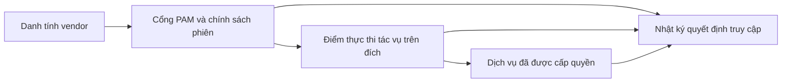

# Vendor command restriction

## 1. Mục tiêu của việc giới hạn lệnh cho vendor

Một nhà cung cấp có thể cần quyền bảo trì hệ thống mà doanh nghiệp không muốn trao toàn bộ quyền quản trị. Ví dụ, kỹ sư của hãng được phép xem trạng thái và khởi động lại dịch vụ thu thập số liệu trên hai máy thuộc một dây chuyền, nhưng không được sửa tài khoản, đọc dữ liệu kinh doanh hoặc thay đổi cấu hình ghi log.

**Vendor command restriction** là tập hợp các biện pháp giới hạn thao tác mà danh tính bên ngoài được phép thực hiện, trên đúng tài nguyên, trong đúng khoảng thời gian và điều kiện đã phê duyệt. Trong Privileged Access Management (PAM), đây là cách chuyển từ quyền “đăng nhập máy chủ” sang quyền “thực hiện một công việc bảo trì cụ thể”.

Giới hạn lệnh không chỉ là danh sách tên chương trình. Một quyết định cấp quyền cần xét cả người dùng, danh tính đặc quyền được sử dụng, máy đích, chương trình hoặc API, tham số, ngữ cảnh thực thi và hiệu lực của phiên. Cùng một chương trình có thể an toàn ở chế độ đọc trạng thái nhưng cho phép thay đổi toàn bộ hệ thống với tham số khác.

Sau bài học, người học cần có khả năng:

- Chuyển một yêu cầu hỗ trợ của vendor thành các thao tác được phép và bị cấm rõ ràng.
- Phân biệt kiểm soát tại cổng PAM với kiểm soát tại máy hoặc dịch vụ đích.
- Thiết kế allowlist theo tác vụ, ràng buộc tham số và nhận diện các đường đi vượt quyền.
- Kết hợp giới hạn lệnh với JIT, JEA, vault, thu hồi quyền và bằng chứng kiểm toán.
- Xây dựng kiểm thử cho cả thao tác hợp lệ, thao tác bị từ chối và tình huống mất thành phần kiểm soát.

## 2. Bài toán mẫu: hỗ trợ một agent thu thập số liệu

Doanh nghiệp thuê hãng Acme bảo trì phần mềm `acme-collector`. Trong cửa sổ hỗ trợ 30 phút, kỹ sư được chỉ định cần kiểm tra agent và khởi động lại khi agent mất kết nối. Phạm vi đã duyệt gồm `collector-01` và `collector-02` trong môi trường sản xuất.

Một yêu cầu như “cấp SSH để sửa agent” chưa đủ làm đầu vào cho chính sách. Nó chưa cho biết cần đọc gì, được thay đổi gì và tác động tới đâu. Bản mô tả tác vụ nên cụ thể hơn:

| Nhu cầu nghiệp vụ | Thao tác có thể cấp | Ràng buộc cần áp dụng |
|---|---|---|
| Kiểm tra agent còn chạy | Đọc trạng thái `acme-collector` | Chỉ đúng dịch vụ, đúng hai máy đã duyệt |
| Xem nguyên nhân lỗi gần đây | Đọc tối đa 200 sự kiện chẩn đoán đã chọn | Chỉ nguồn log của agent; không nhận đường dẫn tùy ý |
| Phục hồi agent | Yêu cầu restart agent | Chỉ trong cửa sổ JIT; giới hạn tần suất và số lần |
| Xác minh sau restart | Đọc kết quả kiểm tra sức khỏe | Không cho nhập URL hoặc endpoint tùy ý |
| Sửa file hệ thống hoặc cài gói | Chưa được cấp trong lượt hỗ trợ này | Phải có quy trình thay đổi khác nếu phát sinh nhu cầu |

Mục tiêu không phải tìm cách cho phép tất cả những gì vendor có thể làm. Mục tiêu là xác định tập thao tác nhỏ nhất đủ hoàn thành công việc đã phê duyệt, đồng thời kiểm tra xem quyền đó có thật sự giữ được trong môi trường đích hay không.

Nếu agent cần cấu hình mới, chính sách restart hiện tại không tự mở rộng thành quyền sửa cấu hình. Nhóm nội bộ cần đánh giá yêu cầu thay đổi, nội dung cấu hình và cách triển khai trước khi cấp tác vụ bổ sung.

## 3. Đơn vị cấp quyền nên là một thao tác có ý nghĩa

Có ba mức thường gặp khi mô tả quyền:

1. **Quyền vào hệ thống:** vendor được SSH hoặc RDP tới một máy.
2. **Quyền chạy chương trình:** vendor được chạy một số executable hoặc cmdlet.
3. **Quyền thực hiện thao tác:** vendor được xem trạng thái hoặc restart một dịch vụ cụ thể với các tham số bị giới hạn.

Mức thứ ba diễn đạt nhu cầu nghiệp vụ rõ nhất. Chương trình hoặc API là cách hiện thực thao tác đó, không nên trở thành một quyền rộng ngoài dự kiến.

Ví dụ, “được chạy công cụ quản lý dịch vụ” rộng hơn “được đọc trạng thái của `acme-collector`”. Một công cụ quản lý dịch vụ có thể có nhiều chức năng như dừng dịch vụ khác, thay đổi chế độ khởi động hoặc thao tác trên máy khác. Chỉ xét tên chương trình sẽ bỏ sót các khác biệt này.

Có thể biểu diễn yêu cầu cấp quyền như sau:

```text
Subject:     danh tính vendor đã được xác thực
Action:      collector.status | collector.logs.read | collector.restart
Resource:    collector-01/acme-collector hoặc collector-02/acme-collector
Constraints: môi trường, thời gian, tham số, giới hạn số lần
Context:     phiên PAM, ticket, phê duyệt và phiên bản chính sách
```

Một mô hình quyết định khái quát:

```text
ALLOW = danh_tính_hợp_lệ
        AND phiên_còn_hiệu_lực
        AND phê_duyệt_còn_hiệu_lực
        AND tác_vụ_nằm_trong_allowlist
        AND tài_nguyên_đúng_phạm_vi
        AND tham_số_hợp_lệ
        AND điểm_thực_thi_đáp_ứng_điều_kiện
```

Đây là mô hình tư duy, không phải cú pháp cấu hình của một sản phẩm PAM. Việc một sản phẩm có hỗ trợ từng thuộc tính hay không phải được xác nhận khi triển khai.

## 4. Kiểm soát ở đâu quyết định phạm vi bảo vệ

Một cổng PAM có thể xác thực vendor, nhận phê duyệt, cấp phiên và ghi lại hoạt động. Máy đích mới là nơi thao tác tạo ra tác động thực tế. Thiết kế cần xác định rõ thành phần nào có quyền ngăn thực thi, thay vì chỉ quan sát phiên.



Trong mô hình này, cổng PAM ràng buộc người dùng và phiên, còn điểm thực thi trên đích giới hạn tác vụ và tài nguyên. Hai lớp cần dùng cùng ngữ cảnh cấp quyền hoặc có cơ chế liên kết đáng tin cậy.

### 4.1. Lọc nội dung terminal có giới hạn

Một thành phần chỉ nhìn thấy văn bản gõ trong terminal không mặc nhiên hiểu đầy đủ hành vi thực thi. Việc diễn giải phụ thuộc vào shell, môi trường, chương trình được gọi và các tiến trình con. Một thao tác còn có thể đến từ client tự động, API hoặc kênh truyền file thay vì câu lệnh gõ tương tác.

Do đó, danh sách chuỗi bị chặn hoặc bản ghi màn hình không đủ để chứng minh rằng mọi thao tác ngoài chính sách đều bị ngăn. Nếu một giải pháp công bố có khả năng chặn lệnh, cần làm rõ nó kiểm soát kênh nào, kiểm tra trước hay sau thực thi, có quản lý tham số và tiến trình con hay không.

### 4.2. Quyền thực sự của tài khoản đích

Nếu tài khoản đích có thể mở shell quản trị tùy ý, thay đổi cơ chế phân quyền hoặc sửa chương trình thực thi chính sách, thì danh sách lệnh hẹp ở bên ngoài có thể không còn là ranh giới đủ mạnh.

Một ranh giới quyền chỉ đáng tin khi vendor không thể tự sửa nó bằng quyền đã được cấp. Vì vậy, cần kết hợp:

- Tài khoản đích có quyền nền tối thiểu.
- Cơ chế thực thi tác vụ được quản trị nội bộ và không cho vendor chỉnh sửa.
- Hạn chế đường kết nối trực tiếp không đi qua quy trình được duyệt.
- Kiểm soát tiến trình con, file, mạng hoặc API theo khả năng của nền tảng.
- Nhật ký ở nhiều lớp để đối chiếu danh tính, yêu cầu và tác động thực tế.

Không nên tuyên bố “chỉ chạy được ba lệnh” nếu vendor vẫn có thể dùng cùng credential để đăng nhập qua một kênh khác với quyền rộng hơn.

## 5. Allowlist theo tác vụ và vai trò của denylist

Allowlist bắt đầu từ tập thao tác được cấp rõ ràng; các thao tác không được mô tả sẽ bị từ chối. Denylist bắt đầu từ một tập quyền rộng rồi loại bỏ một số hành vi đã biết.

Đối với quyền đặc biệt của bên ngoài, allowlist thường phù hợp để diễn đạt phạm vi hỗ trợ hữu hạn. Denylist có thể bổ sung cảnh báo hoặc phòng vệ, nhưng khó liệt kê đầy đủ mọi cách đạt cùng một kết quả bằng công cụ khác nhau.

| Cách mô tả | Điểm mạnh | Điểm cần kiểm tra |
|---|---|---|
| Tên lệnh hoặc chuỗi văn bản | Dễ hiểu ở mức ban đầu | Có thể không xét tham số, đường dẫn, shell và kênh khác |
| Executable cùng tập đối số chính xác | Rõ hơn về hành vi được phép | Cần bảo vệ executable, môi trường và tài nguyên được tham chiếu |
| Tác vụ định nghĩa sẵn với tham số có kiểu | Gắn sát nhu cầu nghiệp vụ, giảm đầu vào tự do | Cần thiết kế và duy trì thành phần thực thi tác vụ |
| API có phân quyền theo action/resource | Có thể giới hạn thao tác và đối tượng cụ thể | Cần kiểm tra quyền của token, backend và thao tác bất đồng bộ |

Một denylist “cấm xóa file” vẫn không giải quyết được việc vendor được sửa cấu hình làm dịch vụ xóa dữ liệu sau đó. Ranh giới cần gắn với tác động và tài nguyên, không chỉ với từ khóa dễ nhận biết.

Mặc định từ chối cũng phải áp dụng khi bộ kiểm tra không hiểu yêu cầu. Nếu không phân tích được tham số, không tìm được policy hoặc không xác định được tài nguyên, hệ thống không nên chuyển sang chế độ cho phép rộng để tiếp tục phiên hỗ trợ.

## 6. Ràng buộc tham số là một phần của quyền

Giả sử hệ thống cấp tác vụ `collector.logs.read`. Nếu tác vụ nhận một đường dẫn file tùy ý thì nó có thể trở thành cơ chế đọc các file mà vendor không được phép truy cập. Nếu tác vụ nhận URL tùy ý thì nó có thể làm phát sinh truy cập mạng ngoài phạm vi.

Đầu vào cần được giới hạn theo ý nghĩa của tác vụ:

| Tham số | Kiểu và giới hạn mẫu | Lý do |
|---|---|---|
| `target` | Một trong hai mã tài nguyên đã duyệt | Không nhận tên máy, địa chỉ IP hoặc hostname tùy ý |
| `action` | Một giá trị trong danh sách cố định | Không nhận đoạn script hoặc câu lệnh tự do |
| `lines` | Số nguyên từ 1 đến 200 | Hạn chế lượng log trả về và chi phí xử lý |
| `reason` | Văn bản mô tả có giới hạn độ dài | Dùng cho bằng chứng; không được đưa vào câu lệnh để thực thi |
| `ticket` | Mã tham chiếu đã được hệ thống kiểm tra | Không coi một chuỗi ticket do client tự gửi là bằng chứng phê duyệt |

Kiểm tra cú pháp không thay thế kiểm tra quyền. Một mã máy đúng định dạng nhưng thuộc môi trường khác vẫn phải bị từ chối. Một số nguyên hợp lệ nhưng vượt hạn mức số lần restart vẫn không được chấp nhận.

Nên tách dữ liệu do vendor cung cấp và dữ liệu được tin cậy từ hệ thống:

```text
Vendor cung cấp: action, target, tham số chẩn đoán hạn chế
PAM cung cấp:    danh tính đã xác thực, session_id, approval_id
Máy đích tra cứu: tài nguyên thật, quyền tác vụ, trạng thái chính sách
```

Vendor không được tự khai `approved=true` hoặc tự gắn một vai trò quản trị vào payload để tạo hiệu lực cấp quyền.

### 6.1. Không nối chuỗi thành lệnh shell

Một adapter thực thi tác vụ nên chuyển action thành một lời gọi được định nghĩa sẵn, với tham số được kiểm tra và truyền dưới dạng dữ liệu. Không ghép đầu vào thành một đoạn shell để diễn giải lại.

Ví dụ giả mã sau mô tả hướng thiết kế, không phải chương trình sẵn sàng triển khai:

```text
handle(authenticated_session, request):
    grant = load_server_side_grant(authenticated_session.id)
    require_grant_active(grant)
    require_target_in_grant(request.target, grant)

    match request.action:
        "collector.status":
            require_no_extra_fields(request, [action, target])
            return target_adapter.read_collector_status(request.target)

        "collector.logs.read":
            require_no_extra_fields(request, [action, target, lines])
            count = require_integer_in_range(request.lines, 1, 200)
            return target_adapter.read_selected_collector_events(
                request.target, count
            )

        "collector.restart":
            require_no_extra_fields(request, [action, target])
            require_change_approval(grant)
            require_restart_budget_available(grant, request.target)
            return target_adapter.restart_fixed_collector(request.target)

        otherwise:
            deny("ACTION_NOT_GRANTED")
```

Các hàm adapter phải được kiểm soát riêng: chúng không nhận thêm tên dịch vụ, executable, script hoặc đường dẫn từ client. Cách truyền tham số an toàn không tự làm cho một API có quyền quá rộng trở nên phù hợp; backend vẫn phải bị giới hạn đúng tài nguyên và đúng thao tác.

### 6.2. Ngữ cảnh thực thi phải ổn định

Ngay cả khi đối số đã được giới hạn, hành vi có thể thay đổi theo executable được tìm thấy, thư mục làm việc, biến môi trường, file cấu hình hoặc thành phần mở rộng được nạp. Vì vậy cần xác định executable và ngữ cảnh thực thi theo cấu hình do bên nội bộ quản lý.

Vendor không nên có quyền thay thế file tác vụ, thư viện mà tác vụ nạp hoặc cấu hình quyết định tác vụ sẽ làm gì. Nếu vendor được sửa chính file dịch vụ sẽ chạy với quyền cao khi restart, quyền restart có thể gián tiếp trở thành quyền chạy nội dung do vendor lựa chọn.

## 7. Các đường mở rộng quyền cần nhận diện

Một lệnh có tên quen thuộc không đồng nghĩa với một khả năng hẹp. Khi xét allowlist, cần xem toàn bộ chức năng và các đối tượng mà thao tác có thể tiếp cận.

### 7.1. Công cụ có khả năng thực thi nội dung khác

Shell, trình thông dịch, trình quản lý gói, trình chạy tác vụ và một số công cụ chẩn đoán có thể thực thi nội dung khác. Nếu cấp một công cụ có khả năng này với đầu vào tự do, ranh giới “chỉ được chạy công cụ đó” có thể rộng gần như một phiên lập trình hoặc quản trị tổng quát.

Một số trình soạn thảo, công cụ xem nội dung hoặc giao diện tương tác cũng có chức năng gọi chương trình phụ. Việc cho phép chúng trong phiên đặc quyền cần dựa trên hành vi và cấu hình thực tế, không dựa trên tên gọi “chỉ xem”.

Giải pháp có thể là cung cấp đầu ra không tương tác, xuất báo cáo đã chọn hoặc bọc thành tác vụ có đầu vào cố định. Nếu vẫn phải cung cấp công cụ tổng quát, cần đánh giá lại mức đặc quyền của tài khoản chạy nó.

### 7.2. Tham số làm thay đổi đối tượng hoặc chế độ

Một công cụ quản lý có thể nhận tên dịch vụ, máy từ xa, file cấu hình hoặc plugin. Một tác vụ đọc trạng thái chỉ phù hợp nếu vendor không đổi được đối tượng sang dịch vụ khác hoặc kích hoạt một chế độ có tác động khác.

Giới hạn tham số bằng ký tự đại diện rộng dễ cấp nhiều hơn dự định. Ví dụ, một họ tên tài nguyên chung có thể chứa cả tài nguyên thử nghiệm và tài nguyên sản xuất nhạy cảm. Chính sách nên tham chiếu tập tài nguyên được duyệt và kiểm tra ánh xạ ở phía hệ thống.

### 7.3. File, liên kết và thay đổi sau khi kiểm tra

Nếu tác vụ chấp nhận file, việc kiểm tra một chuỗi đường dẫn chưa đủ chứng minh file thật nằm trong phạm vi. Cần xét file mà hệ điều hành thực sự mở, quyền sở hữu, liên kết, khả năng thay thế giữa lúc kiểm tra và sử dụng, cùng quyền ghi của vendor lên các thư mục liên quan.

Đây là vấn đề **time of check/time of use (TOCTOU)**: đối tượng được kiểm tra và đối tượng được sử dụng có thể không còn giống nhau. Hướng xử lý phụ thuộc nền tảng; tốt hơn là tránh cho vendor chọn đường dẫn khi tác vụ chỉ cần một nguồn dữ liệu cố định.

### 7.4. Tiến trình con, hàng đợi và lịch chạy

Chặn một yêu cầu ban đầu không giải quyết mọi tác động về sau. Một công cụ có thể tạo tiến trình con, gửi việc vào hàng đợi hoặc thiết lập tác vụ chạy sau khi phiên đã đóng.

Thiết kế cần phân biệt:

- Quyền gửi tác vụ mới.
- Quyền thực thi một tác vụ đang chờ.
- Cách xử lý tác vụ đang chạy khi quyền bị thu hồi.
- Quyền tạo cấu hình bền vững có thể làm phát sinh thực thi sau phiên.

Chính sách phiên hết hạn không tự động thu hồi mọi thay đổi bền vững đã được ghi vào hệ thống. Bởi vậy, không cấp khả năng tạo lịch chạy hoặc thay đổi cơ chế thực thi lâu dài nếu chúng không thuộc công việc đã duyệt.

### 7.5. Kênh khác ngoài terminal

Truyền file, chuyển tiếp kết nối, công cụ GUI, API quản trị hoặc tài khoản dùng chung có thể tạo đường tiếp cận khác. Một phiên được ghi hình không bảo đảm mọi kênh đó đã bị kiểm soát.

Đối với phiên GUI, khái niệm “lệnh được phép” cần chuyển thành quyền của ứng dụng, quyền trên tài nguyên hoặc các hành động được cung cấp sẵn. Hướng dẫn vendor “chỉ bấm nút này” là quy trình làm việc, chưa phải ranh giới cưỡng chế kỹ thuật.

## 8. Kết hợp JIT, JEA và tài khoản được quản lý bằng vault

Ba lớp này giải quyết các câu hỏi khác nhau:

| Lớp kiểm soát | Câu hỏi chính | Ví dụ trong tình huống agent |
|---|---|---|
| JIT — Just-in-Time | Quyền có hiệu lực khi nào? | Chỉ trong cửa sổ hỗ trợ 30 phút |
| JEA — Just Enough Administration | Được thực hiện những thao tác nào? | Xem trạng thái, đọc log chọn lọc, restart đúng agent |
| Vault và quản lý credential | Danh tính đích được sử dụng và bảo vệ ra sao? | Broker dùng credential quản lý; vendor không cần biết secret dài hạn |
| Giám sát phiên | Ai đã yêu cầu và thực hiện thao tác gì? | Liên kết danh tính vendor với yêu cầu và kết quả |

Một quyền rộng tồn tại trong 30 phút vẫn là quyền rộng. Một tác vụ hẹp tồn tại vô thời hạn vẫn có rủi ro tích lũy. Do đó cần kết hợp giới hạn thời gian và giới hạn khả năng.

Với tài khoản nằm trong vault, việc không hiển thị mật khẩu cho vendor giúp giảm một đường lộ credential, nhưng không làm biến mất quyền mà phiên có thể sử dụng. Nếu broker vẫn cấp một shell quản trị toàn quyền thì vendor có khả năng rộng trong suốt phiên dù không biết mật khẩu.

Luân chuyển credential sau phiên cũng không thay thế thu hồi phiên. Một kết nối đã được xác thực hoặc một tác vụ đã được chấp nhận có thể còn tồn tại tùy cơ chế đích. Quy trình đóng quyền cần kiểm tra cả grant, phiên, token, kết nối đang mở và các tác vụ đã được tạo.

### 8.1. Không dùng một profile cho mọi vendor

Một profile cần gắn với vai trò hỗ trợ và hệ thống cụ thể. Vendor bảo trì agent không mặc nhiên có quyền quản lý cơ sở dữ liệu hoặc mạng. Kỹ sư từ cùng một công ty cũng không mặc nhiên có cùng phê duyệt.

Nên ánh xạ danh tính cá nhân đã xác thực tới grant và account đích. Nếu có account đích dùng chung do giới hạn kỹ thuật, phải giữ được liên kết giữa từng thao tác và người thật trong phiên PAM; đồng thời đánh giá nguy cơ các phiên đồng thời ảnh hưởng lẫn nhau.

## 9. Mẫu chính sách theo tác vụ

Mẫu dưới đây là **tài liệu thiết kế minh họa**, không phải schema của sản phẩm PAM, sudo hoặc JEA. Mọi tên tài nguyên, mã ticket và mã phiên đều là dữ liệu giả.

```yaml
policy_id: vendor-acme-collector-support
policy_version: 3
default_decision: deny

subject_scope:
  vendor_org: acme-support
  role: collector-support-engineer
  require_named_identity: true

resource_scope:
  environment: production
  target_ids:
    - collector-01
    - collector-02
  service_id: acme-collector

grant_requirements:
  require_active_approval: true
  maximum_window_minutes: 30
  require_managed_session: true

operations:
  collector.status:
    parameters: none
  collector.logs.read:
    parameters:
      lines:
        type: integer
        minimum: 1
        maximum: 200
  collector.restart:
    parameters: none
    require_change_approval: true
    maximum_attempts_per_target_per_grant: 2

execution_requirements:
  generic_shell: false
  arbitrary_file_transfer: false
  arbitrary_network_forwarding: false
  vendor_may_modify_task_definition: false

audit_requirements:
  record_authorization_decision: true
  record_operation_result: true
  correlate_session_and_target_events: true
```

Từng thuộc tính phải có điểm thực thi tương ứng. Nếu adapter không kiểm tra số lần restart, thì `maximum_attempts_per_target_per_grant` mới chỉ là ý định trên giấy. Nếu cổng không kiểm soát được một kênh phụ, thuộc tính `false` không tự làm kênh đó biến mất.

Hạn mức số lần phải được cập nhật theo cách tránh hai yêu cầu đồng thời cùng vượt qua kiểm tra rồi cùng thực thi. Cần quy định cách xử lý retry, yêu cầu lặp và việc tác vụ đã được chấp nhận nhưng client chưa nhận kết quả. Đối với thao tác thay đổi trạng thái, nên có mã yêu cầu để nhận diện lần gửi lại và tránh thực thi trùng ngoài ý muốn.

## 10. Áp dụng trên các loại hệ thống

### 10.1. Máy Linux hoặc Unix

Cần phân biệt quyền đăng nhập, quyền thực thi chương trình và quyền nâng đặc quyền. Một tài khoản đăng nhập ít quyền có thể được cấp một tập tác vụ đặc quyền hẹp thông qua cơ chế do máy đích thực thi.

Nếu sử dụng sudo hoặc cơ chế tương đương, cần kiểm tra chính xác chương trình, đối số, người dùng thực thi, môi trường và quyền ghi lên mọi thành phần liên quan. Cho phép một script do vendor có thể sửa không tạo ra ranh giới đủ tin cậy, dù đường dẫn script nằm trong allowlist.

Không coi việc cấp một shell đặc quyền thông qua một lệnh “được phép” là giới hạn tác vụ. Nếu công việc chỉ cần restart agent, cơ chế đích nên biểu diễn được đúng hành động đó và không nhận lệnh tùy ý từ vendor.

### 10.2. Máy Windows

Trong môi trường Windows, có thể thiết kế endpoint quản trị hạn chế theo tác vụ, chẳng hạn một endpoint JEA phù hợp với nhu cầu. Phải kiểm tra cả command/cmdlet, tham số, đối tượng được quản lý và danh tính thực thi ở backend.

Việc một tên cmdlet xuất hiện trong danh sách cho phép chưa chứng minh rằng mọi tổ hợp tham số của nó đều phù hợp. Những khả năng như chạy script tùy ý, thao tác từ xa hoặc gọi chương trình ngoài cần được đánh giá theo quyền thực tế của endpoint.

Nếu vendor dùng RDP với tài khoản quản trị rộng, một tài liệu mô tả “chỉ dùng công cụ quản lý dịch vụ” không tự giới hạn các thao tác khác của tài khoản đó. Cần có cơ chế quyền hoặc ứng dụng thực sự cưỡng chế phạm vi đã duyệt.

### 10.3. Thiết bị mạng và công cụ quản trị chuyên dụng

Một số nền tảng có phân quyền theo command hoặc command set. Khi sử dụng, cần kiểm tra chế độ vận hành, ngữ cảnh cấu hình, tham số và các thao tác gián tiếp như thay đổi chính sách xác thực hoặc xuất cấu hình chứa thông tin nhạy cảm.

Không giả định cơ chế phân quyền lệnh của mọi hãng có cùng cách phân tích và cùng độ chi tiết. Chính sách phải được kiểm thử trên đúng nền tảng đích và cấu hình sẽ vận hành.

### 10.4. Cloud, Kubernetes và API

Khi thao tác đi qua API, ranh giới phù hợp thường là action/verb cùng resource, namespace, project hoặc tenant. Hạn chế câu lệnh ở máy client nhưng cấp token API rộng có thể để lại quyền ngoài phạm vi.

Ví dụ, nhu cầu đọc trạng thái một workload không mặc nhiên bao gồm quyền thực thi bên trong workload, tạo workload mới hoặc sửa danh tính của nó. Cần đánh giá các quyền có thể tạo ra khả năng thực thi gián tiếp, thay vì chỉ kiểm tra câu lệnh mà vendor dự định dùng.

Tương tự, quyền khởi động một tác vụ tự động hóa phụ thuộc vào nội dung tác vụ, phiên bản, tham số và danh tính mà tác vụ sẽ sử dụng. Tên tác vụ có vẻ vô hại không đủ làm bằng chứng về quyền thực tế.

## 11. Quản lý ngoại lệ khi vendor cần thao tác mới

Trong phiên hỗ trợ, vendor có thể phát hiện rằng tập tác vụ hiện tại không đủ. Quy trình ngoại lệ cần giúp công việc tiếp tục nhưng vẫn giữ được phạm vi và trách nhiệm.

Một luồng phù hợp gồm:

1. Vendor mô tả chẩn đoán còn thiếu, tác vụ cần bổ sung và tài nguyên liên quan.
2. Chủ hệ thống đánh giá tác động, dữ liệu có thể tiếp cận và phương án hẹp hơn.
3. Người có thẩm quyền phê duyệt đúng thay đổi quyền trong thời gian xác định.
4. Nhóm quản trị cập nhật một profile được kiểm soát hoặc cấp grant mới với phiên bản chính sách rõ ràng.
5. Kiểm tra hiệu lực của quyền mới và thu hồi các quyền ngoại lệ khi công việc kết thúc.

Không nên biến một yêu cầu đọc thêm log thành quyền quản trị toàn bộ chỉ để giảm thời gian cấu hình. Có thể nhờ nhân sự nội bộ thực hiện một thao tác và cung cấp kết quả đã được kiểm tra nếu đó là phương án đủ đáp ứng nhu cầu.

Quyền khẩn cấp cần một cơ chế riêng có người chịu trách nhiệm, thời gian sống, bằng chứng và rà soát sau sử dụng. Nếu phải cấp quyền quản trị tổng quát trong một tình huống đã được chấp thuận, cần ghi nhận đúng mức quyền đó; không mô tả nó như một phiên vẫn bị giới hạn chặt theo ba tác vụ ban đầu.

## 12. Thu hồi quyền và kết thúc phiên

Thu hồi không chỉ là tắt một nút “Allow” tại cổng. Cần xác định các lớp có thể giữ trạng thái cấp quyền:

| Lớp | Việc cần kiểm tra khi thu hồi |
|---|---|
| Grant/phê duyệt | Ngăn cấp yêu cầu mới theo grant đã bị thu hồi |
| Phiên PAM | Kết thúc hoặc khóa phiên theo quy trình đã định |
| Token hoặc credential | Thu hồi hoặc luân chuyển theo cơ chế đích |
| Kết nối đang mở | Xác minh có còn dùng được sau thay đổi credential hay không |
| Tác vụ đang chờ | Xác định phải hủy hay kiểm tra quyền lại trước khi chạy |
| Tác vụ đang chạy | Quy định dừng, hoàn tất có kiểm soát hoặc chuyển cho nội bộ |
| Thay đổi bền vững | Kiểm tra không để lại tài khoản, lịch chạy hay cấu hình ngoài phạm vi |

Không phải tác vụ nào cũng nên bị giết ngay khi phiên hết hạn. Dừng đột ngột một thao tác bảo trì có thể gây trạng thái không hoàn chỉnh. Chính sách phải định nghĩa trước việc hết hạn có nghĩa là ngăn yêu cầu mới, hủy tác vụ chờ hay dừng tác vụ đang chạy, cùng cách xử lý an toàn cho từng loại thao tác.

Quyền cần được kiểm tra ở thời điểm phù hợp với tác động. Đối với tác vụ chạy qua hàng đợi, kiểm tra khi nhận yêu cầu có thể chưa đủ nếu đến lúc thực thi thì grant đã bị thu hồi. Việc kiểm tra lại và truyền ngữ cảnh cấp quyền phải do hệ thống đáng tin cậy thực hiện.

Kết thúc hỗ trợ cần có kết quả nghiệp vụ: agent đã phục hồi hay chưa, thao tác nào đã xảy ra, có quyền ngoại lệ nào còn mở và ai nhận bàn giao nếu sự cố chưa được xử lý xong.

## 13. Bằng chứng kiểm toán: quyết định và tác động phải nối được với nhau

Bản ghi phiên hữu ích nhưng không thay thế nhật ký quyết định phân quyền và kết quả ở máy đích. Một bằng chứng tốt cho phép trả lời: ai yêu cầu, được cấp quyền theo đâu, hệ thống quyết định gì và điều gì thực sự xảy ra.

Một event minh họa:

```json
{
  "event_id": "evt-demo-1042",
  "session_id": "pam-demo-208",
  "request_id": "req-demo-771",
  "subject_id": "vendor-engineer-demo",
  "vendor_org": "acme-support",
  "approval_id": "approval-demo-92",
  "ticket_id": "SUP-DEMO-314",
  "policy_id": "vendor-acme-collector-support",
  "policy_version": 3,
  "target_id": "collector-01",
  "action": "collector.restart",
  "decision": "ALLOW",
  "execution_state": "COMPLETED",
  "result_code": "SERVICE_HEALTHY",
  "parameters_profile": "fixed-service-no-freeform-command"
}
```

Trong hệ thống thật, cần thêm thời điểm, nguồn tạo event và thông tin bảo vệ tính toàn vẹn phù hợp. Trạng thái `ALLOW` không có nghĩa tác vụ đã thành công. Một yêu cầu có thể được cho phép nhưng thất bại khi thực thi; cũng có thể được chấp nhận và còn đang chạy. Nhật ký nên phân biệt các giai đoạn này.

Nội dung log và đầu ra chẩn đoán có thể chứa dữ liệu nhạy cảm. Không đưa password, private key, token hoặc secret vào đối số, mô tả ticket hay event. Việc lọc đầu ra cần được thiết kế theo dữ liệu nguồn; không thể mặc định rằng mọi bí mật đều sẽ bị che chính xác chỉ vì phiên được ghi lại.

Quyền đọc và quyền xóa bằng chứng cũng cần tách khỏi quyền hỗ trợ của vendor. Một người dùng có thể thực hiện tác vụ nhưng không được sửa nhật ký chứng minh tác vụ đó.

Nếu chính sách yêu cầu phải ghi được quyết định trước khi thực thi, cần định nghĩa hành vi khi nơi lưu bằng chứng không khả dụng. Có thể dùng cơ chế đệm được bảo vệ nếu thiết kế cho phép; không âm thầm bỏ ghi log rồi tiếp tục cấp thao tác đặc quyền. Cơ chế đó phải được kiểm thử, bao gồm giới hạn dung lượng và cách đồng bộ lại.

## 14. Ma trận kiểm thử trước khi vận hành

Kiểm thử phải chứng minh cả những gì vendor làm được và những gì bị từ chối. Chỉ chạy thành công một lệnh hợp lệ chưa đủ xác nhận giới hạn quyền.

| Ca kiểm thử | Kỳ vọng | Bằng chứng cần thu |
|---|---|---|
| Đọc trạng thái agent trên `collector-01` trong grant | Cho phép | Event quyết định, kết quả và danh tính phiên |
| Đọc 100 sự kiện đã chọn | Cho phép | Đúng nguồn log, số lượng và profile đầu ra |
| Đọc log với `lines=201` | Từ chối trước thực thi | Mã lý do giới hạn tham số |
| Yêu cầu trạng thái trên máy ngoài grant | Từ chối | Đối tượng đích và lý do không thuộc phạm vi |
| Thêm field tên dịch vụ khác | Từ chối | Parser không âm thầm nhận tham số ngoài schema |
| Gửi một chuỗi tự do thay cho action | Từ chối | Không có đường chuyển sang shell |
| Yêu cầu restart khi chỉ có quyền chẩn đoán | Từ chối | Thiếu quyền thay đổi dù phiên còn hiệu lực |
| Restart vượt ngân sách của grant | Từ chối | Hạn mức được kiểm tra kể cả yêu cầu đồng thời |
| Gửi lại cùng yêu cầu thay đổi sau khi client mất kết nối | Theo quy tắc chống lặp đã định | Có liên kết cùng request, không tạo tác động trùng ngoài ý muốn |
| Grant hết hạn hoặc bị thu hồi | Ngăn yêu cầu mới | Thời điểm thu hồi và quyết định tại đích |
| Tác vụ trong hàng đợi đến lượt sau thu hồi | Theo quy tắc thu hồi đã định | Kiểm tra quyền lại hoặc bằng chứng hủy |
| Đăng nhập trực tiếp bằng kênh ngoài quy trình | Bị ngăn theo thiết kế truy cập | Bằng chứng ở mạng, đích hoặc cơ chế xác thực |
| Vendor thử sửa định nghĩa tác vụ | Từ chối | Quyền sở hữu và kiểm soát thay đổi |
| Thành phần cấp quyền hoặc ghi bằng chứng bị lỗi | Theo chế độ lỗi đã định, không tự mở rộng quyền | Quyết định lỗi và cơ chế phục hồi |

Các kiểm thử có thể ảnh hưởng dịch vụ cần thực hiện trên môi trường đã được cho phép với tài nguyên thử nghiệm. Không lấy việc chạy được lệnh gây tác động trên sản xuất làm cách mặc định để chứng minh chính sách.

Ngoài kiểm thử chức năng, cần kiểm tra thay đổi cấu hình. Một bản nâng cấp công cụ hoặc thay đổi adapter có thể thêm tham số, chế độ hoặc hành vi mới. Chính sách đã kiểm thử cho phiên bản trước không tự chứng minh được phiên bản mới vẫn giữ nguyên phạm vi.

## 15. Tình huống phân tích: restart nhưng không được sửa file dịch vụ

Vendor có quyền `collector.restart` và được phép tải file cấu hình mới lên thư mục mà agent nạp khi khởi động. Hai quyền này có vẻ tách biệt, nhưng tác động kết hợp phụ thuộc vào agent xử lý file như thế nào.

Nếu file chỉ chứa dữ liệu cấu hình trong schema hẹp được kiểm tra, rủi ro có thể được kiểm soát bằng quy trình thay đổi phù hợp. Nếu file có thể khai báo module, chương trình phụ hoặc nguồn thực thi tùy ý, vendor có thể gián tiếp thay đổi hành vi của tiến trình đặc quyền khi restart.

Phân tích cần trả lời:

1. Ai có quyền ghi file và thư mục cha?
2. File được xác thực hoặc kiểm tra theo schema nào?
3. Agent đọc file bằng danh tính có quyền gì?
4. Nội dung file chỉ là dữ liệu hay có thể dẫn tới thực thi?
5. Thay đổi cần phê duyệt riêng hay đã thuộc grant hiện tại?

Trong tình huống của bài, quyền cập nhật cấu hình chưa được cấp. Vendor nên cung cấp đề xuất thay đổi cho nhóm nội bộ qua quy trình được duyệt. Nhóm nội bộ có thể triển khai bản cấu hình đã kiểm tra, còn grant hỗ trợ tiếp tục chỉ bao gồm các tác vụ đã xác định.

Bài học ở đây là quyền không chỉ nằm ở một command. Nó còn nằm ở dữ liệu đầu vào, thành phần được nạp và sự kết hợp giữa các khả năng mà cùng một danh tính đang sở hữu.

## 16. Sai lầm thường gặp và cách điều chỉnh

### “Có session recording nên đã kiểm soát lệnh”

Recording hỗ trợ quan sát và điều tra. Chỉ khi có cơ chế quyết định và ngăn thực thi phù hợp mới có thể khẳng định thao tác ngoài phạm vi bị chặn. Cần chỉ ra điểm cưỡng chế và kiểm thử hành vi bị từ chối.

### “Chỉ mở quyền trong thời gian ngắn nên có thể cấp admin”

JIT giảm khoảng thời gian quyền tồn tại, nhưng không giảm khả năng của quyền trong khoảng đó. Nếu tác vụ có thể biểu diễn hẹp, cần áp dụng cả giới hạn thời gian và tác vụ.

### “Chỉ cho một executable là đủ”

Executable có thể nhận tham số làm thay đổi chức năng hoặc nạp nội dung khác. Cần kiểm tra đối số, tài nguyên, môi trường và quyền sửa thành phần mà executable sử dụng.

### “Không cho biết password thì không thể vượt phạm vi”

Vendor vẫn sử dụng quyền được ủy quyền qua phiên hoặc broker. Credential được vault bảo vệ là một lớp riêng; nó không thay thế ràng buộc tác vụ tại đích.

### “Tắt phiên là mọi tác động dừng ngay”

Một tác vụ đã chạy, token đang dùng hoặc cấu hình bền vững có thể còn hiệu lực. Quy trình thu hồi phải có chính sách cho các trạng thái đó và bằng chứng xác nhận.

### “Mọi lỗi đều cho phép tiếp tục để không gián đoạn hỗ trợ”

Một nhánh xử lý lỗi cho phép rộng có thể vô hiệu hóa toàn bộ giới hạn. Cần xác định trước khi nào dừng, khi nào dùng cơ chế dự phòng đã được phê duyệt và ai nhận trách nhiệm xử lý.

## 17. Bài tập thực hành thiết kế

Một vendor cần hỗ trợ agent trên ba máy thử nghiệm. Công việc gồm xem trạng thái, đọc tối đa 150 sự kiện và restart tối đa một lần trên mỗi máy. Không được sửa file, thay cấu hình dịch vụ hoặc mở kết nối tới máy khác. Cửa sổ hỗ trợ kéo dài 20 phút; restart cần phê duyệt thay đổi, còn đọc trạng thái và log chỉ cần phê duyệt chẩn đoán.

Hãy tạo một tài liệu thiết kế có các phần sau:

1. Danh tính cá nhân, tổ chức vendor và cách gắn với phiên quản lý.
2. Các action cùng tập tài nguyên chính xác được cấp.
3. Tham số có kiểu, khoảng giá trị, các field không được nhận và quyền backend.
4. Cách kiểm tra hạn mức restart với hai yêu cầu đồng thời.
5. Cách xử lý grant hết hạn khi tác vụ còn đang chờ hoặc đang chạy.
6. Event cho phép, từ chối và kết quả thực thi; dữ liệu cần loại khỏi log.
7. Tối thiểu ba kiểm thử cho phép và sáu kiểm thử từ chối hoặc lỗi.

Một phương án đáp ứng yêu cầu cần tách grant chẩn đoán với quyền restart, giới hạn log ở nguồn cố định và tối đa 150 sự kiện, đồng thời không cho vendor truyền tên dịch vụ hoặc câu lệnh tùy ý. Hạn mức restart phải gắn với từng máy và grant; hai yêu cầu đồng thời không được cùng tiêu thụ một quyền còn lại.

Khi đánh giá bài làm, hãy tìm một bằng chứng cụ thể cho mỗi ràng buộc: thành phần nào ngăn sửa file, thành phần nào giới hạn máy đích, nơi nào kiểm tra phê duyệt và nơi nào ghi nhận tác động. Nếu câu trả lời chỉ là “vendor đã đồng ý không làm”, ràng buộc đó mới dừng ở cam kết quy trình.

## 18. Tự kiểm tra kiến thức

**Câu 1. Vì sao quyền chạy công cụ quản lý dịch vụ chưa tương đương quyền restart một agent?**

Vì công cụ có thể có nhiều thao tác, nhiều đối tượng và tham số mở rộng. Quyền cần được giới hạn vào đúng action, đúng dịch vụ và đúng máy, cùng các điều kiện của grant.

**Câu 2. Có thể dùng regex trên văn bản terminal làm bằng chứng duy nhất cho giới hạn lệnh không?**

Không nên coi đó là bằng chứng đủ. Cần biết điểm thực thi thực sự kiểm soát những gì và kiểm thử cả các kênh, tham số, tiến trình con hoặc hành vi diễn giải liên quan trong phạm vi hệ thống.

**Câu 3. Vì sao vendor không được sửa script nằm trong allowlist?**

Nếu script được thực thi với quyền cao, khả năng sửa nội dung script có thể cho phép vendor quyết định nội dung chạy bằng quyền đó. Đường dẫn không đổi không có nghĩa hành vi không đổi.

**Câu 4. Thay mật khẩu sau phiên có đủ để đóng mọi quyền truy cập không?**

Không thể mặc định như vậy. Cần kiểm tra grant, phiên, token, kết nối đã xác thực và tác vụ đã tạo theo cơ chế của đích. Credential rotation và session revocation có mục tiêu khác nhau.

**Câu 5. Nếu vendor cần thêm một thao tác ngoài allowlist thì làm gì?**

Ghi rõ nhu cầu và tác động, đánh giá phương án hẹp, lấy phê duyệt phù hợp rồi cấp quyền bổ sung có thời hạn và phiên bản chính sách xác định. Không tự mở rộng grant từ một yêu cầu hỗ trợ chung.

**Câu 6. Điều gì chứng minh chính sách giới hạn lệnh đã vận hành?**

Các ràng buộc có điểm cưỡng chế thực tế, kiểm thử hợp lệ và bị từ chối cho kết quả mong đợi, cùng bằng chứng liên kết được danh tính, phê duyệt, quyết định và tác động ở đích. Một file policy hoặc bản ghi màn hình đơn lẻ chưa đủ trả lời toàn bộ các câu hỏi này.

Vendor command restriction đạt mục tiêu khi kỹ sư hoàn thành được công việc được duyệt mà không cần sở hữu một năng lực quản trị rộng hơn công việc đó. Tác vụ có ý nghĩa, quyền đích tối thiểu, điều kiện JIT/JEA và bằng chứng nối được từ người dùng tới kết quả là các thành phần phải được thiết kế cùng nhau.
