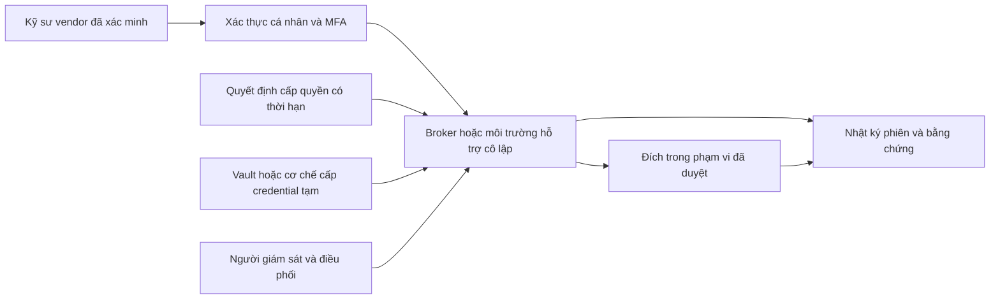

# Emergency vendor access — Truy cập khẩn cấp của nhà cung cấp

## 1. Mục tiêu và bối cảnh

Khi hệ thống quan trọng bị gián đoạn, doanh nghiệp có thể cần kỹ sư của nhà cung cấp can thiệp ngay: phân tích lỗi thiết bị, phục hồi dịch vụ, xử lý sự cố phần mềm hoặc hỗ trợ điều tra. Áp lực thời gian thường dẫn đến các yêu cầu như “mở VPN trước”, “gửi tài khoản quản trị” hoặc “tắt kiểm soát để sửa cho nhanh”. Nếu thiếu quy trình được chuẩn bị từ trước, một sự cố vận hành có thể tạo thêm sự cố về đặc quyền.

**Emergency vendor access** là việc cho phép một cá nhân bên nhà cung cấp truy cập tài nguyên đã xác định trong một tình huống khẩn cấp, theo thẩm quyền khẩn cấp đã được tổ chức thiết lập. Quyền đó có mục đích, phạm vi, thời hạn, người chịu trách nhiệm và bằng chứng riêng. Đây không phải loại tài khoản quản trị được để sẵn cho mọi kỹ sư hỗ trợ.

Trong quản lý truy cập đặc quyền — Privileged Access Management (PAM) — mục tiêu là rút ngắn thời gian hỗ trợ nhưng vẫn trả lời được:

- Ai được phép tham gia và doanh nghiệp đã xác minh họ bằng cách nào?
- Họ cần thực hiện thao tác gì trên tài nguyên nào?
- Ai chịu trách nhiệm cho quyết định cấp quyền?
- Phiên nào đang hoạt động, ai có thể ngắt phiên?
- Khi công việc kết thúc, quyền và khả năng truy cập còn tồn tại ở đâu?

Sau bài học, người học có thể thiết kế một luồng cấp quyền khẩn cấp, lựa chọn cách hỗ trợ phù hợp với rủi ro, xử lý trường hợp PAM không sẵn sàng và xác minh việc thu hồi quyền sau phiên làm việc.

Các tên hệ thống, mốc thời gian và mã yêu cầu dưới đây là ví dụ minh họa. Chúng không phải ngưỡng bắt buộc hoặc cấu hình áp dụng chung cho mọi sản phẩm.

## 2. Xác định khi nào thực sự cần truy cập khẩn cấp

### 2.1. Tình trạng khẩn cấp cần có căn cứ

Một yêu cầu được đưa vào luồng khẩn cấp khi tác động của sự cố và thời gian cần xử lý đáp ứng tiêu chí do tổ chức ban hành. Ví dụ: dịch vụ thanh toán đang gián đoạn, cơ chế phục hồi nội bộ không giải quyết được và cần chuyên môn độc quyền của nhà cung cấp.

Việc nhà cung cấp muốn hoàn thành công việc trong ca trực, quên đặt lịch bảo trì hoặc cần quyền rộng hơn cho tiện không tự tạo ra thẩm quyền khẩn cấp. Cũng không thể chỉ dựa vào việc người yêu cầu chọn mức “critical” trong cổng hỗ trợ của họ. Doanh nghiệp phải xác nhận tác động trên dịch vụ của mình.

Trước khi mở quyền, người điều phối sự cố cần ghi nhận tối thiểu:

1. Dịch vụ bị ảnh hưởng và tác động đang diễn ra.
2. Lý do cần nhà cung cấp thay vì đội nội bộ tự xử lý.
3. Nhiệm vụ cụ thể mà nhà cung cấp cần thực hiện.
4. Mức độ khẩn cấp và người có thẩm quyền kích hoạt quy trình.

Nếu có thể bắt đầu bằng tư vấn qua cuộc gọi và để quản trị viên nội bộ thao tác, cách này thường giảm nhu cầu mở một đường truy cập mới. Tuy nhiên, tư vấn viên vẫn có thể nhìn thấy thông tin nhạy cảm qua màn hình chia sẻ; cần giới hạn nội dung được hiển thị và kiểm soát việc ghi hình.

### 2.2. Phân biệt các khái niệm dễ bị đánh đồng

| Khái niệm | Ý nghĩa | Áp dụng với nhà cung cấp |
|---|---|---|
| Truy cập hỗ trợ thông thường | Được lên lịch, đi qua quy trình cấp quyền bình thường | Có thể dùng quyền JIT và phiên có giám sát |
| Truy cập khẩn cấp | Được kích hoạt vì sự cố và áp dụng thẩm quyền khẩn cấp đã có | Cần một quyết định riêng cho từng người, đích và thời hạn |
| Break-glass | Cơ chế truy cập dự phòng khi đường kiểm soát thông thường không đáp ứng tình huống | Không đồng nghĩa được đưa tài khoản dự phòng nội bộ cho vendor |
| Tài khoản dịch vụ | Danh tính phục vụ ứng dụng hoặc tác vụ tự động | Không dùng làm tài khoản tương tác của kỹ sư hỗ trợ |
| Gia hạn quyền | Quyết định cho phép tiếp tục truy cập sau hạn ban đầu | Phải có lý do và phê duyệt mới theo chính sách, không âm thầm nối dài |

Khẩn cấp mô tả tình huống và thẩm quyền xử lý; break-glass mô tả một cơ chế dự phòng. Một phiên khẩn cấp vẫn có thể đi hoàn toàn qua PAM đang hoạt động bình thường.

## 3. Chuẩn bị trước khi xảy ra sự cố

Một luồng khẩn cấp hiệu quả phải được thiết kế khi hệ thống còn ổn định. Nếu đến lúc sự cố mới tìm danh sách liên hệ, tạo chính sách hoặc quyết định ai được duyệt, đội vận hành sẽ bị đẩy vào lựa chọn vội vàng.

### 3.1. Chuẩn bị danh tính, đầu mối và điều kiện hỗ trợ

Với từng nhà cung cấp quan trọng, cần duy trì:

- Đầu mối hỗ trợ chính thức, kênh xác minh độc lập và cơ chế xác nhận kỹ sư đang được phân công.
- Người bảo trợ nội bộ, chủ dịch vụ và tuyến trực thay thế khi người chính không phản hồi.
- Điều kiện truy cập, nghĩa vụ bảo mật, quy định ghi phiên và xử lý dữ liệu đã được thống nhất.
- Phương thức xác thực, yêu cầu thiết bị và mô hình kết nối đã được thử nghiệm.
- Tài nguyên có thể hỗ trợ từ xa và tài nguyên cần người nội bộ trực tiếp thao tác.
- Quy tắc xử lý khi danh tính liên kết, vault, broker hoặc hệ thống ghi phiên không sẵn sàng.

Danh sách liên hệ chỉ có ích khi còn chính xác và được truy xuất được trong lúc các hệ thống nội bộ gặp sự cố. Bản dự phòng của thông tin liên hệ phải được bảo vệ; nó không được biến thành một danh sách chứa luôn mật khẩu khẩn cấp.

Có thể chuẩn bị trước danh tính nhưng giữ ở trạng thái vô hiệu hóa hoặc chưa có quyền. Danh tính chuẩn bị sẵn vẫn cần được rà soát vòng đời, tránh giữ tài khoản của kỹ sư đã nghỉ việc hoặc chuyển nhiệm vụ.

### 3.2. Chuẩn bị chính sách quyền thay vì chuẩn bị quyền thường trực

Tổ chức nên xây dựng các gói hỗ trợ nhỏ, chẳng hạn:

- Xem chỉ số sức khỏe và log đã giới hạn.
- Kiểm tra cấu hình của một dịch vụ xác định.
- Khởi động lại đúng dịch vụ được phép.
- Thực hiện một thay đổi khôi phục đã được chấp thuận.

Mỗi gói cần xác định đích, thao tác, điều kiện kích hoạt, thời hạn và cách thu hồi. Một gói “vendor-admin” áp dụng cho toàn bộ máy chủ không thể hiện được nhu cầu hỗ trợ cụ thể.

**JIT — Just-in-Time** giúp quyền chỉ tồn tại trong cửa sổ đã duyệt. **JEA — Just Enough Administration** giới hạn tác vụ quản trị cần thực hiện. Hai cách này bổ sung cho nhau: quyền tồn tại ngắn nhưng có thể làm mọi việc vẫn rất nguy hiểm; quyền nhỏ nhưng không bao giờ hết hạn cũng tạo dư lượng truy cập.

### 3.3. Chuẩn bị đường đóng quyền

Ngay khi thiết kế đường vào, phải thiết kế đường ra. Người trực cần biết cách:

- Dừng phiên trên broker và kiểm tra phiên tương ứng trên hệ thống đích.
- Thu hồi vai trò, lease, chứng thư hoặc token tạm.
- Gỡ kết nối mạng được mở riêng cho yêu cầu.
- Xử lý credential đã bị lộ cho người hỗ trợ.
- Thu gom tệp chẩn đoán và xác minh không còn công cụ truy cập được cài thêm.

Đóng quyền cần có người thay thế và cảnh báo thất bại. Không để việc thu hồi phụ thuộc duy nhất vào chính kỹ sư vendor đang cần kết thúc ca trực.

## 4. Phân công trách nhiệm trong lúc khẩn cấp

Một người có thể kiêm nhiệm một số vai trò nếu chính sách cho phép, nhưng trách nhiệm phải được ghi nhận rõ. Các quyết định rủi ro cao nên có sự kiểm tra độc lập phù hợp với quy trình của tổ chức.

| Vai trò | Trách nhiệm chính | Bằng chứng cần có |
|---|---|---|
| Người điều phối sự cố | Xác nhận tình trạng khẩn cấp, điều phối mục tiêu và thời gian xử lý | Incident ID, tác động, quyết định kích hoạt |
| Chủ dịch vụ hoặc chủ tài nguyên | Xác nhận đích và mức quyền cần thiết | Danh sách đích, thao tác được phép, giới hạn dữ liệu |
| Người phê duyệt khẩn cấp | Chấp thuận phạm vi và rủi ro theo thẩm quyền | Danh tính người duyệt, thời điểm, nội dung được duyệt |
| Người vận hành PAM | Cấp quyền đúng quyết định, kiểm tra hiệu lực và thu hồi | Grant ID, thời hạn, kết quả cấp và đóng quyền |
| Người giám sát phiên | Theo dõi thao tác, xác nhận thay đổi phạm vi, ngắt phiên khi cần | Session ID, nhật ký quyết định, sự kiện bất thường |
| Kỹ sư nhà cung cấp | Sử dụng danh tính cá nhân, làm đúng nhiệm vụ đã duyệt | Danh tính, mã ca hỗ trợ, hoạt động trong phiên |
| Đội an ninh hoặc ứng phó sự cố | Đánh giá dấu hiệu xâm nhập và yêu cầu bảo toàn bằng chứng | Đánh giá rủi ro, chỉ dẫn bảo toàn hoặc cô lập |

Trong mô hình nhỏ, người vận hành PAM có thể đồng thời giám sát phiên. Với phiên đặc biệt nhạy cảm, nên tách người phê duyệt khỏi người thực thi để giảm khả năng tự cấp quyền ngoài kiểm soát.

Nhà cung cấp có thể đề xuất phạm vi nhưng không tự phê duyệt quyền trên tài nguyên của doanh nghiệp. Tương tự, sự hiện diện của người điều phối trong cuộc gọi không mặc nhiên có nghĩa mọi thao tác phát sinh đều được chấp thuận.

## 5. Quy trình cấp quyền khẩn cấp

### 5.1. Bước 1 — Mở hồ sơ sự cố và mô tả yêu cầu

Yêu cầu cần gắn với một hồ sơ có định danh. Trong giai đoạn đầu, hồ sơ có thể được ghi trên kênh dự phòng được tổ chức chấp nhận, sau đó đối soát vào hệ thống chính khi phục hồi.

Ví dụ một yêu cầu đủ cụ thể:

> Cho phép kỹ sư Nguyễn A của nhà cung cấp X xem log và kiểm tra trạng thái dịch vụ trên hai máy ứng dụng trong 30 phút, thông qua broker của doanh nghiệp. Chưa cho phép thay đổi cấu hình, sao chép dữ liệu hoặc kết nối tới cơ sở dữ liệu.

Các mốc 30 phút hay hai máy chỉ minh họa cho tính cụ thể. Thời hạn thực tế phải đủ ngắn để kiểm soát nhưng vẫn đáp ứng nhiệm vụ, dựa trên mức nhạy cảm và kế hoạch xử lý.

Tránh các mô tả như “toàn quyền đến khi xong”, “mở tất cả máy cùng cụm” hoặc “cho tài khoản kỹ thuật của vendor”. Những mô tả này không xác định được ai, làm gì và khi nào phải đóng quyền.

### 5.2. Bước 2 — Xác minh nhà cung cấp và kỹ sư

Kiểm tra tối thiểu ba quan hệ:

1. Doanh nghiệp thực sự có một ca hỗ trợ liên quan đến sự cố.
2. Nhà cung cấp thực sự phân công cá nhân đó.
3. Cá nhân đang đăng nhập khớp với người đã được xác minh.

Có thể đối chiếu mã ca trên cổng hỗ trợ chính thức và gọi lại đầu mối đã biết từ trước. Không dùng duy nhất số điện thoại hoặc đường dẫn trong tin nhắn vừa yêu cầu quyền để xác minh chính tin nhắn đó.

Một địa chỉ email có tên miền đúng hoặc việc người gọi biết số ca hỗ trợ chưa đủ để chứng minh thẩm quyền. Trong sự cố, thông tin có thể đã được chuyển tiếp rộng hoặc bị lộ.

Nếu nghi ngờ tài khoản vendor bị chiếm đoạt, không tiếp tục dựa vào cùng tài khoản đó để xác minh. Cần một kênh độc lập và sự tham gia của đội an ninh; cấp quyền mạnh hơn để “sửa lỗi đăng nhập” có thể mở rộng sự cố.

### 5.3. Bước 3 — Chọn cách hỗ trợ ít đặc quyền nhất

Có thể cân nhắc theo thứ tự:

1. Vendor hướng dẫn, quản trị viên nội bộ thực hiện tác vụ.
2. Vendor có quyền xem thông tin chẩn đoán đã giới hạn.
3. Vendor chạy một số tác vụ quản trị được kiểm soát.
4. Vendor có phiên đặc quyền rộng hơn trên đúng đích, trong thời gian ngắn và có giám sát tăng cường.

Đây là cách cân nhắc, không phải yêu cầu phải thử lần lượt mọi phương án trong mọi sự cố. Người điều phối có thể chọn ngay phương án đáp ứng tình huống nếu nêu rõ lý do và được duyệt đúng thẩm quyền.

Quyền đọc log cũng không luôn có rủi ro thấp. Log có thể chứa dữ liệu khách hàng, chuỗi kết nối hoặc token. Cần giới hạn nguồn log, thời gian, trường dữ liệu và khả năng tải tệp khi phù hợp.

### 5.4. Bước 4 — Phê duyệt đúng phạm vi

Quyết định phê duyệt nên thể hiện:

- Danh tính cá nhân và đơn vị hỗ trợ.
- Tài nguyên và môi trường: production, staging hay hệ thống phục hồi.
- Thao tác được phép và những thay đổi cần duyệt bổ sung.
- Thời điểm bắt đầu, hạn kết thúc và thời lượng phiên.
- Điều kiện thiết bị, xác thực và kết nối.
- Người giám sát, người có thể ngắt phiên và đường liên hệ khi mất kiểm soát.
- Ngoại lệ được chấp thuận, biện pháp bù đắp và người chịu trách nhiệm.

Nếu quy trình có tuyến phê duyệt khẩn cấp đơn giản hơn tuyến thông thường, tuyến đó phải được xác định từ trước. Việc bổ sung hồ sơ sau sự cố không tự hợp thức hóa một lần cấp quyền vốn không có thẩm quyền.

Không liên hệ được người phê duyệt chính thì dùng tuyến thay thế đã có. Nếu không có người có thẩm quyền khả dụng, ưu tiên phương án hỗ trợ không đòi hỏi cấp quyền mới; báo người chỉ huy sự cố quyết định theo cơ chế khẩn cấp của tổ chức, thay vì để người vận hành tự phê duyệt.

### 5.5. Bước 5 — Cấp quyền và kiểm tra trước khi bàn giao phiên

Cấp quyền qua tài khoản cá nhân hoặc danh tính khách được quản lý. Khi hệ thống đích bắt buộc sử dụng một tài khoản quản trị chung, PAM cần gắn việc sử dụng tài khoản đó với danh tính cá nhân đã xác thực và phiên cụ thể. Tài khoản dùng chung trên đích không được làm mất khả năng truy nguyên người sử dụng.

Ưu tiên broker hoặc cơ chế chèn credential để vendor không phải nhận mật khẩu. Khả năng che giấu credential phụ thuộc kiến trúc và sản phẩm; không được giả định rằng dùng broker thì người có quyền cao trên đích không thể tiếp cận thông tin bí mật bằng cách khác.

Trước khi bắt đầu, người vận hành xác minh:

- Quyền thực tế không vượt phạm vi được duyệt.
- Đích ngoài danh sách bị chặn.
- Cơ chế hết hạn, dừng phiên và thu hồi đã sẵn sàng.
- Người giám sát nhìn thấy đúng phiên.
- Các nguồn bằng chứng cần thiết đang hoạt động.
- Công cụ và tệp dự kiến đưa vào đã đi qua quy trình kiểm tra tương ứng.

Giới hạn IP nguồn hoặc đường mạng chỉ là một lớp kiểm soát; nó không thay thế xác thực cá nhân, MFA và giới hạn quyền.

## 6. Kiến trúc tham chiếu và điều kiện phiên

Một mô hình thường dùng là đưa kỹ sư qua một điểm vào do doanh nghiệp kiểm soát, rồi từ đó tới đích được duyệt:



Đây là mô hình khái niệm. Sản phẩm cụ thể có thể tách hoặc gộp các thành phần; không phải broker nào cũng kiểm soát được mọi giao thức hoặc mọi hoạt động trên hệ thống đích.

### 6.1. Kiểm soát thiết bị và đường kết nối

Nếu máy của vendor không đáp ứng điều kiện, có thể cấp một môi trường làm việc cô lập do doanh nghiệp quản lý. Môi trường đó vẫn cần hạn chế clipboard, tải tệp, kết nối ra ngoài và lưu trữ cục bộ theo nhiệm vụ.

Không mở trực tiếp dịch vụ quản trị ra Internet chỉ vì broker đang chậm hoặc nhà cung cấp quen dùng một công cụ khác. Đường dự phòng cần được chuẩn bị, giới hạn và phê duyệt riêng.

Với công cụ hỗ trợ từ xa của vendor, phải đánh giá cả đường điều khiển, quyền cài đặt, dịch vụ nền, cơ chế tự khởi động và khả năng tiếp tục truy cập sau phiên. Cửa sổ chia sẻ màn hình đã đóng không chứng minh agent hỗ trợ đã bị gỡ hoặc vô hiệu hóa.

### 6.2. Giới hạn tác vụ và dữ liệu

Tùy năng lực hệ thống, có thể áp dụng:

- Chỉ cho phép kết nối tới một tập đích.
- Chỉ cho phép một số tác vụ hoặc lệnh đã được kiểm tra.
- Chặn hoặc duyệt riêng việc tải lên, tải xuống và chuyển tệp.
- Hạn chế truy cập kho bí mật và vùng dữ liệu ngoài nhu cầu.
- Chỉ cho phép triển khai công cụ đã xác minh nguồn và tính toàn vẹn.

Danh sách lệnh cho phép không đương nhiên bảo đảm an toàn nếu lệnh đó có khả năng chạy chương trình phụ, mở shell, sửa script hoặc nhận đường dẫn tùy ý. Phải xem xét quyền thực tế của tác vụ, không chỉ tên lệnh.

Tương tự, giới hạn kết nối trên broker không ngăn mọi di chuyển ngang nếu đích đã cho phép người dùng mở kết nối mới. Cần kết hợp phân đoạn mạng và kiểm soát trên đích.

### 6.3. Thời hạn có nhiều lớp

Một phiên có thể liên quan đến nhiều đồng hồ khác nhau:

| Lớp | Cần hết hiệu lực ở đâu? | Điều cần xác minh |
|---|---|---|
| Quyết định phê duyệt | Hồ sơ cấp quyền | Không dùng lại quyết định cho lần hỗ trợ mới |
| Vai trò hoặc nhóm tạm | Hệ thống phân quyền | Quyền đã được gỡ và thay đổi đã có hiệu lực |
| Credential hoặc token | Hệ thống phát hành và hệ thống chấp nhận | Thời hạn, khả năng thu hồi và bộ nhớ đệm |
| Phiên kết nối | Broker và đích | Phiên đang mở có bị kết thúc hay vẫn hoạt động |
| Kết nối mạng ngoại lệ | Firewall, gateway hoặc đường hầm | Rule và đường hầm không còn cho phép vào |
| Công cụ hỗ trợ | Dịch vụ, agent hoặc tác vụ trên đích | Không còn đường tái kết nối trái phạm vi |

Hết hạn vai trò không bảo đảm phiên đã mở bị ngắt. Đổi mật khẩu cũng không bảo đảm mọi token, SSH session hoặc kết nối cơ sở dữ liệu hiện có bị vô hiệu hóa. Phải kiểm tra theo hành vi của từng hệ thống.

## 7. Điều hành phiên đang hoạt động

### 7.1. Thống nhất ranh giới trước thao tác đầu tiên

Khi bắt đầu, người giám sát nhắc lại đích, nhiệm vụ và giới hạn. Vendor cần báo trước các thao tác thay đổi trạng thái như khởi động lại dịch vụ, sửa cấu hình, cài công cụ hoặc xuất tệp.

Nếu từ chẩn đoán chuyển sang thay đổi, cần kiểm tra xem quyền thay đổi đã được duyệt hay chưa. Thẩm quyền truy cập và thẩm quyền thay đổi liên quan với nhau nhưng không thay thế nhau: đăng nhập được không có nghĩa được triển khai mọi bản sửa.

Ví dụ, quyền xem log không tự bao gồm quyền khởi động lại dịch vụ. Khi cần mở rộng, ghi lý do, phạm vi bổ sung và quyết định tương ứng trước khi tiếp tục thao tác đó.

### 7.2. Theo dõi sự kiện cần can thiệp

Các tín hiệu đáng chú ý gồm:

- Truy cập đích không liên quan đến sự cố.
- Tìm kiếm bí mật, xuất dữ liệu hàng loạt hoặc thay đổi cấu hình logging.
- Tạo tài khoản, khóa truy cập, lịch chạy hoặc dịch vụ tồn tại lâu dài.
- Cài công cụ điều khiển từ xa ngoài kế hoạch.
- Đề nghị người nội bộ gửi mật khẩu qua chat.
- Có phiên đồng thời hoặc danh tính không khớp người đang hỗ trợ.

Khi xuất hiện tín hiệu nghiêm trọng, người giám sát phải có khả năng dừng hoạt động ngay. Sau đó phối hợp cô lập, bảo toàn bằng chứng và đánh giá tác động. Không tiếp tục để vendor thao tác chỉ vì dịch vụ chưa phục hồi.

Việc ngắt một phiên nghi ngờ cần cân nhắc cả an toàn và trạng thái giao dịch đang thực hiện. Runbook nên chỉ rõ quyền quyết định và cách xử lý tác vụ không thể ngắt đột ngột mà không gây tác động thêm.

### 7.3. Gia hạn là một quyết định mới

Trước khi thời hạn hết, hệ thống nên cảnh báo cho người điều phối và người vận hành. Nếu nhiệm vụ còn cần tiếp tục, yêu cầu gia hạn nêu rõ:

- Đã làm được gì và vì sao chưa kết thúc.
- Phạm vi còn cần thiết.
- Thời gian bổ sung và người giám sát tiếp theo.
- Rủi ro mới phát hiện trong phiên.

Không gia hạn tự động theo số lần hoạt động bàn phím, trạng thái “ticket chưa đóng” hoặc việc vendor vẫn đang trong cuộc gọi. Nếu không được gia hạn hợp lệ, quyền phải kết thúc theo thiết kế; việc bàn giao và lưu tiến độ nên được thực hiện trước hạn để giảm gián đoạn.

## 8. Khi PAM hoặc hệ thống liên quan không sẵn sàng

### 8.1. Xác định thành phần bị lỗi

“PAM hỏng” có thể là nhiều tình huống khác nhau:

- Không truy cập được giao diện yêu cầu nhưng broker và phiên đang hoạt động vẫn tốt.
- IdP hoặc MFA bị lỗi nên không xác thực được.
- Vault không cấp được credential.
- Broker không kết nối được đích.
- Bộ ghi phiên lỗi hoặc không chuyển được log về nơi lưu trữ.
- Toàn bộ đường quản trị bị gián đoạn.

Mỗi trường hợp có cách xử lý khác nhau. Không cần mở một đường truy cập ngoài kiểm soát nếu chỉ giao diện ticket không hoạt động và tổ chức đã có kênh phê duyệt dự phòng.

### 8.2. Chọn đường dự phòng đã được phê duyệt

Các phương án có thể gồm:

1. Quản trị viên nội bộ dùng cơ chế khẩn cấp và trực tiếp thực hiện dưới hướng dẫn của vendor.
2. Dùng gateway dự phòng có cùng yêu cầu danh tính và giới hạn đích.
3. Dùng tài khoản hoặc credential khẩn cấp theo quy trình bảo quản và xuất dùng riêng.
4. Sử dụng quyền tạm trên một đích cô lập với người nội bộ giám sát liên tục.

Chỉ chọn phương án mà tổ chức đã cho phép và còn đáp ứng được mức rủi ro chấp nhận. Không có cơ chế dự phòng phù hợp là một thiếu sót cần được người chỉ huy sự cố xử lý theo thẩm quyền, không phải giấy phép để người vận hành bỏ mọi kiểm soát.

Credential khẩn cấp của doanh nghiệp không nên được chia sẻ cho vendor nếu một người nội bộ có thể thực hiện tác vụ. Khi thực sự phải tiết lộ theo quyết định có thẩm quyền, phải ghi nhận người nhận, phạm vi sử dụng và kế hoạch luân chuyển sau đó; mật khẩu không được chép vào hồ sơ sự cố hoặc bản ghi cuộc gọi.

### 8.3. Xử lý mất ghi phiên và mất log

Ghi phiên giúp điều tra nhưng không thay thế nhật ký thay đổi và bằng chứng trên đích. Ngược lại, một bản ghi màn hình cũng không thể hiện đầy đủ mọi hoạt động nền hoặc lưu lượng phát sinh.

Nếu cơ chế ghi phiên không hoạt động, cần xem chính sách có cho phép tiếp tục hay không. Biện pháp bù đắp có thể là người giám sát thứ hai, ghi nhật ký thao tác theo thời gian, lưu audit trên đích và hạn chế quyền mạnh hơn. Những biện pháp này không tự động tương đương với cơ chế bị mất.

Nếu không còn khả năng xác định ai truy cập hoặc ghi nhận thao tác quan trọng, không tự mở phiên vendor. Chuyển sang hỗ trợ do người nội bộ thực hiện hoặc trình người có thẩm quyền quyết định phương án thay thế phù hợp.

Khi nghi ngờ sự cố do tấn công, mọi phương án dự phòng phải phối hợp với đội ứng phó sự cố để tránh làm mất chứng cứ hoặc cho phép kẻ tấn công dùng cùng đường truy cập.

## 9. Thu hồi quyền và chứng minh đã đóng

### 9.1. Điều kiện kết thúc

Phiên khẩn cấp cần kết thúc khi nhiệm vụ hoàn thành, hết thời hạn, người giám sát không còn khả dụng, xuất hiện hoạt động ngoài phạm vi hoặc quyết định cấp quyền bị thu hồi.

Đóng hồ sơ hỗ trợ của vendor không đồng nghĩa đóng quyền trong hệ thống của doanh nghiệp. Ngược lại, kết thúc phiên truy cập không nhất thiết nghĩa sự cố đã được giải quyết; hai trạng thái cần được theo dõi riêng.

### 9.2. Trình tự thu hồi

Một trình tự có thể gồm:

1. Thông báo kết thúc, lưu trạng thái công việc và bằng chứng cần thiết.
2. Chặn tạo phiên mới bằng grant đang dùng.
3. Kết thúc phiên trên broker và xác minh các phiên tương ứng trên đích.
4. Thu hồi vai trò tạm, credential, chứng thư hoặc token có liên quan.
5. Gỡ rule mạng, đường hầm và quyền truy cập tệp đã cấp riêng.
6. Vô hiệu hóa danh tính tạm hoặc đưa danh tính chuẩn bị sẵn về trạng thái đã quy định.
7. Luân chuyển bí mật đã tiết lộ hoặc có căn cứ bị tiếp cận ngoài kiểm soát.
8. Kiểm tra thay đổi và khả năng tồn tại của đường truy cập mới.
9. Ghi bằng chứng xác minh đóng quyền và chuyển phần việc còn lại cho người chịu trách nhiệm.

Thứ tự chi tiết phải phù hợp hệ thống. Trong tình huống nghi ngờ xâm nhập, đội ứng phó có thể cần chặn truy cập ngay và bảo toàn trạng thái theo kế hoạch điều tra.

Luân chuyển credential phải tính đến ứng dụng hoặc tác vụ đang sử dụng nó. Không đổi mù quáng một bí mật dùng chung rồi gây thêm gián đoạn. Xác định phụ thuộc, cập nhật bên sử dụng và xác minh vận hành, đồng thời giới hạn truy cập trong thời gian chuyển đổi.

### 9.3. Xác minh bằng kiểm tra độc lập

Không chỉ dựa vào thông báo “revoke thành công” của một thành phần. Cần đối chiếu kết quả với lớp thực thi phù hợp:

- Grant không còn và không thể tạo phiên mới theo grant cũ.
- Không còn session liên quan trên broker và đích.
- Quyền trên đích đã hết hiệu lực sau khi tính đến bộ nhớ đệm.
- Các credential phát sinh đã hết hạn, bị thu hồi hoặc được luân chuyển theo kế hoạch.
- Không có tài khoản, khóa, dịch vụ, tác vụ hoặc agent hỗ trợ trái phạm vi còn lại.
- Kết nối mạng ngoại lệ đã đóng.
- Tệp chẩn đoán được xử lý theo quyết định lưu giữ hoặc xóa đã có.

Kiểm tra cần được thực hiện theo cách an toàn và có kiểm soát; không yêu cầu vendor giữ một credential đã thu hồi để tự thử lại ngoài phiên giám sát.

Nếu một lớp chưa thể thu hồi, hồ sơ chưa được đánh dấu đã đóng hoàn toàn. Ghi rõ dư lượng quyền, giới hạn bù đắp, người xử lý, hạn xử lý và cơ chế theo dõi.

## 10. Bằng chứng và hồ sơ mẫu

Một bộ bằng chứng cần đủ để dựng lại quyết định và hoạt động mà không chứa bí mật không cần thiết. Ví dụ sau minh họa dữ liệu hồ sơ, không phải schema hoặc cấu hình của một sản phẩm:

```yaml
incidentId: INC-DEMO-042
vendorCaseId: SUP-DEMO-118
reason: "Dịch vụ xử lý đơn hàng không khởi động sau sự cố"
vendor:
  organization: "Nhà cung cấp X"
  individualIdentity: "vendor-engineer-a"
  verification:
    method: "Đối chiếu ca hỗ trợ và gọi lại đầu mối đã đăng ký"
    verifiedBy: "internal-sponsor"
request:
  targets:
    - app-recovery-01
  tasks:
    - inspect-service-status
    - read-scoped-diagnostic-logs
  dataTransfer: "Không cho phép nếu chưa có duyệt bổ sung"
approval:
  authority: "emergency-access-approver"
  approvedAt: "2026-01-15T02:10:00Z"
  validUntil: "2026-01-15T02:40:00Z"
  scopeExpansion: "Cần quyết định bổ sung"
execution:
  grantId: GRANT-DEMO-09
  sessionIds:
    - SESSION-DEMO-31
  observer: "internal-operator"
  evidenceReferences:
    - EVIDENCE-DEMO-LOG-01
    - EVIDENCE-DEMO-RECORDING-01
closure:
  newSessionsBlocked: true
  targetSessionsTerminated: true
  temporaryPrivilegesRemoved: true
  networkExceptionRemoved: true
  credentialDisposition: "Không tiết lộ credential; lease đã bị thu hồi"
  residualAccess: []
  verifiedBy: "internal-verifier"
  verifiedAt: "2026-01-15T02:38:00Z"
```

Không đưa mật khẩu, token, khóa riêng hoặc dữ liệu khách hàng thô vào hồ sơ mẫu thực tế. Dùng tham chiếu tới kho bằng chứng có kiểm soát quyền. Người được xem ticket không mặc nhiên được xem toàn bộ bản ghi phiên.

Cần lưu mối liên hệ giữa Incident ID, Vendor Case ID, Grant ID, Session ID và sự kiện trên đích. Ghi thời gian kèm múi giờ; theo dõi sai lệch đồng hồ khi nguồn log không đồng bộ để tránh dựng sai trình tự.

Thời hạn lưu giữ bằng chứng được xác định theo chính sách, hợp đồng và yêu cầu áp dụng của tổ chức. Không đặt một con số chung cho mọi loại dữ liệu. Nếu có yêu cầu bảo toàn phục vụ điều tra, việc xóa phải tuân theo quyết định bảo toàn đó.

## 11. Tình huống thực hành: nhà cung cấp cần sửa lỗi trong production

### 11.1. Bối cảnh

Lúc 09:00, dịch vụ xử lý đơn hàng ngừng hoạt động. Nhóm nội bộ đã kiểm tra kết nối cơ bản và nghi ngờ lỗi trong thành phần do nhà cung cấp X phát triển. Vendor yêu cầu một tài khoản quản trị và quyền tải toàn bộ thư mục log để phân tích.

Trong tình huống này, yêu cầu ban đầu vượt thông tin đã biết: chưa chứng minh cần toàn quyền quản trị hoặc cần xuất tất cả log.

### 11.2. Quyết định cấp quyền

Người điều phối mở hồ sơ sự cố và xác nhận tác động. Người bảo trợ kiểm tra ca hỗ trợ qua kênh chính thức, xác minh kỹ sư được phân công và yêu cầu họ mô tả thông tin cần thu thập.

Chủ dịch vụ xác định chỉ cần xem trạng thái và log của một ứng dụng trên một máy. Người phê duyệt chấp thuận phiên chẩn đoán 25 phút qua broker, có quản trị viên nội bộ giám sát và không cho tải tệp mặc định.

PAM cấp quyền JIT tới đúng đích. Kỹ sư đăng nhập bằng danh tính cá nhân và MFA. Người vận hành kiểm tra khả năng ngắt phiên và bằng chứng trước khi cho thao tác.

### 11.3. Phát sinh thay đổi phạm vi

Sau 10 phút, vendor xác định cần thay một tham số cấu hình rồi khởi động lại dịch vụ. Quyền chẩn đoán ban đầu chưa bao gồm thay đổi này.

Nhóm ghi nhận tham số cần đổi, giá trị trước và sau, tác động dự kiến, cách hoàn nguyên và điều kiện kiểm tra. Người có thẩm quyền phê duyệt thay đổi theo quy trình khẩn cấp. Nếu tác vụ phù hợp để người nội bộ thực hiện, vendor tiếp tục hướng dẫn thay vì nhận thêm quyền rộng.

Việc cần thêm thông tin chẩn đoán cũng được xử lý tương tự: xác định dữ liệu tối thiểu, rà soát nội dung nhạy cảm và duyệt đường chuyển, không tự mở tải cả thư mục log.

### 11.4. Kết thúc và đối soát

Dịch vụ phục hồi ở phút thứ 20. Nhóm không để quyền tồn tại cho đủ 25 phút nếu nhiệm vụ đã kết thúc. Người vận hành chặn phiên mới, đóng phiên hiện tại và thu hồi quyền tạm. Người xác minh kiểm tra trên broker, hệ thống đích và rule mạng.

Hồ sơ ghi lại thay đổi thực tế, kết quả kiểm tra dịch vụ, bằng chứng thu hồi và việc xử lý tệp chẩn đoán. Sau đó đội vận hành thực hiện hậu kiểm sự cố và lập kế hoạch sửa gốc. Kết quả khôi phục nhanh không thay thế bằng chứng đã đóng quyền.

## 12. Các lỗi thiết kế thường gặp

| Lỗi | Hệ quả | Cách cải thiện |
|---|---|---|
| Dùng một tài khoản vendor cho nhiều người | Khó truy nguyên cá nhân và khó thu hồi riêng | Danh tính cá nhân, liên kết rõ với phiên và tài khoản đích |
| Chỉ có thời hạn trên ticket | Quyền hoặc phiên thực tế có thể tiếp tục | Thực thi thời hạn ở lớp quyền, phiên và mạng phù hợp |
| Chấp thuận mọi thay đổi sau khi đã xảy ra | Không kiểm soát được phạm vi tác động | Xác định quyền khẩn cấp trước và duyệt phần mở rộng |
| Đặt toàn bộ bằng chứng trên chính máy gặp sự cố | Có thể mất hoặc bị sửa cùng hệ thống | Chuyển bằng chứng tới nơi lưu độc lập có kiểm soát |
| Tin rằng MFA đủ để bỏ giám sát | Tài khoản hợp lệ vẫn có thể bị lạm dụng | Kết hợp MFA, giới hạn quyền, giới hạn đích và giám sát |
| Cho quyền đọc rộng vì cho rằng không thể gây hại | Có thể lộ dữ liệu và bí mật | Giới hạn nội dung và khả năng xuất dữ liệu |
| Chỉ đóng gateway | Phiên hoặc token tại đích có thể còn | Xác minh thu hồi từng lớp liên quan |
| Giữ quyền để tiện hỗ trợ tiếp | Tạo đặc quyền thường trực | Đóng khi xong; lần tiếp theo tạo yêu cầu mới |
| Quên agent hoặc khóa hỗ trợ được tạo trong phiên | Có thể còn đường truy cập sau khi ticket đóng | Kiểm kê thay đổi và xác minh khả năng tái kết nối |
| Để “break-glass” không có người chịu trách nhiệm | Không rõ ai được dùng và ai phải đóng | Xác định thẩm quyền, người bảo quản, người thực thi và người xác minh |

## 13. Diễn tập và đánh giá khả năng sẵn sàng

Diễn tập nên thực hiện trong môi trường thử nghiệm hoặc theo kế hoạch đã được chấp thuận. Không tự làm gián đoạn PAM production để thử quy trình.

Một kịch bản diễn tập hữu ích bao gồm:

1. Người phê duyệt chính không khả dụng.
2. Kỹ sư vendor được thay giữa ca hỗ trợ.
3. Cần mở rộng từ chẩn đoán sang thay đổi.
4. Cơ chế ghi phiên bị gián đoạn.
5. Quyền hết hạn khi phiên đang mở.
6. Thu hồi vai trò thành công nhưng phiên trên đích vẫn tồn tại.
7. Phát hiện một agent hỗ trợ chưa được đưa vào kế hoạch.

Khi đổi kỹ sư, phải xác minh người mới và cấp quyền riêng. Không chuyển giao tài khoản, MFA hoặc phiên đang mở như một cách bàn giao ca.

Các chỉ số nên phản ánh cả tốc độ và khả năng kiểm soát:

- Thời gian từ yêu cầu hợp lệ tới lúc bắt đầu hỗ trợ.
- Tỷ lệ phiên có liên kết đầy đủ danh tính, quyết định cấp quyền và bằng chứng.
- Số lần mở rộng phạm vi hoặc gia hạn và lý do tương ứng.
- Thời gian thu hồi sau khi nhiệm vụ kết thúc.
- Số trường hợp còn quyền, phiên hoặc đường kết nối sau khi thu hồi.
- Số ngoại lệ cần hậu kiểm và thời gian hoàn tất biện pháp khắc phục.

Không tối ưu riêng thời gian mở quyền bằng cách bỏ xác minh hoặc đặt thời hạn rất dài. Cần đo cả thời gian khôi phục dịch vụ và mức dư lượng truy cập sau sự cố.

## 14. Câu hỏi tự kiểm tra

1. Vì sao mức ưu tiên cao trên ca hỗ trợ của vendor chưa đủ để kích hoạt quyền khẩn cấp của doanh nghiệp?
2. Nếu broker đang hoạt động nhưng cổng yêu cầu quyền bị lỗi, cần xác minh gì trước khi chọn đường dự phòng?
3. Quyền JIT hết hạn có bảo đảm một phiên quản trị đang mở bị ngắt hay không? Cần kiểm tra ở những lớp nào?
4. Khi vendor muốn chuyển từ đọc log sang sửa cấu hình, ai cần quyết định và bằng chứng nào cần được bổ sung?
5. Vì sao bản ghi màn hình không thay thế hoàn toàn nhật ký thay đổi hoặc log trên đích?
6. Có thể đóng hồ sơ truy cập khi đã gỡ nhóm quyền nhưng chưa xác minh các token và agent hỗ trợ hay chưa?
7. Nếu nghi ngờ danh tính vendor bị xâm nhập, tại sao không nên dùng chính tài khoản đó làm kênh xác minh duy nhất?
8. Khi PAM không sẵn sàng, điều kiện nào cho phép dùng cơ chế khẩn cấp và ai chịu trách nhiệm cho ngoại lệ?

Một phương án truy cập khẩn cấp được kiểm soát phải nối liền năm việc: xác minh đúng cá nhân, quyết định đúng thẩm quyền, cấp đúng phạm vi và thời gian, quan sát được hoạt động, xác minh được việc thu hồi. Nếu thiếu một mắt xích, việc phục hồi dịch vụ có thể để lại một đường truy cập đặc quyền mà doanh nghiệp không còn theo dõi được.
