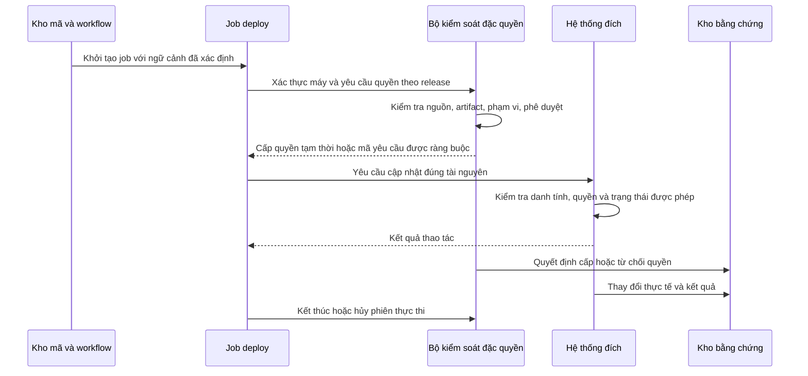

# Deploy privilege: kiểm soát đặc quyền triển khai trong DevOps và CI/CD

## 1. Mục tiêu bài học

Một pipeline triển khai có thể thay đổi mã đang chạy, cấu hình dịch vụ và cách ứng dụng sử dụng dữ liệu. Vì vậy, quyền deploy vào môi trường nhạy cảm phải được xem là một dạng đặc quyền cần quản lý bằng PAM, kể cả khi pipeline không sử dụng tài khoản quản trị có tên quen thuộc như `root` hay `Administrator`.

Sau bài học này, người học có thể:

- Nhận diện quyền trực tiếp và quyền gián tiếp mà một pipeline deploy nắm giữ.
- Tách danh tính build, deploy và runtime để giới hạn phạm vi ảnh hưởng.
- Thiết kế quyền triển khai theo ứng dụng, môi trường, thao tác và thời gian.
- Kết hợp phê duyệt, danh tính máy, credential ngắn hạn và kiểm tra tại đích.
- Xác định bằng chứng cần lưu, cách thu hồi và cách xử lý khi một lần deploy gặp sự cố.

Phạm vi bài học là quản lý truy cập đặc quyền cho hoạt động triển khai. Các quy trình kiểm thử phần mềm, đánh giá mã và kiểm tra chuỗi cung ứng được đề cập khi chúng quyết định một yêu cầu deploy có đủ điều kiện nhận quyền hay không.

## 2. Deploy privilege thực sự cho phép làm gì?

**Deploy privilege là khả năng tạo ra hoặc thay đổi một trạng thái chạy trong một phạm vi được xác định.** Phạm vi có thể là một dịch vụ, một nhóm máy, một namespace hoặc một môi trường. Thao tác có thể là đưa phiên bản mới vào chạy, thay đổi cấu hình, điều chỉnh số bản sao hoặc khôi phục phiên bản đã được phê duyệt.

Một câu như “pipeline chỉ có quyền deploy” chưa đủ để đánh giá rủi ro. Cần hỏi tiếp: deploy cái gì, vào đâu, bằng danh tính nào, được thay đổi trường nào và trạng thái mới sẽ thừa hưởng quyền gì?

Ví dụ, pipeline không có quyền đọc trực tiếp cơ sở dữ liệu nhưng được thay image của dịch vụ thanh toán bằng một image tùy ý. Image mới chạy dưới danh tính runtime có quyền đọc dữ liệu thanh toán. Khi đó, pipeline có thể gián tiếp đưa mã vào một vị trí có khả năng đọc dữ liệu. Việc không cấp quyền đọc database cho chính danh tính deploy chưa loại bỏ đường truy cập gián tiếp này.

### 2.1. Phân biệt các loại quyền

| Loại quyền | Ví dụ khả năng | Rủi ro cần xem xét |
|---|---|---|
| Quyền điều phối pipeline | Sửa workflow, chọn runner, chạy lại job | Thay đổi cách hoặc nơi credential được sử dụng |
| Quyền build | Lấy source, tạo và đẩy artifact | Tạo artifact giả hoặc thay artifact trên một tham chiếu có thể ghi lại |
| Quyền deploy | Cập nhật phiên bản của dịch vụ | Đưa mã hoặc cấu hình mới vào môi trường nhạy cảm |
| Quyền quản trị nền tảng | Sửa role, policy, cấu hình cluster hoặc hệ điều hành | Tự mở rộng quyền và ảnh hưởng nhiều ứng dụng |
| Quyền runtime | Ứng dụng truy cập dữ liệu và dịch vụ phụ thuộc | Mã được triển khai sử dụng các quyền này sau khi chạy |
| Quyền quản lý bằng chứng | Sửa hoặc xóa log triển khai | Che giấu ai đã triển khai gì và bằng quyền nào |

Các quyền này có thể nằm trong nhiều hệ thống khác nhau. Một đánh giá PAM phải xem cả chuỗi, thay vì chỉ đọc role gắn vào tài khoản deploy.

### 2.2. Quyền triển khai thường rộng hơn tên gọi

Những khả năng sau có thể biến một role deploy tưởng là hẹp thành đặc quyền rất lớn:

- Chọn tùy ý tài khoản hoặc danh tính mà workload sẽ chạy.
- Thêm mount chứa secret hoặc đổi cấu hình để gửi dữ liệu ra một đích khác.
- Chạy lệnh tùy ý trên máy đích dưới danh tính có quyền cao.
- Cập nhật mọi dịch vụ trong môi trường, dù pipeline chỉ phụ trách một ứng dụng.
- Sửa chính sách phân quyền hoặc cơ chế xác minh trước triển khai.
- Tạo một tác vụ nền có tuổi thọ dài hơn lần deploy.
- Sửa bộ thu log hoặc tắt kiểm tra bảo mật.

Vì vậy, kiểm soát deploy phải bao gồm cả **các thuộc tính của trạng thái đích được phép tạo ra**, không chỉ tên API hay tên lệnh được gọi.

## 3. Mô hình quyền: ai, làm gì, ở đâu, trong điều kiện nào?

Một yêu cầu deploy nên được mô tả đủ cụ thể để bên cấp quyền và hệ thống đích cùng kiểm tra.

| Chiều kiểm soát | Ví dụ cho một yêu cầu hợp lệ |
|---|---|
| Chủ thể | Danh tính job deploy của ứng dụng `payment-api` |
| Nguồn yêu cầu | Workflow được quản lý, chạy từ nguồn đã được bảo vệ |
| Tài nguyên | Dịch vụ `payment-api` trong môi trường production |
| Hành động | Cập nhật artifact sang digest đã phê duyệt |
| Giới hạn trường | Giữ danh tính runtime và cấu hình đặc quyền hiện có |
| Điều kiện | Kiểm tra bắt buộc đạt, phê duyệt còn hiệu lực |
| Thời gian | Chỉ trong cửa sổ thực thi ngắn của lần deploy |
| Bằng chứng | Gắn với release, job, artifact và quyết định cấp quyền |

Mô hình này giúp phân biệt hai câu:

> “Tài khoản ci-admin được quyền quản trị production.”

và:

> “Job deploy đã xác thực của payment-api được cập nhật đúng dịch vụ payment-api sang digest được phê duyệt, trong cửa sổ cho phép, với các trường đặc quyền bị khóa.”

Câu thứ hai vẫn cần được hiện thực hóa ở tầng chính sách và ở đích. Chỉ ghi một mô tả đẹp trong tài liệu không làm quyền thực tế trở nên hẹp hơn.

### 3.1. Quyền hữu hiệu không chỉ là role của pipeline

Khi phân tích quyền hữu hiệu, cần xét đồng thời:

1. Role và policy của danh tính deploy.
2. Khả năng dùng credential từ runner.
3. Những trường cấu hình được phép thay đổi.
4. Các quyền mà workload mới sẽ thừa hưởng.
5. Những thao tác phụ được controller hoặc dịch vụ triển khai thực hiện thay.
6. Đường vượt qua quy trình, chẳng hạn dùng trực tiếp một credential quản trị cũ.

Một job có role hạn chế vẫn có thể tạo rủi ro cao nếu nó điều khiển đầu vào cho một dịch vụ trung gian chạy bằng quyền quản trị. Dịch vụ trung gian phải xác thực và giới hạn đầu vào ở phía server; không thể tin rằng pipeline luôn gửi tham số đúng.

## 4. Tách danh tính build, deploy và runtime

Tách danh tính giúp một sự cố ở một giai đoạn không tự động mở toàn bộ chuỗi quyền.

### 4.1. Danh tính build

Danh tính build thường cần đọc source và dependency, thực thi kiểm thử, tạo artifact, rồi đưa artifact vào khu vực lưu trữ được chỉ định. Nó không mặc nhiên cần đăng nhập production hoặc lấy secret của production.

Điểm quan trọng là đầu vào build có thể chứa mã chưa được tin cậy hoàn toàn. Một bản thay đổi từ nhánh thử nghiệm có thể sửa script build hoặc cấu hình kiểm thử. Nếu job đó được dùng credential deploy, mã được chạy trong bước kiểm thử có thể tiếp cận đặc quyền trước khi bất kỳ phê duyệt release nào diễn ra.

### 4.2. Danh tính deploy

Danh tính deploy nhận artifact đã được xác định, kiểm tra điều kiện và thực hiện một tập thao tác hẹp trên đích. Nó không cần quyền sửa mọi repository, viết lại lịch sử build hoặc quản trị toàn bộ hệ thống lưu artifact.

Đối với môi trường nhạy cảm, nên có danh tính deploy phân biệt theo ứng dụng và môi trường. Ví dụ, `payment-staging-deployer` và `payment-production-deployer` là hai chủ thể có policy riêng. Việc đặt tên khác chỉ có ý nghĩa khi ràng buộc xác thực và quyền thực tế cũng tách biệt.

### 4.3. Danh tính runtime

Danh tính runtime được ứng dụng sử dụng sau khi triển khai. Credential runtime không nên được sao chép vào job deploy chỉ để thuận tiện. Khi nền tảng hỗ trợ, ứng dụng tự nhận danh tính hoặc secret cần thiết tại thời điểm chạy thông qua cơ chế được kiểm soát.

Ngược lại, job deploy không nên được tự chọn một danh tính runtime có quyền lớn hơn. Thao tác thay danh tính runtime phải được kiểm soát riêng hoặc thuộc một quy trình thay đổi đặc quyền được đánh giá rõ ràng.

### 4.4. Danh tính quản trị chính sách

Quyền sửa policy cấp quyền, điều kiện phê duyệt và cấu hình trust phải được tách khỏi quyền deploy thông thường. Nếu cùng một pipeline vừa sửa điều kiện cấp quyền vừa tự xin quyền, điều kiện đó không còn là một ranh giới kiểm soát độc lập.

Đối với người vận hành, PAM có thể quản lý các phiên truy cập quản trị nền tảng bằng tài khoản định danh cá nhân, quyền tạm thời và ghi nhận phiên. Đối với pipeline, cần giữ được danh tính máy riêng của từng loại tác vụ, không dùng tài khoản cá nhân hoặc một tài khoản quản trị dùng chung làm danh tính mặc định.

## 5. Các ranh giới tin cậy trong một lần deploy

Một thiết kế điển hình có các thành phần sau:



“Bộ kiểm soát đặc quyền” là vai trò kiến trúc. Tùy hệ thống, vai trò này có thể do dịch vụ cấp credential, cơ chế federation, vault, deployment controller hoặc nhiều thành phần phối hợp đảm nhiệm.

Có hai cách thực thi phổ biến:

- **Cấp credential tạm cho job:** job gọi trực tiếp đích. Phải giới hạn credential và bảo vệ môi trường chạy job.
- **Thực hiện thông qua bộ điều phối:** job gửi một yêu cầu có cấu trúc; bộ điều phối dùng danh tính riêng để triển khai. Phải giới hạn hành động và tham số ở bộ điều phối, đồng thời tránh biến nó thành dịch vụ chạy lệnh quản trị tùy ý.

Cách thứ hai có thể giảm việc đưa credential đặc quyền ra runner, nhưng không tự động an toàn hơn nếu bộ điều phối chấp nhận mọi script từ pipeline.

## 6. Từ credential dài hạn đến quyền có thời hạn

### 6.1. Vấn đề của credential dài hạn

Một password, khóa riêng hoặc token quản trị được lưu cố định trong cấu hình CI/CD có thể tồn tại lâu hơn nhu cầu của một job. Nếu bị sao chép ra ngoài, nó có thể tiếp tục hoạt động sau khi pipeline kết thúc.

Vault giúp kiểm soát việc lưu, truy xuất và luân chuyển credential. Tuy nhiên, chuyển một credential quản trị dài hạn từ biến môi trường sang vault chưa tự giải quyết quyền quá rộng. Cần xem ai được lấy secret, lấy lúc nào, secret dùng được ở đâu và thời điểm nó thực sự hết hiệu lực.

### 6.2. Xác thực máy bằng ngữ cảnh đáng tin cậy

Khi sử dụng danh tính liên kết, job trình bày một bằng chứng do nguồn danh tính được tin cậy phát hành. Bên cấp quyền phải kiểm tra các thông tin như issuer, audience, thời hạn và các thuộc tính xác định nguồn job.

Các giá trị quyết định cấp quyền phải đến từ bằng chứng đã xác minh hoặc tra cứu server-side. Không coi một biến như `ENVIRONMENT=production` do job tự gửi là bằng chứng job được phép deploy production.

Điều kiện trust cần đủ hẹp để không chỉ nói “đến từ hệ thống CI”. Nó phải phân biệt đúng tổ chức hoặc kho mã, workflow hoặc cấu hình chạy, loại sự kiện và môi trường được phép. Việc hỗ trợ claim cụ thể và cách kiểm chứng phụ thuộc vào nền tảng được dùng.

Token danh tính chứng minh chủ thể không đồng nghĩa với quyền deploy. Bên cấp quyền vẫn phải đưa ra quyết định ủy quyền cho tài nguyên và hành động cụ thể.

### 6.3. JIT và giới hạn thao tác

Trong ngữ cảnh này:

- **Just-in-Time (JIT):** chỉ mở quyền khi có nhu cầu hợp lệ và đóng quyền sau khoảng cần thiết.
- **Giới hạn thao tác theo nhu cầu:** chỉ cho phép hành động cần cho lần triển khai, với phạm vi tài nguyên và tham số được kiểm soát.

Một job chỉ nhận quyền sau khi các điều kiện bắt buộc đã đạt. Không cấp credential production từ đầu job rồi chờ người duyệt ở một bước sau.

Cửa sổ quyền nên bao phủ thời gian thực thi hợp lý, có giới hạn tối đa và cơ chế kiểm tra lại nếu cần gia hạn. Mọi con số như mười phút hay hai mươi phút đều phải được lựa chọn theo thời gian triển khai thực tế và khả năng thu hồi; chúng không phải một ngưỡng an toàn áp dụng cho mọi hệ thống.

### 6.4. TTL không đồng nghĩa với thu hồi ngay

Credential hết hạn có thể ngăn yêu cầu mới, nhưng không bảo đảm kết thúc mọi kết nối đang mở, tác vụ đã được xếp hàng hoặc workload đã tạo. Một lần triển khai đã ghi mã độc vào môi trường cũng không được “hoàn tác” khi token hết hạn.

Cần tách ba việc:

1. Ngăn cấp thêm quyền mới cho chủ thể bị nghi ngờ.
2. Vô hiệu hóa credential hoặc phiên hiện có theo khả năng của nền tảng.
3. Kiểm tra và xử lý các thay đổi đã thực hiện bằng quyền đó.

Nếu nền tảng không hỗ trợ thu hồi tức thời, thiết kế phải ghi nhận giới hạn này. Có thể giảm cửa sổ rủi ro bằng thời hạn ngắn, hạn chế đường truy cập, kiểm tra tại bộ điều phối và cơ chế dừng tác vụ ở đích.

## 7. Ràng buộc quyền với đúng artifact và đúng lần phê duyệt

Phê duyệt một release phải gắn với đối tượng triển khai có thể nhận diện ổn định. Một nhãn như `latest`, tên nhánh hoặc tên phiên bản có thể ghi lại không đủ để chứng minh rằng artifact được chạy là artifact đã được duyệt.

### 7.1. Bộ thông tin cần liên kết

Một yêu cầu triển khai nên liên kết tối thiểu:

- Định danh ứng dụng và môi trường.
- Source revision liên quan.
- Định danh build hoặc nguồn gốc artifact.
- Digest hoặc định danh bất biến tương đương của artifact.
- Digest của cấu hình triển khai nếu cấu hình quyết định trạng thái đích.
- Phiên bản workflow hoặc chính sách có liên quan.
- Người hoặc cơ chế phê duyệt và phạm vi phê duyệt.
- Job thực thi, danh tính nhận quyền và khoảng hiệu lực.

Nếu phê duyệt chỉ gắn với digest image nhưng job được phép thay secret mount, danh tính runtime hoặc đích nhận dữ liệu, trạng thái cuối cùng vẫn có thể khác đáng kể với điều người duyệt hiểu. Phạm vi phê duyệt phải bao phủ các đầu vào có ý nghĩa bảo mật.

### 7.2. Kiểm tra lại trước thời điểm sử dụng

Một release có thể được duyệt lúc 09:00 và thực thi lúc 11:00. Trong khoảng đó, artifact, cấu hình, policy hoặc trạng thái môi trường có thể đã thay đổi.

Ngay trước khi cấp hoặc sử dụng quyền, cần xác nhận các điều kiện còn đúng. Nếu thay đổi ảnh hưởng đến phạm vi đã duyệt, yêu cầu phải được đánh giá lại hoặc phê duyệt lại theo chính sách. Không dùng một lần phê duyệt cũ làm vé cho mọi phiên bản tiếp theo.

### 7.3. Nguồn gốc và chữ ký không thay thế ủy quyền

Thông tin nguồn gốc hoặc chữ ký giúp kiểm tra artifact được tạo bởi nguồn nào và có bị thay đổi hay không theo mô hình trust được thiết lập. Nó không tự chứng minh artifact không có lỗi, không chứa mã độc hoặc đã được phép deploy vào production.

Một artifact hợp lệ từ build thử nghiệm vẫn có thể không được phép vào production. Cần kết hợp kiểm chứng artifact với policy về nguồn phát hành, ứng dụng, môi trường và điều kiện release.

## 8. Ví dụ policy theo ý định kiểm soát

Ví dụ sau mô tả ý định bằng YAML giả lập. Đây không phải cấu hình có thể đưa trực tiếp vào một sản phẩm PAM, CI/CD hay nền tảng đám mây.

```yaml
# PSEUDOCODE — schema minh họa cho việc phân tích chính sách
deploymentGrant:
  subject:
    application: payment-api
    jobType: approved-deploy
    trustedSource: protected-release-workflow

  resource:
    environment: production
    service: payment-api

  permittedChange:
    action: update-artifact
    artifactDigest: "<digest được gắn với release đã duyệt>"
    configurationDigest: "<digest cấu hình được phê duyệt>"
    preserve:
      - runtimeIdentity
      - privilegedExecutionSettings
      - secretBindings

  preconditions:
    - verifiedJobIdentity
    - approvedReleaseStillValid
    - requiredChecksPassed
    - artifactAndConfigurationUnchanged
    - targetWithinApprovedScope

  lifetime:
    issueAfterApproval: true
    maximumDuration: "<giới hạn đã xác định theo vận hành>"
    extensionRequiresRevalidation: true

  prohibited:
    - manageAuthorizationPolicies
    - chooseArbitraryRuntimeIdentity
    - executeArbitraryAdministrativeCommands
    - modifyOtherApplications
    - disableAuditCollection
```

Khi chuyển ý định này sang hệ thống thật, cần xác định mỗi điều kiện được thực thi ở đâu. Có điều kiện nằm ở trust policy của danh tính, có điều kiện nằm ở deployment controller, có điều kiện cần cơ chế kiểm soát cấu hình tại đích.

Nếu một nền tảng chỉ giới hạn được tên dịch vụ mà không giới hạn trường cấu hình, không được tuyên bố toàn bộ policy đã được hiện thực hóa. Cần bổ sung lớp kiểm soát phù hợp hoặc ghi nhận quyền thực tế còn rộng hơn thiết kế.

Một tham số `service=payment-api` trong script chỉ là dữ liệu đầu vào. Ranh giới an toàn nằm ở bên tiếp nhận kiểm tra rằng danh tính đó chỉ được tác động lên payment-api, kể cả khi script bị sửa hoặc bị bỏ qua.

## 9. Thiết kế một luồng deploy có kiểm soát

### Bước 1 — Chuẩn bị release chưa có quyền production

Build và kiểm thử tạo artifact cùng các bằng chứng cần thiết. Job xử lý mã chưa được tin cậy không có đường lấy credential production.

Artifact và cấu hình được nhận diện ổn định để các bước sau cùng nói về một đối tượng triển khai. Không rebuild tùy ý sau khi đã duyệt rồi coi artifact mới là đối tượng cũ.

### Bước 2 — Đánh giá và phê duyệt yêu cầu

Hệ thống tập hợp ứng dụng, môi trường, artifact, cấu hình và phạm vi thay đổi. Người duyệt có đủ thông tin để nhận biết điều gì sẽ được thay đổi.

Với production nhạy cảm, chính sách có thể yêu cầu người khởi tạo không tự phê duyệt. Cần kiểm soát cả quyền thay đổi quy tắc phê duyệt, nhóm người duyệt và cơ chế bỏ qua, không chỉ hiển thị một nút approve trong giao diện.

### Bước 3 — Xác thực job thực thi

Job deploy được khởi tạo trong môi trường chạy được kiểm soát. Bên cấp quyền kiểm tra bằng chứng danh tính máy và ngữ cảnh nguồn theo trust đã thiết lập.

Nếu job được chạy lại, cần xác định đó là một lần thực thi mới hay một lần tiếp tục hợp lệ. Không mặc định mọi rerun đều được tái dùng quyền của lần trước.

### Bước 4 — Cấp đúng quyền cần thiết

Bên cấp quyền kiểm tra lại các điều kiện và phát hành quyền có thời hạn cho phạm vi cụ thể. Quyết định cấp quyền được gắn với một định danh yêu cầu và ghi vào nơi lưu bằng chứng.

Nếu không xác minh được danh tính hoặc điều kiện bắt buộc, yêu cầu không nhận quyền. Quy trình khẩn cấp phải là một luồng được thiết kế riêng, thay vì tự động bỏ kiểm tra khi thành phần kiểm soát gặp lỗi.

### Bước 5 — Thực thi ở đích

Đích hoặc bộ điều phối kiểm tra danh tính, hành động, tài nguyên và các giới hạn của trạng thái mới. Một yêu cầu nằm ngoài phạm vi bị từ chối ngay cả khi job đã có credential hợp lệ.

Trong thời gian chuyển phiên bản, hệ thống theo dõi kết quả theo release và target. Nếu triển khai nhiều phần, cần biết phần nào đã thay đổi trước khi quyết định tiếp tục, dừng hay phục hồi.

### Bước 6 — Kết thúc quyền và đối chiếu kết quả

Khi hoàn tất, job kết thúc phiên và trả hoặc đóng lease nếu cơ chế hỗ trợ. Quy trình cũng phải xử lý đường lỗi, timeout, hủy job và mất kết nối, thay vì chỉ dọn credential ở nhánh thành công.

Hệ thống đối chiếu kết quả yêu cầu với trạng thái thực tế ở đích. “Job kết thúc thành công” và “production đang chạy đúng artifact đã duyệt” là hai bằng chứng liên quan nhưng khác nhau.

## 10. Bảo vệ runner và các đường vượt quy trình

Credential hẹp và ngắn hạn vẫn có thể bị lạm dụng trong lúc còn hiệu lực. Vì vậy, môi trường sử dụng quyền là một phần của phạm vi PAM.

### 10.1. Cách ly job có đặc quyền

Runner deploy không nên chia sẻ không kiểm soát cùng môi trường chạy với job thực thi mã tùy ý. Cần xem xét sự tách biệt của filesystem, process, cache, mạng và quyền truy cập dịch vụ metadata hoặc dịch vụ cấp danh tính.

Runner dùng một lần giúp giảm trạng thái lưu lại giữa các job, nhưng không tự bảo đảm cách ly nếu host hoặc lớp điều phối đã bị kiểm soát. Xóa workspace cũng không tương đương với loại bỏ mọi dấu vết trên một máy dùng chung.

### 10.2. Hạn chế credential xuất hiện trong tiến trình

Nếu job cần nhận credential, chỉ đưa nó vào đúng bước cần dùng và không ghi vào artifact, cache hoặc báo cáo debug. Không in toàn bộ biến môi trường để chẩn đoán một job đặc quyền.

Che secret trong log là lớp giảm lộ lọt, không phải ranh giới cấp quyền. Nó không ngăn một tiến trình đã có secret sử dụng secret hoặc gửi ra ngoài dưới dạng khác.

Không coi script luôn chạy phần cleanup cuối cùng. Runner có thể bị dừng đột ngột. Thời hạn quyền và cơ chế thu hồi phải tồn tại ở bên cấp quyền hoặc ở đích, độc lập với thiện chí của script.

### 10.3. Bảo vệ cấu hình điều phối

Một danh tính chỉ sửa workflow cũng có thể trở nên rất mạnh nếu workflow đó được phép nhận quyền production. Những thay đổi đối với workflow, dependency thực thi, cấu hình runner và trust policy phải được quản lý như thay đổi trên đường truy cập đặc quyền.

Điều kiện “chỉ chạy từ nhánh bảo vệ” cần đi cùng khả năng bảo vệ cấu hình thực sự được job dùng. Nếu job từ nhánh bảo vệ lại tải script mới nhất từ một nguồn có thể bị sửa không kiểm soát, ranh giới tin cậy đã mở sang nguồn đó.

### 10.4. Kiểm kê đường truy cập thay thế

Một deployment controller được kiểm soát tốt sẽ ít tác dụng nếu còn khóa quản trị cũ cho phép pipeline kết nối thẳng vào host. Cần kiểm kê credential dự phòng, tài khoản dịch vụ cũ, khóa SSH và quyền được gán trực tiếp ngoài policy mới.

Đường quản trị khẩn cấp vẫn có thể cần thiết, nhưng phải có chủ sở hữu, điều kiện kích hoạt, giới hạn thời gian, bằng chứng sử dụng và kiểm tra sau sự kiện.

## 11. Deploy thường, rollback và break-glass

Rollback là một thay đổi trạng thái production. Nó cần quyền được kiểm soát tương tự deploy, dù mục tiêu là khôi phục dịch vụ.

| Tình huống | Quyền nên được xác định | Điều phải kiểm tra thêm |
|---|---|---|
| Deploy phiên bản mới | Cập nhật đúng ứng dụng sang release được duyệt | Artifact, cấu hình, điều kiện release |
| Rollback có kế hoạch | Chuyển về một phiên bản được phép | Tính tương thích và trạng thái dữ liệu hiện tại |
| Retry sau lỗi một phần | Thực hiện lại trong phạm vi yêu cầu được xác minh | Các phần đã thay đổi, tránh lặp tác động ngoài ý muốn |
| Break-glass | Quyền khẩn cấp có phạm vi và thời hạn riêng | Lý do, người chịu trách nhiệm, bằng chứng, hậu kiểm |

### 11.1. Rollback không phải lúc nào cũng đảo ngược toàn bộ

Đưa image về phiên bản trước không tự đảo ngược migration dữ liệu, thay đổi schema, secret đã luân chuyển hoặc tác động đến hệ thống bên ngoài. Trước khi cấp quyền rollback, cần biết thao tác nào có thể khôi phục và thao tác nào cần phương án bù trừ riêng.

Không dùng rollback làm lý do cấp mọi quyền quản trị cho pipeline. Nếu cần thao tác cơ sở dữ liệu nhạy cảm, nên có quyền và quy trình riêng, với chủ thể và bằng chứng tương ứng.

### 11.2. Retry phải phân biệt danh tính job và ý định thay đổi

Một job retry có thể nhận job ID mới nhưng cùng release. Hệ thống cần liên kết được hai lần thực thi, đồng thời kiểm tra lại điều kiện quyền. Một định danh yêu cầu ổn định và cơ chế chống lặp phù hợp có thể hỗ trợ xử lý thao tác đã thực hiện, nhưng không thay thế kiểm tra trạng thái đích.

Không tái dùng một credential cũ chỉ vì pipeline cho biết “đây là retry”. Bên cấp quyền phải quyết định lần thực thi mới có được nhận quyền hay không.

### 11.3. Break-glass vẫn cần truy vết

Khi cơ chế thường gặp sự cố, luồng khẩn cấp phải quy định rõ người được phép kích hoạt, cách xác thực, tài nguyên và hành động được mở, giới hạn thời gian và nơi lưu bằng chứng.

Sau sự kiện, cần đóng quyền, xử lý credential đã dùng, xác minh thay đổi thực tế và đánh giá nguyên nhân phải dùng đường khẩn cấp. Một tài khoản dùng chung, tồn tại vĩnh viễn và không truy được người sử dụng không phải là thiết kế break-glass đầy đủ.

## 12. Bằng chứng kiểm toán và giám sát đặc quyền deploy

Mục tiêu của bằng chứng là tái dựng được chuỗi: **ai hoặc job nào yêu cầu quyền, căn cứ nào được chấp nhận, quyền nào được cấp và đích thực sự thay đổi ra sao**.

Một bản ghi minh họa có thể chứa:

```yaml
# PSEUDOCODE — dữ liệu kiểm toán, không chứa credential
deploymentEvent:
  requestId: DEPLOY-EXAMPLE-042
  releaseId: payment-release-example
  application: payment-api
  environment: production
  sourceRevision: "<revision đã xác minh>"
  artifactDigest: "<digest artifact>"
  configurationDigest: "<digest cấu hình>"
  pipelineRunId: "<run>"
  deployJobId: "<job>"
  initiatorIdentity: "<chủ thể khởi tạo>"
  executionIdentity: "<danh tính máy thực thi>"
  approvalDecisionId: "<quyết định phê duyệt>"
  grantDecisionId: "<quyết định cấp quyền>"
  privilegeLeaseId: "<định danh lease nếu có>"
  policyVersion: "<phiên bản chính sách>"
  targetResource: payment-api
  action: update-artifact
  outcome: succeeded
  observedArtifactDigest: "<digest quan sát tại đích>"
```

Bản ghi thực tế còn cần thời điểm, nguồn phát sinh và chi tiết phù hợp để điều tra. Không lưu token, password, khóa riêng hoặc toàn bộ nội dung secret vào log. Định danh lease hay credential trong log phải là mã tham chiếu an toàn, không phải giá trị có thể dùng để xác thực.

Bằng chứng từ job cần được đối chiếu với log bên cấp quyền và log tại đích. Nếu runner đã bị xâm nhập, chỉ dựa vào một dòng “deploy successful” do runner tự phát sinh sẽ không đủ tin cậy.

Danh tính deploy thông thường không nên có quyền sửa hoặc xóa kho bằng chứng. Việc vận chuyển log, quyền đọc log nhạy cảm và chính sách lưu trữ cũng cần được quản lý phù hợp với yêu cầu của tổ chức.

### 12.1. Các dấu hiệu đáng điều tra

- Yêu cầu production xuất phát từ nguồn job không nằm trong trust đã thiết lập.
- Cùng một lease xuất hiện ở nhiều nguồn thực thi không phù hợp với thiết kế.
- Job xin quyền cho ứng dụng A nhưng gọi đến tài nguyên của ứng dụng B.
- Thay đổi danh tính runtime hoặc cấu hình đặc quyền trong một release chỉ được duyệt cập nhật artifact.
- Deploy thành công ở đích nhưng không tìm thấy quyết định cấp quyền tương ứng.
- Nhiều yêu cầu gia hạn bất thường hoặc credential vẫn được sử dụng sau khi job đã bị hủy.
- Artifact quan sát tại đích khác với đối tượng được phê duyệt.

Mỗi tín hiệu cần được đặt trong ngữ cảnh vận hành. Chẳng hạn, một nguồn mạng khác có thể là hành vi của bộ điều phối hợp lệ, nhưng vẫn phải giải thích và liên kết được với danh tính thực thi.

## 13. Tình huống thực hành: pipeline thanh toán

### 13.1. Thiết kế ban đầu

Một nhóm dùng tài khoản `ci-production-admin` cho nhiều pipeline. Credential được lưu trong cấu hình CI/CD. Cả job build và job deploy đều có thể truy cập nó. Job deploy nhận tham số tên ứng dụng, môi trường và image tag.

Đội vận hành đặt thêm bước approve trước khi chạy script deploy. Tuy nhiên, credential đã tồn tại trong môi trường job từ trước bước approve. Script có thể chọn tài khoản runtime và sửa cấu hình dịch vụ. Tài khoản đó cũng xóa được log deploy.

Các điểm yếu chính là:

1. Mã chạy trong build có đường tiếp cận credential production.
2. Một credential dùng chung khiến khó quy trách nhiệm và giới hạn ảnh hưởng.
3. Phê duyệt không ngăn credential bị sử dụng ngoài script sau khi đã lấy được.
4. Image tag và tham số tự khai báo không ràng buộc chắc với đối tượng đã duyệt.
5. Quyền chọn runtime và xóa log cho phép mở rộng tác động và che dấu.

### 13.2. Thiết kế lại theo phạm vi PAM

Nhóm tách build khỏi deploy và loại bỏ quyền production khỏi danh tính build. Artifact được nhận diện bằng digest; cấu hình triển khai có định danh gắn với release.

Danh tính deploy production của payment-api chỉ được cấp quyền sau khi xác minh job và các điều kiện release. Quyền chỉ áp dụng cho dịch vụ payment-api. Một lớp kiểm soát ở đích ngăn thay danh tính runtime, secret binding và các thuộc tính đặc quyền ngoài phạm vi đã được cho phép.

Phê duyệt gắn với artifact, cấu hình, môi trường và yêu cầu cụ thể. Sửa các đầu vào này có thể làm yêu cầu mất hiệu lực và cần được đánh giá lại. Credential hoặc lease có thời hạn; hủy job kích hoạt quy trình đóng quyền theo khả năng nền tảng.

Log cấp quyền và thay đổi ở đích đi vào nơi danh tính deploy không được sửa hoặc xóa. Đội vận hành vẫn có đường break-glass riêng cho sự cố, với danh tính cá nhân và hậu kiểm.

### 13.3. Rủi ro còn lại

Thiết kế trên không chứng minh mã được phê duyệt luôn an toàn. Nếu một artifact độc hại vượt qua các kiểm tra và được duyệt, nó vẫn có thể chạy dưới quyền runtime của ứng dụng.

Do đó, phạm vi PAM phải liên kết với kiểm soát phát hành và quyền runtime. Giới hạn runtime, đánh giá artifact và giám sát sau triển khai cùng góp phần hạn chế tác động. Không đánh đồng việc “đã cấp quyền đúng” với việc “mọi hành vi của phiên bản mới đều an toàn”.

## 14. Bài tập tự kiểm tra

### Bài tập 1 — Pipeline chỉ được sửa deployment

Một role không có quyền đọc secret, nhưng được sửa mọi trường của deployment. Workload được phép mount secret mà ứng dụng đang dùng.

**Câu hỏi:** Có thể kết luận pipeline không tiếp cận được secret không?

**Gợi ý trả lời:** Không. Khả năng thay đổi mã hoặc cấu hình của workload có thể tạo đường truy cập gián tiếp tới secret. Cần xem những trường được sửa, danh tính runtime, cơ chế mount và các kiểm soát trạng thái đích. Chặn API đọc secret trực tiếp chỉ xử lý một đường truy cập.

### Bài tập 2 — Token hết hạn sau mười phút

Một job tạo tác vụ nền bằng token tạm thời rồi bị hủy ở phút thứ ba. Token hết hạn ở phút thứ mười.

**Câu hỏi:** Tác vụ nền có chắc dừng ở phút thứ mười không?

**Gợi ý trả lời:** Không. Thời hạn token chủ yếu chi phối việc sử dụng credential theo cơ chế xác thực của nền tảng; tác vụ đã được tạo có vòng đời riêng. Quy trình hủy phải kiểm tra tác vụ tại đích, quyền hoặc phiên còn tồn tại và các thay đổi đã thực hiện.

### Bài tập 3 — Artifact được duyệt qua tag

Người vận hành duyệt `payment:v7`. Sau đó cùng tag được cập nhật sang digest khác trước khi deploy. Pipeline vẫn dùng tên tag đó.

**Câu hỏi:** Điểm ràng buộc nào bị thiếu?

**Gợi ý trả lời:** Phê duyệt chưa gắn với định danh artifact bất biến và chưa được đối chiếu lại tại thời điểm sử dụng. Cần xác định digest đã duyệt, kiểm tra đúng đối tượng thực thi và lưu digest quan sát ở đích. Nếu cấu hình cũng thay đổi thì phải kiểm soát cả cấu hình.

### Bài tập 4 — Broker chạy lệnh thay pipeline

Pipeline không nhận secret production. Nó gửi một chuỗi lệnh tùy ý đến broker đang có quyền quản trị.

**Câu hỏi:** Việc giữ secret trong broker đã đủ để giới hạn deploy privilege chưa?

**Gợi ý trả lời:** Chưa. Broker đang cung cấp khả năng sử dụng quyền quản trị thông qua đầu vào không giới hạn. Nó cần xác thực người gọi và kiểm tra hành động, tài nguyên, tham số, trạng thái mong muốn ở phía server. Không đưa secret ra runner là một thuộc tính hữu ích, nhưng không thay thế ủy quyền.

## 15. Checklist thiết kế deploy privilege

Trước khi coi một luồng deploy đã được kiểm soát, cần trả lời được các câu hỏi sau:

- Danh tính nào khởi tạo, phê duyệt, cấp quyền và thực thi lần triển khai?
- Job build hoặc mã chưa được tin cậy có đường lấy quyền production không?
- Quyền deploy giới hạn tới đúng ứng dụng, môi trường và hành động nào?
- Pipeline có thể thay danh tính runtime, gắn secret hoặc bật thực thi đặc quyền không?
- Phê duyệt gắn với artifact, cấu hình và phạm vi thay đổi cụ thể như thế nào?
- Điều kiện được kiểm tra tại bên cấp quyền và tại đích ra sao?
- Quyền được mở lúc nào, hết hiệu lực lúc nào và bị thu hồi bằng cách nào?
- Khi job bị hủy, quyền hiện có và tác vụ tại đích được xử lý thế nào?
- Retry, rollback và break-glass có phạm vi quyền và bằng chứng riêng không?
- Có đường quản trị cũ cho phép bỏ qua toàn bộ quy trình không?
- Có thể đối chiếu release, job, quyết định quyền và trạng thái thực tế ở đích không?
- Danh tính deploy có thể sửa chính sách hoặc xóa bằng chứng của chính nó không?

Deploy privilege được quản lý tốt khi một yêu cầu triển khai chỉ nhận đúng khả năng cần thiết cho đúng đối tượng, trong thời gian phù hợp, và mọi thay đổi có thể được truy vết. Tên role, nút approve hay nơi lưu secret chỉ là từng phần của cơ chế đó; ranh giới cuối cùng phải nằm ở quyền thực tế được cấp và trạng thái mà hệ thống đích cho phép tạo ra.
