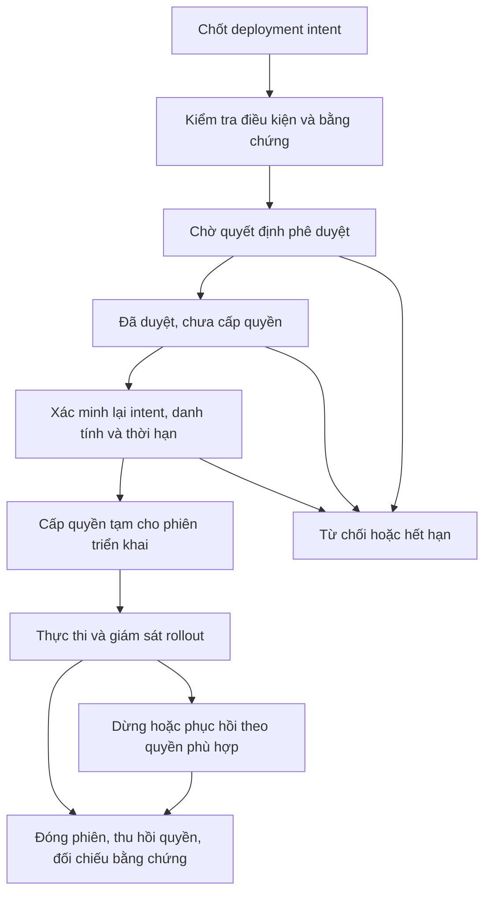

# Production deployment approval

## 1. Vì sao phê duyệt triển khai là một bài toán PAM?

Production deployment approval là quyết định cho phép một thay đổi cụ thể được triển khai vào môi trường sản xuất trong một phạm vi và khoảng thời gian xác định. Quyết định này cần gắn với nội dung thay đổi, đối tượng triển khai và danh tính thực hiện; một nút “Approve” đứng riêng không đủ để mô tả quyền đã cấp.

Trong CI/CD, pipeline có thể tạo workload, thay cấu hình mạng, cập nhật dịch vụ, chạy migration hoặc thay đổi quyền của ứng dụng. Vì vậy, pipeline triển khai là một đường truy cập đặc quyền, dù người phê duyệt không trực tiếp đăng nhập máy chủ. PAM phải kiểm soát đường truy cập đó từ lúc có yêu cầu đến khi credential, phiên và quyền tạm thời được thu hồi.

Ví dụ, một đội muốn đưa image của dịch vụ thanh toán vào production. Điều cần cho phép không phải là “pipeline được làm quản trị viên trong 30 phút”, mà là:

> Cho phép danh tính triển khai của pipeline đã xác minh cập nhật đúng dịch vụ thanh toán, tại đúng môi trường và vùng triển khai, bằng đúng artifact đã được phê duyệt, trong cửa sổ hiệu lực; không cho phép sửa chính sách IAM hoặc đọc secret không liên quan.

Bài học này sử dụng PAM theo nghĩa kiểm soát đặc quyền của cả con người và danh tính máy. Mục tiêu là kết nối quyết định phê duyệt với least privilege, quyền vừa đủ và đúng lúc, quản lý credential, giám sát thực thi và bằng chứng có thể đối chiếu.

## 2. Phân biệt các quyết định dễ bị gộp chung

Một lần triển khai thường có nhiều quyết định khác nhau. Tách rõ chúng giúp tránh việc một tín hiệu hợp lệ bị sử dụng như giấy phép cho mọi hành động.

| Quyết định | Câu hỏi cần trả lời | Không tự động cho phép |
| --- | --- | --- |
| Review mã nguồn | Thay đổi trong mã có được chấp nhận không? | Đưa mọi artifact từ nhánh đó vào production |
| Chấp nhận artifact | Artifact có nguồn gốc, kiểm thử và kết quả kiểm tra phù hợp không? | Triển khai vào mọi môi trường |
| Phê duyệt thay đổi | Có chấp nhận tác động kinh doanh và vận hành của thay đổi không? | Cấp quyền hạ tầng ngoài kế hoạch |
| Phê duyệt triển khai | Có cho phép đúng lần triển khai này trong điều kiện đã nêu không? | Tái sử dụng quyết định cho lần chạy khác |
| Cấp quyền PAM | Danh tính nào được thực hiện hành động nào, trên tài nguyên nào, trong bao lâu? | Bỏ qua điều kiện phê duyệt hoặc kiểm tra artifact |
| Xác nhận kết quả | Hệ thống có đạt trạng thái mong muốn sau triển khai không? | Khẳng định mọi credential đã được thu hồi |

Một tổ chức có thể kết hợp một số quyết định trong cùng quy trình, nhưng cần giữ được ý nghĩa và bằng chứng của từng quyết định. Review pull request hôm qua không đồng nghĩa người review đã đồng ý chạy migration vào production tối nay.

Phê duyệt cũng không bảo đảm bản phát hành không có lỗi. Nó xác nhận người có thẩm quyền chấp nhận một thay đổi đã được định nghĩa với các điều kiện cụ thể. Kiểm thử, giới hạn quyền và cơ chế phục hồi vẫn cần hoạt động độc lập.

## 3. Xác định đối tượng được phê duyệt

### 3.1. Phê duyệt một deployment intent

Deployment intent là mô tả có cấu trúc về điều dự định làm. Tên gọi này không bắt buộc; điều quan trọng là các bên cùng tham chiếu một đối tượng bất biến.

Một intent nên thể hiện tối thiểu:

- ID yêu cầu và ID lần triển khai.
- Dịch vụ, môi trường, tenant hoặc tài khoản hạ tầng và vùng triển khai.
- Artifact được định danh bằng digest hoặc một định danh bất biến tương đương.
- Commit và thông tin lần build để phục vụ truy vết nguồn gốc.
- Phiên bản quy trình triển khai, cấu hình và kế hoạch áp dụng.
- Danh tính pipeline cùng loại quyền cần cấp.
- Những hành động được phép, các hành động bị loại trừ và thời hạn.
- Điều kiện tiên quyết, tiêu chí dừng và phương án phục hồi.

Nếu cấu hình runtime hoặc tập lệnh migration được phát hành tách khỏi image, chỉ khóa digest của image là chưa đủ. Cần khóa các đầu vào có thể thay đổi hành vi triển khai: phiên bản cấu hình, digest script, tham chiếu secret ở dạng không tiết lộ giá trị, tham số có ý nghĩa và kế hoạch thay đổi quyền nếu có.

Không đưa giá trị secret vào intent. Chỉ ghi định danh, phiên bản hoặc dấu vết cần thiết để xác minh đúng nguồn secret theo chính sách của hệ thống.

### 3.2. Vì sao tên nhánh và image tag chưa đủ?

Tên nhánh mô tả một dòng phát triển, không cố định một nội dung duy nhất theo thời gian. Một image tag cũng có thể được trỏ sang artifact khác tùy cách quản lý registry.

Nếu người duyệt chấp nhận tag `release-candidate`, rồi tag đó đổi trước khi triển khai, thực thi có thể dùng artifact chưa được xem xét. Đây là khoảng cách giữa thời điểm kiểm tra và thời điểm sử dụng.

Một cơ chế ràng buộc phù hợp cần:

1. Chốt artifact bất biến trước khi xin duyệt.
2. Hiển thị định danh đó trong yêu cầu.
3. Gắn quyết định duyệt với toàn bộ intent đã chốt.
4. Kiểm tra lại intent và artifact tại điểm thực thi.
5. Yêu cầu quyết định mới khi nội dung hoặc phạm vi có ý nghĩa thay đổi.

Có thể dùng digest của bản biểu diễn intent đã chuẩn hóa để phát hiện thay đổi. Tuy nhiên, digest chỉ chứng minh tính nhất quán khi nơi tính, nơi lưu và nơi xác minh đều được bảo vệ. Kẻ có thể sửa cả nội dung lẫn “digest tin cậy” vẫn có thể thay thế yêu cầu.

### 3.3. Ví dụ một intent để thảo luận thiết kế

Đây là YAML minh họa dữ liệu, không phải cấu hình chạy trực tiếp của một sản phẩm CI/CD hay PAM:

```yaml
deployment:
  requestId: DEP-2026-0178
  intentVersion: 1
  service: payments-api
  environment: production
  target:
    account: prod-payments
    region: region-a
    namespace: payments
  artifact:
    digest: "<digest-bat-bien-cua-artifact>"
    buildId: build-4812
    sourceCommit: "<commit-da-xac-minh>"
    provenanceEvidenceId: provenance-4812
  execution:
    workflowRevision: "<phien-ban-quy-trinh-da-chot>"
    configurationDigest: "<digest-cau-hinh>"
    migrationDigest: null
    workloadIdentity: deploy-payments-prod
    actions:
      - update-existing-workload
      - read-rollout-health
    forbiddenActions:
      - modify-iam-policy
      - export-application-secret
      - create-unrelated-workload
  approval:
    policyVersion: prod-change-v4
    intentDigest: "<digest-cua-intent-da-chuan-hoa>"
    requestedWindow:
      notBefore: "2026-12-02T02:00:00Z"
      notAfter: "2026-12-02T02:30:00Z"
  recovery:
    approvedArtifactDigest: "<digest-ban-truoc>"
    procedureRevision: rollback-payments-v3
    databaseRollbackIncluded: false
```

Các mục `forbiddenActions` giúp người đọc hiểu phạm vi nhưng không tự tạo ra chính sách cưỡng chế. Hệ thống cấp quyền và nền tảng đích phải thực thi giới hạn tương ứng. Nếu role thực tế vẫn có quyền quản trị toàn tài khoản, một danh sách cấm trong YAML không làm giảm đặc quyền.

## 4. Phân tách trách nhiệm và thẩm quyền

### 4.1. Các vai trò trong một lần triển khai

| Vai trò | Trách nhiệm chính | Giới hạn cần có |
| --- | --- | --- |
| Người yêu cầu | Chuẩn bị thay đổi, intent, kết quả kiểm thử và phương án phục hồi | Không tự phê duyệt ngoài ngoại lệ đã quy định |
| Người phê duyệt | Đánh giá tác động và điều kiện chấp nhận | Chỉ duyệt trong phạm vi được giao |
| Bộ máy chính sách | Kiểm tra điều kiện, tính hợp lệ của quyết định và quan hệ vai trò | Không nhận kết quả “đã duyệt” từ đầu vào không tin cậy |
| Dịch vụ PAM hoặc broker | Cấp quyền tạm cho danh tính thực thi đã xác minh | Không cấp rộng hơn intent và chính sách đích |
| Pipeline triển khai | Thực hiện hành động được cấp phép | Không tự thay intent hoặc tự mở rộng quyền |
| Người vận hành giám sát | Quan sát rollout, quyết định dừng hoặc kích hoạt phục hồi theo quyền | Không dùng cơ chế dừng để lấy thêm quyền quản trị |
| Người kiểm tra bằng chứng | Đối chiếu yêu cầu, quyết định, quyền cấp và kết quả | Không phụ thuộc hoàn toàn vào log do pipeline tự ghi |

Một người có thể đảm nhiệm nhiều vai trò trong đội nhỏ, nhưng quan hệ xung đột cần được thể hiện và xử lý bằng chính sách. Với thay đổi có rủi ro cao, có thể yêu cầu người duyệt độc lập hoặc nhiều nhóm thẩm quyền. Không có một số lượng người duyệt phù hợp cho mọi trường hợp.

### 4.2. Kiểm soát tự phê duyệt phải dựa trên danh tính

Chặn cùng một tài khoản bấm hai nút là chưa đủ nếu một người có nhiều tài khoản hoặc có thể điều khiển bot phê duyệt. Cần đối chiếu người yêu cầu, tác giả thay đổi, danh tính người duyệt và cơ chế ủy quyền ở mức mà hệ thống quản lý danh tính hỗ trợ.

Đồng thời, không nên coi mọi lần commit của một người trong kho mã là xung đột tuyệt đối. Quy tắc phải xác định rõ quan hệ nào làm mất tính độc lập: tác giả thay đổi đang xét, người khởi tạo yêu cầu, người có thể sửa bằng chứng hoặc người kiểm soát danh tính bot được dùng để duyệt.

Các thay đổi có thể phá hỏng chính cơ chế phê duyệt cũng cần được bảo vệ riêng, chẳng hạn:

- Sửa danh sách người duyệt hoặc mapping nhóm thẩm quyền.
- Sửa workflow production hoặc thành phần broker.
- Sửa điều kiện cấp token, trust policy và role triển khai.
- Tắt audit hoặc thay đổi chính sách lưu bằng chứng.

Nếu người yêu cầu có thể sửa workflow để bỏ gate rồi chạy bằng credential production có sẵn, cơ chế phê duyệt chỉ mang tính giao diện.

### 4.3. Quyền duyệt cũng là một đặc quyền

Quyền phê duyệt production cần được kiểm kê, có chủ sở hữu và được rà soát. Tài khoản người duyệt cần được bảo vệ phù hợp, đặc biệt khi quyết định duyệt dẫn đến cấp quyền production.

Khi nhân sự chuyển đội hoặc rời tổ chức, phải thu hồi cả quyền triển khai và quyền duyệt. Một nhóm phê duyệt còn thành viên cũ có thể mở lại đường vào production dù credential triển khai đã được luân chuyển.

## 5. Luồng kiểm soát từ yêu cầu đến thu hồi quyền

### 5.1. Trạng thái và chuyển tiếp



Mỗi chuyển tiếp phải có điều kiện rõ ràng. “Đã duyệt” chưa phải “đang có quyền”. Có thể xin duyệt trước cửa sổ bảo trì, nhưng credential chỉ được cấp gần thời điểm thực thi sau khi kiểm tra lại mọi điều kiện.

### 5.2. Trước khi phê duyệt

Người yêu cầu cung cấp đủ thông tin để người duyệt hiểu thay đổi và hậu quả:

- Artifact và nguồn gốc build đã được xác minh theo cơ chế của tổ chức.
- Kết quả kiểm thử và kiểm tra bảo mật gắn với đúng artifact.
- Phạm vi tài nguyên, ảnh hưởng dự kiến và thời gian thực hiện.
- Thay đổi cấu hình, schema dữ liệu hoặc quyền ứng dụng.
- Tiêu chí thành công, điều kiện dừng và phương án phục hồi.
- Quyền cần cấp cho pipeline, thời hạn và cách kết thúc quyền.

Bằng chứng thiếu hoặc không khớp artifact là trạng thái cần xử lý, không phải một cảnh báo mà pipeline tự bỏ qua. Chính sách có thể cho phép ngoại lệ, nhưng ngoại lệ phải có thẩm quyền, phạm vi và bằng chứng riêng.

### 5.3. Tại thời điểm cấp quyền

Broker hoặc điểm cưỡng chế cần kiểm tra lại:

1. Intent hiện tại đúng phiên bản đã được duyệt.
2. Quyết định còn hiệu lực, chưa bị hủy và có đủ thẩm quyền.
3. Danh tính workload, lần chạy và môi trường khớp yêu cầu.
4. Các điều kiện kiểm tra bắt buộc vẫn hợp lệ theo chính sách.
5. Không có xung đột triển khai hoặc khóa tài nguyên bị mất.
6. Quyền dự định cấp nằm trong phạm vi cho phép.

Nếu không thể xác minh điều kiện bắt buộc, triển khai thông thường phải bị chặn. Khi dịch vụ phê duyệt hoặc audit gặp lỗi, không tự chuyển sang credential quản trị dự phòng được nhúng trong pipeline.

Việc kiểm tra quyền hiện hành của người duyệt cũng cần có quy tắc. Chẳng hạn, nếu người duyệt bị thu hồi thẩm quyền trước lúc cấp quyền, hệ thống có thể yêu cầu duyệt lại. Không nên để một quyết định cũ tự động vượt qua một lệnh thu hồi khẩn cấp.

### 5.4. Sau khi thực thi

Pipeline cần báo kết quả có cấu trúc, bao gồm artifact thực tế, tài nguyên đã tác động, kết quả health check, hành động phục hồi và trạng thái quyền tạm.

Một lần chạy thất bại vẫn phải đi qua bước kết thúc phiên và thu hồi quyền. Trạng thái “job canceled” trong CI không chứng minh token đã mất hiệu lực hoặc tiến trình con trên runner đã dừng.

Nếu không xác minh được thu hồi quyền, phải ghi nhận riêng và chuyển xử lý vận hành. Không đổi kết quả này thành thành công chỉ vì dịch vụ ứng dụng đã hoạt động ổn định.

## 6. Cấp quyền JIT/JEA cho pipeline

### 6.1. Quyết định duyệt không nên trở thành secret

Người duyệt không cần sao chép password production hoặc token cá nhân vào CI để “mở khóa” triển khai. Quyết định duyệt là dữ liệu ủy quyền; credential thực thi được cấp riêng cho danh tính pipeline đã xác minh.

Khi nền tảng hỗ trợ, có thể dùng danh tính workload và trao đổi token ngắn hạn để nhận quyền cần thiết. Điểm tin cậy phải kiểm tra các thuộc tính liên quan như nguồn phát hành danh tính, đối tượng nhận token, kho mã, môi trường, workflow và lần chạy. Chỉ kiểm tra tên repository thường chưa diễn đạt đủ phạm vi tin cậy.

Nếu phải dùng vault cung cấp credential, việc lấy secret cũng phải gắn với quyết định, danh tính và thời hạn. Không lưu credential production lâu dài trên runner hoặc dùng cùng secret cho mọi dịch vụ.

### 6.2. Thiết kế quyền theo hành động thực tế

JIT giới hạn thời gian tồn tại của quyền. JEA giới hạn tập hành động được thực hiện. Cần cả hai: một token quản trị toàn hệ thống có thời hạn ngắn vẫn có thể gây tác động rất lớn trong thời gian đó.

Ví dụ với một dịch vụ đã tồn tại:

| Nhu cầu | Phạm vi quyền phù hợp để xem xét | Quyền không nên phát sinh mặc định |
| --- | --- | --- |
| Cập nhật bản chạy | Tài nguyên workload đã chỉ định | Tạo tài nguyên tùy ý trong mọi namespace |
| Kiểm tra rollout | Trạng thái và sự kiện liên quan | Đọc toàn bộ secret của môi trường |
| Ghi nhận kết quả | Đích bằng chứng của lần triển khai | Sửa hoặc xóa bằng chứng đã hoàn tất |
| Áp dụng migration | Danh tính và schema được phê duyệt riêng | Quyền quản trị toàn bộ hệ quản trị dữ liệu |
| Phục hồi artifact | Artifact và thủ tục phục hồi đã cho phép | Thực thi script tùy ý dưới danh nghĩa rollback |

Không phải nền tảng nào cũng cho ràng buộc quyền đến digest artifact ngay tại lớp IAM. Khi đó cần kết hợp lớp IAM với điểm cưỡng chế triển khai hoặc admission policy phù hợp. Phải chỉ rõ ràng buộc nào được nền tảng đích cưỡng chế, ràng buộc nào do broker thực hiện và giới hạn còn lại là gì.

### 6.3. Ba đồng hồ cần quản lý

Có ít nhất ba thời hạn khác nhau:

- Thời hạn quyết định phê duyệt: đến khi nào có thể bắt đầu một hành động đã duyệt.
- Thời hạn quyền hoặc credential: quyền đã cấp tồn tại bao lâu.
- Giới hạn thời gian thực thi: một rollout được phép chạy trong bao lâu.

Phê duyệt hết hạn không nhất thiết tự làm token đã cấp mất hiệu lực. Ngược lại, token hết hạn giữa rollout có thể khiến hệ thống dở dang. Thiết kế cần xác định cách xử lý cả hai tình huống.

Gia hạn credential không được là thao tác vô hạn của pipeline. Mỗi lần gia hạn phải kiểm tra lại phiên, intent và điều kiện áp dụng. Với rollout dài hơn dự kiến, có thể cần phê duyệt mới hoặc chuyển sang thủ tục phục hồi đã xác định.

Thu hồi token đang tồn tại phụ thuộc cơ chế của nền tảng. Nếu không thể vô hiệu hóa ngay, cần dựa thêm vào thời hạn ngắn, điểm cưỡng chế có thể chặn phiên, khóa danh tính hoặc biện pháp cô lập phù hợp; không hứa hẹn thu hồi tức thời khi hạ tầng không hỗ trợ.

## 7. Cưỡng chế ở ranh giới tin cậy

### 7.1. Không tin cờ “approved” do pipeline tự gửi

Một tham số `approved=true` hoặc file do job trước tạo có thể hữu ích cho điều phối, nhưng không phải bằng chứng ủy quyền nếu job đó có thể bị sửa bởi người yêu cầu.

Dịch vụ cấp quyền nên xác minh quyết định qua nguồn tin cậy hoặc một assertion được bảo vệ phù hợp. Kênh xác minh cần chống giả mạo và ràng buộc assertion với đúng intent, người nhận, thời hạn và phiên thực thi.

Ví dụ logic dưới đây là mã giả mô tả thứ tự kiểm tra; không phải một policy engine hoàn chỉnh:

```text
authorizeDeployment(request, workloadAssertion):
    identity = verifyWorkloadAssertion(workloadAssertion)
    intent = loadImmutableIntent(request.intentId)
    approval = loadAuthoritativeApproval(intent.id)

    require identity.matches(intent.allowedWorkload)
    require request.runId == intent.authorizedRunId
    require canonicalDigest(intent) == approval.intentDigest
    require approval.isApprovedAndNotRevoked()
    require approval.hasRequiredIndependentAuthority()
    require currentTime is within intent.allowedWindow
    require requiredEvidenceStillPasses(intent)
    require approval.isValidForCurrentPolicy()
    require targetAndActionsMatch(intent, request)
    require acquireExclusiveExecutionRight(intent.target, request.runId)

    return createBoundedDeploymentSession(
        identity = identity,
        intent = intent,
        maximumPrivilege = intent.allowedActions,
        lifetime = computePermittedSessionLifetime(intent)
    )
```

Trong triển khai thật, kiểm tra và chuyển trạng thái phải được thiết kế để xử lý đồng thời. Không dùng mô hình “đọc thấy chưa sử dụng, rồi đánh dấu sau” nếu hai yêu cầu có thể cùng vượt qua.

### 7.2. Chống phát lại và xử lý retry

Một quyết định có thể được giới hạn cho một lần triển khai hoặc cho một kế hoạch nhiều bước đã định nghĩa trước. Cần chọn rõ mô hình đó.

Nếu chính sách chỉ cho phép một lần dùng, thao tác nhận quyền thực thi cần có tính nguyên tử hoặc cơ chế tương đương để ngăn hai run cùng sử dụng. ID phiên, ID lần chạy và khóa idempotency giúp phân biệt retry hợp lệ với một lần triển khai mới.

Retry sau lỗi mạng không nên tự tạo thêm một phiên quyền không được quản lý. Broker cần có thể trả lại trạng thái của phiên đã tạo hoặc từ chối yêu cầu không khớp, thay vì cấp credential mới cho mỗi lần gọi lại.

Không ghi token thực tế vào khóa idempotency hoặc log. Khi cần cấp lại credential cho cùng phiên, phải kiểm soát số lần, thời hạn và danh tính nhận.

### 7.3. Bảo vệ runner và nguồn mã không tin cậy

Nếu mã từ pull request chưa được tin cậy có thể chạy trên runner chứa credential production, gate phê duyệt về sau không khắc phục được việc secret đã bị lộ từ trước.

Một thiết kế phù hợp nên tách quá trình kiểm thử mã chưa tin cậy khỏi môi trường được phép triển khai production. Runner triển khai cần có vòng đời, quyền hệ điều hành, kết nối mạng và cơ chế dọn trạng thái phù hợp.

Không cho job xử lý mã chưa được duyệt quyền sửa dữ liệu mà job production sẽ tin cậy, chẳng hạn file đánh dấu phê duyệt, script triển khai tải từ vị trí có thể ghi hoặc cache chứa công cụ thực thi.

Artifact bất biến cũng không bảo vệ được một pipeline tùy ý chạy mã khác trước hoặc sau khi áp dụng artifact. Cần kiểm soát cả quy trình thực thi và các thành phần mà nó tải.

## 8. Thay đổi sau phê duyệt và triển khai đồng thời

### 8.1. Khi nào cần duyệt lại?

Những thay đổi sau thường làm thay đổi đối tượng hoặc rủi ro đã được chấp nhận:

- Đổi artifact, cấu hình có ảnh hưởng hoặc script migration.
- Đổi môi trường, tài khoản, tenant, namespace hoặc vùng triển khai.
- Mở rộng quyền của danh tính thực thi.
- Đổi workflow sang phiên bản có hành vi khác.
- Vượt cửa sổ thời gian hoặc điều kiện vận hành cho phép.
- Thay đổi bằng chứng bắt buộc từ đạt sang không đạt.

Không phải mọi thay đổi mô tả đều cần duyệt lại. Sửa lỗi chính tả trong ghi chú có thể không đổi ý nghĩa intent nếu mô hình dữ liệu đã tách rõ trường mô tả và trường quyết định hành vi. Quy tắc này cần được định nghĩa trước; pipeline không được tự quyết rằng một thay đổi phạm vi là “chỉ sửa metadata”.

Khi intent bị thay đổi có ý nghĩa, tạo phiên bản mới và liên kết với phiên bản trước. Giữ lịch sử quyết định cũ, đồng thời làm rõ quyết định đó không cấp phép cho phiên bản mới.

### 8.2. Tại sao cần kiểm soát đồng thời?

Hai bản phát hành có thể đều được duyệt hợp lệ nhưng không nên áp dụng đồng thời lên cùng một dịch vụ. Chúng có thể ghi đè cấu hình, chạy migration lệch thứ tự hoặc khiến phương án rollback của bản sau dựa trên baseline đã thay đổi.

Quy trình cần xác định đơn vị khóa, chẳng hạn dịch vụ và môi trường, hoặc tài nguyên dữ liệu dùng chung. Không nên khóa toàn bộ production nếu chỉ cần ngăn xung đột của một nhóm tài nguyên.

Sau khi lấy khóa, phải kiểm tra baseline còn phù hợp. Nếu một thay đổi khác đã làm trạng thái đích khác với kế hoạch được duyệt, cần đánh giá lại thay vì tiếp tục chỉ vì quyết định vẫn chưa hết hạn.

Nếu mất khóa trong lúc triển khai, pipeline không nên tiếp tục ghi tùy ý. Cần có cơ chế để điểm ghi từ chối chủ sở hữu phiên cũ, hoặc bảo đảm tương đương rằng chỉ phiên đang giữ quyền thực thi hợp lệ mới được thay đổi trạng thái.

## 9. Rollback, migration và triển khai khẩn cấp

### 9.1. Rollback là một hành động có đặc quyền

Đưa hệ thống về artifact cũ cũng là thay đổi production. Phải xác định rollback nào đã được chấp nhận cùng yêu cầu ban đầu và trường hợp nào cần quyết định mới.

Một phương án phục hồi được duyệt trước có thể chỉ rõ artifact đích, thủ tục, phạm vi, điều kiện kích hoạt và thời hạn. Phạm vi này không nên cho phép tải một script bất kỳ rồi gọi đó là rollback.

Phục hồi phiên bản ứng dụng không đồng nghĩa phục hồi dữ liệu. Một migration đã xóa hoặc biến đổi dữ liệu có thể không đảo ngược an toàn bằng cách đưa image cũ trở lại. Với thay đổi dữ liệu, cần thể hiện riêng khả năng tương thích, quyền migration, tiêu chí dừng và phương án phục hồi dữ liệu.

### 9.2. Triển khai dở dang

Nếu một phần workload đã cập nhật rồi phiên quyền hết hạn, kết quả là trạng thái hỗn hợp. Hệ thống nên ghi rõ phần đã làm, phần chưa làm và hành động tiếp theo được phép.

Không tự cấp quyền quản trị rộng hơn để “chạy cho xong”. Có thể tiếp tục bằng một phiên được tái xác minh nếu chính sách cho phép, hoặc kích hoạt phục hồi nằm trong phạm vi đã duyệt. Khi chưa đủ thẩm quyền, giữ trạng thái dừng an toàn theo thiết kế và chuyển điều phối sự cố.

### 9.3. Break-glass có điều kiện

Trong sự cố nghiêm trọng, quy trình khẩn cấp có thể rút ngắn một số bước thông thường. Tuy nhiên, phải có một đường quyền được định nghĩa trước:

1. Xác định sự cố và lý do dùng quyền khẩn cấp.
2. Xác minh người kích hoạt cùng phạm vi quyền được ủy nhiệm.
3. Cấp quyền tạm đủ để thực hiện hành động cụ thể.
4. Ghi nhận và thông báo theo chính sách sự cố.
5. Theo dõi thực thi, kết thúc phiên và thu hồi quyền.
6. Thực hiện kiểm tra sau sự cố cùng các hành động khắc phục.

Nếu nền tảng phê duyệt chính bị gián đoạn, cơ chế khẩn cấp phải có cách xác minh và lưu bằng chứng phù hợp với tình huống đó. Không nên thiết kế một tài khoản dùng chung có password vĩnh viễn nằm trong biến CI rồi coi đó là phương án liên tục hoạt động.

Kiểm tra sau sự cố bổ sung trách nhiệm giải trình; nó không biến mọi hành động không được ủy quyền thành hợp lệ sau khi đã xảy ra.

## 10. Bằng chứng triển khai và giám sát

### 10.1. Chuỗi bằng chứng cần đối chiếu được

Người kiểm tra cần trả lời được bốn câu hỏi: ai chấp nhận, chấp nhận điều gì, ai thực thi và thực tế đã làm gì.

| Nhóm bằng chứng | Nội dung nên lưu | Nguồn đối chiếu |
| --- | --- | --- |
| Yêu cầu | Intent, phiên bản, digest, phạm vi và lý do | Hệ thống quản lý yêu cầu hoặc intent store |
| Quyết định | Danh tính người duyệt, thời điểm, kết quả, chính sách và điều kiện | Dịch vụ phê duyệt |
| Cấp quyền | Danh tính workload, ID phiên, role, scope, thời hạn, kết quả cấp | Broker, PAM hoặc nền tảng IAM |
| Thực thi | Run ID, workflow revision, artifact thực tế, hành động và tài nguyên | CI/CD và audit nền tảng đích |
| Kết quả | Trạng thái rollout, health check, dừng hoặc phục hồi | Nền tảng triển khai và giám sát |
| Kết thúc quyền | Thu hồi phiên, xóa credential tạm hoặc kết quả kiểm tra hiệu lực | PAM, broker và hệ thống đích |

Dùng các ID tương quan ổn định giữa những nguồn này. Chỉ ghép bằng một tên job dễ bị đổi hoặc một khoảng thời gian gần nhau sẽ làm việc điều tra khó tin cậy hơn.

Bằng chứng nên được gửi đến nơi mà danh tính triển khai không có quyền sửa hoặc xóa lịch sử đã hoàn tất. Thời gian lưu, người được đọc và cách bảo vệ tính toàn vẹn phải phù hợp yêu cầu của tổ chức.

Không ghi password, bearer token, private key, toàn bộ biến môi trường hay giá trị secret vào log. Khi lưu nội dung plan, cần kiểm tra plan có thể chứa dữ liệu nhạy cảm và áp dụng cơ chế giảm lộ phù hợp.

### 10.2. Tín hiệu cần chú ý

Các tín hiệu có giá trị vận hành gồm:

- Yêu cầu cấp quyền không có quyết định hợp lệ.
- Artifact thực thi khác artifact được duyệt.
- Pipeline đề nghị quyền rộng hơn intent.
- Quyết định được tái sử dụng ngoài phiên hoặc cửa sổ cho phép.
- Tăng đột biến số lần từ chối, retry cấp quyền hoặc break-glass.
- Phiên triển khai còn hoạt động sau khi job đã kết thúc.
- Khoảng trống bằng chứng giữa CI, PAM và audit đích.
- Thay đổi chính sách người duyệt gần thời điểm cấp quyền production.

Không chỉ theo dõi số lần “Approve”. Một dashboard có tỷ lệ phê duyệt cao không chứng minh đặc quyền đã được kiểm soát.

Các chỉ số như thời gian chờ duyệt, số phiên quyền còn tồn tại và tỷ lệ intent phải sửa lại có thể giúp cải tiến quy trình. Không dùng thời gian chờ làm mục tiêu duy nhất, vì điều đó có thể khuyến khích người duyệt chấp nhận yêu cầu mà không đọc.

## 11. Ví dụ xuyên suốt: triển khai dịch vụ thanh toán

Giả sử đội phát triển chuẩn bị bản phát hành mới của `payments-api`. Bản này thay logic xử lý nhưng không đổi schema dữ liệu.

### Bước 1: Chuẩn bị artifact và intent

Pipeline build tạo một artifact được định danh bất biến. Hệ thống lưu bằng chứng nguồn gốc, kết quả kiểm thử và cấu hình production được chọn. Người yêu cầu tạo intent cho một môi trường và vùng triển khai cụ thể.

Role đề nghị chỉ cho cập nhật workload đã tồn tại và đọc trạng thái rollout. Intent không yêu cầu quyền đọc secret ứng dụng, sửa IAM hoặc quản trị tài khoản hạ tầng.

### Bước 2: Người có thẩm quyền duyệt

Người duyệt thấy đúng artifact, phạm vi tác động, cửa sổ triển khai và artifact phục hồi. Quyết định gắn với phiên bản intent, danh tính người duyệt và phiên bản chính sách đang áp dụng.

Nếu người yêu cầu thay cấu hình sau đó, intent có phiên bản mới và cần xử lý lại theo quy tắc duyệt. Không tái sử dụng quyết định cũ chỉ vì commit ứng dụng không đổi.

### Bước 3: Cấp quyền lúc bắt đầu triển khai

Job production chứng minh danh tính workload. Broker kiểm tra quyết định, cửa sổ thời gian, lần chạy, phạm vi và quyền thực thi độc quyền.

Broker tạo phiên quyền ngắn hạn cho đúng role. Token không được in ra console hoặc chuyển cho người duyệt. Runner chỉ nhận credential theo kênh được bảo vệ phù hợp với nền tảng.

### Bước 4: Thực thi có kiểm soát

Pipeline áp dụng đúng artifact và theo dõi rollout theo kế hoạch. Audit đích ghi nhận danh tính phiên cùng tài nguyên đã sửa.

Nếu health check không đạt, pipeline dừng việc mở rộng rollout. Nó chỉ phục hồi theo artifact và thủ tục đã được cho phép; không tự chạy một script sửa dữ liệu nằm ngoài intent.

### Bước 5: Kết thúc

Sau thành công hoặc phục hồi, hệ thống đóng phiên quyền và xác minh trạng thái credential. Báo cáo liên kết intent, quyết định, run, phiên PAM, artifact thực tế và kết quả.

Một kết quả hoàn chỉnh cần phân biệt được “dịch vụ khỏe” với “quyền tạm đã kết thúc”. Nếu phần thứ hai chưa xác minh được, vẫn cần xử lý dù bản phát hành không có lỗi.

## 12. Các lỗi thiết kế thường gặp

| Lỗi | Vì sao không đạt mục tiêu | Hướng thiết kế phù hợp hơn |
| --- | --- | --- |
| Duyệt một tag có thể đổi | Đối tượng chạy có thể khác đối tượng đã xem | Ràng buộc artifact bất biến và kiểm tra tại lúc áp dụng |
| Duyệt xong mới build lại | Artifact mới chưa chắc là artifact đã có bằng chứng | Build một lần, xác minh và promote artifact đã chốt |
| Gate nằm trong workflow mà người yêu cầu tự sửa được | Có thể bỏ gate hoặc giả kết quả | Bảo vệ workflow và cưỡng chế tại điểm cấp quyền hoặc điểm đích |
| Token production luôn nằm trên runner | Quyền tồn tại trước và ngoài lần duyệt | Cấp quyền theo phiên gần lúc thực thi |
| Dùng tài khoản cá nhân để deploy | Khó tách người duyệt với danh tính máy; khó quản lý vòng đời | Dùng workload identity và phiên đặc quyền có liên kết |
| Một role admin dùng cho mọi môi trường | Phạm vi tác động vượt nhu cầu | Tách role, target và thời hạn theo intent |
| Cho phép retry không giới hạn | Có thể tái sử dụng quyết định hoặc tạo phiên quyền ngoài kiểm soát | Xác định phiên, idempotency và giới hạn retry |
| Hủy job nhưng không kết thúc quyền | Credential hoặc tiến trình vẫn có thể hoạt động | Quản lý vòng đời quyền độc lập với trạng thái job |
| Rollback được phép chạy mọi lệnh | Đường phục hồi trở thành đường cấp quyền tùy ý | Định nghĩa hành động phục hồi và phạm vi từ trước |
| Chỉ lưu log CI | Người kiểm soát pipeline có thể kiểm soát toàn bộ bằng chứng | Đối chiếu nguồn phê duyệt, PAM và audit đích |

Một lỗi khác là yêu cầu phê duyệt thủ công cho mọi thao tác nhưng bỏ qua chất lượng thông tin. Khi yêu cầu thiếu phạm vi hoặc không thể phân biệt thay đổi rủi ro cao, người duyệt dễ trở thành người bấm nút theo thói quen.

Chính sách có thể tự động chấp nhận một số loại thay đổi đã định nghĩa rõ, nếu tổ chức cho phép và có bằng chứng phù hợp. Khi đó vẫn phải xác định ai ban hành chính sách, điều kiện áp dụng, phạm vi quyền và cách ghi lại quyết định máy. “Tự động” không có nghĩa bỏ bước ủy quyền.

## 13. Tình huống thực hành tư duy

### Tình huống 1: Đã duyệt nhưng hết cửa sổ

Một yêu cầu được duyệt từ 02:00 đến 02:30 UTC, nhưng job chờ runner đến 02:35 mới bắt đầu xin quyền.

Kết quả mong đợi: broker từ chối cấp quyền theo quyết định đã hết thời gian bắt đầu. Đội phải dùng cửa sổ và quyết định mới theo chính sách; không chỉnh lại timestamp trong pipeline.

Nếu quyền đã được cấp lúc 02:25 và rollout tiếp tục qua 02:30, cách xử lý phụ thuộc quy tắc thời hạn phiên được xác định trước. Không suy diễn rằng hết cửa sổ bắt đầu thì mọi quyền chắc chắn tự biến mất.

### Tình huống 2: Cùng yêu cầu, hai lần chạy

Do lỗi mạng, hệ thống gửi hai yêu cầu bắt đầu cho cùng intent. Một yêu cầu đã tạo phiên, yêu cầu còn lại đến trước khi bên gọi nhận phản hồi.

Kết quả mong đợi: cơ chế nhận quyền thực thi ngăn tạo hai lần triển khai độc lập. Retry có định danh phù hợp trả về trạng thái nhất quán hoặc bị từ chối có giải thích. Không tạo hai token quản trị mới để “bảo đảm job chạy”.

### Tình huống 3: Người duyệt bị thu hồi quyền

Một quyết định đã được tạo, nhưng trước lúc triển khai, tài khoản người duyệt bị vô hiệu hóa trong quá trình xử lý nghi ngờ xâm nhập.

Kết quả mong đợi: điểm cấp quyền xử lý quyết định theo chính sách thu hồi hiện hành, có thể yêu cầu duyệt mới. Không coi chữ ký hoặc bản ghi cũ là lý do bỏ qua một lệnh hủy quyết định đã được xác thực.

### Tình huống 4: CI báo thành công nhưng artifact không khớp

Log CI cho biết triển khai hoàn tất, trong khi nền tảng đích ghi nhận digest khác intent.

Kết quả mong đợi: coi đây là sai lệch cần điều tra và xử lý theo quy trình, không chốt chỉ từ trạng thái màu xanh của job. Đối chiếu tag, resolver artifact, workflow revision và audit đích để tìm điểm thay thế.

### Tình huống 5: Thu hồi quyền thất bại

Ứng dụng đã ổn định, nhưng broker không xác nhận được phiên tạm đã kết thúc.

Kết quả mong đợi: ghi rõ trạng thái quyền chưa được xác minh, cảnh báo đầu mối vận hành và thực hiện biện pháp kết thúc hoặc cô lập phù hợp. Không ghi token vào báo cáo để nhờ người khác thử.

## 14. Tự kiểm tra mức độ hiểu

Sau bài học, người học nên giải thích được:

1. Vì sao review mã nguồn chưa đủ để cấp quyền triển khai production?
2. Những trường nào khiến một quyết định duyệt gắn với đúng artifact và phạm vi?
3. Cơ chế nào ngăn người yêu cầu tự bỏ gate trong workflow?
4. Quyền của người duyệt và quyền của pipeline khác nhau thế nào?
5. Tại sao phải kiểm tra lại quyết định ngay trước khi cấp quyền?
6. JIT và JEA bổ sung cho nhau ở điểm nào?
7. Hệ thống phân biệt retry của cùng phiên với một lần dùng lại quyết định ra sao?
8. Khi nào thay đổi intent cần được duyệt lại?
9. Vì sao rollback và migration cần được mô tả riêng?
10. Bằng chứng nào chứng minh quyền tạm đã kết thúc sau khi job dừng?

Production deployment approval có ý nghĩa khi quyết định của người hoặc chính sách được chuyển thành một phiên quyền có phạm vi cụ thể, được thực thi đúng đối tượng và được kết thúc có bằng chứng. Trong PAM, quản lý nút duyệt chỉ là một phần; toàn bộ đường đi từ thẩm quyền đến hành động production mới là phạm vi cần kiểm soát.
