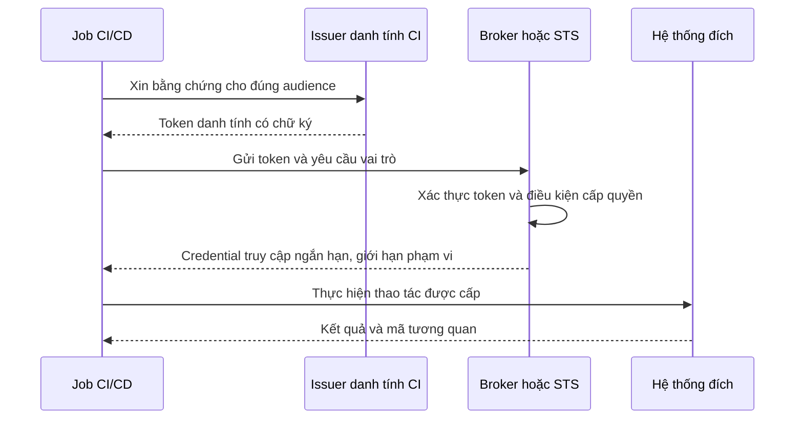

# Pipeline identity

## 1. Vì sao pipeline cần một danh tính riêng?

Một pipeline CI/CD có thể tải mã nguồn, tạo artifact, ký bản phát hành, đọc secret hoặc triển khai lên production. Những hành động này thường đòi hỏi quyền cao hơn quyền của một người dùng ứng dụng thông thường. Nếu mọi pipeline cùng dùng một tài khoản quản trị và một mật khẩu tồn tại nhiều tháng, chỉ một job bị chiếm quyền cũng có thể mở đường vào nhiều hệ thống nhạy cảm.

**Pipeline identity** là danh tính mà một hệ thống đích có thể xác minh để nhận biết workload CI/CD đang yêu cầu truy cập. Danh tính này cần gắn với ngữ cảnh thực thi đáng tin cậy: pipeline nào, thuộc repository nào, chạy workflow nào, trong môi trường nào và ở lần chạy nào. Từ danh tính đã xác thực, hệ thống mới quyết định cấp quyền gì và trong bao lâu.

Trong PAM, pipeline là một chủ thể đặc quyền không phải con người. Nó cần được kiểm kê, có người chịu trách nhiệm, áp dụng least privilege, giới hạn thời gian quyền có hiệu lực và để lại bằng chứng. Việc pipeline chạy tự động không làm mất đi các yêu cầu kiểm soát này.

Ví dụ, pipeline của dịch vụ thanh toán cần triển khai một image đã được duyệt vào một namespace xác định. Nhu cầu hợp lệ là quyền triển khai đúng phạm vi đó trong một khoảng ngắn, chứ không phải tài khoản quản trị toàn bộ cluster được lưu trong biến CI.

Sau bài học, người học cần giải thích được ranh giới tin cậy của pipeline identity, thiết kế luồng cấp quyền ngắn hạn và kiểm tra liệu một job có thể vượt quyền bằng cách thay đổi repository, workflow, môi trường hoặc artifact hay không.

## 2. Phân biệt các danh tính tham gia một lần chạy

Một lần chạy pipeline không chỉ có một danh tính. Có thể đồng thời xuất hiện người kích hoạt, danh tính workload, runner và tài khoản mà ứng dụng sử dụng sau triển khai.

| Thành phần | Câu hỏi cần trả lời | Vai trò trong kiểm soát truy cập |
| --- | --- | --- |
| Người kích hoạt | Ai yêu cầu hoặc phê duyệt lần chạy? | Trách nhiệm của con người, quyền kích hoạt và phê duyệt |
| Pipeline/workflow | Quy trình tự động nào được phép thực hiện công việc? | Xác định workload và phiên bản quy trình được tin cậy |
| Job/lần chạy | Lần thực thi cụ thể nào đang xin quyền? | Tương quan sự kiện, giới hạn thời gian, điều tra |
| Runner | Mã thực thi chạy trên hạ tầng nào? | Kiểm soát host, cách ly và mức tin cậy của môi trường chạy |
| Danh tính triển khai | Hệ thống đích nhận diện chủ thể nào đang thay đổi tài nguyên? | Quyền thao tác với cluster, máy chủ hoặc dịch vụ triển khai |
| Danh tính runtime | Ứng dụng đang chạy truy cập dịch vụ khác dưới tên nào? | Quyền của ứng dụng sau khi pipeline kết thúc |

Người bấm nút chạy pipeline không nhất thiết là principal được hệ thống đích ghi nhận. Nếu một job dùng chung tài khoản `production-admin`, log đích có thể chỉ hiện tài khoản đó. Muốn tìm lại người yêu cầu, workflow và artifact, cần cơ chế liên kết bằng chứng giữa CI/CD, nơi cấp quyền và hệ thống đích.

Danh tính runner cũng không tự động thay thế được danh tính pipeline. Một runner tự quản có thể chạy nhiều job. Nếu mọi job đều thừa hưởng credential quản trị có sẵn trên host, việc kiểm tra repository ở tầng CI không còn đủ để cô lập quyền.

Tương tự, credential triển khai không nên trở thành credential runtime của ứng dụng. Pipeline có thể có quyền cập nhật phiên bản ứng dụng nhưng không cần đọc dữ liệu nghiệp vụ mà ứng dụng sử dụng sau đó.

## 3. Danh tính, credential và quyền là ba khái niệm khác nhau

**Danh tính** mô tả chủ thể là ai. **Credential** là bằng chứng được trình ra để xác thực chủ thể. **Quyền** xác định chủ thể được làm gì sau khi xác thực thành công.

Một chuỗi mô tả như `payments-prod-deployer` mới chỉ là tên. Nó chỉ có ý nghĩa bảo mật nếu hệ thống đích xác minh được bằng chứng do nguồn đáng tin cậy cấp và ánh xạ đúng tên đó vào chính sách.

Credential của pipeline có thể là token, certificate hoặc một cơ chế chứng minh khác. Credential có thể ngắn hạn hoặc dài hạn, dùng trực tiếp ở hệ thống đích hoặc được trao đổi để nhận credential khác. Việc đổi mật khẩu thành token nhưng vẫn dùng chung token quản trị nhiều tháng chưa giải quyết được vấn đề đặc quyền tồn tại lâu dài.

Quyền không nên suy ra từ tên job. Một job tự đặt tên là `deploy-production` chưa đủ điều kiện nhận quyền production. Tên này có thể được người sửa mã nguồn kiểm soát. Quyền phải dựa vào thuộc tính có nguồn gốc xác minh được và các điều kiện mà bên cấp quyền thực sự thực thi.

Ví dụ về yêu cầu truy cập rõ ràng:

```text
Chủ thể: workflow triển khai đã được kiểm soát của repository payments
Ngữ cảnh: lần chạy 4821, commit đã xác định, môi trường production
Đối tượng: namespace payments-prod
Hành động: triển khai artifact đã được phê duyệt theo digest
Thời hạn: tối đa 10 phút cho phiên cấp quyền này
Điều kiện: đã qua cổng phê duyệt, chạy trên runner phù hợp
```

Các giá trị trên chỉ trở thành điều kiện bảo mật khi có cơ chế xác minh và cưỡng chế tương ứng. Ghi chúng trong mô tả job hoặc trong một file do job tùy ý sửa không tạo ra sự đảm bảo đó.

## 4. Mô hình credential dài hạn và mô hình liên kết danh tính

### 4.1. Credential dài hạn được lưu trong CI

Mô hình quen thuộc là tạo một service account, cấp quyền cho nó, rồi đưa mật khẩu hoặc API key vào kho secret của CI. Khi chạy, job đọc secret và gọi hệ thống đích.

Mô hình này có thể được kiểm soát bằng vault, luân chuyển, tách tài khoản và hạn chế nơi dùng. Tuy nhiên, nếu credential có thể sử dụng độc lập với lần chạy pipeline, kẻ lấy được credential có thể tiếp tục dùng nó ngoài CI cho đến khi credential hết hạn hoặc bị vô hiệu hóa.

Kho secret bảo vệ nơi lưu và quá trình cấp phát, nhưng khi job được phép nhận credential thì mã chạy trong job có thể tiếp cận nó. Vì vậy, không nên cấp secret đặc quyền cho job xử lý mã không đáng tin cậy chỉ vì secret đã được lưu trong một vault.

### 4.2. Liên kết danh tính workload

Với workload identity federation, hệ thống CI hoặc một issuer được tin cậy phát hành bằng chứng về workload. Bên cấp quyền xác minh bằng chứng, kiểm tra điều kiện rồi cấp credential có phạm vi và thời hạn phù hợp. OIDC là một cơ chế thường dùng để truyền các thông tin danh tính này.



Broker có thể là dịch vụ trao đổi token, bộ phận của nền tảng cloud, vault hoặc một thành phần tích hợp PAM. Không bắt buộc mọi kiến trúc phải có một sản phẩm PAM nằm trên đường đi của từng request. Điều quan trọng là chuỗi xác thực, cấp quyền và lưu bằng chứng có chủ sở hữu rõ ràng.

Token danh tính dùng để chứng minh workload không mặc nhiên là access token được hệ thống đích chấp nhận. Trong mô hình trao đổi, token thứ nhất dành cho broker; credential thứ hai dành cho tài nguyên đích. Audience, quyền và thời hạn của hai loại có thể khác nhau.

Thời hạn ngắn làm giảm cửa sổ lạm dụng nhưng không ngăn được hành vi xấu trong thời gian credential còn hiệu lực. Cách ly job, kiểm soát nội dung workflow và least privilege vẫn cần thiết.

## 5. Bên cấp quyền phải tin vào điều gì?

Thiết kế pipeline identity bắt đầu từ trust policy: bên nào được phép khẳng định danh tính và những khẳng định nào đủ để nhận quyền đặc quyền.

### 5.1. Nguồn phát hành và bằng chứng mật mã

Một token có hình thức giống JWT chưa chứng minh được điều gì. Bên xác minh cần kiểm tra chữ ký bằng cơ chế và khóa đáng tin cậy, chỉ chấp nhận issuer cùng thuật toán được cấu hình, đồng thời kiểm tra các điều kiện sử dụng token.

Không lấy một địa chỉ issuer hoặc địa chỉ khóa tùy ý từ token rồi tin ngay vào nguồn đó. Nguồn tin cậy phải được thiết lập trước. Cũng không coi việc giải mã payload hoặc nhìn thấy trường `repository` là bước xác thực.

Các khái niệm thường gặp:

| Thuộc tính | Ý nghĩa cần kiểm tra | Sai lầm thường gặp |
| --- | --- | --- |
| `iss` | Issuer có đúng nguồn đã cấu hình không? | Chấp nhận mọi issuer có khóa công khai tải được |
| `aud` | Token có được phát hành cho bên nhận này không? | Dùng token dành cho dịch vụ khác để xin quyền |
| `sub` | Chủ thể được issuer mô tả là ai? | So khớp chuỗi quá rộng hoặc hiểu sai cách issuer tạo subject |
| `exp` | Token còn hiệu lực không? | Chỉ kiểm chữ ký, bỏ qua thời gian hết hạn |
| `nbf`, `iat` nếu có | Thời điểm được sử dụng và thời điểm phát hành có hợp lệ theo contract không? | Cho phép độ lệch đồng hồ không giới hạn |
| ID repository, workflow, môi trường nếu có | Ngữ cảnh có khớp điều kiện cấp quyền không? | Tin vào biến môi trường do job tự khai |
| ID lần chạy hoặc token nếu có | Có thể tương quan và phát hiện sử dụng bất thường không? | Cho rằng có ID là token tự động chỉ dùng được một lần |

Tên claim, mức độ sẵn có và ý nghĩa cụ thể phụ thuộc vào issuer. Không tự giả định tất cả nền tảng CI đều cung cấp cùng một bộ claim hoặc cùng cách mã hóa subject.

Nếu policy yêu cầu một claim mà issuer không cung cấp, cần một nguồn bằng chứng bổ sung đáng tin cậy hoặc thay đổi kiến trúc. Không thay claim thiếu bằng một giá trị do chính job yêu cầu quyền gửi lên.

### 5.2. Repository và workflow được bảo vệ

Chỉ kiểm tra tên tổ chức hoặc tên repository thường quá rộng. Cần xác định repository cụ thể, quyền sửa workflow, cách bảo vệ nhánh hoặc tag phát hành và nguồn của mã được thực thi.

Khi issuer cung cấp định danh bất biến phù hợp, định danh đó có thể giúp tránh phụ thuộc hoàn toàn vào tên có thể đổi. Tuy vậy, ID bất biến không đảm bảo nội dung workflow an toàn: người có quyền sửa workflow vẫn có thể thay đổi hành vi của workload được tin cậy.

Với workflow tái sử dụng, cần hiểu issuer đang xác nhận repository gọi, workflow được gọi hay cả hai. Tin cậy một workflow dùng chung mà không giới hạn bên gọi có thể làm phạm vi cấp quyền lớn hơn dự kiến.

### 5.3. Loại sự kiện và mã không đáng tin cậy

Job chạy test cho pull request có nhu cầu khác job phát hành. Mã từ fork hoặc đóng góp bên ngoài không nên có đường đi tới credential production chỉ bằng cách sửa file workflow, thay tên nhánh hoặc ghi một biến `ENVIRONMENT=production`.

Đặc biệt chú ý quy trình có quyền cao nhưng lại checkout hoặc chạy script từ nguồn chưa được tin cậy. Cổng phê duyệt trước một job không bảo vệ được hệ thống nếu sau cổng đó job thực thi mã tùy ý từ thay đổi chưa được xét duyệt.

Quyền xin token danh tính cũng là một năng lực nhạy cảm. Chỉ cấp cho những job cần nó và bảo đảm token của job test không đáp ứng trust policy production.

### 5.4. Môi trường và phê duyệt

Một claim có giá trị `production` chỉ hữu ích nếu issuer gắn nó với một cơ chế môi trường được bảo vệ mà người sửa job không thể tự vượt qua. Tên môi trường do script khai báo không tương đương với bằng chứng rằng cổng phê duyệt đã được thực thi.

Nếu sử dụng dịch vụ phê duyệt bên ngoài, broker có thể cần xác minh quyết định qua kênh tin cậy, ràng buộc quyết định với đúng lần chạy, phạm vi và artifact. Không chấp nhận một cờ `approved: true` do job gửi như bằng chứng độc lập.

## 6. Ánh xạ danh tính sang quyền theo PAM

Sau khi xác thực thành công, hệ thống vẫn cần quyết định quyền cụ thể. Xác thực đúng pipeline không có nghĩa là pipeline được quyền yêu cầu mọi role.

### 6.1. Tách danh tính theo nhiệm vụ và môi trường

Một cách phân chia thực tế:

| Danh tính logic | Phạm vi hợp lệ | Quyền không nên có mặc định |
| --- | --- | --- |
| `payments-test` | Chạy kiểm thử và đọc dependency cần thiết | Đọc secret production, thay cấu hình IAM |
| `payments-build` | Tạo và đẩy artifact vào vùng quy định | Triển khai production, xóa log kiểm toán |
| `payments-deploy-staging` | Cập nhật ứng dụng ở staging | Thay đổi tài nguyên production |
| `payments-deploy-prod` | Triển khai bản đã duyệt trong phạm vi production được giao | Quản trị toàn nền tảng, tạo credential đặc quyền mới |

Không nhất thiết tạo một tài khoản tồn tại lâu dài cho từng lần chạy. Có thể dùng danh tính workload logic ổn định, kết hợp phiên quyền ngắn hạn và metadata riêng cho từng run. Mục tiêu là cô lập quyền và truy vết, không phải tăng số tài khoản không có chủ sở hữu.

### 6.2. Least privilege và Just Enough Administration

Chỉ cấp quyền mà thao tác triển khai thực sự cần. Ví dụ, quyền cập nhật một deployment khác với quyền đọc mọi secret hoặc sửa role binding của cả cluster.

Tuy nhiên, một quyền nhìn có vẻ hẹp vẫn có thể mở đường đến đặc quyền cao hơn. Nếu pipeline được thay image hoặc cấu hình pod của một workload đang dùng service account mạnh, pipeline có thể khiến mã mới chạy dưới quyền runtime đó. Vì vậy, cần xem cả quyền trực tiếp lẫn quyền có thể đạt được qua tài nguyên mà pipeline được sửa.

Các lớp bổ sung có thể gồm admission policy, giới hạn service account runtime, giới hạn image theo digest được duyệt, cấm workload đặc quyền và ràng buộc namespace. Hệ thống phải kiểm tra ở nơi có thể cưỡng chế điều kiện, thay vì chỉ ghi điều kiện vào hướng dẫn cho người viết pipeline.

### 6.3. Just-in-Time cho workload

JIT đối với pipeline có thể được thiết kế như sau:

1. Job tới giai đoạn cần quyền mới gửi yêu cầu.
2. Broker xác minh danh tính và các điều kiện hiện tại.
3. Broker cấp phiên quyền với thời hạn giới hạn.
4. Job dùng quyền cho thao tác được cấp.
5. Khi hết hạn, mọi yêu cầu mới phải được xác minh lại theo chính sách.

Không nên xin quyền production ngay từ đầu một pipeline kéo dài hàng giờ rồi truyền credential qua nhiều job. Phạm vi nơi credential xuất hiện càng lớn thì khả năng bị lộ hoặc dùng sai càng tăng.

TTL cần phù hợp với thao tác. Phiên hết hạn không nhất thiết hủy một công việc đã được hệ thống đích tiếp nhận trước đó. Ví dụ, một thao tác triển khai bất đồng bộ có thể tiếp tục chạy sau khi token gửi request ban đầu hết hạn. Cần theo dõi cả vòng đời credential và vòng đời thao tác.

### 6.4. Khi vẫn cần secret tĩnh

Một hệ thống cũ có thể chỉ hỗ trợ mật khẩu hoặc API key. Khi đó, pipeline có thể xác thực với vault bằng workload identity để nhận secret cho đúng hệ thống đích. Cách này giảm nhu cầu lưu secret gốc trong CI nhưng không biến secret đích thành credential ngắn hạn nếu hệ thống đích chưa hỗ trợ điều đó.

Cần giới hạn tài khoản, quản lý checkout nếu phù hợp, luân chuyển sau sử dụng theo khả năng tích hợp, phát hiện truy cập ngoài thời gian và giữ bằng chứng ai đã nhận secret. Không báo rằng secret đã bị thu hồi chỉ vì job đã kết thúc.

## 7. Ví dụ policy ở mức thiết kế

Giả sử một nhóm muốn cho phép triển khai dịch vụ thanh toán vào production. Policy phải tách phần xác thực token và phần quyết định cấp quyền. Đoạn dưới là **mã giả**, không phải cấu hình triển khai của một sản phẩm cụ thể.

```text
function authorizeProductionDeploy(rawToken, requestedRole, requestContext):
    claims = verifyUsingConfiguredIssuer(
        rawToken,
        issuer = TRUSTED_CI_ISSUER,
        allowedAlgorithms = CONFIGURED_ALGORITHMS,
        requiredAudience = PRODUCTION_BROKER_AUDIENCE,
        validateTimes = true
    )

    denyUnless(claims.signatureAndTimesValid)
    denyUnless(claims.repositoryId == PAYMENTS_REPOSITORY_ID)
    denyUnless(claims.workflowIdentity == APPROVED_DEPLOY_WORKFLOW)
    denyUnless(claims.ref == PROTECTED_RELEASE_REF)
    denyUnless(claims.eventType in ALLOWED_RELEASE_EVENTS)
    denyUnless(claims.protectedEnvironment == "production")
    denyUnless(requestedRole == "payments-prod-deployer")

    approval = trustedApprovalService.lookup(claims.runId)
    denyUnless(approval.validFor(
        runId = claims.runId,
        artifactDigest = requestContext.artifactDigest,
        target = "payments-prod"
    ))

    denyUnless(artifactPolicy.allows(requestContext.artifactDigest))

    return issueSession(
        role = "payments-prod-deployer",
        targetScope = "payments-prod",
        ttl = min(REQUESTED_TTL, POLICY_MAX_TTL),
        correlationId = trustedRunCorrelation(claims)
    )
```

Các tên như `workflowIdentity`, `eventType`, `protectedEnvironment` là thuộc tính logic của thiết kế. Khi triển khai thật, mỗi thuộc tính phải được ánh xạ sang claim có contract rõ ràng hoặc dữ liệu lấy qua một kênh tin cậy. Nếu không chứng minh được nguồn của một thuộc tính thì điều kiện dựa trên thuộc tính đó chưa có giá trị bảo vệ.

Policy còn cần xử lý trường hợp thiếu claim, audience là một hay nhiều giá trị theo contract, issuer luân chuyển khóa, đồng hồ lệch và lỗi dịch vụ phê duyệt. Với yêu cầu đặc quyền, lỗi xác minh hoặc thiếu điều kiện bắt buộc phải dẫn đến từ chối, không tự chuyển sang role rộng hơn hay credential dự phòng.

Một điểm cần kiểm tra thêm là nơi cưỡng chế artifact digest. Nếu broker chỉ kiểm tra digest mà job khai báo, nhưng credential được cấp sau đó cho phép job triển khai bất kỳ image nào, job vẫn có thể chọn digest khác. Muốn ràng buộc tới một artifact cần cơ chế tại dịch vụ triển khai hoặc hệ thống đích kiểm soát artifact thực sự được dùng.

## 8. Vòng đời credential trong job

### 8.1. Trước khi cấp

Job cần biết mình xin quyền để làm gì, từ ai và cho tài nguyên nào. Các thông số audience, role và target phải nằm trong thiết kế đã được kiểm soát. Không nhận tùy ý role quản trị từ tham số mà người gọi pipeline không được tin cậy có thể thay đổi.

Trước job đặc quyền, cần xác nhận ranh giới giữa mã đã được xét duyệt và mã bên ngoài. Các dependency, action, plugin hoặc script được gọi sau đó cũng là mã nằm trong vùng có quyền truy cập credential. Một workflow có tên ổn định không đủ nếu dependency thực thi có thể thay đổi ngoài kiểm soát.

### 8.2. Trong khi sử dụng

Credential nên chỉ có mặt trong job và tiến trình cần dùng, với thời gian tồn tại tối thiểu thực tế. Tránh truyền token qua artifact, cache, đầu ra dùng chung hoặc tham số dòng lệnh có thể bị hiển thị. Hạn chế ghi credential xuống đĩa; nếu công cụ bắt buộc cần file, giới hạn quyền file và vòng đời sử dụng.

Masking log có ích nhưng không phải cơ chế ngăn thất thoát hoàn chỉnh. Mã độc trong job có thể gửi credential ra ngoài hoặc biến đổi nó trước khi in. Không dựa vào tính năng che chuỗi để quyết định rằng mọi dependency đều có thể chạy cùng credential production.

Runner đặc quyền cần được cách ly với job không đáng tin cậy. Với runner tự quản, phải xét tiến trình còn sót lại, volume dùng chung, cache, quyền truy cập socket và khả năng đọc credential của job kế tiếp. Runner dùng một lần giúp giảm một số đường tồn lưu, nhưng không khắc phục mã độc đang chạy ngay trong job được cấp quyền.

### 8.3. Khi job kết thúc hoặc bị hủy

Job nên dọn credential và file tạm thuộc phạm vi của mình, đóng phiên khi hệ thống hỗ trợ và ghi nhận kết quả. Với runner dùng một lần, kết thúc môi trường chạy cần được thực thi bởi nền tảng quản lý, không chỉ bằng một script cleanup bên trong job.

Không đồng nhất ba sự kiện sau:

| Sự kiện | Điều có thể suy ra | Điều chưa thể suy ra |
| --- | --- | --- |
| Job đã kết thúc | Job không còn tiếp tục thực thi trên runner được quản lý | Mọi bản sao credential đều biến mất |
| Trust policy bị chặn | Những lần trao đổi mới không đáp ứng policy sẽ bị từ chối | Credential đã cấp trước đó chắc chắn vô hiệu ngay |
| Credential hết hạn hoặc bị vô hiệu theo cơ chế đích | Credential đó không còn được dùng cho request mới theo contract đích | Thao tác bất đồng bộ đã gửi trước đó đã bị hủy |

Khả năng vô hiệu hóa phiên phải được kiểm thử theo từng hệ thống. Một số credential có thể bị thu hồi tập trung; một số tiếp tục có hiệu lực đến khi hết hạn nếu không có lớp chặn bổ sung.

## 9. Gắn pipeline identity với artifact và bằng chứng kiểm toán

Biết ai được cấp quyền chỉ giải quyết một phần vấn đề. Cần biết pipeline đó đã triển khai cái gì và thao tác trên hệ thống đích có đúng phạm vi phê duyệt hay không.

Một chuỗi bằng chứng hữu ích gồm:

```text
Yêu cầu phát hành
  -> repository + commit + phiên bản workflow
  -> run/job + runner trust class
  -> artifact digest + bằng chứng nguồn gốc
  -> phê duyệt gắn với artifact và môi trường
  -> quyết định cấp quyền + session/correlation ID
  -> thao tác thực tế tại hệ thống đích
  -> kết quả triển khai và kết thúc phiên
```

Digest giúp nhận diện nội dung artifact, tránh chỉ dựa vào tag có thể bị gán lại. Bằng chứng ký hoặc provenance giúp xác minh nguồn tạo artifact trong phạm vi mà cơ chế đó đảm bảo. Chữ ký hợp lệ không tự chứng minh artifact không độc hại: nếu quy trình build hoặc danh tính ký đã bị chiếm quyền, artifact xấu vẫn có thể mang chữ ký hợp lệ.

Ví dụ một bản ghi kiểm toán đã loại bỏ credential:

```json
{
  "event": "pipeline_privilege_granted",
  "repository_id": "repo-payments-42",
  "workflow_identity": "approved-payments-release",
  "run_id": "4821",
  "job_id": "deploy-prod",
  "source_commit": "commit-example-7f2c",
  "artifact_digest": "sha256:<digest-cua-artifact>",
  "target": "payments-prod",
  "role": "payments-prod-deployer",
  "session_id": "session-9c18",
  "approval_id": "approval-771",
  "decision": "allow",
  "ttl_seconds": 600
}
```

Các giá trị trên là dữ liệu minh họa. Trong vận hành, những trường phục vụ quyết định phải lấy từ nguồn đã xác minh; log cần có thời điểm do hệ thống ghi nhận và đường liên kết đến sự kiện đích. Không ghi toàn bộ JWT, access token, private key hoặc secret vào log để phục vụ tương quan.

Nếu hệ thống đích chỉ ghi một tài khoản chung, có thể cần session tag được nền tảng bảo vệ, access gateway hoặc một dịch vụ triển khai trung gian để giữ liên hệ đến từng run. Metadata mà client được tự khai không nên là bằng chứng duy nhất để quy trách nhiệm.

## 10. Những đường vượt quyền cần nghĩ tới

### 10.1. Token đúng issuer nhưng sai workload

Một token do cùng nền tảng CI phát hành có thể đến từ repository khác. Policy chỉ kiểm `iss` và `aud` có thể cho phép nhiều workload ngoài dự kiến nhận quyền production. Cần kiểm điều kiện chủ thể và ngữ cảnh theo đúng phạm vi.

### 10.2. Kẻ tấn công kiểm soát mã chạy sau phê duyệt

Người duyệt xem commit A, nhưng job sau phê duyệt lại lấy một nhánh đang thay đổi hoặc tải script không cố định. Khi đó, mã thực thi có thể không còn là mã đã được duyệt. Cần ràng buộc lần chạy với commit, phiên bản workflow và artifact được chấp nhận.

### 10.3. Credential rò rỉ từ job hợp lệ

Một dependency bị xâm nhập có thể đọc credential trong job triển khai. Token ngắn hạn hạn chế thời gian nhưng không ngăn việc dùng ngay lập tức. Cần giảm mã thực thi trong giai đoạn đặc quyền, giới hạn egress khi phù hợp và giám sát hành động thực tế tại đích.

### 10.4. Quyền xin hoặc tự gia hạn credential quá rộng

Nếu job có thể liên tục xin phiên mới mà không kiểm lại điều kiện, TTL ngắn có thể không tạo ra thời gian đặc quyền ngắn như mong muốn. Mỗi lần cấp mới cần chịu policy hiện tại; giới hạn phiên, thời gian hoạt động và điều kiện phê duyệt cần được thiết kế rõ.

Một token bearer bị sao chép có thể được sử dụng lại trong thời gian còn hợp lệ. Trường định danh token giúp tương quan nhưng chỉ tạo khả năng chống replay khi bên xác minh thực sự thực thi quy tắc tương ứng. Không coi sự tồn tại của `jti` là bằng chứng token chỉ dùng một lần.

### 10.5. Pipeline tự sửa nền tảng tin cậy của mình

Nếu danh tính triển khai được phép sửa trust policy, thêm credential, cấp role cho chính nó hoặc tắt audit, nó có thể biến một phiên JIT thành quyền tồn tại lâu dài. Tách quyền quản lý cơ chế cấp quyền khỏi quyền triển khai ứng dụng và kiểm soát thay đổi cấu hình tin cậy như một thao tác đặc quyền riêng.

### 10.6. Đường dự phòng bỏ qua kiểm soát

Một workflow an toàn vẫn có thể bị vô hiệu hóa nếu khi federation lỗi, job tự lấy khóa quản trị cũ để tiếp tục. Cơ chế break-glass cần chủ sở hữu, lý do, thời hạn và bằng chứng riêng; không nên trở thành nhánh fallback tự động của mọi lần triển khai.

## 11. Bài thực hành thiết kế và kiểm thử trong môi trường lab

Giả sử có hai repository `payments` và `sandbox`, cùng sử dụng một hệ thống CI. Mục tiêu là chỉ workflow phát hành được kiểm soát của `payments` nhận được quyền triển khai vào `payments-prod` trong lab.

### 11.1. Lập bản thiết kế

Ghi lại issuer, audience, cách nhận diện repository, workflow, ref, môi trường và lần chạy. Với mỗi thuộc tính, chỉ rõ nguồn bằng chứng và bên nào có quyền sửa nguồn đó. Nếu một thuộc tính không có sẵn trong token, mô tả cách bên cấp quyền xác minh qua kênh khác.

Định nghĩa role triển khai, tài nguyên được tác động, TTL tối đa, người sở hữu role và nơi lưu audit. Xác định quyền nào bị cấm, đặc biệt quyền đọc secret không cần thiết, sửa IAM, tắt log và nâng quyền runtime.

Tách job test khỏi job triển khai. Trong bài thực hành, chỉ dùng tài nguyên và credential của lab; không đưa credential production vào ca thử thất bại.

### 11.2. Kiểm tra ca cho phép và ca từ chối

| Ca thử | Kết quả mong đợi | Bằng chứng cần giữ |
| --- | --- | --- |
| Workflow hợp lệ, artifact và phê duyệt khớp | Cấp đúng role, phạm vi và TTL | Quyết định cấp quyền và sự kiện triển khai cùng correlation ID |
| Token từ repository `sandbox` | Từ chối | Lý do sai repository, không có session được cấp |
| Token có audience khác | Từ chối | Lỗi xác thực audience |
| Token hết hạn hoặc chữ ký không hợp lệ | Từ chối | Lỗi xác thực, không có thao tác đặc quyền |
| Job từ ref hoặc sự kiện không được phép | Từ chối | Điều kiện trust policy không đạt |
| Job tự khai `production` nhưng không qua cơ chế bảo vệ | Từ chối | Không có bằng chứng môi trường/phê duyệt hợp lệ |
| Yêu cầu role quản trị nền tảng | Từ chối | Role yêu cầu ngoài ánh xạ được phép |
| Job hợp lệ thử đọc secret ngoài phạm vi | Hệ thống đích từ chối | Audit từ hệ thống đích cho thao tác bị cấm |
| Triển khai digest khác digest đã duyệt | Cổng cưỡng chế artifact từ chối | Bằng chứng policy kiểm artifact thực tế |
| Job bị hủy rồi thử dùng credential đã cấp trong lab | Kết quả đúng với cơ chế thu hồi đã thiết kế | Thời điểm hủy, thời điểm thử và trạng thái credential |

Không tạo một token tự ký rồi diễn giải thất bại chữ ký là đã kiểm tra được điều kiện repository. Mỗi ca thử nên thay đổi điều kiện cần kiểm tra trong khi giữ những điều kiện khác hợp lệ, để biết lớp kiểm soát nào thực sự từ chối.

Nếu không thể tạo claim tùy ý qua issuer thật, có thể kiểm tra phần quyết định policy bằng test harness tin cậy và kiểm tra xác thực token bằng các ca tích hợp riêng trong lab. Kết quả mô phỏng cần được phân biệt với kết quả chạy qua toàn bộ chuỗi thật.

### 11.3. Quan sát kết quả

Đối chiếu ba nơi: CI ghi nhận run nào, broker cấp phiên nào và hệ thống đích nhận thao tác nào. Kiểm tra cả hành động được phép lẫn bị từ chối. Một lần triển khai thành công chỉ chứng minh đường cho phép hoạt động, chưa chứng minh phạm vi quyền đủ hẹp.

Với TTL và hủy job, đo thời gian credential còn sử dụng được bằng kiểm tra có kiểm soát. Nếu credential tiếp tục có hiệu lực sau khi job bị hủy, ghi nhận điều đó như đặc tính thực tế để thiết kế lớp chặn và quy trình ứng phó.

## 12. Ứng phó khi pipeline identity bị lạm dụng

Một cảnh báo có thể bắt đầu từ phiên được cấp ngoài lịch triển khai, tài nguyên đích khác thường hoặc hoạt động không khớp artifact đã duyệt. Cần điều tra đồng thời workload, credential và tài nguyên mà credential đã tác động.

Một trình tự xử lý thực tế:

1. **Khoanh vùng danh tính:** xác định repository, workflow, run/job, runner, role và phiên có liên quan; giữ lại bằng chứng không chứa secret.
2. **Chặn cấp quyền mới:** dừng đường phát hành liên quan và sửa hoặc vô hiệu điều kiện tin cậy bị lạm dụng trong phạm vi đã xác định.
3. **Xử lý quyền đã cấp:** thu hồi phiên khi hệ thống hỗ trợ; nếu không, áp dụng cơ chế chặn tại đích và theo dõi đến khi credential hết hiệu lực. Luân chuyển secret tĩnh có thể đã bị lộ.
4. **Cô lập nơi thực thi:** ngăn runner bị nghi ngờ nhận job mới, bảo toàn dữ liệu điều tra theo quy trình và kiểm tra khả năng tồn lưu sang job khác.
5. **Kiểm tra tác động:** tìm tài khoản, credential, role, cấu hình triển khai, artifact hoặc workload đặc quyền mới được tạo trong khoảng thời gian liên quan.
6. **Khôi phục đường tin cậy:** sửa nguyên nhân ở workflow, dependency, trust policy hoặc runner; kiểm thử ca cho phép và từ chối trước khi mở lại quyền.

Nếu nghi ngờ khóa ký của issuer bị lộ, phạm vi sự cố lớn hơn một pipeline. Khi đó cần phối hợp với bên quản lý issuer, xác định các relying party bị ảnh hưởng và xử lý các bằng chứng có thể đã được giả mạo. Không giải quyết sự cố issuer chỉ bằng đổi tên một job.

## 13. Câu hỏi tự kiểm tra

**1. Một pipeline đã dùng OIDC thì có còn cần PAM không?**

Có. OIDC có thể giúp chứng minh danh tính workload nhưng không tự xác định quyền hợp lý, cổng phê duyệt, chủ sở hữu, khả năng thu hồi hoặc bằng chứng hoạt động tại đích. Những kiểm soát PAM này vẫn cần có người và hệ thống chịu trách nhiệm.

**2. Tại sao không dùng danh tính của người bấm nút chạy pipeline để triển khai trực tiếp?**

Người kích hoạt và workload là hai chủ thể khác nhau. Dùng credential cá nhân cho tự động hóa làm khó việc tách quyền, luân chuyển và bàn giao. Nên xác thực workload riêng và liên kết nó với người yêu cầu hoặc phê duyệt qua audit.

**3. Token sống 5 phút có ngăn được việc lộ token không?**

Không. Nó giảm thời gian sử dụng của credential đó nhưng mã độc trong job có thể dùng ngay. Cần kiểm soát mã thực thi, runner, phạm vi quyền và các lần xin credential mới.

**4. Chỉ kiểm tra issuer và repository có đủ để cấp quyền production không?**

Thường chưa đủ. Cần xem workflow, nguồn mã, loại sự kiện, ref, môi trường và điều kiện phê duyệt theo thiết kế. Những điều kiện này phải dựa trên bằng chứng được xác minh và được cưỡng chế ở đúng lớp.

**5. Vì sao quyền cập nhật một deployment vẫn có thể rất nhạy cảm?**

Pipeline có thể thay mã sẽ chạy dưới danh tính runtime của workload. Nếu runtime có quyền mạnh hoặc cấu hình workload cho phép vượt ranh giới cách ly, quyền triển khai có thể trở thành đường đạt đặc quyền lớn hơn quyền API ban đầu.

**6. Khi job kết thúc, có thể coi mọi credential đã hết hiệu lực không?**

Không. Cần kiểm tra cơ chế hết hạn hoặc thu hồi của credential tại hệ thống đích. Credential bị sao chép có thể còn dùng được, còn một thao tác bất đồng bộ đã được chấp nhận có thể vẫn tiếp tục chạy.

## 14. Các điểm cần giữ khi thiết kế

Pipeline identity cần trả lời được ba câu hỏi nối tiếp: workload nào đang yêu cầu, vì sao có thể tin vào bằng chứng của nó và quyền tối thiểu nào được phép cấp ở thời điểm đó. Thiếu một câu trả lời sẽ tạo ra khoảng trống giữa danh tính trên giấy và kiểm soát thật.

Một thiết kế có thể vận hành cần có danh tính tách theo nhiệm vụ và môi trường, trust policy rõ ràng, credential giới hạn thời gian, ràng buộc quyền ở hệ thống đích và chuỗi audit đi từ yêu cầu phát hành tới artifact cùng thao tác thực tế. Đó là cách đưa pipeline CI/CD vào cùng khuôn khổ quản trị đặc quyền với các tài khoản quản trị và dịch vụ khác.
