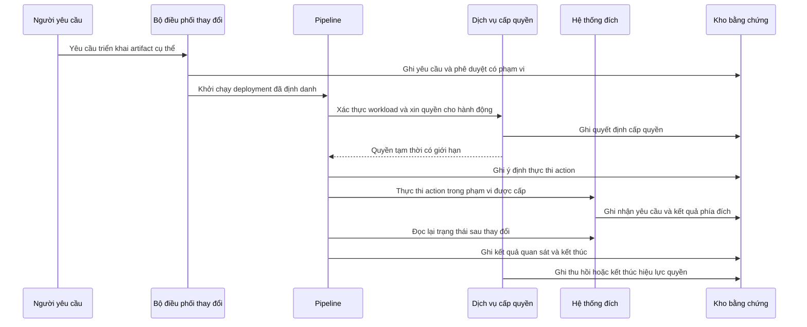

# Audit deployment action: kiểm toán hành động triển khai trong hệ thống PAM

## 1. Vì sao deployment action phải được kiểm toán như một hành động đặc quyền?

Một pipeline triển khai thường được gọi là “tự động hóa”, nhưng quyền mà nó sử dụng có thể tương đương quyền của quản trị viên: thay đổi chương trình đang chạy, sửa cấu hình production, cập nhật chính sách truy cập hoặc khôi phục một phiên bản cũ. Nếu pipeline bị chiếm quyền, kẻ tấn công có thể dùng chính con đường triển khai hợp lệ để tạo thay đổi nguy hiểm.

Trong quản lý truy cập đặc quyền (Privileged Access Management — PAM), mục tiêu kiểm toán không chỉ là biết pipeline đã chạy. Cần có bằng chứng để trả lời:

- Ai hoặc sự kiện nào khởi tạo việc triển khai?
- Danh tính thực thi nào đã được cấp quyền, cho hành động nào, trên tài nguyên nào?
- Quyền đó dựa trên phê duyệt và phiên bản chính sách nào?
- Artifact thực tế có đúng artifact được phê duyệt không?
- Hệ thống đích đã nhận, chấp nhận và áp dụng những thay đổi nào?
- Quyền tạm thời đã hết hiệu lực hoặc được thu hồi sau đó chưa?

Một dòng log “Deploy successful” không đủ trả lời các câu hỏi này. Nó có thể chỉ cho biết một script kết thúc với exit code bằng 0, trong khi thay đổi ở hệ thống đích chưa hoàn tất hoặc chỉ hoàn tất một phần.

**Deployment action** trong bài này là một thao tác cụ thể thuộc quá trình triển khai và có khả năng tác động đến trạng thái hoặc quyền truy cập của hệ thống đích. Ví dụ: cập nhật image của một workload, thay đổi cấu hình, kích hoạt một release, thực hiện migration dữ liệu hoặc rollback.

Không phải mọi deployment action đều có cùng mức rủi ro. Tuy nhiên, các hành động sử dụng quyền quản trị hoặc tác động đến production cần được liên kết với kiểm soát least privilege, cấp quyền theo thời gian và bằng chứng độc lập.

## 2. Phân biệt log, audit event và bằng chứng triển khai

Ba khái niệm này liên quan nhưng không thay thế nhau.

| Thành phần | Mục đích chính | Ví dụ | Giới hạn |
| --- | --- | --- | --- |
| Log thực thi | Hỗ trợ vận hành và chẩn đoán | Một bước build bị timeout | Có thể do chính job sinh ra, có thể bị sửa hoặc chứa dữ liệu nhạy cảm |
| Audit event | Ghi nhận sự kiện có cấu trúc để truy vết trách nhiệm và quyền | Workload identity được phép cập nhật một workload cụ thể | Cần xác minh nguồn, ý nghĩa kết quả và khả năng liên kết |
| Bằng chứng triển khai | Tập hợp chứng cứ giải thích đầy đủ một lần thay đổi | Phê duyệt, artifact digest, quyết định PAM, audit đích và trạng thái sau triển khai | Cần đối chiếu nhiều nguồn, không thể chỉ dựa vào một thông báo của pipeline |

Log của runner cho biết runner đã làm gì theo góc nhìn của runner. Audit của hệ thống đích cho biết yêu cầu nào đã được tiếp nhận hoặc xử lý theo góc nhìn của hệ thống đích. Bản ghi của PAM cho biết quyền được cấp như thế nào. Sự đồng thuận giữa các nguồn giúp tăng độ tin cậy; sự khác biệt giữa chúng là tín hiệu cần điều tra.

Ví dụ, pipeline báo thành công nhưng hệ thống đích không có thay đổi tương ứng có thể là lỗi thu thập audit, lỗi định danh tài nguyên hoặc pipeline chưa thực sự thực thi thao tác. Không nên kết luận ngay đó là tấn công, cũng không nên bỏ qua vì job đã xanh.

Một audit event tốt cần có định nghĩa rõ ràng. “Deployment succeeded” phải phân biệt được thành công khi gửi yêu cầu, khi control plane chấp nhận và khi trạng thái mong muốn được xác nhận.

## 3. Đối tượng cần kiểm toán trong một chuỗi triển khai

Giả sử nhóm vận hành triển khai ứng dụng `billing-api` lên môi trường production. Bản release sử dụng artifact có digest cố định, được phê duyệt qua một quy trình thay đổi. Pipeline xác thực bằng danh tính workload, nhận quyền ngắn hạn rồi cập nhật đúng một workload.

Chuỗi kiểm toán cần bao phủ ít nhất các đối tượng sau:

| Đối tượng | Thông tin cần giữ | Lưu ý về PAM |
| --- | --- | --- |
| Người hoặc sự kiện khởi tạo | ID ổn định, loại trigger, nguồn xác thực, thời điểm | Người bấm chạy và người có mã được triển khai có thể khác nhau |
| Người phê duyệt | ID người duyệt, phạm vi, thời hạn, điều kiện phê duyệt | Tách người yêu cầu và người phê duyệt khi mức rủi ro yêu cầu |
| Pipeline và job | ID workflow, run, attempt, job, phiên bản định nghĩa pipeline | Không chỉ lưu tên hiển thị có thể đổi |
| Danh tính thực thi | Workload identity, target principal, phiên hoặc tham chiếu credential | Không suy ra người chịu trách nhiệm chỉ từ service account |
| Artifact | Digest bất biến, nguồn build, commit và bằng chứng nguồn gốc nếu có | Tag có thể đổi nên không đủ để khóa đối tượng được duyệt |
| Quyết định cấp quyền | Policy ID, phiên bản, phạm vi, thời hạn và lý do | Quyết định cho phép phải gắn với hành động thực tế |
| Tài nguyên đích | Môi trường, account/tenant, cluster, namespace và ID tài nguyên | Tên giống nhau ở hai môi trường không có nghĩa là cùng tài nguyên |
| Hành động và kết quả | Thao tác, yêu cầu, kết quả đích, trạng thái sau thay đổi | Một release có thể chứa nhiều hành động với kết quả khác nhau |

Tham chiếu credential trong audit chỉ nên là định danh quản trị không dùng được để xác thực. Không ghi token, mật khẩu, private key hoặc nội dung secret.

Nếu quyền của pipeline được cấp trực tiếp bằng cơ chế liên kết danh tính thay vì qua vault, vẫn cần kiểm toán việc xác thực, quyết định cấp quyền và quyền hiệu lực. Không nên tạo một khái niệm “vault lease” giả khi kiến trúc không có lease đó.

## 4. Thiết kế chuỗi tương quan từ yêu cầu đến hệ thống đích

### 4.1. Phân biệt định danh nghiệp vụ và định danh kỹ thuật

Một chuỗi triển khai nên có nhiều ID với vai trò khác nhau:

- `change_id`: yêu cầu thay đổi hoặc hồ sơ nghiệp vụ.
- `deployment_id`: một lần triển khai logic được hệ thống điều phối quản lý.
- `run_id`, `attempt`, `job_id`: lần chạy và lần thử cụ thể của pipeline.
- `action_id`: một hành động cụ thể trong deployment.
- `event_id`: định danh duy nhất của từng audit event.
- `authorization_id`: quyết định cho phép một phạm vi hành động.
- `target_request_id`: yêu cầu hoặc operation ID do hệ thống đích cung cấp.
- `credential_ref` hoặc `session_id`: tham chiếu quyền tạm thời khi cơ chế cấp quyền có các đối tượng này.

Không dùng `change_id` làm ID duy nhất cho mọi lần chạy. Một yêu cầu thay đổi có thể được triển khai lại nhiều lần; mỗi lần có thể dùng artifact, quyền và kết quả khác nhau.

Một lần retry của cùng thao tác cần được mô hình hóa rõ: đây là thử gửi lại cùng yêu cầu có khả năng khử trùng lặp, hay một hành động mới? Giữ nguyên định danh tùy tiện có thể che giấu thao tác lặp; tạo định danh mới tùy tiện có thể làm mất khả năng nhận biết cùng một thao tác đang được thử lại.

### 4.2. Không coi correlation ID là bằng chứng ủy quyền

Correlation ID giúp nối các sự kiện, nhưng không tự chứng minh rằng sự kiện hợp lệ. Nếu một job có thể tự đặt `approval_id=approved-123`, hệ thống đích không được tin rằng job đã được phê duyệt.

Dịch vụ cấp quyền phải tra cứu hồ sơ phê duyệt từ nguồn tin cậy và kiểm tra phạm vi thực tế. Nếu cho phép truyền nhãn tương quan sang hệ thống đích, cần phân biệt:

- Nhãn do client khai báo.
- Thuộc tính do bộ điều phối hoặc gateway đã xác thực gắn vào.
- Danh tính và kết quả do hệ thống đích tự ghi nhận.

Không nâng một nhãn tự khai thành dữ liệu xác thực chỉ vì nhãn đó xuất hiện trong audit.

### 4.3. Luồng bằng chứng tham khảo



Đây là sơ đồ logic. Đường thu thập audit thực tế có thể đi qua collector hoặc hàng đợi riêng. Cần tránh để job triển khai có quyền ghi đè hoặc xóa bằng chứng mà các thành phần khác đã phát hành.

## 5. Gắn phê duyệt với đúng hành động được thực thi

Một phê duyệt chỉ có nội dung “cho phép deploy production” quá rộng để kiểm soát hành động đặc quyền.

Phạm vi phê duyệt nên thể hiện được:

1. Ứng dụng và môi trường được phép thay đổi.
2. Artifact hoặc bộ cấu hình đã xác định.
3. Loại hành động được phép thực hiện.
4. Tập tài nguyên đích hoặc quy tắc chọn tài nguyên được kiểm soát.
5. Khoảng thời gian hiệu lực.
6. Điều kiện bổ sung như kiểm tra nguồn artifact, lịch thay đổi hoặc người phê duyệt.
7. Những thay đổi nào khiến phê duyệt mất hiệu lực.

Ví dụ, nếu artifact thay đổi sau khi được duyệt, hệ thống phải đánh giá lại phê duyệt theo chính sách. Không cho phép cùng một approval trở thành giấy phép triển khai mọi image có chung tag.

Đối với tập tài nguyên động, chỉ lưu nhãn như `app=billing-api` có thể chưa đủ. Cần ghi phạm vi được duyệt và tập tài nguyên thực tế đã bị tác động, cùng định danh đủ ổn định để phát hiện thay đổi ngoài dự kiến.

### Khoảng cách giữa kiểm tra và sử dụng

Một rủi ro phổ biến là kiểm tra artifact ở đầu pipeline nhưng đến lúc triển khai lại phân giải một tag có thể thay đổi. Bằng chứng duyệt và hành động thực thi lúc này không còn cùng đối tượng.

Cách giảm rủi ro:

- Phân giải và khóa artifact bằng digest.
- Kiểm tra phạm vi ngay tại cổng cấp quyền hoặc cổng thực thi.
- Ghi digest thực tế được gửi đến hệ thống đích.
- Đọc lại tham chiếu artifact hoặc trạng thái release sau thao tác.
- Áp dụng cơ chế kiểm soát đích để chặn loại thay đổi không được phép nếu nền tảng hỗ trợ.

Việc lưu phê duyệt chỉ chứng minh có hồ sơ phê duyệt. Muốn chứng minh kiểm soát đã hoạt động, cần bằng chứng rằng bộ thực thi đã đối chiếu hồ sơ đó với hành động cụ thể.

## 6. Một mô hình audit event có cấu trúc

Schema dưới đây chỉ là ví dụ trung lập về nhà cung cấp. Khi áp dụng, tổ chức cần định nghĩa rõ trường bắt buộc, nguồn có thẩm quyền và ý nghĩa của từng trạng thái.

```json
{
  "schema_version": "1.0",
  "event_id": "evt-2042",
  "event_type": "deployment.action.observed",
  "event_time": "2026-06-18T08:42:15.400Z",
  "observed_at": "2026-06-18T08:42:16.120Z",
  "source": {
    "component": "deployment-controller",
    "instance_id": "controller-03"
  },
  "correlation": {
    "change_id": "CHG-4821",
    "deployment_id": "dep-4821-prod-a",
    "run_id": "run-9081",
    "attempt": 1,
    "job_id": "deploy-prod",
    "action_id": "act-9081-01",
    "target_request_id": "operation-7130"
  },
  "actors": {
    "initiator_id": "user-172",
    "executor_identity_id": "workload-billing-release",
    "target_principal_id": "principal-billing-deployer",
    "approval_ref": "approval-4821-v2"
  },
  "artifact": {
    "digest": "sha256:aaaaaaaaaaaaaaaaaaaaaaaaaaaaaaaaaaaaaaaaaaaaaaaaaaaaaaaaaaaaaaaa",
    "source_commit": "commit-example-7c21",
    "provenance_ref": "provenance-9081"
  },
  "authorization": {
    "decision_id": "authz-6411",
    "policy_id": "prod-billing-update",
    "policy_version": "v17",
    "decision": "ALLOW",
    "credential_ref": "cred-ref-52",
    "valid_until": "2026-06-18T08:50:00Z"
  },
  "target": {
    "environment": "production",
    "account_id": "account-prod-01",
    "cluster_id": "cluster-prod-02",
    "namespace": "billing",
    "resource_type": "workload",
    "resource_uid": "resource-7b19",
    "resource_name": "billing-api"
  },
  "action": {
    "operation": "update-workload-artifact",
    "request_digest_ref": "request-hash-6411",
    "desired_artifact_digest": "sha256:aaaaaaaaaaaaaaaaaaaaaaaaaaaaaaaaaaaaaaaaaaaaaaaaaaaaaaaaaaaaaaaa",
    "previous_version_ref": "version-117",
    "observed_version_ref": "version-118"
  },
  "result": {
    "request_outcome": "ACCEPTED",
    "observed_outcome": "DESIRED_STATE_CONFIRMED",
    "health_outcome": "NOT_EVALUATED",
    "evidence_refs": [
      "target-audit-7130",
      "state-observation-118"
    ]
  },
  "classification": "internal-security-audit"
}
```

Các ID, thời điểm và digest ở trên là dữ liệu minh họa. `request_digest_ref` là tham chiếu tới bản ghi kiểm soát yêu cầu, không phải toàn bộ nội dung yêu cầu được chép vào audit.

### 6.1. Nguồn và thời gian

`event_time` biểu diễn thời điểm sự kiện xảy ra theo nguồn phát hành. `observed_at` biểu diễn thời điểm collector hoặc kho bằng chứng quan sát được sự kiện theo quy ước schema.

Hai trường có thể lệch nhau do truyền chậm, retry hoặc lệch đồng hồ. Giữ thời gian theo UTC, theo dõi độ lệch đồng hồ và lưu thời điểm tiếp nhận giúp điều tra đúng thứ tự.

Không sắp xếp rồi khẳng định quan hệ nhân quả chỉ dựa trên timestamp. Các quan hệ `action_id`, `decision_id`, `target_request_id` và phiên bản tài nguyên thường đáng tin hơn để nối chuỗi.

### 6.2. Danh tính

`initiator_id` và `executor_identity_id` không phải cùng một vai trò. Với deployment theo lịch, có thể không có người trực tiếp bấm chạy. Khi đó lưu trigger là lịch và chủ thể sở hữu lịch; không bịa một người khởi tạo.

Nếu runner tự khai tên người khởi tạo, bằng chứng này phải được đánh dấu theo nguồn. Danh tính người yêu cầu nên được đối chiếu với bản ghi của hệ thống điều phối có xác thực.

### 6.3. Kết quả theo từng lớp

Trong ví dụ, trạng thái mong muốn đã được quan sát nhưng sức khỏe ứng dụng chưa được đánh giá. Điều đó không đồng nghĩa release đã phục vụ người dùng thành công.

Nên tách:

| Lớp kết quả | Câu hỏi được trả lời |
| --- | --- |
| Xác thực | Danh tính có được chấp nhận không? |
| Cấp quyền | Hành động có được cho phép không? |
| Gửi yêu cầu | Client đã gửi hoặc nhận phản hồi gì? |
| Xử lý phía đích | Hệ thống đích chấp nhận hay từ chối yêu cầu? |
| Trạng thái sau thay đổi | Tài nguyên có đạt trạng thái mong muốn không? |
| Sức khỏe ứng dụng | Kiểm tra vận hành sau triển khai có đạt không? |
| Kết thúc quyền | Quyền tạm thời còn sử dụng được không? |

Không gộp tất cả thành một cờ `success=true`.

## 7. Thu thập bằng chứng trước, trong và sau hành động

### 7.1. Trước khi cấp quyền

Bộ cấp quyền kiểm tra danh tính workload và các điều kiện của yêu cầu triển khai. Các thông tin về repository, workflow, môi trường và artifact phải đến từ nguồn được xác thực hoặc được kiểm chứng, không chỉ từ biến môi trường do job tự đặt.

Bằng chứng cần ghi gồm:

- Danh tính đã xác thực và phương thức xác thực ở mức cần thiết.
- Yêu cầu quyền ban đầu.
- Phạm vi thực tế được cấp sau khi áp dụng chính sách.
- Phiên bản chính sách và kết quả đánh giá.
- Hồ sơ phê duyệt được sử dụng.
- Thời điểm bắt đầu và kết thúc hiệu lực.
- Lý do từ chối nếu yêu cầu không đạt.

Đừng chỉ ghi các lần cấp quyền thành công. Những yêu cầu cố xin quyền quá rộng hoặc dùng approval sai môi trường là dữ liệu quan trọng để phát hiện pipeline bị lạm dụng.

### 7.2. Trước khi thực thi thay đổi

Ghi một sự kiện ý định thực thi, ví dụ `deployment.action.intent`, cho biết action nào chuẩn bị chạy với phạm vi nào.

Với thao tác production có rủi ro cao, chính sách có thể yêu cầu xác nhận ý định đã được ghi bền vững trước khi cho phép thay đổi. “Bền vững” phải được định nghĩa cụ thể: dữ liệu chỉ nằm trong bộ nhớ runner không đáp ứng yêu cầu này.

Tuy nhiên, ghi ý định không chứng minh hành động đã xảy ra. Nếu tiến trình chết ngay sau đó, chuỗi audit có ý định nhưng không có kết quả. Cần cơ chế đối soát để tìm những action như vậy.

### 7.3. Trong khi thực thi

Hệ thống đích cần phát hành audit từ phía mình, độc lập với lời khai của pipeline trong phạm vi kiến trúc cho phép. Bản ghi nên thể hiện principal hiệu lực, thao tác, tài nguyên, kết quả và request ID.

Không cấp quyền quản trị audit cho chính target principal dùng để triển khai. Một pipeline có quyền sửa ứng dụng không nên mặc nhiên có quyền tắt logging, xóa log hoặc thay đổi thời gian lưu bằng chứng.

Nếu nền tảng không cho gắn `action_id` đáng tin cậy vào audit phía đích, dùng các định danh có sẵn như request ID, session và principal để đối chiếu. Chỉ ghép theo thời gian là phương án độ tin cậy thấp hơn; cần thể hiện hạn chế đó trong kết quả điều tra.

### 7.4. Sau khi thực thi

Thu thập kết quả của yêu cầu và kiểm tra trạng thái thực tế. Sau đó ghi các sự kiện kết thúc riêng biệt:

- Kết quả action.
- Kết quả kiểm tra sau triển khai.
- Kết quả thu hồi hoặc hết hiệu lực quyền.
- Kết quả rollback hoặc bù trừ nếu có.

Không đánh dấu action hoàn tất chỉ vì bước cleanup đã chạy. Ngược lại, action triển khai thành công cũng không có nghĩa cleanup quyền đã thành công.

## 8. Timeout, retry, thay đổi một phần và rollback

### 8.1. Timeout không có nghĩa là không có thay đổi

Giả sử client gửi yêu cầu cập nhật workload, hệ thống đích đã chấp nhận nhưng phản hồi bị mất. Client nhận timeout.

Ghi `FAILED` theo nghĩa “hệ thống đích không thay đổi” trong trường hợp này là sai. Kết quả thực tế đang là `UNKNOWN` hoặc `PENDING_RECONCILIATION` theo schema của tổ chức.

Trước khi retry, cần:

1. Tìm request hoặc operation ID nếu đã có.
2. Đọc lại trạng thái tài nguyên.
3. Đối chiếu audit phía đích.
4. Xác định thao tác có tính idempotent và cơ chế chống lặp tương ứng.
5. Quyết định tiếp tục, retry hay chuyển điều tra.

Một migration dữ liệu không nên tự động chạy lại chỉ vì bước trước không nhận được phản hồi. Kiểm toán cần lưu cả lần thử, trạng thái chưa rõ và kết quả đối soát về sau.

### 8.2. Không giả định audit và thay đổi đích là một giao dịch

Một hệ thống có thể gặp cửa sổ lỗi: thay đổi đã áp dụng nhưng sự kiện kết quả chưa gửi được, hoặc ý định đã ghi nhưng thay đổi chưa được thực hiện.

Vì không phải lúc nào cũng có giao dịch nguyên tử xuyên các hệ thống, thiết kế cần:

- ID ổn định và cơ chế khử trùng lặp.
- Hàng đợi hoặc bộ đệm bền vững tại thành phần phù hợp.
- Đối soát giữa ý định, quyết định cấp quyền và audit phía đích.
- Cảnh báo khi thiếu một mắt xích.
- Quy trình bổ sung bằng chứng có nguồn gốc rõ ràng.

Sự kiện bổ sung phải là bản ghi mới liên kết tới sự kiện cũ, không chỉnh sửa âm thầm kết quả trước đó.

### 8.3. Deployment có thể thành công một phần

Một deployment cập nhật ứng dụng thành công nhưng migration thất bại cần được thể hiện là các action riêng với kết quả riêng. Một nhãn tổng “deployment failed” không đủ để biết trạng thái nào đã bị thay đổi.

Trạng thái tổng của deployment nên được suy ra từ các action và chính sách nghiệp vụ, đồng thời giữ nguyên lịch sử của từng action.

### 8.4. Rollback là một hành động đặc quyền mới

Rollback có thể thay đổi phần mềm, cấu hình hoặc dữ liệu nên cần được cấp quyền và kiểm toán theo phạm vi của nó. Không cho phép runner mở rộng sang mọi phiên bản hoặc tài nguyên chỉ vì đang xử lý lỗi.

Bằng chứng rollback cần liên kết tới deployment gốc, lý do, phiên bản nguồn và đích, quyết định cấp quyền, người hoặc cơ chế kích hoạt, cùng kết quả đọc lại.

Rollback thành công không xóa sự kiện triển khai lỗi. Nó bổ sung một chuỗi hành động khắc phục.

## 9. Giữ audit hữu ích mà không làm lộ secret

Audit deployment thường nằm gần những nơi có nhiều secret: biến môi trường, tham số lệnh, file cấu hình, phản hồi cấp credential và kết nối tới hệ thống đích.

Các dữ liệu không nên ghi trực tiếp vào audit gồm:

- Access token, refresh token, password và private key.
- Header xác thực và URL chứa credential.
- Nội dung secret hoặc toàn bộ biến môi trường.
- Payload cấu hình chứa dữ liệu khách hàng.
- Connection string có thông tin đăng nhập.
- Output lệnh có khả năng in secret.
- Credential tạm thời, dù thời hạn chỉ còn ngắn.

Ưu tiên một schema theo danh sách trường được phép ghi thay vì thu thập mọi thứ rồi cố che từng mẫu secret. Cơ chế che dữ liệu vẫn hữu ích như lớp bổ sung, nhưng không thể bảo đảm nhận biết mọi dạng nhạy cảm.

Thay vì lưu toàn bộ cấu hình trước và sau, có thể lưu tham chiếu phiên bản cấu hình, tên trường đã thay đổi và digest của gói cấu hình đã được xử lý phù hợp. Nếu cần giữ bản diff chi tiết để điều tra, đặt nó trong kho bằng chứng có quyền truy cập riêng.

**Hash không tự biến secret thành dữ liệu an toàn.** Với bí mật có miền giá trị nhỏ, hash có thể hỗ trợ đoán ngược bằng cách thử các giá trị. Không băm từng mật khẩu rồi coi đó là phương án audit phù hợp.

Nếu phát hiện secret lọt vào log, cần xử lý như một sự cố: hạn chế truy cập, thu hồi hoặc luân chuyển secret theo phạm vi ảnh hưởng và xử lý bản sao theo quy trình. Việc xóa một dòng log không làm credential đã bị lộ trở lại an toàn.

## 10. Bảo vệ đường thu thập và kho bằng chứng

### 10.1. Tách quyền tạo thay đổi và quyền quản lý audit

Một cách phân quyền tham khảo:

| Chủ thể | Quyền cần thiết | Quyền cần hạn chế |
| --- | --- | --- |
| Job triển khai | Gửi các sự kiện của chính job tới điểm thu nhận | Ghi đè, xóa hoặc sửa sự kiện đã lưu |
| Dịch vụ cấp quyền | Phát hành sự kiện quyết định và vòng đời quyền | Thay đổi sự kiện đích để hợp thức hóa một action |
| Collector | Tiếp nhận và chuyển sự kiện theo phạm vi | Quyền triển khai ứng dụng production |
| Người điều tra | Tra cứu bằng chứng trong phạm vi được giao | Tự sửa lịch sử hoặc thời hạn lưu |
| Quản trị kho audit | Quản trị hạ tầng theo cơ chế kiểm soát riêng | Sử dụng quyền không để lại dấu vết |

Việc tách quyền phải được thực thi bằng chính sách và kiến trúc, không chỉ là quy ước trong tài liệu.

### 10.2. Tính toàn vẹn cần cả kỹ thuật và kiểm soát truy cập

Có thể áp dụng ghi nối tiếp, cơ chế lưu bất biến theo thời hạn, chữ ký theo lô hoặc chuyển bản sao sang miền quản trị độc lập tùy nền tảng.

Một checksum lưu ngay cạnh dữ liệu không đủ chống người có thể sửa cả dữ liệu lẫn checksum. Chữ ký cũng cần quản lý khóa, xác minh nguồn phát hành và bảo vệ khóa khỏi chính thành phần đang bị kiểm toán.

Dấu vết toàn vẹn giúp phát hiện thay đổi sau khi ghi. Nó không chứng minh bản ghi ban đầu đúng sự thật hoặc chứng minh không thiếu sự kiện. Do đó vẫn cần đối chiếu nguồn và theo dõi độ bao phủ.

### 10.3. Khả năng tìm lại bằng chứng cũng là yêu cầu vận hành

Bằng chứng cần được lập chỉ mục để có thể tra cứu theo deployment, tài nguyên, principal và thời gian mà không cấp quyền đọc quá rộng.

Xác định thời gian lưu theo nhu cầu điều tra, yêu cầu hợp đồng và chính sách của tổ chức. Thời hạn quyền tạm thời không quyết định thời hạn lưu audit: token hết hạn sau vài phút nhưng bằng chứng có thể cần được giữ lâu hơn nhiều.

Việc truy cập hoặc xuất bằng chứng nhạy cảm cũng phải được kiểm toán. Cần thử khả năng phục hồi và truy xuất dữ liệu đã lưu, vì “đã đẩy vào kho” không đồng nghĩa “có thể dùng khi xảy ra sự cố”.

## 11. Thiết kế phát hiện từ chuỗi bằng chứng

Audit có ích khi hỗ trợ phát hiện hành vi bất thường và chứng minh kiểm soát hoạt động.

Các quy tắc dưới đây cần được điều chỉnh theo kiến trúc và độ trễ thu thập thực tế:

| Tình huống | Cách đối chiếu | Ý nghĩa và hướng xử lý |
| --- | --- | --- |
| Thay đổi production không có deployment hợp lệ | Audit đích so với sổ action của bộ điều phối | Tìm truy cập ngoài luồng, break-glass hoặc lỗ hổng thu thập |
| Artifact thực thi khác artifact được duyệt | Digest trong approval, action và trạng thái đích | Chặn nếu còn trước thực thi; điều tra nếu đã thay đổi |
| Hành động ngoài phạm vi quyền được cấp | Operation và tài nguyên thực tế so với quyết định PAM | Kiểm tra quyền hiệu lực, nhóm quyền hoặc cấu hình cổng thực thi |
| Principal thực thi khác principal được cấp | Bản ghi cấp quyền so với audit đích | Có thể có credential khác, chuyển vai trò hoặc liên kết sai |
| Có cấp quyền nhưng không có kết thúc quyền | Vòng đời quyền theo tham chiếu credential hoặc phiên | Kiểm tra job bị hủy, cleanup lỗi hoặc giới hạn cơ chế thu hồi |
| Có ý định nhưng không có kết quả | Action intent so với audit đích và bản ghi hoàn tất | Đối soát trạng thái chưa rõ trước khi retry |
| Thay đổi cấu hình audit từ pipeline | Audit quản trị audit so với quyền job | Điều tra khả năng xóa dấu vết hoặc quyền quá rộng |
| Sự kiện đến chậm hoặc mất nguồn | Heartbeat nguồn và thời gian tiếp nhận | Đánh giá khoảng trống quan sát, không chỉ xử lý từng action |

Không cảnh báo “mất audit” ngay khi một event chưa đến trong vài mili giây. Cần xác định khoảng chờ theo độ trễ thu thập, trạng thái nguồn và mức rủi ro. Với thay đổi nhạy cảm, khoảng chờ có thể ngắn hơn và có cơ chế giữ deployment ở trạng thái chờ.

### Đối soát không chỉ đi từ pipeline ra ngoài

Nếu chỉ kiểm tra “mỗi deployment có audit đích hay chưa”, hệ thống có thể bỏ sót thay đổi được thực hiện ngoài pipeline.

Cần đối soát hai chiều:

- Từ action đã đăng ký đến bằng chứng phía đích.
- Từ thay đổi đặc quyền phía đích về nguồn ủy quyền và action hợp lệ.

Với một action tác động nhiều tài nguyên, không ép quan hệ một-một. Lưu tập tài nguyên dự kiến và tập đã quan sát để xác định thiếu, thừa hoặc thay đổi một phần.

## 12. Chỉ số đánh giá độ bao phủ kiểm toán

Một vài chỉ số có thể dùng để theo dõi:

**Tỷ lệ thay đổi đích có nguồn ủy quyền được liên kết**

```text
Số thay đổi đặc quyền phía đích liên kết được với nguồn ủy quyền hợp lệ
----------------------------------------------------------------------------
Tổng số thay đổi đặc quyền phía đích thuộc phạm vi thu thập trong cùng kỳ
```

Chỉ số này phụ thuộc vào độ bao phủ của audit phía đích. Nếu một cluster chưa gửi audit, tỷ lệ cao trên các cluster còn lại không chứng minh toàn môi trường đã được kiểm soát.

**Tỷ lệ action có chuỗi bằng chứng đầy đủ**

```text
Số action có đủ ý định, cấp quyền, kết quả đích và kết thúc quyền theo chính sách
------------------------------------------------------------------------------
Tổng số action cần các bằng chứng đó trong cùng kỳ
```

Những cơ chế không có credential hoặc không có lease phải được đánh giá theo hợp đồng tương ứng, không ép vào mẫu dữ liệu không tồn tại.

Ngoài tỷ lệ, nên theo dõi:

- Số action có kết quả chưa rõ quá thời hạn đối soát.
- Độ trễ từ sự kiện đích đến khi có thể tìm kiếm.
- Số nguồn audit ngừng phát hành.
- Tỷ lệ quyền tạm thời được kết thúc theo yêu cầu.
- Số lần thu hồi thất bại và thời gian xử lý.
- Số sự kiện bị loại vì sai schema hoặc chứa dữ liệu bị cấm.
- Kết quả thử khôi phục bằng chứng và xác minh tính toàn vẹn.

Không dùng số lượng log lớn làm thước đo chất lượng. Một triệu dòng output vẫn có thể thiếu principal đích hoặc artifact digest quan trọng nhất.

## 13. Khi đường audit gặp sự cố

Phải có chính sách rõ cho trường hợp collector, mạng hoặc kho bằng chứng không hoạt động.

Một chính sách minh họa:

```yaml
deploymentAuditPolicy:
  version: audit-policy-v3
  scope: production
  beforePrivilegedAction:
    requireValidAuthorization: true
    requireDurableIntentReceipt: true
    onMissingReceipt: BLOCK
  afterPrivilegedAction:
    onUnknownTargetOutcome: RECONCILE
    onDeliveryFailure: BUFFER_DURABLY_AND_ALERT
  emergencyChange:
    requireSeparateAuthorization: true
    requireIndependentEvidenceChannel: true
    requireRetrospectiveReview: true
```

Đây là chính sách khái niệm, không phải cấu hình có thể nạp trực tiếp vào một sản phẩm. Năng lực ghi bền vững, dung lượng bộ đệm và cơ chế khôi phục cần được hiện thực và thử nghiệm.

Các nguyên tắc vận hành:

- Nếu điều kiện bắt buộc trước thao tác không đạt, không thực hiện thay đổi theo đường thông thường.
- Nếu thay đổi đã xảy ra rồi mới mất đường gửi audit, ghi bền vững tại thành phần phù hợp, cảnh báo và đối soát; không giả vờ rằng thay đổi chưa xảy ra.
- Khi bộ đệm gần đầy hoặc mất khả năng bảo toàn dữ liệu, áp dụng chính sách dừng các thao tác tiếp theo theo mức rủi ro.
- Kênh break-glass có ủy quyền riêng, quyền giới hạn và đường lưu bằng chứng được thiết kế trước.
- Khôi phục collector cần gửi lại có khử trùng lặp và giữ thời điểm sự kiện gốc.

Ghi audit và thu hồi credential là hai kết quả độc lập. Nếu ghi log thất bại, vẫn phải xử lý kết thúc quyền theo cơ chế đã thiết kế. Nếu thu hồi không được nền tảng hỗ trợ tức thời, ghi rõ giới hạn, thời điểm hết hiệu lực dự kiến và các biện pháp ngăn sử dụng tiếp; không báo `REVOKED` chỉ vì đã xóa credential khỏi biến của runner.

## 14. Tình huống phân tích: job xanh nhưng deployment chưa thể đóng

Nhóm phát hành triển khai `billing-api` theo approval `approval-4821-v2`. Artifact được duyệt có digest A.

Các sự kiện quan sát được:

1. Bộ cấp quyền xác nhận workload identity hợp lệ và cho phép cập nhật workload production trong mười phút.
2. Pipeline ghi ý định triển khai digest A.
3. Hệ thống đích chấp nhận yêu cầu và trả operation ID.
4. Pipeline đọc lại workload, thấy digest B.
5. Job kết thúc với exit code bằng 0 vì script chỉ kiểm tra lệnh gửi yêu cầu.
6. Không có bản ghi kết thúc quyền khi job bị dọn runner.

Không thể kết luận “đã triển khai A thành công”. Ít nhất có hai vấn đề cần xử lý độc lập: trạng thái artifact không khớp và quyền chưa được xác nhận đã kết thúc.

Trình tự điều tra hợp lý:

- Khóa mối liên hệ giữa approval, deployment, action và operation ID.
- So sánh yêu cầu thực tế, audit phía đích và phiên bản tài nguyên.
- Xác định digest B đến từ chính action này hay từ một thay đổi xảy ra đồng thời.
- Kiểm tra việc phân giải tag, phiên bản pipeline và quyền của principal.
- Xử lý quyền còn hiệu lực theo cơ chế hỗ trợ.
- Quyết định khắc phục hoặc rollback theo quy trình có ủy quyền.
- Bổ sung bản ghi kết luận, liên kết tới bằng chứng gốc.

Nếu pipeline dùng tag có thể thay đổi, đây là một giả thuyết cần kiểm tra, không phải kết luận sẵn. Cũng có thể một principal khác đã cập nhật tài nguyên sau action ban đầu. Audit đích và phiên bản tài nguyên giúp phân biệt hai trường hợp.

Bài học là trạng thái của job, trạng thái tài nguyên và vòng đời quyền phải được quan sát riêng rồi đối chiếu.

## 15. Thực hành thiết kế bằng chứng cho một deployment

Có thể thực hiện bài tập này bằng dữ liệu giả trong môi trường học tập, không cần cấp quyền production hoặc đưa credential thật vào tài liệu.

### Bước 1: Chọn phạm vi nhỏ

Chọn một ứng dụng, một môi trường và một thao tác cập nhật artifact. Mô tả rõ các bên có thể khởi tạo, phê duyệt, cấp quyền và thực thi.

Xác định principal hiệu lực ở đích được phép làm gì và không được làm gì. Bao gồm việc principal không được quản trị kho audit.

### Bước 2: Lập hợp đồng sự kiện

Định nghĩa các sự kiện:

```text
deployment.requested
deployment.approved
authorization.decided
deployment.action.intent
target.action.recorded
deployment.action.observed
authorization.ended
deployment.closed
```

Tên sự kiện có thể khác trong hệ thống thực. Điều quan trọng là ý nghĩa, nguồn phát hành và quan hệ liên kết rõ ràng.

Với từng sự kiện, ghi các trường bắt buộc, trường không được chứa secret, cách xác minh nguồn và cách xử lý khi thiếu.

### Bước 3: Mô phỏng các đường lỗi

Tạo chuỗi dữ liệu giả cho các trường hợp:

- Triển khai thành công, quyền kết thúc đúng.
- Yêu cầu bị từ chối do sai môi trường.
- Artifact thay đổi sau phê duyệt.
- Hệ thống đích chấp nhận nhưng client timeout.
- Runner chết trước cleanup.
- Một phần action thành công rồi rollback.
- Collector bị gián đoạn.
- Có thay đổi đặc quyền ở đích nhưng không có deployment được đăng ký.

Đối với mỗi trường hợp, xác định hệ thống biết điều gì, chưa biết điều gì và sự kiện nào giúp chốt kết quả.

### Bước 4: Kiểm tra khả năng tái dựng

Một người không trực tiếp tham gia triển khai phải có thể dùng bộ bằng chứng để trả lời:

- Hành động được ủy quyền cho đối tượng nào?
- Artifact thực tế là gì?
- Ai phê duyệt và ai thực thi?
- Quyền hiệu lực có nằm trong phạm vi đã duyệt không?
- Tài nguyên nào đã thay đổi?
- Có thao tác nào chưa rõ kết quả không?
- Quyền đặc quyền kết thúc bằng cách nào?
- Bằng chứng có nguồn nào còn thiếu hoặc chưa đáng tin?

Nếu cần hỏi người vận hành “hôm đó anh nhớ đã làm gì” để lấp các mắt xích chính, bộ bằng chứng chưa tự chứa đủ thông tin.

## 16. Các lỗi thiết kế thường gặp

| Lỗi | Hệ quả | Cách sửa thiết kế |
| --- | --- | --- |
| Chỉ lưu tên pipeline và trạng thái xanh/đỏ | Không quy trách nhiệm hoặc xác định quyền thực tế | Lưu ID ổn định, principal, action và kết quả theo từng lớp |
| Chỉ lưu image tag | Không biết chính xác nội dung được triển khai | Gắn phê duyệt và action với digest bất biến |
| Tin approval ID do job tự nhập | Job có thể gắn approval không phù hợp | Tra cứu và xác minh phạm vi từ nguồn có thẩm quyền |
| Dùng chung service account quyền rộng | Khó phân biệt hành động và phạm vi cần thiết | Tách danh tính, cấp quyền tối thiểu và ghi danh tính hiệu lực |
| Chép toàn bộ output và môi trường | Làm lộ credential hoặc dữ liệu nhạy cảm | Dùng trường cho phép, tham chiếu và kiểm soát nội dung đầu vào |
| Cho deployer xóa log của mình | Có thể xóa dấu vết sau khi lạm dụng | Tách miền quyền và đường lưu bằng chứng |
| Coi timeout là chắc chắn thất bại | Retry tạo thay đổi lặp hoặc migration lặp | Dùng trạng thái chưa rõ và đối soát trước retry |
| Gộp rollback vào kết quả cũ | Mất lịch sử thay đổi và trách nhiệm | Ghi rollback thành action mới có liên kết |
| Chỉ đối soát action từ pipeline | Bỏ sót thay đổi ngoài luồng | Đối soát thêm từ audit đích về nguồn ủy quyền |
| Báo thu hồi khi chỉ xóa file token | Token có thể vẫn dùng được ở nơi khác | Phân biệt cleanup cục bộ, thu hồi và hết hạn thực tế |

Kiểm toán deployment action đạt mục đích khi có thể dựng lại chuỗi **ủy quyền → cấp quyền → thực thi → trạng thái đích → kết thúc quyền** bằng các bằng chứng có nguồn gốc rõ ràng. Trong PAM, đó là cơ sở để chứng minh least privilege đã được thực thi, phát hiện sử dụng quyền ngoài phạm vi và điều tra sự cố mà không phải dựa vào một dòng “deployment successful”.
