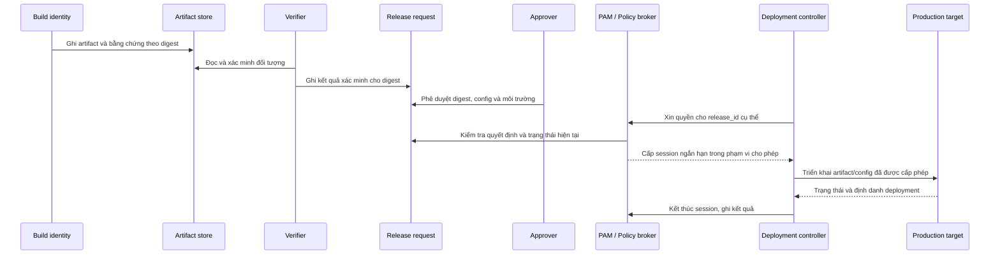

# Tách build và release permission

## 1. Vì sao quyền build không nên kéo theo quyền release?

Một pipeline Java thường checkout mã nguồn, chạy kiểm thử, đóng gói JAR, tạo container image rồi triển khai ứng dụng. Khi mọi bước dùng chung một service account có quyền production, bất kỳ đoạn mã nào chạy trong quá trình build cũng có thể trở thành đường đi tới quyền quản trị môi trường thật.

Ví dụ, một thay đổi tưởng như chỉ sửa `pom.xml`, script kiểm thử hoặc cấu hình plugin build vẫn có thể thực thi lệnh trên runner. Nếu runner giữ credential của production, người sửa mã build có thể sử dụng credential đó mà không cần thay đổi bước deploy. Việc thêm nút “Approve deployment” ở cuối pipeline không khắc phục được credential đã bị lộ ở đầu pipeline.

Trong Privileged Access Management (PAM), tách build và release permission là thiết kế để danh tính tạo artifact không tự quyết định đưa artifact đó vào production, cũng không giữ sẵn quyền thực hiện quyết định ấy. Quyền được phân theo nhiệm vụ, môi trường, tài nguyên và thời gian; bằng chứng phải nối được từ người yêu cầu đến lần triển khai thực tế.

Sau bài học, bạn cần có khả năng:

- Phân biệt quyền build, promote, phê duyệt release và thực thi deploy.
- Xây dựng ma trận quyền cho con người và các workload của pipeline.
- Ràng buộc một lần cấp quyền release với đúng artifact, môi trường và yêu cầu thay đổi.
- Nhận diện đường leo thang từ pull request, runner hoặc artifact registry sang production.
- Thiết kế JIT, thu hồi quyền và bằng chứng kiểm toán cho release thường, rollback và tình huống khẩn cấp.

## 2. Đặt tên rõ cho từng hành động

Các tổ chức dùng từ “release” khác nhau. Có nơi release là phát hành một phiên bản; nơi khác release đồng nghĩa deploy; một số hệ thống deploy xong nhưng chỉ bật feature flag sau đó. Vì vậy, chính sách quyền nên mô tả hành động cụ thể thay vì dựa vào tên stage.

| Hành động | Kết quả chính | Quyền thường cần | Ranh giới cần giữ |
|---|---|---|---|
| Build | Tạo JAR, image hoặc package từ mã nguồn | Đọc source, đọc dependency, ghi artifact vào vùng build | Không sửa workload production hoặc chính sách release |
| Xác minh artifact | Đánh giá test, scan, nguồn gốc và tính toàn vẹn | Đọc artifact và bằng chứng; ghi kết quả xác minh | Không tự thay artifact đang được đánh giá |
| Promote | Đánh dấu hoặc đưa đúng artifact sang vùng được phép phát hành | Ghi metadata hoặc bản sao theo digest vào vùng release | Không tái build thành một artifact khác dưới cùng quyết định phê duyệt |
| Phê duyệt release | Cho phép một thay đổi xác định tới môi trường xác định | Ghi quyết định phê duyệt trên yêu cầu release | Không tự sửa các điều kiện mà mình đang phê duyệt |
| Deploy | Thay đổi trạng thái workload tại môi trường đích | Cập nhật một tập tài nguyên triển khai được giới hạn | Không mặc nhiên có quyền quản trị toàn cụm hoặc toàn cloud account |
| Mở lưu lượng/bật tính năng | Đưa phiên bản tới người dùng | Thay đổi routing hoặc feature flag trong phạm vi được cấp | Không bị bỏ quên như một đường release ngoài chính sách |

Một triển khai có thể gộp một số hành động vào cùng dịch vụ tin cậy. Điều quan trọng là quyền vẫn được kiểm soát riêng, và đầu vào không tin cậy không thể ra lệnh cho dịch vụ đó làm việc ngoài phạm vi đã được cho phép.

### 2.1. Tách quyền khác với tách job

Hai job mang tên `build` và `release` nhưng dùng cùng credential production vẫn là một miền quyền. Hai tài khoản khác tên nhưng tài khoản build có thể đọc secret của tài khoản release cũng chưa tạo được ranh giới hiệu quả.

Ngược lại, cùng một hệ thống CI/CD có thể thực hiện tách quyền nếu các job có danh tính riêng, runner được cô lập, credential không chia sẻ, workflow đặc quyền được bảo vệ và hệ thống đích kiểm tra quyền độc lập. Không nên chỉ nhìn sơ đồ pipeline; cần kiểm tra khả năng thực tế của từng danh tính.

### 2.2. Phê duyệt và khả năng thực thi là hai loại quyền

Người phê duyệt có thể đồng ý release nhưng không cần nhận credential deploy. Deployment controller có thể thực thi một quyết định hợp lệ nhưng không được tự tạo quyết định đó. Cách chia này hạn chế cả lạm dụng quyền của con người lẫn việc pipeline tự phê duyệt chính nó.

Với hệ thống rủi ro cao, người yêu cầu và người phê duyệt cần độc lập theo chính sách phân tách nhiệm vụ. Với hệ thống nhỏ, một số vai trò có thể do cùng người đảm nhiệm trong tình huống được chấp nhận, nhưng sự tập trung quyền phải được ghi nhận rõ và có kiểm soát bù, không bị che bởi tên tài khoản khác nhau.

## 3. Mô hình đe dọa: build là nơi thực thi mã chưa chắc đáng tin

Build không chỉ đọc mã nguồn. Nó thường thực thi test, plugin, hook, script sinh mã và công cụ lấy từ dependency. Do đó, quyền chạy code trong build là một năng lực mạnh, kể cả khi người gửi thay đổi không có quyền merge.

Các đường đi cần xét gồm:

1. Pull request chạy script độc hại và tìm credential trong biến môi trường, thư mục làm việc hoặc credential helper.
2. Runner dùng lại workspace hoặc cache của job trước, làm lộ token hoặc đưa mã vào job release sau.
3. Tài khoản build ghi đè một tag như `stable`, khiến deploy lấy nội dung khác với nội dung đã được phê duyệt.
4. Người sửa workflow thêm một job có quyền release, hoặc truyền một script tùy ý cho workflow đặc quyền.
5. Artifact chứa script triển khai do build tạo ra; release runner thực thi script đó với quyền production.
6. Build sửa policy, danh sách người phê duyệt hoặc cấu hình danh tính workload để tự mở đường tới release.

Mỗi đường đi cho thấy tách credential mới chỉ là một phần. Cần đồng thời bảo vệ điều khiển pipeline, dữ liệu artifact và đường cấp quyền.

### 3.1. Không coi branch tin cậy là bảo đảm tuyệt đối

Một commit đã merge có thể đáp ứng quy trình review nhưng vẫn có lỗi hoặc chứa mã độc chưa được phát hiện. “Build từ nhánh chính” là một điều kiện nguồn gốc, không phải lý do để trao quyền production cho mọi lệnh trong build.

Ranh giới phù hợp hơn là: build tạo đầu ra và bằng chứng; một thành phần khác đánh giá đầu ra đó, rồi cấp quyền cho một thao tác triển khai giới hạn. Mã của ứng dụng có thể trở nên đáng tin đủ để chạy trong workload ứng dụng, nhưng điều đó không đồng nghĩa nó được chạy với danh tính quản trị của release controller.

## 4. Thiết kế danh tính và ma trận quyền tối thiểu

Xét dịch vụ Java `payment-api`. Có ba môi trường `dev`, `staging`, `prod`; artifact được lưu theo digest. Những tên danh tính dưới đây là ví dụ thiết kế, không phải cấu hình dành riêng cho một sản phẩm PAM.

| Danh tính/vai trò | Được phép | Không được cấp mặc định |
|---|---|---|
| Developer | Sửa source theo quy trình, xem log đã lọc, yêu cầu release | Credential deploy production, sửa release policy, tự phê duyệt yêu cầu của mình |
| `payment-build` | Checkout source cần thiết, lấy dependency, ghi vào vùng artifact build | Đọc secret production, ghi vùng artifact release, gọi deploy production |
| `payment-verifier` | Đọc artifact theo digest, kiểm tra bằng chứng, ghi kết quả đánh giá | Thay byte của artifact, thay chính sách chấp nhận hoặc thực thi deploy |
| `payment-promoter` | Promote digest đã đủ điều kiện, ghi bản ghi promote | Build lại mã, chọn tùy ý digest khác, sửa quyền registry |
| Release approver | Phê duyệt yêu cầu đã xác định artifact và môi trường | Lấy credential của controller hoặc sửa workflow release tùy ý |
| `payment-release-prod` | Triển khai phiên bản được cấp phép vào phạm vi `payment-api/prod` | Đọc mọi secret, tạo role quản trị, thay trust policy, triển khai ứng dụng khác |
| PAM/policy administrator | Quản lý cơ chế cấp quyền theo quy trình quản trị riêng | Tự thực hiện mọi release như một quyền mặc định đi kèm |

Ma trận này phải được kiểm tra ở các hệ thống thực thi quyền: CI/CD, registry, vault hoặc broker, nền tảng triển khai và hệ thống quản lý thay đổi. Tài khoản build bị giới hạn ở CI nhưng có quyền quản trị registry vẫn có thể can thiệp đầu ra release.

### 4.1. Chia theo ứng dụng và môi trường

Không nên dùng một `release-bot` toàn tổ chức cho mọi ứng dụng. Nếu một đường cấp quyền bị khai thác, phạm vi ảnh hưởng sẽ bao trùm toàn bộ hệ thống mà bot đó được phép quản trị.

Một thiết kế thực dụng có các chiều giới hạn:

- **Ứng dụng:** chỉ workload, cấu hình và artifact thuộc `payment-api`.
- **Môi trường:** danh tính staging không được suy ra hoặc đổi thành danh tính production.
- **Hành động:** cập nhật phiên bản theo cấu trúc cho phép, thay vì thực thi lệnh quản trị bất kỳ.
- **Thời gian:** chỉ tồn tại trong cửa sổ release được cấp.
- **Nguồn gọi:** chỉ workflow và workload identity đủ điều kiện.
- **Đầu vào:** chỉ digest, cấu hình và chiến lược triển khai đã được cho phép.

Không nhất thiết tạo một tài khoản tĩnh cho mọi tổ hợp. Có thể dùng role hoặc session ngắn hạn, miễn là quyền hiệu lực và bằng chứng vẫn phân biệt được từng phạm vi.

### 4.2. Giới hạn deploy có thể bị mở rộng qua cấu hình workload

Quyền “chỉ sửa deployment” không tự động là quyền nhỏ. Nếu deployment được phép đổi service account, gắn volume nhạy cảm, chạy chế độ đặc quyền hoặc thay image thành bất kỳ nội dung nào, người nắm quyền đó có thể giành thêm quyền qua workload mới.

Do đó, quyền release cần đi cùng kiểm tra cấu hình tại môi trường đích: danh tính runtime được phép, nguồn image, digest đã được duyệt, quyền container và các trường cấu hình nhạy cảm. Controller cũng không nên được phép tự sửa chính các kiểm tra đang giới hạn nó.

## 5. Artifact bất biến là điểm nối giữa build và release

Tách build khỏi release chỉ có ý nghĩa khi hai bên nói về cùng một đầu ra. Nếu phê duyệt bản `1.8.0` nhưng tag `1.8.0` có thể bị ghi đè, quyết định phê duyệt chưa xác định được byte nào sẽ chạy.

### 5.1. Build một lần, nhận diện bằng digest

Luồng cơ bản:

1. Build tạo artifact từ một revision nguồn xác định.
2. Ghi artifact vào vùng build và xác định digest nội dung.
3. Ghi bằng chứng test, scan và nguồn gốc gắn với digest đó.
4. Yêu cầu release tham chiếu digest và tập cấu hình triển khai.
5. Sau khi đủ điều kiện, promote đúng digest hoặc đánh dấu digest đủ điều kiện phát hành.
6. Deploy lấy artifact theo digest và xác minh lại tại điểm sử dụng.

Tag như `candidate`, `release-2026-11` hoặc tên phiên bản vẫn hữu ích cho con người. Chúng nên là nhãn tra cứu; quyết định bảo mật cần gắn với định danh nội dung không thay đổi.

Việc sao chép artifact giữa registry có thể có đặc thù định dạng. Hệ thống phải chứng minh đầu ra được triển khai tương ứng đúng đối tượng đã được đánh giá; không chỉ so sánh tên tag ở hai phía rồi tuyên bố đồng nhất.

### 5.2. Digest không chứng minh artifact an toàn

Digest giúp phát hiện sự khác biệt nội dung và gắn quyết định với một đối tượng cụ thể. Nó không chứng minh mã không độc hại, nguồn build hợp lệ hoặc dependency an toàn.

Bằng chứng nguồn gốc nên liên hệ artifact với source revision, danh tính builder, cấu hình hoặc revision workflow và lần chạy build. Kết quả scan hoặc test cần cho biết phạm vi và kết quả, không chỉ có một cờ `passed` mà build tùy ý tự khai.

Nếu builder được quyền ký attestation, chữ ký ấy xác nhận tuyên bố từ builder theo mô hình tin cậy đã chọn. Không được hiểu thành builder đã có quyền phê duyệt release. Chính sách chấp nhận và danh tính được phép phát hành là các ranh giới khác.

### 5.3. Cấu hình triển khai cũng thuộc quyết định release

Cùng một image có thể chạy an toàn hoặc nguy hiểm tùy cấu hình. Ví dụ, image được duyệt nhưng manifest đổi sang runtime identity có quyền đọc dữ liệu của toàn bộ khách hàng vẫn là một thay đổi đặc quyền đáng kể.

Yêu cầu release vì vậy cần xác định cả artifact và cấu hình liên quan: revision cấu hình, digest của gói cấu hình hoặc biểu diễn chuẩn hóa các trường có ý nghĩa bảo mật. Nếu dữ liệu cấu hình chứa secret, chỉ lưu tham chiếu hoặc fingerprint phù hợp; không đưa giá trị secret vào hồ sơ phê duyệt.

## 6. Luồng release với PAM và quyền JIT

PAM có thể là vault, broker, cơ chế cấp session ngắn hạn hoặc một phần của nền tảng định danh workload. Dù dùng sản phẩm nào, cần trả lời được: ai xin quyền, xin cho việc gì, ai cho phép, quyền nào thực sự được cấp và quyền đó chấm dứt khi nào.



Build identity không có mũi tên trực tiếp tới production. Quan trọng hơn, nó cũng không được quyền tạo ra yêu cầu trông như đã phê duyệt, đóng vai approver hoặc thay policy để broker bỏ qua điều kiện.

### 6.1. Bản ghi cấp quyền phải đủ cụ thể

Ví dụ dữ liệu logic của một quyền release; đây là schema minh họa, không phải định dạng API của một hệ thống có sẵn:

```json
{
  "release_id": "rel-payment-0187",
  "application": "payment-api",
  "environment": "prod",
  "artifact_digest": "sha256:<digest-cua-artifact-da-xac-minh>",
  "config_revision": "cfg-4c7e9b",
  "source_revision": "src-83a2d6",
  "trusted_release_workflow_revision": "release-flow-2f18c0",
  "deployment_principal": "payment-release-prod",
  "target_scope": "payment-api/prod",
  "allowed_action": "deploy-approved-release",
  "change_request": "CHG-0187",
  "approval_record": "APR-0187",
  "expires_at": "2026-11-27T14:15:00+07:00",
  "execution_id": "exec-0187-1"
}
```

Thời hạn trong ví dụ là cửa sổ cho một lần thực hiện. Hệ thống phải tự kiểm tra hạn, danh tính, tính toàn vẹn và trạng thái quyết định; JSON do caller gửi không phải bằng chứng tự xác thực.

Một request có đúng `release_id` nhưng thay `artifact_digest` phải bị từ chối. Tương tự, quyền cho `staging` không được dùng tại `prod`; quyền cho một lần thực thi không được phát lại vô hạn.

### 6.2. Danh tính workload thay credential dùng chung

Ưu tiên cơ chế để controller chứng minh danh tính của lần chạy và nhận quyền ngắn hạn. Nếu dùng assertion từ hệ thống CI/CD, broker cần xác minh chữ ký, issuer, audience, thời hạn và các claim cần thiết. Các claim về repository, workflow, môi trường hoặc context chạy phải được đối chiếu với chính sách tin cậy, không chỉ đọc một tên repository là đủ.

Đặc biệt, workflow được gọi lại không nên trở thành một “dịch vụ chạy lệnh production” nhận tùy ý script, image hoặc đường dẫn từ job build. Đầu vào phải có cấu trúc hẹp và được đối chiếu với bản ghi release. Nếu privileged workflow chạy chính mã từ pull request để quyết định hoặc thực thi release, ranh giới quyền có thể bị xuyên thủng.

Khi phải dùng secret tĩnh do hệ thống đích chưa hỗ trợ federation, secret chỉ thuộc thành phần release tin cậy, được vault quản lý và luân chuyển; build không có quyền đọc trực tiếp hoặc yêu cầu proxy lấy hộ. Secret dài hạn vẫn tạo rủi ro tồn dư lớn hơn session ngắn hạn.

### 6.3. Cấp quyền và phê duyệt cần chống thay đổi sau kiểm tra

Khoảng thời gian từ phê duyệt đến deploy có thể có nhiều thay đổi: approval bị hủy, digest bị chặn, chính sách cập nhật hoặc môi trường chuyển sang trạng thái đóng băng.

Controller và broker cần kiểm tra điều kiện hiện hành tại thời điểm cấp quyền và điểm bắt đầu thao tác nhạy cảm. Sau khi kiểm tra, thao tác phải dùng đúng các giá trị đã ràng buộc; không đọc lại một tag có thể đổi rồi triển khai nội dung mới. Đây là vấn đề kiểm tra một đối tượng nhưng sử dụng một đối tượng khác ở thời điểm sau.

Nếu quy trình cho phép retry, cần quy định rõ retry cùng `execution_id` có tính lặp an toàn hay phải cấp execution mới. Một lần gọi mạng timeout không chứng minh deploy chưa diễn ra; kiểm tra trạng thái thực tế trước khi thực thi lại.

## 7. Chính sách quyết định: mặc định từ chối, cho phép theo phạm vi

Một tập điều kiện minh họa cho production có thể được diễn đạt bằng mã giả:

```text
authorize_release(request, caller, current_state):
    require caller is an authenticated deployment workload
    require caller matches request.deployment_principal
    require caller workflow revision is trusted by release policy
    require request identifies one application and one environment
    require request artifact and config equal the approved release record
    require verification evidence is valid for this artifact
    require required approvals are present and still effective
    require requester/approver separation satisfies policy
    require release is not canceled, expired, blocked or superseded
    require target is inside the principal's allowed scope
    require execution is not an unauthorized replay
    return short_lived_session_for_exact_scope

on missing, unknown, invalid or unavailable required evidence:
    deny and record reason
```

Mã giả mô tả hành vi cần có, không thay thế cấu hình phân quyền thật. Dịch vụ đích còn phải giới hạn thao tác của session: một token có tên `deploy-approved-release` nhưng thực tế cho phép chạy shell quản trị tùy ý sẽ không đáp ứng mô hình này.

### 7.1. Deny ở đúng nơi thực thi

Một kiểm tra trong script CI có thể bị bỏ qua nếu người sửa pipeline cũng sửa được script. Những quyết định quan trọng cần được thực thi tại thành phần mà build không kiểm soát: broker cấp quyền, registry promotion service hoặc admission/deployment policy ở môi trường đích.

Không cần lặp mọi kiểm tra ở mọi tầng. Mỗi tầng nên chịu trách nhiệm rõ ràng, có bằng chứng đầu vào xác thực và một ranh giới mà bên gọi không thể tự vượt. Ví dụ, broker xác nhận session hợp lệ; target policy giới hạn runtime identity và artifact được phép chạy.

### 7.2. Phê duyệt phải gắn với đối tượng, không chỉ với tên pipeline

“Cho pipeline chạy” là một quyết định quá rộng nếu pipeline có thể tiếp tục nhận đầu vào mới. Người phê duyệt cần nhìn được ứng dụng, môi trường, artifact, cấu hình và thay đổi chính yếu mà mình chấp nhận.

Nếu các yếu tố thuộc phạm vi phê duyệt thay đổi, yêu cầu phải được đánh giá lại hoặc tạo quyết định mới. Không sử dụng một approval cũ như giấy phép cho các release tương lai.

## 8. Cô lập runner và bảo vệ workflow đặc quyền

### 8.1. Runner build và runner release có vòng đời riêng

Runner build thường cần internet để lấy dependency và thực thi mã thay đổi thường xuyên. Runner release thường cần truy cập API quản trị nội bộ. Hai nhu cầu này nên được kiểm soát tách biệt.

Một thiết kế có thể dùng runner tạm thời cho từng job và pool release riêng. Những điểm cần bảo đảm là không chia sẻ session, credential helper, workspace, socket đặc quyền hoặc cache có thể ghi giữa mã build không tin cậy và job release đặc quyền.

Ngay cả khi runner tạm thời, image nền hoặc thành phần điều khiển runner bị xâm nhập vẫn có thể ảnh hưởng pipeline. Vòng đời ngắn giảm khả năng tồn lưu giữa các job, không thay thế quản trị image, cập nhật và bảo vệ control plane.

### 8.2. Workflow release là tài sản đặc quyền

Ai sửa được workflow release có thể thay logic chọn artifact, lấy credential hoặc gọi target. Vì vậy, quyền sửa workflow, thay trust policy và quản lý environment protection phải được kiểm kê như quyền PAM, không chỉ xem là quyền viết một file YAML.

Những thay đổi này cần review phù hợp, lưu revision và ghi audit event. Danh tính build không được tự tạo credential mới, đổi audience được tin cậy hay bổ sung mình vào danh sách người phê duyệt.

Tài khoản quản trị CI/CD có thể vượt nhiều cơ chế bảo vệ ở cấp repository. Cần phân biệt quyền vận hành pipeline hằng ngày với quyền quản trị nền tảng, sử dụng JIT hoặc quy trình quản trị riêng cho thao tác có khả năng thay ranh giới tin cậy.

### 8.3. Không thực thi artifact như một công cụ quản trị

Một lỗi thiết kế thường gặp là release runner tải gói build, lấy file `deploy.sh` từ bên trong gói rồi chạy với credential production. Người sửa source lúc này có thể điều khiển lệnh chạy trong miền quyền release, dù chưa từng đọc được secret.

Cách xử lý là để logic triển khai đặc quyền nằm trong workflow/controller được quản trị riêng, nhận dữ liệu triển khai có cấu trúc. Nếu artifact thực sự cần migration hoặc hook, phải xác định danh tính, quyền, phê duyệt và sandbox riêng cho hành động đó. Không tự động chạy mọi nội dung của artifact bằng danh tính quản trị của controller.

## 9. Ví dụ: release dịch vụ Java theo hai miền quyền

### 9.1. Bối cảnh

Nhóm phát triển đóng gói `payment-api` thành image. Build chạy kiểm thử bằng Maven hoặc Gradle trong môi trường CI; lựa chọn công cụ build không thay đổi mô hình phân quyền. Không có credential production trong job build.

Giả sử đầu ra được nhận diện là `D1`, cấu hình triển khai là `C1` và release request là `R1`. Các ký hiệu này giúp nhìn rõ quan hệ, không phải giá trị hash thực.

| Giai đoạn | Đầu vào được tin cậy tới mức nào | Quyền hiệu lực | Đầu ra |
|---|---|---|---|
| Build | Source đã qua quy trình phát triển, vẫn là mã thực thi cần cô lập | Đọc dependency, ghi vùng build | Artifact `D1`, kết quả build |
| Verify | Artifact và bằng chứng cần kiểm tra | Đọc `D1`, ghi kết luận | Kết luận gắn với `D1` |
| Request | Tham chiếu xác định `D1` và `C1` | Tạo đề nghị, chưa được deploy | `R1` ở trạng thái chờ |
| Approve | Bằng chứng và thay đổi được người có trách nhiệm xem xét | Ghi quyết định cho `R1` | Approval cho `D1/C1/prod` |
| Execute | Quyết định còn hiệu lực, caller hợp lệ | Session giới hạn `payment-api/prod` | Deployment `DEP1` |

### 9.2. Controller không nhận lệnh tùy ý

API logic dành cho controller chỉ nhận một yêu cầu có cấu trúc:

```text
executeRelease(
    releaseId = R1,
    executionId = E1
)
```

Controller tự đọc các giá trị đã được phê duyệt từ kho quyết định đáng tin cậy. Nó không cho job build truyền thêm `shell_command`, đổi môi trường, chọn runtime role hoặc chọn một tag mới. Các thành phần thực thi vẫn phải xác minh tính toàn vẹn và quyền truy cập bản ghi quyết định.

Chỉ thu hẹp tham số chưa đủ nếu controller tự có quyền quá rộng và chứa lỗi logic. Quyền ở target cần giới hạn theo ứng dụng; quyền sửa controller cần được bảo vệ; audit phải ghi lại thao tác đã thực hiện.

### 9.3. Thử các đường đi không hợp lệ

| Thử nghiệm | Kết quả mong đợi | Điều chứng minh được |
|---|---|---|
| Build identity xin session production | Từ chối | Source build không nằm trong trust của release role |
| Controller dùng `R1` nhưng muốn deploy `D2` | Từ chối | Approval gắn với artifact cụ thể |
| `R1` cho staging được dùng tại production | Từ chối | Phạm vi môi trường được thực thi |
| Approval bị hủy trước lúc cấp session | Từ chối | Quyết định hiện hành được kiểm tra |
| Cùng `E1` bị gửi lại sau khi deploy đã hoàn tất | Trả trạng thái cũ hoặc từ chối theo thiết kế, không tạo deploy tùy ý mới | Kiểm soát retry và replay |
| Manifest đổi sang runtime identity quản trị | Từ chối | Quyền deploy không trở thành đường nâng quyền runtime |
| Verifier không thể đọc bằng chứng bắt buộc | Chặn release và báo nguyên nhân | Thiếu thông tin không bị hiểu là đạt điều kiện |

Một thử nghiệm “deploy thành công” chỉ chứng minh đường cho phép hoạt động. Các thử nghiệm từ chối mới giúp xác minh ranh giới giữa build và release có được thực thi hay không.

## 10. Quản lý secret, thời hạn và thu hồi quyền

### 10.1. Secret không đi qua artifact và log

Credential release không nên nằm trong image, JAR, file cấu hình đóng gói, output job hoặc artifact kiểm thử. Masking log là biện pháp hỗ trợ; mã build có thể mã hóa hoặc biến đổi secret trước khi in ra nên masking không phải ranh giới bảo mật đáng tin cậy.

Nếu release job cần lấy secret từ vault, quyền đọc phải giới hạn đúng đường dẫn và loại credential. Quyền đọc toàn bộ secret của production thường vượt nhu cầu deploy. Secret runtime của ứng dụng nên được cấp cho danh tính runtime theo cơ chế riêng, không bắt buộc đi qua release controller.

### 10.2. TTL ngắn cần đi cùng cơ chế kết thúc

Session có TTL 10 phút giúp giảm thời gian lạm dụng nhưng không bảo đảm mọi thay đổi đã tạo sẽ tự biến mất sau 10 phút. Một job bất đồng bộ đã được target chấp nhận có thể tiếp tục chạy; một credential phụ được tạo trái phép có thể tồn tại lâu hơn session ban đầu.

Do đó cần:

- Không cấp quyền tạo danh tính hoặc credential ngoài nhu cầu release.
- Hạn chế thời gian session và tổng thời gian release.
- Xác định thao tác nào có thể hủy, thao tác nào cần rollback riêng.
- Đóng session và loại bỏ credential tạm khi job kết thúc, bị hủy hoặc thất bại.
- Ghi nhận deployment thực tế để không coi việc thu hồi token là đã hoàn tác hệ thống.

Khả năng thu hồi phụ thuộc loại token và hệ thống đích. Với token không hỗ trợ thu hồi tức thời, cần thừa nhận cửa sổ hiệu lực còn lại và dùng TTL, giới hạn scope cùng cơ chế chặn ở target nếu có. Không tuyên bố “đã thu hồi ngay” chỉ vì xóa secret khỏi vault.

### 10.3. Người đổi nhóm hoặc nghỉ việc

Quyền yêu cầu và phê duyệt release phải theo vòng đời danh tính con người. Khi một approver không còn vai trò, hệ thống cần ngăn quyết định mới và xử lý các approval đang chờ theo chính sách. Không để tài khoản dùng chung làm mất khả năng gắn quyết định với người chịu trách nhiệm.

Các release đã thực thi vẫn giữ bằng chứng lịch sử. Thu hồi vai trò không nên xóa dấu vết người đã thực hiện hoặc làm thay đổi hồ sơ kiểm toán cũ.

## 11. Rollback và release khẩn cấp vẫn là thao tác đặc quyền

### 11.1. Rollback không mặc nhiên an toàn

Một bản cũ có thể chứa lỗ hổng đã biết, không tương thích schema mới hoặc sử dụng credential đã thay đổi. Vì vậy, rollback nên chọn một artifact xác định từ danh sách được phép, kiểm tra các điều kiện liên quan và ghi quyết định mới hoặc quyết định rollback đã được phê duyệt trước với phạm vi rõ ràng.

Không nên trao cho build identity quyền rollback production vĩnh viễn chỉ vì “rollback dùng để chữa lỗi”. Đây vẫn là quyền thay đổi phiên bản đang phục vụ người dùng.

Nếu tổ chức cho phép rollback tự động khi health check xấu, chính sách tự động ấy phải chỉ rõ phiên bản đích, cửa sổ thời gian, điều kiện kích hoạt và những thay đổi không được tự động hoàn tác. Controller nhận năng lực đã được giới hạn sẵn, không nhận quyền chọn bất kỳ artifact lịch sử nào.

### 11.2. Break-glass phải có đường đi riêng và bằng chứng

Khi cơ chế phê duyệt thường gặp sự cố, quy trình khẩn cấp có thể cấp quyền với điều kiện đặc biệt. Cần xác định người được kích hoạt, xác thực đủ mạnh, thời hạn, phạm vi, lý do và thông báo tới bên có trách nhiệm.

Quyền khẩn cấp không nên tồn tại sẵn trên runner build. Nếu phải sử dụng credential dự phòng, credential cần được bảo quản ngoài đường build thông thường và được xử lý vòng đời sau sử dụng. Việc ghi lại sự kiện và review sau sự cố giúp giải thích tại sao ranh giới bình thường đã được vượt theo một ngoại lệ được quản lý.

## 12. Bằng chứng kiểm toán và tín hiệu giám sát

Một bản ghi “pipeline thành công” không đủ để chứng minh ai được quyền thay đổi production. Hồ sơ cần nối được chuỗi:

```text
requester
  -> change_request / release_id
  -> artifact_digest + config_revision
  -> verification_evidence
  -> approval_record
  -> deployment_workload_identity + trusted_workflow_revision
  -> PAM session / execution_id
  -> deployment_id + target_scope + result
```

Không ghi raw access token, private key hoặc secret vào chuỗi bằng chứng. Ghi session ID hoặc định danh tương quan để tra cứu có kiểm soát.

Các sự kiện đáng theo dõi gồm:

- Build identity yêu cầu đọc secret release hoặc gọi API production.
- Thay đổi workflow đặc quyền, trust policy, danh sách approver hoặc quyền runner.
- Artifact đã được duyệt bị thay tham chiếu hoặc deploy bằng tag không được cố định nội dung.
- Một người vừa sửa điều kiện release vừa tự phê duyệt thay đổi liên quan.
- Session release truy cập ứng dụng, môi trường hoặc tài nguyên ngoài phạm vi dự kiến.
- Nhiều lần xin session bị từ chối, replay execution hoặc cố dùng approval đã hủy.
- Release chạy ngoài cửa sổ, session kéo dài bất thường hoặc không có sự kiện kết thúc.

Nên theo dõi tỷ lệ release đi qua danh tính và đường cấp quyền chuẩn, số credential dài hạn còn tồn tại, số role release có phạm vi quá rộng và thời gian đóng quyền sau job. Không tối ưu một chỉ số như “giảm số lần phê duyệt” bằng cách biến một approval thành quyền dùng lại không giới hạn.

## 13. Những thiết kế trông có vẻ tách quyền nhưng vẫn hở

| Thiết kế | Điểm hở | Hướng sửa |
|---|---|---|
| Build và deploy là hai job, dùng chung service account | Mọi mã build có cùng năng lực production | Tách workload identity và quyền tại target |
| Production secret được che trong log | Secret vẫn có thể bị đọc hoặc gửi ra ngoài | Không cấp secret cho miền build |
| Approve xong rồi deploy tag `latest` | Nội dung có thể đổi sau approval | Ràng buộc digest và kiểm tra lúc sử dụng |
| Build được sửa protected environment | Build có thể bỏ cơ chế phê duyệt | Tách quyền quản trị điều kiện release |
| Release runner thực thi script lấy từ artifact | Artifact trở thành lệnh quản trị tùy ý | Logic đặc quyền được quản trị riêng; đầu vào có cấu trúc |
| Token release chỉ sống 5 phút nhưng có quyền tạo admin token | Quyền có thể tạo hậu quả dài hạn | Loại quyền mở rộng đặc quyền khỏi role deploy |
| Staging role được tự chuyển sang prod role | Ranh giới môi trường chỉ là tên gọi | Trust và cấp quyền production độc lập |
| Một approval dùng cho mọi lần chạy cùng branch | Không xác định artifact hoặc thay đổi được chấp nhận | Approval theo đối tượng và lần thực thi phù hợp |
| Chỉ kiểm tra quyền trong file pipeline mà developer được sửa | Bên bị giới hạn sửa được cơ chế giới hạn | Thực thi policy ở miền quản trị độc lập |

Không có một tên sản phẩm hoặc một cơ chế approval đơn lẻ thay thế được việc kiểm tra toàn bộ đường quyền hiệu lực. Đặc biệt, cần nhìn cả quyền sửa cấu hình quyền, không chỉ quyền deploy cuối cùng.

## 14. Bài tập thiết kế và gợi ý xử lý

### 14.1. Tình huống

Một nhóm có pipeline cho dịch vụ Java với các đặc điểm sau:

- Pull request và nhánh chính dùng cùng pool runner lâu dài.
- Build ghi image bằng tag `candidate` vào registry chung.
- File pipeline trong repository quyết định cả bước build và release.
- Sau khi người vận hành bấm approve, job release đọc `candidate` và chạy script đi kèm image.
- Secret `PROD_ADMIN` nằm trong nhóm biến dùng chung của pipeline.
- Audit chỉ lưu người bấm approve và trạng thái cuối của job.

Hãy xác định ba đường leo thang quyền, đề xuất cách chia danh tính và mô tả hồ sơ release tối thiểu.

### 14.2. Phân tích

Đường thứ nhất là mã pull request đọc `PROD_ADMIN`, trực tiếp có quyền production trước khi approval xuất hiện. Đường thứ hai là người có quyền ghi tag đổi `candidate` sau khi approval được cấp. Đường thứ ba là script trong image được job release chạy với quyền quản trị, cho phép mã từ miền build thực thi trong miền release.

Runner dùng lại có thể thêm một đường khác: mã từ job trước cài thành phần tồn lưu hoặc sửa cache để tác động job sau. File pipeline do cùng nhóm sửa cũng cần được đánh giá: nếu người sửa có thể tự bỏ gate hoặc đổi trust để lấy release role, việc tách tên job chưa đủ.

### 14.3. Thiết kế lại

`app-build` chỉ ghi vùng build và không truy cập secret production. `app-verifier` đánh giá artifact theo digest. Quyết định release xác định digest, cấu hình, môi trường và bằng chứng. Workflow release được bảo vệ ở một miền quản trị mà thay đổi source thông thường không tự sửa được.

`app-release-prod` nhận session ngắn hạn sau khi broker kiểm tra quyết định và workload identity. Controller triển khai dữ liệu đã được phê duyệt bằng logic cố định; không chạy script tùy ý từ artifact với quyền của controller. Target giới hạn ứng dụng, runtime identity và các trường có khả năng tạo đặc quyền mới.

Pool runner cần được cô lập phù hợp; quyền quản trị runner, workflow và broker được kiểm kê riêng. Việc chuyển đổi khỏi secret dùng chung cần bảo đảm credential cũ không còn hoạt động sau khi đường mới đã được xác minh.

Hồ sơ tối thiểu nối được source revision, artifact digest, cấu hình, kết quả xác minh, người yêu cầu, người phê duyệt, revision workflow release, session PAM, execution và deployment thực tế. Các kiểm thử từ chối cần chứng minh build không xin được quyền prod, không đổi được digest đã duyệt và không dùng approval staging tại production.

## 15. Các điểm cần ghi nhớ

Tách build và release permission là tách năng lực tạo đầu ra khỏi năng lực cho phép và thực hiện thay đổi môi trường nhạy cảm. Ranh giới phải được thực thi bằng danh tính, quyền tại target, điều kiện cấp quyền và sự bảo vệ của workflow; tên stage không tự tạo ra ranh giới.

Artifact theo digest và cấu hình được xác định rõ giúp approval nói về đúng thay đổi sẽ chạy. JIT giảm thời gian tồn tại quyền nhưng vẫn cần giới hạn scope, xử lý replay, kết thúc session và theo dõi các thao tác đã được target chấp nhận.

Trong PAM cho CI/CD, câu hỏi cuối cùng không chỉ là “ai bấm release”, mà là “danh tính nào đã có khả năng thay đổi production, theo quyết định nào, với đầu vào nào, trong thời gian nào và để lại bằng chứng gì”.
