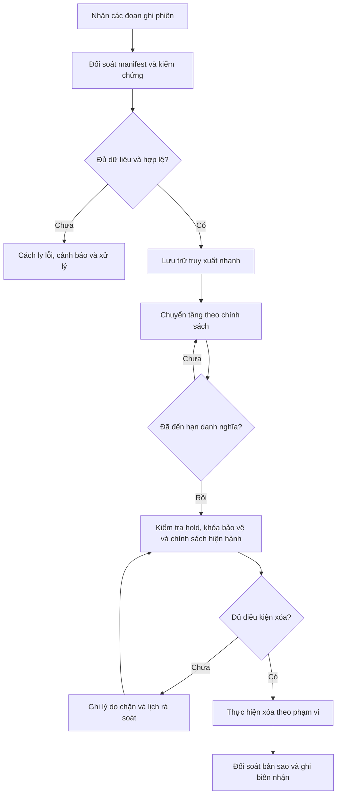

# Session recording retention — Lưu giữ bản ghi phiên đặc quyền

## 1. Mục tiêu và tình huống mở đầu

Trong quản lý truy cập đặc quyền, bản ghi phiên giúp trả lời những câu hỏi mà log đăng nhập đơn lẻ không giải thích được: người nào đã thực hiện thao tác, trên tài nguyên nào, thông qua quyền được phê duyệt nào và trong khoảng thời gian nào. Bản ghi có thể là luồng terminal, hình ảnh phiên desktop, sự kiện cơ sở dữ liệu hoặc tập dữ liệu có cấu trúc do hệ thống PAM tạo ra.

**Session recording retention** là chính sách và cơ chế quản lý thời gian giữ những dữ liệu đó, từ khi thu nhận đến khi xóa hoặc chuyển sang chế độ bảo toàn bằng chứng. Một chính sách đầy đủ phải nói rõ giữ dữ liệu nào, vì mục đích gì, đến thời điểm nào, ai có quyền sử dụng và làm sao chứng minh dữ liệu vẫn đọc được trong thời gian cam kết.

Giả sử một nhà cung cấp truy cập máy chủ sản xuất qua phiên JIT được phê duyệt. Sau vài tháng, đội ứng phó sự cố phát hiện cấu hình đã bị thay đổi trong khoảng thời gian tương ứng. Hệ thống vẫn hiển thị tên phiên nhưng không phát lại được vì khóa giải mã đã bị hủy. Trường hợp này không đáp ứng mục tiêu lưu giữ, dù tệp mã hóa vẫn nằm trong kho lưu trữ.

Sau bài học, người học cần có khả năng:

- Xây dựng lớp lưu giữ phù hợp với rủi ro và mục đích sử dụng.
- Xác định mốc bắt đầu, thời điểm hết hạn và điều kiện chặn xóa.
- Thiết kế vòng đời cho bản ghi, metadata, khóa và các bản sao.
- Kiểm tra tính toàn vẹn, khả năng phát lại và truy xuất bằng chứng.
- Vận hành quy trình giữ lại khi điều tra, phê duyệt ngoại lệ và xóa có kiểm chứng.

Các thời hạn và số liệu trong bài là **giả định thiết kế cho bài tập**, không phải thời hạn pháp lý mặc định. Khi áp dụng thực tế, tổ chức phải xác định các yêu cầu áp dụng cho chính phạm vi dữ liệu và hoạt động của mình.

## 2. Phân biệt retention với các khái niệm gần nhau

Bật ghi phiên chỉ giải quyết việc thu thập. Lưu giữ có hiệu quả còn đòi hỏi quản lý dữ liệu sau khi thu thập.

| Khái niệm | Câu hỏi được giải quyết | Điều không được suy diễn |
| --- | --- | --- |
| Recording | Phiên nào được ghi, ghi những thành phần nào? | Có cấu hình bật ghi không chứng minh mọi phiên đã được ghi đầy đủ |
| Retention | Dữ liệu phải được giữ và có thể sử dụng trong bao lâu? | Tệp còn tồn tại không đồng nghĩa vẫn phát lại được |
| Archiving | Dữ liệu được chuyển sang tầng lưu trữ nào? | Chuyển sang kho lạnh không tự thay đổi ngày hết hạn |
| Backup | Có thể khôi phục dữ liệu khi hệ thống hỏng hoặc bị xóa ngoài ý muốn không? | Có backup không đồng nghĩa truy xuất bằng chứng đạt thời gian cam kết |
| Immutability | Những thao tác sửa hoặc xóa nào bị ngăn trong thời gian bảo vệ? | Bất biến không bảo đảm bản ghi ban đầu đã đầy đủ hoặc đúng nguồn |
| Hold | Dữ liệu nào phải được giữ lại do yêu cầu điều tra, tranh chấp hoặc bảo toàn? | Một hold không tự cấp quyền xem nội dung cho người yêu cầu |
| Disposal | Những bản dữ liệu nào được xóa, khi nào và bằng bằng chứng gì? | Xóa một dòng chỉ mục không chứng minh payload và bản sao đã bị xóa |

Không nên dùng một con số để thay thế toàn bộ chính sách. “Giữ 180 ngày” vẫn để ngỏ nhiều câu hỏi: tính từ lúc bắt đầu hay kết thúc phiên, phiên chưa tải lên hết xử lý ra sao, sau 180 ngày backup còn tồn tại bao lâu và việc phát lại từ kho lạnh mất bao lâu.

## 3. Xác định phạm vi dữ liệu của một phiên

### 3.1. Payload, metadata và dấu vết kiểm toán

Một phiên PAM thường liên quan đến nhiều nhóm dữ liệu:

1. **Payload bản ghi:** hình ảnh, luồng terminal, sự kiện tương tác hoặc các đoạn dữ liệu phiên.
2. **Metadata phiên:** định danh phiên, danh tính người sử dụng, tài khoản đích, tài nguyên, thời gian và trạng thái thu nhận.
3. **Ngữ cảnh cấp quyền:** yêu cầu JIT/JEA, phê duyệt, ticket thay đổi và chính sách áp dụng.
4. **Chỉ mục tìm kiếm:** dữ liệu hỗ trợ tìm phiên theo tài nguyên, khoảng thời gian, hành động hoặc từ khóa.
5. **Dữ liệu dẫn xuất:** transcript, thumbnail, đoạn trích, annotation và kết quả phân tích.
6. **Dữ liệu bảo vệ và kiểm chứng:** manifest, checksum, chữ ký nếu có, tham chiếu khóa và nhật ký truy cập.
7. **Bản sao:** replica, bản xuất cho điều tra, cache phát lại và dữ liệu trong backup.

Từng nhóm có thể có thời hạn khác nhau khi có mục đích và quyết định được phê duyệt. Tuy nhiên, dữ liệu cần để giải mã, xác minh hoặc tìm đúng payload phải còn khả dụng trong suốt thời gian payload cần được sử dụng.

Ví dụ, nếu giữ payload 180 ngày nhưng xóa ánh xạ giữa session ID và các đoạn bản ghi sau 30 ngày, việc khôi phục bằng chứng có thể thất bại. Nếu giữ transcript lâu hơn video, transcript vẫn có thể chứa dữ liệu nhạy cảm; nó không tự trở thành dữ liệu ít nhạy cảm chỉ vì ở dạng văn bản.

### 3.2. Không mặc định “ghi phiên” là ghi mọi hoạt động

Khả năng quan sát phụ thuộc giao thức, cách triển khai và đường truy cập. Một bản ghi terminal không tự chứng minh toàn bộ hoạt động nền trên máy chủ. Một phiên bị ngắt kết nối có thể còn tiến trình chạy ở hệ thống đích. Một hành động thực hiện qua API của tài khoản dịch vụ cũng không tự có bản ghi desktop.

Retention chỉ bảo quản dữ liệu đã được thu thập. Nó không khắc phục đường truy cập bỏ qua PAM, lỗi recorder hoặc khoảng trống thu nhận. Cần liên kết với log xác thực, log hệ thống đích và sự kiện cấp quyền để đánh giá phạm vi bằng chứng.

## 4. Xây dựng chính sách theo mục đích và rủi ro

### 4.1. Bắt đầu từ những câu hỏi cần trả lời

Trước khi chọn thời hạn, chủ sở hữu kiểm soát cần xác định:

- Phiên thuộc hệ thống nào, môi trường nào và có mức đặc quyền nào?
- Mục đích giữ là kiểm tra thay đổi, điều tra sự cố, giải quyết tranh chấp hay kiểm toán?
- Thời gian phát hiện sự cố và chu kỳ rà soát thường dài bao lâu?
- Nội dung phiên có khả năng chứa dữ liệu cá nhân, bí mật kinh doanh hoặc credential nào?
- Có giới hạn thời gian giữ, vị trí lưu hoặc quyền truy cập nào áp dụng?
- Bằng chứng cần được tìm và phát lại trong bao lâu sau khi có yêu cầu?
- Ai phê duyệt chính sách và ai có thẩm quyền quyết định ngoại lệ?

Không cần ghi lại dữ liệu quá mức chỉ để tăng số lượng bằng chứng. Nếu phiên có thể hiển thị credential, ưu tiên giảm khả năng lộ từ thiết kế cấp quyền và công cụ truy cập; không giả định mọi recorder đều tự che được mọi bí mật.

### 4.2. Phân lớp lưu giữ

Bảng dưới minh họa một chính sách nội bộ giả định đã được phê duyệt cho phòng thực hành:

| Lớp | Phạm vi minh họa | Tổng thời gian giữ payload | Tầng truy xuất nhanh | Điều kiện bổ sung |
| --- | --- | --- | --- | --- |
| DEV-ADMIN | Quản trị môi trường phát triển không chứa dữ liệu sản xuất | 30 ngày | 7 ngày đầu | Không dùng lớp này chỉ vì người truy cập thuộc nhóm phát triển |
| PROD-ADMIN | Quản trị hệ thống sản xuất qua PAM | 180 ngày | 30 ngày đầu | Phải duy trì khả năng phát lại trong cả thời hạn |
| VENDOR-PROD | Phiên của nhà cung cấp trên hệ thống sản xuất | 180 ngày | 30 ngày đầu | Liên kết danh tính nhà cung cấp, người bảo trợ và phê duyệt |
| INCIDENT-HOLD | Phiên được chỉ định trong một vụ việc | Theo quyết định bảo toàn được quản lý | Theo nhu cầu truy xuất đã phê duyệt | Chặn xóa cho đến khi các điều kiện bảo toàn được giải quyết |

“30 ngày nhanh, tổng 180 ngày” nghĩa là 30 ngày đầu nằm trong tổng 180 ngày, không phải cộng thành 210 ngày.

Lớp lưu giữ phải được xác định từ tài nguyên đích và ngữ cảnh kiểm soát có thẩm quyền. Không để người thực hiện phiên tự gắn nhãn rủi ro thấp để giảm thời gian giữ. Nếu không xác định được lớp, cần một trạng thái chờ xử lý có cảnh báo và người chịu trách nhiệm; không tự chọn lớp ngắn nhất.

### 4.3. Phân biệt mức tối thiểu và giới hạn tối đa

Có thể mô hình hóa hai ràng buộc độc lập:

- `retain_not_before`: thời điểm sớm nhất được phép xem xét xóa theo những yêu cầu phải giữ.
- `dispose_by`: hạn xử lý xóa theo chính sách hoặc ràng buộc giới hạn lưu, khi không còn căn cứ giữ khác được phê duyệt.

Nếu nhiều yêu cầu cùng áp dụng, mốc tối thiểu phải đáp ứng tất cả các yêu cầu giữ có hiệu lực. Nhưng không được mặc định “chọn thời hạn dài nhất là luôn đúng”: lựa chọn đó có thể xung đột với giới hạn lưu.

Khi `retain_not_before > dispose_by`, hệ thống phải báo xung đột chính sách và chuyển cho người có thẩm quyền xác định cách xử lý. Không tự giải quyết bằng việc xóa sớm hoặc giữ vô hạn. Một hold có thể thay đổi quyết định xử lý theo căn cứ áp dụng, nhưng phải có định danh, phạm vi và quyết định rõ ràng.

## 5. Chọn mốc thời gian và định nghĩa thời điểm hết hạn

### 5.1. Đồng hồ lưu giữ phải có ý nghĩa rõ ràng

Các mốc thường gặp gồm thời điểm bắt đầu phiên, kết thúc phiên, nhận đủ dữ liệu và hoàn tất kiểm chứng. Không nên dùng chúng thay thế cho nhau.

Một thiết kế minh họa:

- Thời hạn theo lịch chính sách bắt đầu từ `session_end_at`.
- Chỉ công nhận bản ghi sẵn sàng phục vụ khi đã nhận đủ dữ liệu và kiểm chứng thành công.
- Ngày xóa thực tế còn phụ thuộc hold, bảo vệ bất biến và các điều kiện vận hành.
- Dữ liệu đến muộn không tự được cấp một vòng lưu giữ mới chỉ vì thời điểm tải lên thay đổi.

Theo quy ước một ngày bằng 24 giờ trong ví dụ:

```text
nominal_expiry_at = session_end_at + retention_days × 24 giờ
```

Tổ chức cũng có thể dùng quy ước ngày lịch hoặc mốc khác. Khi đó cần mô tả chính xác lịch, múi giờ và cách xử lý ranh giới; không trộn hai cách tính trong cùng một chính sách.

Ví dụ, một phiên kết thúc lúc `T`, thuộc lớp giữ tổng cộng 180 ngày. Bản ghi đến hệ thống trung tâm sau 2 ngày. Với quy tắc tính từ cuối phiên, thời điểm hết hạn danh nghĩa vẫn là `T + 180 ngày`, không phải `T + 182 ngày`.

Nếu dữ liệu đến muộn gần hoặc sau hạn danh nghĩa, cần ghi nhận một sự kiện sai lệch thu nhận. Không tự xóa ngay dữ liệu vừa đến hoặc âm thầm thay mốc; chuyển xử lý theo quy trình ngoại lệ với quyết định được lưu lại.

### 5.2. Phiên dài, phiên dang dở và bản ghi nhiều đoạn

Không nên coi việc chưa có sự kiện kết thúc là quyền giữ vô hạn hoặc lý do xóa dữ liệu đang hoạt động.

Với phiên dài hoặc truyền theo đoạn:

- Theo dõi thời điểm và thứ tự của từng đoạn.
- Tách trạng thái phiên còn hoạt động với trạng thái recorder đã mất kết nối.
- Dùng manifest để biết tập đoạn dự kiến và tập đoạn đã nhận.
- Có quy trình đóng phiên bất thường dựa trên bằng chứng vận hành.
- Ghi rõ bản ghi đầy đủ, một phần hay không khả dụng; không đánh dấu “complete” chỉ vì đã có một tệp.

Nếu chính sách yêu cầu giữ từng đoạn theo mốc phát sinh, cần thiết kế rõ cách ghép và truy xuất phiên khi một số đoạn đã hết hạn. Đối với chính sách tính từ cuối phiên, không để lifecycle dựa riêng trên ngày tạo từng đoạn làm xóa sớm phần đầu của phiên dài.

### 5.3. Chuẩn hóa thời gian và nguồn tin cậy

Nên lưu các timestamp phục vụ quyết định dưới dạng thời điểm có múi giờ rõ ràng, chẳng hạn UTC, đồng thời giữ cách hiển thị phù hợp cho người dùng. Dịch vụ thu nhận phải phát hiện độ lệch đồng hồ, thời điểm kết thúc trước thời điểm bắt đầu và timestamp bất hợp lý.

Mốc sự kiện có thể đến từ recorder hoặc hệ thống đích; cần chỉ rõ mức tin cậy và cách xác nhận. Không cho người dùng sửa timestamp của phiên để tác động ngày hết hạn mà không có quy trình điều chỉnh được kiểm toán.

## 6. Thiết kế vòng đời lưu giữ

Một vòng đời có thể được mô hình hóa như sau:



Hold là một ràng buộc có thể được đặt khi dữ liệu còn ở tầng nhanh, kho lạnh hoặc đang chờ xóa. Nó không phải bước chỉ xuất hiện sau ngày hết hạn.

### 6.1. Thu nhận và hoàn tất

Recorder có thể sử dụng bộ đệm cục bộ khi kết nối gián đoạn. Cần bảo vệ bộ đệm, giới hạn dung lượng và phát cảnh báo khi gần đầy. Xóa bộ đệm sau khi “gửi thành công” phải dựa trên xác nhận bền vững theo thiết kế, không chỉ dựa trên việc kết nối mạng đã đóng.

Bản ghi hoàn tất nên có bằng chứng về tổng số đoạn hoặc một tín hiệu kết thúc có thể đối soát. Mất một đoạn ở giữa là vấn đề tính đầy đủ, ngay cả khi các đoạn còn lại đều có checksum đúng.

### 6.2. Tầng nhanh và kho lạnh

Hai tầng cần có cam kết truy xuất riêng. Trong bài tập có thể đặt mục tiêu:

- Tầng nhanh: tìm phiên và bắt đầu phát lại trong vài phút.
- Kho lạnh: phục hồi và cung cấp phát lại trong một số giờ đã thỏa thuận.

Đây là mục tiêu thiết kế minh họa. Nhóm vận hành phải đo từ lúc tiếp nhận yêu cầu đến khi người được cấp quyền sử dụng được dữ liệu, bao gồm tìm kiếm, phục hồi, giải mã và chuẩn bị công cụ phát lại.

Nếu bản ghi ở kho lạnh nhưng chỉ mục đã bị xóa, thời gian truy xuất có thể vượt mục tiêu dù việc phục hồi đối tượng riêng lẻ vẫn nhanh.

### 6.3. Lưu giữ không làm mới hạn một cách vô tình

Những thao tác sau không nên tự tạo thời hạn mới cho dữ liệu gốc nếu chính sách không quy định:

- Di chuyển giữa các tầng.
- Sao chép sang vùng dự phòng.
- Mã hóa lại bằng khóa mới.
- Nâng định dạng hoặc tạo transcript.
- Khôi phục sau sự cố.
- Tải về rồi nhập lại một gói bằng chứng.

Phải mang theo định danh dữ liệu nguồn, mốc giữ và phiên bản chính sách. Nếu bản dẫn xuất có thời hạn riêng, ghi rõ quan hệ và căn cứ; không để mỗi lần chuyển đổi làm dữ liệu tồn tại lâu hơn mà không có quyết định.

## 7. Bảo vệ tính toàn vẹn và khả năng sử dụng

### 7.1. Tồn tại, toàn vẹn và đầy đủ là ba phép kiểm khác nhau

Một phép kiểm `object_exists = true` chỉ chứng minh đối tượng đang tồn tại ở vị trí được kiểm tra.

- **Toàn vẹn:** nội dung hiện tại có khớp giá trị kiểm chứng tin cậy không?
- **Đầy đủ:** có đủ các đoạn, metadata và ngữ cảnh cần thiết không?
- **Khả dụng:** có lấy, giải mã và phát lại được trong thời gian yêu cầu không?

Checksum được lưu cạnh tệp trong cùng miền mà một quản trị viên có thể sửa toàn bộ không tạo ra bằng chứng độc lập đủ mạnh về việc chống sửa đổi. Cần bảo vệ manifest và dấu vết thay đổi bằng cơ chế phù hợp với mô hình đe dọa, chẳng hạn kho kiểm toán tách quyền, dữ liệu bất biến hoặc manifest có chữ ký được kiểm tra.

Chữ ký hoặc hash cũng không chứng minh recorder đã nhìn thấy mọi hành động, hay nội dung thu thập ban đầu luôn đúng. Nó giải quyết một phần khác của chuỗi bằng chứng.

### 7.2. Manifest tối thiểu cho bài tập

Đây là mô hình dữ liệu minh họa, không phải cấu hình của một sản phẩm PAM cụ thể:

```yaml
sessionId: pam-session-example-042
recordingState: COMPLETE
startedAt: "2030-01-15T08:00:00Z"
endedAt: "2030-01-15T08:20:00Z"
retention:
  policyId: PROD-ADMIN
  policyVersion: 3
  clockBasis: SESSION_END
  nominalExpiryAt: "2030-07-14T08:20:00Z"
  decisionRevision: 12
segments:
  - sequence: 1
    objectVersionRef: object-042-segment-001-version-a
    digestRef: digest-entry-001
  - sequence: 2
    objectVersionRef: object-042-segment-002-version-a
    digestRef: digest-entry-002
encryption:
  keyRef: recording-key-version-017
evidence:
  approvalRef: approval-example-201
  accessRequestRef: jit-request-example-331
holdRegistryRef: hold-register-session-042
```

Ví dụ này dùng đúng 180 ngày, mỗi ngày 24 giờ, tính từ thời điểm kết thúc phiên. Tên trường chỉ diễn tả ý nghĩa; triển khai thật phải xác định schema, quyền sửa, cách xác thực digest và nguồn hold có thẩm quyền.

Không lưu token truy cập, mật khẩu hoặc vật liệu khóa trong manifest. `keyRef` là tham chiếu dùng với dịch vụ quản lý khóa; nó không phải khóa giải mã.

### 7.3. Khóa và công cụ phát lại cũng có vòng đời

Một bản ghi có thể mất giá trị sử dụng nếu:

- Khóa giải mã đã bị xóa trước hạn.
- Phiên bản khóa cần thiết không còn khả dụng.
- Chứng chỉ hoặc cơ chế xác minh manifest không còn kiểm tra được theo thiết kế.
- Định dạng cần phần mềm phát lại không còn được duy trì.
- Chỉ mục trỏ vào phiên bản đối tượng sai.

Luân chuyển khóa không đồng nghĩa hủy ngay mọi khóa cũ. Cần xác định các bản ghi nào còn phụ thuộc khóa cũ và cách duy trì khả năng đọc hoặc mã hóa lại được kiểm chứng.

Nếu nhiều bản ghi dùng chung một khóa, hủy khóa đó để xử lý xóa một phiên có thể ảnh hưởng cả những phiên khác còn phải giữ. Chỉ cân nhắc xóa bằng hủy vật liệu khóa khi kiến trúc, phạm vi khóa, các bản sao khóa và căn cứ xử lý đều đã được xác định; không coi đây là thay thế tự động cho mọi quy trình xóa.

## 8. Quyền xem, xuất và quản trị retention

Bản ghi phiên đặc quyền có thể phơi bày dữ liệu sản xuất, câu lệnh nhạy cảm và ngữ cảnh vận hành. Quyền quản trị PAM không nên mặc nhiên bao gồm quyền xem mọi bản ghi hoặc giảm thời hạn giữ.

Có thể phân tách trách nhiệm:

| Vai trò | Quyền cần cho công việc | Giới hạn cần thiết |
| --- | --- | --- |
| Người vận hành thu nhận | Giám sát recorder, xử lý truyền tải và dung lượng | Không tự xóa bằng chứng để giải phóng chỗ |
| Chủ sở hữu chính sách | Đề xuất lớp, thời hạn và phạm vi | Thay đổi phải có phê duyệt và lịch sử |
| Người xem bằng chứng | Tìm và phát lại phiên trong vụ việc được giao | Quyền giới hạn theo phạm vi và thời gian |
| Người phê duyệt hold | Đặt hoặc gỡ yêu cầu giữ theo thẩm quyền | Không dùng hold để tự cấp quyền xem |
| Dịch vụ thực thi xóa | Xóa các đối tượng đủ điều kiện theo quyết định | Không có quyền tự sửa chính sách hoặc gỡ hold |
| Nhóm kiểm tra kiểm soát | Xem báo cáo và mẫu bằng chứng phù hợp | Không nhất thiết cần toàn bộ payload |

Trong môi trường nhạy cảm, yêu cầu xem hoặc xuất có thể dùng JIT, MFA và phê duyệt theo vụ việc. Nhật ký cần ghi ai xem phiên nào, mục đích, thời gian và hành động đã thực hiện.

Một đường dẫn tải xuống có thời hạn ngắn không ngăn người đã tải tệp tạo bản sao khác. Vì vậy, quy trình xuất cần xác định người nhận, phạm vi, biện pháp bảo vệ, thời hạn bản xuất và trách nhiệm xử lý sau sử dụng. Watermark có thể hỗ trợ truy vết nhưng không thay thế phân quyền.

Không sửa bản gốc chỉ để tạo bản che dữ liệu cho một người xem. Nếu cần cung cấp bản redacted, tạo bản dẫn xuất có định danh riêng, quan hệ với nguồn và quyết định lưu giữ phù hợp; bản gốc tiếp tục được bảo vệ theo chính sách áp dụng.

## 9. Hold và bảo toàn bằng chứng

### 9.1. Đặt hold có phạm vi kiểm chứng được

Một hold cần có tối thiểu:

- Định danh vụ việc và người có thẩm quyền yêu cầu.
- Phạm vi phiên, tài nguyên, danh tính hoặc khoảng thời gian.
- Thời điểm có hiệu lực và thời điểm được ghi nhận.
- Những loại dữ liệu và bản sao phải giữ.
- Người chịu trách nhiệm rà soát.
- Trạng thái áp dụng và bằng chứng đối soát.
- Điều kiện và phê duyệt để gỡ hold.

Yêu cầu như “giữ toàn bộ phiên của tài khoản quản trị máy chủ A trong khoảng X–Y” cần được chuyển thành một tập đối tượng xác định được. Phải xử lý cả dữ liệu đến muộn nhưng thuộc phạm vi hold.

Nếu payload được giữ mà transcript, manifest hoặc khóa cần thiết bị xóa, việc bảo toàn có thể chưa đạt mục đích. Cần xác định các phụ thuộc và bản xuất liên quan, đồng thời không mở rộng sang dữ liệu không có liên quan một cách thiếu kiểm soát.

### 9.2. Xử lý cạnh tranh giữa hold và tác vụ xóa

Một lỗi phổ biến xảy ra khi tác vụ xóa chụp danh sách lúc 01:00, hold được đặt lúc 01:05, còn thao tác xóa diễn ra lúc 01:10 trên danh sách cũ.

Để tránh tình huống này, việc đăng ký hold và việc cấp phép xóa cần được điều phối bằng một cơ chế nhất quán. Các lựa chọn triển khai có thể bao gồm giao dịch trong kho trạng thái có thẩm quyền, hàng đợi tuần tự theo đối tượng hoặc cơ chế khóa và revision phù hợp.

Không đủ để nói “kiểm tra hold lần nữa” nếu vẫn còn khoảng trống giữa kiểm tra và thao tác không thể khôi phục. Phải định nghĩa điểm mà yêu cầu hold được coi là đã có hiệu lực và bảo đảm tác vụ xóa không vượt qua điểm đó bằng quyết định cũ.

Một nguyên tắc thiết kế:

```text
Nếu trạng thái hold không xác định, nguồn trạng thái không truy cập được,
hoặc revision quyết định đã thay đổi:
    Không cấp phép xóa.
    Ghi lý do và phát cảnh báo cho phạm vi bị ảnh hưởng.
```

Tạm chặn xóa là biện pháp vận hành bảo vệ dữ liệu trong lúc chưa đủ thông tin; nó không biến thành chính sách giữ vô hạn. Cần theo dõi tồn đọng và thời hạn giải quyết.

### 9.3. Gỡ hold không đồng nghĩa xóa ngay

Một phiên có thể chịu nhiều hold. Gỡ một hold chỉ loại bỏ ràng buộc của hold đó. Sau khi mọi hold có liên quan đã được giải quyết, hệ thống tính lại điều kiện giữ và xóa theo chính sách áp dụng.

Nếu thời hạn danh nghĩa đã qua, đưa đối tượng vào quy trình đánh giá xóa. Nếu vẫn còn thời hạn, tiếp tục giữ đến hạn. Quyết định gỡ cần có dấu vết kiểm toán tách khỏi chính bản ghi đang được xử lý.

## 10. Xóa đúng phạm vi và chứng minh kết quả

### 10.1. Điều kiện đủ để trở thành ứng viên xóa

Một quy tắc minh họa:

```text
eligible_for_disposal =
    recording_is_finalized
    AND retention_policy_is_resolved
    AND now >= retain_not_before
    AND no_active_hold
    AND hold_state_is_authoritative_and_current
    AND no_unresolved_evidence_exception
    AND storage_protection_allows_disposal
```

Đây là điều kiện chọn ứng viên; chưa phải lệnh xóa trực tiếp. Quy trình thực thi vẫn phải xác định đúng phiên bản đối tượng, các bản sao, quyền tác vụ và tính nhất quán với yêu cầu hold mới.

Không dùng một lifecycle theo tuổi tệp để bỏ qua các điều kiện này. Nếu nền tảng lưu trữ có giới hạn trong việc biểu diễn hold hoặc ngày giữ theo từng đối tượng, kiến trúc PAM phải bổ sung cơ chế phù hợp và kiểm tra cả hành vi của nền tảng.

### 10.2. Từ quyết định đến biên nhận

Một đợt xử lý có thể gồm:

1. Lập tập ứng viên kèm lý do, phiên bản chính sách và revision quyết định.
2. Kiểm tra các ràng buộc hiện hành tại điểm cấp phép xóa.
3. Xử lý payload và các bản dẫn xuất trong phạm vi.
4. Đối soát replica, phiên bản cũ, cache và bản xuất thuộc trách nhiệm quản lý.
5. Ghi những bản sao chưa thể xóa ngay, lý do và ngày dự kiến hết hiệu lực.
6. Kiểm tra trạng thái sau thao tác và ghi biên nhận.

Trong hệ thống có versioning, việc tạo dấu xóa có thể chỉ ẩn phiên bản hiện hành trong khi phiên bản cũ vẫn tồn tại. Biên nhận phải phân biệt “không còn hiển thị”, “đã xóa phiên bản xác định” và “các bản sao còn giữ đến hạn nào”.

Backup có thể không cho xóa riêng một phiên theo cách vận hành thông thường. Chính sách phải xác định thời hạn backup, biện pháp hạn chế sử dụng và cách xử lý dữ liệu đã đến hạn khi phục hồi. Không tuyên bố xóa hoàn toàn nếu vẫn có bản sao được giữ mà không nêu phạm vi.

### 10.3. Biên nhận không nên tái tạo dữ liệu đã xóa

Biên nhận có thể lưu session ID hoặc định danh kiểm chứng cần thiết, phiên bản chính sách, thời điểm, tác vụ thực hiện, phạm vi và trạng thái. Không chép toàn bộ transcript hoặc ảnh màn hình vào biên nhận rồi gọi đó là đã xóa payload.

Bản thân biên nhận cũng cần mục đích, phân quyền và thời hạn riêng. Lưu metadata lâu hơn payload phải là lựa chọn được quản lý, không phải mặc định vô hạn.

## 11. Đồng bộ retention với backup, replica và khôi phục

Một bản sao dự phòng phục vụ tính sẵn sàng vẫn nằm trong phạm vi quản lý dữ liệu. Danh mục bản sao cần chỉ ra nơi lưu, người chịu trách nhiệm, cơ chế hết hạn và quan hệ với bản gốc.

Đặc biệt phải kiểm tra tình huống khôi phục:

- Snapshot cũ có thể chứa payload đã bị xóa hợp lệ ở hệ thống chính.
- Registry hold hoặc lịch sử xóa trong snapshot có thể cũ hơn trạng thái hiện hành.
- Khóa được phục hồi có thể làm dữ liệu cũ đọc được trở lại.
- Chỉ mục phục hồi có thể công bố một phiên trước khi các ràng buộc được đối soát.

Quy trình phục hồi nên có vùng cách ly và bước đối soát với nguồn chính sách, hold và lịch sử xử lý còn được bảo vệ. Chỉ đưa dữ liệu trở lại phục vụ sau khi xử lý các đối tượng đã hết hạn hoặc đang bị hạn chế. Không dùng một bản snapshot cũ làm nguồn thẩm quyền duy nhất cho trạng thái hiện tại.

Nếu một hold đang có hiệu lực, bản sao cần thiết cho vụ việc phải được đưa vào phạm vi bảo toàn theo quyết định. Việc offboarding nhà cung cấp hoặc xóa tài khoản người dùng không tự động hủy yêu cầu giữ các phiên do họ đã thực hiện.

## 12. Ước tính dung lượng và chi phí

Giữ lâu hơn làm tăng nhiều khoản chi phí: lưu trữ, replica, chỉ mục, phục hồi kho lạnh, băng thông, quản lý khóa và công cụ phát lại. Thiết kế cần đo dữ liệu thực tế theo loại phiên, không chỉ dựa trên một bitrate trung bình của toàn hệ thống.

Một mô hình đơn giản:

```text
dung_lượng_payload_mỗi_ngày
    = số_phiên_mỗi_ngày × phút_trung_bình_mỗi_phiên × MiB_mỗi_phút

dung_lượng_ổn_định_xấp_xỉ
    = dung_lượng_payload_mỗi_ngày × số_ngày_giữ
```

Giả sử phòng thực hành có 1.000 phiên/ngày, trung bình 20 phút/phiên và 4 MiB/phút:

```text
1.000 × 20 × 4 = 80.000 MiB/ngày
80.000 / 1.024 = 78,125 GiB/ngày
78,125 × 180 / 1.024 ≈ 13,73 TiB payload cho 180 ngày
```

Con số này chưa gồm replica, backup, metadata, chỉ mục, dữ liệu dẫn xuất, hold và khoảng trống dự phòng. Nếu có hai bản sao payload đầy đủ, phần dung lượng tương ứng gần gấp đôi trước khi xét nén, cơ chế lưu trữ hoặc các khác biệt của từng tầng.

Mô hình ổn định giả định lưu lượng đều và hết hạn được thực thi bình thường. Khi tỷ lệ phiên bị hold tăng, mức sử dụng có thể vượt dự báo. Cần theo dõi dung lượng được giữ do hold riêng với dung lượng chưa hết hạn thông thường.

Khi thiếu dung lượng, không tự giảm thời hạn hoặc xóa bản ghi chưa đủ điều kiện. Cần xử lý tăng năng lực, lỗi chuyển tầng, backlog xóa hoặc ngoại lệ chính sách thông qua thẩm quyền phù hợp.

## 13. Giám sát và bằng chứng kiểm soát

Chỉ theo dõi số lượng tệp là chưa đủ. Cần chỉ số thể hiện cả thu nhận, bảo toàn, truy xuất và xử lý hết hạn.

| Chỉ số | Ý nghĩa | Cần tránh diễn giải sai |
| --- | --- | --- |
| Tỷ lệ phiên phải ghi có bản ghi đã kiểm chứng | Đánh giá độ bao phủ trong tập phiên được kỳ vọng | Không loại phiên lỗi recorder khỏi mẫu số để làm đẹp tỷ lệ |
| Độ trễ từ cuối phiên đến sẵn sàng phát lại | Phát hiện chậm thu nhận hoặc kiểm chứng | Tách độ trễ tải lên và độ trễ xử lý |
| Tỷ lệ phát lại thành công từ từng tầng | Đánh giá khả dụng thực tế | Không kiểm riêng tầng nhanh rồi suy ra kho lạnh cũng đạt |
| Số đối tượng có xung đột chính sách | Nhận diện quyết định chưa giải quyết | Không tự chuyển thành thời hạn vô hạn |
| Số đối tượng bị chặn xóa do trạng thái không xác định | Phát hiện phụ thuộc hold hoặc policy gặp lỗi | Tách khỏi đối tượng đang có hold hợp lệ |
| Độ trễ xử lý sau khi đủ điều kiện xóa | Đánh giá việc thực thi disposal | Không coi dữ liệu bị hold là backlog xóa quá hạn |
| Số hold chưa rà soát đúng lịch | Đánh giá quản lý ngoại lệ | Không tự gỡ hold chỉ vì quá lịch rà soát |
| Sai lệch giữa bản gốc, replica và bản sao quản lý | Phát hiện lỗ hổng vòng đời | Tồn tại replica không tự là lỗi nếu còn đúng thời hạn |

Một bộ bằng chứng kiểm soát có thể gồm chính sách được phê duyệt, mapping lớp lưu giữ, lịch sử thay đổi, kết quả đối soát phiên, mẫu phát lại từ kho lạnh, registry hold, biên nhận xóa và kết quả diễn tập khôi phục.

Không cần phát tán payload thật cho mọi người kiểm tra. Có thể dùng báo cáo tổng hợp, metadata tối thiểu và các phiên mẫu đã được cấp quyền theo mục đích.

## 14. Thực hành: xử lý một phiên từ lưu giữ đến xóa

### 14.1. Dữ kiện

Dùng dữ liệu giả lập cho phiên `S-042`:

- Truy cập sản xuất của nhà cung cấp, liên kết một yêu cầu JIT đã phê duyệt.
- Lớp VENDOR-PROD: tổng 180 ngày; 30 ngày đầu ở tầng nhanh.
- Đồng hồ giữ bắt đầu tại thời điểm kết thúc phiên `T`.
- Hai đoạn bản ghi được nhận đủ tại `T + 2 giờ`.
- Có payload, manifest, tham chiếu khóa, chỉ mục và một replica được quản lý.
- Tại `T + 170 ngày`, vụ việc `IR-042` đặt hold trên phiên và các thành phần cần để phát lại.
- Tại `T + 190 ngày`, tác vụ xử lý hết hạn được chạy.
- Tại `T + 220 ngày`, người có thẩm quyền gỡ hold sau khi đối soát.

### 14.2. Các quyết định cần đưa ra

**Tại T + 2 giờ:** kiểm tra đủ hai đoạn, manifest, tính toàn vẹn và khả năng phát lại. Ghi nhận thời điểm sẵn sàng, nhưng không dời hạn danh nghĩa từ T + 180 ngày sang T + 180 ngày + 2 giờ.

**Sau 30 ngày:** chuyển sang tầng phù hợp theo chính sách; giữ khả năng tìm và phục hồi. Việc chuyển tầng không thay đổi lớp, thời điểm kết thúc hoặc hạn danh nghĩa.

**Tại T + 170 ngày:** áp dụng hold có định danh và phạm vi. Đối soát payload, manifest, khóa và replica cần cho vụ việc. Ghi rõ trạng thái áp dụng; không chỉ đánh dấu trên màn hình giao diện rồi mặc định mọi kho dữ liệu đã nhận được.

**Tại T + 190 ngày:** phiên đã qua hạn danh nghĩa nhưng chưa đủ điều kiện xóa vì hold còn hiệu lực. Tác vụ cần ghi lý do chặn. Đây là giữ theo ngoại lệ có căn cứ, không phải lỗi xóa chậm thông thường.

**Tại T + 220 ngày:** xác nhận không còn hold khác, không còn ràng buộc bảo vệ hoặc ngoại lệ đang mở. Khi đủ điều kiện, xử lý xóa theo phạm vi và đối soát các bản sao. Ghi biên nhận với kết quả thực tế, bao gồm những bản sao nào còn theo lịch xử lý riêng nếu có.

### 14.3. Những phép thử chức năng nên chuẩn bị trong môi trường giả lập

| Tình huống thử | Hành vi mong đợi |
| --- | --- |
| Thiếu một đoạn bản ghi | Không công nhận đầy đủ; cảnh báo và xử lý sai lệch |
| Không tìm được khóa | Báo phát lại thất bại dù payload vẫn tồn tại |
| Registry hold không truy cập được | Không cấp phép xóa cho đối tượng chưa xác nhận được |
| Hold được đặt sau khi lập danh sách ứng viên | Quyết định cũ không được vượt qua hold đã có hiệu lực |
| Gỡ một trong hai hold | Tiếp tục chặn xóa vì hold còn lại |
| Chuyển từ tầng nhanh sang kho lạnh | Giữ nguyên hạn danh nghĩa và kiểm tra đường phục hồi |
| Khôi phục snapshot chứa phiên đã hết hạn | Cách ly, đối soát trước khi đưa trở lại phục vụ |
| Xóa chỉ tạo dấu xóa nhưng còn phiên bản cũ | Không báo đã xóa toàn bộ payload |
| Tài khoản nhà cung cấp bị vô hiệu hóa | Giữ phiên theo chính sách và hold hiện có |
| Thay đổi thời hạn cho lớp lưu giữ | Phải xác định phạm vi hiệu lực và xử lý dữ liệu cũ có phê duyệt |

Các phép thử này là hướng dẫn thực hành cho người học. Chúng không yêu cầu thao tác trên bản ghi sản xuất hoặc xóa dữ liệu thật.

## 15. Thay đổi chính sách và các lỗi thiết kế thường gặp

Thay đổi từ 180 ngày sang 90 ngày không chỉ là sửa một giá trị cấu hình. Cần xác định quyết định có áp dụng cho dữ liệu cũ hay chỉ cho phiên mới, yêu cầu giữ còn hiệu lực và tác động tới cơ chế bất biến.

Nếu áp dụng hồi tố, lập báo cáo tác động theo lớp và số đối tượng, đối soát hold, phê duyệt trước khi thực thi và giữ lịch sử phiên bản chính sách. Những ràng buộc bất biến đã được thiết lập có thể không cho giảm thời hạn theo mong muốn; phải kiểm tra cơ chế thực tế thay vì giả định cấu hình ứng dụng đủ để thay đổi kho lưu.

Các lỗi thường gặp và cách nhận diện:

- **Một thời hạn cho mọi dữ liệu:** không giải thích được vì sao transcript, video và biên nhận có cùng mục đích hoặc mức nhạy cảm. Cần phân loại và chỉ rõ quan hệ phụ thuộc.
- **Giữ vô hạn để tránh thiếu bằng chứng:** làm tăng dữ liệu nhạy cảm và chi phí, đồng thời che giấu ngoại lệ chưa được quyết định. Cần thời hạn và lịch rà soát có người chịu trách nhiệm.
- **Chỉ dùng ngày tạo đối tượng:** dễ sai với dữ liệu đến muộn, phiên dài hoặc sao chép. Cần mang theo mốc nghiệp vụ được chính sách chọn.
- **Hủy khóa trước payload:** khiến dữ liệu còn nhưng không dùng được. Cần quản lý vòng đời khóa theo các đối tượng phụ thuộc.
- **Chỉ chặn xóa trên giao diện PAM:** lifecycle hoặc tác vụ nền vẫn có thể xóa. Cần bảo đảm mọi đường xóa cùng tôn trọng nguồn ràng buộc có thẩm quyền.
- **Đồng nhất hash đúng với phiên đầy đủ:** một đoạn hợp lệ vẫn có thể nằm trong tập bị thiếu. Cần kiểm cả manifest và tính liên tục theo khả năng recorder.
- **Không quản lý bản xuất:** dữ liệu vượt ra ngoài vòng đời chính. Cần theo dõi phạm vi giao nhận và trách nhiệm xử lý.
- **Không thử phát lại sau nâng cấp:** tệp cũ có thể không còn dùng được với công cụ mới. Cần thử các định dạng và tầng lưu trữ còn trong thời hạn.
- **Gỡ hold rồi xóa trực tiếp:** bỏ qua hold khác hoặc ràng buộc còn lại. Cần tính lại quyết định theo trạng thái hiện hành.
- **Khôi phục cả dữ liệu đã xóa mà không đối soát:** làm sống lại dữ liệu hết hạn. Cần cổng kiểm tra trước khi đưa bản phục hồi vào phục vụ.

## 16. Câu hỏi tự kiểm tra

1. Vì sao tệp bản ghi còn trên storage nhưng khóa bị hủy vẫn là một vấn đề retention?
2. Nếu 30 ngày đầu ở tầng nhanh và tổng thời hạn là 180 ngày, thời điểm chuyển tầng có làm ngày hết hạn thành 210 ngày không?
3. Một phiên tải lên muộn 2 ngày sẽ hết hạn theo mốc nào khi chính sách tính từ cuối phiên?
4. Nếu phải giữ ít nhất 180 ngày nhưng đồng thời có giới hạn xử lý xóa sớm hơn, vì sao không nên tự chọn một trong hai?
5. Hold trên payload cần xem xét thêm những phụ thuộc nào để bảo đảm phát lại?
6. Tại sao kiểm tra hold rồi xóa sau vài phút vẫn có thể mất bằng chứng?
7. Sau khi gỡ một hold, cần kiểm tra những gì trước khi phiên trở thành ứng viên xóa?
8. Việc xóa phiên bản hiện hành khác gì với việc xác nhận mọi phiên bản payload trong phạm vi đã được xử lý?
9. Làm sao chứng minh phiên ở kho lạnh vẫn sử dụng được trong thời gian cam kết?
10. Quy trình khôi phục cần làm gì để tránh đưa dữ liệu đã hết hạn trở lại phục vụ?

Một thiết kế đạt mục tiêu phải nối được chuỗi: **phiên được ghi đúng phạm vi → bản ghi đầy đủ và được bảo vệ → thời hạn có căn cứ → phát lại được trong thời hạn → hold được tôn trọng → xóa và đối soát có bằng chứng**.
