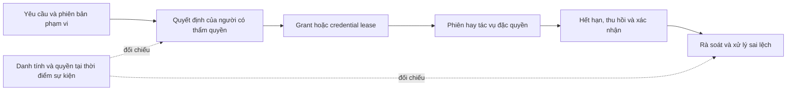

# Bằng chứng phân tách nhiệm vụ trong PAM

## 1. Từ “có hai người tham gia” đến bằng chứng có thể kiểm tra

Phân tách nhiệm vụ, hay **Separation of Duties — SoD**, là cách chia các nhiệm vụ có xung đột để một chủ thể không thể tự mình kiểm soát trọn vẹn một chuỗi hành động nhạy cảm. Trong quản lý truy cập đặc quyền (PAM), chuỗi đó có thể gồm đề nghị quyền quản trị, phê duyệt, cấp quyền, sử dụng quyền và xác nhận kết quả.

Hai tên tài khoản khác nhau trên ticket chưa đủ chứng minh hai người độc lập. Một người có thể sở hữu cả tài khoản thường và tài khoản quản trị; một tài khoản dịch vụ có thể được nhiều người điều khiển; người phê duyệt có thể vừa tự thêm mình vào nhóm phê duyệt trước khi bấm duyệt. Bằng chứng SoD phải giúp người kiểm tra dựng lại **ai có thể làm gì, ai thực sự đã làm gì, trên đối tượng nào và vào thời điểm nào**.

Ví dụ, kỹ sư An đề nghị quyền quản trị cơ sở dữ liệu thanh toán trong 30 phút để sửa lỗi. Bình là chủ sở hữu dịch vụ và phê duyệt yêu cầu. PAM cấp một quyền giới hạn, ghi lại phiên thao tác rồi thu hồi quyền. Chi là người rà soát phiên và đối chiếu thay đổi. Để chứng minh SoD, tổ chức cần hơn một ảnh chụp “Approved”: cần liên kết danh tính, thẩm quyền của Bình, phạm vi được duyệt, lần cấp quyền thực tế, hoạt động của An và kết quả rà soát của Chi.

Mục tiêu của bài học là xây dựng được một hồ sơ bằng chứng cho quá trình này, nhận diện những chỗ dễ kết luận quá mức và xử lý các trường hợp ngoại lệ. Các mã kiểm soát, tên người, mốc thời gian và thời hạn trong ví dụ đều là dữ liệu minh họa; tổ chức phải xác định yêu cầu cụ thể theo phạm vi và chính sách của mình.

## 2. Xác định đúng điều cần chứng minh

### 2.1. Năm lớp bằng chứng

Có thể phân biệt năm lớp để tránh dùng một tài liệu thay cho tất cả các lớp còn lại:

| Lớp | Câu hỏi cần trả lời | Ví dụ bằng chứng | Chưa chứng minh được điều gì |
|---|---|---|---|
| Thiết kế kiểm soát | Những nhiệm vụ nào phải tách, với phạm vi nào? | Chính sách, ma trận xung đột, quy trình ngoại lệ | Hệ thống đã áp dụng thiết kế đó |
| Cấu hình thực thi | Hệ thống ngăn hoặc phát hiện xung đột bằng cách nào? | Bản xuất policy, cấu hình workflow, quyền quản trị policy | Cấu hình hiện tại đã tồn tại suốt kỳ kiểm tra |
| Thẩm quyền và quyền hiệu lực | Ai có quyền nào tại thời điểm sự kiện? | Lịch sử membership, delegation, kích hoạt vai trò, ánh xạ danh tính | Người có quyền đã thực sự thực hiện hành động |
| Hoạt động vận hành | Quy trình đã chạy như thế nào trong thực tế? | Nhật ký yêu cầu, quyết định, grant, phiên, thu hồi | Nhật ký đầy đủ hoặc không thể bị người vận hành sửa |
| Giám sát và bảo vệ bằng chứng | Ai kiểm tra, xử lý sai lệch và bảo vệ hồ sơ? | Kết quả rà soát, issue, quyền kho log, lịch sử thay đổi retention | Mọi ngoại lệ đã hết rủi ro hoặc mọi hành vi đều được phát hiện |

Một ma trận vai trò được ký duyệt là bằng chứng về thiết kế. Một bản ghi từ chối tự phê duyệt là bằng chứng hệ thống đã chặn một trường hợp cụ thể. Một tập yêu cầu đầy đủ trong cả kỳ, có lịch sử cấu hình và xử lý ngoại lệ, mới giúp đánh giá hoạt động qua thời gian.

Không nên chuyển từ “mẫu này đủ bằng chứng” sang “toàn bộ hệ thống tuân thủ” nếu chưa xác định tập dữ liệu, phạm vi và cách chọn mẫu.

### 2.2. Phân tách quyền được giao và phân tách theo giao dịch

**Phân tách tĩnh** hạn chế việc một chủ thể cùng được giao các quyền xung đột. Ví dụ, người vận hành máy chủ không đồng thời có quyền quản lý hoặc xóa kho bằng chứng của chính máy chủ đó.

**Phân tách động** đánh giá xung đột trong một giao dịch hoặc phiên cụ thể. Một người có thể đủ điều kiện đảm nhận hai vai trò trong các tình huống khác nhau nhưng không được phê duyệt yêu cầu của chính mình.

Bằng chứng hai loại này khác nhau:

- Phân tách tĩnh cần lịch sử quyền, quan hệ nhóm, quyền kế thừa, quyền ủy quyền và các đường có thể tự nâng quyền.
- Phân tách động cần định danh yêu cầu, chủ thể đề nghị, người hưởng quyền, người quyết định, vai trò hiệu lực và thời điểm quyết định.
- Nếu dùng cả hai, hồ sơ phải thể hiện cả hai phép kiểm tra. Một phép kiểm tra động đạt không tự động loại bỏ một xung đột tĩnh.

“Đề nghị” cũng cần được định nghĩa rõ. Nếu trưởng nhóm gửi yêu cầu thay kỹ sư, hệ thống phải lưu cả người gửi và người sẽ nhận quyền. Chỉ so sánh người bấm gửi với người bấm duyệt có thể bỏ sót việc người hưởng quyền tự phê duyệt.

## 3. Chuyển chính sách thành các quy tắc có thể đối chiếu

Trước khi thu thập log, cần diễn đạt kiểm soát đủ cụ thể để người khác có thể kiểm tra lại. “Các quyền nhạy cảm được phê duyệt độc lập” còn quá rộng. Cần làm rõ đối tượng, hành động, quan hệ xung đột, cách thực thi và cách xử lý khi thiếu dữ liệu.

Ví dụ ma trận SoD trong một môi trường PAM:

| Mã minh họa | Chuỗi nhiệm vụ có xung đột | Quy tắc theo phạm vi | Bằng chứng chính |
|---|---|---|---|
| SOD-PAM-01 | Hưởng quyền và phê duyệt chính yêu cầu đó | Người phê duyệt phải khác chủ thể hưởng quyền sau khi quy về danh tính gốc | Yêu cầu, ánh xạ danh tính, sự kiện quyết định |
| SOD-PAM-02 | Quản lý nhóm approver và tự dùng thẩm quyền mới tạo | Thay đổi nhóm approver phải có phê duyệt độc lập và lịch sử áp dụng | Lịch sử nhóm, change record, quyết định liên quan |
| SOD-PAM-03 | Vận hành hệ thống đích và quản lý bằng chứng của chính hoạt động đó | Hạn chế quyền sửa, xóa và thay đổi chính sách lưu bằng chứng của người vận hành | Quyền PAM, quyền kho log, log quản trị kho |
| SOD-PAM-04 | Thực hiện thay đổi và tự kết luận rà soát độc lập | Người rà soát được chỉ định phải độc lập theo tiêu chí của kiểm soát | Session, kết quả thay đổi, bản ghi review |
| SOD-PAM-05 | Tạo phiên bản triển khai và cho phép phát hành phiên bản đó | Phê duyệt phải gắn với đúng artifact và môi trường; thay đổi nội dung phải đánh giá lại | Digest artifact, phê duyệt, deployment event |
| SOD-PAM-06 | Dùng break-glass và tự đóng việc kiểm tra sau sự kiện | Ngoại lệ phải được người có thẩm quyền độc lập rà soát trong hạn đã xác định | Sự kiện khẩn cấp, cảnh báo, review, kết quả thu hồi |

Đây là một thiết kế minh họa, không phải danh sách bắt buộc áp dụng nguyên trạng. Chẳng hạn, một kiểm soát có thể chỉ yêu cầu tách người duyệt với người hưởng quyền, trong khi kiểm soát khác còn yêu cầu tách người duyệt với người thực hiện. Hồ sơ phải ghi đúng yêu cầu đang áp dụng.

Mỗi quy tắc nên có phiên bản, ngày hiệu lực, chủ sở hữu, tiêu chí ngoại lệ và nguồn dữ liệu dùng để đánh giá. Khi thay đổi chính sách giữa kỳ, sự kiện trước và sau mốc thay đổi phải được đối chiếu với đúng phiên bản.

## 4. Độc lập bắt đầu từ danh tính và thẩm quyền theo thời gian

### 4.1. Đối chiếu danh tính, không chỉ tên đăng nhập

Trong một tổ chức, cùng một người có thể xuất hiện dưới nhiều dạng:

- Tài khoản làm việc thường ngày trong IdP.
- Tài khoản quản trị riêng trong directory.
- Tài khoản liên kết với PAM.
- Tài khoản cloud hoặc tài khoản quản trị cục bộ.
- Định danh của nhà thầu được hệ thống nhân sự hoặc nhà cung cấp quản lý.

Bảng ánh xạ nên có một định danh chủ thể ổn định, định danh tài khoản theo từng nguồn, khoảng hiệu lực và nguồn xác nhận. Không dùng duy nhất email hoặc tên hiển thị: chúng có thể thay đổi, được tái sử dụng hoặc trùng nhau giữa các miền.

Một ví dụ:

| Tài khoản | Nguồn | Chủ thể gốc | Hiệu lực | Ý nghĩa khi kiểm tra |
|---|---|---|---|---|
| an.work | IdP nội bộ | PERSON-104 | Trong kỳ kiểm tra | Tài khoản gửi yêu cầu |
| an.admin | Directory quản trị | PERSON-104 | Trong kỳ kiểm tra | Tài khoản bấm phê duyệt |
| binh.owner | IdP nội bộ | PERSON-208 | Trong kỳ kiểm tra | Chủ sở hữu dịch vụ |
| svc-pam-grant | Workload identity | WORKLOAD-17 | Trong kỳ kiểm tra | Thành phần tự động cấp quyền |

Nếu an.work gửi yêu cầu cho PERSON-104 và an.admin duyệt yêu cầu đó, hai account ID khác nhau vẫn quy về cùng một người. Với quy tắc cấm tự phê duyệt, đây là xung đột.

Tài khoản tự động svc-pam-grant không tự tạo ra một người phê duyệt độc lập. Cần xác định workflow đã được ai phê duyệt, ai có thể sửa nó, tài khoản tự động có được tự bỏ qua quyết định hay không và log nào ghi nhận thay đổi cấu hình.

### 4.2. Chứng minh thẩm quyền tại thời điểm quyết định

Một bản xuất danh sách approver hôm nay không chứng minh người duyệt có thẩm quyền tại thời điểm tháng trước. Quyền có thể phát sinh qua nhóm lồng nhau, delegation tạm thời, vai trò JIT hoặc quyền quản trị trực tiếp.

Đối với quyết định tại thời điểm T, cần xác định:

1. Người duyệt là chủ thể nào sau khi quy về danh tính gốc.
2. Chủ thể đó thuộc tập được phép duyệt tài nguyên và hành động đang xét tại T hay không.
3. Việc ủy quyền hoặc kích hoạt vai trò còn hiệu lực tại T hay không.
4. Người đó có đường tự thay đổi phạm vi được phép duyệt hay không.
5. Dữ liệu đủ để kết luận hay chỉ là một snapshot không có lịch sử.

Có thể dùng lịch sử thay đổi cùng snapshot nền để tái dựng trạng thái, hoặc dùng snapshot tại thời điểm quyết định kèm nguồn xác thực và phiên bản. Mọi khoảng trống lịch sử phải được ghi nhận. “Không tìm thấy record xung đột” không đồng nghĩa “đã chứng minh độc lập”.

Nếu không ánh xạ được tài khoản, trạng thái phù hợp là **chưa đủ bằng chứng**, không tự động coi đó là hai người khác nhau.

## 5. Dựng chuỗi bằng chứng xuyên suốt một lần truy cập

Một lần truy cập đặc quyền thường đi qua nhiều hệ thống. Không có correlation ID chung thì người kiểm tra dễ nối nhầm các quyết định hoặc phiên có cùng tên người và thời gian gần nhau.

Chuỗi minh họa:



### 5.1. Yêu cầu và quyết định

Yêu cầu cần lưu người gửi, chủ thể hưởng quyền, lý do, tài nguyên, môi trường, hành động được phép, thời hạn và phiên bản nội dung. Quyết định cần lưu người quyết định, thời gian, kết quả, căn cứ thẩm quyền và phiên bản chính sách.

Phê duyệt phải gắn với **đúng phạm vi đã duyệt**. Nếu sau khi duyệt, người gửi đổi tài nguyên từ máy thử nghiệm sang cơ sở dữ liệu production, quyết định cũ không tự động bao phủ nội dung mới. Có thể đóng băng phiên bản yêu cầu hoặc lưu fingerprint của các trường có ý nghĩa và yêu cầu đánh giá lại khi chúng thay đổi.

Fingerprint chỉ hữu ích nếu hệ thống kiểm tra nó trước khi cấp quyền và có định nghĩa nhất quán về nội dung được băm. Một trường hash xuất hiện trong báo cáo nhưng không được dùng trong thực thi chỉ là dữ liệu mô tả.

### 5.2. Cấp quyền và sử dụng quyền

Grant event cần liên kết về quyết định đã cho phép nó, lưu quyền cấp thực tế và tài nguyên đích. Quyền thực tế có thể rộng hơn nhãn trong ticket; vì vậy cần đối chiếu cả thao tác API hoặc cấu hình trên hệ thống đích.

Với JIT/JEA, bằng chứng nên thể hiện cả cửa sổ thời gian và tập thao tác được cấp. Với vault, cần biết loại truy cập: người dùng nhận credential, PAM tạo phiên thay họ hay workload nhận lease. Nếu secret đã được tiết lộ, đóng phiên PAM chưa đủ chứng minh người đó không thể tái sử dụng secret; cần bằng chứng luân chuyển, vô hiệu hóa hoặc kiểm soát khác phù hợp với cơ chế sử dụng.

Bằng chứng sử dụng có thể là session metadata, bản ghi lệnh, nhật ký quản trị tại đích hoặc sự kiện của tác vụ tự động. Session recording hỗ trợ điều tra nhưng không tự chứng minh ai có quyền sửa workflow hay ai đã phê duyệt quyền.

### 5.3. Kết thúc truy cập và rà soát

Cần tách các sự kiện sau:

- Quyền hết hạn theo lịch.
- Lệnh thu hồi đã được gửi.
- Hệ thống đích xác nhận quyền đã bị gỡ.
- Phiên hoặc token đang tồn tại đã bị kết thúc hoặc xử lý theo cơ chế của hệ thống.
- Credential có thể tái sử dụng đã được luân chuyển hoặc vô hiệu hóa nếu cần.

Không phải mọi hệ thống đều thu hồi phiên và token ngay khi xóa membership. Hồ sơ phải phản ánh cơ chế thực tế, kể cả độ trễ và giới hạn đã biết.

Bản ghi rà soát nên có chủ thể rà soát, căn cứ độc lập, phạm vi dữ liệu đã xem, kết luận, sai lệch và liên kết hành động khắc phục. Một ô “Reviewed” thiếu người thực hiện hoặc thiếu nội dung đã xem khó hỗ trợ kết luận độc lập.

## 6. Mô hình hóa hồ sơ bằng chứng

Dưới đây là cấu trúc minh họa cho một hồ sơ kiểm tra. Đây không phải schema của sản phẩm PAM hay cấu hình có thể triển khai trực tiếp.

```yaml
evidenceCase:
  id: EVC-0421
  controlId: SOD-PAM-01
  controlVersion: "3"
  scope:
    environment: production
    resourceId: DB-PAY-01
    action: approved-maintenance
  request:
    id: REQ-0842
    version: 2
    submittedBySubject: PERSON-104
    beneficiarySubject: PERSON-104
    scopeFingerprintRef: artifact-request-v2
  approval:
    decisionId: DEC-0187
    approverSubject: PERSON-208
    decision: approved
    decidedAt: "2026-10-14T02:00:00Z"
    approvedRequestVersion: 2
    authorityEvidenceRef: membership-asof-0200
    policyEvidenceRef: policy-version-3
  execution:
    grantId: GRANT-0291
    sessionId: SESSION-0634
    grantedAt: "2026-10-14T02:03:00Z"
    effectiveAccessEndAt: "2026-10-14T02:28:00Z"
    revocationEvidenceRef: target-confirmation-0291
  review:
    reviewerSubject: PERSON-319
    reviewedAt: "2026-10-14T04:10:00Z"
    result: no-deviation-in-reviewed-scope
    reviewedArtifactRefs:
      - session-metadata-0634
      - target-audit-0634
      - target-confirmation-0291
  assessment:
    identityResolution: complete
    authorityAtDecision: confirmed
    requestApprovalBinding: confirmed
    evidenceCompleteness: complete-for-defined-scope
    conclusion: supported
```

Một số lựa chọn quan trọng trong mô hình:

- Lưu ID của tài nguyên và chủ thể thay vì chỉ lưu tên hiển thị.
- Lưu phiên bản yêu cầu để kiểm tra điều được duyệt có trùng điều được cấp.
- Ghi kết luận có giới hạn phạm vi, tránh nhãn “compliant” bao trùm mọi kiểm soát.
- Trỏ tới bằng chứng thẩm quyền tại thời điểm quyết định.
- Giữ kết quả thực thi tách khỏi kết quả đánh giá bằng chứng.
- Dùng mã tham chiếu ổn định và vị trí truy xuất có kiểm soát; không đưa mật khẩu, private key hoặc nội dung secret vào hồ sơ.

Thông tin chi tiết về phiên có thể nằm ở kho bằng chứng hạn chế hơn. Báo cáo tổng hợp chỉ cần tham chiếu và những trường cần cho việc kiểm tra. Nếu có bản đã che dữ liệu, cần phân biệt rõ bản gốc, bản dẫn xuất và quy tắc che dữ liệu.

## 7. Quy trình thu thập và đánh giá theo kỳ

### 7.1. Chốt phạm vi và tập dữ liệu gốc

Trước khi chọn các ticket để xem, xác định kỳ kiểm tra, hệ thống thuộc phạm vi, loại truy cập, policy có hiệu lực và những đường truy cập phải được bao phủ. Cần xét không chỉ giao diện PAM mà cả API, CLI, tài khoản trực tiếp trên hệ thống đích, tác vụ tự động và break-glass nếu chúng thuộc phạm vi.

Nếu chỉ lấy các yêu cầu được duyệt thành công, báo cáo có thể bỏ sót yêu cầu bị chặn, grant không qua yêu cầu hoặc phiên được tạo bên ngoài PAM. Vì vậy, nên đối soát từ nhiều phía: danh sách yêu cầu, grant của PAM và hoạt động quản trị tại đích.

Ghi rõ cách truy vấn và bộ lọc. Kỳ theo UTC, kỳ theo giờ địa phương và khoảng thời gian bao gồm hay loại trừ mốc kết thúc phải được thống nhất. Lưu cả event time và thời điểm thu nhận khi chúng có ý nghĩa; log đến chậm không nên bị gán nhầm sang kỳ khác chỉ vì thời điểm ingest.

### 7.2. Bảo toàn bản xuất và nguồn gốc

Với mỗi bản xuất, lưu nguồn, thời điểm, người hoặc workload thực hiện xuất, tham số truy vấn, số lượng bản ghi, cách phân trang và lỗi hoặc giới hạn gặp phải. Ghi cả phiên bản của logic chuẩn hóa nếu dữ liệu được chuyển đổi.

Bản xuất cần có manifest để người khác nhận biết tập file, checksum, thời gian và phương thức tạo. Checksum hỗ trợ phát hiện thay đổi sau khi tạo bản xuất; nó không tự chứng minh dữ liệu đã đầy đủ hoặc đúng ngay tại nguồn.

Nếu log bị mất trong hai giờ, phải ghi khoảng trống đó vào hồ sơ. Không chèn bản ghi suy đoán để làm chuỗi trông liền mạch. Có thể dùng nguồn độc lập để bổ sung, nhưng cần thể hiện rõ nguồn bổ sung và giới hạn của nó.

### 7.3. Chuẩn hóa, liên kết và kiểm tra

Một luồng xử lý có thể diễn đạt như sau:

```text
Với mỗi grant thuộc phạm vi:
    tìm yêu cầu và đúng phiên bản yêu cầu
    tìm quyết định có hiệu lực trước khi grant
    quy tài khoản về chủ thể theo thời điểm tương ứng
    kiểm tra thẩm quyền người duyệt tại thời điểm quyết định
    kiểm tra các cặp xung đột mà policy áp dụng
    đối chiếu quyền được cấp với phạm vi và thời hạn được duyệt
    nối hoạt động sử dụng, thu hồi và rà soát nếu kiểm soát yêu cầu
    phân loại kết quả, giữ liên kết tới bản ghi nguồn
```

Luồng này không được coi việc thiếu một liên kết là “không có vi phạm”. Cần một trạng thái riêng cho dữ liệu thiếu hoặc mâu thuẫn.

Đồng thời kiểm tra chiều ngược lại: có hoạt động quản trị tại đích không tìm được grant hay quyết định tương ứng hay không. Kiểm tra chỉ bắt đầu từ grant của PAM sẽ khó phát hiện truy cập nằm ngoài PAM.

### 7.4. Kết luận và quản lý phát hiện

Có thể dùng bốn trạng thái sau:

| Trạng thái | Điều kiện minh họa | Cách trình bày |
|---|---|---|
| Được bằng chứng hỗ trợ | Đủ chuỗi, đúng policy, không thấy xung đột theo phép kiểm tra đã định nghĩa | Ghi rõ đối tượng, kỳ và giới hạn |
| Có xung đột | Cùng chủ thể hưởng quyền và phê duyệt khi policy cấm | Nêu sự kiện, tác động, cách xử lý |
| Ngoại lệ được phê duyệt | Có quyết định ngoại lệ đúng thẩm quyền, phạm vi và hạn hiệu lực | Báo cáo riêng cùng rủi ro còn lại |
| Chưa đủ bằng chứng | Thiếu ánh xạ, lịch sử quyền, log hoặc liên kết | Mở việc bổ sung hoặc xử lý khoảng trống |

Một lần tự phê duyệt **bị chặn** khác với một lần tự phê duyệt **được cho phép và dẫn tới grant**. Cả hai nên được ghi nhận, nhưng chỉ trường hợp sau mới cho thấy kiểm soát phòng ngừa đã không chặn giao dịch đó. Nếu số lần bị chặn tăng, đây có thể là tín hiệu cần điều tra hành vi hoặc cải thiện quy trình, không phải tự động là lỗi kiểm soát.

## 8. Bảo vệ bằng chứng cũng phải có SoD

Người thực hiện thao tác đặc quyền mà có thể sửa hoặc xóa mọi dấu vết của chính mình sẽ làm suy yếu giá trị của hồ sơ. Do đó, kiểm tra SoD cần mở rộng đến hạ tầng bằng chứng: collector, kho lưu trữ, SIEM, khóa bảo vệ, cấu hình retention, tài khoản xuất báo cáo và quyền thay đổi workflow thu thập.

Các lớp bảo vệ có thể gồm quyền ghi và đọc tách biệt, kho lưu trữ có cơ chế chống sửa phù hợp, quản lý thay đổi chính sách lưu giữ, giám sát hành động quản trị và quyền truy cập khẩn cấp có kiểm soát. Không nên chỉ kiểm tra quyền trong PAM rồi bỏ qua quyền quản trị cấp cao của hạ tầng cloud hoặc storage chứa log.

Cần đặt những câu hỏi cụ thể:

- Người vận hành hệ thống đích có thể xóa log tại nguồn trước khi collector nhận không?
- Ai có quyền dừng collector hoặc sửa bộ lọc để loại bỏ một loại sự kiện?
- Ai có quyền thay đổi thời hạn lưu hoặc xóa toàn bộ kho, nếu cơ chế lưu trữ cho phép?
- Tài khoản xuất báo cáo có thể chỉnh sửa dữ liệu nguồn hay chỉ đọc?
- Quyền quản lý khóa có tạo ra khả năng làm bằng chứng không thể giải mã không?
- Hành động thay đổi quyền trên kho log có được ghi ở một nguồn độc lập thích hợp không?

Một kho được gọi là “immutable” vẫn cần bằng chứng về cấu hình, phạm vi bảo vệ và những quyền quản trị có thể tác động đến nó. Không nên suy ra tính chống sửa chỉ từ tên thương mại hoặc ảnh chụp một nút bật.

Bằng chứng cũng có thông tin nhạy cảm: tên tài khoản, tài nguyên, câu lệnh và dữ liệu hiện ra trong phiên. Người kiểm toán chỉ nên được cấp quyền đọc theo phạm vi cần thiết. Quy trình bàn giao cần ghi người nhận, mục đích, tập file, thời điểm và phiên bản; không chia sẻ cả vault hoặc bản ghi chứa secret để chứng minh một sự kiện phê duyệt.

## 9. Các tình huống dễ tạo ra bằng chứng sai lệch

### 9.1. Người duyệt tự tạo thẩm quyền cho mình

Một người có thể không tự phê duyệt yêu cầu của bản thân nhưng có quyền sửa nhóm approver để tài khoản khác do họ kiểm soát được phép duyệt. Kiểm tra ở màn hình request có thể đạt trong khi chuỗi quyền quản trị có xung đột.

Hồ sơ cần nối lịch sử thay đổi nhóm, người duyệt thay đổi đó và những quyết định sử dụng quyền mới. Với nhóm lồng nhau, phải xem quyền hiệu lực thay vì chỉ membership trực tiếp. Nếu không đủ dữ liệu về người điều khiển tài khoản, ghi rõ điều chưa xác định.

### 9.2. Phê duyệt thay mặt và người hưởng quyền bị ẩn

Trưởng nhóm gửi yêu cầu thay An rồi An duyệt. Nếu policy cấm người hưởng quyền tự duyệt, thao tác này vẫn xung đột dù người gửi và người duyệt khác nhau.

Vì vậy, lưu submittedBy, beneficiary và approver thành ba thuộc tính riêng. Với yêu cầu nhóm hoặc danh sách người hưởng quyền, phép kiểm tra phải xét từng chủ thể được hưởng quyền, không chỉ người đầu tiên.

### 9.3. Tài khoản dịch vụ và pipeline

Workload không có “tính độc lập” theo cùng nghĩa với hai người. Cần xem ai có thể thay đổi code, cấu hình phê duyệt, runner, quyền lấy secret và điều kiện phát hành.

Ví dụ, pipeline chỉ triển khai artifact được duyệt theo digest có thể hỗ trợ kiểm soát. Nhưng nếu cùng người sửa code có quyền thay digest sau khi duyệt, hoặc sửa workflow để bỏ bước phê duyệt, hồ sơ “pipeline đã chạy thành công” không giải quyết xung đột đó.

Bằng chứng phù hợp gồm phiên bản workflow, digest artifact, quyết định phát hành, lịch sử người sửa và quyền của runner tại thời điểm triển khai. Owner được gắn trên tài khoản dịch vụ là đầu mối trách nhiệm, không tự chứng minh ai đã điều khiển lần chạy cụ thể.

### 9.4. Hậu kiểm được trình bày như phê duyệt trước

Một ticket được ký sau khi phiên đặc quyền đã bắt đầu có thể chứng minh đã có rà soát sau sự kiện, nhưng không chứng minh đã có phê duyệt trước. Phải so sánh thời điểm quyết định với thời điểm cấp quyền hoặc sử dụng quyền theo đúng định nghĩa kiểm soát.

Cũng cần xét sai lệch đồng hồ và thứ tự xử lý sự kiện. Nếu hai nguồn lệch thời gian hoặc chỉ lưu độ chính xác thấp, ghi giới hạn và dùng thông tin thứ tự đáng tin cậy khác khi có. Không sửa timestamp để tạo thứ tự mong muốn.

### 9.5. Rà soát vòng tròn và thông đồng

Hai người luân phiên duyệt cho nhau không tự động là vi phạm mọi chính sách SoD. Cần đối chiếu thẩm quyền, quan hệ xung đột và quy tắc của tổ chức. Tuy nhiên, mô hình phê duyệt qua lại tập trung hoặc chỉ một cặp người duyệt toàn bộ hoạt động nhạy cảm có thể là tín hiệu cần xem xét.

SoD làm giảm khả năng một người hành động đơn độc; nó không loại bỏ thông đồng. Bằng chứng nên thể hiện cả cơ chế giám sát và quá trình rà soát bởi cấp hoặc chức năng phù hợp khi rủi ro yêu cầu, thay vì tuyên bố “hai người là đủ an toàn”.

## 10. Ngoại lệ, break-glass và nhóm vận hành nhỏ

Trong sự cố nghiêm trọng, quy trình có thể cho phép truy cập khẩn cấp mà không đợi phê duyệt thông thường. Đây phải là một luồng được nhận diện rõ, có điều kiện sử dụng, thẩm quyền và bằng chứng riêng.

Một hồ sơ ngoại lệ có thể gồm:

1. ID ngoại lệ, sự cố hoặc thay đổi liên quan.
2. Quy tắc SoD bị ảnh hưởng, tài nguyên và chủ thể liên quan.
3. Lý do, khoảng thời gian, người chấp thuận và căn cứ thẩm quyền.
4. Biện pháp bù đắp: giới hạn quyền, ghi phiên, cảnh báo độc lập hoặc giám sát phù hợp.
5. Thời hạn và người chịu trách nhiệm rà soát sau sự kiện.
6. Bằng chứng kết thúc quyền, xử lý credential và đóng hành động khắc phục.

Nếu chính sách cho phép dùng break-glass trước rồi rà soát sau, kết luận phải là **ngoại lệ theo luồng khẩn cấp**, không phải “đã có phê duyệt trước độc lập”. Một ngoại lệ hết hạn nhưng vẫn được dùng cần được xử lý theo thực tế, không gia hạn ngược để làm hồ sơ đạt.

Với đội nhỏ không đủ người tách mọi vai trò, có thể thiết kế kiểm soát bù đắp dựa trên rủi ro và thẩm quyền của tổ chức: người ngoài nhóm rà soát độc lập, cửa sổ quyền ngắn, hạn chế thao tác, giám sát bổ sung và định kỳ xem xét ngoại lệ. Các biện pháp này không tự biến một người thành hai người độc lập. Hồ sơ vẫn phải ghi rõ xung đột còn lại, người chấp nhận rủi ro và điều kiện kết thúc ngoại lệ.

## 11. Ví dụ xuyên suốt: chứng minh một phiên bảo trì

Giả sử kiểm soát yêu cầu người hưởng quyền không tự phê duyệt yêu cầu bảo trì production. Một kiểm soát riêng yêu cầu người thực hiện không tự ký rà soát phiên của mình. Yêu cầu REQ-0842 v2 cấp quyền bảo trì DB-PAY-01 cho PERSON-104 trong tối đa 30 phút.

| Mốc UTC | Sự kiện | Điểm cần kiểm tra |
|---|---|---|
| 01:55 | PERSON-104 gửi yêu cầu v2 | Phạm vi, người hưởng quyền và phiên bản đã được cố định |
| 02:00 | PERSON-208 phê duyệt v2 | Thẩm quyền tại 02:00, danh tính khác PERSON-104 |
| 02:03 | PAM tạo GRANT-0291 | Quyền thực tế không vượt phạm vi v2; liên kết quyết định đúng |
| 02:05 | PERSON-104 mở SESSION-0634 | Tài khoản sử dụng được quy về đúng chủ thể hưởng quyền |
| 02:25 | Phiên kết thúc | Hoạt động ở đích có liên kết và không xuất hiện phạm vi ngoài duyệt |
| 02:28 | Hệ thống đích xác nhận kết thúc quyền | Phân biệt gửi lệnh thu hồi với xác nhận; xử lý phiên, token liên quan |
| 04:10 | PERSON-319 hoàn tất rà soát | Đủ thẩm quyền và độc lập với người thực hiện theo policy |

Người đánh giá đi theo chuỗi thay vì chỉ xem từng ảnh chụp. Đầu tiên, họ xác nhận lịch sử danh tính của PERSON-104 và PERSON-208 trong kỳ. Tiếp đó, họ đối chiếu việc PERSON-208 được phép duyệt DB-PAY-01 tại 02:00, kể cả nguồn quyền kế thừa hoặc ủy quyền.

Họ kiểm tra quyết định trỏ tới v2 và grant cũng dựa trên v2. Nếu sau quyết định có v3 mở thêm quyền, cần xác định grant có dùng v3 hay không. Một quyết định cho v2 không đủ làm bằng chứng cho quyền tăng thêm ở v3.

Sau đó, họ nối session với hoạt động tại đích và kiểm tra kết thúc quyền. Cuối cùng, họ xác minh PERSON-319 đã xem những bằng chứng nào và có đáp ứng điều kiện độc lập của kiểm soát rà soát hay không.

Ba kết quả biến thể cho cùng ví dụ:

- Nếu PERSON-208 và PERSON-104 thực chất là một người dưới hai account ID, kiểm soát cấm tự phê duyệt bị vi phạm nếu quyết định đã dẫn tới cấp quyền.
- Nếu hai người khác nhau nhưng thiếu lịch sử thẩm quyền của PERSON-208 tại 02:00, chưa đủ bằng chứng để kết luận quyết định có thẩm quyền.
- Nếu đủ bằng chứng độc lập, cấp quyền đúng phạm vi và rà soát đúng quy định, hồ sơ hỗ trợ kết luận cho giao dịch này. Nó không tự chứng minh mọi giao dịch trong kỳ đều đạt.

## 12. Xây dựng gói bàn giao kiểm toán có thể tái lập

Một gói bằng chứng hữu ích cần giúp người được cấp quyền kiểm tra lại kết luận mà không phải hỏi người lập báo cáo giải thích từng dòng.

Có thể tổ chức các thành phần theo các nhóm sau:

| Thành phần | Nội dung |
|---|---|
| Phạm vi | Kỳ, hệ thống, loại giao dịch, tiêu chí loại trừ và policy áp dụng |
| Thiết kế | Ma trận xung đột, chủ sở hữu kiểm soát, workflow và ngoại lệ |
| Dữ liệu gốc | Bản xuất từ PAM, IdP, hệ thống đích và nguồn liên quan |
| Dữ liệu theo thời gian | Lịch sử danh tính, membership, delegation, policy và quyền quản trị |
| Kết quả đối chiếu | Liên kết request–decision–grant–activity–review và phân loại từng giao dịch |
| Manifest | Danh sách file, checksum, nguồn, truy vấn, thời điểm và cách thu thập |
| Phát hiện | Xung đột, dữ liệu thiếu, ngoại lệ, người xử lý, hạn và bằng chứng đóng |
| Kết luận | Kết quả theo phạm vi đã xác định, phương pháp chọn mẫu và giới hạn |

Đường dẫn trong gói nên ổn định, tránh link cá nhân hết hạn sau vài ngày. Nếu hồ sơ có thời hạn lưu dài, cần bảo đảm người có thẩm quyền vẫn có thể đọc được định dạng, giải mã và truy xuất bản ghi liên quan trong thời gian đó.

Báo cáo có thể tổng hợp tỷ lệ, nhưng phải nêu rõ mẫu số. Ví dụ:

```text
Tỷ lệ đủ chuỗi bằng chứng =
    số grant có đủ bằng chứng bắt buộc theo policy
    / tổng grant thuộc phạm vi cần đánh giá

Tỷ lệ đã xác minh độc lập =
    số quyết định xác nhận độc lập và đúng thẩm quyền
    / tổng quyết định thuộc phạm vi cần đánh giá
```

Nếu thiếu ánh xạ danh tính, giao dịch đó vẫn nằm trong mẫu số của phạm vi ban đầu và được báo cáo là chưa đủ bằng chứng; không âm thầm loại ra để làm tăng tỷ lệ. Có thể công bố thêm tỷ lệ trên phần dữ liệu đã xác định được, nhưng phải ghi nhãn và mẫu số riêng.

Các số lượng nên được báo cáo tách biệt: grant không có yêu cầu, quyết định thiếu lịch sử thẩm quyền, tự phê duyệt bị chặn, tự phê duyệt được thực thi, ngoại lệ đang hiệu lực, ngoại lệ quá hạn và bản ghi chưa rà soát. Một tỷ lệ tổng hợp cao có thể che khuất một xung đột nghiêm trọng trên tài nguyên nhạy cảm nhất.

## 13. Tự thực hành lập kết luận từ dữ liệu thiếu

Xét tình huống: ticket thể hiện An gửi yêu cầu và Bình phê duyệt. Grant đã được tạo, có session recording, có thông báo thu hồi. Báo cáo còn một snapshot approver được xuất cuối tháng và chữ ký “reviewed” của An.

Chưa thể kết luận SoD đầy đủ, vì còn các điểm cần giải quyết:

- Chưa có ánh xạ để chắc chắn An và Bình là hai chủ thể khác nhau.
- Snapshot cuối tháng chưa xác nhận thẩm quyền của Bình tại thời điểm phê duyệt.
- Chưa biết quyết định và grant có cùng phiên bản phạm vi hay không.
- Thông báo thu hồi chưa thể hiện quyền tại đích và phiên hoặc token liên quan đã kết thúc.
- Nếu policy yêu cầu người rà soát độc lập với người thực hiện, chữ ký của An không đáp ứng điều kiện đó.
- Chưa có dữ liệu để đánh giá người thực hiện có thể sửa bằng chứng của chính mình hay không.

Cách xử lý là xác định kiểm soát nào bị ảnh hưởng, bổ sung đúng nguồn và ghi trạng thái từng phần. Có thể có phần đã được hỗ trợ, phần vi phạm và phần chưa đủ dữ liệu trong cùng một hồ sơ; không cần ép mọi thứ vào một nhãn đạt hoặc không đạt thiếu giải thích.

Sau khi có lịch sử danh tính, lịch sử thẩm quyền, liên kết phiên bản, xác nhận thu hồi và rà soát độc lập bổ sung, người đánh giá cập nhật kết luận với thời điểm thực hiện bổ sung. Việc rà soát bổ sung không được ghi lùi ngày để biến thành bằng chứng vốn đã tồn tại tại thời điểm ban đầu.

## 14. Những nguyên tắc cần giữ khi làm việc với bằng chứng SoD

Bằng chứng tốt bắt đầu từ quy tắc xung đột rõ ràng và danh tính có thể đối chiếu. Nó cần phản ánh trạng thái tại thời điểm sự kiện, nối quyết định với đúng phạm vi cấp quyền và cho phép đi từ báo cáo về bản ghi nguồn.

Phê duyệt, sử dụng quyền, thu hồi và rà soát là các sự kiện khác nhau. Chứng minh một sự kiện không thay thế được sự kiện khác. Với workload hoặc break-glass, cần diễn đạt đúng cách kiểm soát đang hoạt động thay vì gán nhãn “độc lập” chỉ vì có thêm một tài khoản.

Độ đầy đủ và khả năng bảo vệ bằng chứng là một phần của kết luận. Bản ghi bị thiếu phải được nhận diện; bản xuất có hash vẫn cần nguồn gốc; một mẫu đạt vẫn cần giới hạn phạm vi. Ngoại lệ phải được quản lý và trình bày riêng, cùng rủi ro và hành động còn lại.

### Tài liệu đối chiếu

[NIST SP 800-53 Revision 5](https://nvlpubs.nist.gov/nistpubs/SpecialPublications/NIST.SP.800-53r5.pdf) trình bày AC-5 về xác định nhiệm vụ cần tách và phân quyền hỗ trợ sự phân tách; AU-9 đề cập bảo vệ thông tin kiểm toán trước truy cập, sửa đổi hoặc xóa trái phép. Bài học vận dụng các ý này vào những tình huống PAM minh họa. Ma trận, mô hình hồ sơ và cách phân loại trong bài là đề xuất thực hành để học, không phải biểu mẫu bắt buộc do NIST quy định.
