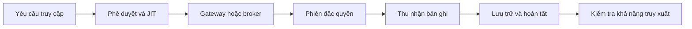

# Session recording coverage trong PAM

## 1. Chỉ số này trả lời câu hỏi nào?

Trong Privileged Access Management (PAM), **session recording coverage** là mức độ bao phủ ghi nhận phiên truy cập đặc quyền. Chỉ số này giúp trả lời: trong những phiên cần ghi lại, có bao nhiêu phiên đã tạo được bản ghi đáp ứng yêu cầu?

Một phiên ở đây có thể là kết nối SSH của quản trị viên, phiên RDP của nhà cung cấp hoặc phiên điều khiển từ xa qua gateway. Tùy hệ thống, bằng chứng có thể gồm hình ảnh màn hình, luồng terminal, thao tác được ghi nhận và metadata liên kết người dùng với tài khoản đích. Khả năng quan sát khác nhau theo giao thức và kiến trúc; không mặc định mọi recorder đều đọc được đầy đủ lệnh hoặc nội dung ứng dụng.

Ví dụ, một tổ chức báo cáo đã ghi 980 phiên trong tháng. Con số đó chưa cho biết mức bao phủ:

- Nếu tháng đó có 1.000 phiên cần ghi, mức bao phủ có thể là 98%.
- Nếu còn 400 phiên kết nối trực tiếp không đi qua PAM, mẫu số phải được xem xét lại.
- Nếu trong 980 bản ghi có 60 bản hỏng hoặc thiếu đoạn quan trọng, mức bao phủ bằng chứng dùng được thấp hơn mức “có đối tượng recording”.

Vì vậy, đo coverage là bài toán kết hợp **phạm vi chính sách, đối soát phiên và chất lượng bằng chứng**. Đếm số file trong kho lưu trữ chỉ là một phần của bài toán.

Bài học này đặt chỉ số trong bối cảnh bảo vệ tài khoản quản trị, tài khoản dịch vụ và hạ tầng nhạy cảm. Mục tiêu là giúp đội PAM vận hành kiểm soát, phát hiện khoảng trống và cung cấp bằng chứng phục vụ kiểm toán, điều tra sự cố.

## 2. Phân biệt recording với các kiểm soát PAM khác

Session recording thường nằm trong chuỗi kiểm soát sau:



Mỗi bước có chức năng riêng:

| Kiểm soát | Câu hỏi chính | Quan hệ với recording coverage |
|---|---|---|
| Least privilege, JEA | Phiên được phép thực hiện những gì? | Giảm phạm vi tác động; không chứng minh phiên được ghi |
| JIT | Quyền có hiệu lực trong khoảng thời gian nào? | Thu hẹp thời gian quyền tồn tại; không thay thế bản ghi |
| Vault và luân chuyển credential | Bí mật được cấp phát, bảo vệ, thay đổi ra sao? | Có thể buộc người dùng đi qua broker; chưa đủ để chứng minh recording thành công |
| Session recording | Có quan sát và lưu được phiên theo yêu cầu không? | Là đối tượng trực tiếp của coverage |
| Audit log | Ai yêu cầu, ai duyệt, phiên bắt đầu và kết thúc khi nào? | Cung cấp metadata, nguồn đối soát và dấu vết truy cập bản ghi |
| Phân tích hành vi | Có dấu hiệu bất thường cần xử lý không? | Dùng dữ liệu phiên nhưng là phép đo khác |

Coverage cao không có nghĩa là quyền đã tối thiểu, không còn đường đi vòng hoặc mọi hành vi độc hại đều bị phát hiện. Ngược lại, một phiên được phê duyệt hợp lệ vẫn có thể tạo ra recording bị hỏng.

Cần tách rõ **khả năng ghi**, **thực tế đã ghi** và **khả năng dùng bản ghi làm bằng chứng**.

## 3. Xác định đơn vị đo trước khi tính tỷ lệ

### 3.1. Một phiên là gì?

Đội vận hành phải thống nhất một định nghĩa có thể áp dụng trên các nguồn dữ liệu. Ví dụ:

> Một phiên tương tác đặc quyền là một lần thiết lập truy cập đến một tài sản đích bằng danh tính có khả năng quản trị, được phân biệt bằng mã phiên chuẩn hóa.

Quy tắc đi kèm cần nêu rõ:

- Một phiên SSH mở nhiều kênh được tính một hay nhiều phiên?
- RDP ngắt kết nối rồi reconnect được tính là tiếp tục phiên hay phiên mới?
- Một lần mở cổng truy cập dẫn đến ba tài sản đích được tách ra sao?
- Phiên bị từ chối trước khi đến đích có thuộc mẫu số không?
- Phiên của vendor đi qua jump host có được liên kết với phiên trên máy đích không?

Không có một quy tắc duy nhất đúng cho mọi kiến trúc. Điều quan trọng là áp dụng nhất quán, có phiên bản và không thay định nghĩa giữa kỳ để làm đẹp số liệu.

Một quyết định hợp lý cho nhiều hệ thống là không tính yêu cầu truy cập bị từ chối trước khi phiên đích hình thành vào coverage của phiên thực tế. Tuy nhiên, yêu cầu bị từ chối vẫn cần được theo dõi bằng chỉ số vận hành riêng.

### 3.2. Không trộn phiên tương tác với mọi hoạt động đặc quyền

Tài khoản dịch vụ có thể gọi API hoặc chạy tác vụ nền mà không tạo phiên tương tác có thể ghi hình. Không đưa các hoạt động đó vào mẫu số recording tương tác một cách máy móc.

Thay vào đó, phân loại:

| Hoạt động | Kiểu bằng chứng thường phù hợp |
|---|---|
| Quản trị qua SSH/RDP được hệ thống hỗ trợ | Recording phiên và metadata liên kết |
| Pipeline lấy secret rồi gọi API | Audit cấp secret, danh tính workload, log API và lịch sử pipeline |
| Tác vụ nền bằng service account | Log thực thi, log xác thực, log thay đổi và dấu vết cấp quyền |
| Hoạt động trên console hoặc kênh ngoài băng | Bằng chứng phù hợp với nền tảng và chính sách riêng |

Nếu một loại phiên thuộc chính sách bắt buộc ghi nhưng giải pháp hiện tại chưa hỗ trợ, đó là **khoảng trống kiểm soát**. Không được âm thầm chuyển nó thành “không áp dụng” chỉ vì chưa có recorder phù hợp.

### 3.3. Định nghĩa “đủ” theo từng loại phiên

Một bản ghi terminal và một bản ghi màn hình có thể có điều kiện chấp nhận khác nhau. Hồ sơ chỉ số cần mô tả tiêu chí, chẳng hạn:

- Có liên kết xác định được người truy cập thực và tài khoản đích.
- Có tài sản đích, thời điểm bắt đầu, kết thúc và trạng thái hoàn tất.
- Bản ghi mở được bằng công cụ được hỗ trợ.
- Bao phủ giai đoạn hoạt động cần quan sát theo chính sách.
- Không có khoảng mất dữ liệu vượt ngưỡng đã định nghĩa.
- Có kiểm soát truy cập và thông tin kiểm tra tính toàn vẹn theo thiết kế.

Không suy luận rằng terminal recording luôn thể hiện đầy đủ hoạt động bên trong mọi tiến trình, hoặc screen recording cho phép tìm kiếm chính xác mọi lệnh. Coverage phải được đọc trong giới hạn khả năng quan sát của cơ chế ghi.

## 4. Xây dựng mẫu số từ phạm vi chính sách

Ký hiệu:

- **E**: tập phiên thực tế thuộc phạm vi bắt buộc ghi trong kỳ.
- **N = |E|**: số phiên thuộc tập đó.
- **O**: tập phiên trong E có đối tượng recording được tạo.
- **V**: tập phiên trong E có recording hoàn tất và đạt kiểm tra kỹ thuật.
- **A**: tập phiên trong E có bằng chứng đáp ứng đầy đủ tiêu chí chấp nhận của tổ chức.

Nếu xây dựng các lớp theo cùng một hợp đồng, có thể yêu cầu:

```text
A ⊆ V ⊆ O ⊆ E
```

Từ đó có ba tỷ lệ:

```text
Object coverage (%) =
    |O| / |E| × 100

Validated recording coverage (%) =
    |V| / |E| × 100

Accepted evidence coverage (%) =
    |A| / |E| × 100
```

Tên gọi trên là cách tổ chức chỉ số trong bài học, không phải một chuẩn đặt tên bắt buộc. Khi triển khai, hãy chọn tên rõ nghĩa và công bố điều kiện đưa phiên vào tử số.

### 4.1. Lỗi mẫu số chỉ lấy từ recorder

Nếu lấy danh sách phiên từ chính bảng recording, mọi phiên không tạo recording đều có thể biến mất. Kết quả thường nghiêng về 100% dù hệ thống đang bỏ sót truy cập.

Nguồn xác định E nên được đối soát từ nhiều dấu vết phù hợp:

- Session event của PAM gateway.
- Log xác thực hoặc kết nối từ tài sản đích.
- Log remote access, jump host, VPN hoặc bastion.
- Inventory tài sản và phân loại tài khoản đặc quyền.
- Lịch cấp quyền JIT, yêu cầu truy cập và lịch truy cập vendor.

Một log xác thực không tự động tương đương một phiên đặc quyền. Bước chuẩn hóa phải nhận biết loại sự kiện, tài khoản, tài sản và mối liên hệ với phiên. Đồng thời phải loại trùng những sự kiện cùng mô tả một phiên.

Nếu không thể xác định một phần danh tính hoặc đặc quyền, cần ghi nhận nhóm **chưa phân loại**. Không mặc định chúng vô hại rồi loại bỏ khỏi việc điều tra.

### 4.2. Phạm vi, ngoại lệ và đường đi vòng

Nên phân biệt ba trường hợp:

1. **Ngoài phạm vi theo chính sách gốc:** không nằm trong E; vẫn có số liệu về phạm vi để người đọc hiểu giới hạn.
2. **Trong phạm vi nhưng có ngoại lệ tạm thời:** lưu thông tin ngoại lệ, chủ sở hữu, lý do và thời hạn; báo cáo riêng phần thiếu recording.
3. **Trong phạm vi nhưng kết nối đi vòng không được phép:** vẫn là khoảng trống coverage và có thể cần xử lý như vi phạm kiểm soát.

Có thể công bố thêm tỷ lệ trên nhóm áp dụng sau ngoại lệ, nhưng không dùng nó để che đi mức bao phủ của phạm vi gốc.

Ví dụ, 20 phiên break-glass được phê duyệt bỏ qua ghi hình trong tình huống khẩn cấp vẫn là 20 phiên thiếu recording trong báo cáo bao phủ phạm vi gốc. Việc chấp nhận rủi ro không tạo ra bản ghi đã không tồn tại.

## 5. Chọn cửa sổ thời gian và thời điểm chốt dữ liệu

### 5.1. Kỳ phát sinh phiên khác với kỳ tải lên bản ghi

Một phiên có thể bắt đầu cuối tháng, kết thúc đầu tháng sau và cần thêm thời gian để hoàn tất tải bản ghi. Nếu đếm theo ngày upload, recording của kỳ trước có thể làm tăng sai kết quả kỳ sau.

Một cách định nghĩa:

```text
Kỳ đo: phiên bắt đầu trong [T0, T1)
Thời điểm chốt: T1 + khoảng chờ hoàn tất W
Múi giờ báo cáo: được công bố rõ
```

Khoảng chờ W do tổ chức lựa chọn từ hành vi vận hành và nhu cầu báo cáo, không phải một giá trị phổ quát.

Báo cáo cần cho biết số phiên còn hoạt động hoặc còn chờ hoàn tất. Không tính những phiên đó là thành công hoàn chỉnh chỉ vì recorder đã mở file.

Có thể dùng ba trạng thái báo cáo:

- **Tạm tính:** dữ liệu chưa đến thời điểm chốt.
- **Đã chốt:** đã áp dụng cùng quy tắc chờ và kiểm tra.
- **Điều chỉnh:** có bản ghi đến muộn hoặc phát hiện sai lệch; lưu phiên bản và lý do.

Không âm thầm viết lại số cũ mà mất dấu vết thay đổi.

### 5.2. Hai cách nhìn cho phiên kéo dài

Coverage theo số phiên trả lời “bao nhiêu phiên được ghi đạt yêu cầu”. Với phiên kéo dài qua kỳ, chỉ số này thường cần chờ phiên kết thúc và hoàn tất kiểm tra.

Coverage theo thời lượng có thể quan sát khoảng hoạt động nằm trong kỳ. Hai phép đo phục vụ mục đích khác nhau; không thay thế cho nhau mà không nói rõ.

Bên cạnh đó, độ trễ hoàn tất recording là một chỉ số hữu ích. Một bản ghi cuối cùng có thể đầy đủ nhưng đến quá muộn cho việc điều tra khẩn cấp.

## 6. Ví dụ tính toán có đối soát đầy đủ

Giả sử kỳ báo cáo có 1.000 phiên thuộc phạm vi gốc. Đối soát phát hiện:

| Nhóm phiên | Số phiên | Kết quả |
|---|---:|---|
| Recording hoàn chỉnh, truy xuất được, metadata đủ | 900 | Đạt A |
| Recording hợp lệ về kỹ thuật nhưng không đáp ứng yêu cầu lưu giữ bằng chứng | 20 | Đạt V, không đạt A |
| Có recording nhưng bị thiếu đoạn hoặc không mở được | 40 | Đạt O, không đạt V |
| Qua PAM nhưng không tạo được recording | 25 | Chỉ có trong E |
| Truy cập trực tiếp bỏ qua PAM | 15 | Chỉ có trong E |
| **Tổng** | **1.000** | Đã phân nhóm không trùng |

Kết quả:

```text
|O| = 900 + 20 + 40 = 960
|V| = 900 + 20 = 920
|A| = 900

Object coverage = 960 / 1.000 × 100 = 96%
Validated recording coverage = 920 / 1.000 × 100 = 92%
Accepted evidence coverage = 900 / 1.000 × 100 = 90%
```

Nếu chỉ đếm trên 985 phiên đi qua PAM, object coverage sẽ thành khoảng 97,46%. Tỷ lệ đó có thể dùng để đánh giá riêng hoạt động của gateway, nhưng không đại diện mức bao phủ toàn bộ truy cập thuộc phạm vi.

Điểm cần đưa vào quyết định vận hành là 100 phiên chưa tạo được bằng chứng đạt yêu cầu, trong đó có 15 phiên đi vòng. Hai nhóm vấn đề đòi hỏi cách xử lý khác nhau.

## 7. Đo khoảng thiếu bằng coverage theo thời lượng

Một phiên 5 phút và một phiên 8 giờ có cùng trọng số trong coverage theo số phiên. Để nhìn rõ ảnh hưởng của các khoảng mất ghi, có thể bổ sung:

```text
Time coverage (%) =
    Tổng thời lượng hoạt động hợp lệ được ghi
    / Tổng thời lượng hoạt động cần ghi
    × 100
```

Khi cộng thời lượng, phải lấy **hợp các khoảng** thay vì cộng thẳng độ dài từng segment nếu các segment chồng lên nhau.

Ví dụ một phiên hoạt động từ phút 0 đến phút 60, có segment hợp lệ:

```text
Segment 1: [0, 25)
Segment 2: [20, 40)
Segment 3: [45, 60)
```

Hợp khoảng ghi là [0, 40) và [45, 60), tổng 55 phút:

```text
Time coverage = 55 / 60 × 100 ≈ 91,67%
```

Cộng thẳng 25 + 20 + 15 thành 60 phút sẽ che mất khoảng thiếu từ phút 40 đến phút 45.

### 7.1. Giới hạn của chỉ số thời lượng

Một phút mất ghi lúc người dùng thay đổi quyền có thể quan trọng hơn hàng giờ màn hình chờ. Time coverage không thể hiện đầy đủ mức nghiêm trọng nghiệp vụ.

Ngoài tổng thời lượng, có thể theo dõi:

- Số phiên có ít nhất một khoảng mất ghi.
- Khoảng mất ghi dài nhất.
- Số phiên thiếu đoạn bắt đầu hoặc kết thúc.
- Khoảng mất ghi trùng thời điểm thay đổi quyền hoặc cấu hình quan trọng.
- Thời gian từ khi phát sinh lỗi đến khi phát hiện và khắc phục.

Chỉ số thời lượng cũng cần định nghĩa rõ “hoạt động cần ghi”. Không tự loại thời gian idle nếu chưa có chính sách và cơ chế phân biệt đáng tin cậy.

## 8. Thiết kế dữ liệu để phép đo có thể kiểm chứng

Một mô hình dữ liệu tối thiểu có thể gồm:

| Trường | Ý nghĩa |
|---|---|
| canonical_session_id | Định danh phiên sau chuẩn hóa |
| source_session_id | Mã phiên từ nguồn gốc |
| principal_id | Danh tính thực hiện truy cập |
| privileged_account_id | Tài khoản hoặc danh tính đặc quyền được sử dụng |
| target_asset_id | Tài sản đích |
| protocol | SSH, RDP hoặc loại truy cập đã phân loại |
| started_at, ended_at | Thời điểm bắt đầu và kết thúc |
| recording_required | Phiên có thuộc yêu cầu ghi không |
| policy_version | Phiên bản chính sách áp dụng |
| exception_id | Ngoại lệ liên quan, nếu có |
| recording_id | Định danh bản ghi, có thể rỗng khi ghi thất bại |
| recording_state | Trạng thái thu nhận và hoàn tất |
| validation_result | Kết quả kiểm tra kỹ thuật |
| evidence_result | Kết quả đối chiếu tiêu chí bằng chứng |
| gap_reason | Lý do chưa đạt |
| observed_at, report_cutoff | Mốc quan sát và thời điểm chốt |

Không dùng recording_id làm khóa duy nhất của bảng phiên cần ghi. Những phiên thất bại chính là các trường hợp không có recording_id.

Một phiên có thể có nhiều segment; nên lưu segment trong bảng riêng để không nhân bản số phiên khi join. Trạng thái cuối của phiên được tổng hợp từ các segment và kết quả kiểm tra theo quy tắc đã công bố.

### 8.1. Chất lượng định danh và thời gian

Đối soát đáng tin cậy cần:

- Mã tài sản ổn định, có ánh xạ khi tên hoặc địa chỉ thay đổi.
- Liên kết giữa tài khoản dùng chung trên đích và người yêu cầu truy cập thực.
- Đồng bộ thời gian và theo dõi sai lệch đồng hồ.
- Khóa chống trùng khi nhận lại cùng một sự kiện.
- Quy tắc liên kết có độ tin cậy, thay vì ghép tùy tiện theo tên người và phút gần nhất.

Khi không thể xác định hai sự kiện có cùng phiên hay không, ghi nhận độ bất định và xử lý trước khi dùng số liệu làm kết luận chắc chắn.

### 8.2. Không suy diễn khoảng trống dữ liệu thành thành công

Nếu log đích không gửi về trong sáu giờ, có thể chưa biết chính xác có bao nhiêu phiên phát sinh. Trường hợp này không đủ cơ sở để khẳng định coverage 100%.

Dashboard nên có trạng thái **dữ liệu không đầy đủ** hoặc **chưa xác định**, đi cùng độ trễ thu thập, nguồn bị thiếu và thời điểm cập nhật cuối. Giá trị rỗng hoặc “N/A” phải có nghĩa cụ thể, không tự chuyển thành 0% hoặc 100%.

## 9. Ví dụ truy vấn tổng hợp

Ví dụ dưới đây minh họa logic trên dữ liệu đã được chuẩn hóa. Đây không phải schema của một sản phẩm PAM cụ thể.

Giả sử bảng session_cohort có đúng một dòng cho mỗi phiên và mỗi phiên bản báo cáo. Các cột object_created, technical_valid và evidence_accepted đã được tổng hợp theo tiêu chí của tổ chức.

```sql
WITH eligible AS (
    SELECT
        canonical_session_id,
        object_created,
        technical_valid,
        evidence_accepted
    FROM session_cohort
    WHERE recording_required = TRUE
      AND started_at >= :period_start
      AND started_at < :period_end
      AND report_cutoff = :cutoff
),
counts AS (
    SELECT
        COUNT(*) AS eligible_count,
        SUM(CASE WHEN object_created = TRUE THEN 1 ELSE 0 END)
            AS object_count,
        SUM(CASE WHEN technical_valid = TRUE THEN 1 ELSE 0 END)
            AS valid_count,
        SUM(CASE WHEN evidence_accepted = TRUE THEN 1 ELSE 0 END)
            AS accepted_count
    FROM eligible
)
SELECT
    eligible_count,
    object_count,
    valid_count,
    accepted_count,
    100.0 * object_count / NULLIF(eligible_count, 0)
        AS object_coverage_pct,
    100.0 * valid_count / NULLIF(eligible_count, 0)
        AS validated_coverage_pct,
    100.0 * accepted_count / NULLIF(eligible_count, 0)
        AS accepted_evidence_coverage_pct
FROM counts;
```

Khi eligible_count bằng 0, tỷ lệ trả về NULL thay vì 100%. Nếu thực sự không có phiên thì báo “không có phiên thuộc phạm vi trong kỳ”. Nếu nguồn quan sát bị mất, phải báo tình trạng thiếu dữ liệu; hai hoàn cảnh này khác nhau.

Trước khi tin kết quả, pipeline cần kiểm tra:

```text
Không trùng canonical_session_id trong cohort.
accepted_count <= valid_count <= object_count <= eligible_count.
Không có technical_valid = true khi object_created khác true.
Không có evidence_accepted = true khi technical_valid khác true.
Mọi phiên chưa đạt đều có lý do hoặc trạng thái đang điều tra.
```

Truy vấn tỷ lệ không thể tự bảo đảm mẫu số đúng. Việc chuẩn hóa, đối soát và xác nhận độ đầy đủ của nguồn vẫn là điều kiện bắt buộc.

## 10. Kiểm tra recording như một chuỗi bằng chứng

Một recording có thể đi qua các trạng thái:

```text
SESSION_DISCOVERED
    → RECORDING_STARTED
    → RECORDING_FINALIZED
    → TECHNICALLY_VALIDATED
    → EVIDENCE_ACCEPTED
```

Các trạng thái lỗi nên cụ thể, chẳng hạn NO_RECORDING, INCOMPLETE, UNREADABLE, IDENTITY_UNRESOLVED, RETENTION_MISMATCH hoặc VALIDATION_PENDING. Đây là tên minh họa; hệ thống thực tế cần ánh xạ về quy tắc của mình.

### 10.1. Khả năng mở và liên kết

Kiểm tra có thể gồm:

- Đối tượng tồn tại và có kích thước phù hợp với định dạng, không chỉ có header.
- Manifest hoặc chỉ mục nhận diện được các segment.
- Công cụ được hỗ trợ có thể giải mã và phát lại trong quyền hạn cho phép.
- Metadata xác định đúng phiên, người dùng và đích.
- Thời điểm bản ghi nhất quán với vòng đời phiên.

Độ dài file khác 0 không đủ để kết luận recording hoàn chỉnh.

### 10.2. Tính toàn vẹn và nguồn gốc

Checksum giúp phát hiện thay đổi so với một giá trị tham chiếu đã tin cậy. Nó không tự chứng minh ai đã tạo recording hoặc rằng recording ban đầu đã đầy đủ.

Tùy yêu cầu, cơ chế bảo vệ có thể kết hợp quyền ghi hạn chế, kho lưu trữ chống sửa theo cấu hình, chữ ký hoặc xác thực manifest, audit truy cập và quản lý khóa. Bằng chứng cần giữ liên kết đến nguồn, các lần chuyển giao và hoạt động quản trị liên quan.

### 10.3. Lưu giữ và truy xuất

Phân biệt:

- **Coverage khi phiên hoàn tất:** recording đạt yêu cầu tại thời điểm chốt.
- **Khả năng truy xuất trong thời hạn lưu giữ:** bằng chứng còn tồn tại và mở được khi cần.
- **Xóa đúng hạn:** recording được xử lý theo chính sách sau khi hết thời hạn, trừ yêu cầu giữ lại hợp lệ.

Không đánh giá một recording là mất trái phép chỉ vì nó đã được xóa đúng lịch sau khi hết hạn. Ngược lại, mất khóa giải mã trước khi hết hạn có thể làm bằng chứng không còn dùng được dù file vẫn tồn tại.

Nên lưu kết quả đánh giá tại thời điểm chốt và theo dõi riêng tình trạng bằng chứng còn phải giữ. Cách này tránh trộn chỉ số lịch sử với trạng thái lưu trữ hiện tại.

### 10.4. Kiểm tra toàn bộ và kiểm tra lấy mẫu

Không phải mọi kiểm tra đều có cùng phạm vi. Hệ thống có thể tự kiểm tra manifest, thời lượng và checksum cho toàn bộ recording, nhưng chỉ phát lại một mẫu.

Khi đó, không được ghi “mọi phiên đã kiểm tra playback thành công” dựa trên kết quả của mẫu. Báo cáo phải tách tiêu chí đã kiểm tra toàn bộ với kết quả lấy mẫu, kích thước mẫu và cách chọn mẫu.

## 11. Phân rã coverage để không che khuất rủi ro

Một tỷ lệ chung 99% có thể che việc toàn bộ 1% thiếu recording nằm trên hệ thống nhạy cảm nhất. Nên phân rã ít nhất theo các chiều có tác dụng vận hành:

| Chiều phân rã | Câu hỏi cần trả lời |
|---|---|
| Mức quan trọng của tài sản | Phiên trên hệ thống trọng yếu có được ghi đủ không? |
| Giao thức | Một loại kết nối cụ thể có thường xuyên lỗi không? |
| Gateway, vùng hoặc site | Có điểm thu nhận nào đang tạo khoảng trống? |
| Nhân viên, vendor, break-glass | Nhóm truy cập nào có ngoại lệ hoặc đường đi vòng? |
| Loại lỗi | Mất file, thiếu đoạn, không giải mã hay thiếu danh tính? |
| Tài sản mới onboard | Có tài sản được đưa vào dùng trước khi kiểm soát hoạt động? |

Khi tổng hợp nhiều nhóm, cộng tử số và mẫu số rồi mới chia. Không lấy trung bình đơn giản các phần trăm nếu số phiên giữa nhóm khác nhau.

Ví dụ:

```text
Nhóm A: 990/1.000 = 99%
Nhóm B: 0/10 = 0%

Coverage tổng = 990/1.010 ≈ 98,02%
Không phải (99% + 0%)/2 = 49,5%
```

Tỷ lệ tổng 98,02% vẫn không làm nhóm B trở nên chấp nhận được. Cần giữ đồng thời số liệu theo nhóm và số tuyệt đối của phiên thiếu bằng chứng.

Có thể thêm chỉ số có trọng số rủi ro:

```text
Risk-weighted coverage =
    Tổng trọng số của phiên có bằng chứng đạt yêu cầu
    / Tổng trọng số của phiên thuộc phạm vi
    × 100
```

Trọng số phải có tiêu chí minh bạch và phiên bản ổn định. Chỉ số này bổ sung góc nhìn ưu tiên xử lý; không thay thế số phiên thực tế bị bỏ sót.

## 12. Xây dựng dashboard có thể hành động

Một dashboard hữu ích nên hiển thị cùng lúc:

1. Kỳ đo, thời điểm chốt và phiên bản định nghĩa.
2. Số phiên thuộc phạm vi, số chưa phân loại và trạng thái đầy đủ của nguồn.
3. Số recording được tạo, số hợp lệ và số bằng chứng đạt tiêu chí.
4. Coverage theo số phiên và, nếu có, theo thời lượng.
5. Số phiên đi vòng, ngoại lệ và phiên đang chờ hoàn tất.
6. Phân rã theo tài sản trọng yếu, giao thức và điểm thu nhận.
7. Lý do thiếu recording, người xử lý và tuổi của vấn đề.

Mỗi cảnh báo cần dẫn đến một hành động cụ thể. Ví dụ:

| Tình trạng | Hành động phù hợp |
|---|---|
| Phiên đã kết thúc nhưng chưa có recording quá thời gian chờ | Kiểm tra recorder, hàng đợi, upload và kho lưu trữ |
| Có phiên đích nhưng không có sự kiện gateway | Xác minh liên kết; điều tra khả năng truy cập trực tiếp |
| Nhiều recording cùng gateway không mở được | Kiểm tra phiên bản định dạng, khóa và hạ tầng phát lại |
| Coverage giảm cùng lúc log nguồn ngừng cập nhật | Đánh dấu dữ liệu chưa đầy đủ và xử lý nguồn quan sát |
| Ngoại lệ hết hạn còn tiếp tục phát sinh phiên | Yêu cầu chủ sở hữu xử lý theo quy trình ngoại lệ |

Ngưỡng và thời gian phản ứng cần phù hợp mức rủi ro. Một phiên quản trị trọng yếu bị mất ghi có thể cần xử lý ngay dù tỷ lệ toàn tháng vẫn cao. Không có một ngưỡng phần trăm chung phù hợp cho mọi tổ chức.

## 13. Ví dụ vận hành: giảm coverage tại một gateway

Một đội PAM quan sát tỷ lệ recording hợp lệ giảm từ 99,6% xuống 94% ở nhóm SSH. Đội vận hành không bắt đầu bằng việc tăng ngưỡng cảnh báo.

Quá trình xử lý có thể diễn ra như sau:

**Bước 1 — Xác nhận phạm vi ảnh hưởng.** Đối chiếu số phiên với log đích, xác nhận nguồn không bị thiếu. Phân nhóm cho thấy lỗi tập trung tại gateway ở một site.

**Bước 2 — Phân loại bằng chứng.** Phần lớn phiên có đối tượng recording nhưng thiếu segment cuối. Các phiên đó không được đánh dấu hợp lệ chỉ vì đã có file.

**Bước 3 — Kiểm tra chuỗi thu nhận.** Đội phát hiện hàng đợi upload tồn đọng sau sự cố kết nối đến kho lưu trữ. Cần phân biệt segment vẫn còn phục hồi được với dữ liệu chưa từng được ghi.

**Bước 4 — Kiểm soát truy cập tiếp diễn.** Theo chính sách đã phê duyệt, đội có thể chuyển phiên mới sang gateway khỏe, hạn chế nhóm truy cập hoặc áp dụng quy trình khẩn cấp. Quyết định chặn hay cho phép truy cập khi recording lỗi phải cân bằng với yêu cầu sẵn sàng và thẩm quyền nghiệp vụ.

**Bước 5 — Phục hồi và kiểm tra.** Với segment còn tồn tại, hoàn tất upload rồi kiểm tra lại theo cùng tiêu chí. Dữ liệu đã mất không thể được “bổ sung” bằng việc sửa trạng thái thành thành công.

**Bước 6 — Cập nhật báo cáo có dấu vết.** Phiên phục hồi sau thời điểm chốt được ghi nhận trong bản điều chỉnh. Lưu số liệu trước, sau và lý do thay đổi.

**Bước 7 — Ngăn tái diễn.** Bổ sung cảnh báo độ sâu hàng đợi, dung lượng đệm và thời gian hoàn tất; thử lại đường chuyển tải và khả năng vận hành khi kho lưu trữ không sẵn sàng.

Coverage trong trường hợp này giúp phát hiện và định lượng vấn đề. Chỉ số không thay thế việc điều tra nguyên nhân hoặc quy trình xử lý sự cố.

## 14. Bảo vệ thông tin trong chính recording

Recording có thể chứa bí mật, dữ liệu cá nhân, thông tin khách hàng hoặc nội dung nghiệp vụ nhạy cảm. Tăng coverage đồng thời làm tăng khối lượng dữ liệu cần bảo vệ.

Các biện pháp phù hợp có thể gồm:

- Chỉ người có nhiệm vụ điều tra hoặc kiểm toán mới được truy cập.
- Tách quyền quản trị hệ thống ghi với quyền xem nội dung khi kiến trúc cho phép.
- Ghi audit việc tìm kiếm, phát lại và xuất bản ghi.
- Bảo vệ dữ liệu khi truyền, khi lưu và bảo vệ khóa giải mã.
- Đặt thời hạn lưu giữ gắn với yêu cầu cụ thể.
- Thông báo việc giám sát và áp dụng quy trình truy cập theo chính sách của tổ chức.
- Dùng cơ chế che nội dung nhạy cảm phù hợp, đồng thời công bố giới hạn quan sát.

Nếu chính sách yêu cầu che một phần nội dung, định nghĩa “recording đầy đủ” phải nói rõ phần quan sát được chấp nhận. Không coi phần đã che hợp lệ là lỗi kỹ thuật; cũng không khẳng định nhìn thấy đầy đủ mọi thao tác nếu dữ liệu đã bị che.

Khi thử nghiệm, dùng tài khoản và dữ liệu thử. Không đưa credential thật vào recording mẫu hoặc báo cáo minh họa.

## 15. Những cách đọc sai thường gặp

| Cách đọc sai | Vì sao sai | Cách đọc phù hợp |
|---|---|---|
| “PAM bật recording nên coverage là 100%” | Cấu hình chưa chứng minh kết quả từng phiên | Đối soát phiên thực tế với recording |
| “Có file là có bằng chứng” | File có thể hỏng, thiếu đoạn hoặc mất liên kết danh tính | Công bố tiêu chí kỹ thuật và tiêu chí bằng chứng |
| “Ngoại lệ đã duyệt thì tính như được ghi” | Ngoại lệ là chấp nhận rủi ro, không tạo recording | Hiển thị ngoại lệ và ảnh hưởng riêng |
| “Không thấy session event nghĩa là không có phiên” | Nguồn quan sát có thể bị mất | Theo dõi sức khỏe nguồn và đối soát độc lập |
| “Coverage 99% là mọi hệ thống đều ổn” | Lỗi có thể tập trung ở tài sản quan trọng | Phân rã theo rủi ro và xem số tuyệt đối |
| “Ghi đầy đủ nghĩa là phát hiện được mọi hành vi xấu” | Khả năng quan sát và phân tích có giới hạn | Kết hợp kiểm soát quyền, cảnh báo và điều tra |
| “Recording đến muộn làm kỳ trước tự động đúng” | Mất dấu vết điều chỉnh và độ trễ điều tra | Giữ phiên bản báo cáo và đo độ trễ hoàn tất |
| “Checksum đúng nghĩa là dữ liệu chắc chắn nguyên gốc và đầy đủ” | Checksum chỉ so với giá trị tham chiếu | Kiểm tra nguồn gốc, quyền ghi và chuỗi bằng chứng |

## 16. Bài thực hành tự kiểm tra

Một kỳ có 200 phiên thuộc phạm vi ghi. Đội vận hành xác định:

- 170 phiên có recording hoàn chỉnh và đạt tiêu chí bằng chứng.
- 10 phiên có recording hợp lệ về kỹ thuật nhưng thiếu liên kết người dùng thực.
- 8 phiên có recording nhưng thiếu đoạn hoạt động.
- 7 phiên đi qua PAM nhưng không tạo recording.
- 5 phiên truy cập trực tiếp thuộc phạm vi bắt buộc ghi.

Theo định nghĩa phân lớp trong bài:

```text
Object coverage = (170 + 10 + 8) / 200 = 94%
Validated recording coverage = (170 + 10) / 200 = 90%
Accepted evidence coverage = 170 / 200 = 85%
```

Ở ví dụ này, tiêu chí kỹ thuật kiểm tra khả năng mở và sự hoàn chỉnh của recording; liên kết danh tính thuộc tiêu chí chấp nhận bằng chứng. Nếu tổ chức đưa liên kết danh tính vào tiêu chí kỹ thuật, phải điều chỉnh cách phân lớp và giải thích rõ, không thay đổi mẫu số tùy ý.

Giả sử 5 phiên truy cập trực tiếp là break-glass được phê duyệt. Accepted evidence coverage trên phạm vi gốc vẫn là 85%. Có thể công bố thêm 170/195, khoảng 87,18%, cho nhóm không có ngoại lệ, nhưng phải giữ con số 5 phiên thiếu recording và 85% để phản ánh phạm vi gốc.

Các câu hỏi nên tự trả lời khi triển khai:

1. Nguồn nào phát hiện được một phiên không đi qua PAM?
2. Một phiên có nhiều segment được chống trùng ra sao?
3. Phiên đang chạy tại thời điểm chốt được trình bày thế nào?
4. Hệ thống có phân biệt bản ghi đến muộn với dữ liệu đã mất không?
5. Có thể truy từ một ô trên dashboard đến danh sách phiên và lý do chưa đạt không?
6. Ai chịu trách nhiệm sửa khoảng trống trên tài sản trọng yếu?
7. Định nghĩa chỉ số có giải thích phần không quan sát được do kỹ thuật hoặc che dữ liệu không?

## 17. Ghi nhớ khi áp dụng

Session recording coverage chỉ có ý nghĩa khi cả tử số lẫn mẫu số đều kiểm chứng được. Tập phiên cần ghi phải phản ánh phạm vi chính sách và đường truy cập thực tế; recording phải được đánh giá theo tiêu chí rõ ràng.

Khi vận hành PAM, hãy kết hợp tỷ lệ bao phủ với số phiên thiếu bằng chứng, mức quan trọng của tài sản, độ đầy đủ của nguồn và độ trễ hoàn tất. Cách đọc đó biến một con số phần trăm thành thông tin để sửa kiểm soát, bảo vệ quyền truy cập và chuẩn bị bằng chứng khi cần điều tra.
