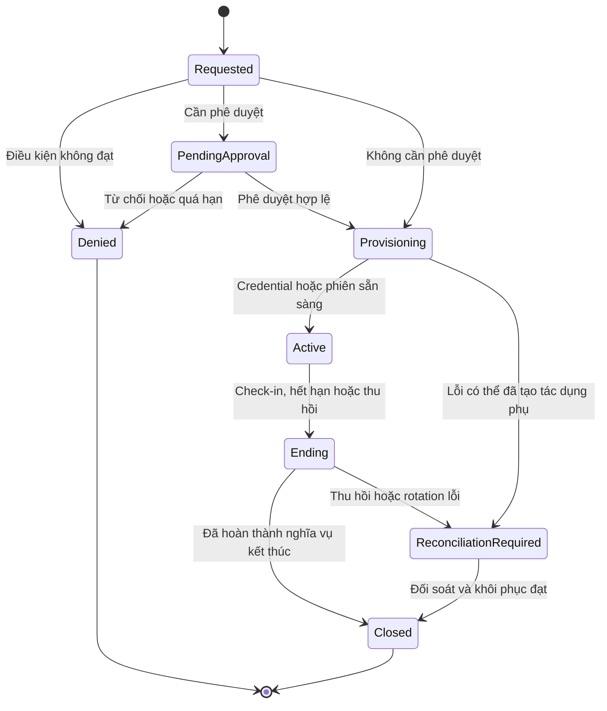

# Kiểm thử checkout credential đặc quyền

## 1. Checkout cần được kiểm thử như một giao dịch cấp quyền

Trong hệ thống quản lý truy cập đặc quyền (PAM), **checkout** là thao tác xin sử dụng một credential hoặc một quyền truy cập do PAM quản lý. Credential có thể là mật khẩu tài khoản quản trị, khóa SSH hoặc thông tin xác thực của tài khoản dịch vụ. Một số giải pháp đưa credential cho người dùng; giải pháp khác chỉ cấp phiên truy cập và tự chèn credential vào kết nối đến hệ thống đích.

Bài này tập trung vào kiểm thử checkout theo mô hình một yêu cầu tạo ra một **lease**: bản ghi cấp sử dụng có chủ thể, tài nguyên, phạm vi và thời hạn. Tên đối tượng, trạng thái và API trong các ví dụ là quy ước minh họa, không phải giao diện chung của mọi sản phẩm PAM.

Một phản hồi “checkout thành công” chưa chứng minh kiểm soát an toàn. Người kiểm thử phải trả lời được:

- Ai được cấp quyền, cho tài khoản và hệ thống đích nào?
- Điều kiện MFA, phê duyệt, lý do sử dụng và ticket có được áp dụng đúng không?
- Người dùng nhận được đúng quyền tối thiểu trong đúng khoảng thời gian hay không?
- Yêu cầu bị từ chối có thật sự không phát sinh credential hoặc phiên truy cập?
- Khi check-in hoặc hết hạn, quyền sử dụng mới có bị thu hồi và credential có được xử lý đúng chính sách không?
- Có đủ bằng chứng để truy vết mà không đưa secret vào báo cáo không?

Checkout nằm trên đường truy cập đến hạ tầng nhạy cảm. Vì vậy, một kế hoạch kiểm thử tốt phải kiểm tra cả **khả năng làm việc hợp lệ**, **khả năng từ chối truy cập không hợp lệ** và **khả năng khôi phục trạng thái khi giao dịch gặp lỗi**.

## 2. Phân biệt checkout, đọc secret và mở phiên

Không nên viết cùng một bộ tiêu chí cho mọi cơ chế truy cập PAM.

| Cơ chế | Kết quả người dùng nhận | Trọng tâm kiểm thử |
| --- | --- | --- |
| Checkout có hiển thị secret | Credential và quyền sử dụng theo chính sách | Quyền xem, số lần xem, lease, check-in, rotation và việc credential cũ còn dùng được hay không |
| Checkout qua phiên được broker | Đường vào phiên; người dùng không cần nhìn thấy credential | Đúng tài khoản đích, che giấu credential, ràng buộc lease với phiên và kiểm soát đường truy cập trực tiếp |
| Lấy secret qua API cho workload | Credential hoặc token để chương trình sử dụng | Danh tính workload, phạm vi tài nguyên, thời hạn, xử lý retry và tránh log secret |
| Cấp quyền JIT cho tài khoản cá nhân | Quyền hoặc vai trò có thời hạn | Quyền hiệu lực ở hệ thống đích, thời điểm hết hạn, thu hồi và độ trễ truyền trạng thái |

Một API đọc secret không tự động trở thành cơ chế checkout độc quyền. Ngược lại, một checkout có lease cũng không tự động khiến mật khẩu tĩnh mất hiệu lực khi lease hết hạn.

Cần xác định rõ **sản phẩm đang kiểm soát điều gì**. Nếu mật khẩu đã được tiết lộ, PAM không thể làm người dùng “quên” mật khẩu đó. Muốn ngăn việc sử dụng lại, hệ thống cần cơ chế như rotation đã được xác minh ở đích, vô hiệu hóa tài khoản phù hợp, credential ngắn hạn hoặc giới hạn mọi đường truy cập qua một bộ thực thi chính sách.

Đây là điểm quan trọng khi thiết kế kỳ vọng: không lấy trạng thái “lease expired” trên giao diện làm bằng chứng duy nhất rằng mọi quyền truy cập đã biến mất.

## 3. Xác định hợp đồng kiểm thử trước khi chạy

Mỗi ca kiểm thử phải có một chính sách làm căn cứ cho kết quả mong đợi. Không kết luận sai chỉ vì sản phẩm không thực hiện một hành vi chưa từng được yêu cầu.

Một hợp đồng checkout có thể ghi như sau:

```yaml
# Chính sách giả lập dùng để thiết kế test; không phải cấu hình sản phẩm.
resource: lab-linux-admin
principal_group: lab-operators
credential_delivery: brokered
approval_required: true
approval_scope:
  target: lab-linux-admin
  action: open-admin-session
mfa_required: true
requested_duration_limit_seconds: 600
exclusive_checkout: true
exclusive_scope: managed-account
renewal_allowed: false
checkin_action:
  deny_new_use: true
  terminate_active_session: true
  rotate_credential: true
expiry_action:
  deny_new_use: true
  terminate_active_session: true
  rotate_credential: true
```

Ví dụ này giả định môi trường lab yêu cầu chấm dứt phiên và rotation khi kết thúc lease. Môi trường khác có thể cho phép phiên đang chạy hoàn thành hoặc không sử dụng rotation cho loại credential đó. Khi ấy phải thay tiêu chí tương ứng, không âm thầm dùng chính sách của ví dụ.

Bên cạnh chính sách, cần ghi rõ:

- Định nghĩa “thành công”: chỉ tạo lease, đã sẵn sàng dùng hay đã mở phiên?
- Sự kiện nào bắt đầu tính thời hạn: gửi yêu cầu, được duyệt hay credential sẵn sàng?
- Phạm vi độc quyền: tài khoản đích, credential cụ thể hay một loại phiên?
- Độ trễ được chấp nhận khi thu hồi quyền ở PAM và hệ thống đích.
- Cách xử lý phiên đang hoạt động khi hết hạn.
- Điều kiện được gia hạn và việc có cần phê duyệt lại không.
- Cách xác nhận rotation hoàn thành, cùng hành vi khi rotation thất bại.
- Cơ chế khẩn cấp nào được phép và cách phân biệt nó với luồng thông thường.

Các giá trị như thời hạn 600 giây hay giới hạn độ trễ là dữ liệu kiểm thử của lab, không phải con số mặc định cho mọi tổ chức.

## 4. Mô hình vòng đời dùng để suy ra test

Có thể dùng mô hình trạng thái dưới đây để liệt kê các đường đi cần kiểm thử:



Đây là mô hình kiểm thử, không bắt buộc giao diện sản phẩm phải có các nhãn giống hệt. Một số hệ thống tách riêng trạng thái phê duyệt, lease, phiên và rotation.

Mục tiêu của mô hình là tránh bỏ sót các trạng thái trung gian:

- Có phê duyệt nhưng chưa có lease.
- Có lease nhưng chưa nhận được kết nối.
- Hệ thống đích đã mở phiên trong khi phía client gặp timeout.
- Lease đã đóng nhưng rotation chưa hoàn tất.
- Rotation thành công ở đích nhưng vault chưa cập nhật được bản credential mới.

Không gộp các tình huống này thành một cờ thành công/thất bại đơn giản. Chính trạng thái trung gian thường tạo ra quyền mồ côi, credential không đồng bộ hoặc khóa độc quyền bị giữ vĩnh viễn.

## 5. Các bất biến cần bảo vệ

Bất biến là điều phải luôn đúng trong phạm vi chính sách đã chọn, kể cả khi có retry, truy cập đồng thời hoặc lỗi phụ thuộc.

### 5.1. Danh tính và phạm vi

Một lease phải gắn với đúng chủ thể được xác thực và đúng tài nguyên được phê duyệt. Người dùng không được thay tài khoản đích hoặc dùng mã lease của người khác để lấy credential.

Thông tin principal do client gửi trong nội dung yêu cầu không được tự nó quyết định danh tính. Kỳ vọng kiểm thử phải dựa vào phiên đăng nhập hoặc danh tính workload đã được hệ thống xác minh.

### 5.2. Quyền tối thiểu

Checkout thành công cho tài khoản lab không được kéo theo quyền đọc credential của tài khoản khác, quyền chỉnh chính sách hoặc quyền gia hạn không được cấp.

Nếu cơ chế hỗ trợ JEA, cần kiểm tra cả lệnh được phép và lệnh ngoài phạm vi. “Đăng nhập được” chỉ chứng minh xác thực thành công, không chứng minh least privilege.

### 5.3. Độc quyền theo tài nguyên

Nếu chính sách đặt checkout độc quyền cho một tài khoản, tại mọi thời điểm số lease sử dụng đồng thời hợp lệ cho tài khoản đó không được vượt giới hạn.

Độc quyền cho tài khoản A không có nghĩa mọi tài khoản trong vault bị khóa theo. Cần một ca kiểm thử đối chứng để xác nhận người dùng khác vẫn checkout được tài khoản B không liên quan.

### 5.4. Kết thúc có hiệu lực

Sau check-in hoặc hết hạn, việc mở truy cập mới phải bị từ chối trong giới hạn thời gian đã cam kết.

Nếu chính sách yêu cầu kết thúc phiên đang mở, phải quan sát trạng thái tại bộ broker hoặc hệ thống đích. Nếu chỉ yêu cầu ngăn phiên mới, không đánh trượt chỉ vì phiên cũ còn tồn tại; thay vào đó ghi nhận rõ giới hạn của kiểm soát.

### 5.5. Bằng chứng không chứa secret

Mọi kết quả kiểm thử phải truy vết được yêu cầu và quyết định, nhưng không được chứa mật khẩu, private key, token truy cập hoặc nội dung phản hồi nhạy cảm.

Không lưu cả secret đã che một phần nếu việc che đó vẫn để lộ dữ liệu không cần thiết. Mã lease, mã sự kiện và mã ca kiểm thử thường đủ để nối bằng chứng.

## 6. Chuẩn bị môi trường và dữ liệu

Thực hiện các ca có thay đổi credential, thu hồi phiên hoặc tiêm lỗi trên môi trường lab được cấp riêng. Không sử dụng tài khoản break-glass sản xuất làm dữ liệu thử.

Một bộ dữ liệu tối thiểu gồm:

| Đối tượng | Vai trò trong test |
| --- | --- |
| Người dùng A | Được phép yêu cầu checkout tài khoản lab |
| Người dùng B | Được phép tương tự A, dùng để kiểm thử cạnh tranh |
| Người dùng C | Đăng nhập hợp lệ nhưng không có quyền checkout tài nguyên này |
| Người phê duyệt D | Có quyền duyệt đúng phạm vi, tách khỏi người yêu cầu khi chính sách yêu cầu |
| Tài khoản đích X | Tài khoản quản trị lab, có thể rotation và khôi phục |
| Tài khoản đích Y | Tài khoản độc lập để kiểm tra phạm vi khóa |
| Workload W | Danh tính máy nếu phạm vi có checkout qua API |

Trước lượt chạy, xác nhận tài khoản X không có lease đang hoạt động của người khác, credential trong vault đồng bộ với đích và đường thu thập log hoạt động. Nếu điều kiện nền không đạt, đánh dấu **lỗi chuẩn bị môi trường**, không quy mọi thất bại cho chức năng checkout.

Đồng bộ thời gian giữa PAM, bộ broker và máy đích trong giới hạn của lab. Ghi nhận độ lệch đã biết. Khi đo khoảng thời gian trong chương trình kiểm thử, dùng đồng hồ đơn điệu; khi đối chiếu nhiều hệ thống, dùng timestamp cùng múi giờ và mã tương quan.

Không yêu cầu tài khoản kiểm thử có toàn quyền quản trị PAM chỉ để tiện chạy test. Tách quyền gửi checkout khỏi quyền quan sát audit, đọc trạng thái phiên và phục hồi tài khoản lab.

## 7. Ma trận kiểm thử cốt lõi

Ma trận dưới đây là điểm khởi đầu. Với mỗi dòng, phải cụ thể hóa điều kiện, thao tác, kết quả và bằng chứng theo sản phẩm đang dùng.

| Mã | Tình huống | Kết quả mong đợi chính | Bằng chứng cần có |
| --- | --- | --- | --- |
| CO-01 | Người dùng hợp lệ, đủ MFA và phê duyệt | Cấp đúng tài khoản, đúng thời hạn | Quyết định, lease, principal và kết nối đích |
| CO-02 | Đăng nhập hợp lệ nhưng thiếu quyền | Từ chối; không cấp credential hoặc phiên | Audit deny và không có tác dụng phụ |
| CO-03 | Thiếu hoặc không đạt MFA | Không hoàn thành checkout | Kết quả kiểm tra MFA và không có lease khả dụng |
| CO-04 | Chưa duyệt, bị từ chối hoặc phê duyệt quá hạn | Không vượt qua cổng phê duyệt | Trạng thái duyệt và quyết định checkout |
| CO-05 | Đổi tài nguyên sau khi được duyệt | Phê duyệt không áp dụng cho tài nguyên mới | Yêu cầu ban đầu và yêu cầu bị sửa |
| CO-06 | Yêu cầu thời hạn quá giới hạn | Từ chối hoặc giới hạn theo chính sách công bố | Thời hạn yêu cầu và thời hạn thực tế |
| CO-07 | Hai người cùng checkout tài khoản độc quyền | Chỉ số lease được chính sách cho phép tồn tại | Kết quả đồng thời và toàn bộ lease liên quan |
| CO-08 | Client timeout rồi retry | Không tạo quyền trùng ngoài hợp đồng retry | Mã tương quan, lease và phiên thực tế |
| CO-09 | Check-in bình thường | Chặn dùng mới, xử lý phiên và rotation đúng quy định | Lease, phiên đích và tác vụ rotation |
| CO-10 | Hết hạn khi người dùng không check-in | Hệ thống tự thực thi chính sách kết thúc | Mốc hết hạn và trạng thái sau hạn |
| CO-11 | Người khác thao tác với lease của A | Không tiết lộ credential hoặc thao tác trái quyền | Quyết định theo chủ thể và mã lease |
| CO-12 | Phụ thuộc lỗi trong lúc checkout/kết thúc | Trạng thái rõ ràng, không âm thầm cấp sai quyền | Lỗi phụ thuộc, tác dụng phụ và đối soát |

Không chỉ đếm số dòng PASS. Các ca âm tính và ca kết thúc quyền là phần bắt buộc để chứng minh cổng checkout thực sự kiểm soát truy cập.

## 8. Ca thành công: kiểm tra từ quyết định đến hệ thống đích

Ví dụ CO-01 sử dụng người dùng A và tài khoản X.

### Tiền điều kiện

A có quyền yêu cầu checkout X; MFA đã đạt theo chính sách; phê duyệt của D còn hiệu lực và gắn đúng X, hành động, thời lượng. X không bị khóa bởi lease khác.

### Thao tác

1. A gửi yêu cầu với lý do sử dụng và ticket lab.
2. Đọc kết quả quyết định cùng lease được cấp.
3. Kiểm tra tài khoản đích, thời điểm bắt đầu, thời điểm hết hạn và cơ chế truy cập.
4. Thực hiện một thao tác vô hại trên máy lab để xác nhận danh tính hiệu lực.
5. Thử một hành động ngoài phạm vi đã được chuẩn bị sẵn.
6. Check-in, sau đó xác minh nghĩa vụ kết thúc.

Với một máy Linux lab, một thao tác nhận diện có thể là:

```sh
id -un
id
```

Đầu ra cần tương ứng với tài khoản hoặc vai trò được cấp. Nếu phiên broker ánh xạ người dùng A sang tài khoản quản trị X, audit phải nối được A với phiên sử dụng X; chỉ thấy X trong log đích chưa đủ quy trách nhiệm cho người yêu cầu.

Hành động ngoài phạm vi không nên là thao tác phá hoại. Có thể dùng một lệnh chỉ đọc đã bị chính sách JEA chặn hoặc truy cập một tài nguyên lab không thuộc quyền. Nếu mô hình không có kiểm soát lệnh, không bịa kỳ vọng JEA; kiểm tra quyền thực tế theo mô hình tài khoản đang dùng.

Nếu chế độ broker yêu cầu giấu credential, xác minh người dùng không nhận secret trong phản hồi, trang chi tiết lease, tệp tải xuống hoặc luồng lỗi. Việc chương trình phía server có dùng credential để kết nối là bình thường; tiêu chí là credential không bị lộ ra bề mặt người dùng ngoài hợp đồng.

## 9. Kiểm thử các cổng trước khi cấp quyền

### 9.1. Quyền checkout khác với quyền nhìn thấy tài nguyên

Người dùng C có thể được nhìn thấy tên máy đích hoặc danh mục tài khoản, nhưng không được checkout. Thử gọi trực tiếp điểm thực hiện checkout bằng danh tính C thay vì chỉ kiểm tra nút trên giao diện đã bị ẩn.

Kết quả đúng phải bao gồm cả hai phía:

- Hệ thống trả quyết định từ chối theo hợp đồng.
- Không có credential khả dụng, lease hoạt động hoặc phiên đích được tạo ngoài ý muốn.

Mã HTTP chỉ là một phần bằng chứng. Có sản phẩm trả thành công ở tầng HTTP nhưng trong nội dung là trạng thái bị từ chối; phải kiểm tra kết quả nghiệp vụ tương ứng.

### 9.2. Phê duyệt phải gắn với nội dung được cấp

Kiểm thử yêu cầu đang chờ duyệt, yêu cầu bị từ chối, phê duyệt đã hết hạn và phê duyệt bị thu hồi.

Sau khi duyệt checkout X trong thời gian ngắn, thử thay X bằng Y hoặc tăng thời lượng trước khi nhận quyền. Phê duyệt cũ không được trở thành giấy phép chung cho tài nguyên khác.

Nếu chính sách cấm tự duyệt, dùng chính A thử duyệt yêu cầu của A. Nếu có quy trình ủy quyền phê duyệt, thêm ca kiểm tra phạm vi và thời hạn ủy quyền.

### 9.3. MFA và phiên đăng nhập phải được đánh giá đúng lúc

Kiểm tra trường hợp MFA chưa có, đã quá thời gian cho phép hoặc phiên đăng nhập đã bị thu hồi trước khi checkout hoàn tất.

Chính sách có thể yêu cầu MFA mới cho mỗi checkout hoặc chấp nhận bằng chứng MFA còn hiệu lực trong một khoảng thời gian. Kết quả mong đợi phải theo chính sách đó.

Nếu người dùng bị vô hiệu hóa sau khi đã nhận lease, đây còn là ca kiểm thử thu hồi quyền đang tồn tại. Không tự suy rằng việc chặn đăng nhập PAM sẽ tự chấm dứt mọi phiên đích.

### 9.4. Ticket và lý do sử dụng

Kiểm tra thiếu ticket, ticket sai phạm vi, ticket đã đóng và lý do rỗng nếu các trường này bắt buộc.

Nếu PAM chỉ ghi nhận mã ticket để phục vụ kiểm toán mà không xác minh trạng thái bên hệ thống quản lý thay đổi, cần mô tả đúng giới hạn ấy. Việc trường ticket có dữ liệu không chứng minh đã kiểm tra hiệu lực ticket.

## 10. Kiểm thử thời hạn và gia hạn

Thời hạn cần được kiểm tra tại các biên, thay vì chỉ dùng một giá trị nằm giữa khoảng cho phép:

- Thời lượng nhỏ nhất hợp lệ.
- Giá trị bằng giới hạn tối đa.
- Giá trị lớn hơn giới hạn.
- Giá trị không hợp lệ: âm, bằng không, sai kiểu hoặc vượt phạm vi nếu API cho phép gửi dữ liệu đó.
- Yêu cầu được duyệt gần hết thời hạn hiệu lực của phê duyệt.
- Yêu cầu gia hạn trước, sát và sau khi lease hết hạn.

Không dựa vào đồng hồ client để quyết định lease còn hạn. Hệ thống thực thi phải dùng nguồn thời gian đáng tin cậy theo thiết kế của nó.

Đối với ca hết hạn, ghi lại ít nhất ba mốc:

```text
T_expire    = thời điểm lease phải hết hiệu lực
T_deny_new  = thời điểm xác nhận không thể mở truy cập mới
T_end_live  = thời điểm phiên đang mở bị chấm dứt, nếu chính sách yêu cầu
```

Tính riêng độ trễ chặn truy cập mới và độ trễ chấm dứt phiên. Không lấy một lần bị lỗi mạng làm bằng chứng quyền đã bị thu hồi; cần kết hợp quyết định của PAM, trạng thái phiên và thử lại có kiểm soát.

Với kiểm thử tự động, quan sát bằng polling có timeout theo giới hạn hợp đồng. Không chờ cố định một khoảng rất dài rồi chỉ kiểm tra một lần, vì cách đó không đo được độ trễ thực tế.

Nếu gia hạn được phép, xác minh nó không vượt thời gian tối đa, không dùng phê duyệt đã hết hiệu lực và không tạo thêm lease độc lập ngoài ý muốn. Nếu gia hạn bị cấm, người dùng phải đi lại luồng yêu cầu phù hợp thay vì sửa trực tiếp thời điểm hết hạn.

## 11. Checkout độc quyền và truy cập đồng thời

Ca cạnh tranh cần tạo ra các yêu cầu thực sự chồng lấn. Gửi A xong rồi mới gửi B không kiểm tra được lỗi race condition.

Một cách thực hiện là chuẩn bị hai client đã xác thực, cho cả hai chờ cùng một điểm đồng bộ, rồi đồng thời gửi yêu cầu checkout X. Lặp lại có giới hạn để tăng khả năng phát hiện lỗi thời điểm.

```text
A và B đều đã sẵn sàng
          |
     Điểm đồng bộ
       /       \
checkout X   checkout X
       \       /
   Thu kết quả và đối soát
```

Nếu chính sách độc quyền cho phép một lease, tiêu chí không chỉ là một client thấy thành công. Phải xác minh **không có thời điểm nào tồn tại hai lease khả dụng** và không có hai phiên được cấp trái chính sách.

Tùy sản phẩm, yêu cầu thua có thể bị từ chối, được xếp hàng hoặc trả trạng thái bận. Chỉ chấp nhận hành vi đã được quy định; không buộc mọi sản phẩm phải dùng cùng mã lỗi.

Thêm các biến thể:

1. A giữ lease X, B xin X và C xin Y.
2. A check-in đúng lúc B đang xin X.
3. A hết hạn đúng lúc B đang xin X.
4. Rotation X đang chạy trong lúc B gửi yêu cầu mới.
5. Một yêu cầu bị hủy hoặc timeout trong khi vẫn giữ khóa xử lý.

Ca đối chứng Y giúp phát hiện khóa quá rộng làm giảm khả dụng. Các ca ở biên check-in, hết hạn và rotation giúp phát hiện khoảng trống cấp credential cũ hoặc khóa mồ côi không được giải phóng.

Nếu tài khoản dịch vụ đang được nhiều ứng dụng dùng chung, “checkout độc quyền” không chứng minh chỉ một bên sử dụng tài khoản trên toàn hệ thống. Cần phân biệt quyền do PAM cấp với các đường dùng credential đã tồn tại ngoài PAM.

## 12. Timeout, retry và tính nhất quán của giao dịch

Timeout của client không chứng minh server chưa thực hiện checkout. Ví dụ:

1. PAM tạo lease.
2. Bộ broker mở phiên đến máy đích.
3. Phản hồi về client bị mất.
4. Client gửi lại yêu cầu.
5. Hệ thống tạo thêm lease hoặc phiên nếu không kiểm soát retry.

Nếu sản phẩm hỗ trợ khóa idempotency, kiểm tra cùng khóa và cùng nội dung trả về kết quả của cùng một giao dịch trong phạm vi được công bố. Thử dùng lại khóa với nội dung khác; hệ thống cần phát hiện xung đột theo hợp đồng.

Không mặc định mọi API checkout có idempotency. Nếu không hỗ trợ, client hoặc bộ điều phối cần cách truy vấn kết quả yêu cầu và đối soát trước khi tạo yêu cầu mới. Bộ test phải kiểm tra cơ chế thực tế này.

Phân biệt:

- **Mã tương quan** dùng nối log giữa các thành phần.
- **Khóa idempotency** dùng ngăn xử lý trùng theo một hợp đồng cụ thể.
- **Mã lease** định danh quyền sử dụng đã được cấp.

Ba giá trị này có thể liên quan nhưng không nhất thiết thay thế cho nhau.

Sau một ca timeout, đếm lease và phiên thực tế, kiểm tra chủ thể sở hữu và dọn toàn bộ tác dụng phụ của ca đó. Chỉ kiểm tra số phản hồi thành công mà client nhận được sẽ bỏ sót giao dịch đã hoàn tất ở server.

## 13. Check-in, rotation và credential đã tiết lộ

Checkout phải được kiểm thử cùng đường kết thúc vì một quyền được cấp đúng nhưng không được thu hồi vẫn tạo rủi ro.

### 13.1. Check-in có thẩm quyền

A check-in lease của mình. Kiểm tra người dùng B không thể check-in, gia hạn hoặc đọc chi tiết nhạy cảm của lease A, trừ khi B có quyền quản trị được chỉ rõ.

Gửi check-in lặp lại. Hành vi phải được định nghĩa rõ: trả trạng thái đã đóng hoặc lỗi phù hợp, không làm hỏng credential và không phát sinh rotation cạnh tranh không kiểm soát.

### 13.2. Tách đóng lease khỏi hoàn thành rotation

Một vòng rotation có thể cần đổi credential ở hệ thống đích, lưu credential mới vào vault và kiểm chứng khả năng sử dụng. Các bước này có thể lỗi ở những thời điểm khác nhau.

Nếu lease đã đóng nhưng rotation thất bại, bộ test không được ghi “thu hồi hoàn toàn” chỉ vì giao diện cho thấy đã check-in.

Kiểm tra các điểm sau theo thiết kế:

- Hệ thống đánh dấu credential chưa an toàn hoặc chưa đồng bộ.
- Checkout mới bị chặn hoặc được xử lý theo cơ chế đã phê duyệt.
- Có cảnh báo và công việc đối soát với người chịu trách nhiệm.
- Retry không làm vault và tài khoản đích lệch nhau thêm.
- Trạng thái hoàn tất chỉ được xác nhận khi đạt điều kiện đã quy định.

### 13.3. Kiểm tra credential cũ

Nếu credential được đưa cho client và chính sách yêu cầu rotation sau dùng, có thể thực hiện một lần thử đăng nhập mới bằng credential cũ trên tài khoản lab sau khi rotation đã được xác minh.

Credential cũ chỉ được giữ tạm trong bộ nhớ của bộ kiểm thử theo cơ chế được phép. Không ghi ra tệp, truyền trên dòng lệnh, chụp màn hình hoặc đưa vào log. Nếu công cụ không bảo vệ được secret, dùng bằng chứng xác minh rotation từ thành phần tin cậy thay vì thu thập credential chỉ để hoàn thành ca test.

Kết quả kỳ vọng là credential cũ không tạo được một đăng nhập mới tại đích. Lưu ý rằng đổi mật khẩu hoặc khóa không nhất thiết làm mất hiệu lực phiên đã được xác thực trước đó. Chấm dứt phiên đang mở là một nghĩa vụ riêng, phải có kiểm tra riêng.

Nếu tài khoản dịch vụ có phụ thuộc, rotation cần kiểm tra cả việc ứng dụng lab nhận credential mới và tiếp tục hoạt động. Không đánh đổi việc khóa secret cũ bằng sự cố dây chuyền rồi gọi toàn bộ ca là PASS.

## 14. Kiểm thử lỗi phụ thuộc và đối soát

Các lỗi thường cần mô phỏng trong lab gồm:

| Điểm lỗi | Câu hỏi kiểm thử |
| --- | --- |
| Dịch vụ xác thực hoặc MFA không sẵn sàng | Checkout mới có bị chặn khi không xác minh được điều kiện bắt buộc không? |
| Dịch vụ phê duyệt mất kết nối | Hệ thống xử lý bằng chứng duyệt đã có và yêu cầu mới theo chính sách nào? |
| Vault không đọc được credential | Có tạo lease “sẵn sàng” dù không thể cấp sử dụng không? |
| Máy đích không truy cập được | Có phân biệt không kết nối được với đã kết nối nhưng mất phản hồi không? |
| Broker lỗi sau khi mở phiên | Có phiên mồ côi và cơ chế phát hiện, thu hồi không? |
| Rotation thất bại khi check-in | Có chặn việc tái cấp credential chưa an toàn và cảnh báo không? |
| Đường chuyển log audit bị gián đoạn | Sự kiện có được đệm, gửi lại và bảo toàn thứ tự liên quan theo thiết kế không? |

“Fail closed” cho checkout mới không có nghĩa bỏ mặc cleanup. Khi không thể cấp quyền mới một cách đáng tin cậy, hệ thống vẫn cần tiếp tục hoặc khôi phục việc thu hồi, rotation và đối soát quyền đã tồn tại.

Với audit, chính sách có thể cho phép đệm cục bộ trong thời gian chuyển log lỗi hoặc yêu cầu chặn checkout khi không thể ghi nhận bền vững. Kiểm thử theo yêu cầu đó; không tự đặt quy tắc rằng mọi sự cố SIEM phải làm dừng toàn bộ PAM.

Mỗi ca tiêm lỗi cần có giới hạn thời gian, điều kiện dừng và thao tác phục hồi. Sau khi khôi phục phụ thuộc, xác minh không còn lease mồ côi, phiên ngoài kiểm soát, khóa độc quyền treo hoặc công việc rotation không có người xử lý.

Nếu môi trường không cho phép mô phỏng một lỗi, ghi **NOT_RUN** cùng lý do và kiểm soát thay thế. Không suy ra PASS từ việc hệ thống chưa từng gặp lỗi đó.

## 15. Thiết kế bộ kiểm thử tự động không làm lộ secret

Tự động hóa nên tách ba lớp:

1. **Bộ điều khiển ca test** chuẩn bị đầu vào, gửi yêu cầu và áp tiêu chí.
2. **Adapter sản phẩm** ánh xạ thao tác checkout, lấy trạng thái, mở phiên và check-in sang giao diện cụ thể.
3. **Bộ thu bằng chứng** đọc dữ liệu đã cho phép, loại secret và xuất kết quả.

Không ghi toàn bộ request/response để “dễ debug”. Các phản hồi lỗi, header xác thực và URL mở phiên cũng có thể chứa dữ liệu nhạy cảm.

Đoạn giả mã dưới đây minh họa một ca checkout qua broker. Nó không phải mã gọi API thực tế:

```text
case_id = "CO-01"
lease_id = null
request_id = new_correlation_id()

try:
    result = pam.checkout(
        identity = test_identity_A,
        target = lab_account_X,
        approval = valid_approval_for_X,
        duration = allowed_duration,
        correlation = request_id
    )

    assert result.business_outcome == "granted"
    lease_id = result.lease_id

    assert result.target == lab_account_X
    assert result.subject == expected_subject_A
    assert result.delivery_mode == "brokered"
    assert result.expiry <= maximum_allowed_expiry
    assert result.contains_exposed_secret == false

    session = broker.open_session(lease_id)
    assert target.observe_effective_identity(session) == expected_target_identity
    evidence.record_safe(case_id, request_id, lease_id, "ACCESS_CONFIRMED")

finally:
    if lease_id is not null:
        pam.checkin(lease_id)
        observe_termination_and_rotation_with_deadline(lease_id)
    else:
        reconcile_request_outcome(request_id)

    verify_no_owned_resources_remain(case_id, request_id)
```

Các hàm kiểm tra trong ví dụ cần được triển khai bằng thông tin hợp đồng và nguồn quan sát đáng tin cậy. Không thể phát hiện rò rỉ secret chỉ bằng một cờ do server tự khai báo; adapter thực tế phải kiểm tra các trường được trả về và các bề mặt quan sát thuộc phạm vi.

Khối cleanup phải chạy cả khi assertion thất bại. Khi chưa biết lease đã được tạo hay chưa, đối soát theo yêu cầu thay vì bỏ qua cleanup.

Bộ dọn dẹp chỉ được kết thúc tài nguyên thuộc lượt test của mình. Không liệt kê rồi check-in mọi lease trên hệ thống. Nếu cleanup thất bại, ghi rõ tài nguyên còn tồn tại và chuyển xử lý; không che lỗi cleanup bằng kết quả PASS của phần mở phiên.

## 16. Thu bằng chứng và đánh giá kết quả

Một bộ bằng chứng tối thiểu có thể gồm:

```yaml
# Ví dụ báo cáo đã loại secret.
caseId: CO-09
runId: pam-checkout-lab-run-01
resourceAlias: lab-linux-admin
subjectAlias: operator-A
policyRevision: lab-policy-r3
requestCorrelation: req-lab-0042
leaseReference: lease-lab-0017
observed:
  checkoutGranted: true
  targetIdentityConfirmed: true
  checkinAccepted: true
  newAccessDenied: true
  activeSessionEnded: true
  rotationVerified: true
  cleanupCompleted: true
result: PASS
sensitivePayloadStored: false
```

Các mã định danh thực tế vẫn có thể là dữ liệu nội bộ. Báo cáo cần được lưu ở nơi có phân quyền, thời hạn giữ và cơ chế kiểm soát truy cập phù hợp.

Để chứng minh một ca bị từ chối, nên nối bằng chứng từ quyết định checkout với kiểm tra trạng thái lease và hệ thống đích. Không thấy sự kiện trên SIEM ngay lập tức không chứng minh không có quyền được cấp; log có thể đến trễ hoặc đường chuyển log đang lỗi.

Khi xác minh “không phát sinh tác dụng phụ”, xác định rõ cửa sổ quan sát, tài khoản, request và nguồn dữ liệu đã kiểm tra. Không thể khẳng định tuyệt đối toàn hệ thống chỉ từ một màn hình rỗng.

Kết quả nên phân biệt:

- **PASS:** đáp ứng đầy đủ tiêu chí đã định nghĩa và cleanup đạt.
- **FAIL:** quan sát được hành vi trái tiêu chí.
- **BLOCKED:** thiếu điều kiện hoặc công cụ nên không thể đánh giá.
- **NOT_RUN:** chưa thực hiện.
- **NOT_APPLICABLE:** cơ chế không thuộc phạm vi, có lý do rõ ràng.

Ví dụ: nếu rotation lỗi, cửa checkout mới đã chặn đúng nhưng credential cũ vẫn còn dùng được, có thể một tiểu tiêu chí chặn tái cấp PASS trong khi tiêu chí rotation FAIL. Không gộp thành PASS chung cho ca kết thúc quyền.

## 17. Ví dụ phân tích một lỗi checkout

Giả sử tài khoản X được đặt độc quyền. A và B gửi yêu cầu đồng thời:

```text
10:00:00.100  A được cấp lease LA
10:00:00.110  B được cấp lease LB
10:00:00.150  A mở phiên thành công
10:00:00.170  B mở phiên thành công
10:00:00.300  Giao diện chỉ hiển thị LA
```

Nếu chỉ xem giao diện ở thời điểm cuối, người kiểm thử có thể kết luận có một lease nên chính sách đúng. Tuy nhiên, audit và trạng thái phiên chứng minh đã có hai quyền sử dụng đồng thời.

Báo cáo lỗi cần mô tả:

1. Chính sách và phạm vi độc quyền của X.
2. Cách tạo hai yêu cầu chồng lấn.
3. Mã tương quan của từng yêu cầu, LA, LB và hai phiên đích.
4. Khoảng thời gian vi phạm.
5. Tài nguyên nào đã được thu hồi sau test.
6. Bằng chứng đã loại secret.

Chưa có dữ liệu nội bộ thì không kết luận chắc chắn nguyên nhân là lỗi khóa cơ sở dữ liệu, cache hay kiểm tra quyền. Có thể ghi giả thuyết để người phát triển điều tra, nhưng tách giả thuyết khỏi hành vi đã quan sát.

Sau khi có bản sửa, chạy lại ca cạnh tranh, ca đối chứng tài khoản Y, ca retry và ca chuyển giao lease lúc check-in. Những ca này giúp kiểm tra bản sửa không tạo khóa quá rộng hoặc làm checkout bị treo.

## 18. Tiêu chí hoàn tất một lượt kiểm thử checkout

Một lượt kiểm thử có thể được chấp nhận khi đã thực hiện đủ các ca bắt buộc theo phạm vi, có bằng chứng cho kết quả và không để lại quyền đặc quyền ngoài kiểm soát.

Người chịu trách nhiệm cần xác nhận:

- Luồng hợp lệ cấp đúng danh tính, tài nguyên, thời lượng và quyền.
- Luồng không hợp lệ bị chặn trước khi credential hoặc phiên khả dụng.
- Phê duyệt, MFA và quyền checkout được kiểm tra ở điểm thực thi.
- Ràng buộc độc quyền được bảo vệ khi có truy cập đồng thời.
- Retry và timeout không tạo quyền trùng hoặc tác dụng phụ bị bỏ quên.
- Check-in, hết hạn, gia hạn và thu hồi thực hiện đúng hợp đồng.
- Rotation được xác minh độc lập với trạng thái đóng lease.
- Quyền dùng mới và phiên đang mở được đánh giá riêng.
- Audit nối được người yêu cầu với tài khoản đặc quyền tại đích.
- Secret không xuất hiện trong báo cáo, log hoặc tệp tạm của bộ test.
- Cleanup và đối soát hoàn tất; lỗi chưa giải quyết có người tiếp nhận.

Một bài tập thực hành phù hợp là dựng tài khoản quản trị lab, viết ba ca CO-01, CO-07 và CO-10, rồi tạo bảng thời gian cho từng lease và phiên. Người học phải chỉ ra bằng chứng nào chứng minh cấp quyền, bằng chứng nào chứng minh thu hồi và bằng chứng nào chỉ phản ánh trạng thái giao diện.

Chất lượng kiểm thử checkout nằm ở việc chứng minh toàn bộ vòng đời quyền sử dụng đặc quyền. Khi các kiểm soát cấp, sử dụng, kết thúc và truy vết được kiểm tra cùng nhau, tổ chức mới đánh giá được PAM có giới hạn quyền truy cập theo đúng chính sách hay chỉ ghi nhận rằng một yêu cầu đã được xử lý.

