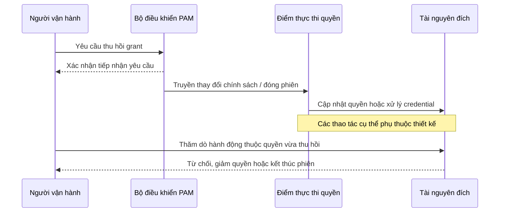

# Kiểm thử thu hồi quyền truy cập đặc quyền (Test revocation)

Một yêu cầu thu hồi quyền có thể trả về thành công trong khi phiên SSH vẫn chạy, token cũ vẫn gọi được API hoặc tài khoản dịch vụ vẫn dùng được mật khẩu đã checkout. Trong PAM, kiểm thử thu hồi quyền phải trả lời câu hỏi ở nơi thực thi: **sau khi bị thu hồi, chủ thể còn thực hiện được hành động đặc quyền nào, qua đường nào và trong bao lâu?**

Bài học này tập trung vào kiểm thử revocation đối với tài khoản quản trị, tài khoản dịch vụ và tài nguyên nhạy cảm. Mục tiêu là xây dựng phép thử có điều kiện ban đầu rõ ràng, tiêu chí đạt đo được và bằng chứng đủ để giải thích kết quả. Nút “Revoke”, trạng thái trên giao diện hay một dòng log riêng lẻ chưa đủ chứng minh quyền đã mất hiệu lực.

## 1. Kết quả cần đạt sau bài học

Sau khi học, bạn có thể:

- Phân biệt thu hồi grant, entitlement, lease, credential, token và phiên thực thi.
- Thiết kế phép thử cho cả truy cập mới và phiên đã tồn tại.
- Đo khoảng thời gian từ yêu cầu thu hồi đến khi việc thực thi quyền bị chặn.
- Kiểm thử các đường truy cập trực tiếp, bộ nhớ đệm, tác vụ đang chạy và sự cố truyền thông.
- Xác định kết quả PASS, FAIL hoặc INCONCLUSIVE dựa trên hành vi thực tế.
- Lưu bằng chứng phục vụ kiểm toán và điều tra mà không làm lộ secret hoặc nội dung nhạy cảm.

## 2. Xác định chính xác thứ đang được thu hồi

“Thu hồi quyền của người dùng” là mô tả quá rộng để làm tiêu chí kiểm thử. Một người có thể có nhiều nguồn cấp quyền, nhiều loại credential và nhiều phiên đồng thời.

Ví dụ, kỹ sư được cấp quyền JIT để xem trạng thái dịch vụ trên máy chủ A. Người đó đồng thời có quyền đọc dashboard qua một nhóm khác. Thu hồi grant JIT phải loại bỏ quyền đến từ grant này; không mặc nhiên loại bỏ quyền đọc dashboard hợp lệ.

Một đối tượng kiểm thử nên được mô tả bằng bộ thông tin:

```text
Chủ thể:          user-lab-17
Nguồn cấp quyền:  grant-jit-204
Vai trò:         operator-read
Tài nguyên:      host-lab-a
Hành động:       đọc thông tin trạng thái dịch vụ thử nghiệm
Đường truy cập:  PAM broker và đường trực tiếp nếu được thiết kế cho phép
Credential:      chứng thư/credential có định danh thử nghiệm
Phiên:           session-lab-301
Lý do thu hồi:   thao tác quản trị chủ động
```

Định danh grant và phiên giúp tránh trường hợp kiểm thử nhầm quyền do một nguồn khác cấp.

| Đối tượng | Thu hồi có thể có nghĩa là gì? | Điều phải quan sát thêm |
|---|---|---|
| Yêu cầu hoặc phê duyệt | Không cho sử dụng phê duyệt để tạo grant mới | Grant đã tạo trước đó có được xử lý theo chính sách không? |
| Grant JIT hoặc role assignment | Loại bỏ một nguồn cấp quyền có thời hạn | Quyền hiệu lực còn đến từ nhóm, vai trò hay grant khác không? |
| Lease trong vault | Không cho gia hạn hoặc tiếp tục dùng lease theo hợp đồng của backend | Backend có thực sự vô hiệu hóa credential tại đích không? |
| Credential đã checkout | Chặn khả năng dùng bản credential đã cấp | Đổi mật khẩu, xóa khóa hay vô hiệu hóa tại đích đã xảy ra chưa? |
| Access token hoặc refresh token | Ngăn sử dụng hoặc phát hành tiếp token theo cơ chế hỗ trợ | Các token liên quan có bị ảnh hưởng giống nhau không? |
| Phiên PAM | Chấm dứt hoặc giảm quyền phiên theo chính sách | Kết nối đích, tiến trình và phiên con còn tồn tại không? |
| Quyền của workload | Ngăn workload thực hiện hành động thuộc quyền bị thu hồi | Worker đã nhận việc, connection pool và credential cache phản ứng thế nào? |

Không suy luận rằng thu hồi một loại đối tượng tự động thu hồi mọi loại khác. Chẳng hạn, ngăn đọc secret mới từ vault không làm một bản secret đã sao chép tự biến mất khỏi bộ nhớ của ứng dụng.

## 3. Tách ý định thu hồi khỏi hiệu lực thu hồi

Một luồng revocation thường đi qua nhiều bước:



Xác nhận tiếp nhận yêu cầu chỉ chứng minh bộ điều khiển đã nhận việc. Xác nhận truyền thay đổi chứng minh thêm một bước xử lý, nhưng vẫn cần kiểm tra hành vi tại điểm thực thi.

Có thể dùng mô hình trạng thái quan sát trong bài kiểm thử:

```text
ACTIVE
  → REVOKE_REQUESTED
  → CHANGE_PROPAGATING
  → ENFORCEMENT_OBSERVED
  → VERIFIED_DURING_OBSERVATION_WINDOW
```

Đây là mô hình của phép thử, không phải yêu cầu đặt tên trạng thái trong sản phẩm. Một lần từ chối chưa đủ chứng minh hiệu lực ổn định: hệ thống có thể cho phép trở lại khi request đi qua node khác hoặc cache khác.

Cần kiểm tra ít nhất ba lớp:

1. **Nguồn cấp quyền:** grant hoặc entitlement có chuyển sang trạng thái đúng không?
2. **Điểm thực thi:** broker, API gateway, hệ điều hành, cơ sở dữ liệu hoặc dịch vụ đích có áp dụng thay đổi không?
3. **Tác động còn lại:** phiên, credential, tiến trình và công việc đã được khởi tạo có còn khả năng sử dụng quyền cũ không?

Chỉ đánh dấu các lớp đã có bằng chứng. Không thay bằng suy đoán từ sơ đồ kiến trúc.

## 4. Viết hợp đồng kiểm thử trước khi thao tác

Hợp đồng revocation xác định hành vi mong đợi, phạm vi và giới hạn thời gian. Nếu thiếu hợp đồng này, hai người kiểm thử có thể nhìn cùng một kết quả nhưng đưa ra hai kết luận trái ngược.

Ví dụ hợp đồng giả định cho môi trường lab:

```yaml
testId: REV-LAB-004
subject: user-lab-17
grant: grant-jit-204
resource: host-lab-a
revocationTrigger: explicit_operator_revoke
policy:
  newPrivilegedRequests: deny_after_deadline
  existingPrivilegedSessions: terminate_after_deadline
  oldCredentialAtTarget: reject_after_deadline
  alreadyCompletedActions: outside_rollback_scope
  unrelatedReadOnlyAccess: preserve
timing:
  revocationDeadlineSeconds: 15
  observationWindowSeconds: 30
  probeIntervalMilliseconds: 500
```

Các con số trên chỉ minh họa cách đặt tiêu chí. Không phải mọi hệ thống PAM đều phải dùng deadline 15 giây hoặc cùng một chính sách đối với phiên đang mở.

Hợp đồng phải làm rõ:

- Đồng hồ bắt đầu từ lúc người vận hành gửi yêu cầu, lúc máy chủ tiếp nhận hay lúc hệ thống cam kết thay đổi.
- Quyền bị thu hồi là một grant cụ thể hay toàn bộ quyền hiệu lực của chủ thể trong phạm vi tài nguyên.
- Phiên đang mở phải bị đóng, phải giảm quyền hay chỉ bị ngăn tạo thao tác mới.
- Credential cũ phải bị từ chối ở đâu và khi nào.
- Công việc đã nhận trước thời điểm thu hồi được phép hoàn thành đến bước nào.
- Khi một thành phần mất kết nối, hành vi được yêu cầu là gì.
- Những quyền hợp lệ ngoài phạm vi nào phải tiếp tục hoạt động.
- Bằng chứng nào cần có để kết luận.

Nếu thiết kế chỉ ngăn đăng nhập mới nhưng không thu hồi phiên đang mở, bài kiểm thử phải thể hiện giới hạn đó. Nếu yêu cầu nghiệp vụ đòi chặn phiên cũ, kết quả này là không đạt yêu cầu dù sản phẩm đã hoạt động đúng theo cấu hình hiện tại.

## 5. Chuẩn bị môi trường và bằng chứng ban đầu

Dùng tài khoản, tài nguyên và workload chuyên biệt trong môi trường kiểm thử được phép. Hành động thăm dò nên ít tác động, có thể lặp lại và cần đúng quyền đang được kiểm tra. Không chọn thao tác phá hủy dữ liệu để chứng minh một tài khoản “vẫn còn quyền”.

### 5.1. Các vai trò của phép thử

Tách các vai trò sau khi có thể:

- **Chủ thể thử nghiệm:** tài khoản nhận quyền đặc biệt.
- **Người yêu cầu thu hồi:** tài khoản đủ quyền quản lý grant hoặc phiên.
- **Bộ chạy thăm dò:** gửi các request có định danh và lưu kết quả.
- **Người thu thập bằng chứng:** đọc log từ PAM và tài nguyên đích.

Nếu công cụ thăm dò chạy bằng tài khoản quản trị riêng, phải chắc chắn request kiểm tra vẫn đại diện cho chủ thể thử nghiệm. Một lệnh thành công dưới danh tính của người kiểm thử không chứng minh tài khoản đã thu hồi còn quyền.

### 5.2. Baseline tối thiểu

Trước khi cấp quyền, chứng minh hành động đặc quyền bị từ chối. Sau khi cấp quyền, chứng minh đúng hành động đó được phép. Chuỗi quan sát mong muốn là:

```text
Chưa có grant:              DENY
Grant đã có hiệu lực:       ALLOW
Đã yêu cầu thu hồi:         theo dõi chuyển trạng thái
Sau deadline thu hồi:       DENY hoặc phiên kết thúc theo hợp đồng
Trong cửa sổ quan sát tiếp: tiếp tục không sử dụng được quyền đã thu hồi
```

Nếu baseline sau cấp quyền chưa từng ALLOW, lần DENY sau thu hồi không chứng minh cơ chế revocation hoạt động. Nguyên nhân có thể là grant chưa bao giờ tới được tài nguyên.

### 5.3. Kiểm tra quyền hiệu lực và đường truy cập

Ghi lại:

- Các nguồn quyền liên quan: grant, nhóm, role, tài khoản local và quyền kế thừa.
- Những phiên tồn tại trước thu hồi cùng định danh phiên.
- Loại credential đã được phát hành, thời hạn và định danh phiên bản nếu có.
- Node hoặc endpoint xử lý mỗi lần thăm dò, nếu có thể quan sát.
- Đường đi qua PAM và những đường trực tiếp thuộc phạm vi kiểm thử.
- Chính sách cache, gia hạn và xử lý tác vụ đã nhận.

Không cần sao chép toàn bộ cấu hình nhạy cảm vào báo cáo. Chỉ thu thông tin cần để tái hiện và giải thích quyền hiệu lực.

## 6. Chọn phép thăm dò có thể giải thích kết quả

Phép thăm dò phải phân biệt được “bị từ chối quyền” với “không kết nối được”.

Một kết quả HTTP 403 có thể đến từ gateway không liên quan đến quyền vừa thu hồi. Một timeout có thể do tài nguyên ngừng hoạt động. Một shell không in thêm dữ liệu có thể đang rảnh chứ chưa bị đóng.

Thiết kế mỗi phép thăm dò với bốn thành phần:

| Thành phần | Ví dụ trong lab | Mục đích |
|---|---|---|
| Hành động cần quyền | Đọc một trạng thái quản trị thử nghiệm | Chứng minh khả năng sử dụng quyền đích |
| Dấu hiệu danh tính | Subject ID và session ID được hệ thống ghi nhận | Tránh kiểm thử bằng nhầm tài khoản |
| Dấu hiệu kết quả | Mã quyết định và log đích tương ứng | Xác định đúng nguyên nhân ALLOW hoặc DENY |
| Phép đối chứng sức khỏe | Đọc endpoint kiểm tra sức khỏe bằng quyền riêng | Phân biệt thu hồi quyền với lỗi toàn dịch vụ |

Không gửi lại một response đã cache và coi đó là thực thi mới. Mỗi lần thăm dò cần request ID riêng; nếu hệ thống có cache dữ liệu, chọn cách xác minh rằng quyết định quyền hoặc hành động thật đã được thực hiện lại.

Đối với phiên đang mở, thử gửi một thao tác mới sau thu hồi bằng chính phiên cũ. Đối với credential đã phát hành, thử tạo kết nối mới bằng credential cũ trong phạm vi lab. Hai phép thử này kiểm tra hai rủi ro khác nhau.

## 7. Ma trận tình huống revocation

Một test case đơn lẻ thường bỏ sót đường truy cập hoặc loại trạng thái tồn dư. Ma trận sau giúp lựa chọn các phép thử đúng với thiết kế.

| Mã | Tình huống | Quan sát quan trọng |
|---|---|---|
| REV-01 | Thu hồi grant chủ động khi chưa có phiên | Truy cập đặc quyền mới bị từ chối trong deadline |
| REV-02 | Thu hồi grant khi có phiên đang hoạt động | Phiên cũ đóng hoặc giảm quyền đúng hợp đồng |
| REV-03 | Grant tự hết hạn | Không gia hạn ngầm; quyền hết hiệu lực theo mốc đã định |
| REV-04 | Thu hồi sau khi credential đã checkout | Bản credential cũ không còn dùng được tại đích khi chính sách yêu cầu |
| REV-05 | Thu hồi token hoặc quyền gắn với token | Token cũ và cơ chế làm mới được kiểm tra riêng |
| REV-06 | Cùng chủ thể có nhiều nguồn quyền | Quyền hiệu lực khớp chính sách; không kết luận sai do grant khác |
| REV-07 | Cùng grant có nhiều phiên | Tất cả phiên thuộc phạm vi được xử lý, kể cả phiên ít hoạt động |
| REV-08 | Điểm thực thi bị mất kết nối | Hành vi khi lỗi và sau phục hồi khớp hợp đồng |
| REV-09 | Nhiều node với cache khác nhau | Không còn node tiếp tục cho phép ngoài deadline |
| REV-10 | Thu hồi đồng thời với tạo phiên hoặc gia hạn | Không phát hành quyền mới trái chính sách tại ranh giới tranh chấp |
| REV-11 | Gửi lặp yêu cầu thu hồi | Không làm quyền sống lại, mở rộng phạm vi hoặc gây sai trạng thái |
| REV-12 | Workload đang giữ kết nối hoặc công việc đã nhận | Giới hạn thực thi và xử lý việc đang chạy được đáp ứng |
| REV-13 | Cấp quyền lại sau thu hồi | Chỉ grant mới hợp lệ hoạt động; không phục hồi credential cũ ngoài ý muốn |
| REV-14 | Người không đủ quyền gửi yêu cầu thu hồi | Yêu cầu bị từ chối và quyền đang hợp lệ không bị thay đổi |
| REV-15 | Thu hồi quyền nhạy cảm nhưng giữ quyền độc lập | Quyền cần loại bỏ mất hiệu lực; quyền ngoài phạm vi được bảo toàn |

Không phải mọi hệ thống đều có token, lease hay nhiều node. Đánh dấu NOT_APPLICABLE kèm lý do và bằng chứng về phạm vi, thay vì tạo tình huống giả để tăng số lượng test.

## 8. Thực hiện một phép thử đầu cuối

Ví dụ dưới đây dùng grant JIT cho hành động đọc thông tin quản trị trên tài nguyên lab. Hợp đồng yêu cầu chặn truy cập mới và kết thúc phiên đặc quyền cũ trong deadline.

### Bước 1 — Chứng minh trạng thái chưa được cấp quyền

Dùng chủ thể thử nghiệm gửi hành động cần quyền. Kết quả phải là DENY do thiếu quyền phù hợp. Đồng thời xác nhận tài nguyên vẫn hoạt động bình thường.

Lưu request ID, danh tính được nhận diện và mã lý do quyết định quyền. Nếu request thất bại do mạng, sửa điều kiện kiểm thử trước khi tiếp tục.

### Bước 2 — Cấp grant và chứng minh grant có hiệu lực

Tạo grant thử nghiệm với phạm vi đã chốt. Chờ hoặc kiểm tra đến khi hành động đặc quyền ALLOW đúng danh tính, đúng tài nguyên.

Mở ít nhất một phiên sẽ được giữ lại qua thời điểm thu hồi. Nếu kiểm tra credential checkout, lấy credential qua quy trình được phép và chỉ giữ trong bộ nhớ hoặc cơ chế lưu bảo mật của lab. Báo cáo chỉ chứa định danh tham chiếu.

### Bước 3 — Bắt đầu các phép thăm dò

Chạy đồng thời những phép thăm dò cần thiết:

1. Tạo truy cập mới qua PAM bằng chủ thể thử nghiệm.
2. Thực hiện thao tác mới trên phiên đã mở.
3. Tạo kết nối mới bằng credential cũ nếu tình huống áp dụng.
4. Kiểm tra sức khỏe tài nguyên bằng đường đối chứng độc lập.

Ghi thời gian và kết quả của từng probe. Giữ tải đủ nhỏ để bản thân phép thử không gây quá tải hoặc kích hoạt khóa tài khoản ngoài ý muốn.

### Bước 4 — Gửi yêu cầu thu hồi

Ghi lại thời điểm bắt đầu theo hợp đồng và định danh yêu cầu thu hồi. Phân biệt:

- Yêu cầu được tiếp nhận.
- Hệ thống công bố grant đã thu hồi.
- Điểm thực thi bắt đầu từ chối.
- Phiên cũ thực sự kết thúc hoặc mất quyền.

Nếu yêu cầu thu hồi bị từ chối, đừng tiếp tục diễn giải một lần DENY sau đó như bằng chứng thu hồi thành công.

### Bước 5 — Theo dõi đến deadline và hết cửa sổ quan sát

Không dừng ngay tại lần DENY đầu tiên. Tiếp tục thăm dò các đường nằm trong phạm vi và phân bố request qua các điểm thực thi cần kiểm tra.

Nếu có bất kỳ ALLOW nào sau deadline, ghi nhận vi phạm với request ID và điểm thực thi tương ứng. Nếu probe không thể thực hiện vì lỗi hạ tầng, ghi nhận khoảng thiếu quan sát; không tự đổi timeout thành DENY.

### Bước 6 — Đối chiếu và kết luận

Đối chiếu log bộ điều khiển, broker và tài nguyên đích theo correlation ID. Kiểm tra quyền không liên quan vẫn hoạt động nếu hợp đồng có yêu cầu bảo toàn.

Kết luận cho từng đường truy cập trước, sau đó mới kết luận chung. Ví dụ: broker PASS nhưng credential cũ đăng nhập trực tiếp được sau deadline là FAIL của phạm vi revocation yêu cầu chặn cả hai đường.

### Bước 7 — Thu dọn dữ liệu lab

Kết thúc phiên và công việc thử nghiệm còn lại, loại bỏ grant thử nghiệm, xử lý credential theo cơ chế đã định và xác nhận tài nguyên về trạng thái mong muốn.

Việc cleanup có thể làm quyền mất hiệu lực sau cùng, nhưng không được dùng kết quả cleanup để thay thế kết quả kiểm thử tại deadline ban đầu.

## 9. Đo thời gian thu hồi một cách có ý nghĩa

Đặt các mốc:

- `t0`: mốc bắt đầu revocation theo hợp đồng.
- `tAck`: thời điểm nhận xác nhận từ bộ điều khiển.
- `tLastAllow`: lần gần nhất vẫn quan sát thấy ALLOW.
- `tFirstDeny`: lần đầu quan sát thấy từ chối có căn cứ.
- `tSessionEnd`: thời điểm xác nhận phiên cần đóng đã chấm dứt.
- `tEnd`: kết thúc cửa sổ quan sát.

Một chỉ số có thể báo cáo là:

```text
Độ trễ từ chối quan sát được = tFirstDeny - t0
Độ trễ kết thúc phiên        = tSessionEnd - t0
Thời gian phản hồi điều khiển = tAck - t0
```

Ba chỉ số này không thay thế cho nhau. API điều khiển phản hồi nhanh không chứng minh phiên đóng nhanh.

### 9.1. Sai số do chu kỳ thăm dò

Nếu lần cuối ALLOW ở giây 3,0 và lần đầu DENY ở giây 3,5, bạn chỉ biết có chuyển trạng thái trong khoảng quan sát đó, với điều kiện đang kiểm tra cùng điểm thực thi và không có thay đổi trở lại.

Không báo rằng hệ thống thu hồi “chính xác sau 3,5 giây”. Báo độ trễ quan sát được, chu kỳ probe và khoảng không chắc chắn. Khi deadline nằm trong khoảng chưa quan sát, tăng độ phân giải hoặc chạy lại; đừng tự suy ra PASS.

Trong hệ thống nhiều node, `tLastAllow` và `tFirstDeny` từ hai node khác nhau không xác định được một thời điểm chuyển trạng thái chung. Cần theo dõi theo node hoặc đường truy cập, đồng thời tìm ALLOW muộn nhất trên toàn phạm vi.

### 9.2. Đồng hồ và dữ liệu thiếu

Dùng đồng hồ đơn điệu của bộ chạy test để tính khoảng thời gian cục bộ. Dùng timestamp đã đồng bộ phù hợp để ghép log giữa hệ thống, và ghi nhận độ lệch đồng hồ có thể ảnh hưởng kết luận.

Với kiểm thử hết hạn, kiểm tra cả nguồn thời gian mà chính sách thực sự sử dụng. Không chỉnh đồng hồ trên hệ thống dùng chung chỉ để tạo tình huống; dùng môi trường hoặc cơ chế giả lập thời gian được thiết kế cho test.

Nếu bộ chạy test bị ngắt trong giai đoạn quan trọng, kết quả có thể là INCONCLUSIVE. Không được coi khoảng không có mẫu là khoảng “không có truy cập trái phép”.

## 10. Các loại phiên và credential cần kiểm tra riêng

### 10.1. Phiên SSH, shell và tiến trình

Đóng phiên trên giao diện PAM có thể chưa đủ để xử lý mọi tài nguyên thực thi:

- Kết nối từ broker đến máy đích có thể còn tồn tại.
- Chủ thể có thể có nhiều phiên song song.
- Tiến trình được khởi chạy trước thu hồi có thể tiếp tục thực thi.
- Phiên ghép kênh hoặc tác vụ nền có thể có vòng đời khác phiên tương tác.
- Một lần nâng quyền trước đó có thể tạo shell hoặc ngữ cảnh thực thi với quyền riêng.

Bài kiểm thử phải xác định những đối tượng nào thuộc chính sách kết thúc. Ngắt kênh điều khiển không tự chứng minh mọi tiến trình của chủ thể đã dừng. Ngược lại, không được tự yêu cầu diệt mọi tiến trình nếu hợp đồng cho phép tác vụ đã nhận hoàn tất.

Dùng tiến trình lab không gây hại, có định danh và trạng thái quan sát rõ ràng để kiểm tra. Đối chiếu danh tính và tiến trình trên đích; không dựa riêng vào việc cửa sổ terminal biến mất.

### 10.2. Mật khẩu, SSH key và chứng thư

Đổi mật khẩu thường ảnh hưởng lần xác thực bằng mật khẩu tiếp theo; không nên suy ra phiên đã xác thực sẽ tự bị ngắt. Tương tự, xóa khóa khỏi nơi cấp phát không chứng minh mọi máy đích đã loại bỏ khả năng chấp nhận khóa đó.

Với chứng thư có thời hạn, phải biết verifier kiểm tra thu hồi bằng cơ chế nào. Thời hạn ngắn giúp giới hạn thời gian sử dụng trong một số thiết kế, nhưng “sẽ hết hạn” không đồng nghĩa “đã bị thu hồi ngay”.

Các phép thử cần tách:

1. Không cấp thêm credential từ vault.
2. Credential đã cấp không thể tạo kết nối mới tại đích theo chính sách.
3. Phiên đã xác thực được xử lý đúng hợp đồng.
4. Gia hạn, cấp lại và cache không làm credential cũ có hiệu lực trở lại.

Đối với lease, hiệu ứng revocation phụ thuộc backend và cách credential được quản lý. Kiểm chứng tại tài nguyên đích thay vì coi trạng thái lease là bằng chứng cuối cùng.

### 10.3. Access token, refresh token và kết nối dài hạn

Một access token được kiểm tra ngoại tuyến có thể vẫn được chấp nhận tới khi hết hạn nếu hệ thống không có cơ chế thu hồi hoặc tái đánh giá quyền phù hợp. Thu hồi refresh token có thể ngăn xin token mới mà chưa ngăn mọi access token đã phát hành.

Bài kiểm thử nên có các nhánh riêng:

- Dùng access token cũ để tạo request mới.
- Dùng refresh token cũ để xin token mới.
- Mở phiên hoặc kết nối mới.
- Gửi thao tác trên kết nối đã mở như WebSocket hoặc luồng RPC.
- Thử lại qua các điểm thực thi khác nhau thuộc phạm vi.

Không mặc định rằng mọi request HTTP đều kiểm tra quyền mới nhất, hoặc rằng đóng kết nối là cách duy nhất để giảm quyền. Tiêu chí là hành động đặc quyền còn được cho phép hay không theo hợp đồng.

### 10.4. Tài khoản dịch vụ và automation

Workload có thể giữ secret trong bộ nhớ, kết nối cơ sở dữ liệu trong pool hoặc một công việc đã được cấp quyền từ trước. Chặn đọc secret mới không đủ nếu workload vẫn dùng credential cũ.

Kiểm tra ít nhất:

- Công việc mới sau thu hồi.
- Công việc đã xếp hàng nhưng chưa thực thi.
- Công việc đang thực thi.
- Kết nối đang mở và kết nối được tạo mới.
- Cơ chế retry, refresh và fallback credential.
- Hành vi sau khi workload hoặc worker khởi động lại.

Nếu mục tiêu là thu hồi một workload cụ thể, dùng định danh phù hợp trong môi trường test. Thu hồi một tài khoản dùng chung có thể ảnh hưởng nhiều workload; kết quả phải phản ánh phạm vi ảnh hưởng thực tế.

## 11. Kiểm thử tranh chấp, cache và sự cố

### 11.1. Thu hồi đồng thời với phát hành quyền

Một tình huống khó là request tạo phiên hoặc gia hạn lease đã bắt đầu trước thu hồi nhưng hoàn tất sau thu hồi.

Để kiểm thử:

1. Xác định mốc quyết định mà thiết kế dùng để chấp nhận hoặc từ chối request.
2. Tạo các request gần mốc thu hồi, có request ID riêng.
3. Lưu thời điểm gửi, tiếp nhận, ra quyết định và phát hành nếu có thể.
4. Kiểm tra những quyền được phát hành ở ranh giới đó có bị xử lý theo chính sách không.
5. Kiểm tra kết quả cuối cùng tại tài nguyên đích.

Không kết luận chỉ từ thứ tự response đến bộ chạy test; response có thể đến khác thứ tự quyết định tại máy chủ. Nếu không đủ dữ liệu xác định thứ tự, báo giới hạn bằng chứng và bổ sung khả năng quan sát.

### 11.2. Cache và nhiều điểm thực thi

Gửi một request tới node A và thấy DENY có thể bỏ sót node B vẫn ALLOW. Đường kiểm thử nên bao phủ các điểm thực thi liên quan, kể cả tuyến dự phòng nếu nằm trong kiến trúc được kiểm tra.

Kiểm tra cache được làm mới khi có tín hiệu thu hồi, khi TTL hết hạn và khi node tái kết nối. Một node trở lại sau thời gian mất kết nối không được tự khôi phục quyền cũ trái hợp đồng.

Không xóa cache thủ công trước mỗi phép đo thông thường: điều đó có thể che mất chính độ trễ cần đo. Nếu xóa cache để chẩn đoán, tách kết quả chẩn đoán khỏi phép thử chấp nhận.

### 11.3. Mất kết nối và xử lý yêu cầu lặp

Mô phỏng có kiểm soát các tình huống áp dụng được:

- Bộ điều khiển không gửi được thay đổi tới broker.
- Broker không cập nhật được tài nguyên đích.
- Một điểm thực thi mất kết nối với nguồn chính sách.
- Hệ thống xử lý thay đổi xong nhưng response về người gọi bị mất.
- Người vận hành gửi lại yêu cầu do timeout.

Đối với từng tình huống, kiểm tra hành vi trong thời gian lỗi, cơ chế cảnh báo và trạng thái sau phục hồi. Yêu cầu lặp phải tạo hiệu ứng cuối cùng phù hợp; lỗi “đã thu hồi” cần được phân biệt với thất bại khiến grant vẫn còn hiệu lực.

Không áp đặt cùng một hành vi khi mất kết nối cho mọi hệ thống. Hợp đồng phải nêu hành vi được chấp nhận và giới hạn rủi ro. Nếu yêu cầu bảo mật buộc chặn quyền trong thời gian lỗi mà hệ thống vẫn cho phép ngoài giới hạn, đánh dấu FAIL.

## 12. Mẫu logic tự động hóa phép thử

Mã giả dưới đây mô tả thuật toán, không phải API của một sản phẩm cụ thể. Các hàm tích hợp phải được triển khai theo hệ thống thực tế và chỉ dùng tài nguyên lab.

```text
verify_revocation(contract):
    assert target_health(control_identity) == HEALTHY

    before_grant = probe_privileged_action(test_identity)
    assert before_grant == DENY_MISSING_GRANT

    grant = create_lab_grant(contract.scope)
    wait_for_grant_activation_with_timeout(grant)
    assert probe_privileged_action(test_identity) == ALLOW

    old_session = open_lab_session(test_identity)
    old_credential_ref = obtain_lab_credential_reference_if_applicable()
    start_probe_workers_with_unique_request_ids()

    t0 = monotonic_now()
    revoke_result = request_revoke(grant.id)
    record(revoke_result)

    if revoke_result was not accepted:
        return FAIL_REVOKE_REQUEST

    evidence = []
    while monotonic_now() <= t0 + deadline + observation_window:
        health = target_health(control_identity)
        new_access = probe_new_privileged_access(test_identity)
        old_session_action = probe_existing_session(old_session)
        old_credential_access = probe_old_credential_if_applicable(
            old_credential_ref
        )

        record_without_secrets(
            timestamp,
            health,
            new_access,
            old_session_action,
            old_credential_access,
            request_ids
        )

        classify_each_probe_as_ALLOW_DENY_TERMINATED_OR_UNKNOWN()
        wait_until_next_probe_tick()

    verify_required_paths_against_contract(evidence)
    verify_unrelated_permissions_are_preserved()
    return classified_result_with_evidence_gaps()
```

Bộ chạy thực tế cần có timeout cho từng thao tác, xử lý ngoại lệ và cleanup trong nhánh luôn được thực hiện. Timeout của toàn test không được ngắn đến mức cắt mất cửa sổ quan sát.

Một nhánh trả về UNKNOWN phải giữ nguyên sự không chắc chắn khi tổng hợp. Không chuyển tất cả exception thành DENY vì điều đó sẽ tạo PASS giả mỗi khi dịch vụ gặp lỗi.

Khi đo thời gian, lưu sự kiện liên tục thay vì chỉ giữ trạng thái cuối. Nếu có ALLOW sau deadline rồi lại DENY, bản ghi cuối cùng DENY không xóa được vi phạm đã quan sát.

## 13. Quy tắc kết luận và mẫu bằng chứng

### 13.1. Phân loại kết quả

| Kết quả | Điều kiện điển hình |
|---|---|
| PASS | Các điều kiện trước thử nghiệm hợp lệ; mọi đường bắt buộc đáp ứng chính sách và deadline; cửa sổ quan sát đủ; quyền độc lập cần giữ vẫn hoạt động |
| FAIL | Có hành vi trái hợp đồng được quan sát, như ALLOW sau deadline, phiên cần đóng vẫn thực thi được hoặc credential cũ tiếp tục được chấp nhận |
| INCONCLUSIVE | Không đủ bằng chứng để quyết định, như thiếu baseline, lỗi mạng kéo dài hoặc mất dữ liệu tại mốc thời gian quan trọng |
| NOT_APPLICABLE | Tình huống không thuộc thiết kế hoặc phạm vi đã được xác minh, kèm lý do |

Một vi phạm được xác thực vẫn là FAIL dù các probe khác bị lỗi. Ngược lại, nếu chỉ có lỗi hạ tầng và không chứng minh được vi phạm hay tuân thủ, INCONCLUSIVE phản ánh đúng tình trạng.

### 13.2. Ví dụ kết quả có một đường còn hiệu lực

Giả sử hợp đồng yêu cầu chặn cả broker và credential cũ tại đích trong 15 giây:

```text
T+00.000  Yêu cầu thu hồi được tiếp nhận
T+00.180  Bộ điều khiển xác nhận xử lý
T+02.000  Broker từ chối truy cập mới
T+04.100  Phiên cũ chấm dứt
T+16.000  Credential cũ vẫn mở được kết nối trực tiếp tới tài nguyên lab
T+21.000  Credential cũ bị từ chối tại đích
```

Kết luận: **FAIL** do có ALLOW ở giây 16 trên đường nằm trong phạm vi. Trạng thái cuối cùng đã thu hồi không làm phép thử đạt deadline ban đầu.

Báo cáo cũng nên ghi broker và phiên cũ đã đáp ứng tiêu chí riêng để giúp khoanh vùng phần cần sửa. Không rút gọn thành “PAM không hoạt động” vì kết luận đó thiếu định vị.

### 13.3. Bản ghi bằng chứng gọn

```json
{
  "testId": "REV-LAB-004",
  "subjectRef": "user-lab-17",
  "grantRef": "grant-jit-204",
  "sessionRef": "session-lab-301",
  "resourceRef": "host-lab-a",
  "trigger": "explicit_operator_revoke",
  "deadlineSeconds": 15,
  "probeIntervalMilliseconds": 500,
  "controlPlaneAckMilliseconds": 180,
  "paths": [
    {
      "name": "broker_new_access",
      "result": "PASS",
      "firstObservedDenyMilliseconds": 2000
    },
    {
      "name": "existing_session",
      "result": "PASS",
      "observedTerminationMilliseconds": 4100
    },
    {
      "name": "direct_old_credential",
      "result": "FAIL",
      "allowAfterDeadlineRequestRefs": ["req-lab-824"]
    }
  ],
  "overallResult": "FAIL",
  "evidenceRefs": [
    "pam-event-lab-204",
    "target-audit-lab-824"
  ],
  "secretsIncluded": false
}
```

Bản ghi trên chỉ minh họa cấu trúc báo cáo. Khi thực hiện, lưu thêm phạm vi cửa sổ quan sát, chất lượng dữ liệu thời gian, khoảng mất mẫu và kết quả đối chứng. Các số liệu phải xuất phát từ phép thử, không điền theo giá trị mong đợi.

Không đưa mật khẩu, private key, bearer token, cookie phiên hay nội dung nhạy cảm của tài nguyên vào log test. Dùng định danh credential hoặc tham chiếu bằng chứng đã được bảo vệ; bảo đảm người xem báo cáo không thể dùng chúng để truy cập hệ thống.

## 14. Những lỗi làm kiểm thử thu hồi quyền mất giá trị

### Chỉ kiểm tra trạng thái trên giao diện

Giao diện hiển thị REVOKED nhưng điểm thực thi chưa cập nhật. Cần bổ sung probe tại đích và bằng chứng quyết định quyền.

### Chỉ thử đăng nhập mới

Truy cập mới bị chặn trong khi phiên cũ vẫn thực hiện được hành động đặc quyền. Phải kiểm tra riêng phiên tồn tại trước thu hồi.

### Chỉ thử đi qua PAM

Broker chặn nhưng đường trực tiếp bằng credential cũ vẫn hoạt động. Nếu đường này thuộc phạm vi rủi ro, phải đưa vào hợp đồng kiểm thử.

### Dùng tài khoản có quyền khác mà không biết

Grant đã thu hồi đúng nhưng quyền kế thừa vẫn cho phép thao tác. Kiểm tra nguồn quyền hiệu lực để phân biệt lỗi test với lỗi sản phẩm. Nếu yêu cầu là loại bỏ toàn bộ quyền trong phạm vi, chính nguồn quyền khác cũng phải được xử lý theo yêu cầu đó.

### Xem timeout là bằng chứng bị từ chối

Tài nguyên có thể đang ngừng hoạt động. Kết quả cần được phân loại UNKNOWN và đối chiếu phép kiểm tra sức khỏe.

### Dừng sau lần DENY đầu tiên

Một node khác có thể vẫn ALLOW. Duy trì cửa sổ quan sát và kiểm tra các điểm thực thi liên quan.

### Luân chuyển credential trước khi bắt đầu đo

Nếu mục tiêu là đo toàn bộ luồng thu hồi và xử lý credential, việc đổi credential thủ công trước mốc bắt đầu làm mất điều kiện kiểm thử. Các thao tác hỗ trợ chẩn đoán phải được ghi tách biệt.

### Đồng nhất thu hồi với hoàn tác

Revocation hạn chế khả năng thực thi tiếp theo. Nó không tự hoàn tác dữ liệu đã đọc, lệnh đã hoàn thành hay secret đã bị sao chép. Bài kiểm thử phải chỉ rõ tác động tồn dư và cơ chế xử lý bổ sung nếu có yêu cầu.

### Coi một lần PASS là bảo đảm cho mọi điều kiện

Kết quả chỉ áp dụng cho phiên bản, cấu hình, đường truy cập, loại credential và điều kiện đã kiểm tra. Thay đổi cache, cơ chế token, topology hoặc đường dự phòng có thể làm thay đổi hành vi cần kiểm thử lại.

## 15. Bài tập thực hành

Thiết kế bộ test cho tình huống sau:

> Một kỹ sư được cấp quyền JIT trong 10 phút để đọc trạng thái dịch vụ trên hai máy chủ lab. Kỹ sư có một phiên PAM đang mở và đã nhận một credential tạm thời. Sau 3 phút, người vận hành chủ động thu hồi grant. Hợp đồng yêu cầu chặn truy cập mới, kết thúc phiên đặc quyền và vô hiệu hóa khả năng đăng nhập mới bằng credential cũ trong 20 giây. Quyền đọc dashboard từ một nhóm độc lập phải tiếp tục hoạt động.

Hãy chuẩn bị:

1. Bộ định danh tài khoản, grant, phiên, credential và hai tài nguyên.
2. Baseline trước và sau khi grant có hiệu lực.
3. Phép thăm dò cho từng đường truy cập trên cả hai máy chủ.
4. Phép đối chứng sức khỏe và phép kiểm tra quyền dashboard.
5. Mốc bắt đầu đo, chu kỳ probe, cửa sổ quan sát và sai số dự kiến.
6. Cách phân loại timeout hoặc thiếu log.
7. Một tình huống node thực thi mất kết nối rồi phục hồi.
8. Bản ghi bằng chứng đã loại secret và các bước cleanup.

Tự đánh giá ba kết quả giả định:

- Máy chủ A từ chối sau 5 giây; máy chủ B còn cho phép ở giây 23.
- Cả hai máy chủ không kết nối được từ giây 2 đến giây 40, không có log quyết định quyền.
- Mọi đường đặc quyền bị chặn trong deadline, nhưng dashboard cũng bị mất quyền do bị xóa nhầm khỏi nhóm độc lập.

Gợi ý phân loại: trường hợp đầu FAIL vì vượt deadline ở một tài nguyên; trường hợp hai INCONCLUSIVE nếu không có bằng chứng khác xác định vi phạm hoặc tuân thủ; trường hợp ba FAIL theo yêu cầu bảo toàn quyền ngoài phạm vi. Mỗi kết luận cần chỉ ra tiêu chí bị vi phạm hoặc khoảng bằng chứng còn thiếu.

## 16. Điểm cần nhớ

Kiểm thử revocation bắt đầu từ một phạm vi quyền cụ thể và kết thúc bằng bằng chứng tại nơi quyền được sử dụng. Cần kiểm tra truy cập mới, trạng thái đã tồn tại và các đường thay thế phù hợp với thiết kế; đo độ trễ với mốc thời gian rõ ràng; giữ sự khác biệt giữa DENY và lỗi kỹ thuật.

Một phép thử có giá trị phải chứng minh quyền từng có hiệu lực, sau đó mất hiệu lực đúng phạm vi và thời hạn, đồng thời quan sát đủ lâu để phát hiện việc quyền xuất hiện trở lại. Log điều khiển, log tài nguyên và probe hành vi bổ sung cho nhau để tạo bằng chứng có thể giải thích và tái hiện.
