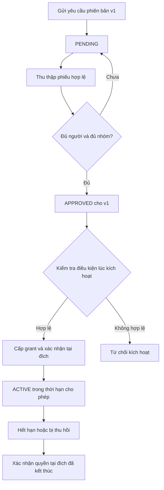

# Test approval workflow

## 1. Mục tiêu kiểm thử luồng phê duyệt trong PAM

Luồng phê duyệt (approval workflow) của hệ thống quản lý truy cập đặc quyền, hay PAM, biến một nhu cầu vận hành thành quyền truy cập có phạm vi và thời hạn. Người vận hành có thể xin quyền đọc cấu hình máy chủ, mở phiên quản trị hoặc thực hiện một nhóm thao tác đã định trước. Hệ thống phải xác định ai được yêu cầu, ai được duyệt, những điều kiện nào cần thỏa mãn và khi nào quyền phải kết thúc.

Kiểm thử luồng này cần chứng minh được hai điều đồng thời: yêu cầu hợp lệ có thể hoàn thành công việc được phép, và mọi đường đi không hợp lệ đều không tạo ra đặc quyền ngoài chính sách. Một nút Approve đổi màu hoặc một phản hồi HTTP thành công chưa đủ chứng minh điều đó. Cần quan sát cả quyết định, bản ghi cấp quyền, trạng thái ở hệ thống đích và bằng chứng kiểm toán.

Trong bài này, phạm vi kiểm thử tập trung vào việc phê duyệt quyền truy cập tài khoản quản trị, tài khoản dịch vụ và tài nguyên nhạy cảm. Các tình huống gắn với least privilege, quyền có thời hạn JIT, phạm vi thao tác JEA, vault, giám sát phiên và thu hồi quyền. Bài không giả định một sản phẩm PAM hoặc một API thương mại cụ thể.

Sau bài học, người học có thể:

- Chuyển chính sách phê duyệt thành các điều kiện kiểm thử rõ ràng.
- Tách trạng thái yêu cầu, quyết định phê duyệt và quyền thực tế.
- Xây dựng ca thành công, ca bị từ chối, ca biên thời gian và ca đồng thời.
- Kiểm chứng phân tách nhiệm vụ, tính nhất quán khi retry và việc thu hồi.
- Thu thập bằng chứng đủ để giải thích ai đã cho phép điều gì, dựa trên chính sách nào.

## 2. Xác định hợp đồng trước khi viết test

### 2.1. Một tình huống minh họa

Một kỹ sư tên Lan cần kiểm tra cấu hình dịch vụ trên máy chủ lab `srv-pay-lab-01`. Quyền yêu cầu là vai trò `config-reader`, chỉ cho phép đọc một tập cấu hình được xác định trước. Lan không cần biết mật khẩu quản trị và không cần quyền sửa dịch vụ.

Chính sách lab yêu cầu một người thuộc nhóm vận hành và một người thuộc nhóm an ninh phê duyệt. Hai người phải là hai cá nhân khác nhau và không được là Lan. Sau khi đủ phiếu, hệ thống cho phép kích hoạt một lần trong cửa sổ đã định; mỗi quyền được kích hoạt có thời hạn tối đa 15 phút và bị giới hạn bởi thời điểm kết thúc cửa sổ.

Các tên, thời điểm và giới hạn trong bài là dữ liệu minh họa của một hợp đồng kiểm thử, không phải mặc định áp dụng cho mọi tổ chức.

### 2.2. Những câu hỏi cần có đáp án

Trước khi xây dựng ca kiểm thử, cần làm rõ:

| Thành phần | Câu hỏi cần chốt | Lỗi dễ bỏ sót |
| --- | --- | --- |
| Chủ thể | Ai được tạo yêu cầu và ai được hưởng quyền? | Xin quyền cho người khác mà không có thẩm quyền |
| Tài nguyên | Quyền áp dụng cho tài nguyên, tài khoản, môi trường nào? | Duyệt máy lab nhưng dùng cho production |
| Thao tác | Đọc, sửa, thực thi hay quản trị toàn bộ? | Vai trò thực tế rộng hơn vai trò đã duyệt |
| Người duyệt | Duyệt theo cá nhân, nhóm, vai trò hay quan hệ quản lý? | Chỉ kiểm tra tên nhóm trên giao diện |
| Số phiếu | Cần tất cả, bất kỳ một người hay một quorum? | Đếm nhiều phiếu từ cùng một cá nhân |
| Trình tự | Các tầng song song hay bắt buộc duyệt theo thứ tự? | Duyệt tầng sau khi tầng trước chưa xong |
| Thời gian | Hạn duyệt, cửa sổ kích hoạt, thời hạn quyền là gì? | Approval chưa hết hạn nhưng quyền đã quá cửa sổ |
| Thay đổi | Sửa tài nguyên hoặc chính sách có vô hiệu phiếu cũ không? | Dùng quyết định cũ cho yêu cầu đã đổi |
| Thu hồi | Ai được thu hồi, có kết thúc phiên đang chạy không? | UI báo thu hồi nhưng phiên vẫn hoạt động |
| Khẩn cấp | Break-glass có quy trình và bằng chứng riêng nào? | Timeout duyệt tự biến thành quyền khẩn cấp |

Nếu chưa chốt được một quy tắc, đánh dấu điểm chưa xác định trong kế hoạch test. Không tự chọn kết quả mong đợi chỉ để làm test xanh.

### 2.3. Hợp đồng lab có thể biểu diễn bằng dữ liệu

Đoạn YAML sau chỉ mô tả dữ liệu cho bài thực hành, không phải cấu hình có thể nạp trực tiếp vào sản phẩm PAM:

```yaml
policyId: pam-approval-lab
policyVersion: 7
resource: srv-pay-lab-01
environment: lab
privilege: config-reader
approval:
  requiredGroups:
    - operations-approvers
    - security-approvers
  distinctHumanApprovers: 2
  requesterMayApprove: false
  mode: parallel
  decisionDeadlineMinutes: 10
activation:
  singleUse: true
  windowStart: "2030-04-12T03:00:00Z"
  windowEnd: "2030-04-12T03:30:00Z"
  maxLeaseMinutes: 15
changeHandling:
  requestChange: invalidateExistingDecisions
  policyChangeBeforeActivation: requireReevaluation
```

Các trạng thái còn phụ thuộc vào quy tắc nghiệp vụ cụ thể. Với hợp đồng này, một người thuộc cả hai nhóm vẫn chỉ là một cá nhân, nên không được tự đáp ứng cả hai vị trí phê duyệt. Quorum phải được tính trên các chủ thể đủ điều kiện với sự phân công nhóm hợp lệ, không chỉ trên số dòng quyết định.

## 3. Tách ba loại trạng thái

### 3.1. Trạng thái yêu cầu

Một mô hình đơn giản có thể dùng các trạng thái:

- `DRAFT`: chưa gửi, có thể chỉnh sửa trong phạm vi cho phép.
- `PENDING`: đã gửi, đang chờ quyết định.
- `APPROVED`: đã đạt yêu cầu phê duyệt cho đúng phiên bản yêu cầu.
- `REJECTED`: bị từ chối theo quy tắc của chính sách.
- `CANCELLED`: người có thẩm quyền đã hủy yêu cầu.
- `EXPIRED`: hết hạn mà không còn có thể sử dụng.

Không bắt buộc sản phẩm phải dùng đúng tên trên. Điều cần kiểm thử là ý nghĩa và những chuyển trạng thái hợp lệ.

Trong hợp đồng lab, một phiếu Reject hợp lệ khi yêu cầu còn `PENDING` sẽ kết thúc yêu cầu ở `REJECTED`. Khi đã `APPROVED`, việc dừng quyền sử dụng đi qua thao tác thu hồi, không ghi đè lịch sử bằng một phiếu Reject mới.

### 3.2. Trạng thái quyết định phê duyệt

Một quyết định cần gắn với:

- Mã yêu cầu và phiên bản yêu cầu.
- Định danh cá nhân của người duyệt.
- Vai trò hoặc nhóm mà người đó đại diện khi quyết định.
- Hành động Approve hoặc Reject.
- Thời điểm, lý do và ngữ cảnh xác thực cần thiết.
- Chính sách đã được dùng để đánh giá quyết định.

Một yêu cầu có thể có một phiếu Approve nhưng vẫn đang `PENDING`. Không được đồng nhất “có phiếu đồng ý” với “đã đủ điều kiện cấp quyền”.

### 3.3. Trạng thái quyền và phiên

Approval là điều kiện để xét cấp quyền, không phải bằng chứng quyền đã tồn tại. Một grant hoặc lease có thể ở các trạng thái `PROVISIONING`, `ACTIVE`, `REVOKING`, `REVOKED`, `EXPIRED` hoặc `FAILED`.

Ví dụ, yêu cầu đã `APPROVED`, nhưng connector đến hệ thống đích bị lỗi. Kết quả hợp lý là chưa có quyền sử dụng và có trạng thái cấp quyền thất bại hoặc đang chờ xử lý theo hợp đồng. Không được báo phiên đang hoạt động chỉ vì bước duyệt đã thành công.



Sơ đồ thể hiện đường đi chính. Các nhánh Reject, Cancel, lỗi connector và tranh chấp đồng thời cần được bổ sung bằng ca kiểm thử riêng.

## 4. Các bất biến bảo mật cần chứng minh

Bất biến là điều kiện phải đúng trong mọi chuỗi thao tác hợp lệ, kể cả khi có retry, lỗi mạng và xử lý đồng thời.

### 4.1. Không có quyền trước khi đủ điều kiện

```text
grant.ACTIVE
  => yêu cầu đúng phiên bản đã được phê duyệt
  AND có đủ quyết định từ các cá nhân đủ điều kiện
  AND tài nguyên, vai trò và chủ thể khớp phạm vi được duyệt
  AND đang trong cửa sổ cho phép
  AND chưa bị hủy hoặc thu hồi
  AND các điều kiện kích hoạt hiện hành đều thỏa mãn
```

Mệnh đề này không có nghĩa một approval hợp lệ phải luôn cấp được quyền. Hệ thống đích có thể không sẵn sàng. Nó có nghĩa mọi quyền đang hoạt động đều phải có căn cứ hợp lệ.

### 4.2. Phân tách nhiệm vụ được thực thi ở phía máy chủ

Người yêu cầu không được tự duyệt bằng API, bằng tài khoản phụ hoặc thông qua ủy quyền không hợp lệ. Nếu tổ chức ánh xạ nhiều tài khoản vào cùng một cá nhân, test cần dùng định danh cá nhân chuẩn khi kiểm tra tính độc lập.

Hai tài khoản đăng nhập khác nhau chưa chắc là hai người khác nhau. Ngược lại, việc hai người cùng thuộc một nhóm không tự làm họ mất tính độc lập nếu chính sách cho phép và các vị trí nhóm bắt buộc vẫn được đáp ứng.

### 4.3. Quyết định không được chuyển sang phạm vi khác

Approval cho `srv-pay-lab-01/config-reader` không được dùng để mở `srv-pay-prod-01/admin`. Quyết định phải ràng buộc với một tập thuộc tính được chuẩn hóa: chủ thể, tài nguyên, vai trò, môi trường, cửa sổ, thời lượng và phiên bản yêu cầu.

Không tin một trường `approved: true` hay `approverId` do client gửi. Máy chủ lấy người hành động từ ngữ cảnh xác thực và tự xác định trạng thái có thẩm quyền.

### 4.4. Retry không nhân đôi hiệu lực

Gửi lại cùng một quyết định không được tạo thêm một cá nhân phê duyệt. Retry kích hoạt không được tạo hai grant cho yêu cầu chỉ dùng một lần.

Tính idempotent cần bao phủ cả trạng thái trong PAM và hiệu ứng ở hệ thống đích. Hai phản hồi có cùng mã grant vẫn chưa đủ nếu connector đã cấp hai quyền khác nhau.

### 4.5. Thu hồi phải ngăn được việc tái sử dụng

Sau khi thu hồi có hiệu lực, không tạo phiên mới từ approval hoặc token cũ. Với phiên đang chạy, xác minh hành vi kết thúc theo cơ chế đã công bố và trong thời hạn đã thống nhất.

Không giả định mọi phiên đều bị ngắt tức thời. Nếu hợp đồng cho phép một độ trễ thu hồi, phải có giới hạn đo được, cơ chế cưỡng chế và cảnh báo khi vượt giới hạn.

## 5. Thiết kế bộ dữ liệu và môi trường kiểm thử

### 5.1. Danh tính thử nghiệm

Chuẩn bị các danh tính độc lập trong môi trường lab:

| Danh tính | Quyền trong lab | Mục đích |
| --- | --- | --- |
| Lan | Tạo yêu cầu, sử dụng grant của chính mình | Người yêu cầu |
| Minh | Duyệt thay mặt nhóm vận hành | Phiếu hợp lệ thứ nhất |
| An | Duyệt thay mặt nhóm an ninh | Phiếu hợp lệ thứ hai |
| Binh | Thành viên cả hai nhóm duyệt | Kiểm tra không đếm một người hai lần |
| Lan-alt | Tài khoản khác ánh xạ về cùng cá nhân Lan | Kiểm tra tự duyệt qua tài khoản phụ |
| Observer | Chỉ xem bằng chứng trong phạm vi được cấp | Kiểm tra đọc và rò rỉ thông tin |
| Outsider | Không có quyền với yêu cầu này | Kiểm tra truy cập trái phép |
| Connector-lab | Danh tính kỹ thuật có phạm vi tối thiểu | Mô phỏng cấp và thu hồi quyền |

Các danh tính phải có định danh rõ ràng, không dùng chung mật khẩu giữa người yêu cầu và người duyệt. Trình kiểm thử không ghi credential, cookie phiên, token hoặc secret của connector vào báo cáo.

### 5.2. Tài nguyên và hành vi quan sát

Sử dụng tài nguyên lab có dữ liệu giả. Chuẩn bị ít nhất hai tài nguyên và hai vai trò để phát hiện việc dùng approval sai phạm vi. Một vai trò chỉ đọc và một vai trò rộng hơn giúp chứng minh hệ thống không tự nâng quyền.

Nên có ba điểm quan sát độc lập:

1. Trạng thái yêu cầu và các quyết định được lưu trong PAM.
2. Trạng thái grant, connector và phiên truy cập.
3. Thao tác thực tế trên đích: đọc được cấu hình thử nghiệm nhưng không sửa được.

Nếu chỉ dùng mock connector, bộ test mới chứng minh logic điều phối ở ranh giới mock. Cần có ít nhất một kiểm thử tích hợp với cơ chế cưỡng chế tương ứng trước khi kết luận về hiệu lực của quyền tại đích.

### 5.3. Đồng hồ và định danh cho mỗi lần chạy

Dùng đồng hồ điều khiển được cho test thời gian. Trong unit test có thể tiêm một clock; trong integration test dùng cơ chế thời gian thử nghiệm được hệ thống hỗ trợ. Không đổi giờ máy chủ dùng chung chỉ để chạy test.

Mỗi lần chạy có `testRunId` riêng, mỗi yêu cầu có `requestId`, mỗi grant có `grantId`. Các mã này giúp theo dõi và dọn tài nguyên đúng phạm vi, đồng thời tránh test này đọc nhầm bằng chứng của test khác.

## 6. Kiểm thử đường đi thành công

Một ca thành công đầy đủ phải đi hết từ yêu cầu đến việc kết thúc quyền.

### 6.1. Trình tự kiểm thử

1. Lan đăng nhập và tạo yêu cầu đúng tài nguyên, vai trò, lý do, ticket và cửa sổ.
2. Máy chủ lưu phiên bản yêu cầu ban đầu, trạng thái `PENDING` và chính sách áp dụng.
3. Minh duyệt. Yêu cầu vẫn `PENDING` vì chưa đủ nhóm an ninh.
4. An duyệt. Yêu cầu chuyển sang `APPROVED`.
5. Trước cửa sổ kích hoạt, Lan vẫn chưa dùng được quyền.
6. Trong cửa sổ, Lan kích hoạt; hệ thống kiểm tra lại điều kiện và cấp một grant.
7. Sau khi việc cấp quyền được xác nhận, Lan thực hiện được hành động đọc cho phép.
8. Lan không thực hiện được hành động sửa ngoài phạm vi.
9. Hết thời hạn, grant mất hiệu lực; không thể tạo phiên mới hoặc tiếp tục thao tác được bảo vệ theo hợp đồng.
10. Bằng chứng liên kết đủ yêu cầu, hai quyết định, grant, phiên và kết quả thu hồi.

Trong bước 9, tách việc UI cập nhật trạng thái khỏi việc quyền tại đích thực sự mất hiệu lực. Nếu đích có cache hoặc quyền tạm được đồng bộ bất đồng bộ, cần kiểm tra giới hạn hội tụ đã được thiết kế.

### 6.2. Mô tả theo Given–When–Then

```gherkin
Scenario: Hai người độc lập duyệt quyền đọc cấu hình có thời hạn
  Given Lan có quyền yêu cầu config-reader cho srv-pay-lab-01
    And yêu cầu R1 phiên bản 1 đang PENDING
    And chính sách yêu cầu một người vận hành và một người an ninh
  When Minh phê duyệt R1 phiên bản 1
  Then R1 vẫn PENDING
    And chưa có grant nào có hiệu lực cho R1

  When An phê duyệt R1 phiên bản 1
  Then R1 là APPROVED
    And hai quyết định thuộc hai cá nhân khác nhau

  When Lan kích hoạt R1 trong cửa sổ cho phép
  Then chỉ một grant được cấp với vai trò config-reader
    And thời điểm kết thúc grant không vượt cửa sổ yêu cầu
    And Lan đọc được cấu hình lab được cho phép
    And thao tác sửa ngoài phạm vi bị từ chối
```

“Chưa có grant có hiệu lực” nên được chứng minh bằng cả trạng thái điều phối và truy cập thực tế hoặc adapter kiểm chứng, không chỉ bằng số dòng trả về trên màn hình.

## 7. Ma trận ca âm và ca sai phạm vi

Ma trận sau là bộ khởi đầu cho hợp đồng lab. Khi triển khai, mỗi dòng cần có dữ liệu đầu vào, cách quan sát và kết quả mong đợi cụ thể.

| Mã | Tình huống | Kết quả cần chứng minh |
| --- | --- | --- |
| AP-01 | Lan tự duyệt yêu cầu của mình | Từ chối; không có phiếu hợp lệ mới |
| AP-02 | Lan-alt tự duyệt thay Lan | Phát hiện cùng cá nhân; không được tính vào quorum |
| AP-03 | Outsider gọi API Approve trực tiếp | Không thay đổi trạng thái hoặc cấp quyền |
| AP-04 | Minh gửi hai lần Approve | Chỉ có một đóng góp hợp lệ từ Minh |
| AP-05 | Binh duyệt khi thuộc cả hai nhóm | Một cá nhân không thể tự hoàn thành yêu cầu hai người |
| AP-06 | Hai người cùng nhóm vận hành duyệt | Chưa đủ nhóm an ninh nên chưa đủ điều kiện |
| AP-07 | Người duyệt mất tư cách trước khi gửi phiếu | Phiếu mới bị từ chối theo quyền hiện hành |
| AP-08 | Client giả mạo approverId của An | Máy chủ dùng danh tính đã xác thực; không ghi phiếu của An |
| AP-09 | Dùng requestId của phạm vi quản lý khác | Không đọc hoặc sửa trái phép; không rò rỉ nội dung nhạy cảm |
| AP-10 | Đổi tài nguyên sau phiếu đầu | Phiếu cũ không áp dụng cho phiên bản đã đổi |
| AP-11 | Đổi config-reader thành admin | Không kế thừa approval của vai trò hẹp |
| AP-12 | Người duyệt gửi phiên bản cũ | Phát hiện xung đột; không duyệt nội dung mới ngoài ý muốn |
| AP-13 | Approve sau deadline | Không được tính phiếu; không phát sinh grant |
| AP-14 | Kích hoạt trước cửa sổ | Từ chối dù đã đủ phiếu |
| AP-15 | Kích hoạt đúng lúc kết thúc cửa sổ | Từ chối theo quy ước biên đã chốt |
| AP-16 | Kích hoạt yêu cầu đã bị hủy hoặc thu hồi | Không có phiên mới hoặc grant hiệu lực mới |
| AP-17 | Mở tài nguyên khác bằng grant đã cấp | Từ chối tại điểm cưỡng chế |
| AP-18 | Lặp kích hoạt một yêu cầu dùng một lần | Không tạo thêm grant hoặc thêm quyền tại đích |
| AP-19 | Chỉ gửi body chứa approved=true | Không bỏ qua việc đánh giá chính sách ở máy chủ |
| AP-20 | Dùng lại liên kết thông báo sau khi yêu cầu hết hạn | Vẫn kiểm tra danh tính, quyền và trạng thái hiện hành |

Với mỗi thao tác bị từ chối, còn cần xác minh: phiên bản yêu cầu không bị đổi sai, quyết định trước đó không mất, connector không được gọi để cấp quyền, và có sự kiện bảo mật phù hợp. Không bắt buộc mọi lỗi dùng cùng mã HTTP; mã phản hồi phải theo hợp đồng API và hạn chế tiết lộ thông tin.

Thông báo qua email, chat hoặc trang web chỉ hỗ trợ thao tác. Việc nhận được liên kết phê duyệt không tự tạo thẩm quyền. Nếu hệ thống hỗ trợ liên kết có token, kiểm thử thêm phạm vi, thời hạn, khả năng dùng lại và ràng buộc danh tính theo thiết kế của cơ chế đó.

## 8. Kiểm thử thời gian và hiệu lực của approval

### 8.1. Phân biệt các loại thời hạn

Ít nhất cần phân biệt:

- Hạn gửi quyết định phê duyệt.
- Khoảng thời gian approval được phép dùng để kích hoạt.
- Thời hạn của grant đã kích hoạt.
- Thời hạn phiên và điều kiện gia hạn.
- Thời hạn ủy quyền của người duyệt, nếu có.

Trong lab, giả sử khoảng cho phép kích hoạt là `[03:00, 03:30)` theo UTC. Tại 03:00 được phép; tại 03:30 bị từ chối. Đây là quy ước của bài thực hành, cần được ghi rõ trong test.

### 8.2. Tính thời điểm kết thúc grant

Một công thức minh họa:

```text
leaseEnd = min(
  activationTime + requestedDuration,
  activationTime + policyMaxDuration,
  requestWindowEnd
)
```

Nếu approval có hạn dùng riêng, bổ sung giới hạn đó nếu hợp đồng quy định nó giới hạn cả grant. Không tự giả định approval hết hạn sẽ lập tức kết thúc một grant đã hoạt động; cần chốt ngữ nghĩa này trong thiết kế.

Ví dụ Lan kích hoạt lúc 03:20, yêu cầu 15 phút, nhưng cửa sổ kết thúc lúc 03:30. Grant chỉ được kéo dài tối đa 10 phút. Kích hoạt gần cuối cửa sổ không được tạo quyền vượt qua 03:30.

### 8.3. Các điểm biên bắt buộc

Với mỗi mốc thời gian, kiểm thử ngay trước mốc, đúng mốc và ngay sau mốc theo độ chính xác mà hệ thống thực sự lưu. Nếu hệ thống lưu đến mili giây, dữ liệu test nên phản ánh điều đó thay vì mặc định độ chính xác nano giây.

Kiểm thử thêm các tình huống:

- Yêu cầu đã đủ phiếu nhưng chờ quá lâu mới kích hoạt.
- Browser còn hiển thị approval hợp lệ trong khi máy chủ đã hết hạn.
- Tác vụ dọn expiry chạy chậm nhưng API kích hoạt vẫn phải kiểm tra thời gian.
- Token đăng nhập hết hạn hoặc điều kiện MFA không còn đủ mới tại lúc duyệt hay kích hoạt.
- Các nút xử lý có sai lệch đồng hồ trong giới hạn được hệ thống hỗ trợ.
- Cách nhập giờ địa phương được chuyển đúng sang một mốc thời gian tuyệt đối.

Không dùng thời gian do client gửi làm nguồn tin cậy cho việc quyết định đã hết hạn hay chưa. Nếu test phải chờ một tiến trình bất đồng bộ, chờ theo điều kiện với timeout hữu hạn; không dùng một lệnh sleep dài rồi mặc định kết quả đã hội tụ.

## 9. Kiểm thử thay đổi và điều kiện tại lúc sử dụng

### 9.1. Yêu cầu thay đổi sau khi đã có phiếu

Giả sử Minh đã duyệt phiên bản 1. Lan sửa thời lượng hoặc tài nguyên, tạo phiên bản 2. Theo hợp đồng lab, phiếu của Minh vẫn được giữ làm lịch sử của phiên bản 1 nhưng không được tính cho phiên bản 2.

Ca kiểm thử cần quan sát:

1. Phiên bản tăng theo cơ chế của hệ thống.
2. Nội dung được người duyệt nhìn thấy gắn với phiên bản họ quyết định.
3. Máy chủ từ chối phiếu gửi từ giao diện còn giữ phiên bản 1.
4. Không có quyền từ tổ hợp phiếu của nhiều phiên bản khác nhau.
5. Lịch sử thể hiện nguyên nhân phải duyệt lại.

Nếu thiết kế chọn bất biến yêu cầu sau khi gửi, thay đổi phải bị chặn và người dùng tạo yêu cầu mới. Cả hai cách đều có thể kiểm thử; không được vừa cho sửa phạm vi vừa âm thầm giữ approval cũ.

### 9.2. Chính sách hoặc danh tính thay đổi

Khoảng cách giữa thời điểm kiểm tra và thời điểm sử dụng có thể tạo lỗi TOCTOU: điều kiện đúng lúc duyệt nhưng đã sai lúc cấp quyền.

Các ví dụ cần thử:

- Lan bị khóa tài khoản sau khi đủ phiếu.
- Người duyệt bị thu hồi quyền hoặc hết hạn ủy quyền.
- Tài nguyên đổi từ lab sang nhóm nhạy cảm hơn.
- Chính sách đổi từ một tầng sang hai tầng trước lúc kích hoạt.
- Ticket bảo trì đã đóng hoặc cửa sổ được rút ngắn.
- Hệ thống yêu cầu mức xác thực cao hơn tại lần sử dụng.

Có hệ thống giữ quyết định theo snapshot chính sách; có hệ thống đánh giá lại chính sách hiện hành. Hợp đồng lab chọn đánh giá lại trước kích hoạt và yêu cầu phê duyệt lại nếu thay đổi làm approval cũ không còn đáp ứng. Test phải xác định rõ trường hợp nào vô hiệu phiếu và trường hợp nào chỉ từ chối sử dụng.

Không nên coi mọi thay đổi metadata đều bắt buộc duyệt lại. Những thay đổi ảnh hưởng phạm vi, rủi ro và điều kiện cấp quyền phải được phân loại trước để test có kỳ vọng ổn định.

## 10. Kiểm thử đồng thời, retry và thứ tự sự kiện

### 10.1. Hai người duyệt cùng lúc

Cho Minh và An gửi quyết định đồng thời sau cùng một điểm đồng bộ trong test. Không chỉ khởi chạy hai thread rồi hy vọng chúng chạm nhau.

Kết quả cần có:

- Hai quyết định hợp lệ được lưu đúng.
- Yêu cầu chỉ chuyển sang `APPROVED` theo một kết quả nhất quán.
- Không mất một phiếu do ghi đè.
- Chỉ một chuỗi cấp quyền hợp lệ được khởi tạo nếu thiết kế có tự cấp sau duyệt.
- Các thông báo gửi lặp, nếu được phép, không nhân đôi quyền.

Test tương tự với hai yêu cầu từ cùng Minh. Dù xử lý cùng lúc, hệ thống vẫn chỉ tính một cá nhân.

### 10.2. Approve cạnh tranh với Cancel hoặc Revoke

Cần xác định điểm chuyển trạng thái có hiệu lực của thao tác, thường nằm trong giao dịch hoặc bước cập nhật có kiểm soát phiên bản.

Nếu Cancel thắng trước phiếu cuối, phiếu đó không thể đưa yêu cầu bị hủy trở lại `APPROVED`. Nếu approval thắng trước, Cancel hoặc Revoke tiếp theo phải xử lý theo trạng thái mới. Kết quả quan trọng là không để một sự kiện cũ kích hoạt quyền sau khi hệ thống đã xác nhận thu hồi.

Khi grant đang được cấp, việc thu hồi có thể cần bước bù để gỡ quyền đã được connector tạo ra. Ca kiểm thử phải quan sát trạng thái cuối tại đích, không chỉ trạng thái trong cơ sở dữ liệu.

### 10.3. Timeout và gửi lại

Mô phỏng tình huống máy chủ đã lưu quyết định nhưng client không nhận được phản hồi. Client gửi lại cùng khóa idempotency:

- Cùng khóa, cùng nội dung, cùng chủ thể và phạm vi phải trả kết quả nhất quán theo hợp đồng.
- Cùng khóa nhưng nội dung khác phải bị phát hiện; không sửa quyết định đã lưu.
- Dùng khóa khác cũng không được giúp cùng một người có thêm phiếu hợp lệ.
- Retry kích hoạt không tạo thêm quyền ở connector.

Khóa idempotency không thay thế phân quyền. Nó phải được ràng buộc với chủ thể và thao tác phù hợp để không trở thành cách đọc hoặc phát lại kết quả của người khác.

### 10.4. Hàng đợi và sự kiện đến trễ

Nếu hệ thống dùng hàng đợi, thử gửi lặp và đảo thứ tự các sự kiện trong môi trường thử nghiệm. Một sự kiện `ApprovalCompleted` cũ đến sau `RequestRevoked` không được làm sống lại quyền.

Một cách thiết kế có thể dùng phiên bản yêu cầu, khóa duy nhất theo grant và kiểm tra lại trạng thái trước hiệu ứng cấp quyền. Nếu dùng outbox để bảo đảm phát sự kiện sau giao dịch, vẫn cần kiểm thử consumer xử lý lặp; việc phát tin bền vững không tự bảo đảm hiệu ứng tại đích chỉ xảy ra một lần.

## 11. Kiểm thử nhiều tầng, ủy quyền và luồng khẩn cấp

### 11.1. Phê duyệt theo thứ tự

Với chính sách yêu cầu quản lý duyệt trước, chủ tài nguyên duyệt sau, hãy thử:

- Người tầng hai gửi quyết định khi tầng một chưa hoàn tất.
- Tầng một Reject trong lúc trang tầng hai đang mở.
- Yêu cầu đổi phạm vi sau khi tầng một đã duyệt.
- Tầng một hết hạn khi tầng hai còn chờ.
- Thông báo tầng hai được gửi lặp hoặc gửi sớm.

Kết quả phải theo thứ tự mà chính sách quy định. Việc giao diện cho thấy nút duyệt không đủ làm quyết định tầng sau hợp lệ.

### 11.2. Người duyệt được ủy quyền

Ủy quyền cần có phạm vi, người ủy quyền, người được ủy quyền và thời hạn. Kiểm thử không cho phép:

- Người được ủy quyền duyệt tài nguyên ngoài phạm vi.
- Dùng ủy quyền sau thời điểm hết hạn.
- Dùng ủy quyền để người yêu cầu tự duyệt.
- Tính người ủy quyền và người được ủy quyền thành hai phiếu độc lập nếu chính sách coi họ cùng một vị trí duyệt.
- Mở rộng một tầng phê duyệt thành quyền quyết định toàn bộ workflow.

Bằng chứng phải thể hiện cả người hành động thực tế và căn cứ ủy quyền. Không ghi người ủy quyền như thể họ trực tiếp bấm Approve.

### 11.3. Timeout, escalation và break-glass

Escalation có thể chuyển yêu cầu sang người duyệt dự phòng hoặc gửi cảnh báo. Trong hợp đồng lab, nó không tự phê duyệt và không tự cấp quyền.

Break-glass là luồng khẩn cấp có điều kiện, thẩm quyền, thời hạn và hậu kiểm riêng. Kiểm thử chứng minh yêu cầu thông thường hết hạn không tự biến thành yêu cầu khẩn cấp. Nếu tổ chức cho phép một luồng khẩn cấp bỏ qua một số tầng, ca kiểm thử phải bám vào chính sách đã phê duyệt cho luồng đó, gồm cảnh báo và bằng chứng bắt buộc.

## 12. Lỗi phụ thuộc và khả năng phục hồi

| Lỗi mô phỏng | Kỳ vọng trong hợp đồng lab | Bằng chứng cần xem |
| --- | --- | --- |
| Không đọc được nguồn danh tính có thẩm quyền | Không coi người chưa xác minh là người duyệt hợp lệ | Quyết định bị chặn và mã nguyên nhân |
| Gửi thông báo thất bại | Không tự Approve; có thể retry thông báo | Yêu cầu vẫn đúng trạng thái |
| Kho quyết định không ghi được | Không báo đã duyệt bền vững | Không có phiếu hoặc grant giả |
| Connector timeout khi cấp quyền | Không báo ACTIVE khi chưa xác nhận kết quả | Đối soát tại đích và trạng thái provisioning |
| Connector trả thành công nhưng phản hồi bị mất | Đối soát trước retry để tránh cấp lặp | Định danh thao tác và quyền tại đích |
| Thu hồi tại đích thất bại | Hiển thị trạng thái đang xử lý hoặc lỗi, có cảnh báo | Không ghi REVOKED hoàn tất khi chưa đủ bằng chứng |
| Kênh chuyển log ra ngoài gián đoạn | Giữ sự kiện bền vững tại nguồn nếu thiết kế hỗ trợ | Hàng đợi tồn và việc chuyển log sau phục hồi |
| Không thể lưu sự kiện bắt buộc tại nguồn | Không phát sinh đặc quyền mà thiếu bằng chứng bắt buộc | Giao dịch bị chặn hoặc cơ chế bảo đảm tương đương |

Cần phân biệt lỗi chuyển log đến hệ thống phân tích với lỗi không thể ghi bằng chứng tại nguồn. Nếu đã có bản ghi bền vững và cơ chế chuyển tiếp, sự cố hệ thống phân tích không nhất thiết phải chặn mọi yêu cầu. Ngược lại, không được mất dấu một quyết định cấp quyền chỉ vì kênh log gặp lỗi.

Các giả lập lỗi nên đặt ở điểm tích hợp có kiểm soát. Sau khi phục hồi, xác minh không còn quyền treo, phiếu lặp hoặc tác vụ cấp quyền cũ chờ chạy ngoài thời hạn.

## 13. Tự động hóa kiểm thử theo nhiều lớp

### 13.1. Unit test cho quyết định chính sách

Unit test phù hợp cho tính quorum, xác định người đủ điều kiện, kiểm tra phạm vi, thời hạn và chuyển trạng thái. Dùng clock và dữ liệu danh tính có thể điều khiển để tái hiện ca biên.

Đừng kiểm tra một hàm bằng cách gọi chính hàm đó để tính kết quả mong đợi. Kỳ vọng phải đến từ hợp đồng: ví dụ hai cá nhân độc lập và đủ hai nhóm thì được phê duyệt; một cá nhân thuộc hai nhóm thì chưa đủ.

### 13.2. Integration test cho tính nhất quán

Integration test cần bao phủ:

- Giao dịch lưu quyết định và trạng thái yêu cầu.
- Ràng buộc chống phiếu trùng.
- Xung đột phiên bản khi yêu cầu bị sửa.
- Retry và xử lý lặp ở ranh giới connector.
- Outbox, consumer và sự kiện đến trễ nếu có.
- Trạng thái provisioning và đối soát thu hồi.

Dùng các rào đồng bộ hoặc điểm chèn lỗi trong test để tạo lịch chạy xác định. Test đồng thời không nên phụ thuộc vào may rủi của bộ lập lịch.

### 13.3. End-to-end test cho hiệu lực thực tế

End-to-end test cần đi qua xác thực, giao diện hoặc API, connector và cơ chế cưỡng chế ở đích lab. Ít nhất nên có một ca đọc được trong thời hạn, một ca không sửa được ngoài phạm vi và một ca bị từ chối sau khi quyền hết hiệu lực.

Đoạn mã giả sau minh họa cách tổ chức ca, không phải mã chạy được của một SDK PAM:

```text
test "quorum không được đếm lặp và grant bị giới hạn thời gian":
    clock.set("2030-04-12T02:55:00Z")
    request = pam.submit(
        asUser = Lan,
        resource = "srv-pay-lab-01",
        privilege = "config-reader",
        duration = 15 minutes,
        window = ["03:00:00Z", "03:30:00Z")
    )

    pam.approve(asUser = Minh, request, version = 1, key = "decision-1")
    pam.approve(asUser = Minh, request, version = 1, key = "decision-1")
    assert pam.requestState(request) == PENDING
    assert pam.validHumanApproverCount(request) == 1
    assert target.effectiveGrantsFor(request).isEmpty()

    pam.approve(asUser = An, request, version = 1, key = "decision-2")
    assert pam.requestState(request) == APPROVED
    assert pam.activate(asUser = Lan, request).isDenied("OUTSIDE_WINDOW")

    clock.set("2030-04-12T03:20:00Z")
    grant = pam.activate(asUser = Lan, request, key = "activation-1")
    awaitConditionWithin(provisioningBudget):
        assert pam.grantState(grant) == ACTIVE
        assert target.readAllowed(Lan, "lab-config")
    assert grant.endsAt == "2030-04-12T03:30:00Z"
    assert target.writeDenied(Lan, "lab-config")

    clock.set("2030-04-12T03:30:00Z")
    assert pam.newSession(asUser = Lan, grant).isDenied()
    awaitConditionWithin(revocationBudget):
        assert target.protectedActionDenied(grant)

    assert audit.links(request, ["decision-1", "decision-2"], grant)
```

`provisioningBudget` và `revocationBudget` phải là giới hạn đo được do hợp đồng môi trường quy định. Các hàm của test harness cũng cần làm rõ chúng quan sát trạng thái PAM hay hiệu lực tại đích để tránh một assertion có tên đẹp nhưng kiểm tra sai lớp.

## 14. Bằng chứng kiểm toán và cách đánh giá kết quả

### 14.1. Một chuỗi bằng chứng có thể truy vết

Mỗi ca cần liên kết được:

```text
testRunId
  -> requestId + requestVersion
  -> policyId + policyVersion
  -> decisionId + actorId + representedGroup
  -> grantId + targetOperationId
  -> sessionId, nếu có
  -> expiry/revocation result
```

Với luồng ủy quyền, bổ sung định danh ủy quyền. Với lỗi hoặc xung đột, bổ sung mã nguyên nhân, thời điểm và phiên bản được quan sát.

Ví dụ một sự kiện đã lược bỏ dữ liệu nhạy cảm:

```json
{
  "eventType": "ApprovalDecisionRecorded",
  "testRunId": "pam-lab-run-042",
  "requestId": "req-lab-105",
  "requestVersion": 1,
  "actorId": "person-minh",
  "representedGroup": "operations-approvers",
  "decision": "APPROVE",
  "policyId": "pam-approval-lab",
  "policyVersion": 7,
  "resultingRequestState": "PENDING",
  "occurredAt": "2030-04-12T02:56:00Z",
  "correlationId": "corr-lab-105"
}
```

Sự kiện nói Minh đã ghi một phiếu và yêu cầu vẫn chờ, giúp phân biệt rõ quyết định cá nhân với kết quả toàn bộ workflow.

### 14.2. Điều không nên xuất vào báo cáo

Không lưu mật khẩu, private key, token, cookie, URL chứa token dùng được hoặc toàn bộ nội dung phiên có dữ liệu nhạy cảm. Dùng định danh và dữ liệu giả trong lab; với bằng chứng thật, áp dụng phân quyền và thời hạn lưu phù hợp.

Ảnh chụp giao diện hữu ích cho trải nghiệm người dùng nhưng không thay thế bằng chứng phía máy chủ và tại đích. Một màn hình Approved không chứng minh quorum đúng; màn hình Revoked không chứng minh quyền đã bị gỡ.

### 14.3. Mẫu kết quả của một ca

Một kết quả nên ghi:

- Quy tắc được kiểm chứng và phiên bản chính sách.
- Dữ liệu chuẩn bị, thao tác, thứ tự hoặc lịch chạy đồng thời.
- Trạng thái yêu cầu, số cá nhân hợp lệ và trạng thái grant quan sát được.
- Kết quả thao tác được phép và thao tác bị cấm trên đích.
- Các định danh bằng chứng và thời gian hội tụ.
- Kết luận PASS, FAIL hoặc chưa kết luận được vì lỗi môi trường.
- Kết quả dọn tài nguyên và quyền còn tồn, nếu có.

Không đánh dấu PASS khi thiếu khả năng quan sát ở lớp quyết định. Ví dụ connector timeout nhưng chưa đối soát được quyền tại đích là kết quả cần điều tra, không phải bằng chứng rằng không có quyền.

## 15. Bài thực hành có hướng dẫn

### 15.1. Chuẩn bị

Dựng môi trường lab cô lập với các danh tính và hai tài nguyên giả. Cài đặt hợp đồng hai người duyệt độc lập, quyền đọc cấu hình, cửa sổ 30 phút và thời hạn grant tối đa 15 phút. Chuẩn bị điểm quan sát ở PAM, connector và đích.

Ghi rõ chính sách của lab về thay đổi yêu cầu, việc hết hiệu lực approval, thời gian thu hồi và điều kiện MFA. Không sử dụng tài khoản quản trị production để chứng minh một ca âm.

### 15.2. Thực hiện

Thực hiện lần lượt các nhóm sau:

1. Một ca thành công từ gửi yêu cầu đến hết hạn.
2. Tự duyệt, duyệt bằng tài khoản phụ và một người thuộc hai nhóm.
3. Duyệt sai tài nguyên, sai phiên bản và vai trò đã bị nâng.
4. Kích hoạt trước, đúng đầu và đúng cuối cửa sổ.
5. Hai phiếu đồng thời, phiếu cuối cạnh tranh với Cancel, và retry kích hoạt.
6. Connector timeout, sự kiện cấp quyền đến trễ sau Revoke và lỗi thu hồi.
7. Kiểm chứng lại trạng thái ở đích sau phục hồi.

Mỗi ca âm cần có một ca hợp lệ gần tương đương để chứng minh sự từ chối đến từ đúng điều kiện đang kiểm tra. Ví dụ kiểm tra “người ngoài nhóm không được duyệt” phải dùng một yêu cầu còn hạn và đúng phiên bản; nếu yêu cầu đã hết hạn, kết quả bị từ chối chưa chứng minh phân quyền nhóm hoạt động.

### 15.3. Đầu ra

Nộp ma trận ca, bằng chứng theo mã ca và danh sách sai lệch so với hợp đồng. Với mỗi lỗi, mô tả đường đi tái hiện, phạm vi đặc quyền bị ảnh hưởng và lớp đã quan sát được. Phân biệt lỗi giao diện, lỗi quyết định, lỗi cấp quyền và lỗi thu hồi.

Kết thúc bài thực hành bằng việc xác minh các grant lab đã kết thúc, phiên thử nghiệm đã đóng và tác vụ đang chờ không thể cấp lại quyền. Giữ bằng chứng đã lược bỏ secret; chỉ dọn các đối tượng thuộc `testRunId` của lần chạy.

## 16. Những sai lầm thường gặp

**Chỉ kiểm tra đường đi thành công.** Một luồng hai người duyệt có thể hoạt động đúng khi mọi thành phần khỏe nhưng vẫn cho tự duyệt qua API. Bổ sung ca âm ở phía máy chủ và chứng minh không có hiệu ứng cấp quyền.

**Đếm số bản ghi thay vì số cá nhân hợp lệ.** Hai dòng Approve từ cùng một người không tạo phân tách nhiệm vụ. Kiểm tra định danh cá nhân, vai trò đại diện, nhóm bắt buộc và phiên bản yêu cầu.

**Dùng trạng thái APPROVED làm bằng chứng quyền hoạt động.** Cần kiểm tra riêng việc cấp quyền đã được đích xác nhận và thao tác thực tế có đúng phạm vi.

**Bỏ qua thay đổi giữa duyệt và sử dụng.** Một tài khoản bị khóa hoặc một yêu cầu đổi vai trò có thể khiến approval cũ không còn đủ căn cứ. Kiểm tra lại tại điểm kích hoạt theo hợp đồng đã chọn.

**Chỉ chờ tác vụ dọn hết hạn.** Điểm kích hoạt và điểm cưỡng chế cần tôn trọng thời hạn theo thiết kế, ngay cả khi tiến trình dọn dữ liệu chạy chậm.

**Dùng sleep cố định để chứng minh xử lý bất đồng bộ.** Chờ theo điều kiện có timeout, ghi thời gian hội tụ và báo lỗi khi quá giới hạn.

**Cho rằng gửi sự kiện đúng một lần bảo đảm quyền chỉ cấp một lần.** Cần kiểm tra hiệu ứng connector, khả năng retry và đối soát tại đích. Hàng đợi, cơ sở dữ liệu và hệ thống đích là các ranh giới riêng.

**Thu hồi xong ở PAM nhưng không kiểm tra đích.** Kết quả phải phản ánh việc quyền đã mất hiệu lực, hoặc thể hiện rõ trạng thái lỗi và biện pháp xử lý khi chưa thu hồi được.

**Sử dụng quyền quản trị của test runner làm bằng chứng cho người dùng.** Thao tác kiểm tra đọc hoặc sửa phải chạy dưới danh tính hoặc ngữ cảnh grant đang được kiểm thử, tránh làm test xanh nhờ quyền ngoài luồng.

## 17. Tiêu chí hoàn thành bộ kiểm thử

Bộ kiểm thử approval workflow đủ cơ sở để nghiệm thu khi đã chứng minh các thuộc tính của hợp đồng: đúng người yêu cầu, đúng người duyệt, đủ các cá nhân độc lập, đúng nhóm và thứ tự, đúng phiên bản, đúng tài nguyên và thao tác, đúng thời hạn, cấp quyền không lặp và thu hồi có hiệu lực.

Các ca sai phạm vi phải bị từ chối ở máy chủ và không tạo đặc quyền ở đích. Các ca đồng thời phải có kết quả cuối nhất quán; sự kiện cũ hoặc retry không làm sống lại một quyền đã bị hủy. Lỗi phụ thuộc phải được thể hiện đúng, có khả năng đối soát và có bằng chứng thay vì một trạng thái thành công suy đoán.

Mỗi kết luận cần gắn với bằng chứng quan sát được. Chính sự liên kết giữa yêu cầu, quyết định, grant, phiên và kết quả thu hồi giúp bộ test trở thành công cụ kiểm chứng kiểm soát đặc quyền trong vận hành, kiểm toán và ứng phó sự cố.
