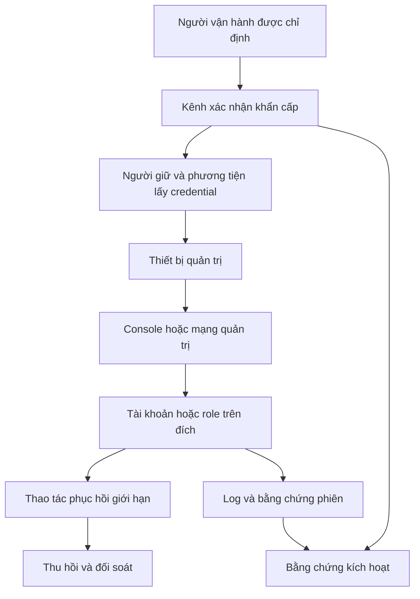

# Test break-glass

## 1. Mục tiêu của kiểm thử break-glass trong PAM

Break-glass là cơ chế truy cập đặc quyền khẩn cấp đã được thiết kế và phê duyệt trước, dùng khi đường truy cập thông thường không đáp ứng được tình huống sự cố. Ví dụ, hệ thống định danh đang gián đoạn nhưng đội vận hành vẫn cần khôi phục một dịch vụ quan trọng bằng một tài khoản khẩn cấp có phạm vi giới hạn.

Trong Privileged Access Management (PAM), kiểm thử break-glass phải trả lời đồng thời hai câu hỏi:

1. Người được giao trách nhiệm có lấy được đúng quyền cần thiết khi những phụ thuộc dự kiến đang hỏng hay không?
2. Tổ chức có kiểm soát được việc kích hoạt, sử dụng, theo dõi và thu hồi quyền đó hay không?

Chỉ đăng nhập thành công bằng tài khoản quản trị dự phòng chưa chứng minh cơ chế break-glass hoạt động đầy đủ. Một bài test cần đi hết vòng đời:

**Khai báo tình huống → xác nhận thẩm quyền → kích hoạt → thực hiện thao tác phục hồi → kết thúc truy cập → thay credential khi cần → xác minh trạng thái an toàn.**

Kết quả cần chứng minh khả năng phục hồi và khả năng kiểm soát. Đăng nhập được nhưng không biết ai dùng tài khoản, không giới hạn được đích truy cập hoặc không thu hồi được phiên vẫn là một thất bại kiểm soát.

Sau bài học, người học có thể:

- Xác định các giả định và phụ thuộc của một đường break-glass.
- Xây dựng test case cho cả trường hợp sử dụng hợp lệ và sử dụng sai.
- Thiết kế fault injection có giới hạn và điều kiện dừng rõ ràng.
- Đo thời gian phục hồi truy cập bằng những mốc có ý nghĩa.
- Kiểm tra bằng chứng, thu hồi credential, phiên và quyền tạm.
- Phân biệt lỗi sẵn sàng của đường khẩn cấp với lỗi bảo mật hoặc lỗi bằng chứng.

Các ví dụ trong bài là mô hình trung lập về sản phẩm. Tên tài khoản, hệ thống, thời hạn và ngưỡng đều là dữ liệu minh họa cho môi trường diễn tập.

## 2. Xác định chính xác cơ chế đang được kiểm thử

### 2.1. Tài khoản dự phòng chưa đủ để tạo thành break-glass

Một tài khoản khẩn cấp chỉ là một thành phần. Cơ chế hoàn chỉnh còn bao gồm:

- Điều kiện nào cho phép kích hoạt.
- Ai có quyền tuyên bố tình huống khẩn cấp.
- Ai giữ credential, token, khóa hoặc vật mang tin.
- Làm thế nào xác nhận người yêu cầu khi kênh định danh thường ngày không hoạt động.
- Quyền nào được cấp, trên hệ thống nào và trong khoảng thời gian nào.
- Cách nhận biết phiên do ai sử dụng, kể cả khi đích dùng tài khoản chung.
- Kênh thông báo và cách lưu bằng chứng khi một phần hệ thống giám sát bị gián đoạn.
- Cách kết thúc, thay credential, vô hiệu hóa quyền tạm và đối soát sau sự cố.

Bài test phải bám vào thiết kế đã được phê duyệt. Nếu tổ chức chưa định nghĩa cách truy cập khi IdP hỏng, người kiểm thử không tự tạo một cách bỏ qua xác thực rồi coi đó là break-glass.

### 2.2. Phân biệt các đường khẩn cấp

| Kiểu đường khẩn cấp | Ví dụ | Phụ thuộc phải kiểm tra | Điểm cần chứng minh |
|---|---|---|---|
| Qua PAM còn hoạt động | Checkout credential khẩn cấp với chính sách riêng | PAM, kho credential, mạng tới PAM, cơ chế xác nhận độc lập cần thiết | Không vô tình phụ thuộc vào thành phần đang giả lập hỏng |
| Credential lưu ngoại tuyến có kiểm soát | Vật mang tin được niêm phong và bàn giao theo quy trình | Người giữ, nơi lưu, khả năng giải mã, thiết bị đọc, quyền trên đích | Có thể tiếp cận và sử dụng đúng người, đồng thời bảo toàn truy vết |
| Tài khoản cục bộ trên đích | Tài khoản phục hồi trên một máy quản trị | Console hoặc mạng quản trị, credential cục bộ, chính sách đăng nhập | Đăng nhập được trong sự cố đã thiết kế và không có quyền ngoài phạm vi |
| Quyền khẩn cấp có thời hạn | Kích hoạt một role phục hồi đã chuẩn bị | Dịch vụ cấp quyền, nguồn danh tính, cơ chế thời hạn | Cấp và thu hồi đúng quyền, kể cả khi có phiên đang mở |

Không mặc định rằng một đường giải quyết được tất cả các sự cố. Đường chịu được lỗi IdP có thể vẫn phụ thuộc vào DNS, mạng quản trị, dịch vụ thời gian hoặc người giữ vật mang tin.

### 2.3. Phạm vi tình huống phải cụ thể

“Tất cả hệ thống đều hỏng” không phải mô tả test case có thể kiểm soát. Hãy chỉ rõ:

> Trong lab, IdP dành cho tài khoản quản trị không truy cập được từ máy vận hành. Mạng quản trị tới máy đích và console vẫn hoạt động. Đường break-glass được thiết kế không cần IdP đó. Hai người giữ credential khẩn cấp có thể liên lạc qua kênh diễn tập độc lập.

Mô tả này giúp phân biệt ba kết quả:

- Đường khẩn cấp hoạt động đúng thiết kế.
- Thiết kế có phụ thuộc ẩn.
- Bài test đã vượt ngoài điều kiện mà cơ chế được cam kết hỗ trợ.

Trường hợp thứ ba cần được báo như khoảng trống thiết kế hoặc thiếu phạm vi cam kết; không che giấu bằng việc thay đổi giả định giữa bài test.

## 3. Xây dựng mục tiêu kiểm soát và tiêu chí đạt

### 3.1. Mục tiêu tích cực và mục tiêu phủ định

Mục tiêu tích cực là những việc người có thẩm quyền phải làm được. Ví dụ: người trực có thể khôi phục một dịch vụ lab bằng đúng tài khoản khẩn cấp trong thời gian cho phép.

Mục tiêu phủ định là những việc phải bị chặn. Ví dụ: một người không có trong danh sách người giữ không thể tự lấy credential; tài khoản khẩn cấp của máy A không thể truy cập máy B; credential đã thay sau diễn tập không thể tạo phiên đăng nhập mới.

Cần ghi cả hai trong kế hoạch. Một cơ chế có tính sẵn sàng tốt nhưng cho phép bất kỳ người trực nào dùng quyền không giới hạn chưa đạt yêu cầu PAM.

### 3.2. Bộ tiêu chí mẫu

Giả sử tổ chức đặt các tiêu chí sau cho một diễn tập lab:

| Mã | Tiêu chí | Cách xác minh |
|---|---|---|
| BG-01 | Kích hoạt có mã sự cố hoặc mã diễn tập duy nhất | Đối chiếu yêu cầu, quyết định kích hoạt và phiên |
| BG-02 | Đúng người yêu cầu, đúng người xác nhận theo thiết kế | Kiểm tra danh tính và dấu vết xác nhận ở kênh độc lập |
| BG-03 | Credential không xuất hiện trong bằng chứng thông thường | Kiểm tra mẫu log, ảnh và gói evidence trước khi bàn giao |
| BG-04 | Có đường truy cập khi phụ thuộc được chỉ định bị hỏng | Thực hiện fault injection đã phê duyệt và kiểm tra end-to-end |
| BG-05 | Quyền chỉ đủ cho thao tác phục hồi đã định | Chạy thao tác cho phép và một phép thử phủ định an toàn |
| BG-06 | Có thể quy trách nhiệm phiên cho người thực hiện | Tương quan mã yêu cầu, người nhận credential, đích và session ID |
| BG-07 | Có bằng chứng tối thiểu ngay trong sự cố | Kiểm tra nguồn cục bộ hoặc kênh dự phòng theo thiết kế |
| BG-08 | Kết thúc quyền khẩn cấp được xác minh trên đích | Kiểm tra phiên, token, membership và credential liên quan |
| BG-09 | Đường truy cập thông thường được kiểm tra trước khi đóng diễn tập | Thử truy cập và thao tác cần thiết bằng đường thông thường |
| BG-10 | Không còn thay đổi tồn dư chưa được quản lý | Đối chiếu cấu hình và danh sách ngoại lệ sau test |

Các mã này chỉ là cách đặt tên trong bài, không đại diện cho một tiêu chuẩn bắt buộc.

Nếu đặt ngưỡng “10 phút để có truy cập hợp lệ”, cần giải thích đó là mục tiêu riêng của tổ chức. Phải ghi rõ thời điểm bắt đầu, thời điểm kết thúc, điều kiện diễn tập và phần thời gian nào được tính.

### 3.3. Không gộp mọi kết quả vào một chữ PASS

Một bài test có thể có kết quả:

- **Khả dụng:** đăng nhập và phục hồi thành công.
- **Phạm vi quyền:** đạt, không truy cập được tài nguyên ngoài phạm vi.
- **Truy vết:** không đạt do không liên kết được session với người nhận credential.
- **Thu hồi:** không đạt do phiên cũ vẫn còn đặc quyền sau khi khóa tài khoản.

Kết quả tổng không được ghi PASS nếu một tiêu chí bắt buộc thất bại. Việc chấp nhận một rủi ro còn tồn tại cần đúng người có thẩm quyền quyết định, có phạm vi và hạn xử lý; người chạy test không tự thay tiêu chí để làm báo cáo đạt.

## 4. Chuẩn bị môi trường và vai trò diễn tập

### 4.1. Ưu tiên môi trường đại diện có thể phục hồi

Bắt đầu bằng lab hoặc môi trường thử nghiệm mô phỏng đủ các phụ thuộc quan trọng:

- Một máy đích chứa dịch vụ giả lập.
- Một tài khoản vận hành thông thường.
- Một tài khoản hoặc role khẩn cấp có phạm vi xác định.
- Một đường truy cập thường ngày và một đường khẩn cấp.
- Kênh thu log, đồng hồ và vị trí lưu evidence.
- Cấu hình lỗi có thể bật và khôi phục theo kế hoạch.

Lab cần đủ giống thiết kế thật ở các điểm ảnh hưởng tới kết luận. Ví dụ, nếu đường khẩn cấp thật dùng console riêng thì chỉ kiểm thử SSH trong lab sẽ không chứng minh được khả năng tiếp cận console đó.

Thử nghiệm trên production, nếu cần, phải có phạm vi, cửa sổ thay đổi, chủ hệ thống, điều kiện dừng và phương án khôi phục riêng đã được phê duyệt. Không suy rộng quyền diễn tập lab thành quyền làm gián đoạn IdP, PAM hoặc mạng dùng chung.

### 4.2. Phân vai rõ trách nhiệm

| Vai trò | Trách nhiệm trong bài test |
|---|---|
| Người điều phối | Giữ kịch bản, phát tín hiệu bắt đầu, theo dõi điều kiện dừng |
| Người yêu cầu truy cập | Trình bày tình huống, xác nhận phạm vi và thực hiện thao tác phục hồi |
| Người xác nhận hoặc người giữ thứ hai | Kiểm tra thẩm quyền theo cơ chế đã thiết kế |
| Chủ hệ thống đích | Xác nhận thao tác được phép và trạng thái dịch vụ |
| Người quan sát | Ghi thời điểm, phát hiện sai lệch và bảo vệ tính độc lập của kết quả |
| Người quản lý evidence | Thu thập, phân quyền, kiểm tra tính toàn vẹn và lưu hồ sơ |
| Người khôi phục cấu hình | Gỡ fault injection và đối chiếu cấu hình sau test |

Một người có thể kiêm vai trò khi chính sách cho phép, nhưng phải ghi rõ. Nếu tiêu chí yêu cầu hai người độc lập, việc cùng một người điều khiển hai tài khoản không chứng minh được tiêu chí đó.

### 4.3. Kiểm tra trước diễn tập

Trước thời điểm bắt đầu, xác nhận:

1. Phạm vi tài sản và hành động phục hồi đã được chốt.
2. Tài khoản khẩn cấp tồn tại, có chủ sở hữu và không dùng làm tài khoản tự động thường ngày.
3. Mọi credential, khóa hoặc token trong diễn tập là loại được phép sử dụng.
4. Đường liên lạc dự phòng có thể dùng khi kênh chính mất.
5. Fault injection chỉ tác động tới phạm vi được duyệt.
6. Có người và phương tiện đủ quyền để gỡ fault injection.
7. Có cách nhận biết diễn tập và sự cố thật.
8. Điều kiện dừng cùng người quyết định đã được phổ biến.

Việc chuẩn bị không nên làm mất mục tiêu kiểm thử. Nếu muốn đo khả năng tìm đúng runbook trong điều kiện khẩn cấp, không gửi sẵn toàn bộ đường dẫn và credential cho người trực ngay trước lúc bấm giờ rồi coi đó là kết quả đại diện.

## 5. Lập bản đồ phụ thuộc của đường break-glass

Một bản đồ nhỏ giúp tìm vòng phụ thuộc:



Với từng cạnh, ghi lại thành phần thật và điều kiện lỗi được hỗ trợ. Những câu hỏi có ích gồm:

- Muốn lấy mật khẩu ngoại tuyến có cần đăng nhập vào chính IdP đang hỏng không?
- File giải mã có nằm trong cùng kho đang không truy cập được không?
- Người giữ token có cần VPN phụ thuộc vào cơ chế xác thực đã mất không?
- Hệ thống đích có chấp nhận tài khoản khẩn cấp khi kết nối directory bị gián đoạn không?
- Máy quản trị có cần DNS hoặc chứng thư mà môi trường lỗi không cung cấp được không?
- Runbook có đọc được khi cổng tài liệu nội bộ mất không?
- Kênh gọi người xác nhận có nằm trong cùng miền sự cố không?
- Có thể thu hồi phiên từ một đường quản trị độc lập hay chỉ từ PAM đang lỗi?

Ví dụ về một vòng phụ thuộc:

> Runbook yêu cầu lấy khóa giải mã từ vault. Vault yêu cầu SSO. SSO chính là thành phần đang được giả lập mất. Credential khẩn cấp tồn tại nhưng không thể dùng trong tình huống này.

Bài test nên đánh dấu lỗi thiết kế đó tại bước lấy credential. Không tự chép khóa ra một nơi khác để tiếp tục mà bỏ qua sai lệch.

Với cơ chế lưu ngoại tuyến, kiểm tra cả tính tiếp cận và tính bảo mật: nơi lưu vật mang tin, nơi lưu khóa giải mã, người giữ, tình trạng niêm phong, tính đọc được và quy trình bàn giao. Không chụp nội dung credential vào evidence để chứng minh đã mở thành công.

## 6. Ma trận tình huống kiểm thử

Mỗi tình huống phải ghi rõ thành phần hỏng, thành phần còn hoạt động và kết quả mong đợi. Chỉ chạy những tình huống phù hợp với thiết kế đã phê duyệt.

| Tình huống | Thực hiện trong phạm vi lab | Kết quả mong đợi |
|---|---|---|
| Kích hoạt hợp lệ khi hệ thống bình thường | Thực hiện diễn tập có mã test | Đúng thẩm quyền, phạm vi và evidence; không dùng quyền khẩn cấp như lối đi tắt |
| IdP quản trị gián đoạn | Chặn phụ thuộc lab theo kế hoạch | Đường được thiết kế chịu lỗi IdP vẫn dùng được |
| PAM hoặc vault gián đoạn | Làm mất truy cập tới thành phần lab đã chọn | Dùng được đường độc lập nếu thiết kế có cam kết; ghi rõ nếu ngoài phạm vi |
| SIEM mất kết nối | Ngắt luồng lab tới nơi thu tập trung | Lưu được bằng chứng tối thiểu theo thiết kế và đối soát khi khôi phục |
| Một người giữ không sẵn sàng | Dùng danh sách thay thế và kênh liên hệ được duyệt | Đúng quy trình thay thế; không tự bỏ điều kiện hai người nếu bắt buộc |
| Người không có thẩm quyền yêu cầu | Gửi yêu cầu giả lập bằng danh tính test | Bị từ chối; có dấu vết và cảnh báo theo chính sách |
| Credential sai hoặc vật mang tin không dùng được | Dùng dữ liệu test lỗi đã chuẩn bị | Nhận biết lỗi, chuyển đúng nhánh xử lý, không thử lặp gây lockout |
| Tài khoản bị khóa hoặc bị vô hiệu hóa | Dùng tài khoản lab ở trạng thái đã định | Phát hiện rõ và xử lý theo cơ chế khôi phục được duyệt |
| Truy cập ngoài phạm vi | Thử một hành động vô hại trên đích không được cấp | Bị chặn và có bằng chứng phù hợp |
| Hết thời gian cho phép khi phiên còn mở | Giữ phiên lab tới mốc kết thúc | Xác minh cách thu hồi thực tế, không chỉ đọc thời hạn trên cấu hình |
| Credential bị thay sau sử dụng | Thử đăng nhập mới một lần bằng credential cũ trong lab | Bị từ chối; credential mới được bảo quản và xác minh |
| Dịch vụ thường ngày hoạt động trở lại | Khôi phục phụ thuộc và thực hiện failback | Đường thường hoạt động, đường khẩn cấp được đóng đúng trạng thái |

Mất SIEM không mặc định cho phép bỏ mọi giám sát. Nếu chính sách yêu cầu phải có recorder hoạt động để cấp quyền, kết quả mong đợi khi recorder hỏng có thể là từ chối hoặc chuyển sang một đường khác đã được phê duyệt. Nếu thiết kế cho phép bằng chứng cục bộ tạm thời, phải có yêu cầu bảo vệ, dung lượng và thời hạn đồng bộ cụ thể.

Các lỗi kết hợp nên được bổ sung dựa trên rủi ro. Ví dụ, mất IdP và mất kênh chat nội bộ có thể là một miền lỗi thực tế; mất đồng thời tất cả console, người giữ và mạng lại cần một bài toán phục hồi khác.

## 7. Test case chi tiết: IdP không truy cập được

### 7.1. Bối cảnh

Doanh nghiệp có máy lab `pam-lab-db-01` chạy một dịch vụ mẫu. Đường quản trị thường ngày sử dụng SSO qua IdP lab. Đường khẩn cấp dùng tài khoản cục bộ `bg-lab-recovery`, được truy cập qua console quản trị lab và chỉ có những quyền phục hồi đã xác định.

Credential của tài khoản khẩn cấp được lưu bằng cơ chế ngoại tuyến được duyệt, có hai người tham gia lấy và bàn giao. Cách xác nhận người yêu cầu sử dụng kênh diễn tập độc lập với IdP lab. Đây là giả định của ví dụ, không phải cấu hình áp dụng mặc định cho mọi PAM.

Mục tiêu thao tác chỉ là khởi động lại dịch vụ mẫu đang dừng và kiểm tra endpoint lab. Không thay đổi dữ liệu, không tạo tài khoản bổ sung và không cấp quyền trên hệ thống khác.

### 7.2. Điều kiện đầu vào

- Có mã diễn tập `EX-BG-008` và mã test case `BG-IDP-01`.
- Máy đích và console lab đang hoạt động.
- Người chạy test dùng thiết bị quản trị được chỉ định.
- Dịch vụ mẫu có trạng thái ban đầu và cách hoàn nguyên rõ ràng.
- Người xác nhận, người giữ và người quan sát đã được phân công.
- Ngưỡng thời gian, danh sách thao tác và evidence bắt buộc đã được duyệt.
- Đã kiểm tra cách gỡ lỗi kết nối IdP lab bằng một đường không phụ thuộc vào IdP đó.
- Không có sự cố thật cần dùng chung tài khoản hoặc nguồn lực diễn tập.

### 7.3. Các bước và điểm kiểm soát

| Bước | Hành động | Quan sát cần có |
|---|---|---|
| 1 | Ghi trạng thái ban đầu và bắt đầu bài test | Thời điểm, người điều phối, tình trạng dịch vụ và phiên hiện hữu |
| 2 | Bật fault injection dành cho IdP lab | Chỉ đúng phạm vi, có dấu vết thay đổi và cách gỡ |
| 3 | Xác minh đường thông thường không đáp ứng đúng lỗi dự kiến | Không nhầm lỗi mạng tới đích với lỗi IdP |
| 4 | Người trực khai báo nhu cầu khẩn cấp | Mã test, tài sản, thao tác, thời hạn và lý do |
| 5 | Xác nhận thẩm quyền bằng cơ chế dự phòng | Người yêu cầu và người xác nhận được nhận diện độc lập theo thiết kế |
| 6 | Lấy và bàn giao credential | Có dấu vết custody, không ghi giá trị credential |
| 7 | Mở phiên console tới đúng máy đích | Danh tính vận hành, tài khoản đích, session ID và thời điểm |
| 8 | Thực hiện thao tác phục hồi đã cho phép | Dịch vụ mẫu hoạt động và có phép kiểm tra sức khỏe độc lập |
| 9 | Thực hiện phép thử phủ định an toàn | Không có quyền trên tài nguyên ngoài phạm vi |
| 10 | Khôi phục IdP lab và kiểm tra đường thông thường | Đường thường thực hiện được thao tác quản trị cần thiết |
| 11 | Kết thúc truy cập khẩn cấp và xử lý credential | Phiên, token, quyền tạm, credential được xử lý đúng thiết kế |
| 12 | Đối soát và đóng bài test | Evidence đầy đủ, thay đổi tồn dư được giải quyết hoặc lập ngoại lệ hợp lệ |

Ở bước 3, chỉ thực hiện số lần thử tối thiểu cần thiết để chứng minh lỗi. Không dùng vòng lặp đăng nhập thất bại có thể khóa tài khoản hoặc làm sai kết quả.

Ở bước 9, chọn một tài nguyên test vô hại đã được chủ hệ thống cho phép. Không dùng thao tác phá hủy, đọc dữ liệu nhạy cảm hoặc truy cập một hệ thống thật ngoài phạm vi để “thử quyền”.

### 7.4. Tiêu chí dừng

Dừng diễn tập và chuyển sang quy trình khôi phục khi:

- Fault injection ảnh hưởng tài sản ngoài danh sách được duyệt.
- Không còn khả năng khôi phục bằng đường quản trị đã chuẩn bị.
- Có dấu hiệu credential test bị lộ cho người không có thẩm quyền.
- Không thể xác nhận người đang nhận hoặc sử dụng quyền.
- Một thao tác dự định vượt quá phạm vi phê duyệt.
- Xuất hiện sự cố thật khiến diễn tập cạnh tranh nguồn lực phục hồi.
- Bằng chứng hoặc trạng thái quan trọng không còn đáng tin để tiếp tục đánh giá.

Sau khi dừng, vẫn phải thu hồi quyền đã cấp và hoàn nguyên thay đổi trong khả năng an toàn. “Dừng test” không đồng nghĩa bỏ mặc phiên đang mở hoặc bỏ fault injection tại chỗ.

## 8. Kiểm thử quyền, thời hạn và phiên đang tồn tại

### 8.1. Kiểm tra quyền hiệu lực trên đích

Không chỉ đọc role trong PAM. Cần xác minh tài khoản hoặc session thực sự có quyền gì tại hệ thống đích.

Một cấu hình có thể ghi quyền hạn chế nhưng tài khoản lại là thành viên của một nhóm đặc quyền khác. Ngược lại, quyền trong PAM có thể đúng nhưng chính sách cục bộ làm tài khoản không thực hiện được thao tác phục hồi.

Bộ kiểm tra nên gồm:

- Thao tác phục hồi được phép hoàn thành.
- Một thao tác ngoài phạm vi bị từ chối.
- Không tạo ra quyền tồn tại lâu dài ngoài thiết kế.
- Không thêm tài khoản hoặc khóa mới ngoài kế hoạch.
- Không tự động mở rộng quyền khi hệ thống kiểm tra chính sách lỗi.

Nếu đích buộc phải cấp quyền rất rộng để phục hồi, hãy ghi nhận giới hạn đó và kiểm tra các kiểm soát bù đã phê duyệt, như phạm vi máy đích, console riêng, hai người tham gia, thời gian, quan sát và đối soát. Không gọi quyền rộng là “least privilege” chỉ vì đó là tài khoản khẩn cấp.

### 8.2. Phân biệt các loại thời hạn

Một bài test có thể gặp nhiều mốc hết hạn khác nhau:

- Hạn cho phép kích hoạt hoặc checkout.
- Hạn của role hoặc membership tạm.
- Hạn credential, certificate hoặc token.
- Thời lượng tối đa của phiên.
- Thời hạn để lưu và gửi bù bằng chứng.

Các mốc này không thay thế cho nhau. Credential hết hạn có thể chặn xác thực mới nhưng không nhất thiết kết thúc phiên đã mở. Xóa membership cũng không đảm bảo mọi session đã cập nhật quyền ngay. Đổi mật khẩu không tự chứng minh rằng mọi token hoặc kết nối hiện hữu đã mất hiệu lực.

Vì vậy cần test riêng:

1. Sau thời hạn, yêu cầu tạo một phiên mới có bị từ chối không?
2. Phiên đang mở có còn thực hiện được thao tác đặc quyền không?
3. Có cơ chế chấm dứt phiên hoặc thu hồi quyền hiệu lực phù hợp với đích không?
4. Nếu thu hồi chưa thành công, hệ thống có phát hiện và chuyển xử lý không?

Tiêu chí đạt phải dựa trên hành vi quan sát được và khả năng thực tế của từng nền tảng.

### 8.3. Tình huống mất kết nối khi thu hồi

Nếu controller PAM gửi lệnh thu hồi nhưng hệ thống đích không phản hồi, không được chỉ dựa vào thông báo “request accepted” để kết luận đã thu hồi.

Kết quả test phải phân biệt:

- Đã gửi yêu cầu thu hồi.
- Đã nhận xác nhận từ thành phần trung gian.
- Đã xác minh trên đích rằng quyền hoặc phiên không còn hiệu lực.

Nếu đích chưa thể kiểm tra, trạng thái phù hợp là chưa xác minh hoặc đang xử lý, kèm chủ trách nhiệm và biện pháp kiểm soát theo kế hoạch. Không ghi PASS dựa trên ý định thu hồi.

## 9. Bằng chứng và khả năng quy trách nhiệm

### 9.1. Gói evidence tối thiểu

Một bộ evidence cho bài test có thể gồm:

| Nhóm | Nội dung cần giữ |
|---|---|
| Phê duyệt | Mã test, phạm vi, phiên bản runbook và người có thẩm quyền |
| Trạng thái ban đầu | Tài sản, phụ thuộc, tài khoản và phiên trước diễn tập |
| Fault injection | Loại lỗi, phạm vi, thời điểm bật và thời điểm gỡ |
| Kích hoạt | Người yêu cầu, người xác nhận, lý do, thời hạn |
| Custody | Ai lấy và bàn giao phương tiện truy cập, thời điểm, mã niêm phong nếu có |
| Sử dụng | Đích, tài khoản, session ID, hành động và kết quả phục hồi |
| Phủ định | Yêu cầu sai hoặc thao tác ngoài quyền cùng kết quả từ chối |
| Kết thúc | Đóng phiên, thu hồi quyền, thay credential và xác minh trên đích |
| Đối soát | Thiếu hụt, sai lệch thời gian, ngoại lệ, người xử lý và trạng thái |

Không đưa mật khẩu, seed MFA, mã phục hồi hoặc khóa riêng vào gói evidence thông thường. Nếu ảnh hoặc log vô tình chứa secret, áp dụng xử lý lộ credential và bảo vệ bằng chứng theo quy trình; không chỉ che ảnh rồi cho rằng credential gốc vẫn an toàn.

### 9.2. Liên kết người thật với tài khoản đích dùng chung

Tài khoản khẩn cấp trên đích có thể không mang tên người dùng. Khi đó, log “bg-lab-recovery đăng nhập” không đủ để biết ai đang điều khiển.

Cần một chuỗi tương quan, chẳng hạn:

> Người trực A → yêu cầu EX-BG-008 → xác nhận của B → biên bản bàn giao CUST-017 → phiên console S-204 → tài khoản bg-lab-recovery → hành động phục hồi.

Nếu credential có thể được dùng đồng thời bởi nhiều người ngoài luồng kiểm soát, khả năng quy trách nhiệm suy giảm. Bài test phải nhận diện vấn đề đó và kiểm tra chính sách cho phép sử dụng đồng thời, phương thức quan sát và quy trình thay credential sau sử dụng.

### 9.3. Khi hệ thống thu log tập trung không hoạt động

Nếu thiết kế cho phép vận hành có giới hạn khi mất nơi thu log, hãy thử các điểm sau trong lab:

- Nguồn log cục bộ thực sự được ghi và có đủ dung lượng.
- Người dùng khẩn cấp không thể âm thầm sửa hoặc xóa toàn bộ bằng chứng theo mức bảo vệ đã thiết kế.
- Có nơi lưu bổ sung độc lập hoặc người quan sát khi được yêu cầu.
- Luồng gửi bù sau khôi phục bảo toàn thứ tự và mã tương quan trong khả năng thiết kế.
- Người đối soát nhận biết được khoảng thời gian thiếu evidence.
- Hết giới hạn lưu tạm được phát hiện và xử lý theo chính sách.

Không chủ động xóa log thật để kiểm tra khả năng phát hiện trong một bài test không có quyền đó. Có thể dùng dữ liệu và nguồn log giả lập riêng để tạo tình huống mất bản ghi.

Một checksum giúp phát hiện thay đổi so với bản đã ghi nhận, nhưng bản thân checksum không chứng minh nội dung log là đúng, đầy đủ hoặc được tạo bởi nguồn đáng tin. Cần bảo vệ nguồn, quyền truy cập, mốc thu nhận và chuỗi bàn giao bằng chứng.

### 9.4. Xử lý thời gian và độ lệch đồng hồ

Ghi rõ múi giờ hoặc dùng timestamp UTC nhất quán trong evidence. Kiểm tra độ lệch giữa máy vận hành, đích, console và nơi thu log.

Nếu các nguồn lệch nhau, lưu độ lệch quan sát và phương pháp tương quan. Không tự sửa timestamp gốc để tạo một timeline trông đẹp hơn.

Khi diễn tập mất dịch vụ thời gian, tiêu chí phải chỉ rõ cách xác định thứ tự sự kiện và độ tin cậy của phép đo. Nếu không thể đo chính xác, báo giới hạn đó thay vì đưa ra số giây có vẻ chắc chắn.

## 10. Đo thời gian phục hồi truy cập

### 10.1. Đặt tên mốc trước khi chạy

Ví dụ:

- `t0`: người trực bắt đầu khai báo tình huống cần break-glass.
- `t1`: thẩm quyền được xác nhận.
- `t2`: credential hoặc quyền khẩn cấp sẵn sàng sử dụng.
- `t3`: phiên đặc quyền hợp lệ được mở tới đúng đích.
- `t4`: thao tác phục hồi hoàn thành và được kiểm tra.
- `t5`: đường thường đã được xác minh hoạt động.
- `t6`: hoàn thành thu hồi và xác minh trạng thái sau sử dụng.

Từ đó có thể tính:

```text
Thời gian xác nhận       = t1 - t0
Thời gian lấy quyền      = t2 - t1
Thời gian mở phiên       = t3 - t2
Thời gian có truy cập    = t3 - t0
Thời gian phục hồi mẫu   = t4 - t0
Thời gian đóng quyền     = t6 - t5
```

“Thời gian có truy cập” và “thời gian khôi phục dịch vụ” là hai phép đo khác nhau. Chúng cũng không tự đại diện cho RTO tổng của một dịch vụ nghiệp vụ, vì RTO còn phụ thuộc phạm vi và định nghĩa của kế hoạch liên tục kinh doanh.

### 10.2. Ví dụ timeline

| Mốc | Thời gian minh họa |
|---|---|
| t0 | 09:00:00 UTC |
| t1 | 09:02:10 UTC |
| t2 | 09:04:00 UTC |
| t3 | 09:05:20 UTC |
| t4 | 09:07:40 UTC |
| t5 | 09:12:00 UTC |
| t6 | 09:16:30 UTC |

Kết quả:

- Có truy cập hợp lệ sau 5 phút 20 giây.
- Hoàn thành phục hồi mẫu sau 7 phút 40 giây.
- Hoàn thành đóng quyền sau khi đường thường sẵn sàng: 4 phút 30 giây.

Nếu tổ chức đặt mục tiêu có truy cập trong 10 phút, chỉ số đầu đạt. Tuy vậy, toàn bài vẫn có thể thất bại nếu credential cũ còn tạo được phiên mới hoặc thiếu bằng chứng bàn giao.

Đừng chỉ báo giá trị trung bình của nhiều lượt test. Cần giữ các lượt thất bại, lượt dừng và điều kiện đặc biệt; một lần không tìm được người giữ vào ca đêm có thể quan trọng hơn nhiều lượt nhanh vào giờ hành chính.

## 11. Thu hồi, thay credential và failback

### 11.1. Kiểm tra đường thường trước khi đóng đường khẩn cấp

Đường SSO hiển thị màn hình đăng nhập không đủ để kết luận đã phục hồi. Người có thẩm quyền cần kiểm tra khả năng truy cập tới đúng đích và thực hiện một thao tác quản trị phù hợp.

Sau đó kết thúc đường khẩn cấp theo trình tự của runbook. Trong tình huống thật, quyết định giữ hay chấm dứt một phiên phục hồi còn tùy trạng thái sự cố và rủi ro; bài test phải bám vào quyết định đã phê duyệt, có theo dõi thời gian và chủ trách nhiệm.

### 11.2. Kiểm tra từng loại tồn dư

Danh sách đối soát sau sử dụng nên bao gồm:

1. Phiên console, SSH, RDP hoặc phiên quản trị ứng dụng liên quan.
2. Token, certificate, ticket hoặc quyền tạm được cấp.
3. Membership hoặc policy được thay để phục hồi.
4. Credential đã được tiết lộ cho người vận hành.
5. Credential dự phòng đang được lưu trong kho hoặc vật mang tin ngoại tuyến.
6. Bản sao tạm, clipboard hoặc file chứa secret trong thiết bị test.
7. Rule mạng, ngoại lệ giám sát và cấu hình fault injection.
8. Dữ liệu hoặc dịch vụ mẫu đã thay đổi trạng thái.

Không mặc định rằng thay mật khẩu xử lý được mọi mục trong danh sách.

### 11.3. Xác minh credential mới và credential cũ

Sau khi thay credential theo thiết kế:

- Xác minh credential mới đã được cập nhật đúng nơi lưu được quản lý.
- Xác minh khả năng dùng credential mới bằng một phép thử có kiểm soát.
- Thử đăng nhập mới bằng credential cũ một lần trong lab nếu kế hoạch yêu cầu và không gây lockout ngoài ý muốn.
- Kiểm tra các phiên cũ riêng biệt.
- Ghi nhận kết quả và cách niêm phong, bàn giao hoặc cập nhật phương tiện khẩn cấp cho lần sau.

Nếu thay credential thất bại ở đích nhưng kho đã cập nhật giá trị mới, đường break-glass có thể bị hỏng cho lần sử dụng tiếp theo. Test phải phát hiện trạng thái không đồng bộ này và chuyển xử lý; không đánh dấu hoàn tất chỉ vì tác vụ rotation đã được gọi.

Với cơ chế không dùng mật khẩu, áp dụng nguyên tắc tương đương cho khóa, certificate, token hoặc thiết bị. Xác minh việc vô hiệu hóa và khả năng sử dụng thực tế theo loại credential.

### 11.4. Kiểm thử khôi phục từ backup

Một bản khôi phục hệ thống có thể đưa credential, membership hoặc trạng thái tài khoản cũ quay lại. Trong một kịch bản lab riêng, kiểm tra:

- Bản khôi phục có đưa credential khẩn cấp đã thu hồi trở lại hay không.
- Kho credential và đích có còn đồng bộ.
- Quy trình sau restore có thay hoặc đối soát credential liên quan.
- Bản sao ngoại tuyến đang giữ có còn là bản hợp lệ.

Đây là một phụ thuộc giữa break-glass và backup/recovery. Không thực hiện restore production chỉ để bổ sung một kiểm tra chưa được phê duyệt.

## 12. Mẫu test case và mô hình trạng thái

### 12.1. Hồ sơ test case minh họa

Mẫu JSON dưới đây chỉ mô tả bài test. Nó không chứa secret và không phải cấu hình của một sản phẩm PAM cụ thể.

```json
{
  "testId": "BG-IDP-01",
  "exerciseId": "EX-BG-008",
  "environment": "isolated-lab",
  "target": "pam-lab-db-01",
  "scenario": "admin-idp-unreachable",
  "survivingDependencies": [
    "lab-management-console",
    "approved-offline-credential-custody",
    "independent-exercise-verification-channel"
  ],
  "allowedActions": [
    "restart-sample-service",
    "check-sample-health"
  ],
  "requiredChecks": [
    "activation-authorized",
    "credential-custody-recorded",
    "session-attributed",
    "out-of-scope-action-denied",
    "normal-access-restored",
    "emergency-session-closed",
    "old-credential-rejected-for-new-login",
    "post-test-state-reconciled"
  ],
  "timingTarget": {
    "metric": "authorized-session-opened-minus-request-started",
    "maximumSeconds": 600
  },
  "secretValuesIncluded": false
}
```

Từ hồ sơ này, người quan sát phải biết đo cái gì và phải thu evidence nào. Không dùng một trường “success=true” do người chạy test tự nhập để thay toàn bộ phép xác minh.

### 12.2. Mô hình trạng thái để tránh đóng test quá sớm

```text
READY
  → REQUESTED
  → AUTHORIZED
  → ACCESS_ACTIVE
  → RECOVERY_VERIFIED
  → NORMAL_ACCESS_VERIFIED
  → REVOCATION_PENDING
  → POST_STATE_VERIFIED
  → CLOSED
```

Một số nhánh lỗi:

```text
REQUESTED → DENIED
ACCESS_ACTIVE → TEST_STOPPED → REVOCATION_PENDING
REVOCATION_PENDING → REVOCATION_UNVERIFIED
POST_STATE_VERIFIED → EVIDENCE_INCOMPLETE
```

Mô hình này là công cụ ghi nhận test, không phải cách tự động cấp quyền thật. Nếu bằng chứng thiếu hoặc thu hồi chưa xác minh, không chuyển sang CLOSED với kết quả PASS.

Logic đánh giá minh họa:

```text
function evaluateTest(observations, criteria):
    if observations.scopeExceeded:
        return STOPPED

    if observations.revocationUnverified:
        return INCOMPLETE

    if observations.missingRequiredEvidence:
        return INCOMPLETE

    for criterion in criteria.required:
        if observations.resultOf(criterion) != PASS:
            return FAIL

    return PASS
```

Trong triển khai ghi nhận thực tế, cần bảo vệ tính toàn vẹn của observations và danh sách criteria đã chốt. Người chạy test không nên có thể sửa kết quả bắt buộc từ FAIL thành PASS mà không để lại dấu vết.

## 13. Các lỗi thường gặp khi test break-glass

| Lỗi | Vì sao kết luận không đáng tin | Cách thiết kế lại |
|---|---|---|
| Chỉ đăng nhập khi mọi phụ thuộc đều hoạt động | Không chứng minh khả năng chịu lỗi | Chạy kịch bản mất phụ thuộc phù hợp trong lab |
| Dùng IdP đang hỏng để xác nhận khẩn cấp | Có vòng phụ thuộc | Kiểm tra cơ chế xác nhận độc lập đã phê duyệt |
| Bỏ người xác nhận vì muốn test nhanh | Thay đổi kiểm soát đang cần kiểm thử | Đo thời gian quy trình thật hoặc ghi rõ bài kiểm tra kỹ thuật giới hạn |
| Dùng tài khoản quản trị toàn hệ thống cho mọi bài | Không chứng minh phạm vi quyền | Cấp quyền theo kịch bản và thêm phép thử phủ định |
| Gọi việc đổi mật khẩu là thu hồi toàn bộ | Phiên hoặc token cũ có thể còn hiệu lực | Kiểm tra phiên và quyền hiệu lực trên đích |
| Chụp secret vào biên bản | Tạo thêm nơi chứa credential ngoài quản lý | Chỉ lưu mã tham chiếu và kết quả xác minh |
| Coi thiếu log là bình thường trong khẩn cấp | Mất khả năng quy trách nhiệm | Kiểm tra kênh bằng chứng tối thiểu và giới hạn được duyệt |
| Không gỡ fault injection | Để lại cấu hình gây lỗi cho lần sau | Có danh sách hoàn nguyên và người xác minh độc lập |
| Bỏ qua lượt thất bại khi tính số liệu | Làm đẹp chỉ số và che lỗ hổng phục hồi | Báo mọi lượt cùng nguyên nhân và điều kiện |
| Kết thúc khi dịch vụ chạy lại | Bỏ sót quyền tồn dư và credential đã lộ cho người dùng | Đi hết thu hồi, đồng bộ kho và đối soát |
| Dùng secret test quá đơn giản | Không phản ánh thao tác lấy, nhập hoặc dùng credential thật | Dùng credential test có đặc tính đại diện, vẫn bảo vệ như secret |
| Áp dụng cùng một lịch test cho mọi tài sản | Không xét mức quan trọng và thay đổi phụ thuộc | Lập lịch theo rủi ro và bổ sung test sau thay đổi đáng kể |

Tần suất test cần do tổ chức xác định theo mức quan trọng, yêu cầu vận hành và chính sách áp dụng. Những thay đổi như IdP, phương thức MFA, topology mạng quản trị, người giữ, quy trình rotation hoặc console có thể làm kết quả cũ không còn đại diện.

## 14. Bài thực hành

### 14.1. Thiết kế bài test

Trong một lab có máy ứng dụng và dịch vụ mẫu, thiết kế một đường truy cập khẩn cấp cho tình huống IdP quản trị không truy cập được.

Nộp kế hoạch gồm:

- Phạm vi tài sản và thao tác phục hồi.
- Các phụ thuộc được giả lập hỏng và các phụ thuộc còn hoạt động.
- Vai trò người yêu cầu, người xác nhận, người giữ và người quan sát.
- Hai tiêu chí tích cực và ít nhất ba tiêu chí phủ định.
- Mốc đo thời gian và ngưỡng minh họa có giải thích.
- Điều kiện dừng và cách gỡ fault injection.
- Danh sách evidence không chứa secret.
- Các phép xác minh thu hồi, credential và trạng thái sau test.

Không cần dùng hệ thống PAM thật để hoàn thành phần thiết kế. Có thể mô phỏng quy trình bàn giao và cơ chế quyền trong môi trường cô lập, nhưng phải ghi rõ những phần mới chỉ được mô phỏng.

### 14.2. Phân tích một kết quả chưa đạt

Một nhóm báo cáo:

> Đã mở phiên khẩn cấp sau 4 phút. Dịch vụ lab hoạt động trở lại. Mật khẩu đã đổi. Phiên console cũ chưa đóng vì người chạy test cho rằng đổi mật khẩu đã đủ. SIEM không nhận log, không có bản ghi dự phòng về người lấy credential.

Hãy kết luận theo từng mục tiêu:

- Khả năng có truy cập: đã có bằng chứng tích cực, cần đối chiếu mốc đo.
- Khôi phục dịch vụ: cần evidence kiểm tra sức khỏe, không chỉ lời xác nhận.
- Thu hồi: chưa đạt hoặc chưa xác minh vì phiên cũ chưa được kiểm tra và xử lý.
- Quy trách nhiệm: không đủ evidence về việc nhận credential.
- Kết quả tổng: không thể PASS theo bộ tiêu chí yêu cầu thu hồi và truy vết.

Hành động tiếp theo là xử lý phiên còn mở, bảo đảm credential và đường khẩn cấp được quản lý đúng trạng thái, bảo toàn evidence hiện có, ghi thiếu hụt, sửa quy trình rồi kiểm thử lại phần thất bại. Không sửa timestamp hoặc bổ sung biên bản như thể đã được ghi tại thời điểm diễn tập.

### 14.3. Câu hỏi tự kiểm tra

1. Đường break-glass của bạn có cần cùng IdP với đường thường không?
2. Nếu người giữ chính không liên lạc được, nhánh thay thế nào đã được phê duyệt?
3. Vì sao role hết hạn và phiên kết thúc là hai việc phải xác minh riêng?
4. Khi PAM báo đã gửi lệnh thu hồi nhưng đích chưa phản hồi, nên ghi trạng thái gì?
5. Làm thế nào liên kết người vận hành với một tài khoản khẩn cấp dùng chung?
6. Khi SIEM gián đoạn, evidence tối thiểu còn đến từ đâu?
7. Sau rotation, phép thử nào chứng minh kho và đích không bị lệch credential?
8. Restore từ backup có thể làm credential đã thu hồi xuất hiện lại như thế nào?
9. Phép đo thời gian có truy cập bắt đầu và kết thúc ở đâu?
10. Điều gì phải hoàn tất trước khi đóng bài test?

## 15. Các điểm cần ghi nhớ

Test break-glass kiểm tra trọn vòng đời truy cập đặc quyền khẩn cấp, từ thẩm quyền kích hoạt tới trạng thái sau sử dụng. Khả năng đăng nhập chỉ là một điểm trong vòng đời đó.

Một bài test có giá trị cần kịch bản lỗi cụ thể, môi trường đại diện, phạm vi quyền rõ ràng, phép thử phủ định, evidence có thể tương quan và cách đo thời gian đã chốt. Phần kết thúc phải xác minh credential, phiên, token, quyền tạm và cấu hình tồn dư theo hành vi thật trên đích.

Đường khẩn cấp chỉ sẵn sàng cho lần sử dụng tiếp theo khi việc phục hồi dịch vụ và việc khôi phục kiểm soát truy cập đều đã được kiểm tra.

