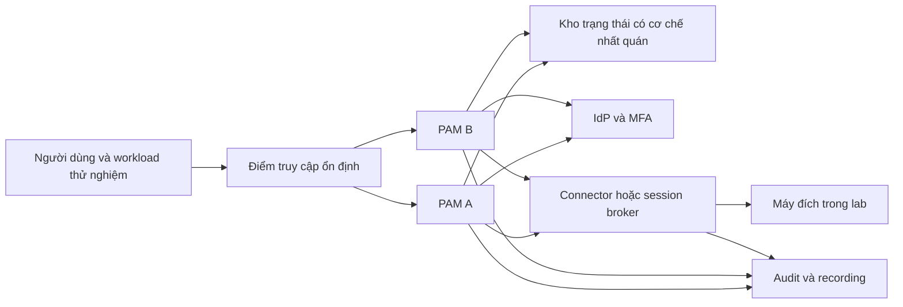

# Test failover

## 1. Failover của PAM phải bảo vệ cả khả năng truy cập và ranh giới đặc quyền

Một cụm Privileged Access Management (PAM) vẫn trả về trang đăng nhập sau khi node chính hỏng chưa đủ để kết luận failover thành công. Người quản trị có thể đăng nhập vào giao diện nhưng không mở được phiên đến máy đích; connector có thể tiếp tục dùng credential cũ; node dự phòng có thể đọc một phê duyệt đã hết hạn; bản ghi phiên có thể bị ngắt mà không ai phát hiện. Kiểm thử failover phải quan sát toàn bộ đường đi của một thao tác đặc quyền.

Trong bài này, **test failover** là thử nghiệm có kiểm soát để xác minh việc chuyển phục vụ từ thành phần đang hoạt động sang thành phần thay thế khi có lỗi, đồng thời kiểm tra các trạng thái bảo mật liên quan. Phạm vi gồm người quản trị, tài khoản dịch vụ, vault, JIT/JEA, luân chuyển credential, session broker và bằng chứng kiểm toán. Cách triển khai cụ thể phụ thuộc sản phẩm và kiến trúc; bài học dùng một mô hình lab trung lập, không giả định mọi PAM đều có cùng cơ chế chuyển đổi.

Một kết quả đạt yêu cầu cần trả lời được bốn câu hỏi:

1. Người dùng hợp lệ phục hồi được đúng thao tác đã cam kết trong bao lâu?
2. Quyền bị từ chối, hết hạn hoặc thu hồi có tiếp tục bị chặn không?
3. Credential, phiên và thao tác đang xử lý được giải quyết nhất quán như thế nào?
4. Có đủ bằng chứng để giải thích từng quyết định trước, trong và sau sự cố không?

Failover là một thuộc tính của hệ thống đang vận hành, không chỉ của hai máy chủ PAM. Load balancer, DNS, cơ sở dữ liệu, identity provider (IdP), MFA, kho khóa mã hóa, connector, storage và hệ thống log đều có thể quyết định kết quả.

### Mục tiêu học tập

Sau bài học, người học có thể lập một kế hoạch test failover có tiêu chí rõ ràng; tách kiểm tra tính sẵn sàng khỏi kiểm tra an toàn; thiết kế lỗi cho control plane và đường phiên truy cập; đo các mốc phục hồi từ bên ngoài hệ thống; đối soát trạng thái credential và audit; quyết định khi nào được failback và khi nào phải dừng thử nghiệm.

## 2. Phân biệt đúng các loại thử nghiệm

| Hoạt động | Mục đích chính | Điều cần chứng minh |
|---|---|---|
| Kiểm tra health check | Phát hiện tiến trình hoặc endpoint có phản hồi | Tín hiệu health phản ánh đúng khả năng phục vụ đã định nghĩa |
| Test failover | Chuyển phục vụ khi một thành phần lỗi | Đường truy cập thực phục hồi và các ràng buộc bảo mật còn đúng |
| Test failback | Chuyển về topology mong muốn sau phục hồi | Node quay lại đã đồng bộ, không chiếm quyền ghi sai và không làm sống lại trạng thái cũ |
| Test khôi phục backup | Dựng lại dữ liệu hoặc cấu hình từ bản sao | Bản sao dùng được, giải mã được và phục hồi đúng phạm vi |
| Test DR | Khôi phục sau mất một miền sự cố lớn | Hạ tầng, dữ liệu, khóa, kết nối và quy trình đáp ứng mục tiêu phục hồi |

Một lần failover trong cùng site không chứng minh khôi phục sau mất toàn bộ site. Một bản backup khôi phục được không chứng minh cụm đang chạy tránh được split-brain. Hai nhóm kiểm thử có thể dùng chung dữ liệu và bằng chứng, nhưng có điều kiện hoàn thành khác nhau.

Phân biệt thêm **chuyển đổi có kế hoạch** với **failover đột ngột**. Khi bảo trì có kế hoạch, hệ thống có thể drain phiên và đợi đồng bộ hoàn tất. Khi tiến trình bị mất đột ngột, các bước chuẩn bị đó không tồn tại. Nếu chỉ thử chuyển đổi bằng nút bảo trì, báo cáo cần ghi đúng phạm vi đã thử; không gọi đó là bằng chứng cho mọi kiểu lỗi.

## 3. Xác định hệ thống và các bất biến cần giữ

### 3.1. Mô hình lab tham chiếu

Giả sử lab có hai node ứng dụng PAM là `pam-a` và `pam-b`, một cơ chế lưu trạng thái dùng chung hoặc được sao chép theo kiến trúc sản phẩm, hai đường connector và một session broker. Các thành phần này không nhất thiết cùng chuyển vai trò ở một thời điểm.



Sơ đồ mô tả các quan hệ phụ thuộc, không phải hướng dẫn dựng một cụm chỉ có hai thành viên biểu quyết. Kiến trúc quorum, witness, leader election và fencing phải theo thiết kế được hỗ trợ. Không suy ra rằng hai node ứng dụng tự đủ điều kiện quyết định leader khi mất liên lạc với nhau.

Trước khi thử, đánh dấu rõ miền sự cố: cùng host vật lý, cùng rack, cùng nguồn điện, cùng network zone hoặc cùng site. Hai node ảo trên một host không tạo ra khả năng chịu lỗi host. Hai connector cùng đi qua một firewall cũng chia sẻ một điểm lỗi quan trọng.

### 3.2. Bất biến bảo mật

Bất biến là điều phải luôn đúng, kể cả lúc hệ thống đang chuyển đổi. Chọn bất biến cụ thể và quan sát được:

- Không tạo quyền quản trị thường trực để bù cho thời gian chuyển đổi.
- Một JIT grant không được kéo dài thời hạn chỉ vì node mới nhận phục vụ.
- Phê duyệt cho một tài khoản hoặc một máy đích không được áp dụng sang đối tượng khác.
- JEA hoặc bộ lệnh được phép không tự mở rộng trên node dự phòng.
- Credential không xuất hiện trong log, báo cáo, trace hoặc ảnh chụp màn hình.
- Tại một thời điểm, chỉ có chủ thể được thiết kế cho phép thay đổi trạng thái cần một writer duy nhất, chẳng hạn một rotation job cho cùng tài khoản.
- Mọi truy cập đặc quyền được chấp nhận phải tạo bằng chứng theo chính sách audit đã chọn.
- Node cũ không được tiếp tục ghi khi đã mất quyền làm writer.

Không đồng nhất mọi bất biến với yêu cầu ngắt toàn bộ phiên. Với phiên đang chạy, chính sách có thể yêu cầu kết thúc khi mất recording, hoặc cho phép tiếp tục với recording cục bộ bền vững trong một khoảng giới hạn. Điều quan trọng là hành vi được phê duyệt trước, có giới hạn rõ ràng và được chứng minh bằng test.

### 3.3. Những trạng thái phải kiểm kê

Lập danh sách trạng thái có thể đang tồn tại khi lỗi xảy ra: yêu cầu chờ phê duyệt, phê duyệt đã cấp, JIT grant còn hiệu lực, grant hết hạn, token đã thu hồi, lease của workload, credential đang checkout, rotation job, phiên đang hoạt động, recording chưa chuyển hết và hàng đợi audit chưa được xác nhận lưu bền vững.

Mỗi trạng thái cần có một nguồn chuẩn và một quy tắc giải quyết. Ví dụ, thời hạn grant lấy từ dữ liệu cấp quyền gốc, không lấy từ thời điểm node dự phòng khởi động; trạng thái rotation không chỉ dựa vào thông báo thành công của một worker mà còn phải đối chiếu khả năng xác thực thực tế tại máy đích.

## 4. Biến yêu cầu phục hồi thành tiêu chí đo được

### 4.1. Đo từ hành vi thực, không chỉ từ dashboard

Định nghĩa một giao dịch đặc quyền đại diện, chẳng hạn:

> Tài khoản thử nghiệm đã qua xác thực và có phê duyệt hợp lệ yêu cầu một phiên SSH đến máy lab, chạy một lệnh chỉ đọc nằm trong phạm vi cho phép, nhận kết quả và tìm được audit tương ứng.

Nếu module có tài khoản dịch vụ, thêm một giao dịch workload: workload lấy lease hoặc credential qua connector theo đúng policy, dùng nó xác thực đến tài nguyên lab và để lại bằng chứng tương quan. Không đo khả năng phục hồi workload bằng cách đăng nhập thành công vào giao diện quản trị.

Đồng thời chạy probe phủ định: người dùng không được cấp quyền, token đã thu hồi, grant hết hạn, máy đích ngoài phạm vi và lệnh ngoài tập JEA. Probe phủ định cần được đánh giá bằng quyết định cấp quyền hoặc tác động thực tế; chỉ nhìn HTTP status chưa đủ nếu lỗi transport đang che khuất một đường bypass khác.

### 4.2. Các mốc thời gian

| Mốc | Ý nghĩa |
|---|---|
| `t_fault` | Lỗi được xác nhận đã tác động lên thành phần cần thử |
| `t_detect` | Hệ thống phát hiện và tạo tín hiệu lỗi có thể quan sát |
| `t_decide` | Cơ chế chuyển đổi chốt vai trò mới theo thiết kế |
| `t_first_ok` | Giao dịch đặc quyền hợp lệ đầu tiên hoàn thành sau lỗi |
| `t_stable` | Bắt đầu cửa sổ quan sát mà dịch vụ đạt tiêu chí ổn định liên tục |
| `t_evidence` | Bằng chứng trong phạm vi thử đã được đối soát đầy đủ |

Độ trễ phát hiện là `t_detect - t_fault`. Thời gian tới lần thành công đầu là `t_first_ok - t_fault`. Thời gian phục hồi ổn định quan sát được là `t_stable - t_fault`. Không dùng lẫn các số này trong báo cáo.

Tổ chức cần thống nhất metric nào dùng để đánh giá RTO của từng nghiệp vụ. Một test có thể quy định RTO kết thúc khi giao dịch ổn định trở lại, còn hoàn tất đối soát evidence là một gate riêng. Nếu muốn coi việc audit truy xuất được là một phần của giao dịch, phải nêu rõ ngay từ đầu.

Probe theo chu kỳ tạo sai số quan sát. Với chu kỳ 5 giây, thời điểm thành công thực có thể sớm hơn thời điểm probe ghi nhận. Ghi chu kỳ probe, timeout, retry và nguồn đồng hồ; không báo độ chính xác đến mili giây khi phép đo không hỗ trợ. Dùng đồng hồ đơn điệu để đo khoảng thời gian tại probe nếu có thể, đồng thời lưu UTC để tương quan sự kiện giữa các máy.

### 4.3. RPO theo từng loại dữ liệu

RPO mục tiêu mô tả mức mất dữ liệu chấp nhận được theo thời gian hoặc quy ước của tổ chức. Trong test, cần đo mất dữ liệu quan sát được đối với từng lớp trạng thái, thay vì lấy một con số replication lag đại diện cho tất cả.

Ví dụ, kiểm tra yêu cầu đã được hệ thống xác nhận trước lỗi có còn tồn tại sau chuyển đổi không; grant đã thu hồi có bị node mới phục hồi từ bản sao cũ không; đoạn recording đã được xác nhận lưu bền vững có truy xuất được không. Với yêu cầu chưa nhận được xác nhận khi mất kết nối, kết quả có thể chưa biết. Đây là trạng thái cần tra cứu và đối soát, không tự kết luận thao tác thất bại rồi thực hiện lại.

Không mặc định cho phép mất một phê duyệt hoặc audit chỉ vì RPO chung của cơ sở dữ liệu lớn hơn không. Mức chấp nhận cho credential, quyền và evidence cần được chủ sở hữu xác định riêng. Dữ liệu bảo mật bị rollback có thể tạo truy cập sai dù số bản ghi mất rất nhỏ.

### 4.4. Ví dụ tiêu chí cho một lab

Các ngưỡng sau chỉ là số liệu minh họa, không phải chuẩn chung cho PAM:

| Phạm vi | Tiêu chí minh họa |
|---|---|
| Phiên mới hợp lệ | Phục hồi ổn định trong 90 giây kể từ `t_fault` |
| Cửa sổ ổn định | 10 phút với probe mỗi 5 giây, không có lỗi giao dịch trong cửa sổ |
| Truy cập trái phép | Không có thao tác được chấp nhận hoặc tác động trái policy |
| Grant hết hạn/thu hồi | Không được sử dụng để mở phiên mới sau thời điểm policy có hiệu lực |
| Rotation được xác nhận hoàn tất | Vault và máy đích nhất quán về phiên bản đang hiệu lực |
| Audit/recording | Đối soát đủ sự kiện thuộc phạm vi đã cam kết; mọi khoảng trống được phát hiện |
| Phiên đang chạy | Hành vi đúng chính sách đã chọn cho đường broker và recording bị lỗi |

Nếu phiên mới phục hồi trong 40 giây nhưng token bị thu hồi dùng được trên node dự phòng, kết quả bảo mật là FAIL. Nếu mọi truy cập đều bị chặn đúng policy nhưng phục hồi mất 5 phút, an toàn có thể PASS còn mục tiêu sẵn sàng FAIL. Kết luận tổng chỉ PASS khi mọi gate bắt buộc đều đạt.

## 5. Chuẩn bị trước khi đưa lỗi vào hệ thống

### 5.1. Điều kiện bắt đầu

Chọn lab hoặc môi trường được cấp quyền thử nghiệm, có máy đích và dữ liệu giả. Xác định rõ chủ sở hữu, người điều phối fault injection, người theo dõi dịch vụ và người có quyền dừng. Với môi trường có người dùng thật, phạm vi và cửa sổ thử phải được phê duyệt theo quy trình vận hành tương ứng.

Xác nhận cấu hình HA được hỗ trợ, trạng thái đồng bộ bình thường, các phụ thuộc truy cập được và không có sự cố đang diễn ra. Ghi phiên bản, cấu hình policy liên quan, topology, điểm vào và trạng thái replication. Không thay đổi đồng thời policy, phiên bản phần mềm và network topology rồi quy mọi kết quả cho failover.

Cần có đường quản trị khẩn cấp độc lập với thành phần đang thử. Đường này phải được kiểm soát, lưu bằng chứng và không trở thành đường truy cập mặc định của test. Nếu phải dùng break-glass để cứu lab, ghi nhận một bước can thiệp riêng; không cộng kết quả đó vào khả năng failover tự động.

### 5.2. Bộ dữ liệu thử có chủ đích

Tạo các đối tượng sau bằng quy trình hợp lệ của môi trường:

| Đối tượng | Trạng thái chuẩn bị | Mục đích |
|---|---|---|
| `admin-allow` | Có phê duyệt tới đúng máy lab | Kiểm tra phục hồi truy cập hợp lệ |
| `admin-deny` | Không có quyền đến máy lab | Phát hiện mở rộng quyền khi chuyển đổi |
| `grant-expire` | Hết hạn trong lúc chuyển đổi | Kiểm tra node mới không gia hạn ngầm |
| `token-revoked` | Đã thu hồi trước lỗi và có bằng chứng | Phát hiện cache hoặc bản sao quyền cũ |
| `svc-lab` | Workload có lease giới hạn phạm vi | Kiểm tra đường truy cập không tương tác |
| `acct-rotate-lab` | Tài khoản đích riêng cho rotation | Đối soát thay đổi credential dở dang |
| `session-lab` | Phiên đang chạy, lệnh chỉ đọc | Quan sát đường broker và recording |

Không ghi giá trị secret vào bộ dữ liệu báo cáo. Dùng ID, phiên bản hoặc nhãn thế hệ do hệ thống cung cấp. Nếu cần xác minh một phiên bản credential, thực hiện bên trong công cụ kiểm thử được kiểm soát và chỉ trả kết quả xác thực; không xuất credential ra console.

### 5.3. Baseline và quan sát độc lập

Chạy probe hợp lệ và phủ định trước sự cố. Nếu probe hợp lệ đã thất bại hoặc probe phủ định đã lọt quyền ở baseline, dừng để sửa điều kiện thử. Failover không thể giải thích một lỗi đã tồn tại từ trước.

Probe nên nằm ngoài các node PAM và ngoài miền lỗi được tiêm. Nếu dừng `pam-a` đồng thời làm mất cả máy đo, sẽ thiếu bằng chứng về thời gian gián đoạn. Kiểm tra health của chính bộ đo; phân biệt lỗi máy đích, lỗi mạng probe và lỗi PAM.

Gắn `run_id`, `scenario_id`, `request_id`, `session_id`, `job_id` vào bằng chứng ở mức hệ thống hỗ trợ. Không giả định một ID tự động truyền qua mọi thành phần. Nếu phải ghép các ID khác nhau, ghi quy tắc ánh xạ và mức chắc chắn của việc tương quan.

## 6. Thiết kế ma trận lỗi theo đường truy cập

Không đưa toàn bộ lỗi vào một lượt. Bắt đầu với một lỗi rõ ràng, xác minh, phục hồi baseline rồi chuyển sang kịch bản tiếp theo. Lỗi kết hợp chỉ nên thử khi có mục tiêu cụ thể, vì chúng làm tăng khó khăn trong việc xác định nguyên nhân.

| Kịch bản | Cách tạo lỗi ở mức ý tưởng | Điều phải quan sát |
|---|---|---|
| Mất tiến trình node đang phục vụ | Dừng đột ngột tiến trình theo công cụ lab | Phát hiện lỗi, chuyển routing, phục hồi giao dịch |
| Mất host của node đang phục vụ | Cô lập hoặc dừng host lab | Khác biệt so với shutdown có drain; kết nối treo |
| Node còn sống nhưng mất đường mạng | Chặn đúng luồng mạng đã định danh | Health không đánh lừa routing; timeout có giới hạn |
| Partition giữa các thành phần giữ trạng thái | Ngắt đường liên lạc trong phạm vi lab | Quyết định quorum/fencing; không có writer trái phép |
| Lỗi storage hoặc kho trạng thái | Tiêm lỗi được cơ chế test hỗ trợ | Không xác nhận ghi thành công khi dữ liệu chưa đạt điều kiện bền vững |
| Mất một connector | Ngắt connector hoặc đường tới nó | Workload/phiên chuyển đường đúng; không dùng secret cũ vô hạn |
| Mất session broker | Ngắt broker đang giữ phiên | Số phận phiên cũ, phiên mới, recording và cảnh báo |
| Mất IdP/MFA | Cô lập dependency trong lab | Quy tắc cho xác thực mới, token còn hạn và break-glass đúng thiết kế |
| Mất log sink/recording storage | Cắt đường chuyển evidence | Buffer, giới hạn, chính sách tiếp tục hoặc chặn và phục hồi log |
| Lỗi điểm vào | Chuyển endpoint hoặc load balancer trong lab | DNS/cache/client pool không làm sai thời gian phục hồi |

Mỗi kịch bản ghi rõ loại lỗi: mất hoàn toàn, mất một chiều, chậm, timeout hoặc phản hồi sai. Mất kết nối hai chiều không thay thế được thử nghiệm đường mạng một chiều. Shutdown sạch cũng không mô phỏng đầy đủ việc mất điện hay mất khả năng ghi storage.

### Partition cần một kết luận khác với lỗi node đơn giản

Khi hai phía không liên lạc được, mỗi phía có thể vẫn nhận yêu cầu từ một nhóm client. Mục tiêu không phải buộc cả hai phía phục vụ bằng mọi giá. Cần xác minh phía nào được tiếp tục theo cơ chế nhất quán và phía nào bị chặn ghi hoặc bị fencing.

Một cơ chế phân vai đúng có thể chủ động từ chối yêu cầu ở phía không đủ điều kiện. Với kịch bản được thiết kế để mất quorum, việc ngừng cấp quyền mới có thể là hành vi an toàn dự kiến. Báo cáo cần tách hành vi đúng của thiết kế khỏi việc thiết kế có đáp ứng mục tiêu sẵn sàng của nghiệp vụ hay không.

Không tự promote node dự phòng chỉ vì không ping được node cũ. Nếu node cũ vẫn ghi được vào máy đích hoặc kho trạng thái, việc promote thủ công có thể tạo hai luồng rotation hoặc cấp quyền cạnh tranh.

## 7. Quy trình một lượt test failover

### Bước 1 — Chốt hợp đồng kịch bản

Ghi lỗi sẽ tiêm, phạm vi, cách xác nhận lỗi đã có hiệu lực, hành vi mong đợi cho từng loại phiên và trạng thái, tiêu chí PASS/FAIL, thời gian chờ tối đa, điều kiện dừng và quy trình phục hồi. Chỉ định bằng chứng nào là bắt buộc để kết luận; thiếu bằng chứng không được tự suy diễn là PASS.

Ví dụ một manifest mô tả, không phải cấu hình của sản phẩm PAM hay lệnh để thực thi:

```yaml
run_id: pam-failover-lab-017
scenario_id: active-node-loss
scope: isolated-lab
fault_target: pam-a
fault_type: abrupt-process-loss
entrypoint: stable-lab-endpoint
probes:
  allowed_new_session:
    interval_seconds: 5
    timeout_seconds: 8
  denied_new_session:
    interval_seconds: 5
  workload_lease:
    interval_seconds: 5
acceptance:
  stable_recovery_limit_seconds: 90
  stable_window_seconds: 600
  unauthorized_successes: 0
  writer_conflicts: 0
  evidence_reconciliation: required
existing_session_policy: terminate-if-required-recording-unavailable
stop_conditions:
  - unauthorized-action-observed
  - credential-state-ambiguous-beyond-approved-limit
  - evidence-loss-exceeds-approved-policy
```

Các timeout cần được chọn để tránh tạo hàng loạt request chồng lấn không kiểm soát. Nếu timeout dài hơn interval, phải xác định có cho phép nhiều probe đồng thời không. Đặt giới hạn concurrency để bộ đo không vô tình biến thành bài load test.

### Bước 2 — Tạo hoạt động trước lỗi

Mở một phiên đang chạy; gửi một yêu cầu chờ phê duyệt; giữ một grant sắp hết hạn; chuẩn bị workload lấy lease; chạy probe đều đặn. Nếu kịch bản liên quan rotation, xác định chính xác pha sẽ ngắt và cách quan sát pha đó.

Ghi baseline các ID và trạng thái. Một yêu cầu đã được ACK trước lỗi phải được phân biệt với yêu cầu mà client chưa biết có được xử lý hay không. Thiếu phân biệt này rất dễ tạo kết luận sai về mất dữ liệu hoặc xử lý trùng.

### Bước 3 — Tiêm lỗi và xác nhận tác động

Người điều phối thực hiện đúng hành động đã định danh. Ghi `t_fault` khi có bằng chứng lỗi thực sự tác động, không chỉ khi người vận hành bấm nút. Tiếp tục ghi probe qua cùng điểm vào bình thường; không đổi sang IP node dự phòng giữa chừng rồi coi đó là phục hồi trong suốt.

Theo dõi node cũ, node thay thế, writer/leader, routing và phụ thuộc. Chỉ quan sát hoặc thực hiện hành động đã nằm trong kế hoạch; mọi can thiệp ngoài kế hoạch phải được ghi rõ cùng thời điểm. Nếu can thiệp cần thiết để bảo vệ hệ thống, ưu tiên dừng kịch bản an toàn và phân loại lần thử đúng thực tế.

### Bước 4 — Xác minh trong cửa sổ chuyển đổi

Quan sát đồng thời giao dịch hợp lệ và các phép thử phủ định. Kiểm tra grant hết hạn có bị từ chối, token thu hồi có còn bị chặn, JEA có giữ giới hạn lệnh và workload có giữ đúng scope. Phân biệt request bị từ chối do policy với request không tới được hệ thống.

Kiểm tra phiên đang chạy theo kỳ vọng đã chọn. Kết nối TCP còn mở không chứng minh phiên vẫn được giám sát; phải thử một thao tác chỉ đọc, đối chiếu recording hoặc terminal event và xác nhận trạng thái session tại broker. Nếu phiên bị ngắt, ghi nguyên nhân, thời điểm và cách mở phiên mới theo quy trình bình thường.

### Bước 5 — Chốt phục hồi ổn định

Sau lần thành công đầu, tiếp tục quan sát hết cửa sổ ổn định. Đánh giá độ trễ, số lần timeout, tỷ lệ lỗi, giới hạn tải và khả năng tạo audit. Không kết thúc test ngay khi thấy một lần login thành công.

Một endpoint có thể trả lại dịch vụ rồi lỗi tiếp vì cache, client pool hoặc hàng đợi backlog. Khi cửa sổ ổn định bị vi phạm, tính lại theo định nghĩa đã chọn; không bỏ những lần thất bại ở giữa để làm đẹp RTO.

### Bước 6 — Đối soát và phục hồi baseline

Đối chiếu yêu cầu, phê duyệt, grant, rotation, lease, phiên và evidence. Sau đó phục hồi thành phần lỗi theo runbook, xác minh đồng bộ và quyết định có failback hay giữ nguyên node đang phục vụ. Hoàn tất thu hồi đối tượng thử và xác nhận baseline trước khi mở kịch bản tiếp theo.

## 8. Kiểm thử những trạng thái dễ sai nhất

### 8.1. Rotation bị ngắt giữa chừng

Một thay đổi credential có thể đi qua nhiều pha: chọn phiên bản mới, thay đổi tại máy đích, xác minh, cập nhật trạng thái trong vault và ghi audit. Trình tự cụ thể tùy sản phẩm; không giả định đây là một transaction nguyên tử xuyên vault và máy đích.

Tạo lỗi tại các điểm quan sát được của luồng được hỗ trợ:

| Điểm ngắt | Rủi ro cần kiểm tra | Kết quả cần có |
|---|---|---|
| Trước thay đổi máy đích | Job bị chạy lại không kiểm soát | Một quyết định tiếp tục/hủy rõ ràng; không có writer cạnh tranh |
| Sau thay đổi máy đích, trước khi client biết kết quả | Client retry tạo thay đổi thứ hai | Tra cứu trạng thái và đối soát trước thao tác có tác động tiếp theo |
| Sau xác minh, trước khi trạng thái hoàn tất lan tới node dự phòng | Dự phòng dùng phiên bản cũ | Xác định đúng credential hiệu lực hoặc chặn sử dụng tới khi rõ |
| Sau khi đã ACK hoàn tất | Rollback về dữ liệu cũ | Cam kết bền vững và khả năng xác thực được giữ theo hợp đồng |

Dùng mã operation ổn định hoặc cơ chế chống xử lý trùng nếu sản phẩm hỗ trợ. Một timeout ở client chỉ nói rằng client chưa biết kết quả; không chứng minh máy đích chưa đổi credential. Retry có giới hạn và có đối soát là một phần của test, không phải cách che lỗi.

Chỉ kiểm tra credential trên tài khoản lab theo mức thử cho phép. Nếu policy cho phép nhiều khóa hoặc nhiều phiên bản có hiệu lực trong một khoảng chồng lấn, kiểm theo khoảng đó; không mặc định mọi hệ thống chỉ có một secret hợp lệ. Ngược lại, nếu thiết kế yêu cầu credential cũ bị vô hiệu, phải thử chứng minh điều đó. Xác thực thành công bằng bản mới chưa đủ để chứng minh bản cũ đã hết hiệu lực.

### 8.2. Phê duyệt, JIT và thu hồi

Chuẩn bị các yêu cầu ở trạng thái chưa duyệt, vừa duyệt, hết hạn và bị thu hồi. Sau failover, đối chiếu người duyệt, tài khoản đích, mục đích, thời hạn và phạm vi. Không chỉ đếm số request còn xuất hiện trên giao diện.

Kiểm tra một grant hết hạn trong thời gian chuyển đổi không được tính lại TTL từ lúc node mới khởi động. Với thu hồi, ghi rõ thời điểm quyết định có hiệu lực và giới hạn lan truyền được thiết kế. Nếu thiết kế không thể bảo đảm cập nhật quyền khi một partition xảy ra, test phải chứng minh nhánh xử lý đã được chọn, chẳng hạn chặn cấp phiên mới khi độ mới của policy không còn đủ tin cậy.

JIT hết hạn có tự chấm dứt phiên hiện có hay chỉ cấm tạo phiên mới là quyết định policy. Tách hai assertion này, ghi điều kiện rõ ràng và thử cả hai khi chúng thuộc phạm vi. Không gắn một hành vi duy nhất cho mọi PAM.

### 8.3. Workload, lease và cache

Một ứng dụng có thể giữ credential trong memory hoặc connection pool. Sau failover, việc lấy lease mới thành công không chứng minh mọi connection cũ đã đổi danh tính. Test cần ghi TTL, chiến lược refresh, khoảng chồng lấn và hành vi khi refresh thất bại.

Thử lease còn hạn, lease hết hạn và lease đã bị thu hồi. Nếu connector có cache, kiểm tra điều kiện được dùng cache, giới hạn thời gian và scope. Cache không được biến mất kết nối với PAM thành quyền sử dụng đặc quyền vô thời hạn.

Đo ảnh hưởng retry của workload: số request đồng thời, backoff, jitter nếu có, timeout và ngưỡng ngắt. Một loạt workload cùng retry ngay sau chuyển đổi có thể làm node mới quá tải; đây là kịch bản tải riêng cần kế hoạch, không nên vô tình trộn vào bài thử lỗi node cơ bản.

### 8.4. Phiên và recording

Tách phiên mới khỏi phiên đang chạy. Các phiên đi qua broker có thể mất khi broker chết, dù control plane đã phục hồi. Các phiên có cơ chế duy trì khác có thể tiếp tục, nhưng vẫn phải xác minh quyền giám sát, khả năng thu hồi và bằng chứng.

Nếu recording được buffer tại chỗ, thử tình huống buffer đầy hoặc không gửi được quá thời gian giới hạn theo cơ chế lab hỗ trợ. Nếu policy yêu cầu ngắt phiên khi không bảo đảm recording, xác nhận phiên thực sự không thể thực hiện thêm thao tác sau thời điểm áp dụng; một nhãn “disconnected” trên giao diện chưa đủ.

Một recording bị chia thành hai đoạn có thể hợp lệ nếu hai đoạn được liên kết bằng session ID và thể hiện rõ khoảng gián đoạn. Không ghép nội dung để che một đoạn thiếu. Báo cáo phải phân biệt tiếp tục liên tục, tiếp tục có khoảng trống và kết thúc rồi tạo phiên mới.

## 9. Kiểm tra audit như một đường dữ liệu riêng

Liệt kê các sự kiện mong đợi: xác thực, MFA khi áp dụng, yêu cầu, phê duyệt/từ chối, cấp/thu hồi grant, checkout hoặc cấp lease, rotation, mở/đóng phiên, thay đổi vai trò node, fault detection và can thiệp quản trị. Với mỗi loại, chỉ định nguồn nào tạo sự kiện và nơi nào chứng minh nó đã được lưu.

Không mặc định có một chuỗi số thứ tự toàn cục trên mọi thành phần. Dùng sequence theo nguồn nếu có, kết hợp ID và quan hệ nhân quả. Clock skew có thể làm timestamp trông sai thứ tự; cần ghi sai lệch đồng hồ và không sắp lại sự kiện chỉ để tạo một timeline đẹp.

Sau khi phục hồi đường log, thử kiểm tra backlog có gửi lại được không, có sự kiện trùng do retry không, có lỗ hổng sequence tại từng nguồn không và cơ chế phân tích có xử lý bản trùng mà vẫn giữ nguyên bằng chứng gốc không. Cần phân biệt “đã vào hàng đợi”, “đã nhận”, “đã lưu bền vững” và “đã tìm kiếm được”. Đây có thể là những thời điểm khác nhau.

Một bảng đối soát tối thiểu có thể như sau:

| ID tương quan | Hoạt động quan sát tại probe | Quyết định tại PAM | Bằng chứng đích/recording | Kết luận |
|---|---|---|---|---|
| `req-101` | Phiên hợp lệ mở thành công | Allow theo grant đúng | Có lệnh thử và đoạn recording | Khớp |
| `req-102` | Token thu hồi bị chặn | Deny vì revocation | Không có phiên đích tương ứng | Khớp |
| `rot-031` | Client timeout | Trạng thái chưa rõ ban đầu | Đã đổi tại đích, sau đó được đối soát | Cần ghi diễn biến giải quyết |
| `req-103` | Mở phiên thành công | Có quyết định Allow | Thiếu recording bắt buộc | Fail gate evidence |

Báo cáo chỉ dùng ID và kết quả đã làm sạch. Quy định quyền đọc, nơi lưu và thời gian giữ artifact theo quy trình của môi trường; raw recording có thể chứa thông tin nhạy cảm dù credential không bị ghi trực tiếp.

## 10. Ví dụ đọc một kết quả thử

Giả sử lab đặt giới hạn phục hồi ổn định là 90 giây, probe mỗi 5 giây và cửa sổ ổn định 10 phút. Một lần thử thu được các mốc minh họa sau:

| Thời điểm tương đối | Quan sát |
|---|---|
| 0 giây | Xác nhận tiến trình trên `pam-a` mất đột ngột |
| 7 giây | Có cảnh báo lỗi được hệ thống ghi nhận |
| 19 giây | Cơ chế phân vai ghi nhận node thay thế đủ điều kiện phục vụ |
| 25 giây | Phiên mới đầu tiên hoàn thành qua điểm vào bình thường |
| 30 giây | Một probe hợp lệ timeout |
| 35 giây | Bắt đầu cửa sổ 10 phút mà mọi giao dịch hợp lệ đều đạt tiêu chí |
| 635 giây | Kết thúc cửa sổ; không thấy tác động trái phép trong các probe phủ định |
| 700 giây | Hoàn tất đối soát evidence và trạng thái rotation |

Kết quả đo được là độ trễ phát hiện 7 giây, lần thành công đầu sau 25 giây và phục hồi ổn định quan sát được sau 35 giây. Mốc 35 giây chỉ được xác nhận sau khi quan sát tới giây 635. Không lấy 25 giây làm kết quả ổn định vì còn lỗi ở giây 30.

Giả sử một grant hết hạn ở giây 20 được thử tại giây 25 và bị từ chối, JEA giữ nguyên phạm vi, workload lấy lease mới đúng scope, rotation dở dang được xác định chỉ hoàn tất một lần, và mọi bằng chứng bắt buộc đều khớp. Khi đó có thể kết luận PASS cho kịch bản và cấu hình đã thử.

Nếu phát hiện một phiên dùng token đã thu hồi vẫn được mở ở giây 15, gate bảo mật FAIL dù phục hồi chỉ mất 35 giây. Nếu sự kiện mở phiên đã được ACK nhưng không tìm thấy sau thời hạn đối soát, gate evidence FAIL hoặc chưa đủ bằng chứng theo hợp đồng thử. Không biến sự kiện bị thiếu thành “không có vấn đề vì người dùng vẫn làm việc được”.

Một lần thử PASS chỉ chứng minh phạm vi đã chạy: loại lỗi, cấu hình, tải, phiên bản và bộ dữ liệu cụ thể. Muốn kết luận về lỗi site, partition bất đối xứng hoặc tải cao phải có các kịch bản tương ứng.

## 11. Failback là một bước kiểm thử riêng

Node cũ trở lại có thể chứa cache quyền, dữ liệu rotation hoặc hàng đợi audit cũ. Cho node đó quay ngay vào routing có thể làm xuất hiện lại lỗi sau khi failover đã ổn định.

Trước failback, xác minh node cũ có thể tham gia theo quy trình được hỗ trợ, đạt điều kiện đồng bộ, nhận đúng policy hiện hành, có khóa giải mã cần thiết và không tiếp tục job cũ trái phép. Đối soát backlog audit và recording bằng ID; không xóa chúng chỉ vì thấy node mới đã hoạt động.

Nếu thiết kế có fencing, việc gỡ fencing phải theo đúng trình tự tái gia nhập. Không tự mở đường ghi cho node cũ trước khi biết nó đã mất hoặc nhận lại vai trò nào. Với một job rotation bị ngắt, phải chứng minh node cũ không chạy lại job từ checkpoint cũ sau khi khởi động.

Sau chuyển lại, chạy lại probe hợp lệ, phủ định, lease, grant hết hạn và truy xuất evidence. Tách metric gián đoạn do failback khỏi metric failover. Nếu chưa có nhu cầu vận hành phải quay lại node ban đầu, có thể giữ node hiện tại theo kế hoạch; báo cáo rõ failback chưa thử thay vì giả định đã đạt.

## 12. Điều kiện dừng và cách xử lý kết quả không đạt

Dừng fault injection khi thấy truy cập trái phép, nguy cơ writer cạnh tranh, trạng thái credential không thể xác định trong giới hạn cho phép, mất bằng chứng vượt policy, lỗi lan ra ngoài lab hoặc mất đường quản trị phục hồi. Điều kiện dừng phải có hành động cụ thể, không chỉ là một cảnh báo trên checklist.

Khi dừng, ghi thời điểm và người quyết định, ngừng tạo thêm tác động, giữ bằng chứng cần thiết và thực hiện phục hồi theo runbook. Không tùy tiện tắt hàng loạt thành phần nếu hành động đó có thể làm mất thêm dữ liệu đang cần đối soát. Nếu có nghi ngờ hai writer, ưu tiên kiểm soát quyền ghi theo thiết kế phục hồi đã xác định.

Đánh dấu kết quả là FAIL, ABORTED hoặc INCONCLUSIVE theo nguyên nhân. `INCONCLUSIVE` phù hợp khi bộ đo hỏng hoặc thiếu bằng chứng bắt buộc; nó không phải PASS có điều kiện. Với lỗi sản phẩm hoặc cấu hình, ghi giả thuyết, bằng chứng, thay đổi khắc phục và phạm vi cần chạy lại. Một lần chạy lại thành công cần giữ liên kết tới lần thất bại trước để tránh mất lịch sử.

Không sửa ngưỡng, policy hoặc dữ liệu đo sau khi thấy kết quả chỉ để đổi FAIL thành PASS. Nếu yêu cầu thật sự cần điều chỉnh, phát hành phiên bản kế hoạch mới và thử lại với điều kiện mới.

## 13. Các lỗi kiểm thử thường gặp

| Sai sót | Vì sao gây kết luận sai | Cách cải thiện |
|---|---|---|
| Chỉ ping node hoặc xem HTTP 200 | Không đi qua đường đặc quyền thật | Dùng giao dịch tới máy đích và đối soát audit |
| Chỉ thử bảo trì có drain | Bỏ qua trạng thái dở dang khi mất đột ngột | Có kịch bản abrupt loss riêng |
| Đổi endpoint thủ công giữa test | Che vấn đề routing và cache của client | Giữ điểm vào chuẩn; ghi mọi can thiệp |
| Chỉ chạy người dùng hợp lệ | Không thấy quyền bị mở rộng | Thử tài khoản bị từ chối, grant hết hạn và token thu hồi |
| Giả định phiên phải sống bằng mọi giá | Có thể bỏ qua recording hoặc thu hồi | Chốt hành vi phiên theo policy trước test |
| Retry rotation khi client timeout | Có thể tác động máy đích hai lần | Tra cứu operation và đối soát trạng thái chưa biết |
| Đo RTO từ lúc có cảnh báo | Bỏ qua thời gian chưa phát hiện lỗi | Đo từ lỗi đã được xác nhận có hiệu lực |
| Kết thúc ở lần thành công đầu | Bỏ qua flapping và backlog | Quan sát cửa sổ ổn định |
| Không thử node cũ quay lại | Bỏ sót cache, job và dữ liệu cũ | Có gate tái gia nhập và failback riêng |
| Gọi mọi lỗi dependency là lỗi node PAM | Mất khả năng xác định nguyên nhân | Ghi ranh giới lỗi và dùng bằng chứng độc lập |

## 14. Bài thực hành: lập một gói bằng chứng failover

Trong lab, chọn lỗi mất đột ngột một node đang phục vụ. Chuẩn bị một phiên đang chạy, một request chờ duyệt, một grant hết hạn trong cửa sổ thử, một token đã thu hồi và một workload có lease. Chỉ thêm rotation vào cùng lần thử khi đã có cách quan sát và phục hồi trạng thái của nó; nếu chưa, tách thành kịch bản riêng.

Viết trước hành vi mong đợi cho từng đối tượng. Chọn giao dịch thành công end-to-end, ngưỡng phục hồi, cửa sổ ổn định, điều kiện dừng, thời hạn đối soát evidence và người chịu trách nhiệm phục hồi. Xác nhận baseline rồi mới đưa lỗi vào.

Sau lần thử, tạo báo cáo gồm các phần sau:

1. **Định danh và phạm vi:** run ID, topology, phiên bản, miền sự cố, cấu hình liên quan và giới hạn kết luận.
2. **Kế hoạch và điều kiện thực tế:** lỗi dự kiến, lỗi đã tác động, tải probe, concurrency và mọi can thiệp.
3. **Timeline:** các mốc đo, cách lấy thời gian, sai số và metric phục hồi.
4. **Ma trận kết quả:** phiên mới, phiên cũ, JIT/JEA, thu hồi, workload, credential, writer và evidence.
5. **Đối soát:** ID request/session/job, trạng thái trước/sau, bằng chứng đích và các trường hợp chưa rõ đã được giải quyết thế nào.
6. **Phục hồi và kết luận:** failback đã thử hay chưa, baseline sau test, đối tượng thử đã thu hồi, gate PASS/FAIL và công việc khắc phục.

Báo cáo không chứa secret hoặc raw token. Với mỗi kết luận, dẫn tới artifact tương ứng trong kho bằng chứng của lab bằng ID hoặc đường dẫn được phép. Nếu một hạng mục không thuộc phạm vi, ghi `NOT_TESTED` cùng lý do; đừng để ô trống khiến người đọc hiểu thành PASS.

### Câu hỏi tự kiểm tra

- Vì sao login thành công vào node dự phòng chưa chứng minh PAM đã phục hồi?
- Một rotation request timeout ở client có thể đã thay đổi máy đích chưa? Cần bằng chứng gì để quyết định bước tiếp theo?
- Nếu mất quorum làm hệ thống chặn cấp phiên mới, tiêu chí nào đánh giá an toàn và tiêu chí nào đánh giá sẵn sàng?
- Làm thế nào phát hiện node dự phòng dùng một grant đã hết hạn nhưng còn trong cache?
- Nếu phiên vẫn chạy nhưng recording bị thiếu, điều kiện nào quyết định tiếp tục, ngắt phiên hoặc đánh dấu FAIL?
- Vì sao một cửa sổ ổn định và một gate đối soát evidence cho thông tin khác nhau?
- Node cũ phải vượt qua những điều kiện nào trước khi quay lại làm writer hoặc nhận traffic?

Một kế hoạch test failover tốt làm rõ điều gì được phép tiếp tục, điều gì phải bị chặn và bằng chứng nào chứng minh từng quyết định. Khả năng phục hồi của PAM chỉ có ý nghĩa khi người dùng và workload hợp lệ lấy lại đúng quyền cần thiết, trong khi credential, ranh giới đặc quyền và dấu vết kiểm toán vẫn được kiểm soát qua toàn bộ quá trình chuyển đổi.

