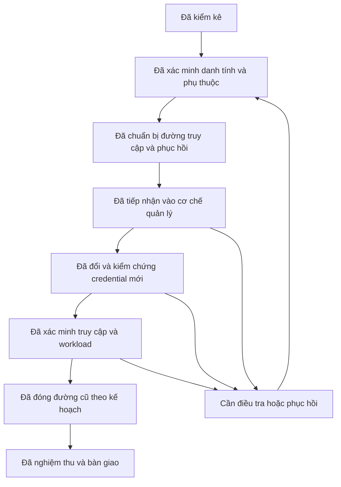

# Migrate local admin

## 1. Bài toán chuyển tài khoản quản trị cục bộ vào PAM

Một doanh nghiệp có thể đã dùng tài khoản quản trị cục bộ nhiều năm trước khi triển khai Privileged Access Management (PAM). Mật khẩu được đặt khi cài máy, chia sẻ giữa kỹ thuật viên hoặc lưu trong công cụ triển khai. Một số tài khoản còn chạy dịch vụ, tác vụ định kỳ hay công cụ sao lưu. Vì vậy, đưa chúng vào PAM không chỉ là tạo bản ghi trong vault.

Migrate local admin là chuyển các tài khoản có quyền quản trị trên từng máy sang một cơ chế được kiểm soát: định danh đúng tài khoản và tài sản, xác định người chịu trách nhiệm, quản lý credential, kiểm soát người sử dụng, kiểm chứng luân chuyển và giữ lại khả năng phục hồi. Chuyển đổi chỉ có ý nghĩa khi cách truy cập cũ cũng được xử lý.

Ví dụ, một bản ghi vault mang tên `APP-021\\support-admin` chưa chứng minh rằng:

- Nó đang trỏ đến đúng máy và đúng tài khoản.
- Credential trong vault còn khớp với credential trên máy.
- Chính sách luân chuyển thực sự có hiệu lực.
- Kỹ thuật viên đã sử dụng danh tính cá nhân và quy trình phê duyệt.
- Script cũ đã ngừng dùng mật khẩu chia sẻ.
- Có thể khôi phục truy cập khi connector hoặc mạng quản trị gặp sự cố.

Mục tiêu của bài là xây dựng một quy trình chuyển đổi có thể áp dụng theo từng nhóm máy, phát hiện sớm phụ thuộc và dừng đúng chỗ khi chưa đủ bằng chứng. Phạm vi chính là tài khoản quản trị cục bộ trên hệ điều hành; tài khoản miền, tài khoản dịch vụ chuyên dụng và khóa SSH cần có phương án tương ứng, không được mặc nhiên coi là cùng một loại credential.

## 2. Phân biệt tài khoản, quyền và đường truy cập

### 2.1. Tài khoản cục bộ không đồng nghĩa với mọi quyền quản trị trên máy

Trên một máy Windows, tài khoản thuộc cơ sở dữ liệu tài khoản cục bộ là một đối tượng khác với tài khoản miền được thêm vào nhóm Administrators của máy đó. Cả hai có thể tạo ra quyền quản trị, nhưng nơi quản lý danh tính và credential khác nhau.

Trên Linux, quyền quản trị có thể đến từ đăng nhập root hoặc từ một tài khoản được cấp quyền qua sudo. Đổi mật khẩu root không xử lý toàn bộ khóa SSH, chính sách sudo, thành viên nhóm hoặc những con đường leo thang quyền khác.

Cần tách ba lớp:

| Lớp | Câu hỏi phải trả lời | Ví dụ |
|---|---|---|
| Danh tính | Đang quản lý đối tượng nào, trên tài sản nào? | Tài khoản local có SID cụ thể trên một máy Windows |
| Credential | Hệ thống nào quản lý mật khẩu hoặc yếu tố xác thực? | Cơ chế quản lý mật khẩu local đã được chọn |
| Quyền và đường sử dụng | Ai được truy cập, qua kênh nào, làm được gì? | Phiên qua broker, console khẩn cấp, quyền nâng tạm thời |

Một thay đổi ở lớp credential không tự sửa cấu hình ở hai lớp còn lại. Nếu tất cả nhân viên hỗ trợ vẫn là local admin thường trực, việc vault hóa một tài khoản dùng chung chưa đáp ứng mục tiêu least privilege.

### 2.2. Quản lý credential và giảm đặc quyền là hai kết quả riêng

Với một tài khoản cũ, tổ chức có thể chọn một trong các hướng sau:

| Tình trạng | Hướng xử lý |
|---|---|
| Cần cho phục hồi máy khi mất kết nối danh tính tập trung | Giữ tài khoản phục hồi với credential được quản lý và quyền truy xuất hạn chế |
| Dùng thường xuyên cho hỗ trợ tương tác | Chuyển công việc sang danh tính cá nhân và cơ chế cấp quyền phù hợp |
| Đang được dịch vụ hoặc tác vụ định kỳ sử dụng | Tách phụ thuộc sang danh tính dành cho workload nếu khả thi |
| Không có chủ sở hữu hoặc không chứng minh được nhu cầu | Điều tra và xử lý vòng đời trước khi coi là tài khoản cần duy trì |
| Trùng chức năng với tài khoản khác | Hợp nhất hoặc loại bỏ theo kế hoạch có kiểm chứng |

JIT cấp quyền đúng thời điểm, JEA giới hạn công việc được thực hiện và vault quản lý bí mật phục vụ những nhu cầu khác nhau. Chọn kết hợp phù hợp với nền tảng; không giả định chỉ cần bật một tính năng PAM là tự đạt cả ba.

## 3. Định nghĩa trạng thái đích trước khi di chuyển

Một thiết kế đích rõ ràng giúp tránh tình trạng mỗi nhóm vận hành hiểu “đã migrate” theo một cách.

Với mỗi tài khoản cần duy trì, nên xác định tối thiểu:

1. Tài sản đích và định danh tài khoản đã được xác minh.
2. Chủ sở hữu nghiệp vụ và nhóm vận hành.
3. Mục đích sử dụng: hỗ trợ tương tác, phục hồi hay phụ thuộc tạm thời.
4. Cơ chế có quyền quyết định và cập nhật credential.
5. Đường truy cập bình thường và đường phục hồi.
6. Người có quyền yêu cầu, phê duyệt, sử dụng hoặc tiết lộ credential.
7. Cách luân chuyển, kiểm tra và xử lý khi hai phía mất đồng bộ.
8. Điều kiện loại bỏ cách truy cập cũ.
9. Bằng chứng cần lưu và người nghiệm thu.

Ví dụ về trạng thái đích:

> Mỗi máy chủ có một tài khoản phục hồi cục bộ thuộc phạm vi đã phê duyệt. Credential riêng cho từng máy được quản lý bởi một cơ chế duy nhất. Nhân viên vận hành thông thường dùng danh tính cá nhân qua đường truy cập được kiểm soát. Việc lấy mật khẩu phục hồi cần quyền riêng, lý do và dấu vết kiểm toán. Tài khoản dùng chung cũ được xử lý sau khi phụ thuộc đã được tách và khả năng phục hồi đã được thử.

Đây là mục tiêu thiết kế, không phải yêu cầu tạo thêm tài khoản phục hồi trên mọi máy. Nếu một tài khoản phù hợp đã tồn tại và có thể được quản lý an toàn, hãy đánh giá việc tiếp nhận nó thay vì tạo đối tượng trùng chức năng.

## 4. Lập inventory theo tài khoản trên từng tài sản

### 4.1. Không dùng mỗi tên máy và tên tài khoản làm bằng chứng định danh

Máy có thể đổi tên, được cài lại, tái sử dụng địa chỉ IP hoặc khôi phục từ image. Tài khoản có thể đổi tên hoặc bị xóa rồi tạo lại với cùng tên hiển thị. Một bản ghi nhìn giống bản cũ chưa chắc là cùng đối tượng bảo mật.

Inventory cần nối dữ liệu từ quản lý tài sản với quan sát tại máy:

| Nhóm thông tin | Dữ liệu cần có | Tác dụng |
|---|---|---|
| Tài sản | Asset ID, môi trường, chủ sở hữu, nhóm ứng dụng | Xác định đối tượng chịu thay đổi |
| Định danh hệ điều hành | Host identity và dấu hiệu tái cài đặt theo nền tảng | Phát hiện bản ghi PAM đang trỏ sai |
| Tài khoản | Tên hiện tại, định danh tài khoản, trạng thái bật/tắt | Phân biệt đổi tên với tạo tài khoản mới |
| Quyền | Thành viên nhóm, quyền đăng nhập, cơ chế nâng quyền | Biết quyền thực tế sau khi xác thực |
| Credential | Nơi quản lý hiện tại, ngày xác minh, phiên bản tham chiếu | Đánh giá độ tin cậy mà không ghi bí mật |
| Sử dụng | Người dùng, dịch vụ, tác vụ, công cụ tự động | Phát hiện phụ thuộc |
| Vận hành | Kết nối quản trị, thời gian online, console, cửa sổ thay đổi | Chọn đợt di chuyển |
| Quyết định | Giữ, thay thế, vô hiệu hóa hoặc ngoại lệ | Tránh onboarding mọi tài khoản một cách máy móc |

Tên tài khoản không phải bí mật như mật khẩu, nhưng inventory vẫn là dữ liệu nhạy cảm về hạ tầng. Phân quyền và thời hạn lưu của inventory cần phù hợp với mục đích vận hành.

Không thu thập password hash, xuất database bí mật hoặc dò mật khẩu để “làm đủ inventory”. Trường chưa xác minh được phải mang trạng thái chưa xác minh, kèm hành động tiếp theo và người phụ trách.

### 4.2. Kiểm kê cả tài khoản và thành viên có quyền quản trị

Một máy có thể có tài khoản local đã vào vault nhưng vẫn tồn tại:

- Tài khoản local thứ hai với cùng quyền.
- Nhóm miền rộng được thêm vào Administrators.
- Tài khoản vendor chưa hết hạn.
- Công cụ quản lý từ xa có khả năng thực thi với đặc quyền.
- Image hoặc cấu hình tự động có thể tạo lại tài khoản cũ.

Do đó, danh sách tài khoản dự kiến migrate cần được đối chiếu với bề mặt đặc quyền thực tế. Những quyền ngoài phạm vi đợt này vẫn phải có quyết định xử lý hoặc ngoại lệ; không được bỏ qua rồi báo máy đã được kiểm soát toàn diện.

## 5. Tìm phụ thuộc trước khi đổi mật khẩu

### 5.1. Những phụ thuộc thường bị bỏ sót

Tài khoản mang tên “admin” có thể đồng thời là danh tính chạy workload. Thay mật khẩu thường không làm tiến trình đang chạy dừng ngay. Lỗi có thể chỉ xuất hiện khi dịch vụ khởi động lại, máy reboot hoặc tác vụ đến lịch chạy.

| Phụ thuộc | Dấu hiệu cần điều tra | Phép thử có ý nghĩa |
|---|---|---|
| Dịch vụ hệ điều hành | Cấu hình chạy bằng tài khoản local đích | Khởi động lại có kiểm soát và kiểm tra chức năng |
| Tác vụ định kỳ | Thông tin đăng nhập được lưu cùng tác vụ | Chạy theo cách buộc xác thực lại trong môi trường được phép |
| Công cụ sao lưu | Agent hoặc job sử dụng credential cũ | Thử hoạt động đại diện và xác nhận phục hồi theo kế hoạch |
| Công cụ triển khai | Pipeline hoặc agent dùng tài khoản quản trị chung | Thực hiện một công việc đại diện sau chuyển đổi |
| Script vận hành | Tham chiếu tên tài khoản, nơi lưu credential | Chuyển sang cơ chế lấy credential được phê duyệt rồi kiểm thử |
| Kết nối ra máy khác | Truy cập share, cơ sở dữ liệu hoặc dịch vụ phụ trợ | Kiểm tra danh tính thực sự được dùng ở đầu nhận |
| Công cụ quản lý mật khẩu cũ | Agent hoặc chính sách còn khả năng ghi mật khẩu | Chứng minh chỉ còn một cơ chế được quyền cập nhật |

Đừng kết luận “không có phụ thuộc” từ việc không thấy lần đăng nhập gần đây. Log có thể thiếu, thời gian lưu ngắn hoặc tác vụ chỉ chạy cuối tháng. Kết hợp cấu hình, lịch vận hành, xác nhận của chủ hệ thống và quan sát trong một khoảng phù hợp.

### 5.2. Xử lý workload trước khi đóng đường truy cập cũ

Nếu một dịch vụ đang chạy bằng local admin, kế hoạch tốt thường là tách nó sang danh tính phù hợp và cấp đúng quyền cần thiết. Khi chưa thể tách ngay, phải ghi rõ:

- Dịch vụ nào còn phụ thuộc và vì sao.
- Thành phần nào cập nhật credential cho dịch vụ sau rotation.
- Cách kiểm chứng xác thực mới thay vì dựa vào tiến trình đang chạy.
- Người chịu trách nhiệm xử lý lỗi và thời hạn ngoại lệ.
- Những rủi ro còn lại của việc dùng tài khoản quản trị chung.

Không tự động đổi tài khoản chạy dịch vụ, mật khẩu và quyền filesystem trong cùng một bước không thể phân biệt nguyên nhân lỗi. Chia thành thay đổi có thể quan sát và thử độc lập, trong phạm vi cửa sổ vận hành đã thống nhất.

## 6. Chọn một cơ chế có quyền cập nhật credential

### 6.1. Tránh hai hệ thống cùng luân chuyển một mật khẩu

Giả sử một cơ chế quản lý mật khẩu local sẵn có vẫn đổi mật khẩu trên máy, trong khi vault mới cũng chạy lịch rotation. Hai bên có thể luân phiên ghi đè. Bản ghi vault sẽ có lúc hợp lệ, có lúc lỗi, dù mỗi hệ thống riêng lẻ đều báo đã thực hiện công việc.

Nguyên tắc vận hành là với một credential tại một thời điểm, phải xác định rõ cơ chế có quyền tạo và cập nhật giá trị hiện hành.

Có thể lựa chọn:

| Mô hình | Điều kiện cần làm rõ |
|---|---|
| PAM trực tiếp quản lý và luân chuyển | Connector, quyền cập nhật, kiểm chứng và phục hồi phải hỗ trợ đúng loại tài khoản |
| Cơ chế quản lý mật khẩu local hiện hữu tiếp tục làm chủ | PAM chỉ truy xuất hoặc môi giới theo tích hợp được hỗ trợ; không tự chạy một lịch đổi khác |
| Chuyển quyền quản lý theo từng đợt | Ngừng quyền ghi của cơ chế cũ đối với đúng tập máy trước khi kích hoạt cơ chế mới |
| Nền tảng chưa hỗ trợ tích hợp cần thiết | Giữ trạng thái ngoại lệ có chủ sở hữu, chưa công bố hoàn tất |

Windows LAPS là một ví dụ về cơ chế quản lý mật khẩu tài khoản local. Việc phối hợp nó với PAM phụ thuộc kiến trúc và khả năng tích hợp được hỗ trợ. Không mặc nhiên sao chép mật khẩu sang một vault thứ hai rồi cho rằng hai bản sẽ tự đồng bộ.

### 6.2. Quyền đổi, quyền đọc và quyền phục hồi phải được tách

Một connector có quyền đổi mật khẩu không nhất thiết phải có quyền xuất hàng loạt bí mật cho người vận hành. Một kỹ thuật viên được mở phiên không nhất thiết phải được xem mật khẩu. Quyền dùng chức năng reconcile hoặc khôi phục đồng bộ cũng không nên mặc nhiên thuộc mọi người có quyền checkout.

Lập ma trận quyền theo thao tác:

| Thao tác | Vai trò minh họa | Bằng chứng |
|---|---|---|
| Đề nghị phiên quản trị | Nhân viên hỗ trợ được phân công | Danh tính cá nhân, máy đích, lý do |
| Phê duyệt | Chủ hệ thống hoặc vai trò được ủy quyền | Quyết định gắn với yêu cầu cụ thể |
| Cập nhật credential | Thành phần quản lý đã được cấp quyền | Đích, kết quả, phiên bản tham chiếu |
| Truy xuất credential phục hồi | Vai trò khẩn cấp giới hạn | Lý do khẩn cấp và hậu kiểm |
| Sửa cấu hình quản lý | Quản trị nền tảng PAM | Thay đổi cấu hình và người thực hiện |
| Kiểm toán | Vai trò đọc bằng chứng | Truy cập log, không cần xem bí mật |

Không dùng cùng tài khoản local đang di chuyển làm danh tính duy nhất để quản trị chính vault hoặc giải mã gói phục hồi. Điều đó tạo vòng phụ thuộc khi cần cứu hệ thống.

## 7. Chia đợt theo rủi ro và tính đại diện

Không nên chọn pilot chỉ gồm các máy luôn online và không có ứng dụng. Pilot phải đủ nhỏ để có thể phục hồi, đồng thời đại diện cho các đặc điểm làm migration thất bại.

Những tiêu chí phân nhóm hữu ích gồm:

- Hệ điều hành và khả năng quản lý từ xa.
- Máy chủ, máy trạm, thiết bị offline hoặc mạng hạn chế.
- Nền tảng vật lý, máy ảo và khả năng truy cập console.
- Máy phục vụ ứng dụng quan trọng hay có cửa sổ bảo trì hẹp.
- Tình trạng dùng chung mật khẩu.
- Phụ thuộc dịch vụ và tác vụ định kỳ.
- Cơ chế quản lý mật khẩu hiện hành.
- Máy mới cài lại hoặc có chu kỳ tái tạo thường xuyên.

Trước mỗi đợt, xác định tiêu chí tiếp tục và tiêu chí dừng. Ví dụ, nếu xuất hiện một máy đổi mật khẩu thành công nhưng mất cả đường PAM lẫn đường phục hồi đã cam kết, cần dừng mở rộng và điều tra cơ chế chung. Không chờ tỷ lệ lỗi vượt ngưỡng rồi mới xử lý một sự cố mất quyền quản trị nghiêm trọng.

Các ngưỡng về số lượng, thời gian theo dõi hoặc tỷ lệ thành công là quyết định của từng môi trường. Không có một tỷ lệ cố định có thể thay thế đánh giá mức độ ảnh hưởng.

## 8. Chu trình chuyển đổi cho từng tài khoản

Có thể biểu diễn tiến trình bằng các trạng thái vận hành sau. Đây là mô hình minh họa cho sổ theo dõi migration, không phải tên trạng thái bắt buộc của một sản phẩm PAM.



Mỗi trạng thái cần bằng chứng và thời điểm quan sát. Không tiến thẳng từ “đã tạo bản ghi vault” sang “đã hoàn tất”. Nếu tái cài máy làm thay đổi đối tượng đích, cần quay lại cổng xác minh danh tính dù trước đó tài khoản từng được nghiệm thu.

## 9. Chuẩn bị trước cửa sổ chuyển đổi

### 9.1. Xác minh đường quản trị độc lập

Đường phục hồi phải sử dụng được trong kiểu sự cố dự kiến. Một phiên quản trị đang mở có thể giúp khắc phục tức thời, nhưng không phải bằng chứng về khả năng đăng nhập mới sau reboot. Một tài khoản khẩn cấp cũng không có giá trị nếu bí mật của nó chỉ lấy được qua chính connector đang lỗi.

Tùy thiết kế, chuẩn bị console, kênh quản lý ngoài băng, cơ chế quản lý endpoint hoặc quy trình truy xuất credential phục hồi. Cần xác nhận quyền sử dụng kênh đó, độ sẵn sàng và người thực hiện; không chỉ ghi tên công cụ trong tài liệu.

Thử đường phục hồi theo phạm vi được phép trước khi đóng cách truy cập cũ. Nếu thử nghiệm có thể ảnh hưởng sản xuất, thiết kế phép thử trong lab và một kiểm tra vận hành phù hợp thay vì tự ý ngắt hạ tầng dùng chung.

### 9.2. Chốt baseline và phân công

Baseline nên gồm định danh tài khoản, quyền hiện tại, đường truy cập, chủ ứng dụng và cấu hình phụ thuộc. Không đưa mật khẩu vào change ticket, ảnh chụp, terminal transcript hoặc file đối chiếu.

Trong cửa sổ thực hiện, xác định rõ:

- Người điều phối có quyền cho tiếp tục hoặc dừng đợt.
- Người quản trị hệ điều hành.
- Người vận hành PAM.
- Đại diện ứng dụng kiểm tra nghiệp vụ.
- Người phê duyệt và người hậu kiểm.
- Đầu mối phục hồi nếu thất bại.

Phạm vi thay đổi nên khóa theo tập tài sản cụ thể. Một truy vấn động trả về “mọi máy có tên APP-*” có thể mở rộng tập đích giữa lúc chạy. Dùng danh sách đã xác minh cho đợt thực hiện và kiểm tra lại danh tính ngay trước thao tác ghi.

## 10. Runbook chuyển đổi một máy

### Bước 1: Xác minh đích và điều kiện sẵn sàng

Đối chiếu tài sản được duyệt với máy thực tế. Xác nhận tài khoản, định danh nền tảng, trạng thái và quyền. Nếu tên khớp nhưng đối tượng đã thay đổi sau khi tái tạo máy, dừng và cập nhật kế hoạch; không ghi credential lên đích chưa xác minh.

Kiểm tra cửa sổ thay đổi, liên lạc ứng dụng, kênh quản trị và khả năng phục hồi. Không chọn tùy tiện một tài khoản khác khi tài khoản dự kiến không tồn tại.

### Bước 2: Xác nhận quyền quản lý credential

Chứng minh cơ chế cũ sẽ không tiếp tục cập nhật cùng credential trong thời gian chuyển đổi. Việc ngừng quản lý phải giới hạn đúng phạm vi và có cách kiểm chứng tại endpoint hoặc từ hệ thống quản lý.

Nếu hai sản phẩm cần phối hợp, chỉ tiến hành theo mô hình tích hợp đã được thiết kế và kiểm thử. Không giải quyết xung đột bằng cách tăng tần suất rotation của bên mới.

### Bước 3: Tiếp nhận tài khoản vào PAM

Tạo hoặc liên kết bản ghi đúng phạm vi, áp policy, người sở hữu và quyền truy cập. Nếu tiếp nhận credential hiện có, truyền qua kênh được phê duyệt. Nếu không có credential hiện hành, chỉ dùng cơ chế thiết lập hoặc reconcile đã được cấp quyền.

Không lấy hash để thay cho mật khẩu, không thử nhiều mật khẩu cũ và không nhúng credential vào dòng lệnh hoặc tài liệu. Khi chưa có phương thức khởi tạo hợp lệ, trạng thái phải là chưa sẵn sàng.

### Bước 4: Kiểm chứng khả năng quản lý trước rotation

Xác nhận thành phần quản lý liên hệ được với đúng endpoint và có thể thực hiện thao tác được thiết kế. Kiểm tra phân quyền PAM để người dùng thử không nhận quyền ngoài máy và ngoài vai trò của họ.

Một phản hồi “đã lưu credential” chỉ xác nhận phía vault chấp nhận dữ liệu. Nó chưa chứng minh xác thực trên máy đích hay quyền quản trị thực tế.

### Bước 5: Thực hiện rotation có kiểm soát

Yêu cầu cơ chế đã chọn tạo credential mới cho đúng tài khoản. Sau thao tác, cần kiểm chứng credential hiện hành được lưu an toàn và có thể xác thực theo đường được phép.

Thực tế, việc đổi mật khẩu trên máy và cập nhật trạng thái trong hệ thống quản lý không phải lúc nào cũng là một giao dịch nguyên tử. Có thể xảy ra timeout sau khi endpoint đã đổi mật khẩu. Khi đó, kết quả là chưa xác định cho đến khi đối soát; không tự kết luận chưa đổi rồi chạy lại bằng dữ liệu cũ.

Không hiển thị mật khẩu mới để so bằng mắt. Dùng kết quả xác thực, phiên bản tham chiếu và chức năng đối soát được hỗ trợ.

### Bước 6: Kiểm tra một phiên xác thực mới

Mở phiên quản trị mới bằng quy trình được thiết kế. Xác minh đúng máy, đúng tài khoản đích, đúng quyền và đúng liên kết với người yêu cầu. Phân biệt “xác thực thành công” với “có đủ quyền thực hiện tác vụ đã duyệt”.

Một phiên đang mở từ trước rotation không phải phép thử credential mới. Trên Windows, UAC, quyền đăng nhập và chính sách truy cập từ xa có thể ảnh hưởng kết quả. Không tắt hàng loạt các cơ chế đó chỉ để làm phép thử thành công.

### Bước 7: Kiểm tra phụ thuộc và lần xác thực lại

Chủ ứng dụng thực hiện kiểm tra chức năng đã thống nhất. Với dịch vụ hoặc tác vụ còn phụ thuộc, phép thử cần buộc dùng credential hiện hành tại thời điểm phù hợp: khởi động lại có kiểm soát, chạy tác vụ đại diện hoặc kiểm tra theo chu kỳ đã lên lịch.

Không ghi kết quả “PASS” cho tác vụ cuối tháng chỉ vì dịch vụ web đang phản hồi. Nếu chưa thể thử, giữ mục xác minh còn mở và xử lý theo tiêu chí nghiệm thu đã thỏa thuận.

### Bước 8: Xử lý đường truy cập cũ

Sau khi các cổng trước đạt yêu cầu, triển khai những thay đổi đã duyệt: thu hồi quyền của người không còn cần, ngừng phát hành mật khẩu dùng chung, loại bỏ tham chiếu trong công cụ cũ hoặc vô hiệu hóa tài khoản thay thế đã hết mục đích.

Việc rotation không tự đóng mọi phiên đã tồn tại hoặc thu hồi mọi token. Nếu mục tiêu yêu cầu chấm dứt phiên cũ, cần một hành động riêng có tính đến tác động vận hành.

Không xóa tài khoản chỉ vì đã đổi tên hoặc đưa vào vault. Xóa và tạo lại có thể tạo đối tượng bảo mật khác, ảnh hưởng quyền gắn với đối tượng cũ.

### Bước 9: Theo dõi và thử khả năng vận hành tiếp theo

Theo dõi sau reboot, lần chạy tác vụ và lần rotation tiếp theo theo đặc điểm máy. Một lần đổi mật khẩu thủ công thành công chưa chứng minh lịch tự động hoặc xử lý máy offline đã hoạt động.

Kiểm tra rằng image, công cụ cấu hình hoặc quy trình sửa chữa không tạo lại tài khoản cũ hay ghi đè credential. Nếu máy thường xuyên bị tái tạo, quy trình tái tiếp nhận phải là một phần của thiết kế đích.

### Bước 10: Nghiệm thu theo bằng chứng

Chủ hệ thống và vận hành PAM xác nhận điều kiện hoàn tất. Ghi lại những ngoại lệ còn hiệu lực, thời hạn và người chịu trách nhiệm. Chỉ đưa tài khoản vào nhóm đã nghiệm thu khi đạt tất cả điều kiện bắt buộc; số lượng bản ghi vault không thay cho kết quả này.

## 11. Lưu ý riêng với Windows

### 11.1. Tài khoản Administrator dựng sẵn và tài khoản local khác

Một tài khoản có tên hiển thị `Administrator` không nên được nhận diện chỉ bằng tên. Tài khoản dựng sẵn có đặc điểm định danh riêng; tài khoản tự tạo mang cùng tên trên một máy khác vẫn cần được xác minh độc lập.

Nếu tài khoản dựng sẵn đã đổi tên, inventory cần phản ánh tên hiện tại và định danh được xác minh. Việc đổi tên đơn thuần không phải kiểm soát thay thế cho credential riêng, chính sách truy cập và giám sát.

Các tài khoản local nằm trong Administrators cũng cần được kiểm kê. Quản lý duy nhất tài khoản dựng sẵn có thể để nguyên các tài khoản quản trị khác dùng mật khẩu yếu hoặc chia sẻ.

### 11.2. Domain controller là một trường hợp khác

Không đưa domain controller vào cùng runbook tài khoản SAM cục bộ của member server hoặc workstation. Mô hình tài khoản và phục hồi của domain controller khác; credential DSRM cần được xử lý trong quy trình riêng phù hợp.

Một phạm vi truy vấn chỉ lọc theo “Windows Server” là chưa đủ để xác định nhóm máy có thể áp dụng cùng quy trình local admin.

### 11.3. Không giải quyết lỗi truy cập bằng cách mở rộng quyền tùy tiện

Tài khoản có thể xác thực được nhưng không có đường đăng nhập từ xa phù hợp. Ngược lại, thêm rộng nhóm người dùng vào Administrators có thể làm phiên thử thành công nhưng phá vỡ mục tiêu giảm quyền.

Phân loại lỗi theo xác thực, cấp quyền, quyền đăng nhập và kênh kết nối. Chỉ thay đổi kiểm soát liên quan khi đã hiểu nguyên nhân và có phạm vi được duyệt. Không dùng việc tắt UAC, mở truy cập mạng rộng hoặc cấp domain admin như một bước mặc định của migration.

## 12. Áp dụng nguyên tắc cho Linux và hệ thống hỗn hợp

Với Linux, cần xác định rõ đang chuyển đổi mật khẩu root, tài khoản local có sudo hay một đường truy cập quản trị khác. Không áp dụng giả định của Windows sang Linux chỉ vì cùng gọi là “local admin”.

Ví dụ, đưa mật khẩu root vào vault chưa giải quyết việc kỹ thuật viên dùng chung khóa SSH đăng nhập root. Thay mật khẩu cũng không tự thu hồi khóa được cho phép hay thay đổi quyền sudo. Các credential và đường truy cập khác phải có công việc xử lý riêng, gắn với cùng tài sản.

Nếu chuyển tác vụ vận hành sang tài khoản cá nhân có sudo, cần xác minh cả khả năng hoàn thành công việc và giới hạn được cấp. Quyền sudo quá rộng có thể tương đương quyền root dù không ai biết mật khẩu root.

Với máy dùng cloud-init, image hoặc công cụ cấu hình, kiểm tra điều gì xảy ra khi khởi động lại và khi tạo máy mới. Quy trình tạo tài khoản phải đưa máy mới vào mô hình quản lý credential; không tái đưa mật khẩu dùng chung vào qua image.

## 13. Xử lý lỗi và quyết định dừng

| Hiện tượng | Điều cần kiểm tra | Hành động phù hợp |
|---|---|---|
| Vault lưu được nhưng endpoint không xác thực | Đích, tài khoản, credential hoặc trạng thái đồng bộ | Giữ trạng thái chưa xác minh và đối soát |
| Rotation timeout | Endpoint có thể đã nhận thay đổi | Dừng retry mù, dùng cơ chế xác minh hoặc reconcile được phê duyệt |
| Credential đổi lại sau ít phút | Cơ chế cũ, agent hoặc công cụ cấu hình còn quyền ghi | Khắc phục xung đột quyền quản lý trước khi tiếp tục |
| Phiên cũ chạy, phiên mới lỗi | Credential mới, quyền đăng nhập hoặc kênh kết nối | Thử có giới hạn bằng phiên mới; không lấy phiên cũ làm bằng chứng |
| Dịch vụ lỗi sau reboot | Credential lưu cho workload hoặc quyền liên quan | Phối hợp chủ dịch vụ, cập nhật đúng phụ thuộc |
| Máy offline khi đến lịch | Khả năng kết nối và chính sách xử lý endpoint offline | Theo dõi tồn đọng, thử lại theo cơ chế đã thiết kế |
| Tên máy đúng nhưng định danh khác | Tái cài đặt, tái tạo hoặc ánh xạ sai tài sản | Xác minh lại trước mọi thao tác ghi |
| Connector không đủ quyền | Quyền tối thiểu cho thao tác và scope thực tế | Sửa phân quyền có kiểm soát; không cấp đặc quyền toàn miền |
| Tài khoản khóa do kiểm tra lặp | Chính sách khóa và vòng retry | Dừng vòng thử, điều tra trước khi phục hồi |
| Truy cập được nhưng không có log liên kết người dùng | Đường đi bỏ qua broker hoặc cấu hình audit | Chưa nghiệm thu kiểm soát truy cập |
| Đường phục hồi chỉ dùng được khi PAM khỏe | Vòng phụ thuộc giữa các hệ thống | Thiết kế và thử lại khả năng phục hồi |
| Công cụ cũ vẫn phát hành mật khẩu | Quyền truy cập và quy trình vận hành cũ | Hoàn tất cutover trước khi đóng công việc |

Một lỗi đơn lẻ có thể chỉ thuộc một endpoint, nhưng cũng có thể cho thấy lỗi thiết kế chung. Quyết định tiếp tục phải dựa vào phạm vi ảnh hưởng đã hiểu, không chỉ dựa trên số máy còn lại trong kế hoạch.

## 14. Phục hồi sau một lần chuyển đổi thất bại

### 14.1. Phân biệt thời điểm thất bại

Trước khi đổi mật khẩu, có thể khôi phục cấu hình quản lý hoặc hoãn đợt nếu chưa tác động credential. Sau khi endpoint đã đổi mật khẩu, “quay lui” không còn đơn giản là trả policy về trạng thái cũ.

Nếu credential mới vẫn được quản lý và xác thực được nhưng đường phiên lỗi, ưu tiên khắc phục đường phiên hoặc policy theo kế hoạch. Nếu vault và endpoint mất đồng bộ, dùng cơ chế reconcile hoặc đặt lại được cấp quyền, rồi lưu và xác minh credential hiện hành.

Nếu chưa xác định endpoint đang chấp nhận giá trị nào, không phát tán cả mật khẩu cũ và mới cho nhiều nhóm để thử. Hạn chế thao tác, dùng đường phục hồi đã chuẩn bị và duy trì một đầu mối điều phối.

### 14.2. Không coi mật khẩu chia sẻ cũ là phương án mặc định

Đưa toàn bộ máy về cùng mật khẩu cũ có thể khôi phục một số script nhưng cũng khôi phục rủi ro lan truyền credential. Nó còn làm sai các bản ghi quản lý đã cập nhật.

Một phương án phục hồi tốt cần xác định trạng thái cuối cùng nhất quán giữa endpoint và cơ chế quản lý, với credential phù hợp cho từng máy. Nếu phải dùng một quyền khẩn cấp, phải ghi bằng chứng, giới hạn thời gian và thực hiện các bước hậu kiểm, luân chuyển sau sử dụng theo thiết kế.

### 14.3. Snapshot không đồng nghĩa với khôi phục credential nhất quán

Khôi phục snapshot máy có thể đưa trạng thái tài khoản về thời điểm cũ trong khi vault vẫn lưu phiên bản mới. Khôi phục riêng dữ liệu vault cũng có thể tạo chiều lệch ngược lại.

Do đó, quy trình khôi phục máy và khôi phục PAM phải nêu rõ cách xác minh danh tính đích và đối soát credential. Snapshot của một thành phần không chứng minh toàn bộ hệ thống đã trở lại trạng thái đồng bộ.

Nếu có gói phục hồi bí mật, nó cần được mã hóa, kiểm soát người truy cập, có thời hạn và thử khả năng sử dụng. Không để bản xuất plaintext trong thư mục chia sẻ hay đính kèm ticket.

## 15. Ví dụ chuyển đổi một nhóm 24 máy chủ

Một nhóm ứng dụng có 24 máy Windows dùng tài khoản local `ops-local`. Credential hiện được phân phối qua công cụ vận hành cũ. Bốn máy còn có tác vụ định kỳ sử dụng tài khoản này.

Nhóm quyết định giữ một tài khoản quản trị cục bộ được quản lý riêng trên từng máy để phục hồi; công việc hỗ trợ thường ngày chuyển sang đường truy cập có danh tính cá nhân. Bốn tác vụ phải được tách hoặc có phương án cập nhật credential được kiểm chứng trước khi nghiệm thu.

Kế hoạch minh họa gồm:

| Đợt | Tập máy | Mục tiêu quan sát |
|---|---|---|
| Pilot | 4 máy, trong đó có một máy mang phụ thuộc tác vụ | Xác minh mô hình và đường phục hồi |
| Mở rộng 1 | 8 máy đã đạt điều kiện đầu vào | Kiểm chứng khả năng lặp lại và vận hành rotation |
| Mở rộng 2 | 12 máy còn lại sau khi xử lý điều kiện tồn đọng | Hoàn tất phạm vi đã duyệt |

Các con số chỉ dùng để mô tả tình huống. Nếu nhóm máy cuối chứa rủi ro khác, cần chia lại đợt thay vì giữ số lượng cho đẹp.

Trong pilot, ba máy vượt qua rotation và phiên mới. Máy thứ tư bị lỗi tác vụ sau khi buộc chạy lại. Nhóm không đánh dấu cả bốn đã migrate chỉ vì vault có đủ bốn bản ghi.

Kết quả được ghi:

```text
Tổng máy của pilot:                  4
Đã có bản ghi quản lý:               4
Đã xác minh credential mới:          4
Đã đạt kiểm tra workload bắt buộc:   3
Đã nghiệm thu chuyển đổi:            3
Còn mở để xử lý phụ thuộc:           1
```

Nhóm dừng mở rộng, xác minh tác vụ đang lưu credential cũ, chuyển nó sang danh tính được phê duyệt và kiểm thử lại. Chỉ sau khi máy còn lại đạt cổng và nguyên nhân đã được hiểu, họ mới mở đợt tiếp.

Nếu một máy đang offline, nó phải nằm trong danh sách tồn đọng. Việc chưa thao tác được không được đổi thành “đã xong”, cũng không làm máy tự biến mất khỏi mẫu số báo cáo.

## 16. Bằng chứng và chỉ số tiến độ

### 16.1. Bằng chứng cần trả lời được điều gì?

| Câu hỏi nghiệm thu | Bằng chứng nên có |
|---|---|
| Đã thao tác đúng tài khoản trên đúng máy? | Định danh tài sản, tài khoản và kết quả đối chiếu |
| Ai được quyền quản lý credential? | Policy, scope và xác nhận cơ chế có quyền ghi |
| Credential mới đã hoạt động? | Kết quả xác thực mới, thời điểm và phiên bản tham chiếu |
| Người vận hành có đúng quyền? | Danh tính người yêu cầu, quyết định cấp quyền và kết quả phiên |
| Phụ thuộc có còn hoạt động? | Kiểm tra ứng dụng, tác vụ hoặc dịch vụ đại diện |
| Đường cũ đã được xử lý? | Thay đổi quyền, công cụ, tham chiếu và xác nhận của chủ hệ thống |
| Có thể phục hồi? | Kết quả phép thử hoặc diễn tập có phạm vi rõ ràng |
| Còn ngoại lệ nào? | Chủ sở hữu, rủi ro, thời hạn và hành động xử lý |

Bằng chứng có thể ghi phiên bản hoặc mã tham chiếu credential, nhưng không ghi giá trị bí mật. Log migration cũng phải tránh request body, command argument hoặc ảnh chụp có thể làm lộ mật khẩu.

### 16.2. Tách coverage khỏi hiệu lực kiểm soát

Một chỉ số cơ bản là:

```text
Tỷ lệ đã nghiệm thu =
    Số tài khoản đạt tất cả điều kiện bắt buộc
    / Tổng số tài khoản thuộc phạm vi đã chốt
```

Ngoài ra, theo dõi riêng số tài khoản đã discovery, đã tiếp nhận, đã rotation và còn ngoại lệ. Với phạm vi có nhiều tài khoản trên cùng máy, ghi rõ đơn vị đo là tài khoản hay máy để tránh diễn giải sai.

Các dấu hiệu cần giám sát sau migration gồm rotation quá hạn, credential không xác minh được, quyền quản trị bị thêm lại, tài khoản cũ được bật lại, máy tái cài chưa tiếp nhận và việc tiết lộ credential ngoài quy trình.

Một máy đã nghiệm thu hôm qua vẫn có thể phát sinh drift hôm nay. Migration bàn giao sang vận hành liên tục, không kết thúc trách nhiệm giám sát.

## 17. Mẫu bản ghi kế hoạch không chứa bí mật

Ví dụ dưới đây minh họa thông tin của một công việc chuyển đổi. Nó không phải schema cấu hình để nạp trực tiếp vào sản phẩm PAM.

```yaml
assetRef: srv-app-021
environment: production
account:
  platform: windows
  name: ops-local
  identityEvidenceRef: inventory-evidence-021
purpose: recovery
ownerTeam: application-operations
credentialAuthority: selected-local-password-manager
normalAccessPath: approved-session-workflow
recoveryProcedureRef: recovery-runbook-021
dependencies:
  - ref: scheduled-task-reporting
    resolution: migrate-to-approved-workload-identity
    validationRef: task-validation-021
cutover:
  changeRef: change-021
  cohort: pilot
  stopOnUnverifiedCredential: true
evidence:
  rotationResultRef: rotation-event-021
  freshAuthenticationRef: access-test-021
  applicationValidationRef: application-test-021
  recoveryValidationRef: recovery-test-021
migrationState: pending-acceptance
```

Các mã tham chiếu đều là dữ liệu minh họa. Bản ghi không cần và không nên có trường chứa mật khẩu cũ, mật khẩu mới, khóa giải mã hoặc token quản trị.

Nếu một công việc tự động đọc bản ghi như thế này, cần bổ sung xác minh định danh, giới hạn scope và kiểm tra quyền trước khi thao tác. Không coi nội dung YAML tự thân là sự cho phép chạy thay đổi.

## 18. Bài thực hành trong môi trường được phép

Chuẩn bị hai máy lab có tài khoản quản trị cục bộ, một hệ thống quản lý credential hoặc mô hình tương đương, một đường quản trị độc lập và một tác vụ thử nghiệm. Không sử dụng credential hay tài sản sản xuất trong lab.

Thực hiện theo các chặng:

1. Lập inventory và ghi định danh của từng tài khoản trên từng máy.
2. Xác định cơ chế duy nhất có quyền cập nhật mật khẩu.
3. Đặt một tác vụ thử nghiệm phụ thuộc vào tài khoản trên một máy.
4. Tiếp nhận máy không có phụ thuộc, đổi credential và kiểm chứng bằng phiên mới.
5. Thực hiện chuyển đổi máy có tác vụ, quan sát khác biệt giữa tiến trình đang chạy và lần xác thực mới.
6. Xử lý phụ thuộc theo thiết kế rồi thử lại.
7. Mô phỏng lỗi kết nối của một thành phần trong lab và thực hiện runbook phục hồi.
8. Kiểm tra một lần rotation tiếp theo và đối chiếu bằng chứng.

Sản phẩm của bài thực hành là inventory, bảng quyết định, runbook, kết quả xác thực mới, kết quả tác vụ và kết quả phục hồi. Không đưa credential vào báo cáo.

Khi tự đánh giá, hãy giải thích được vì sao một bản ghi vault chưa phải bằng chứng hoàn tất, tại sao timeout rotation cần đối soát và vì sao khôi phục snapshot có thể làm lệch credential. Đây là ba tình huống phân biệt việc “đã thực hiện thao tác” với việc “đã xác lập được trạng thái vận hành”.

## 19. Điều kiện bàn giao sang vận hành

Một tài khoản được bàn giao khi danh tính đích đã xác minh, cơ chế quản lý credential rõ ràng, credential hiện hành hoạt động, quyền sử dụng phù hợp, workload bắt buộc đã được kiểm chứng và đường phục hồi có bằng chứng. Những cách truy cập cũ thuộc kế hoạch phải được xử lý hoặc ghi ngoại lệ có thời hạn.

Đội tiếp nhận cần biết ai xử lý rotation lỗi, ai có quyền phục hồi, cách nhận diện máy tái tạo và cách ngăn công cụ cũ tái đưa credential dùng chung vào hệ thống. Tài liệu phải đủ để một người trực vận hành thực hiện các bước đó mà không cần hỏi lại người đã làm migration.

Kết quả mong muốn không chỉ là có thêm tài khoản trong vault. Đó là mỗi tài khoản quản trị cục bộ còn cần thiết đều có lý do tồn tại, chủ sở hữu, credential được quản lý, quyền sử dụng được giới hạn và một quy trình phục hồi có thể thực hiện.
