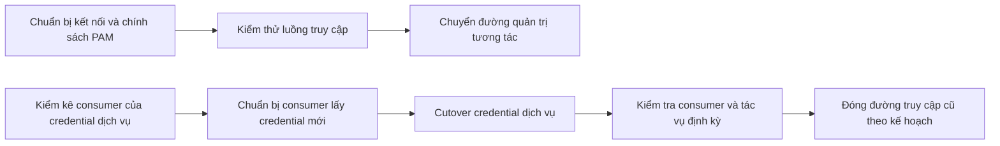

# Phân nhóm migration wave

## 1. Mục tiêu của việc chia wave trong một dự án PAM

Một dự án Privileged Access Management (PAM) thường phải chuyển nhiều loại tài khoản và đường truy cập đang tồn tại sang cơ chế kiểm soát mới: tài khoản quản trị cá nhân, tài khoản dùng chung, tài khoản dịch vụ, khóa SSH, tác vụ tự động hoặc phiên quản trị của nhà cung cấp. Nếu chuyển tất cả cùng lúc, một lỗi connector hoặc một phụ thuộc chưa được phát hiện có thể đồng thời ảnh hưởng nhiều dịch vụ.

**Migration wave** là một nhóm đơn vị chuyển đổi được tổ chức trong cùng một nhịp triển khai, có phạm vi xác định, nguồn lực hỗ trợ, điều kiện bắt đầu và tiêu chí nghiệm thu riêng. Wave không chỉ là danh sách máy chủ được đưa vào vault. Nó phải thể hiện được đường truy cập đặc quyền nào sẽ thay đổi, ai chịu trách nhiệm, ứng dụng nào phụ thuộc và cách khôi phục nếu chuyển đổi thất bại.

Ví dụ, mục tiêu của một wave có thể là:

> Chuyển đường SSH quản trị của 12 máy Linux môi trường kiểm thử sang truy cập qua PAM; ánh xạ được danh tính người dùng, kiểm tra khả năng thu hồi quyền và thu thập được bằng chứng phiên theo chính sách áp dụng.

Mục tiêu trên cụ thể hơn “onboard 12 máy”, vì nó xác định hành vi cần đạt sau chuyển đổi. Nếu 12 tài khoản đã có trong vault nhưng người quản trị vẫn dùng khóa cũ để đi trực tiếp, mục tiêu kiểm soát chưa đạt.

Sau bài học, người học có thể:

- Xác định đơn vị chuyển đổi phù hợp thay vì đếm tài khoản một cách tách rời.
- Phân nhóm theo rủi ro, phụ thuộc, mức sẵn sàng và khả năng hỗ trợ.
- Chọn pilot đủ tính đại diện, rồi mở rộng phạm vi có kiểm soát.
- Thiết kế điều kiện vào wave, nghiệm thu, tạm dừng và rollback.
- Giải thích tại sao một hệ thống được xếp vào wave cụ thể bằng dữ liệu có thể kiểm tra.

Các con số, tên dịch vụ và ngưỡng trong bài là ví dụ để thực hành lập kế hoạch. Khi triển khai, tổ chức phải xác định ngưỡng của mình dựa trên kiến trúc, chính sách và thử nghiệm thực tế.

## 2. Wave, batch và đơn vị chuyển đổi

### 2.1. Phân biệt ba khái niệm

| Khái niệm | Ý nghĩa | Ví dụ trong PAM |
|---|---|---|
| Chương trình migration | Toàn bộ phạm vi chuyển đổi hướng tới mô hình kiểm soát đích | Chuẩn hóa truy cập đặc quyền cho hạ tầng và ứng dụng |
| Wave | Nhóm triển khai có mục tiêu, chủ sở hữu, cửa sổ thay đổi và gate nghiệm thu | Chuyển truy cập quản trị của một nhóm nền tảng kiểm thử |
| Batch | Phần nhỏ thực thi trong một wave, được kiểm tra trước khi mở rộng | Triển khai 2 máy, quan sát, rồi triển khai tiếp 4 máy |

Một wave có thể gồm nhiều batch. Việc batch đầu tiên thành công không có nghĩa được tự động triển khai toàn bộ phần còn lại. Người điều phối phải đối chiếu điều kiện tiếp tục đã đặt ra.

Không nên hiểu wave là “cứ mỗi tuần 100 tài khoản”. Cùng 100 tài khoản, một nhóm có thể chỉ phục vụ quản trị tương tác, trong khi nhóm khác tham gia hàng trăm tác vụ chạy nền. Khối lượng thực và mức ảnh hưởng rất khác nhau.

### 2.2. Đơn vị chuyển đổi phải chứa được quan hệ phụ thuộc

Đơn vị đơn giản nhất thường được hình dung là:

```text
Một tài khoản → Một đối tượng được onboard
```

Trong thực tế, nên mô tả đơn vị bằng một cụm quan hệ:

```text
Danh tính hoặc tài khoản
    + tài nguyên đích
    + đường truy cập
    + nơi sử dụng credential
    + chủ sở hữu nghiệp vụ và kỹ thuật
    + hành vi kiểm soát cần đạt
```

Một đơn vị có thể là “nhóm quản trị vận hành truy cập SSH vào cụm ứng dụng A qua broker”, thay vì chỉ là “tài khoản root”. Với tài khoản dịch vụ, đơn vị có thể là “credential của dịch vụ báo cáo và toàn bộ consumer phải cập nhật khi credential thay đổi”.

Ví dụ:

- `svc-report` được một tác vụ định kỳ và một dịch vụ xuất dữ liệu sử dụng.
- Tác vụ định kỳ lấy credential từ file cấu hình.
- Dịch vụ xuất dữ liệu giữ credential trong bộ nhớ tới khi khởi động lại.
- Cả hai dùng cùng một danh tính trên cơ sở dữ liệu.

Nếu chỉ chuyển credential vào vault và bật rotation mà chưa xử lý hai consumer, hệ thống có thể hoạt động ban ngày nhưng lỗi ở lần chạy tác vụ ban đêm. Đơn vị migration phải ghi nhận cả hai consumer, hoặc phải có một thay đổi tách credential được thiết kế và kiểm chứng trước.

**Đơn vị chuyển đổi không nhất thiết trùng đơn vị quyền hạn.** Gom nhiều consumer để phối hợp thay đổi không có nghĩa duy trì một tài khoản đặc quyền dùng chung là thiết kế tốt. Việc tách danh tính và giảm quyền vẫn cần được xử lý theo mô hình đích đã thống nhất.

### 2.3. Một lesson quan trọng: hoàn tất onboarding khác hoàn tất kiểm soát

Một đơn vị có thể đi qua nhiều mốc:

```text
Đã kiểm kê
→ Đã xác minh phụ thuộc
→ Đã cấu hình PAM
→ Đã kiểm thử đường truy cập mới
→ Đã kiểm thử vòng đời credential
→ Đã xử lý đường truy cập cũ theo kế hoạch
→ Đã bàn giao vận hành
```

Kế hoạch wave phải xác định mốc nào là điều kiện “hoàn tất”. Không gộp các mốc thành một cột “done” thiếu bằng chứng.

## 3. Chuẩn bị dữ liệu trước khi phân nhóm

Phân wave dựa trên inventory chưa được xác minh thường tạo ra một lịch triển khai đẹp nhưng khó thực hiện. Cần có đủ dữ liệu để trả lời: chuyển cái gì, ảnh hưởng ai, phụ thuộc vào đâu và ai có quyền quyết định.

### 3.1. Bộ thông tin tối thiểu

| Nhóm dữ liệu | Nội dung cần biết | Tác dụng khi xếp wave |
|---|---|---|
| Định danh | ID đơn vị, tài khoản, tài nguyên, môi trường | Tránh trùng phạm vi hoặc bỏ sót |
| Chủ sở hữu | Chủ dịch vụ, người quản trị tài khoản, người vận hành consumer | Có người xác nhận tác động và nghiệm thu |
| Mức quan trọng | Chức năng nghiệp vụ, mức chịu gián đoạn, thời điểm nhạy cảm | Giới hạn phạm vi ảnh hưởng |
| Kiểu sử dụng | Tương tác, dịch vụ, automation, vendor access | Chọn quy trình chuyển đổi phù hợp |
| Credential | Mật khẩu, khóa, certificate hoặc token; cơ chế cập nhật consumer | Đánh giá rotation và phương án khôi phục |
| Phụ thuộc | Consumer, scheduler, node dự phòng, trust, đường quản trị | Xác định thứ tự và nhóm phối hợp |
| Kỹ thuật PAM | Phương thức kết nối, yêu cầu mạng, khả năng tích hợp đã kiểm chứng | Tránh xếp lịch khi chưa đủ điều kiện |
| Kiểm soát đích | Least privilege, JIT/JEA nếu áp dụng, approval, ghi phiên, thu hồi | Xác định tiêu chí chấp nhận |
| Vận hành | Cửa sổ thay đổi, lịch trực, khả năng quan sát, hỗ trợ | Đặt wave vào thời điểm có thể xử lý lỗi |
| Khôi phục | Runbook, truy cập khẩn cấp, quyền thực hiện, thời gian đã thử | Đánh giá khả năng phục hồi |

Không lưu giá trị secret vào bảng phân wave, ticket, manifest hoặc tài liệu nghiệm thu. Những nơi này chỉ lưu định danh và tham chiếu tới hệ thống quản lý secret, nếu có.

### 3.2. Gắn mức tin cậy cho dữ liệu

Một cột “có phụ thuộc” chưa đủ nếu không biết dữ liệu đến từ đâu. Có thể sử dụng trạng thái:

- **Đã xác minh:** chủ sở hữu và dữ liệu vận hành hỗ trợ cùng một kết luận.
- **Đã khai báo, cần kiểm chứng:** có thông tin từ đội ứng dụng nhưng chưa thử.
- **Chưa biết:** chưa xác định được consumer hoặc phạm vi sử dụng.

Đừng biến “chưa biết” thành “không có”. Đơn vị có consumer chưa rõ không nên vào wave rotation tự động chỉ vì inventory không liệt kê lỗi.

Có thể dùng nhiều nguồn để xác minh: cấu hình được phép truy cập, log xác thực, lịch scheduler, sơ đồ ứng dụng và xác nhận của chủ sở hữu. Việc tìm phụ thuộc phải tuân theo quyền truy cập được cấp; không thu thập hoặc sao chép credential để “kiểm tra cho tiện”.

### 3.3. Tách việc làm sạch dữ liệu khỏi ngày cutover

Một wave không nên vừa phát hiện chủ sở hữu, vừa sửa tài khoản dùng chung, vừa thử connector lần đầu và vừa chuyển production. Các việc chuẩn bị có thể là những hạng mục riêng:

```text
Đơn vị U-17
  Owner: chưa xác nhận
  Consumers: thiếu scheduler dự phòng
  Readiness: chưa đạt
  Việc chuẩn bị: xác nhận owner và diễn tập cập nhật cả hai scheduler
  Wave triển khai: chưa cam kết
```

Gán ngày cutover trước khi xử lý các việc này sẽ tạo áp lực đánh dấu sẵn sàng khi bằng chứng chưa đủ.

## 4. Các trục phân nhóm cần sử dụng

Không có một tiêu chí duy nhất đủ để chia wave. Cần kết hợp các trục dưới đây và ghi rõ lý do ưu tiên.

### 4.1. Mức rủi ro bảo mật hiện tại

Xem xét quyền đang có và mức phơi nhiễm:

- Tài khoản có đặc quyền cao hoặc quyền lan rộng.
- Credential dùng chung và khó gắn với một cá nhân.
- Credential tồn tại lâu, khó rotation hoặc đã phân phối tới nhiều nơi.
- Có đường truy cập trực tiếp bỏ qua kiểm soát.
- Tài khoản còn hoạt động nhưng chủ sở hữu không rõ.

Rủi ro hiện tại cao làm tăng nhu cầu xử lý sớm. Nó không tự chứng minh rằng hệ thống đã đủ điều kiện migration.

Nếu một đơn vị có rủi ro cao nhưng chưa sẵn sàng, cần ưu tiên công việc chuẩn bị và áp dụng biện pháp tạm thời được chấp thuận. Không nên âm thầm đẩy đơn vị đó về cuối chương trình chỉ vì khó chuyển.

### 4.2. Mức ảnh hưởng khi thay đổi

Đây là trục khác với rủi ro bảo mật hiện tại. Cần đánh giá:

- Bao nhiêu dịch vụ bị ảnh hưởng nếu xác thực thất bại?
- Có node, vùng hoặc cụm dự phòng nào dùng cùng credential không?
- Lỗi có xuất hiện ngay hay chỉ ở tác vụ cuối ngày?
- Có thể khôi phục đường quản trị mà vẫn giữ kiểm soát không?
- Cửa sổ nào cho phép kiểm tra đủ luồng nghiệp vụ?

Một tài khoản ít quyền trên hệ thống thanh toán vẫn có thể gây gián đoạn lớn nếu ứng dụng phụ thuộc vào nó. Ngược lại, một tài khoản quản trị ở môi trường thử nghiệm có thể mang quyền cao nhưng phạm vi nghiệp vụ hạn chế.

### 4.3. Độ phức tạp và tính tương đồng kỹ thuật

Các đơn vị cùng loại thường chia sẻ runbook và bài kiểm thử:

- Cùng phương thức quản trị tương tác.
- Cùng cơ chế phân phối credential tới consumer.
- Cùng mô hình hệ điều hành hoặc thiết bị.
- Cùng kiểu phê duyệt và thu hồi quyền.
- Cùng đường mạng tới thành phần PAM.

Tuy nhiên, cùng hệ điều hành chưa đủ để gom chung. Hai máy Linux có thể sử dụng SSH khác nhau: một máy có khóa cá nhân được quản lý tốt; máy còn lại có automation phụ thuộc khóa đặt cứng. Chỉ dùng nhãn “Linux” sẽ che mất khác biệt quan trọng.

### 4.4. Phụ thuộc nghiệp vụ và vận hành

Cần cân nhắc:

- Một consumer dùng credential từ nhiều hệ thống.
- Nhiều tài khoản cùng phục vụ một chuỗi giao dịch.
- Cùng đội vận hành, cùng lịch trực hoặc cùng cửa sổ thay đổi.
- Các thành phần dự phòng phải giữ khả năng quản trị trong suốt cutover.
- Một nhóm người quản trị dùng chung thiết bị truy cập hoặc đường mạng.

Có phụ thuộc không đồng nghĩa phải chuyển tất cả đồng thời. Cần xác định đó là ràng buộc về **thứ tự**, **tính nhất quán** hay chỉ là **phối hợp**.

### 4.5. Mức sẵn sàng thực tế

Một đơn vị sẵn sàng cần có bằng chứng cho các điều kiện đã chọn, ví dụ:

- Owner xác nhận phạm vi và kịch bản nghiệm thu.
- Kết nối và quyền kỹ thuật cần thiết đã được kiểm tra.
- Consumer được thống kê và có phương án cập nhật.
- Runbook đã thử trong môi trường phù hợp.
- Người thực hiện, người quyết định dừng và người hỗ trợ đã được bố trí.
- Phương án truy cập khẩn cấp được kiểm chứng.
- Không vướng thời kỳ đóng băng thay đổi hoặc xung đột với đợt triển khai khác.

Một ô đánh dấu “ready” do riêng đội PAM điền không thay thế xác nhận của các đội có hệ thống chịu tác động.

## 5. Xử lý phụ thuộc trước khi chốt wave

### 5.1. Lập đồ thị phụ thuộc ở mức đủ dùng

Một sơ đồ nhỏ thường giúp phát hiện việc không thể làm độc lập:



Sơ đồ minh họa quan hệ trước sau; nó không yêu cầu mọi ứng dụng phải có cùng quy trình.

Với mỗi cạnh, ghi rõ ý nghĩa:

| Loại quan hệ | Cách xử lý trong kế hoạch |
|---|---|
| A phải sẵn sàng trước B | Đặt A ở công việc chuẩn bị hoặc wave trước B |
| A và B cần chuyển trạng thái nhất quán | Tạo nhóm phối hợp và runbook có điểm kiểm soát |
| A và B dùng chung nguồn lực hỗ trợ | Tránh triển khai đồng thời vượt sức đội hỗ trợ |
| A và B là các thành phần dự phòng | Chọn thứ tự giữ khả năng phục hồi; không làm mất cả hai đường cùng lúc |
| A liên quan B nhưng hoạt động độc lập | Có thể tách wave nếu đã kiểm chứng giả định độc lập |

### 5.2. Gom nhóm liên kết chặt, nhưng không mở rộng vô hạn

Giả sử `svc-report` có ba consumer phải cập nhật trong cùng một cutover để tránh dùng credential không còn hợp lệ. Ba consumer này tạo thành một nhóm phối hợp chặt.

Nhưng hệ thống báo cáo còn lấy dữ liệu từ nhiều nguồn khác. Điều đó không có nghĩa toàn bộ kho dữ liệu phải chuyển vào cùng wave. Chỉ gom những thành phần mà thay đổi của một bên làm bên còn lại không thể đáp ứng điều kiện nghiệm thu.

Nếu nhóm liên kết quá lớn, cần một thiết kế chuẩn bị để giảm độ gắn kết: tách danh tính, đổi cách consumer lấy secret hoặc chia luồng sử dụng. Đây là thay đổi kiến trúc có chủ sở hữu và kiểm thử riêng; người lập wave không được giả định việc tách đã có sẵn.

### 5.3. Tránh phụ thuộc vòng bằng giả định ngầm

Ví dụ:

- PAM cần một đường quản trị để khôi phục thành phần của chính nó.
- Đường quản trị đó lại yêu cầu toàn bộ PAM đang hoạt động.
- Không có đường khẩn cấp đã thử ngoài chuỗi phụ thuộc này.

Nếu đưa các thành phần vào cùng wave mà không giải quyết vòng phụ thuộc, lỗi PAM có thể đồng thời làm mất đường khôi phục. Kế hoạch phải xác định một cơ chế phục hồi được quản lý độc lập với điểm lỗi đang xét, có kiểm soát cấp quyền, ghi nhận sử dụng và quy trình hậu kiểm.

Không dùng tài khoản đặc quyền “giấu riêng” làm giải pháp. Đường phục hồi cũng phải có owner, chính sách bảo vệ và bằng chứng kiểm thử.

## 6. Quy trình xây dựng danh sách wave

### Bước 1 — Chốt mục tiêu kiểm soát và đơn vị nghiệm thu

Ghi mục tiêu thành hành vi có thể quan sát:

```text
Không đủ: Đưa tài khoản vào PAM.

Cụ thể hơn:
- Người quản trị dùng danh tính cá nhân để yêu cầu truy cập.
- Quyền được giới hạn theo phạm vi và thời gian đã phê duyệt.
- Truy cập tới tài nguyên đúng đường được kiểm soát.
- Thu hồi quyền và hết hạn được kiểm tra theo thiết kế.
- Bằng chứng phiên hoặc sự kiện được thu thập theo chính sách.
- Đường truy cập cũ được xử lý và đối chiếu.
```

JIT, JEA, vault, rotation và ghi phiên không phải một gói bắt buộc giống nhau cho mọi tài khoản. Chọn kiểm soát phù hợp với kiểu sử dụng và khả năng tích hợp đã xác minh, rồi thể hiện rõ phần nào thuộc wave.

### Bước 2 — Áp dụng các điều kiện bắt buộc

Trước khi chấm điểm, lọc các điều kiện không được bù trừ:

- Không có owner chịu trách nhiệm.
- Phụ thuộc quan trọng chưa được xác minh.
- Chưa có phương án khôi phục khả thi.
- Chưa thử luồng nghiệp vụ cần nghiệm thu.
- Chưa có cách cấp và thu hồi quyền theo thiết kế.
- Cửa sổ thay đổi không đủ thời gian thao tác, kiểm tra và dự phòng.

Các đơn vị chưa đạt nằm trong danh sách chuẩn bị. Có thể ưu tiên xử lý chúng, nhưng chưa cam kết cutover.

Điểm rủi ro cao không được bù cho việc thiếu đường khôi phục. Đây là lý do cần tách điều kiện bắt buộc khỏi điểm ưu tiên.

### Bước 3 — Tạo các nhóm kỹ thuật và phụ thuộc

Phân các đơn vị đã đủ thông tin thành nhóm có runbook tương đồng. Sau đó bổ sung ràng buộc từ đồ thị phụ thuộc và khả năng hỗ trợ.

Kết quả có thể là:

- Nhóm quản trị SSH tương tác, ít phụ thuộc consumer.
- Nhóm tài khoản dịch vụ với consumer đã hỗ trợ cơ chế lấy secret mới.
- Nhóm automation cần triển khai adapter trước.
- Nhóm vendor access có lịch bảo trì và đội hỗ trợ riêng.
- Nhóm hệ thống cũ cần một phương án ngoại lệ có thời hạn.

Mỗi nhóm vẫn cần chia tiếp theo mức ảnh hưởng và môi trường. Không gom production và thử nghiệm chỉ để đạt số lượng đẹp.

### Bước 4 — Xếp thứ tự ưu tiên bằng dữ liệu

Có thể dùng điểm để hỗ trợ so sánh những đơn vị đã qua điều kiện bắt buộc:

```text
Điểm ưu tiên minh họa
    = 0,45 × rủi ro bảo mật hiện tại
    + 0,30 × giá trị kiểm soát đạt được
    + 0,25 × mức sẵn sàng
```

Mỗi thành phần được đánh giá trên cùng thang 1–5 với mô tả cụ thể. Hệ số chỉ là ví dụ; không phải công thức chuẩn của PAM.

Độ phức tạp triển khai và mức ảnh hưởng được dùng tiếp để thiết kế wave, không nên chỉ trừ vào điểm khiến mọi hệ thống khó tự động bị đẩy về cuối.

Một quyết định xếp thứ tự cần ghi cả lý do bằng lời:

> Đơn vị U-08 có rủi ro cao và consumer đã kiểm chứng. Đưa vào wave sớm sau pilot, nhưng tách batch nhỏ vì thuộc production và dùng lịch trực chuyên biệt.

### Bước 5 — Chọn pilot có tính đại diện

Pilot cần đủ nhỏ để xử lý lỗi, nhưng đủ thực tế để tạo ra bài học có ích:

- Có phương thức truy cập và chính sách tương tự nhóm sắp mở rộng.
- Có owner tham gia trực tiếp.
- Có kịch bản thất bại cần thử.
- Có kiểm thử thu hồi và truy cập khẩn cấp.
- Có cách quan sát kết quả từ phía dịch vụ, không chỉ phía PAM.

Chỉ chọn máy lab không có người sử dụng có thể giúp kiểm tra kết nối, nhưng chưa kiểm tra được quy trình yêu cầu quyền, hỗ trợ người dùng hoặc tác động tới công việc vận hành.

Pilot cũng không tự chứng minh thiết kế phù hợp cho mọi nền tảng khác. Khi xuất hiện kiểu tích hợp mới, cần một pilot hoặc batch xác nhận riêng cho kiểu đó.

### Bước 6 — Đặt kích thước wave và các batch

Kích thước phải phù hợp với nhiều giới hạn đồng thời: công suất triển khai, khả năng kiểm thử, hỗ trợ ứng dụng, thời gian khôi phục và phạm vi gián đoạn chấp nhận được.

Không sử dụng số lượng tài khoản như thước đo duy nhất. Có thể quy đổi khối lượng thành đơn vị công việc ước lượng, nhưng phải hiệu chỉnh bằng dữ liệu từ các wave trước.

### Bước 7 — Chốt gate, runbook và người quyết định

Mỗi wave cần có:

- Điều kiện bắt đầu.
- Điều kiện chuyển từ batch này sang batch tiếp theo.
- Tiêu chí nghiệm thu.
- Điều kiện tạm dừng hoặc rollback.
- Người có quyền quyết định và người thay thế.
- Danh sách bằng chứng phải thu thập.
- Thời gian quan sát sau cutover.
- Cách xử lý các đơn vị chưa hoàn thành.

Không để các quyết định này chỉ xuất hiện khi sự cố đã xảy ra.

## 7. Xác định kích thước wave bằng năng lực thực tế

### 7.1. Tính theo cửa sổ thay đổi

Giả sử một cửa sổ có 240 phút. Cần giữ:

- 30 phút kiểm tra trước thay đổi.
- 45 phút kiểm tra dịch vụ và thu thập bằng chứng cuối cửa sổ.
- 45 phút dự phòng khôi phục.
- 120 phút còn lại cho triển khai và kiểm tra từng batch.

Nếu một đơn vị cùng loại cần trung bình 15 phút xử lý trong điều kiện đã diễn tập, một luồng thực thi có thể đáp ứng tối đa lý thuyết 8 đơn vị:

```text
120 phút / 15 phút mỗi đơn vị = 8 đơn vị
```

Đây chưa phải cam kết wave 8 đơn vị. Cần xét thêm nguồn lực và giới hạn ảnh hưởng.

### 7.2. Lấy giới hạn chặt nhất

Giả sử cùng một loại đơn vị:

| Ràng buộc | Năng lực cho cửa sổ đang xét |
|---|---:|
| Đội PAM triển khai và kiểm tra kỹ thuật | 8 đơn vị |
| Đội ứng dụng nghiệm thu | 5 đơn vị |
| Đội hỗ trợ xác minh người dùng | 6 đơn vị |
| Phạm vi ảnh hưởng được chấp thuận | 4 đơn vị |

Kích thước wave không vượt 4 đơn vị nếu muốn đáp ứng tất cả các ràng buộc. Có thể chia thành hai batch, mỗi batch 2 đơn vị, với điểm kiểm tra ở giữa.

Cách lấy giá trị nhỏ nhất chỉ dùng được khi các con số đang đo cùng loại đơn vị. Không so trực tiếp “8 tài khoản tương tác” với “5 ứng dụng có 20 consumer” rồi coi đó là cùng năng lực.

### 7.3. Chừa năng lực xử lý sai lệch

Lịch sử wave trước có thể cho thấy thời gian trung bình 15 phút nhưng một số trường hợp cần 40 phút. Nếu kế hoạch chỉ dùng trung bình, cửa sổ sẽ dễ hết trước khi hoàn thành kiểm tra.

Cần dùng dữ liệu về độ biến thiên, các lỗi lặp lại và thời gian hỗ trợ thực tế để chọn dự phòng. Sau một wave có nhiều lỗi phụ thuộc, nên giảm phạm vi hoặc sửa runbook trước khi tăng tốc.

Không tự tăng mức song song chỉ vì còn nhiều tài khoản chờ. Song song làm giảm thời gian lịch trong một số trường hợp nhưng cũng tăng số sự cố đội hỗ trợ phải xử lý cùng lúc.

## 8. Ví dụ phân nhóm cho một tổ chức giả định

Một tổ chức có các nhóm đơn vị sau. “Đơn vị” trong bảng là cụm truy cập hoặc cụm credential cùng consumer đã được định nghĩa, không phải số tài khoản thô.

| Nhóm | Phạm vi | Mức ảnh hưởng | Tình trạng chính |
|---|---|---|---|
| A | 6 đơn vị SSH tương tác ở môi trường kiểm thử | Thấp | Owner rõ, đường truy cập và phương án phục hồi đã thử |
| B | 12 đơn vị SSH tương tác ở production | Trung bình | Cùng kiểu tích hợp A, cần hai đội ứng dụng nghiệm thu |
| C | 3 đơn vị credential cho tác vụ báo cáo | Cao | Đã biết consumer, cần quan sát tác vụ theo lịch |
| D | 2 đơn vị automation của hệ thống cũ | Cao | Còn vị trí lưu credential chưa xác minh |
| E | 4 đơn vị vendor access theo lịch bảo trì | Trung bình | Có thời hạn truy cập và yêu cầu hỗ trợ ngoài giờ |

Một cách phân nhóm hợp lý:

| Giai đoạn | Phạm vi đề xuất | Lý do và điều kiện |
|---|---|---|
| Chuẩn bị | Kết nối, chính sách, inventory, đường khôi phục; giải quyết dữ liệu của D | Làm rõ điều kiện trước khi đặt ngày cutover |
| Wave 1 — pilot | 2 đơn vị thuộc A | Xác nhận luồng yêu cầu, truy cập, thu hồi, quan sát và hỗ trợ |
| Wave 2 | 4 đơn vị còn lại của A và một batch nhỏ thuộc B theo cửa sổ riêng | Kiểm chứng runbook lặp lại, rồi xác nhận khác biệt production |
| Wave 3 | Phần B đã sẵn sàng, chia theo đội ứng dụng và giới hạn ảnh hưởng | Mở rộng mẫu đã kiểm chứng |
| Wave 4 | C, chia theo cụm consumer và lịch chạy tác vụ | Không dùng kết quả SSH tương tác để thay kiểm thử rotation dịch vụ |
| Wave 5 | E theo cửa sổ nhà cung cấp và đội hỗ trợ | Có thử hết hạn, thu hồi và quy trình hỗ trợ |
| Chưa chốt cutover | D | Ưu tiên làm rõ phụ thuộc; đưa vào wave sau khi đạt gate |

Wave 4 hoặc Wave 5 có thể được đưa lên sớm hơn nếu đủ điều kiện và có đội hỗ trợ độc lập. Số wave không phải một lịch tuyến tính bất biến; các phụ thuộc và giới hạn nguồn lực mới quyết định việc nào có thể làm song song.

### 8.1. Vì sao không gom B và C?

B là truy cập tương tác, còn C ảnh hưởng consumer chạy nền. Cần các kiểu xác minh khác nhau:

- Với B: yêu cầu quyền, kết nối, ánh xạ danh tính, phạm vi quyền, thu hồi và bằng chứng phiên.
- Với C: consumer lấy được credential hiện hành, cập nhật đồng bộ, retry không tạo khóa tài khoản và tác vụ định kỳ chạy thành công.

Gộp B và C chỉ vì cùng production sẽ tạo ra wave có runbook và điều kiện nghiệm thu không đồng nhất.

### 8.2. Vì sao D không được biến mất khỏi kế hoạch?

Chưa chốt cutover không có nghĩa bỏ D khỏi chương trình. D cần một owner và mốc hoàn thành công việc chuẩn bị:

```text
D-01:
  Việc còn thiếu: xác minh consumer dự phòng và nơi cấu hình credential.
  Owner xử lý: đội ứng dụng hệ thống cũ.
  Bằng chứng cần có: danh sách consumer được xác nhận và diễn tập cập nhật.
  Biện pháp tạm thời: theo quyết định quản trị rủi ro có thời hạn.
  Ngày đánh giá lại: được ghi trong kế hoạch.
```

Nếu chỉ dùng KPI “tỷ lệ tài khoản đã onboard”, đội triển khai có thể hoàn thành các phần dễ và bỏ lại phần rủi ro nhất. Danh sách chưa sẵn sàng phải được theo dõi công khai trong phạm vi quản trị dự án.

## 9. Manifest cho một wave

Một manifest giúp gắn phạm vi, bằng chứng và quyết định vào cùng một tài liệu. Ví dụ dưới đây là cấu trúc minh họa cho bài học, không phải schema bắt buộc của một sản phẩm PAM.

```yaml
waveId: PAM-W03
purpose: Chuyển truy cập quản trị SSH của nhóm ứng dụng nội bộ
environment: production
changeRef: CHG-DEMO-030

owners:
  coordinator: pam-migration-lead
  application: internal-app-owner
  operations: platform-operations
  stopDecision: change-commander

units:
  - unitId: U-021
    accessType: interactive-ssh
    targetRef: asset-demo-021
    identityScopeRef: admin-role-demo
    dependencyRefs:
      - network-path-demo
    expectedControls:
      - individual-attribution
      - time-bounded-access
      - session-evidence
      - revocation-test
    readinessEvidenceRef: evidence/U-021/preflight
    rollbackRunbookRef: runbook/U-021/recovery

execution:
  batchPlan:
    - batchId: B1
      unitRefs: [U-021]
      continueAfter: technical-and-application-checks-pass
  observeThrough:
    - agreed-operational-checks
    - agreed-scheduled-work-if-applicable

gates:
  entryEvidenceRef: evidence/PAM-W03/entry
  acceptanceChecklistRef: checklist/PAM-W03/acceptance
  stopCriteriaRef: runbook/PAM-W03/stop
  closureEvidenceRef: evidence/PAM-W03/closure
```

Các tham chiếu phải trỏ tới bằng chứng và runbook thật trong hệ thống được tổ chức lựa chọn. Không sử dụng một chuỗi “pass” trong manifest như bằng chứng tự thân.

Manifest nên có phiên bản hoặc lịch sử thay đổi. Sau khi chốt phạm vi, thêm một đơn vị cần được đánh giá tác động tới phụ thuộc, kiểm thử, hỗ trợ và khả năng khôi phục; không thêm chỉ bằng cách sửa danh sách cuối ngày.

## 10. Gate triển khai và tiêu chí tạm dừng

### 10.1. Gate vào wave

Trước cutover, kiểm tra tối thiểu các mục đã được xác định trong thiết kế:

- Phạm vi và owner được xác nhận.
- Kết nối tới tài nguyên đích và tới hệ thống bằng chứng hoạt động.
- Chính sách truy cập đã kiểm tra bằng các tình huống được phép và bị từ chối.
- Consumer và phụ thuộc đã được xử lý.
- Quy trình rotation hoặc thay đổi credential đã diễn tập nếu thuộc phạm vi.
- Đường khẩn cấp và runbook khôi phục sẵn sàng.
- Đội ứng dụng có mặt và có tiêu chí kiểm tra dịch vụ.
- Không có xung đột thay đổi ảnh hưởng giả định của runbook.

Một mục chưa đạt cần có quyết định xử lý rõ. Nếu đó là điều kiện bắt buộc, không được chuyển thành “sẽ kiểm tra sau”.

### 10.2. Gate giữa các batch

Một batch chỉ mở đường cho batch tiếp theo nếu các kiểm tra của nó đạt yêu cầu:

```text
Kết nối thành công
    + thực hiện được công việc được phép
    + từ chối được việc ngoài phạm vi theo thiết kế
    + không có lỗi dịch vụ mới chưa giải thích
    + thu thập được bằng chứng cần thiết
    + còn đủ thời gian dự phòng khôi phục
```

Nếu thời gian còn lại chỉ đủ triển khai nhưng không đủ kiểm tra và khôi phục, cần dừng mở rộng dù batch trước thành công.

### 10.3. Tiêu chí tạm dừng phải quan sát được

Ví dụ các điều kiện cần dừng để đánh giá:

- Không gắn được phiên với danh tính yêu cầu truy cập.
- Consumer quan trọng xác thực thất bại sau đổi credential.
- Mất đường quản trị cả thành phần chính và dự phòng.
- Có truy cập ngoài phạm vi được phê duyệt.
- Bằng chứng bắt buộc không được thu thập.
- Xuất hiện phụ thuộc chưa được khai báo.
- Không còn đủ thời gian thực hiện phương án khôi phục.

Tùy điều kiện, quyết định có thể là sửa tại chỗ trong phạm vi runbook, rollback một batch hoặc dừng toàn wave. Không phải lỗi nào cũng cần rollback tất cả, nhưng không được tiếp tục mở rộng khi chưa hiểu phạm vi tác động.

Các ngưỡng định lượng như số lỗi hoặc thời gian mất kết nối cần gắn với mức quan trọng của hệ thống. Không sử dụng một tỷ lệ lỗi chung để chấp nhận việc một dịch vụ trọng yếu đã ngừng hoạt động.

## 11. Thiết kế rollback cho migration PAM

### 11.1. Rollback không chỉ là khôi phục cấu hình

Một thay đổi PAM có thể tác động đồng thời:

- Chính sách cấp quyền.
- Phương thức kết nối.
- Credential trên tài nguyên đích.
- Cấu hình consumer.
- Bộ nhớ đệm của ứng dụng.
- Đường mạng hoặc quy tắc chặn truy cập cũ.

Vì vậy, runbook cần xác định trạng thái hiện tại của từng thành phần trước khi chọn hành động khôi phục.

Nếu credential trên đích đã đổi, chép lại file cấu hình cũ có thể đưa consumer về một giá trị không còn hợp lệ. Khôi phục cấu hình và khôi phục khả năng xác thực là hai việc phải được kiểm tra cùng nhau.

### 11.2. Phục hồi an toàn sau rotation

Giả sử cutover gồm:

```text
T0: Consumer dùng credential C0.
T1: Credential trên đích được thay đổi sang C1.
T2: Consumer được cập nhật để sử dụng C1.
T3: Kiểm tra nghiệp vụ.
```

Nếu T2 chỉ thành công một phần, cần biết consumer nào đã chuyển và credential nào đang có hiệu lực trên đích. Không được giả định C0 vẫn dùng được.

Một phương án phục hồi có thể là cập nhật các consumer còn lại tới trạng thái credential hiện hành. Phương án khác có thể cần một thay đổi credential mới được phối hợp. Lựa chọn phải dựa trên cơ chế hỗ trợ thực tế, trạng thái hệ thống và runbook đã được thử.

Không hứa hẹn có thể “đổi lại mật khẩu cũ” trong mọi trường hợp. Chính sách lịch sử mật khẩu, cơ chế của hệ thống đích hoặc yêu cầu bảo mật có thể làm hành động đó không phù hợp.

### 11.3. Không sử dụng bypass không thời hạn làm rollback

Nếu phương án phục hồi cần mở lại một đường truy cập cũ, phải quy định:

- Ai phê duyệt và ai được sử dụng.
- Phạm vi tài nguyên và thời hạn hiệu lực.
- Cách ghi nhận truy cập.
- Cách đóng lại đường đó.
- Ai xác nhận hoàn tất sau phục hồi.

Một đường bypass được mở trong sự cố nhưng không đóng lại sẽ làm giảm giá trị của toàn bộ wave. Theo dõi nó như một hạng mục chưa hoàn thành cho tới khi được xử lý hoặc chuyển thành ngoại lệ có trách nhiệm và thời hạn rõ ràng.

### 11.4. Không ngắt đường cứu hộ trước khi đường mới được kiểm chứng

Thứ tự thay đổi phải giữ một khả năng phục hồi được quản lý phù hợp trong suốt quá trình. Tuy nhiên, cũng không để hai đường truy cập tồn tại vô thời hạn mà không kiểm soát.

Kế hoạch cần một mốc đóng đường cũ và một kiểm tra xác nhận sau đó. Với hệ thống dự phòng, chuyển đổi theo thứ tự không làm mất khả năng quản trị của toàn cụm nếu một thành phần gặp lỗi.

## 12. Quan sát sau cutover và nghiệm thu wave

### 12.1. Chọn thời gian quan sát theo hành vi thực

Một phiên quản trị tương tác thường cho kết quả sớm. Một credential dùng bởi tác vụ cuối tuần có thể chưa được kiểm chứng nếu chỉ quan sát 30 phút sau thay đổi.

Cần lập danh sách các hoạt động phải diễn ra:

- Đăng nhập và công việc quản trị thông thường.
- Thu hồi hoặc hết hạn quyền.
- Lần rotation thuộc thiết kế nghiệm thu.
- Khởi động lại consumer nếu đó là lúc credential được đọc lại.
- Tác vụ định kỳ quan trọng.
- Chuyển đổi sang thành phần dự phòng khi có trong kế hoạch kiểm thử.

Không nhất thiết chờ mọi lịch chạy tự nhiên nếu có thể kiểm thử tương đương một cách được chấp thuận. Nhưng phải chứng minh phép thử phản ánh đúng hành vi cần xác minh.

### 12.2. Kết hợp tín hiệu từ PAM và từ dịch vụ

Một bảng điều khiển PAM xanh không chứng minh ứng dụng khỏe. Nghiệm thu cần dữ liệu từ cả hai phía:

| Phía kiểm tra | Ví dụ bằng chứng |
|---|---|
| Cấp quyền | Yêu cầu được phê duyệt đúng phạm vi và thời hạn |
| Tài nguyên đích | Xác thực và thực thi thao tác đúng quyền |
| Consumer | Kết nối thành công, tác vụ hoàn thành, không dùng credential cũ |
| Dịch vụ | Các kiểm tra nghiệp vụ quan trọng đạt yêu cầu |
| Thu hồi | Hành vi thu hồi được thử và giải thích theo cơ chế thiết kế |
| Giám sát | Phiên, sự kiện và cảnh báo cần thiết có thể tra cứu |
| Đường truy cập cũ | Đã đóng hoặc được quản lý như ngoại lệ có thời hạn |

Hết hạn một quyền không mặc định đồng nghĩa mọi phiên đang mở đều bị kết thúc ngay. Cần kiểm tra cơ chế thực tế và ghi rõ hành vi được nghiệm thu.

### 12.3. Phân loại kết quả của từng đơn vị

Có thể sử dụng các trạng thái vận hành sau:

- **Hoàn tất:** đạt toàn bộ tiêu chí nghiệm thu đã thống nhất.
- **Đang quan sát:** cutover thành công nhưng còn kịch bản cần kiểm tra.
- **Cần xử lý bổ sung:** tồn tại hạng mục chưa đạt, có owner và thời hạn.
- **Đã rollback:** quay về trạng thái vận hành đã xác minh theo runbook.
- **Hoãn:** chưa thực hiện cutover do gate không đạt.

Các nhãn trên là ví dụ cho kế hoạch migration thực tế. Không nên đổi mọi trạng thái chưa hoàn tất thành “thành công có lưu ý” để làm đẹp báo cáo.

## 13. Chỉ số đánh giá chất lượng phân wave

Số lượng tài khoản đã onboard cho biết tiến độ một phần, nhưng chưa đủ để đánh giá kết quả.

Nên theo dõi các chỉ số theo đúng phạm vi đã định nghĩa:

| Chỉ số | Câu hỏi nó trả lời |
|---|---|
| Đơn vị đạt toàn bộ nghiệm thu / đơn vị thuộc phạm vi | Bao nhiêu đơn vị thực sự hoàn tất kiểm soát đích? |
| Đơn vị hoãn do thiếu readiness | Công việc chuẩn bị có tạo được dữ liệu đáng tin không? |
| Phụ thuộc chưa biết được phát hiện khi cutover | Inventory có bỏ sót những gì? |
| Số lần rollback và nguyên nhân | Runbook hoặc thiết kế đang yếu ở đâu? |
| Thời gian khôi phục đã quan sát | Dự phòng trong cửa sổ có đủ không? |
| Đường bypass còn hiệu lực quá hạn | Kiểm soát mới có đang bị đi vòng không? |
| Sự cố của consumer trong giai đoạn quan sát | Thử nghiệm credential và phụ thuộc có đầy đủ không? |
| Tải hỗ trợ theo batch | Kích thước wave có vượt năng lực đội vận hành không? |

Khi tính tỷ lệ, phải giữ rõ mẫu số. Không loại các đơn vị khó ra khỏi phạm vi chỉ để làm tăng phần trăm hoàn thành. Nếu phạm vi thay đổi có lý do, ghi nhận quyết định và công bố cách tính mới.

Các chỉ số dùng để điều chỉnh wave sau. Nếu cùng một lỗi lặp lại, tăng số lượng triển khai sẽ khuếch đại lỗi thay vì tạo hiệu quả.

## 14. Những sai lầm thường gặp

### Chia theo số tài khoản bằng nhau

Hai wave có cùng 50 tài khoản nhưng một wave chỉ có quản trị tương tác, wave kia có nhiều consumer chạy nền. Khối lượng và rủi ro không tương đương.

**Cách xử lý:** định nghĩa đơn vị chuyển đổi, ước lượng công sức và áp dụng giới hạn nghiệm thu, hỗ trợ, khôi phục.

### Chọn toàn bộ hệ thống dễ cho nhiều wave đầu

Đội triển khai tạo tiến độ nhanh nhưng không học được cách xử lý ứng dụng trọng yếu hoặc phụ thuộc phức tạp.

**Cách xử lý:** pilot vừa sức, có tính đại diện; đồng thời ưu tiên công việc chuẩn bị cho các nhóm rủi ro cao.

### Đặt tất cả tài khoản quản trị cao nhất vào wave đầu

Mức quyền cao làm tăng nhu cầu kiểm soát, nhưng đưa toàn bộ vào một thay đổi chưa được kiểm chứng có thể mở rộng phạm vi sự cố.

**Cách xử lý:** áp dụng biện pháp tạm thời phù hợp, kiểm chứng đường khôi phục và chuyển theo nhóm nhỏ có chủ đích.

### Gom toàn bộ hệ thống cùng nền tảng

Cùng là Windows, Linux hoặc thiết bị mạng nhưng cách sử dụng credential và phụ thuộc có thể rất khác.

**Cách xử lý:** phân nhóm theo kiểu truy cập và vòng đời credential, rồi xét nền tảng để tái sử dụng runbook.

### Coi đưa vào vault là hoàn tất

Credential đã được lưu nhưng consumer vẫn dùng bản cũ, quyền chưa giảm và truy cập trực tiếp vẫn tồn tại.

**Cách xử lý:** nghiệm thu hành vi kiểm soát và đường truy cập, không chỉ kiểm tra đối tượng đã xuất hiện trong công cụ.

### Mở rộng khi còn lỗi chưa rõ

Một lỗi ở batch nhỏ có thể là dấu hiệu của phụ thuộc phổ biến.

**Cách xử lý:** dừng mở rộng, xác định phạm vi, sửa runbook và kiểm chứng trước batch tiếp theo.

### Rollback bằng cách khôi phục file cũ

File cũ có thể chứa credential không còn hiệu lực hoặc mở lại đường truy cập không được quản lý.

**Cách xử lý:** runbook theo trạng thái thực của tài nguyên, credential và consumer; kiểm tra dịch vụ cùng kiểm soát sau phục hồi.

## 15. Bài tập thực hành có lời giải định hướng

### Bài tập 1 — Một credential có nhiều consumer

Có một tài khoản dịch vụ được dùng bởi bốn consumer. Hai consumer hỗ trợ lấy secret từ cơ chế mới. Hai consumer còn lại chỉ đọc cấu hình khi khởi động. Chủ dự án muốn chia bốn consumer vào bốn wave để mỗi wave nhỏ.

**Câu hỏi:** cách chia đó có an toàn chỉ vì số consumer mỗi wave ít không?

**Định hướng trả lời:**

Không thể kết luận an toàn. Cần biết credential trên đích được thay đổi thế nào và bốn consumer có thể cùng hoạt động với các trạng thái credential khác nhau hay không. Nếu chỉ có một credential hiện hành và rotation làm credential cũ mất hiệu lực, chia độc lập có thể làm các consumer chưa chuyển bị lỗi.

Cần một runbook phối hợp cho cả cụm, hoặc thiết kế tách danh tính/cơ chế cập nhật đã được xác minh trước. Hai consumer đọc cấu hình lúc khởi động cần kịch bản cập nhật, khởi động lại, kiểm tra và khôi phục cụ thể.

### Bài tập 2 — Hai đơn vị có cùng điểm ưu tiên

U-A và U-B đều đạt điểm ưu tiên 4,2/5. U-A có owner và runbook khôi phục đã thử. U-B có đặc quyền cao hơn nhưng chưa xác định đủ consumer.

**Câu hỏi:** có nên đưa cả hai vào cùng wave vì điểm bằng nhau?

**Định hướng trả lời:**

Không. Điểm không thay thế điều kiện bắt buộc. U-B chưa đạt gate về phụ thuộc, cần được ưu tiên chuẩn bị và quản lý rủi ro tạm thời. U-A có thể triển khai nếu đạt các điều kiện còn lại. Quyết định phải ghi rõ phần công việc giúp U-B sẵn sàng, thay vì đẩy U-B về cuối mà không có kế hoạch.

### Bài tập 3 — Batch đầu thành công nhưng hết thời gian dự phòng

Wave có ba batch. Sau batch đầu, kết nối và nghiệp vụ đều tốt, nhưng việc xử lý một sai lệch đã tiêu hết phần dự phòng. Người triển khai muốn tiếp tục vì hai batch còn lại “giống hệt”.

**Câu hỏi:** nên quyết định thế nào?

**Định hướng trả lời:**

Dừng mở rộng khi không còn đủ thời gian kiểm tra và khôi phục theo runbook. Thành công của batch đầu không loại bỏ khả năng lỗi ở batch sau. Ghi lại sai lệch, cập nhật ước lượng và lên lại cửa sổ cho phần chưa thực hiện. Không dùng cảm giác tương đồng để vượt điều kiện tiếp tục.

### Bài tập 4 — Tác vụ cuối tuần chưa chạy

Một tài khoản đã được chuyển và ứng dụng ban ngày hoạt động. Tác vụ quan trọng chỉ chạy cuối tuần, chưa có phép thử tương đương được thống nhất.

**Câu hỏi:** wave có thể nghiệm thu hoàn tất ngay trong ngày cutover không?

**Định hướng trả lời:**

Chưa đủ cơ sở nếu tác vụ đó thuộc tiêu chí nghiệm thu. Có thể ghi trạng thái đang quan sát, duy trì hỗ trợ và xác định mốc kiểm tra. Muốn nghiệm thu sớm cần một thử nghiệm tương đương được owner chấp thuận và có bằng chứng phù hợp; không suy diễn từ luồng ban ngày.

## 16. Checklist trước khi công bố một wave

- [ ] Mỗi đơn vị có ID, owner, tài nguyên đích, đường truy cập và mục tiêu kiểm soát.
- [ ] Phụ thuộc được phân loại thành thứ tự, phối hợp, nhất quán hoặc nguồn lực.
- [ ] Dữ liệu chưa biết được ghi nhận, có việc chuẩn bị và người chịu trách nhiệm.
- [ ] Pilot đủ đại diện cho kiểu tích hợp sẽ mở rộng.
- [ ] Điều kiện bắt buộc được tách khỏi điểm ưu tiên.
- [ ] Kích thước và độ song song phù hợp với năng lực nghiệm thu, hỗ trợ và khôi phục.
- [ ] Có gate vào wave, giữa batch và khi đóng wave.
- [ ] Điều kiện dừng có thể quan sát và có người ra quyết định.
- [ ] Rollback xét cả trạng thái credential, consumer, quyền và đường truy cập.
- [ ] Thời gian quan sát bao phủ các hành vi và tác vụ quan trọng.
- [ ] Đường truy cập cũ được đóng hoặc có ngoại lệ có thời hạn và owner.
- [ ] Bằng chứng không chứa secret và đủ để giải thích quyết định nghiệm thu.
- [ ] Các đơn vị hoãn hoặc rollback vẫn nằm trong kế hoạch theo dõi.

Một kế hoạch wave tốt biến inventory thành những thay đổi có thể thực hiện, quan sát và khôi phục. Chất lượng phân nhóm thể hiện ở việc mỗi wave đạt được kiểm soát PAM đã đặt ra trong phạm vi ảnh hưởng chấp nhận được, đồng thời tạo dữ liệu đáng tin để điều chỉnh wave tiếp theo.
