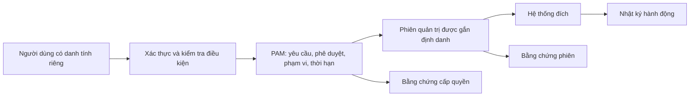

# Dùng chung tài khoản admin

## 1. Anti-pattern này là gì?

Dùng chung tài khoản admin là cách nhiều người cùng sử dụng một danh tính có quyền cao để quản trị hệ thống, trong khi hệ thống không duy trì được liên kết đủ tin cậy giữa từng thao tác và từng người thực hiện. Ví dụ quen thuộc là cả nhóm vận hành đăng nhập bằng `admin-prod`, dùng chung mật khẩu `root` của máy chủ hoặc chia sẻ một khóa SSH để truy cập tài khoản quản trị.

Vấn đề không chỉ nằm ở việc mật khẩu có đủ mạnh hay không. Một credential được bảo vệ tốt vẫn có thể đại diện cho quá nhiều người, được dùng trong quá nhiều công việc và mang quyền vượt nhu cầu thực tế. Khi đó, câu hỏi “tài khoản nào đã làm?” có thể có đáp án, nhưng “ai đã làm, được phép làm gì, trong phiên nào và vì sao?” vẫn bỏ ngỏ.

Trong quản lý truy cập đặc quyền, hay PAM, mục tiêu là kiểm soát đầy đủ vòng đời truy cập: nhận diện chủ thể, cấp đúng quyền, giới hạn thời gian, bảo vệ credential, quan sát phiên, thu hồi truy cập và lưu bằng chứng. Tài khoản admin dùng chung không được quản lý làm suy yếu nhiều mắt xích cùng lúc.

Cần phân biệt hai tình huống:

- **Chia sẻ danh tính đăng nhập:** nhiều người biết cùng mật khẩu hoặc giữ cùng khóa, đăng nhập trực tiếp và xuất hiện dưới một tên trên hệ thống đích. Đây là anti-pattern đang xét.
- **Dùng tài khoản kỹ thuật đích thông qua PAM:** từng người đăng nhập PAM bằng danh tính riêng; PAM xác thực, kiểm tra quyền và tạo phiên được gắn định danh trước khi kết nối tới một tài khoản kỹ thuật chung ở đích. Cách này có thể là biện pháp bù trừ cho hệ thống cũ, nhưng vẫn phải kiểm soát đường truy cập trực tiếp và giới hạn khả năng truy vết của hệ thống đích.

Không nên coi hai tình huống trên là tương đương chỉ vì log đích đều có tên `administrator`.

## 2. Vì sao nhóm vận hành dễ rơi vào cách làm này?

Một tài khoản chung thường xuất phát từ nhu cầu hợp lý: triển khai nhanh, xử lý sự cố ngoài giờ, tránh phải cấp tài khoản trên nhiều máy hoặc làm việc với thiết bị chỉ hỗ trợ một tài khoản quản trị. Anti-pattern hình thành khi giải pháp tạm thời trở thành mặc định lâu dài mà không có chủ sở hữu và điều kiện kết thúc.

Một số biểu hiện thường gặp:

- Mật khẩu quản trị được gửi qua tin nhắn, email hoặc ghi trong tài liệu dùng chung.
- Một khóa SSH riêng được sao chép cho cả nhóm, kể cả nhà cung cấp.
- Người mới nhận credential ngay khi vào nhóm; người rời nhóm chỉ bị xóa khỏi danh sách chat.
- Tài khoản chung có quyền trên cả môi trường thử nghiệm và môi trường sản xuất.
- Pipeline triển khai dùng cùng tài khoản với người quản trị tương tác.
- Sau sự cố, credential khẩn cấp tiếp tục được dùng cho công việc hằng ngày.
- Khi hỏi ai chịu trách nhiệm cho một lần sử dụng, nhóm chỉ xác định được ca trực hoặc đội phụ trách.

Cách làm này giảm công sức cấp quyền ở thời điểm ban đầu, nhưng chuyển chi phí sang điều tra sự cố, thu hồi truy cập, kiểm toán và xử lý gián đoạn sau này.

## 3. Một tình huống điển hình

Nhóm vận hành của một nền tảng học trực tuyến có sáu người. Tất cả dùng tài khoản `admin-prod` để sửa cấu hình dịch vụ, xem log và bảo trì máy chủ. Mật khẩu nằm trong một kho bí mật, nhưng mọi thành viên có thể lấy bản rõ. Cùng credential đó còn được cấu hình trong một công cụ triển khai cũ.

Lúc 14:07, một thay đổi cấu hình làm dịch vụ đăng nhập ngừng hoạt động. Log trên máy chủ cho biết:

```text
14:02:10 login_success account=admin-prod source=10.20.0.15
14:07:43 config_updated account=admin-prod resource=auth-service
14:08:12 service_restarted account=admin-prod resource=auth-service
```

Địa chỉ `10.20.0.15` là máy nhảy dùng chung. Ba kỹ sư đang mở phiên, và công cụ triển khai cũng hoạt động trong cùng khoảng thời gian. Nhóm không thể kết luận người nào đã thực hiện thay đổi chỉ từ tên tài khoản và địa chỉ nguồn.

Kho bí mật có bản ghi “Lan lấy mật khẩu lúc 13:55”. Bằng chứng này chỉ chứng minh một lần truy xuất credential. Nó không tự chứng minh Lan là người thực hiện thao tác lúc 14:07, vì credential có thể đã được sao chép, được sử dụng từ trước hoặc được hệ thống tự động dùng lại.

Tình huống cho thấy ba thiếu hụt khác nhau:

1. Không tách danh tính con người khỏi danh tính tự động hóa.
2. Không liên kết chắc chắn lần xác thực, lần cấp quyền, phiên truy cập và hành động đích.
3. Không giới hạn tài khoản theo công việc và thời gian, nên nhiều chủ thể cùng nắm khả năng tác động rộng.

Khi điều tra, mục tiêu là tái dựng sự kiện bằng bằng chứng, không suy đoán hoặc quy trách nhiệm chỉ vì một người có quyền truy cập.

## 4. Những rủi ro cốt lõi

### 4.1. Mất khả năng quy thuộc thao tác

Hệ thống thường ghi nhận danh tính tài khoản đã xác thực. Nếu nhiều người dùng cùng một tài khoản, thông tin đó không đủ để phân biệt người thực hiện.

Một chuỗi truy vết có ích cần trả lời được:

- Ai xác thực ban đầu bằng danh tính cá nhân?
- Ai hoặc cơ chế nào phê duyệt quyền truy cập?
- Quyền áp dụng cho tài nguyên và công việc nào?
- Phiên nào được mở, vào thời điểm nào?
- Hành động nào xảy ra trong phiên hoặc lời gọi API tương ứng?
- Có đường truy cập nào bỏ qua cơ chế kiểm soát không?

Ngay cả tài khoản cá nhân cũng không bảo đảm tuyệt đối một con người đã trực tiếp thực hiện hành động: thiết bị hoặc phiên có thể bị chiếm đoạt. Tuy nhiên, danh tính riêng cùng xác thực, quản lý phiên và bằng chứng liên quan cung cấp nền tảng điều tra tốt hơn tài khoản dùng chung không kiểm soát.

### 4.2. Quyền được cấp theo người cần nhiều nhất

Khi cả nhóm dùng cùng tài khoản, quyền của tài khoản thường phải đáp ứng công việc rộng nhất của một thành viên. Người chỉ cần xem log cũng nhận được khả năng sửa cấu hình, thay đổi quyền hoặc quản trị dữ liệu.

Đây là nguyên nhân khiến nguyên tắc đặc quyền tối thiểu khó thực hiện. Thay vì cấp quyền theo nhiệm vụ, tổ chức cấp cho tất cả mọi người khả năng tương đương người có nhu cầu cao nhất.

Việc đặt tên tài khoản là `support-admin` không làm quyền của nó hẹp hơn. Phải kiểm tra quyền hiệu lực trên hệ thống đích, bao gồm quyền qua nhóm, vai trò, ủy quyền và các đường nâng quyền.

### 4.3. Thu hồi một người trở thành thay đổi cho cả nhóm

Nếu một người biết mật khẩu chung, khóa tài khoản cá nhân của họ trên hệ thống danh tính chưa chắc đã chặn được đăng nhập trực tiếp bằng tài khoản chung.

Thu hồi đúng có thể đòi hỏi đổi mật khẩu, thay khóa, xóa bản sao, chặn đường mạng và chấm dứt các phiên liên quan. Nếu credential còn được ứng dụng hoặc pipeline sử dụng, việc đổi vội có thể gây gián đoạn.

Bởi vậy, quá trình nghỉ việc của một thành viên có thể trở thành một đợt thay đổi có ảnh hưởng tới cả nhóm và dịch vụ.

### 4.4. Phạm vi ảnh hưởng khi credential bị lộ quá lớn

Một credential có quyền rộng và được dùng ở nhiều hệ thống làm tăng phạm vi ảnh hưởng khi bị lộ. Kẻ chiếm được credential có thể xuất hiện dưới cùng danh tính với người vận hành hợp lệ, khiến việc phân biệt hành vi bất thường khó hơn.

Luân chuyển credential giúp giảm thời gian sử dụng của credential cũ khi hệ thống đích thực sự vô hiệu hóa nó. Tuy nhiên, đổi mật khẩu không mặc nhiên kết thúc mọi phiên đang mở, thu hồi mọi token đã cấp hoặc làm mất hiệu lực mọi khóa độc lập.

Cần quản lý riêng credential, phiên, token và các cơ chế xác thực liên quan theo hành vi của từng hệ thống.

### 4.5. Tăng phụ thuộc ngầm giữa người và máy

Một tài khoản chung có thể được dùng đồng thời cho thao tác tay, tác vụ định kỳ và tích hợp. Khi đó, nhóm không biết chắc bên nào còn phụ thuộc vào credential.

Hậu quả thường xuất hiện khi:

- Đổi mật khẩu làm tác vụ nền thất bại.
- Bật yêu cầu xác thực tương tác khiến tự động hóa không chạy.
- Vô hiệu hóa tài khoản để xử lý sự cố làm mất cả đường vận hành hợp lệ.
- Nới chính sách cho pipeline vô tình mở rộng quyền của người dùng tương tác.

Danh tính của workload cần được quản lý theo vòng đời riêng, thay vì dùng tài khoản của con người hoặc nhận ngoại lệ chỉ để giữ một tài khoản chung hoạt động.

## 5. Phân biệt các mô hình gần giống nhau

| Mô hình | Danh tính có thể phân biệt | Hạn chế chính | Hướng xử lý |
|---|---|---|---|
| Nhiều người đăng nhập trực tiếp bằng cùng admin và cùng mật khẩu | Chỉ thấy tài khoản đích | Khó quy thuộc, thu hồi và giới hạn quyền từng người | Chuyển sang danh tính riêng và kiểm soát nâng quyền |
| Tài khoản cá nhân cùng thuộc một nhóm quản trị | Có danh tính riêng cho từng người | Có thể vẫn tồn tại quyền quản trị thường trực quá rộng | Giới hạn vai trò, phạm vi và thời hạn |
| Từng người vào PAM bằng danh tính riêng, PAM tạo phiên tới tài khoản đích chung | Có chuỗi định danh ở lớp PAM nếu được cấu hình và lưu đầy đủ | Log đích có thể không phân biệt người; đường đi vòng làm đứt chuỗi | Cô lập đường truy cập, bảo vệ bằng chứng và kiểm soát phiên |
| Một workload dùng tài khoản dịch vụ riêng | Nhận diện được workload | Credential dài hạn, chủ sở hữu hoặc quyền có thể chưa được kiểm soát | Quản lý danh tính máy, cấp quyền phù hợp và luân chuyển |
| Nhiều workload không liên quan dùng chung một tài khoản dịch vụ | Chỉ nhận diện được nhóm workload | Khó thu hồi từng ứng dụng và xác định nguồn thay đổi | Tách danh tính theo ranh giới ứng dụng, môi trường và trách nhiệm |

Một nhóm quản trị dùng chung không đồng nghĩa với một tài khoản dùng chung. Nhóm có thể là cách hợp lý để quản lý vai trò nếu từng thành viên vẫn xác thực bằng danh tính riêng và quyền được cấp đúng phạm vi.

Ngược lại, tạo nhiều tài khoản mang tên cá nhân nhưng tiếp tục cho mọi người biết mật khẩu của nhau vẫn giữ nguyên bản chất chia sẻ danh tính.

## 6. Mô hình truy cập nên hướng tới

Ưu tiên thiết kế chuỗi truy cập trong đó danh tính người yêu cầu được giữ xuyên suốt quá trình cấp quyền và thực hiện công việc.



Sơ đồ mô tả các lớp kiểm soát, không yêu cầu mọi hệ thống phải có cùng một cách triển khai. Điều cần giữ là khả năng đối chiếu bằng chứng giữa các lớp.

### 6.1. Danh tính cá nhân ở điểm vào

Mỗi người sử dụng danh tính riêng và phương thức xác thực phù hợp mức độ đặc quyền. Không chia sẻ yếu tố xác thực hoặc phiên đăng nhập PAM.

Tài khoản thông thường và tài khoản hoặc vai trò quản trị nên có ranh giới rõ. Ranh giới này giúp giảm việc mang đặc quyền vào các hoạt động thường ngày và giúp áp chính sách phù hợp cho truy cập nhạy cảm.

### 6.2. Quyền theo nhiệm vụ và thời gian

Quyền truy cập cần phản ánh tài nguyên, môi trường, hành động và khoảng thời gian thực sự cần thiết.

Hai khái niệm bổ trợ nhau:

- **JIT, cấp quyền đúng lúc:** khả năng đặc quyền chỉ được kích hoạt trong khoảng thời gian cần cho công việc.
- **JEA, chỉ đủ khả năng quản trị:** giới hạn những thao tác được phép, thay vì mở toàn bộ môi trường quản trị.

Một cửa sổ JIT ngắn vẫn có thể quá rủi ro nếu cho phép toàn quyền trên mọi máy. Một tập thao tác hẹp cũng chưa đủ nếu quyền tồn tại vô thời hạn và không còn nhu cầu sử dụng.

Không phải công việc nào cũng cần phê duyệt thủ công. Có thể dùng chính sách được phê duyệt trước cho thao tác có phạm vi rõ, đồng thời áp quy trình chặt hơn với tác vụ nhạy cảm. Quyết định phải dựa trên rủi ro và có bằng chứng.

### 6.3. Ưu tiên không tiết lộ credential cho người sử dụng

Nếu hệ thống hỗ trợ, PAM có thể thiết lập phiên hoặc cấp credential ngắn hạn mà người dùng không cần xem mật khẩu quản trị đích.

Cách này giảm cơ hội sao chép và dùng lại credential ở ngoài luồng kiểm soát. Nó không loại bỏ rủi ro của một phiên đã được cấp quyền: người dùng hoặc đối tượng chiếm phiên vẫn có thể thực hiện những hành động mà phiên cho phép.

Do đó, bảo vệ credential phải đi cùng giới hạn phiên và quyền hiệu lực.

### 6.4. Ràng buộc đường truy cập

Nếu cùng một credential có thể đăng nhập trực tiếp từ máy cá nhân, lớp PAM có thể bị bỏ qua. Cần kiểm kê và kiểm soát các đường SSH, RDP, giao diện web, API quản trị, console và các phương thức truy cập ngoài băng có liên quan.

Việc hạn chế đường mạng phải phù hợp với kiến trúc và nhu cầu khôi phục. Không đóng đường truy cập cũ trước khi kiểm thử đường quản trị mới và đường khẩn cấp đã được phê duyệt.

## 7. Khi hệ thống cũ chỉ có một tài khoản admin

Có những hệ thống không hỗ trợ tài khoản cá nhân, vai trò chi tiết hoặc danh tính liên kết. Không nên che giấu giới hạn này bằng cách tuyên bố rằng đã đưa mật khẩu vào vault thì vấn đề được giải quyết hoàn toàn.

Một thiết kế bù trừ cần xem xét các điểm sau:

1. Mỗi người xác thực PAM bằng danh tính riêng.
2. Quyền mở phiên gắn với tài nguyên, mục đích và khoảng thời gian.
3. Credential đích được bảo vệ, hạn chế tiết lộ và luân chuyển theo khả năng hỗ trợ.
4. Đường truy cập quản trị thông thường được buộc đi qua lớp kiểm soát.
5. Phiên có mã định danh để nối với người yêu cầu, quyết định cấp quyền và tài nguyên.
6. Bằng chứng được lưu ở nơi người dùng đặc quyền đích không dễ sửa hoặc xóa.
7. Những thao tác ngoài kênh quan sát, như console riêng hoặc API khác, được kiểm soát bổ sung.
8. Ngoại lệ có người chịu trách nhiệm, giới hạn áp dụng và ngày xem xét lại.

Nếu nhiều phiên đồng thời cùng chạy dưới một tài khoản đích, khả năng quy thuộc từng thay đổi có thể bị hạn chế. Cần đánh giá hệ thống có ghi thông tin phiên, kết nối hoặc mã tương quan đủ dùng hay không. Trong một số trường hợp, giới hạn phiên đồng thời là biện pháp giảm nhập nhằng, nhưng không thay thế việc thiết kế bằng chứng.

Ghi hình một phiên cũng không tự bao phủ mọi hành động. Công việc có thể tiếp tục qua tiến trình nền, tác vụ đã lên lịch hoặc token được tạo trong phiên. Phải hiểu giới hạn quan sát của kênh được giám sát.

Ngoại lệ cho hệ thống cũ nên đi kèm kế hoạch giảm phụ thuộc hoặc nâng cấp, thay vì trở thành lý do để mở rộng tài khoản chung sang các hệ thống đã hỗ trợ kiểm soát tốt hơn.

## 8. Bằng chứng nào giúp truy vết?

Một lần lấy mật khẩu, một bản ghi đăng nhập và một đoạn ghi hình trả lời những câu hỏi khác nhau. Cần kết hợp chúng theo một chuỗi sự kiện có thể đối chiếu.

Ví dụ dưới đây là nhật ký minh họa, không phải schema bắt buộc của một sản phẩm:

```text
event=access_requested request_id=REQ-1042 actor_id=usr-lan
target_id=prod-auth-02 purpose_ref=CHG-1842 requested_role=config-operator

event=access_granted request_id=REQ-1042 decision_id=DEC-205
policy_id=POL-17 valid_from=2026-01-15T07:00:00Z valid_until=2026-01-15T07:30:00Z

event=session_started request_id=REQ-1042 session_id=SES-883
actor_id=usr-lan target_id=prod-auth-02 target_account=admin-prod

event=target_action session_id=SES-883 target_event_id=EVT-9021
action=config-update resource=auth-service result=success

event=session_ended session_id=SES-883 reason=completed
```

Trường `session_id` trong sự kiện đích chỉ có giá trị nếu có cơ chế tạo và đối chiếu đáng tin cậy. Không được tự gán một mã phiên vào log tổng hợp rồi xem đó là bằng chứng hệ thống đích đã xác nhận nguồn thao tác.

Nếu đích không hỗ trợ mã tương quan, có thể phải kết hợp thời gian, mã kết nối, log proxy và bằng chứng phiên. Khi những dữ liệu này chưa đủ phân biệt các phiên, kết luận điều tra phải ghi rõ mức độ không chắc chắn.

Chuỗi bằng chứng nên bao gồm:

- Định danh ổn định của người dùng và workload, không chỉ tên hiển thị có thể đổi.
- Kết quả xác thực, quyết định cấp quyền và chính sách áp dụng.
- Tài nguyên, tài khoản hoặc vai trò đích, thời điểm bắt đầu và kết thúc.
- Liên kết tới yêu cầu thay đổi hoặc sự cố khi quy trình yêu cầu.
- Hành động quan trọng, kết quả và dấu hiệu gián đoạn thu thập bằng chứng.
- Sự kiện tiết lộ credential, sử dụng đường khẩn cấp và thu hồi truy cập.

Các hệ thống liên quan cần đồng bộ thời gian và lưu múi giờ rõ ràng. Chính sách lưu trữ, quyền xem bản ghi và bảo vệ tính toàn vẹn phải phù hợp với nhu cầu vận hành và điều tra.

Không ghi mật khẩu, khóa riêng, token hoặc bí mật khôi phục vào log. Bản ghi phiên cũng có thể vô tình chứa bí mật và dữ liệu nhạy cảm; cần hạn chế quyền đọc và xử lý theo chính sách tương ứng.

## 9. Lộ trình loại bỏ tài khoản admin dùng chung

### Bước 1: Kiểm kê cách sử dụng thực tế

Với từng tài khoản, xác định:

- Hệ thống và môi trường có thể truy cập.
- Quyền hiệu lực và chủ sở hữu chịu trách nhiệm.
- Những người, ứng dụng, công cụ và nhà cung cấp đang sử dụng.
- Vị trí credential được lưu và các phương thức xác thực khác còn tồn tại.
- Đường truy cập thông thường, ngoài băng và khẩn cấp.
- Khả năng hỗ trợ tài khoản riêng, nâng quyền, credential tạm thời và ghi log.
- Tác động nếu credential thay đổi hoặc tài khoản bị khóa.

Kết quả kiểm kê cần phân biệt thông tin đã xác minh với giả định. “Chắc chỉ nhóm vận hành dùng” chưa đủ để quyết định đổi credential trong sản xuất.

### Bước 2: Tách người dùng khỏi tự động hóa

Tạo danh tính phù hợp cho từng workload và xác định quyền cần thiết trước khi thu hồi credential chung. Không đơn giản chuyển pipeline sang tài khoản cá nhân của một kỹ sư.

Ưu tiên cơ chế cấp credential ngắn hạn hoặc danh tính máy mà hạ tầng hỗ trợ. Nếu vẫn cần bí mật dài hạn, phải có chủ sở hữu, phạm vi quyền, kho lưu trữ và quy trình luân chuyển rõ ràng.

Sau chuyển đổi, kiểm tra cả luồng thành công và tình huống workload không còn được phép truy cập. Một pipeline vẫn chạy được bằng credential cũ cho thấy sự phụ thuộc chưa được loại bỏ hoàn toàn.

### Bước 3: Thiết kế quyền của người theo công việc

Phân tách các nhu cầu như xem log, khởi động lại dịch vụ, sửa cấu hình, quản trị dữ liệu và quản trị danh tính.

Cấp khả năng tối thiểu theo tác vụ và kiểm tra trên hệ thống đích. Tránh tạo hàng loạt tài khoản cá nhân rồi cấp cùng toàn quyền quản trị thường trực chỉ để hoàn thành việc đổi tên đăng nhập.

### Bước 4: Thí điểm luồng truy cập mới

Chọn một nhóm hệ thống có phạm vi đủ rõ. Kiểm thử:

- Người hợp lệ có thể hoàn thành công việc đã được cấp.
- Người không được cấp không thể mở phiên hoặc nâng quyền.
- Hết thời hạn thì quyền và phiên được xử lý đúng chính sách.
- Log có thể nối từ người yêu cầu tới hành động mẫu.
- Mất kết nối hoặc lỗi một thành phần được xử lý theo thiết kế.
- Đường khẩn cấp có thể sử dụng và để lại bằng chứng cần thiết.

Đối chiếu thời gian thao tác và các điểm gây khó khăn để cải thiện luồng vận hành. Nếu luồng mới quá vướng, người dùng có động lực giữ lại đường đi vòng.

### Bước 5: Chuyển đổi và thu hồi đường cũ

Lập lịch thay đổi phù hợp, chuyển các bên phụ thuộc đã xác định, sau đó vô hiệu hóa credential và đường truy cập cũ theo kế hoạch.

Việc thu hồi cần bao phủ mật khẩu, khóa SSH, token, phiên còn mở và các cơ chế xác thực khác có liên quan. Chỉ xóa một bản ghi trong kho bí mật không chứng minh credential đó đã mất hiệu lực ở đích.

Phương án quay lui phải có điều kiện kích hoạt, người quyết định, thời hạn và cách ghi nhận. Nếu phải khôi phục truy cập tạm thời, cần quản lý bằng luồng ngoại lệ hoặc khẩn cấp đã phê duyệt, tránh tái chia sẻ credential rộng rãi.

### Bước 6: Đánh giá sau chuyển đổi

Theo dõi việc sử dụng tài khoản cũ, các lần bị từ chối và những tác vụ vận hành gặp trở ngại. Kiểm thử nghỉ việc, đổi vai trò và thu hồi trong sự cố.

Chỉ đóng hạng mục khi bằng chứng cho thấy đường truy cập mới hoạt động, đường cũ đã bị thu hồi theo phạm vi cam kết và các ngoại lệ còn lại có người chịu trách nhiệm.

## 10. Xử lý truy cập khẩn cấp mà không quay lại thói quen cũ

Truy cập khẩn cấp, hay break-glass, phục vụ tình huống luồng kiểm soát thông thường không đáp ứng được nhu cầu khôi phục đã xác định. Nó không nên trở thành cách đăng nhập nhanh hơn cho công việc hằng ngày.

Một thiết kế thực tế cần làm rõ:

- Trường hợp nào được sử dụng và ai chịu trách nhiệm kích hoạt.
- Credential hoặc cơ chế khôi phục được bảo vệ như thế nào.
- Cách hạn chế phạm vi, thời gian và số người có thể sử dụng.
- Cách thông báo, ghi nhận người nhận quyền và lý do sử dụng.
- Cách lưu bằng chứng khi một phần hạ tầng PAM hoặc danh tính đang gián đoạn.
- Cách thu hồi phiên, vô hiệu hóa credential đã tiết lộ và rà soát sau sự kiện.

Nếu dùng credential khẩn cấp chung, cần thừa nhận giới hạn truy vết tại đích và tăng cường bằng chứng ở quy trình cấp phát. Không tự động coi một lần mở niêm phong hoặc lấy credential là bằng chứng chắc chắn cho mọi thao tác tiếp theo.

Sau diễn tập hoặc sử dụng thật, kiểm tra trạng thái credential và các phiên liên quan. Cơ chế khẩn cấp phải được thử định kỳ trong phạm vi an toàn, thay vì chỉ phát hiện không hoạt động khi hệ thống đã gặp sự cố.

## 11. Những cách sửa trông hợp lý nhưng chưa đủ

### “Mật khẩu đủ dài là được”

Độ mạnh của mật khẩu giúp chống một số cách đoán credential. Nó không giải quyết việc nhiều người cùng nắm credential, không giới hạn quyền từng người và không làm rõ nguồn thao tác.

### “Đưa vào vault là hết dùng chung”

Vault cải thiện bảo quản và cấp phát bí mật. Nếu mọi người vẫn lấy cùng mật khẩu bản rõ và đăng nhập trực tiếp, tài khoản vẫn là danh tính dùng chung.

Cần đánh giá cả cách truy cập sau khi credential được cấp và cách xử lý bản sao hoặc phiên còn tồn tại.

### “Đã bật xác thực đa yếu tố cho tài khoản chung”

Xác thực đa yếu tố có thể tăng cường kiểm soát đăng nhập, nhưng nếu nhiều người chia sẻ cùng yếu tố hoặc cùng một phiên đã xác thực thì vẫn thiếu danh tính cá nhân.

Mục tiêu là xác thực từng người ở điểm vào và giữ được liên kết tới truy cập đặc quyền, không chỉ thêm một thao tác xác nhận cho danh tính chung.

### “Ghi hình toàn bộ phiên sẽ biết ai làm”

Ghi hình hỗ trợ quan sát, nhưng cần biết phiên thuộc về ai, bản ghi có đầy đủ không và có kênh nào bỏ qua ghi hình hay không. Một số hành động nền hoặc lời gọi API có thể không xuất hiện rõ trong bản ghi màn hình.

Bằng chứng phiên cần được kết hợp với log đích và sự kiện cấp quyền.

### “Đổi mật khẩu ngay khi một người nghỉ việc”

Đây có thể là một phần của thu hồi, nhưng chưa đủ nếu người đó còn giữ token, khóa độc lập hoặc phiên đang hoạt động. Đổi mật khẩu cũng có thể làm hỏng tác vụ tự động chưa được kiểm kê.

Cần thu hồi theo tất cả cơ chế truy cập thực tế, đồng thời quản lý các bên phụ thuộc.

### “Cấm tất cả tài khoản kỹ thuật chung ngay lập tức”

Một số hệ thống cũ hoặc cơ chế khôi phục có giới hạn thực tế. Xóa tài khoản trước khi kiểm thử giải pháp thay thế có thể làm mất khả năng quản trị.

Hướng xử lý là ưu tiên danh tính riêng khi có thể, áp biện pháp bù trừ cho giới hạn đã xác minh và quản lý ngoại lệ có thời hạn.

## 12. Tiêu chí đánh giá kết quả

Không nên chỉ đo số lượng tài khoản đã đưa vào PAM. Cần đo mức độ thay đổi của quyền và đường truy cập thực tế.

| Nội dung cần đánh giá | Bằng chứng có ích |
|---|---|
| Người dùng có danh tính riêng tại điểm vào | Danh sách cấp quyền và sự kiện xác thực cá nhân |
| Quyền phù hợp nhiệm vụ | Vai trò hiệu lực và kết quả thử thao tác được phép, bị cấm |
| Truy cập có thời hạn | Sự kiện cấp, hết hạn, thu hồi và trạng thái phiên |
| Đường cũ đã được kiểm soát | Kiểm thử truy cập trực tiếp và kiểm kê các kênh quản trị |
| Có thể truy vết một thay đổi | Liên kết yêu cầu, người dùng, phiên và sự kiện đích |
| Tự động hóa đã được tách | Danh tính workload và xác nhận không còn dùng credential của người |
| Ngoại lệ được quản lý | Chủ sở hữu, giới hạn, biện pháp bù trừ và ngày xem xét |

Ví dụ, “95% tài khoản quản trị đã nằm trong vault” là số liệu về phạm vi bảo quản credential. Nó không tự chứng minh 95% phiên quản trị đã được gắn với người dùng cá nhân hoặc đã có quyền tối thiểu.

Tương tự, không thấy log đăng nhập trực tiếp chưa đủ kết luận không có đường đi vòng nếu việc thu thập log đang thiếu. Kết luận cần kết hợp kiểm kê, cấu hình, kiểm thử có kiểm soát và dữ liệu quan sát.

Mục tiêu vận hành nên được định nghĩa bằng điều kiện có thể kiểm chứng, thay vì một nhãn “đã triển khai PAM”.

## 13. Bài thực hành tư duy

Một nhóm có tám kỹ sư và hai nhân sự nhà cung cấp. Họ cùng dùng `ops-admin` để quản trị ba máy chủ sản xuất. Credential đã nằm trong vault, nhưng người dùng được xem mật khẩu. Một tác vụ sao lưu cũng dùng tài khoản này. Máy chủ hỗ trợ tài khoản cá nhân và nâng quyền theo vai trò.

Hãy xây dựng phương án xử lý theo các câu hỏi:

1. Những chủ thể nào phải được tách danh tính?
2. Cần kiểm kê gì trước khi đổi credential?
3. Quyền xem log, khôi phục dịch vụ và quản trị sao lưu nên khác nhau thế nào?
4. Làm sao thu hồi một nhân sự nhà cung cấp mà không làm gián đoạn tác vụ sao lưu?
5. Bằng chứng nào chứng minh thay đổi cấu hình thuộc về một phiên cụ thể?
6. Điều kiện nào cho phép đóng đường đăng nhập trực tiếp bằng `ops-admin`?

Một hướng trả lời phù hợp:

- Cấp danh tính riêng cho từng kỹ sư và nhà cung cấp; tách tác vụ sao lưu sang danh tính workload chuyên biệt.
- Xác minh quyền, credential, khóa, token, lịch chạy và mọi bên phụ thuộc của `ops-admin`.
- Cấp quyền theo nhiệm vụ; quyền thay đổi sản xuất và quyền khôi phục dữ liệu được giới hạn theo nhu cầu đã phê duyệt.
- Thu hồi nhà cung cấp ở lớp danh tính và cấp quyền, kiểm tra phiên hoặc token còn tồn tại; danh tính sao lưu không phụ thuộc vào tài khoản người đó.
- Liên kết quyết định cấp quyền, phiên và sự kiện đích; thừa nhận giới hạn nếu hệ thống chưa hỗ trợ tương quan đủ tin cậy.
- Chỉ đóng đường cũ sau khi các bên phụ thuộc đã chuyển, kiểm thử vận hành và khẩn cấp đạt yêu cầu, đồng thời credential cũ được vô hiệu hóa theo kế hoạch.

Không cần thay mọi tài khoản kỹ thuật đích bằng tên cá nhân trong mọi kiến trúc. Điều cần chứng minh là từng chủ thể được nhận diện, quyền được giới hạn, đường truy cập được kiểm soát và bằng chứng phản ánh đúng khả năng quy thuộc.

## 14. Ghi nhớ

Tài khoản admin dùng chung làm nhiều người hoặc hệ thống xuất hiện dưới một danh tính có quyền cao. Hậu quả chính là khó quy thuộc hành động, khó áp quyền tối thiểu và khó thu hồi một chủ thể mà không ảnh hưởng bên khác.

Giải pháp cần kết hợp danh tính riêng, phân quyền theo nhiệm vụ, giới hạn thời gian, bảo vệ credential, quản lý phiên và bằng chứng có thể đối chiếu. Với hệ thống cũ buộc dùng tài khoản đích chung, PAM chỉ phát huy tác dụng khi đường truy cập được ràng buộc và giới hạn truy vết được nêu rõ.

Một thiết kế tốt giúp trả lời bằng bằng chứng: ai được cấp khả năng gì, trên tài nguyên nào, trong bao lâu; truy cập diễn ra qua phiên nào; và điều gì xác nhận khả năng đó đã được thu hồi.
