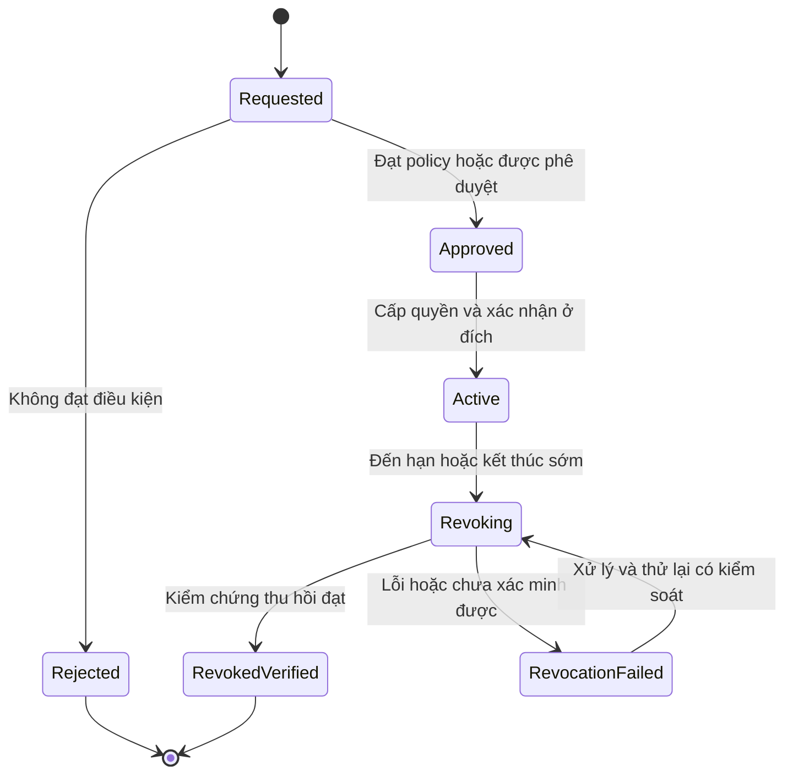

# Standing privilege vô thời hạn

## 1. Quyền được cấp cho một công việc nhưng tồn tại lâu hơn công việc

Một kỹ sư cần sửa lỗi cấu hình trên cụm ứng dụng sản xuất trong 45 phút. Người đó được thêm vào nhóm quản trị và xử lý xong sự cố. Sáu tháng sau, quyền quản trị vẫn còn vì không ai tạo yêu cầu thu hồi, người phê duyệt đã chuyển nhóm, còn ticket ban đầu đã đóng.

Đây là anti-pattern **standing privilege vô thời hạn**: một danh tính giữ khả năng thực hiện thao tác đặc quyền liên tục, trong khi phạm vi, thời hạn hoặc nhu cầu sử dụng không còn được ràng buộc và kiểm chứng. Quyền có thể nằm trong nhóm quản trị, role trên cloud, quyền sudo, quyền quản trị cơ sở dữ liệu, chính sách của service account hoặc một đường chuyển sang danh tính mạnh hơn.

Vấn đề không chỉ là “quyền chưa dùng đến”. Khi tài khoản, thiết bị hoặc workload bị chiếm quyền, khả năng quản trị đã sẵn sàng để sử dụng mà không cần một quyết định cấp quyền mới. Thời gian phơi nhiễm kéo dài cả ngoài ca trực, ngoài cửa sổ thay đổi và sau khi người dùng đã đổi nhiệm vụ.

Trong PAM, cần tách hai câu hỏi:

- **Danh tính này được phép làm gì?** Đây là vấn đề phạm vi quyền, liên quan đến least privilege và JEA.
- **Danh tính này được phép làm việc đó vào lúc nào, trong bao lâu?** Đây là vấn đề thời gian hiệu lực, liên quan đến JIT, lease và thu hồi.

Thu hẹp phạm vi nhưng để quyền tồn tại mãi vẫn để lại quyền thường trực. Đặt thời hạn ngắn cho một role quá rộng vẫn để lại tác động lớn trong cửa sổ hiệu lực. Một thiết kế tốt phải xét cả hai chiều.

Sau bài học, người học có thể nhận diện quyền đặc quyền không có điểm kết thúc, phân biệt việc kết thúc grant với kết thúc khả năng sử dụng quyền, thiết kế vòng đời cấp–hết hạn–thu hồi và xử lý ngoại lệ có trách nhiệm.

## 2. Hiểu chính xác quyền nào đang “thường trực”

### 2.1. Không đồng nhất tài khoản, credential, grant và phiên

Một tài khoản tồn tại lâu không tự động có nghĩa là quyền quản trị tồn tại lâu. Ngược lại, credential tồn tại ngắn không chứng minh rằng quyền quản trị được cấp tạm thời.

| Thành phần | Ý nghĩa | Điều cần kiểm tra |
| --- | --- | --- |
| Identity | Danh tính người dùng hoặc workload | Ai sở hữu, ai chịu trách nhiệm và danh tính còn cần thiết không? |
| Entitlement hoặc eligibility | Quyền được gán hoặc điều kiện cho phép kích hoạt quyền | Có thể tự biến thành quyền quản trị ngay lập tức không? Điều kiện kích hoạt có giới hạn không? |
| Grant đang hiệu lực | Sự cho phép thực hiện một tập hành động trên một phạm vi | Có thời điểm bắt đầu, kết thúc và cơ chế thu hồi không? |
| Credential | Phương tiện chứng minh danh tính hoặc sử dụng một danh tính khác | Credential còn dùng được sau khi grant hết hạn không? |
| Session hoặc token | Ngữ cảnh truy cập đã được thiết lập | Phiên đang mở có tiếp tục thao tác được sau khi quyền bị thu hồi không? |
| Nhóm, role lồng nhau và đường chuyển quyền | Cách danh tính nhận quyền trực tiếp hoặc gián tiếp | Có đường quản trị khác nằm ngoài grant vừa thu hồi không? |

Ví dụ, một người giữ tư cách “đủ điều kiện kích hoạt quản trị” cả năm nhưng chỉ có grant quản trị trong 30 phút. Cần kiểm tra điều kiện kích hoạt: nếu người đó có thể tự kích hoạt bất kỳ lúc nào, trên mọi tài nguyên và liên tục gia hạn, rủi ro còn lại có thể rất gần với quyền thường trực. Eligibility cũng cần owner, phạm vi, rà soát và khả năng thu hồi.

Một service account có token hết hạn sau 15 phút nhưng được phép xin token quản trị mới vô hạn vẫn giữ một đường đặc quyền lâu dài. Rút ngắn tuổi thọ token giúp hạn chế thời gian sử dụng của từng token; nó không tự xóa entitlement nền.

### 2.2. Quyền hiệu lực có thể đến từ nhiều đường

Khi kiểm kê, đừng chỉ tìm trường “administrator” trên từng tài khoản. Cần nhìn theo các đường dẫn đến khả năng quản trị:

- Gán trực tiếp role quản trị cho danh tính.
- Thành viên nhóm quản trị, kể cả nhóm lồng nhau.
- Khả năng assume hoặc impersonate một role hay service account có quyền cao.
- Khả năng sửa policy, nhóm hoặc mapping để tự cấp quyền.
- Credential của một tài khoản quản trị có thể checkout bất kỳ lúc nào.
- Quyền sửa pipeline, runner hoặc cấu hình triển khai dẫn đến workload quản trị.
- Quyền sử dụng một cơ chế khẩn cấp không có giới hạn và không được kiểm tra.
- Đường truy cập trực tiếp vào hệ thống đích bỏ qua cơ chế cấp quyền tạm thời.

Một bản ghi “grant đã hết hạn” chỉ nói về bản ghi đó. Muốn kết luận danh tính không còn khả năng quản trị trong phạm vi đã xét, phải kiểm tra cả đường trực tiếp, đường gián tiếp và trạng thái phiên có liên quan.

### 2.3. “Vô thời hạn” thường xuất hiện dưới dạng vận hành

Không nhất thiết phải có giá trị `expires_at: null` mới là anti-pattern. Các tình huống sau cũng tạo quyền gần như không có điểm kết thúc:

- Grant được gia hạn tự động mà không cần nhu cầu mới.
- Chính sách có thời hạn nhưng không có bộ phận thực thi thu hồi.
- Hạn kết thúc nằm trong ticket, còn hệ thống đích không biết hạn đó.
- Rà soát định kỳ luôn bấm “giữ nguyên” mà không kiểm tra owner và công việc.
- Nhóm quản trị được duy trì cho tiện, chỉ tắt tài khoản khi nhân viên nghỉ việc.
- Có cơ chế hết hạn trên giao diện PAM nhưng người dùng vẫn truy cập trực tiếp bằng credential cũ.
- Danh tính workload được tạo cho một đợt migration rồi tiếp tục hoạt động sau migration.

Một ngày hết hạn chỉ có giá trị kiểm soát khi nó dẫn đến thay đổi quyền thực tế và có thể chứng minh được.

## 3. Vì sao anti-pattern này sống lâu trong tổ chức?

### 3.1. Công việc cấp quyền rõ ràng, công việc thu hồi bị bỏ trống

Yêu cầu cấp quyền thường có người dùng, ticket và áp lực thời gian. Thu hồi xảy ra sau khi mục tiêu đã đạt được, lúc ít người còn chú ý. Nếu quy trình chỉ định nghĩa “ai phê duyệt” nhưng không định nghĩa “ai bảo đảm kết thúc quyền”, grant dễ trở thành tài sản không có người quản lý.

### 3.2. Quyền được gắn với con người thay vì nhiệm vụ

Các câu như “đội hạ tầng cần admin” hoặc “người này là senior nên cần full access” biến quyền quản trị thành đặc điểm lâu dài của chức danh. Trong thực tế, cùng một người có thể cần quyền đọc log hằng ngày, quyền khởi động lại một dịch vụ khi trực và quyền thay đổi policy chỉ trong một số thay đổi được kiểm soát.

Khi không tách các nhiệm vụ này, role rộng nhất trở thành lựa chọn mặc định.

### 3.3. Sự cố làm xuất hiện quyền tạm, nhưng quy trình không ghi nhận tính tạm

Trong sự cố, một ngoại lệ có thể hợp lý. Anti-pattern bắt đầu khi ngoại lệ không có owner, hạn chót, phạm vi và việc phải làm sau sự cố. “Thu hồi sau” không phải một cơ chế thu hồi.

### 3.4. Nhầm công cụ PAM với kết quả kiểm soát

Một tổ chức có vault, MFA và ghi hình phiên nhưng vẫn có thể duy trì quyền quản trị vô thời hạn trên hệ thống đích. Những công cụ này giải quyết các phần khác nhau của rủi ro:

| Kiểm soát | Giá trị mang lại | Phần chưa được giải quyết nếu dùng riêng |
| --- | --- | --- |
| MFA | Tăng yêu cầu xác thực | Không thu hẹp phạm vi hoặc tự hết hạn quyền quản trị |
| Vault | Quản lý việc lưu và cấp credential | Không tự bảo đảm grant hoặc quyền ở đích hết hạn |
| Rotation credential | Thay đổi credential, hạn chế việc dùng lại credential cũ nếu thực thi đúng | Không loại bỏ entitlement của tài khoản; tác động đến phiên hiện hữu cần kiểm tra riêng |
| Ghi phiên | Tạo bằng chứng phục vụ giám sát và điều tra | Không ngăn mọi thao tác gây hại hoặc kết thúc quyền |
| Rà soát định kỳ | Có cơ hội loại bỏ quyền không còn cần | Vẫn có khoảng phơi nhiễm giữa hai lần rà soát |
| JIT có kiểm chứng thu hồi | Giới hạn cửa sổ sử dụng quyền cho từng nhiệm vụ | Còn phụ thuộc phạm vi role, điều kiện kích hoạt và thực thi trên hệ thống đích |

Không nên loại bỏ các kiểm soát hỗ trợ này. Cần đặt chúng vào cùng vòng đời quyền để mỗi kiểm soát có mục tiêu và bằng chứng riêng.

## 4. Rủi ro tăng theo phạm vi, thời gian và đường truy cập

Có thể dùng mô hình định tính sau để thảo luận thiết kế:

```text
Mức phơi nhiễm đặc quyền
  phụ thuộc vào:
  phạm vi hành động × độ nhạy tài nguyên × thời gian có thể sử dụng quyền
  × khả năng sử dụng credential/phiên × số đường truy cập còn mở
```

Đây không phải công thức tính xác suất hay tổn thất tài chính. Nó giúp thấy rằng giảm một yếu tố chưa chắc giải quyết được các yếu tố còn lại.

Với standing privilege vô thời hạn, một lỗi bảo vệ tài khoản có thể mở đường đến tác động đặc quyền vào bất kỳ thời điểm nào. Khi quyền tồn tại nhiều tháng, các thay đổi về công việc, nhóm, thiết bị, người sở hữu và môi trường đều có thể làm giả định cấp quyền ban đầu không còn đúng.

Các hậu quả thường gặp gồm:

- Tài khoản ít hoạt động nhưng vẫn có thể thay đổi hệ thống sản xuất.
- Workload cũ giữ quyền đọc secret hoặc thay đổi hạ tầng sau khi ứng dụng đã chuyển chủ.
- Quyền tích lũy qua nhiều lần chuyển đội mà không thu hồi vai trò trước.
- Không xác định được tác vụ nào biện minh cho một lần thao tác quản trị.
- Không biết chính xác thời điểm quyền lẽ ra phải kết thúc để điều tra truy cập ngoài cửa sổ.
- Tăng số danh tính có thể thay đổi cấu hình, xóa dữ liệu hoặc tác động đến bằng chứng.

Bản kiểm kê nên ưu tiên quyền có khả năng sửa IAM/PAM, quản lý secret, điều khiển hạ tầng quan trọng và thay đổi log. Những quyền này có thể ảnh hưởng cả các kiểm soát dùng để quản lý quyền khác.

## 5. Thiết kế đích: quyền có mục đích, phạm vi và điểm kết thúc

### 5.1. Một grant phải trả lời được các câu hỏi vận hành

Một yêu cầu cấp quyền tạm thời nên xác định được:

1. Danh tính nào sẽ dùng quyền, theo loại người dùng hay workload?
2. Công việc cụ thể và mã tham chiếu nào biện minh cho quyền?
3. Hành động nào được phép, trên những tài nguyên nào?
4. Thời điểm bắt đầu và kết thúc là khi nào?
5. Điều kiện nào phải đạt trước khi kích hoạt?
6. Ai có quyền phê duyệt theo chính sách, và có xung đột vai trò không?
7. Hệ thống nào thực thi việc cấp và thu hồi?
8. Làm sao xác minh việc thu hồi có hiệu lực ở hệ thống đích?
9. Nếu thu hồi lỗi, ai nhận cảnh báo và biện pháp xử lý là gì?
10. Bằng chứng nào được lưu để nối yêu cầu, quyết định, grant, phiên và kết quả thu hồi?

Yêu cầu phê duyệt có thể khác nhau theo mức rủi ro. Một tác vụ giới hạn đã được phê duyệt bằng policy có thể được xử lý tự động. Tác vụ nhạy cảm có thể cần người phê duyệt độc lập. Điều cốt lõi là điều kiện cấp quyền phải được định nghĩa, thực thi và lưu bằng chứng; không phụ thuộc vào một thao tác đồng ý mang tính hình thức.

### 5.2. Tách quyền nền, eligibility và quyền kích hoạt

Một cấu trúc thường dùng gồm:

- **Quyền nền:** phục vụ công việc bình thường, ví dụ đọc tình trạng dịch vụ.
- **Eligibility:** xác định ai được yêu cầu một loại tác vụ đặc quyền trong một phạm vi.
- **Grant kích hoạt:** cấp quyền thực thi cụ thể trong thời gian hữu hạn.
- **JEA hoặc role tác vụ:** giới hạn hành động để không phải dùng toàn bộ quyền quản trị.
- **Thu hồi và kiểm chứng:** kết thúc grant, xử lý phiên hoặc credential liên quan theo khả năng của đích và xác nhận kết quả.

Ví dụ, kỹ sư trực chỉ cần khởi động lại một dịch vụ. Nếu cấp role quản trị toàn bộ hệ điều hành trong 30 phút, thời hạn đã được cải thiện nhưng phạm vi vẫn quá rộng. Một cơ chế cho phép restart đúng dịch vụ, với đầu vào bị giới hạn và ghi nhận người thực hiện, có thể đáp ứng nhiệm vụ với ít quyền hơn.

Tài khoản quản trị tách biệt với tài khoản làm việc thông thường giúp phân biệt ngữ cảnh sử dụng, nhưng bản thân tài khoản tách biệt không làm quyền trở thành tạm thời. Nó vẫn phải tham gia cùng vòng đời grant.

### 5.3. TTL là thời hạn của đối tượng nào?

Khi nói “TTL 30 phút”, cần ghi rõ đó là TTL của yêu cầu, grant, credential, token hay phiên. Những thời hạn này không nhất thiết giống nhau.

Một mục tiêu thiết kế có thể là:

- Grant chỉ hợp lệ trong cửa sổ đã được phê duyệt.
- Không phát hành thêm credential hoặc phiên đặc quyền sau khi grant hết hạn.
- Credential/token và phiên được ràng buộc hoặc xử lý để không tạo một cửa sổ đặc quyền vượt quá mức tổ chức chấp nhận.
- Sau hết hạn, kết quả thu hồi được kiểm tra trong một khoảng trễ đã định nghĩa.
- Mọi sai lệch được ghi nhận và xử lý, thay vì tự chuyển trạng thái thành thành công.

Không được giả định mọi hệ thống đều đánh giá quyền ở cùng thời điểm. Có hệ thống đánh giá ở mỗi thao tác, có hệ thống giữ ngữ cảnh quyền trong phiên hoặc token. Phải kiểm thử hành vi thực tế của đường truy cập đang dùng.

Nếu nền tảng không hỗ trợ kết thúc phiên đang mở, thiết kế phải nêu rõ giới hạn, dùng biện pháp bù phù hợp và chấp nhận rủi ro còn lại theo quy trình. Không nên báo cáo “quyền hết hạn đúng TTL” chỉ từ việc xóa một mapping trong control plane.

## 6. Vòng đời grant và điều kiện kết thúc



### 6.1. Cấp quyền cũng phải có readback

Một API cấp quyền trả về thành công chưa đủ chứng minh đúng danh tính đã nhận đúng role trên đúng phạm vi. Cần đọc lại hoặc kiểm chứng theo cơ chế của hệ thống đích, đồng thời lưu định danh grant để việc thu hồi không phải suy đoán từ tên tài khoản.

Thời hạn nên được xác định trước khi cấp. Nếu cấp thành công nhưng ghi nhận hạn thất bại, hệ thống cần có cách phát hiện và xử lý grant mồ côi.

### 6.2. Kết thúc sớm khi công việc hoàn tất

TTL là giới hạn tối đa, không phải quyền mặc nhiên được giữ đến hết hạn dù công việc đã xong. Người dùng hoặc hệ thống có thể chủ động kết thúc grant sớm. Cách xử lý phải rõ với phiên đang hoạt động để tránh làm gián đoạn một thay đổi ở trạng thái nguy hiểm.

Việc kết thúc công việc, kết thúc phiên và kết thúc grant là ba sự kiện có liên quan nhưng không tự động đồng nghĩa. Quy trình phải ghi nhận cả trạng thái công việc và trạng thái truy cập thực tế.

### 6.3. Thu hồi là một quy trình có thể thất bại

Các tình huống cần dự kiến gồm:

- Hệ thống đích không truy cập được.
- Connector mất quyền thực hiện thu hồi.
- API trả kết quả chưa hoàn tất hoặc việc thay đổi quyền cần thời gian lan truyền.
- Danh tính đã bị đổi tên hoặc tài nguyên đã được di chuyển.
- Grant đã được cấp qua nhiều đường nhưng mới gỡ được một đường.
- Phiên hoặc token còn khả năng sử dụng sau khi gỡ membership.
- Job thu hồi không chạy vì bộ lập lịch, hàng đợi hoặc dịch vụ quản lý gặp lỗi.

Trạng thái “đã gửi lệnh thu hồi” phải khác với “đã kiểm chứng thu hồi”. Khi chưa biết kết quả, cần giữ trạng thái chưa xác minh, phát cảnh báo có người nhận và ưu tiên xử lý theo mức nhạy của quyền.

Hoạt động thử lại nên có định danh ổn định, tránh tạo thêm grant hoặc xóa nhầm membership có nguồn khác. Một vòng đối soát độc lập giúp tìm grant đã quá hạn nhưng job thu hồi ban đầu bị mất.

### 6.4. Gia hạn không được trở thành vòng lặp vô hạn

Gia hạn phải nối với nhu cầu đang còn hiệu lực, có thời hạn mới và quyết định theo policy. Không nên tự gia hạn chỉ vì phiên vẫn mở, có heartbeat hoặc người dùng chưa bấm hoàn tất.

Ví dụ, một grant 30 phút nhưng tự gia hạn mỗi 25 phút trong suốt nhiều ngày có thể chỉ là standing privilege được chia thành nhiều bản ghi nhỏ. Theo dõi cả thời gian truy cập liên tục và chuỗi grant liên tiếp cho cùng danh tính, role và phạm vi, thay vì chỉ xem TTL của từng bản ghi.

## 7. Ví dụ chính sách và bằng chứng cho một grant

Đoạn YAML dưới đây là **mô hình minh họa**, không phải schema cấu hình của một sản phẩm PAM. Khi triển khai, phải ánh xạ từng thuộc tính sang khả năng thực tế của IAM, PAM, hệ thống đích và hệ thống giám sát.

```yaml
grant:
  id: grant-demo-004
  principal: human:ops-an
  purpose_ref: change-demo-082
  resource_scope:
    environment: production
    service: payment-worker
    instances:
      - app-demo-01
  task_role: service-restart-operator
  allowed_actions:
    - inspect_service_status
    - restart_named_service
  valid_from: "2026-01-15T09:00:00Z"
  expires_at: "2026-01-15T09:30:00Z"

activation:
  policy_ref: pam-task-access-v3
  approval_ref: approval-demo-019
  requester_may_approve_own_request: false
  recheck_conditions_before_grant: true

closure:
  deny_new_activation_after_expiry: true
  revoke_target_grant: true
  verify_effective_access_removed: true
  inspect_related_sessions: true
  revocation_owner: platform-oncall
  verification_deadline_seconds: 120
  on_verification_failure: open_security_alert

evidence:
  correlate:
    - purpose_ref
    - approval_ref
    - grant_id
    - principal
    - target_assignment_id
    - session_id
  store_credentials_in_evidence: false
```

Các giá trị 30 phút và 120 giây chỉ là giả định cho ví dụ. Tổ chức cần chọn giới hạn theo tác vụ, tác động đến tính sẵn sàng, đặc điểm hệ thống đích và yêu cầu vận hành. Tác vụ đổi cấu hình ngắn, tác vụ nâng cấp kéo dài và luồng ứng phó khẩn cấp có thể cần các cửa sổ khác nhau.

Một bản ghi kết thúc hữu ích có thể chứa:

```json
{
  "grant_id": "grant-demo-004",
  "expiry_at": "2026-01-15T09:30:00Z",
  "revocation_requested_at": "2026-01-15T09:30:01Z",
  "target_assignment_removed_at": "2026-01-15T09:30:04Z",
  "verification_completed_at": "2026-01-15T09:30:07Z",
  "verification_scope": "assigned task role and tracked privileged session",
  "verification_result": "PASS",
  "evidence_ref": "evidence-demo-004"
}
```

Không nên đặt `verification_result: PASS` nếu chỉ nhận được phản hồi đã tiếp nhận yêu cầu. Phạm vi kiểm chứng phải được mô tả trung thực: kiểm tra một task role không phải là kết luận rằng danh tính không còn bất kỳ đặc quyền nào trong toàn tổ chức.

Bằng chứng cần đủ để tái dựng quyết định và kết quả, nhưng không chứa mật khẩu, private key, access token hay nội dung secret. Tham chiếu tới bản ghi bảo mật thích hợp thay vì sao chép credential vào ticket hoặc log. Quyền sửa và quyền xóa bằng chứng cũng cần được kiểm soát để người sử dụng đặc quyền không tự quyết định dấu vết nào được giữ.

## 8. Phát hiện quyền vô thời hạn và quyền đã quá hạn

### 8.1. Bắt đầu từ dữ liệu hiệu lực

Nguồn kiểm kê nên phản ánh hệ thống đang thực thi quyền: assignment IAM, membership nhóm, cấu hình quyền ở đích, policy của workload và các đường sử dụng tài khoản được quản lý. Ticket và hồ sơ PAM giải thích lý do; chúng cần được đối chiếu với dữ liệu thực tế.

Tối thiểu, mỗi đường đặc quyền nên xác định được:

- Principal và loại danh tính.
- Owner chịu trách nhiệm và đơn vị quản lý tài nguyên.
- Role hoặc tập hành động, phạm vi tài nguyên.
- Nguồn cấp trực tiếp, nhóm, role trung gian hoặc credential được checkout.
- Thời điểm bắt đầu, thời điểm kết thúc nếu có.
- Mã yêu cầu, quyết định cấp hoặc ngoại lệ được chấp nhận.
- Trạng thái quan sát ở đích và thời điểm quan sát gần nhất.
- Trạng thái thu hồi, kết quả kiểm chứng và sự kiện sử dụng liên quan.

Nếu thiếu owner hoặc không biết nguồn của quyền, hãy ghi nhận đó là vấn đề cần xử lý, không tự suy ra quyền hợp lệ chỉ vì đã tồn tại từ lâu.

### 8.2. Đối soát theo nhiều nhóm sai lệch

Pseudocode sau mô tả ý tưởng kiểm tra, không phải truy vấn chạy trực tiếp trên sản phẩm:

```text
now = trusted_current_time()

for each access_path in observed_privileged_access:
    if access_path.observation_is_stale:
        record_finding("OBSERVATION_STALE", access_path)
        continue

    record = match_authorized_grant_or_exception(access_path)

    if record is missing:
        record_finding("UNTRACKED_PRIVILEGE", access_path)
        continue

    if record.has_no_end_time:
        record_finding("NO_EXPIRY", access_path)

    if record.owner_is_missing:
        record_finding("OWNER_MISSING", access_path)

    if record.expires_at exists and now >= record.expires_at:
        record_finding("EXPIRED_BUT_ACCESS_OBSERVED", access_path)

for each grant with expected_end_time <= now:
    if grant.revocation_verification is missing:
        record_finding("REVOCATION_NOT_VERIFIED", grant)

for each renewable_privilege_chain:
    if chain.exceeds_continuous_access_policy:
        record_finding("CONTINUOUS_PRIVILEGE_EXCEEDS_POLICY", chain)
```

Việc đối chiếu cần định danh đủ chính xác. Chỉ ghép theo tên role có thể bỏ sót khác biệt về tenant, môi trường hoặc resource scope. Các assignment lồng nhau cần được giải thành đường quyền hoặc được kiểm tra bằng một cơ chế xác định quyền hiệu lực phù hợp.

Không có dữ liệu quan sát mới không đồng nghĩa không còn quyền. Dashboard nên phân biệt “không thấy quyền sau kiểm tra”, “chưa kiểm tra được” và “quyền vẫn tồn tại”.

### 8.3. Tín hiệu ưu tiên điều tra

Các tín hiệu sau đặc biệt hữu ích khi kết hợp với mức nhạy của tài nguyên:

- Đặc quyền không có hạn, không owner hoặc không mã nhu cầu.
- Danh tính đã đổi đội nhưng vẫn giữ quyền của đội cũ.
- Quyền cấp vì sự cố vẫn tồn tại sau khi sự cố đã kết thúc.
- Workload đã ngừng triển khai nhưng danh tính hoặc trust path quản trị vẫn hoạt động.
- Một principal nhận grant mới ngay trước khi grant cũ hết hạn, lặp lại liên tục.
- Hoạt động quản trị xuất hiện sau thời điểm grant lẽ ra phải kết thúc.
- PAM báo hết hạn nhưng log hệ thống đích vẫn ghi nhận thao tác đặc quyền.
- Quyền qua đường JIT bị thu hồi nhưng truy cập trực tiếp vẫn thành công.
- Job thu hồi liên tục báo thành công mà không có readback ở đích.

Tín hiệu bất thường là căn cứ kiểm tra, không phải kết luận về hành vi xấu. Ca trực dài, hoạt động khắc phục khẩn cấp hoặc công việc theo kế hoạch có thể giải thích một phần hoạt động, nhưng lời giải thích cần nối được với quyền thực tế và quyết định hợp lệ.

## 9. Đo lường để biết quyền thường trực có thực sự giảm

Nếu chỉ đếm số tài khoản đã đưa vào vault hoặc số grant có TTL, báo cáo có thể đẹp trong khi các đường quản trị lâu dài vẫn giữ nguyên.

| Chỉ số | Cách định nghĩa mẫu | Ý nghĩa và giới hạn |
| --- | --- | --- |
| Đường đặc quyền không có hạn | Số bộ principal–quyền–phạm vi không có thời hạn / tổng số bộ đặc quyền đã kiểm kê trong scope | Phải bao gồm cả đường gián tiếp; chỉ số bị lệch nếu kiểm kê chưa đủ |
| Grant quá hạn còn hiệu lực | Số grant đã hết hạn nhưng vẫn quan sát được quyền ở đích | Nên phân nhóm theo độ trễ và mức nhạy, không chỉ tổng số |
| Tỷ lệ kiểm chứng thu hồi | Số grant đến hạn đã kiểm chứng thu hồi đạt / tổng grant đến hạn trong kỳ | Cần báo riêng các grant chưa quan sát được hoặc gặp lỗi |
| Độ trễ thu hồi đã kiểm chứng | Thời điểm kiểm chứng thành công trừ thời điểm kết thúc được yêu cầu | Có thể báo trung vị và phân vị cao; các ca chưa hoàn tất phải hiện riêng |
| Thời gian đặc quyền liên tục | Thời lượng hợp của các cửa sổ grant liền nhau theo quy tắc đã xác định | Giúp phát hiện chuỗi gia hạn biến JIT thành quyền thường trực |
| Ngoại lệ thiếu owner hoặc quá hạn | Số ngoại lệ thiếu người chịu trách nhiệm, thiếu ngày rà soát hoặc đã hết hạn | Phản ánh chất lượng quản lý ngoại lệ |
| Độ phủ quan sát | Số hệ thống hoặc đường quyền có dữ liệu hiệu lực đủ mới / tổng số thuộc scope | Ngăn hiểu nhầm “không có phát hiện” thành “không có rủi ro” |

Khi tính thời gian đặc quyền, không cộng trùng hai grant chồng nhau cho cùng principal, quyền và phạm vi. Nếu so sánh trước–sau, cần giữ cách phân loại và scope tương đương; đưa thêm hệ thống vào kiểm kê có thể làm số phát hiện tăng dù kiểm soát đang tốt hơn.

Ngoài tốc độ thu hồi, nên quan sát tác động vận hành: yêu cầu hợp lệ bị từ chối, kích hoạt chậm, thu hồi giữa thay đổi đang dang dở và số lần phải dùng cơ chế khẩn cấp. Mục tiêu là giảm quyền tồn tại không cần thiết mà vẫn đáp ứng công việc theo một cơ chế có kiểm soát.

Không nên tuyên bố “zero standing privilege” nếu còn đường quản trị ngoài scope, eligibility kích hoạt không giới hạn hoặc dữ liệu quan sát chưa đủ. Hãy mô tả phạm vi đã chuyển đổi, các ngoại lệ còn lại và giới hạn kiểm chứng.

## 10. Chuyển đổi an toàn từ quyền lâu dài sang quyền theo nhiệm vụ

### 10.1. Kiểm kê và phân loại trước khi gỡ quyền

Không nên xóa hàng loạt nhóm quản trị chỉ dựa trên tên nhóm. Một membership có thể đang phục vụ tự động hóa, khôi phục hoặc tác vụ vận hành chưa được ghi nhận đầy đủ.

Lập danh sách các đường quyền, owner, hệ thống phụ thuộc và công việc đang dùng quyền. Phân loại thành:

- Không còn nhu cầu: xác minh owner và thực hiện thu hồi theo quy trình.
- Cần dùng theo đợt: đưa vào grant có thời hạn theo nhiệm vụ.
- Cần dùng thường xuyên nhưng phạm vi hẹp: xem xét role tác vụ hoặc cơ chế ủy quyền giới hạn.
- Workload cần chạy liên tục: xử lý bằng mô hình identity và quyền tối thiểu của workload.
- Đường khẩn cấp hoặc giới hạn kỹ thuật: quản lý thành ngoại lệ có điều kiện.

Lịch sử “chưa thấy dùng” là dữ liệu hỗ trợ chứ không phải bằng chứng duy nhất để xóa quyền. Một quyền phục hồi có thể ít sử dụng nhưng cần thiết; một quyền không có log cũng có thể chỉ là thiếu giám sát.

### 10.2. Thử nghiệm trên một nhóm tác vụ cụ thể

Chọn một tác vụ có đầu vào rõ, rủi ro được hiểu và owner sẵn sàng tham gia. Ví dụ: restart một dịch vụ trên một nhóm máy thử nghiệm.

Trước khi gỡ standing role, cần chứng minh đường mới đáp ứng đủ công việc hợp lệ: kích hoạt, thực thi, hết hạn, kết thúc phiên khi cần, thu hồi sớm và xử lý lỗi. Cũng cần thử một thao tác ngoài phạm vi để biết role tác vụ thực sự giới hạn hành động.

Chỉ sau khi đường mới và cơ chế khôi phục vận hành được chấp nhận mới bỏ đường quyền cũ. Nếu vẫn giữ cả hai đường vô thời hạn, việc đưa vào JIT chưa làm giảm quyền thường trực.

### 10.3. Mở rộng theo hệ thống và mức nhạy

Theo dõi tỷ lệ thành công của công việc, số lần hỗ trợ và chất lượng bằng chứng. Điều chỉnh vai trò, thời lượng hoặc quy trình dựa trên dữ liệu công việc thật.

Cần tránh khôi phục quyền thường trực chỉ vì quy trình mới có độ trễ. Trước hết xác định nguyên nhân: role chưa đủ, phạm vi sai, luồng phê duyệt thiếu người trực hay connector chậm. Giải pháp có thể là policy tự động cho tác vụ giới hạn, chuẩn bị eligibility phù hợp hoặc cải thiện cơ chế cấp–thu hồi.

Mọi biện pháp quay lại đường cũ để xử lý sự cố nên có owner, thời hạn và bước đóng ngoại lệ. Một “rollback tạm” không có hạn có thể tái tạo chính anti-pattern đang loại bỏ.

## 11. Workload và ngoại lệ: không áp một mô hình cho mọi danh tính

### 11.1. Workload chạy liên tục

Một dịch vụ chạy suốt ngày cần quyền liên tục để thực hiện chức năng hợp lệ. Không nên yêu cầu con người phê duyệt mỗi lần dịch vụ gọi API. Cũng không nên dùng nhu cầu chạy liên tục để biện minh cho role quản trị toàn cục.

Thiết kế phù hợp có thể bao gồm:

- Danh tính riêng cho từng workload và môi trường.
- Quyền giới hạn theo tác vụ, tài nguyên và điều kiện thực thi.
- Credential hoặc token ngắn hạn khi nền tảng hỗ trợ.
- Điều kiện cấp mới gắn với workload hợp lệ thay vì một secret dùng chung.
- Kiểm soát người có thể sửa workload, trust policy và pipeline.
- Thu hồi hoặc thay đổi entitlement khi workload kết thúc, chuyển chủ hoặc đổi chức năng.
- Owner, rà soát định kỳ và giám sát quyền vượt khỏi nhu cầu.

Cần báo cáo trung thực: một workload có entitlement dài hạn để thực hiện chức năng cốt lõi vẫn giữ quyền dài hạn đó, dù từng token chỉ sống vài phút. Cải thiện tuổi thọ credential và loại bỏ quyền quản trị dư thừa là hai công việc riêng.

### 11.2. Hệ thống không hỗ trợ TTL

Nếu hệ thống đích không có native expiry, có thể dùng cơ chế cấp–gỡ từ bên ngoài, với điều kiện có đối soát độc lập và kiểm chứng ở đích. Cơ chế này phụ thuộc vào connector, bộ lập lịch và khả năng truy cập hệ thống, nên phải quản lý các lỗi tương ứng.

Biện pháp bù có thể gồm role hẹp hơn, giới hạn đường mạng, quản lý credential qua vault, giám sát phiên, thu hồi theo lịch và cảnh báo sai lệch. Không nên coi biện pháp bù là bằng chứng rằng quyền đã tự hết hạn.

### 11.3. Ngoại lệ có điều kiện

Một ngoại lệ được quản lý nên có tối thiểu:

- Lý do kỹ thuật hoặc nghiệp vụ cụ thể.
- Principal, quyền và phạm vi tài nguyên.
- Owner nghiệp vụ và owner kỹ thuật.
- Người hoặc vai trò chấp nhận rủi ro theo thẩm quyền.
- Ngày bắt đầu, ngày hết hạn hoặc mốc phải đánh giá lại có quyết định tiếp theo.
- Kiểm soát bù và cách kiểm tra chúng.
- Kế hoạch giảm phạm vi hoặc chuyển sang mô hình tốt hơn.
- Bằng chứng rà soát và quyết định tiếp tục hay thu hồi.

“Đến hạn rà soát” không được đồng nhất với “quyền đã bị thu hồi”. Nếu ngoại lệ tiếp tục duy trì quyền dài hạn, dashboard phải thể hiện rõ điều đó. Mục tiêu là tránh quyền không có trách nhiệm quản lý, không đổi tên standing privilege thành “ngoại lệ” để bỏ qua kiểm soát.

### 11.4. Break-glass

Đường truy cập khẩn cấp có thể phải tồn tại khi hệ thống phê duyệt thông thường hoặc PAM không hoạt động. Vì vậy, cơ chế khẩn cấp cần được thiết kế và kiểm thử riêng: bảo vệ phương tiện truy cập, giới hạn người có thể sử dụng, phát hiện việc sử dụng và thực hiện rà soát sau sự kiện.

Sau khi dùng, cần xác minh kết thúc truy cập, xử lý credential theo thiết kế và loại bỏ quyền phát sinh để khắc phục sự cố. Break-glass không nên trở thành đường quản trị hằng ngày hoặc cách tự gia hạn quyền không bị theo dõi.

## 12. Tình huống: bỏ role thường trực nhưng vẫn còn phiên quản trị

Đội vận hành có 12 kỹ sư cùng giữ role quản trị trên một cụm ứng dụng. Tổ chức chuyển sang grant 30 phút qua PAM và gỡ membership lâu dài. Dashboard ghi nhận mọi grant đã hết hạn đúng giờ.

Trong thử nghiệm, đội phát hiện một phiên quản trị mở trước lúc hết hạn vẫn tiếp tục thực hiện thao tác. Đồng thời, một nhóm lồng nhau còn cấp quyền tương đương cho hai kỹ sư.

Phân tích theo từng lớp cho thấy:

1. Việc gỡ membership trực tiếp đã thực hiện.
2. Logic báo cáo chỉ dựa trên thời gian hết hạn trong PAM.
3. Phiên đã xác thực có hành vi khác với một lần kết nối mới.
4. Kiểm kê chưa giải đường quyền qua nhóm lồng nhau.
5. Vì thế, trạng thái “grant hết hạn” không chứng minh “khả năng quản trị đã kết thúc”.

Cách xử lý là cập nhật thiết kế và tiêu chí kiểm chứng: kiểm tra các đường quyền trong phạm vi, xác định cách quản lý phiên của đích, giới hạn hoặc kết thúc phiên theo cơ chế được hỗ trợ và ghi nhận phần chưa kiểm chứng được.

Một dòng thời gian mong muốn cho lần thử tiếp theo:

```text
09:00  Grant được kích hoạt cho đúng tác vụ và tài nguyên
09:02  Phiên đặc quyền được mở, gắn session_id với grant_id
09:18  Tác vụ hoàn tất; người dùng yêu cầu kết thúc sớm
09:18  Ngừng cấp phiên/credential mới theo grant này
09:19  Xử lý phiên và gỡ quyền theo cơ chế đã thiết kế
09:19  Kiểm tra quyền trực tiếp, đường gián tiếp liên quan và phiên
09:20  Đóng grant với kết quả kiểm chứng cùng tham chiếu bằng chứng
```

Thời gian trong ví dụ là giả định. Nếu bước kiểm tra thất bại hoặc không quan sát được đích, grant không được đóng ở trạng thái đã kiểm chứng. Việc giữ sai lệch hiển thị giúp đội vận hành xử lý đúng nơi quyền còn tồn tại.

## 13. Bài thực hành trên môi trường kiểm thử

### 13.1. Chuẩn bị phạm vi

Dùng một danh tính thử nghiệm, một tài nguyên không chứa dữ liệu thật và một role tác vụ có hành động được phép rõ ràng. Ví dụ: xem trạng thái và restart một dịch vụ demo. Chuẩn bị thêm một thao tác ngoài phạm vi, chẳng hạn thay đổi policy của tài nguyên, để kiểm tra quyền bị giới hạn.

Trước khi thử, ghi lại trạng thái quyền ban đầu và bảo đảm có đường quản lý riêng để khôi phục môi trường. Các thử nghiệm thay đổi role và phiên chỉ thực hiện trong phạm vi đã được cho phép.

### 13.2. Các ca thử và bằng chứng cần thu

| Ca thử | Kết quả cần quan sát |
| --- | --- |
| Trước kích hoạt | Tác vụ đặc quyền bị từ chối; quyền nền vẫn dùng được |
| Trong cửa sổ grant | Tác vụ được phê duyệt thành công trên đúng tài nguyên |
| Hành động ngoài phạm vi | Bị từ chối dù grant đang hiệu lực |
| Sau hết hạn, mở kết nối mới | Không sử dụng được grant đã hết hạn |
| Sau hết hạn, dùng phiên đã mở | Hành vi phù hợp với thiết kế quản lý phiên; sai lệch được ghi nhận |
| Thu hồi sớm | Quyền và phiên được xử lý theo chính sách, có readback |
| Đường quyền gián tiếp | Không còn đường tương đương ngoài những ngoại lệ được ghi nhận |
| Mô phỏng connector thu hồi lỗi | Có trạng thái lỗi/chưa xác minh và cảnh báo đến đúng owner |
| Đối soát sau khi connector phục hồi | Phát hiện grant quá hạn, hoàn tất xử lý và kiểm chứng |
| Yêu cầu gia hạn | Có nhu cầu và quyết định mới theo policy; không tự kéo dài vô hạn |

Giữ bằng chứng về principal, grant, phạm vi, thời gian, quyết định, sự kiện ở đích và kết quả kiểm chứng. Không ghi credential vào biên bản thực hành.

### 13.3. Cách đánh giá kết quả

Bài thực hành đạt mục tiêu khi người thực hiện chứng minh được ba điều: đúng công việc diễn ra trong đúng phạm vi, thời gian đặc quyền bị giới hạn theo thiết kế và sai lệch thu hồi được phát hiện thay vì bị che bằng trạng thái thành công.

Nếu phiên cũ vẫn dùng được sau expiry, hãy mô tả chính xác điều kiện, thời lượng và cơ chế còn thiếu. Nếu một nhóm khác tiếp tục cấp quyền, ghi nhận đường quyền đó. Đây là dữ liệu để sửa thiết kế, không phải lý do bỏ qua kiểm tra.

## 14. Câu hỏi tự kiểm tra

**Một tài khoản quản trị đã được đưa vào vault và bật MFA có còn standing privilege không?**

Có thể còn. Vault và MFA quản lý credential và xác thực. Cần kiểm tra entitlement, khả năng kích hoạt, thời hạn grant, đường truy cập và hành vi phiên trên hệ thống đích.

**Token hết hạn sau 10 phút có chứng minh workload không giữ quyền dài hạn không?**

Không. Workload có thể vẫn được quyền xin token mới hoặc dùng một trust path dài hạn. Cần đánh giá entitlement nền và điều kiện phát hành token, đồng thời kiểm tra phạm vi quyền của workload.

**Vì sao xóa membership chưa đủ để đóng grant là đã kiểm chứng?**

Danh tính có thể còn quyền qua nhóm lồng nhau, role khác hoặc phiên/token đã thiết lập. Kết luận phải dựa trên những đường quyền và trạng thái truy cập đã được kiểm tra trong phạm vi xác định.

**Có phải mọi quyền dài hạn đều phải thu hồi ngay lập tức?**

Không. Cần hiểu công việc và phụ thuộc trước khi thay đổi. Workload liên tục, hệ thống cũ và cơ chế khẩn cấp có thể cần thiết kế hoặc ngoại lệ riêng. Quyền dài hạn phải có mục đích, owner, phạm vi, kiểm soát và quyết định rà soát rõ ràng.

**Một grant ngắn hạn được tự gia hạn suốt một tuần có giải quyết anti-pattern không?**

Chưa đủ. Cần xem thời gian quyền hiệu lực liên tục, căn cứ cho từng lần gia hạn và khả năng sử dụng quyền thực tế. Chia một quyền dài hạn thành nhiều grant nhỏ không tự làm giảm thời gian phơi nhiễm.

**Bằng chứng mạnh nhất để nói một grant đã kết thúc là gì?**

Là chuỗi bằng chứng nối thời điểm kết thúc theo quyết định với thao tác thu hồi và kết quả kiểm tra ở đích, bao gồm phiên và các đường quyền liên quan theo scope đã định nghĩa. Một timestamp expiry hoặc phản hồi API đơn lẻ chưa thay thế được chuỗi bằng chứng đó.

## 15. Nguyên tắc vận dụng

Mỗi quyền đặc quyền cần gắn với một công việc hoặc chức năng có thể giải thích, một phạm vi tối thiểu và một vòng đời được quản lý. Với quyền cấp theo nhiệm vụ, điểm kết thúc phải được thực thi và kiểm chứng. Với quyền dài hạn còn cần thiết, phải nhìn thấy rõ owner, lý do, giới hạn và rủi ro còn lại.

Khi đánh giá PAM, hãy đi hết đường từ nhu cầu đến quyền thực tế, rồi từ thời điểm hết hạn đến việc khả năng sử dụng quyền đã kết thúc. Đó là cách phát hiện standing privilege vô thời hạn ngay cả khi tổ chức đã có vault, MFA, grant ngắn hạn và dashboard báo cáo đầy đủ.
