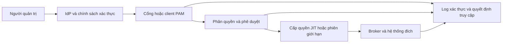

# Không có MFA cho PAM

## 1. Mục tiêu của bài học

Privileged Access Management (PAM) tập trung những quyền có khả năng thay đổi hệ thống: quản trị máy chủ, truy xuất bí mật, khởi tạo phiên đặc quyền, thay chính sách và xử lý truy cập khẩn cấp. Vì vậy, một cổng PAM chỉ yêu cầu mật khẩu có thể biến thành điểm tập trung rủi ro. Nếu mật khẩu bị lộ và không có kiểm soát bổ sung đủ mạnh, kẻ tấn công có thể sử dụng chính hạ tầng được triển khai để bảo vệ tài khoản quản trị.

Sau bài học, bạn cần có khả năng:

- Nhận diện anti-pattern “không có MFA cho PAM”, kể cả khi tổ chức đã bật MFA cho một số màn hình đăng nhập.
- Phân biệt xác thực nhiều yếu tố, phân quyền, phê duyệt và giám sát phiên.
- Xác định những đường truy cập con người cần được kiểm soát và những đường tự động hóa cần cơ chế định danh riêng.
- Đề xuất cách triển khai MFA cùng least privilege, JIT/JEA, vault, quản lý credential và lưu bằng chứng.
- Kiểm tra enrollment, khôi phục, truy cập khẩn cấp và các đường vòng trước khi coi MFA là đã bao phủ.

Trọng tâm là sai lầm kiến trúc và vận hành, không phải hướng dẫn cấu hình cho một sản phẩm cụ thể.

## 2. Tình huống mở đầu: kho bí mật an toàn nhưng cổng vào yếu

Một doanh nghiệp đưa tài khoản quản trị vào vault. Mật khẩu được luân chuyển định kỳ, người dùng truy cập máy chủ thông qua session broker và các phiên đều được ghi lại. Nhóm vận hành cho rằng tài khoản quản trị đã được bảo vệ tốt.

Tuy nhiên, cổng PAM chỉ yêu cầu tên đăng nhập và mật khẩu thư mục doanh nghiệp. Một quản trị viên nhập thông tin vào trang giả mạo. Kẻ tấn công sử dụng mật khẩu đó để đăng nhập cổng PAM, chọn một tài sản mà người này có quyền truy cập và mở phiên.

Các kiểm soát vẫn hoạt động đúng chức năng:

- Vault không công bố mật khẩu ngoài quy trình.
- Broker vẫn kết nối đến đúng máy chủ được cấp quyền.
- Nhật ký vẫn ghi đúng danh tính đã đăng nhập.
- Chính sách vẫn cho phép tài khoản đó thực hiện thao tác quản trị.

Điểm thất bại nằm ở giả định: “người nhập đúng mật khẩu chắc chắn là quản trị viên”.

MFA bổ sung bằng chứng xác thực ngoài mật khẩu, giảm khả năng một mật khẩu bị đánh cắp đủ để chiếm quyền. Tuy nhiên, MFA không tự sửa quyền quá rộng, phiên bị đánh cắp hoặc quy trình khôi phục yếu. Các vấn đề đó phải được xử lý trong cùng thiết kế.

## 3. Hiểu đúng MFA trong hệ thống PAM

### 3.1. Hai bước không nhất thiết là hai yếu tố

Các yếu tố xác thực thường thuộc ba nhóm:

| Nhóm yếu tố | Ví dụ | Điểm cần lưu ý |
| --- | --- | --- |
| Điều người dùng biết | Mật khẩu hoặc PIN theo thiết kế của cơ chế xác thực | Hai mật khẩu hoặc mật khẩu cộng câu hỏi bí mật vẫn có thể chỉ thuộc một nhóm |
| Điều người dùng sở hữu | Khóa bảo mật, thiết bị giữ khóa mật mã, bộ sinh mã được cấp cho người dùng | Phải kiểm soát đăng ký, thay thế và thu hồi |
| Đặc điểm gắn với người dùng | Sinh trắc học được dùng trong một cơ chế xác thực phù hợp | Cần hiểu cách thiết bị xác minh người dùng và cách hệ thống kiểm chứng kết quả |

Một trình xác thực mật mã có thể kết hợp quyền sở hữu thiết bị với PIN hoặc sinh trắc học để xác minh người dùng. Việc cơ chế đó đáp ứng yêu cầu nhiều yếu tố phải dựa vào cấu hình, khả năng kiểm chứng và chính sách thực tế; không thể kết luận chỉ từ tên gọi “passkey” hay “biometric”.

Hai màn hình nhập mật khẩu không tạo thành MFA. Một mã được gửi qua kênh mà cùng phiên đăng nhập đã bị chiếm có thể không mang lại tính độc lập như kỳ vọng.

### 3.2. Xác thực, phân quyền và phê duyệt giải quyết các câu hỏi khác nhau

| Kiểm soát | Câu hỏi chính |
| --- | --- |
| Xác thực | Ai đang yêu cầu truy cập và bằng chứng nhận diện có đủ tin cậy không? |
| Phân quyền | Danh tính này được phép thực hiện hành động nào trên tài sản nào? |
| Phê duyệt | Yêu cầu cụ thể có được người có thẩm quyền chấp thuận không? |
| JIT | Quyền được cấp trong khoảng thời gian nào và thu hồi khi nào? |
| JEA hoặc giới hạn lệnh | Trong phiên được cấp, những thao tác nào được phép? |
| Ghi và giám sát phiên | Người dùng đã làm gì và có dấu hiệu cần can thiệp không? |

Một yêu cầu được phê duyệt không thay thế bằng chứng xác thực của người thực hiện. Ngược lại, xác thực MFA thành công không phải lý do để cấp mọi quyền hoặc bỏ qua phê duyệt.

### 3.3. MFA không đồng nghĩa miễn nhiễm với chiếm tài khoản

Hiệu quả còn phụ thuộc phương thức và toàn bộ vòng đời truy cập. Mã OTP có thể bị nhập vào trang giả mạo và chuyển tiếp theo thời gian thực. Cơ chế push có thể bị lợi dụng bằng cách gửi nhiều yêu cầu để người dùng chấp nhận nhầm. Phiên đã được xác thực có thể bị đánh cắp nếu thiết bị hoặc token phiên bị xâm phạm.

Các cơ chế mật mã gắn với bên xác minh, chẳng hạn triển khai phù hợp của WebAuthn/FIDO2, có thể chống những kiểu giả mạo đăng nhập mà mã OTP không chống được. Chúng vẫn cần enrollment, quản lý thiết bị, xác minh người dùng, khôi phục và bảo vệ phiên phù hợp.

Vì vậy, mục tiêu phải là mức đảm bảo xác thực có thể kiểm chứng cho từng loại truy cập đặc quyền, không phải chỉ thêm một hộp nhập mã.

## 4. Những biểu hiện của anti-pattern

Anti-pattern này xuất hiện dưới nhiều hình thức:

1. Cổng PAM chỉ yêu cầu mật khẩu.
2. MFA được bật cho người dùng thông thường nhưng tài khoản quản trị PAM được miễn.
3. Giao diện web có MFA, còn ứng dụng máy trạm, API hoặc cổng kết nối khác cho phép dùng mật khẩu trực tiếp.
4. PAM tin kết quả SSO nhưng không kiểm tra mức xác thực, thời điểm xác thực hoặc chính sách áp dụng cho ứng dụng PAM.
5. Một tài khoản local dự phòng tồn tại nhiều năm và truy cập được bằng mật khẩu.
6. Người dùng có thể đi thẳng đến máy đích bằng credential cũ mà không qua đường được bảo vệ.
7. Nhân viên hỗ trợ được phép tắt MFA sau một yêu cầu không được xác minh chặt chẽ.
8. Người dùng tự thêm yếu tố mới chỉ bằng một phiên yếu hoặc một liên kết gửi đến kênh đã bị chiếm.
9. MFA được áp dụng lần đầu nhưng phiên tồn tại rất lâu, có thể sử dụng tiếp sau khi người dùng nghỉ việc hoặc bị thu hồi quyền.
10. Một token tự động hóa mang quyền quản trị toàn hệ thống được dùng thay cho đăng nhập con người.

Không phải mọi tài khoản không có prompt MFA đều là lỗi. Một workload sử dụng danh tính máy với credential ngắn hạn có thiết kế khác một người đang mở phiên quản trị. Sai lầm là không phân loại danh tính và để các đường truy cập có mức đảm bảo thấp dẫn đến cùng năng lực đặc quyền.

### 4.1. Dấu hiệu cần điều tra

Các câu trả lời sau chưa đủ để chứng minh MFA đã được triển khai đầy đủ:

- “Hệ thống SSO của công ty có hỗ trợ MFA.”
- “Người dùng phải kết nối VPN trước.”
- “PAM ở mạng nội bộ nên không cần yếu tố thứ hai.”
- “Mật khẩu rất dài và được đổi mỗi ngày.”
- “Mọi phiên đều được ghi hình.”
- “Chỉ có một vài tài khoản ngoại lệ.”
- “API này chỉ dùng nội bộ.”

Cần hỏi tiếp: chính sách nào đang được thực thi, trên đường truy cập nào, áp dụng cho danh tính nào và bằng chứng từ chối đường vòng nằm ở đâu?

## 5. Vì sao thiếu MFA đặc biệt nguy hiểm với PAM?

### 5.1. Một lần xác thực có thể mở nhiều năng lực

PAM không chỉ là nơi lưu password. Tùy vai trò, người dùng có thể:

- Khởi tạo phiên SSH hoặc RDP qua broker.
- Xem, checkout hoặc cấp credential.
- Đổi chính sách và phạm vi tài sản.
- Thêm connector, danh tính hoặc phương thức xác thực.
- Quản lý quyền phê duyệt và quyền truy cập khẩn cấp.
- Thay cấu hình ghi phiên, lưu log hoặc xuất bằng chứng.

Mức ảnh hưởng phụ thuộc quyền thực tế. Một tài khoản chỉ được mở phiên giới hạn không có cùng tác động với tài khoản quản trị vault. Tuy nhiên, cả hai đều cần được bảo vệ tương xứng với năng lực mà chúng có thể sử dụng.

### 5.2. Đường tấn công điển hình

| Điều kiện ban đầu | Hệ quả có thể xảy ra khi chỉ có mật khẩu | Kiểm soát cần phối hợp |
| --- | --- | --- |
| Mật khẩu bị lộ qua phishing | Kẻ tấn công đăng nhập như người dùng hợp lệ | MFA phù hợp, bảo vệ thiết bị, phát hiện đăng nhập bất thường |
| Mật khẩu bị dùng lại ở dịch vụ khác | Credential stuffing dẫn đến truy cập PAM | Mật khẩu riêng, kiểm soát đăng nhập, MFA và cảnh báo |
| Tài khoản vendor còn hiệu lực | Người không còn nhiệm vụ tiếp tục sử dụng quyền | Ngày hết hạn, offboarding, quyền tối thiểu, MFA |
| Tài khoản local dự phòng bị lộ | Bỏ qua chính sách SSO của tổ chức | Kiểm soát local account và quy trình khẩn cấp |
| Token phiên bị đánh cắp | Kẻ tấn công dùng phiên đã qua MFA | Bảo vệ token, thời hạn phiên, thu hồi và step-up theo hành động |
| Nhân viên hỗ trợ bị lừa đặt lại yếu tố | Kẻ tấn công đăng ký yếu tố của chính mình | Xác minh khôi phục độc lập, phân tách nhiệm vụ, cảnh báo |

MFA làm giảm một số đường chiếm danh tính; nó không làm biến mất mọi điều kiện dẫn đến truy cập trái phép.

### 5.3. Ghi phiên không thay thế phòng ngừa

Nhật ký và bản ghi phiên giúp điều tra, phát hiện và cung cấp bằng chứng. Chúng không bảo đảm ngăn được hành động gây hại trước khi xảy ra. Nếu kẻ tấn công đã nhận phiên có đủ quyền, một thay đổi nhạy cảm có thể hoàn thành trước khi người giám sát phản ứng.

Thiết kế tốt kết hợp ngăn chặn, phát hiện, giới hạn ảnh hưởng và khả năng phục hồi.

## 6. Đặt MFA ở đâu để tránh “bật một chỗ, hở chỗ khác”?

### 6.1. Xem theo đường truy cập từ đầu đến cuối

Một đường truy cập con người có thể được mô tả như sau:



Sơ đồ chỉ mô tả một đường thông thường. Khi thiết kế, phải lập danh sách những đường không đi qua nó: tài khoản local, CLI, API, tài khoản khẩn cấp, kết nối trực tiếp đến máy đích và quy trình đặt lại yếu tố.

Không nhất thiết yêu cầu người dùng nhập yếu tố hai tại mọi hop. Một kiến trúc liên kết danh tính có thể chuyển bằng chứng xác thực đủ mạnh từ IdP đến PAM. Điều quan trọng là PAM nhận và kiểm tra đúng bằng chứng, bên phát hành, đối tượng nhận, tính hợp lệ và các thuộc tính đảm bảo cần thiết theo giao thức được hỗ trợ.

### 6.2. SSO có MFA chưa đủ nếu chính sách ứng dụng không khớp

Cần trả lời những câu hỏi sau bằng kiểm thử và log:

- Ứng dụng PAM có nằm trong chính sách yêu cầu MFA không?
- Những nhóm quản trị, vendor và tài khoản mới có được bao gồm không?
- Có điều kiện miễn theo mạng, thiết bị hoặc nhóm mà người dùng có thể lợi dụng không?
- Phiên IdP cũ có thể được dùng để đăng nhập PAM mà không đáp ứng độ mới yêu cầu không?
- PAM có kiểm tra được ngữ cảnh xác thực mà chính sách yêu cầu không?
- Đăng nhập local hoặc một endpoint khác có bỏ qua IdP không?
- Thu hồi tại IdP ảnh hưởng thế nào đến phiên PAM và phiên máy đích đang chạy?

Tên và ý nghĩa claim, cách thể hiện authentication context và khả năng step-up phụ thuộc giao thức cùng sản phẩm. Không được coi mọi claim có chữ “MFA” là bằng chứng tương đương nhau.

### 6.3. Quản trị nền tảng PAM cần mức đảm bảo tương xứng

Những thao tác như thêm quản trị viên, thay chính sách truy cập, tắt ghi phiên hoặc thay cấu hình IdP có thể ảnh hưởng đến nhiều tài sản. Chúng nên được xem như một lớp hành động nhạy cảm riêng.

Ngoài MFA ban đầu, tổ chức có thể yêu cầu xác thực lại đủ mới, phê duyệt độc lập, giới hạn thời gian, máy quản trị được quản lý hoặc phân tách nhiệm vụ. Lựa chọn cụ thể dựa vào mô hình đe dọa và khả năng hệ thống; không áp đặt một thời gian cố định cho mọi môi trường.

## 7. Chọn phương thức xác thực theo rủi ro

| Phương thức | Giá trị chính | Hạn chế cần xử lý |
| --- | --- | --- |
| Mã OTP từ ứng dụng hoặc thiết bị sinh mã | Bổ sung bằng chứng sở hữu ngoài password trong thiết kế phù hợp | Mã có thể bị phishing và chuyển tiếp; phải bảo vệ seed, đăng ký và khôi phục |
| Push có hiển thị ngữ cảnh hoặc đối chiếu số | Giúp người dùng phân biệt một số yêu cầu hợp lệ và yêu cầu lạ | Không tự chống mọi kiểu phishing; thiết bị và quy trình chấp nhận vẫn có thể bị tấn công |
| Mã gửi qua điện thoại | Có thể bổ sung kiểm soát trong một số điều kiện | Phụ thuộc kênh viễn thông, nguy cơ chuyển quyền số và khả năng truy cập kênh |
| Cơ chế mật mã gắn với bên xác minh | Có thể tăng khả năng chống giả mạo bên xác minh | Phải kiểm tra cấu hình, xác minh người dùng, vòng đời khóa và đường khôi phục |
| Mã dự phòng | Hỗ trợ phục hồi khi mất yếu tố thông thường | Là bí mật nhạy cảm, có thể bị đánh cắp và sử dụng nếu bảo quản kém |

Đối với quyền rất nhạy cảm, nên ưu tiên cơ chế chống phishing phù hợp với khả năng triển khai và mô hình đe dọa. Phương thức yếu hơn nếu vẫn tồn tại như đường thay thế có thể quyết định mức đảm bảo thực tế của cả tài khoản.

Các yếu tố cần cân nhắc khi chọn gồm:

- Khả năng chống phishing và chuyển tiếp bằng chứng.
- Mức ràng buộc khóa với thiết bị và cơ chế xác minh người dùng.
- Thiết bị do doanh nghiệp quản lý hay thiết bị cá nhân.
- Khả năng cấp phát, dự phòng, thu hồi và thay thế.
- Môi trường vận hành: có mạng, cô lập mạng, ca trực hoặc địa điểm đặc biệt.
- Cách xử lý nhà thầu và người dùng không có thiết bị doanh nghiệp.
- Khả năng hỗ trợ người dùng mà không tạo quyền miễn vĩnh viễn.

Trải nghiệm sử dụng ảnh hưởng trực tiếp đến an toàn. Nếu quy trình khiến quản trị viên liên tục bị hỏi lại mà không hiểu lý do, họ có thể chấp nhận prompt máy móc hoặc tìm đường đi khác. Tần suất xác thực cần gắn với rủi ro và trạng thái phiên, không chỉ tăng số lượng prompt.

## 8. Enrollment và recovery là một phần của hệ thống MFA

### 8.1. Đăng ký yếu tố đầu tiên

Người đăng ký yếu tố cần được xác minh trước khi được gắn với danh tính đặc quyền. Nếu ai biết mật khẩu cũng có thể đăng ký yếu tố đầu tiên sau khi tài khoản được tạo, thời điểm chưa enrollment có thể trở thành cửa sổ chiếm tài khoản.

Một quy trình có thể bao gồm xác minh danh tính theo chính sách tổ chức, kênh cấp phát được kiểm soát, thời hạn kích hoạt và giới hạn quyền trước khi hoàn tất enrollment. Những tài khoản được mời nhưng chưa đăng ký phải được theo dõi, không bị bỏ quên trong nhóm quản trị.

### 8.2. Thêm hoặc thay yếu tố

Thêm một yếu tố mới là hành động nhạy cảm: nó có thể trao năng lực đăng nhập cho một thiết bị khác.

Cần kiểm soát:

- Bằng chứng xác thực hiện tại và độ mới của bằng chứng.
- Xác minh bổ sung khi thay đổi từ môi trường rủi ro.
- Thông báo đến kênh đã được xác lập trước.
- Nhật ký người yêu cầu, người xử lý, yếu tố bị thay và thời điểm.
- Thu hồi yếu tố cũ khi mất, bị đánh cắp hoặc không còn được phép sử dụng.
- Rà soát phiên hiện hữu theo nguyên nhân thay đổi.

Thông báo là kiểm soát phát hiện, không tự thay thế việc kiểm tra trước khi thay đổi.

### 8.3. Khôi phục khi mất thiết bị

Không nên giảm quy trình khôi phục thành “gọi helpdesk và đọc mã nhân viên”. Những thông tin đó có thể bị biết trước hoặc thu thập được.

Quy trình phục hồi cần mức xác minh phù hợp với năng lực tài khoản được khôi phục. Đối với tài khoản đặc quyền cao, có thể cần xác minh độc lập, người phê duyệt khác người thực hiện và thời gian hiệu lực hạn chế cho biện pháp tạm thời.

Khi nghi ngờ thiết bị bị xâm phạm, chỉ cấp yếu tố mới là chưa đủ. Cần đánh giá việc thu hồi phiên, khóa hoặc token liên quan và các hành động đặc quyền đã thực hiện.

### 8.4. Tránh khôi phục làm suy yếu phương thức chính

Một tài khoản dùng khóa chống phishing nhưng có thể đặt lại bằng kênh dễ bị chiếm vẫn có rủi ro từ kênh đặt lại đó. Mức đảm bảo cần được đánh giá trên toàn bộ chuỗi từ đăng ký đến phục hồi, không chỉ trên màn hình đăng nhập hàng ngày.

## 9. Truy cập khẩn cấp: ngoại lệ phải được thiết kế trước

IdP, mạng hoặc dịch vụ xác thực có thể gặp sự cố. PAM vẫn cần hỗ trợ khôi phục hạ tầng trong những tình huống đã được dự kiến.

Giải pháp không phải là một tài khoản “emergency” được nhiều người biết mật khẩu và dùng thường xuyên. Cần một quy trình break-glass có chủ sở hữu, tiêu chí kích hoạt và khả năng kiểm chứng.

Tùy kiến trúc, thiết kế khẩn cấp có thể sử dụng phương thức xác thực độc lập, credential được niêm phong hoặc cấp phát có kiểm soát, phân tách người giữ thành phần phục hồi và đường truy cập hạn chế. Một số tình huống đòi hỏi phương án ngoại lệ với xác thực khác bình thường; ngoại lệ đó phải được quyết định rõ, không được âm thầm mở rộng thành đăng nhập thường lệ.

Tối thiểu cần xác định:

1. Sự cố nào cho phép kích hoạt và ai được quyết định.
2. Danh tính, tài sản và năng lực nào được cấp trong tình huống đó.
3. Cách xác minh người yêu cầu khi hệ thống xác thực chính không hoạt động.
4. Cách thông báo, ghi lại lý do và đối chiếu bằng chứng.
5. Thời hạn truy cập, cách kết thúc và thu hồi phiên.
6. Credential, yếu tố hoặc vật liệu khôi phục nào cần thay sau sử dụng.
7. Cách diễn tập để chứng minh phương án thực sự hoạt động.

Nếu cùng một sự cố làm mất cả PAM, IdP, thiết bị xác thực và mọi phương án khôi phục, thiết kế chưa đạt mục tiêu khả dụng. Ngược lại, nếu đường khẩn cấp luôn mở và ít bị giám sát, nó có thể vô hiệu hóa chính sách MFA thông thường.

## 10. Tài khoản dịch vụ và tự động hóa không dùng MFA kiểu người dùng

Một pipeline, agent hoặc service không thể thực hiện tương tác MFA theo cách con người xác nhận đăng nhập. Gắn một điện thoại cho pipeline rồi yêu cầu người trực bấm chấp nhận không phải thiết kế định danh máy bền vững.

Cần tách rõ hai lớp:

| Lớp truy cập | Cách bảo vệ cần xem xét |
| --- | --- |
| Con người đăng nhập hoặc quản trị pipeline | MFA, phân quyền, phê duyệt và bảo vệ thiết bị phù hợp |
| Pipeline hoặc service gọi PAM | Workload identity, chứng thư hoặc cơ chế mật mã được hỗ trợ; credential ngắn hạn và quyền tối thiểu |
| Con người cấp hoặc đổi cấu hình danh tính máy | Kiểm soát quản trị đặc quyền, xác thực đủ mạnh và bằng chứng thay đổi |
| Token hoặc secret bootstrap còn bắt buộc | Giới hạn phạm vi, nơi lưu, thời hạn, luân chuyển và khả năng thu hồi |

Không nên cho phép một người chọn “đăng nhập như service” để bỏ qua MFA. Danh tính máy cần được ràng buộc với workload hoặc môi trường được cấp phép, và phải có cách xác định ai có quyền triển khai, sửa cấu hình hoặc sử dụng nó.

Token dài hạn mang quyền quản trị toàn vault là một vấn đề riêng ngay cả khi API không hỗ trợ MFA tương tác. Giải pháp là thiết kế lại quyền, danh tính và vòng đời token; không chỉ thêm API vào danh sách miễn MFA.

## 11. Ví dụ thiết kế chính sách

Giả sử tổ chức có ba nhóm:

- Nhân viên vận hành mở phiên quản trị theo yêu cầu đã được duyệt.
- Quản trị viên nền tảng PAM thay đổi chính sách.
- Vendor truy cập một số tài sản trong thời gian hỗ trợ.

Một ma trận thiết kế có thể như sau:

| Loại yêu cầu | Xác thực và điều kiện | Quyền cấp | Bằng chứng |
| --- | --- | --- | --- |
| Vận hành mở phiên thường lệ | Xác thực người dùng đủ mức đảm bảo, đáp ứng yêu cầu về độ mới | Tài sản và thời gian theo yêu cầu được duyệt | Danh tính, quyết định chính sách, yêu cầu và session ID |
| Thay chính sách PAM | Cơ chế xác thực phù hợp với quyền quản trị nền tảng; step-up khi cần | Năng lực quản trị giới hạn theo nhiệm vụ | Thay đổi trước/sau, người thực hiện và phê duyệt nếu áp dụng |
| Vendor mở phiên | MFA theo chính sách vendor; tài khoản còn hiệu lực | Chỉ tài sản, giao thức và thời gian hỗ trợ được cấp | Đơn vị, người bảo trợ, phiếu hỗ trợ và bản ghi phiên |
| Workload lấy secret | Xác thực máy đã được ràng buộc với workload | Chỉ secret và thao tác cần thiết | Danh tính workload, quyết định cấp và hạn dùng |
| Truy cập khẩn cấp | Cơ chế khẩn cấp được phê duyệt trước | Phạm vi phục hồi tối thiểu | Lý do kích hoạt, người tham gia và kết quả hậu kiểm |

Đây là ví dụ kiến trúc, không phải cú pháp cấu hình có thể nạp vào sản phẩm.

### 11.1. Luồng quyết định minh họa

```text
Khi một người yêu cầu hành động đặc quyền:
    Xác minh danh tính và tính hợp lệ của phiên.
    Xác định mức đảm bảo và độ mới cần cho hành động.
    Nếu bằng chứng chưa đủ:
        Yêu cầu xác thực bổ sung hoặc từ chối theo chính sách.
    Kiểm tra quyền đối với tài sản và hành động.
    Kiểm tra phê duyệt cùng các điều kiện vận hành cần thiết.
    Cấp năng lực có phạm vi và thời hạn rõ ràng.
    Ghi quyết định và liên kết đến phiên hoặc yêu cầu.

Khi workload yêu cầu secret:
    Dùng chính sách định danh máy tương ứng.
    Không chuyển sang đăng nhập người dùng để né điều kiện MFA.
```

Thứ tự kỹ thuật cụ thể có thể khác, nhưng không được bỏ qua một kiểm soát chỉ vì kiểm soát khác đã thành công. Mỗi quyết định nên tạo bằng chứng đủ để giải thích vì sao truy cập được cho phép hoặc bị từ chối.

### 11.2. Khi dịch vụ MFA không khả dụng

Phải định nghĩa hành vi trước sự cố:

- Truy cập thường lệ không được âm thầm chuyển thành password-only.
- Phiên đang chạy được xử lý theo chính sách rủi ro và khả dụng đã thống nhất.
- Đường khẩn cấp chỉ mở theo điều kiện đã thiết kế.
- Trạng thái suy giảm và mọi lần sử dụng ngoại lệ được ghi nhận.

Không nên kết luận “fail-closed ở mọi chỗ” hoặc “luôn cho phép để giữ vận hành” mà chưa xét hệ thống cần khôi phục. Hai mục tiêu an toàn và khả dụng phải được giải bằng kiến trúc cùng diễn tập cụ thể.

## 12. Triển khai từ hệ thống đang thiếu MFA

### 12.1. Lập bản đồ truy cập và năng lực

Bắt đầu bằng danh sách những gì thực sự tồn tại:

- Portal, client, CLI, API và các cổng broker.
- SSO, tài khoản local và tài khoản quản trị nền tảng.
- Tài khoản vendor, tài khoản tạm thời và tài khoản chưa enrollment.
- Phương thức recovery, tài khoản break-glass và hỗ trợ kỹ thuật.
- Credential trên máy đích còn cho phép đăng nhập trực tiếp.
- Danh tính máy và token có thể tạo năng lực đặc quyền.

Với mỗi đường, ghi chủ sở hữu, cách xác thực, phạm vi quyền, thời hạn phiên, ngoại lệ và bằng chứng kiểm thử. Đừng chỉ đếm số tài khoản.

### 12.2. Chuẩn bị phương án phục hồi trước khi siết chính sách

Cần kiểm tra tài khoản thử nghiệm, người trực, thiết bị dự phòng và cách lấy lại quyền khi có lỗi. Đặc biệt lưu ý quyền quản trị IdP và PAM có thể phụ thuộc lẫn nhau.

Phương án rollback phải giới hạn người thực hiện và thời gian áp dụng, tránh khôi phục thành một lỗ hổng password-only vĩnh viễn. Việc khẩn cấp thay chính sách cũng cần được ghi lại.

### 12.3. Thí điểm bằng các luồng tiêu biểu

Chọn một nhóm đủ đại diện: vận hành thông thường, quản trị PAM, vendor và người trực ngoài giờ. Kiểm thử cả thành công lẫn từ chối, enrollment, thay yếu tố và recovery.

Mục tiêu thí điểm là tìm lỗi bao phủ hoặc lỗi vận hành. Một lần đăng nhập thành công không đủ để kết luận toàn bộ hệ thống sẵn sàng.

### 12.4. Thực thi và thu hẹp đường cũ

Sau khi các luồng đã được kiểm chứng, triển khai theo kế hoạch với người chịu trách nhiệm rõ ràng. Thu hồi quyền miễn không còn cần, đóng các cách đăng nhập cũ theo thiết kế và kiểm tra tài khoản không hoạt động.

Ngoại lệ còn lại phải có lý do, chủ sở hữu, phạm vi, biện pháp bù và ngày rà soát hoặc hết hạn. Việc ghi ngoại lệ vào bảng theo dõi không tự làm rủi ro trở nên chấp nhận được; người có thẩm quyền phải quyết định trên bằng chứng cụ thể.

## 13. Giám sát và lưu bằng chứng

### 13.1. Những sự kiện cần quan sát

- Đăng nhập thành công hoặc thất bại theo phương thức và đường truy cập.
- Quyết định yêu cầu MFA hoặc step-up cùng kết quả.
- Thêm, xóa, thay và phục hồi yếu tố.
- Tạo hoặc gia hạn ngoại lệ.
- Sử dụng tài khoản local và tài khoản khẩn cấp.
- Thay đổi chính sách xác thực hoặc cấu hình IdP.
- Cấp, thu hồi và sử dụng phiên đặc quyền.
- Hành vi không khớp giữa xác thực, yêu cầu phê duyệt và tài sản được truy cập.

Không ghi password, mã OTP, seed, mã dự phòng hay token phiên vào nhật ký để “làm bằng chứng”. Thông tin thiết bị, mạng và người dùng cũng cần được bảo vệ theo quyền truy cập phù hợp.

### 13.2. Ví dụ sự kiện được giản lược

```json
{
  "eventType": "PRIVILEGED_SESSION_REQUEST",
  "actorId": "operator-024",
  "assetId": "app-host-07",
  "requestId": "REQ-DEMO-184",
  "authenticationContext": "ORG_PRIVILEGED_POLICY",
  "authenticationFreshnessSatisfied": true,
  "authorizationDecision": "ALLOW",
  "approvalSatisfied": true,
  "decision": "ALLOW",
  "sessionId": "SESSION-DEMO-910"
}
```

Đây là schema minh họa với giá trị giả. Một log có trường ghi “MFA thành công” chỉ là một mảnh bằng chứng. Cần đối chiếu nguồn phát sinh, quyết định chính sách và phiên thực tế; không tin một giá trị do client tự gửi lên.

### 13.3. Chỉ số có thể dùng

| Chỉ số | Cách hiểu và giới hạn |
| --- | --- |
| Tỷ lệ danh tính con người đặc quyền đã enrollment | Phải nêu mẫu số gồm nhóm nào; chưa chứng minh mọi đường đều thực thi MFA |
| Tỷ lệ yêu cầu đặc quyền đáp ứng chính sách xác thực | Phản ánh truy cập thực tế; cần tách con người và workload |
| Số đường password-only chưa được xử lý | Giúp nhìn thấy đường vòng thay vì chỉ nhìn số người đã đăng ký |
| Số ngoại lệ quá hạn hoặc không có chủ sở hữu | Phản ánh chất lượng quản lý ngoại lệ |
| Số thay đổi hoặc recovery yếu tố bất thường | Hỗ trợ phát hiện chiếm tài khoản qua vòng đời xác thực |
| Kết quả diễn tập khẩn cấp | Chứng minh khả năng phục hồi trong điều kiện được thử |

Ví dụ “100% quản trị viên đã đăng ký MFA” có thể đúng nhưng vẫn che giấu một API hoặc tài khoản local cho phép password-only. Báo cáo nên mô tả cả danh tính, đường truy cập và hành động.

## 14. Bài thực hành: chứng minh MFA có hiệu lực

Bài thực hành dành cho môi trường thử nghiệm được phép, không sử dụng credential hay tài sản production. Có thể thực hiện bằng cách phân tích cấu hình và log giả nếu chưa có PAM lab.

### 14.1. Đầu vào

Giả sử có:

- Một danh tính vận hành chỉ được truy cập máy chủ lab.
- Một danh tính quản trị cấu hình PAM.
- Một tài khoản vendor có thời hạn.
- Một workload chỉ được đọc một secret thử nghiệm.
- Một phương án recovery và một đường break-glass được mô tả.

Lập bảng cho từng đường gồm: endpoint, loại danh tính, mức đảm bảo yêu cầu, phạm vi quyền, thời hạn và nơi lấy bằng chứng.

### 14.2. Các ca kiểm thử

| Ca kiểm thử | Kết quả cần quan sát |
| --- | --- |
| Nhập đúng password nhưng chưa hoàn tất MFA | Không nhận năng lực đặc quyền theo chính sách thông thường |
| Đăng nhập thành công bằng MFA nhưng không có quyền trên tài sản | Bị từ chối bởi phân quyền |
| Đã có quyền nhưng thiếu phê duyệt bắt buộc | Không mở được phiên |
| Dùng phiên xác thực quá cũ cho hành động nhạy cảm | Yêu cầu xác thực lại hoặc từ chối theo chính sách đã định |
| Đăng nhập qua đường local hoặc client khác | Không xuất hiện đường vòng ngoài thiết kế |
| Tài khoản vendor đã hết hạn | Bị từ chối dù yếu tố xác thực vẫn hợp lệ |
| Thay yếu tố khi không đáp ứng điều kiện xác minh | Bị từ chối và có log |
| Thu hồi danh tính hoặc phiên | Hành vi thực tế khớp chính sách thu hồi đã công bố |
| Dịch vụ xác thực chính bị gián đoạn trong bài diễn tập | Truy cập thường lệ và khẩn cấp xử lý đúng thiết kế |
| Workload truy cập secret ngoài phạm vi | Bị từ chối dù xác thực máy thành công |

Nếu một sản phẩm không hỗ trợ điều kiện trong thiết kế, cần ghi rõ khoảng trống và biện pháp xử lý. Không đánh dấu đạt bằng cách chỉ sửa tên ca kiểm thử.

### 14.3. Đầu ra cần nộp

1. Bản đồ các đường truy cập, bao gồm local account, API và recovery.
2. Ma trận danh tính, quyền và mức đảm bảo.
3. Kết quả thực tế, thời điểm, request ID hoặc session ID cho từng ca.
4. Danh sách đường chưa bao phủ, người chịu trách nhiệm và hướng xử lý.
5. Bằng chứng rằng log không chứa bí mật xác thực.

Tiêu chí đạt là chứng minh chính sách được thực thi trên những đường đã xác định và chỉ ra giới hạn còn tồn tại. Chụp ảnh màn hình “MFA enabled” không đủ thay thế kết quả này.

## 15. Nếu phát hiện PAM đang bị khai thác do thiếu MFA

Khi có dấu hiệu chiếm tài khoản, bật MFA là một phần của khắc phục dài hạn, không phải thao tác duy nhất để kết thúc sự cố.

Quy trình phản ứng cần phối hợp:

- Xác định danh tính, phiên, tài sản và credential có thể bị ảnh hưởng.
- Ngăn truy cập trái phép bằng cách khóa, thu hồi phiên hoặc hạn chế quyền theo kế hoạch ứng phó.
- Bảo toàn log xác thực, phê duyệt, bản ghi phiên và thay đổi chính sách.
- Kiểm tra yếu tố mới, tài khoản mới, token và ngoại lệ do kẻ tấn công tạo.
- Luân chuyển credential có nguy cơ lộ, đồng thời xử lý phụ thuộc để tránh gây lỗi dây chuyền.
- Điều tra hành động trên máy đích, kể cả hành động không đi qua PAM.
- Xác minh thiết bị và đường recovery trước khi khôi phục tài khoản.
- Kiểm thử lại các đường truy cập sau khi sửa cấu hình.

Thu hồi ở IdP không phải lúc nào cũng kết thúc ngay phiên PAM hoặc phiên đến máy đích; cần kiểm tra khả năng thực tế và xử lý từng lớp. Credential đã bị lấy ra khỏi vault cũng có thể còn hiệu lực đến khi được thay hoặc bị thu hồi.

## 16. Những kết luận dễ sai

| Kết luận dễ sai | Cách đánh giá đúng hơn |
| --- | --- |
| Có vault thì không cần MFA | Vault bảo vệ bí mật; vẫn phải xác minh người được phép sử dụng |
| Có VPN là đã đủ | Cần biết VPN xác thực gì, ai có thể vào và PAM còn đường nào khác |
| Có SSO tức là PAM có MFA | Phải kiểm tra chính sách áp dụng, ngữ cảnh xác thực và đường local |
| MFA thành công thì cấp quyền admin | Quyền, phê duyệt, JIT và giới hạn phiên vẫn là quyết định riêng |
| Cứ hỏi MFA nhiều lần là an toàn hơn | Phải cân bằng độ mới, rủi ro, ngữ cảnh và hành vi người dùng |
| Mọi tài khoản phải bấm push | Danh tính máy cần cơ chế xác thực và vòng đời riêng |
| Tài khoản khẩn cấp được phép bỏ mọi kiểm soát | Phải có điều kiện kích hoạt, kiểm soát bù, bằng chứng và hậu kiểm |
| Đã bật MFA thì không cần bảo vệ phiên | Token và thiết bị đã xác thực vẫn có thể bị chiếm |
| Tỷ lệ enrollment 100% là đã hoàn thành | Phải chứng minh cả đường truy cập, hành động và vòng đời yếu tố |

## 17. Câu hỏi tự kiểm tra

1. Một portal yêu cầu MFA nhưng API quản trị chấp nhận token dài hạn của cùng người dùng. Cần kiểm tra những yếu tố nào trước khi đánh giá mức bao phủ?
2. Vì sao một yêu cầu được người quản lý phê duyệt vẫn có thể do kẻ tấn công thực hiện?
3. Một tài khoản có khóa bảo mật nhưng recovery chỉ dựa vào email đang mở trên máy bị chiếm. Điểm yếu nằm ở đâu?
4. Làm thế nào phân biệt API của workload với việc con người dùng danh tính máy để né MFA?
5. Khi IdP dừng hoạt động, những bằng chứng nào chứng minh đường khẩn cấp có kiểm soát?
6. Vì sao phải kiểm tra phiên đến máy đích sau khi đã thu hồi phiên tại IdP?
7. Tổ chức nên báo cáo thêm điều gì ngoài tỷ lệ người dùng đã đăng ký MFA?

## 18. Ghi nhớ

Không có MFA cho PAM là anti-pattern vì một bằng chứng yếu ở cổng vào có thể mở đường đến nhiều năng lực quản trị. Việc khắc phục phải bao phủ toàn bộ đường truy cập của con người, các thao tác nhạy cảm, enrollment, recovery và truy cập khẩn cấp.

MFA phát huy giá trị khi kết hợp với quyền tối thiểu, cấp quyền theo thời hạn, giới hạn thao tác, vault, quản lý credential, bảo vệ phiên và lưu bằng chứng. Thành công được chứng minh bằng kết quả thực thi và kiểm thử đường vòng, không chỉ bằng một tùy chọn đã được bật.
