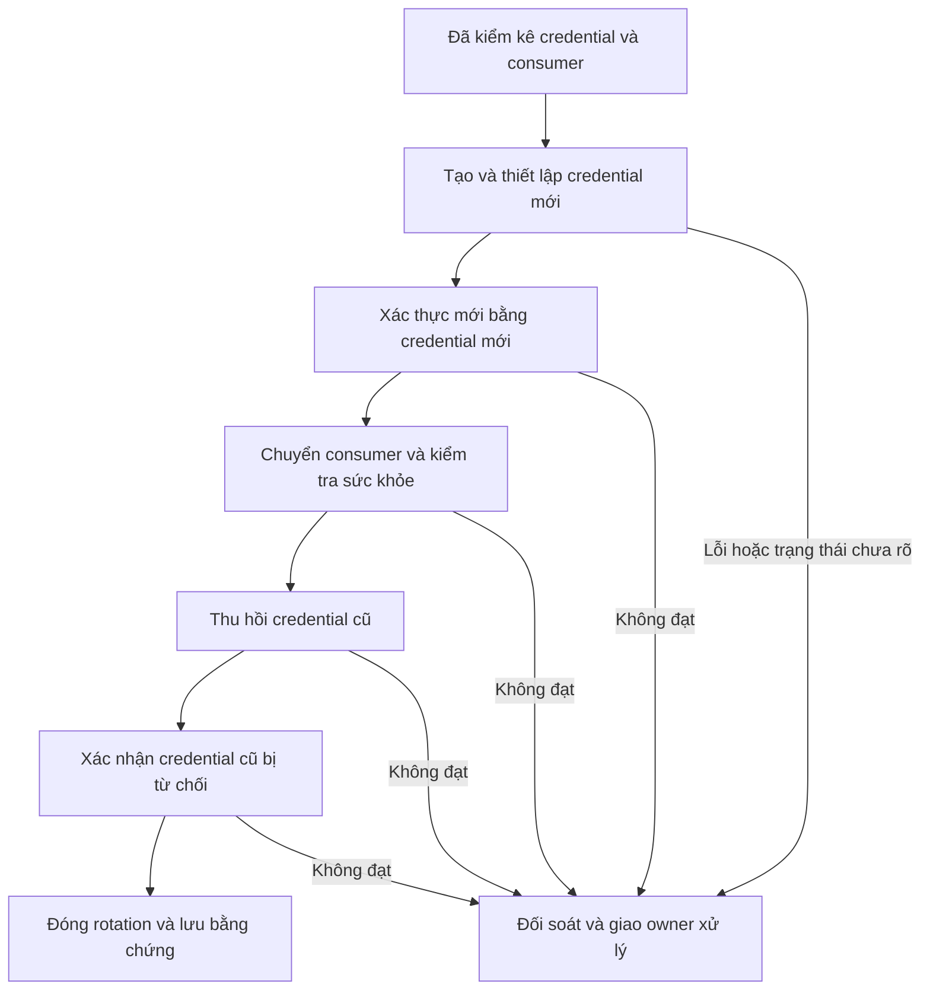

# Không rotate credential

## 1. Anti-pattern: credential đã cấp thì dùng mãi

Trong Privileged Access Management (PAM), **credential rotation** là quá trình thay thế một credential bằng credential mới, chuyển các bên sử dụng sang giá trị mới và kết thúc khả năng sử dụng giá trị cũ theo cơ chế xác thực của hệ thống đích. Credential có thể là mật khẩu tài khoản quản trị, mật khẩu service account, API key, private key SSH, khóa truy cập hạ tầng hoặc một loại bí mật xác thực khác.

Anti-pattern “không rotate credential” xuất hiện khi tổ chức coi việc tạo một mật khẩu mạnh rồi cất vào vault là điểm kết thúc. Credential tiếp tục có hiệu lực qua nhiều năm, nhiều lần thay nhân sự, nhiều phiên quản trị và nhiều thay đổi ứng dụng. Không ai biết chính xác bao nhiêu người hoặc hệ thống còn giữ bản sao của nó.

Một tài khoản quản trị có mật khẩu ngẫu nhiên dài nhưng tồn tại vô thời hạn vẫn tạo ra rủi ro đáng kể. Độ khó đoán giúp chống đoán mật khẩu; nó không làm một bản sao đã bị lộ tự biến mất. Khi giá trị cũ vẫn được hệ thống đích chấp nhận, người có bản sao đó vẫn có thể tiếp tục xác thực trong phạm vi quyền của tài khoản.

Trong module PAM, rotation phải gắn với kiểm kê quyền, least privilege, cấp quyền đúng lúc, quản lý vault, giám sát phiên và bằng chứng kiểm toán. Đổi một chuỗi bí mật mà không biết ai sử dụng, quyền gì được cấp và credential cũ đã mất hiệu lực chưa thì chưa tạo thành một quy trình kiểm soát truy cập đặc quyền đầy đủ.

### Mục tiêu bài học

Sau bài này, người học có thể:

- Nhận diện credential đặc quyền tồn tại quá lâu và các dấu hiệu rotation chỉ diễn ra trên danh nghĩa.
- Phân biệt thay credential, hết hạn credential, thu hồi quyền và kết thúc phiên.
- Lập kế hoạch rotation có xét đến dependency và tính sẵn sàng của dịch vụ.
- Thiết kế bằng chứng cho thấy credential mới hoạt động, credential cũ bị từ chối và các consumer hợp lệ đã chuyển đổi.
- Xử lý ngoại lệ, lỗi rotation và tình huống nghi lộ credential bằng một quy trình có chủ sở hữu.

## 2. Vì sao credential lâu đời trở thành rủi ro tích lũy?

### 2.1. Mỗi lần sử dụng có thể tạo thêm một bản sao

Một credential đặc quyền có thể từng xuất hiện trong terminal, biến môi trường, file cấu hình, máy quản trị, pipeline triển khai, công cụ hỗ trợ từ xa hoặc bản sao lưu. Dù vault hiện tại được kiểm soát tốt, các bản sao trước khi đưa vào vault vẫn có thể tồn tại.

Chuỗi sự kiện thường gặp:

1. Nhóm vận hành tạo tài khoản có quyền cao để giải quyết một nhu cầu gấp.
2. Credential được gửi cho nhiều người và nhúng vào một số tác vụ tự động.
3. Sau đó nhóm đưa credential vào vault nhưng giữ nguyên giá trị trên hệ thống đích.
4. Nhân sự thay đổi, job mới xuất hiện, tài liệu cũ vẫn còn.
5. Tổ chức tin rằng credential đã an toàn vì “đã có trong vault”.

Bước 3 giúp kiểm soát lần truy xuất tiếp theo qua vault, nhưng không vô hiệu hóa những bản sao đã phát tán trước đó. Nếu tổ chức chưa thay credential trên hệ thống đích, việc chuyển nơi lưu trữ không đóng lại đường truy cập từ các bản sao ấy.

### 2.2. Quyền cao làm tăng tác động của một lần lộ

Credential của tài khoản đọc báo cáo và credential của tài khoản quản trị hệ thống có thể có cùng dạng chuỗi ký tự, nhưng hậu quả khi lộ rất khác nhau. Một credential có quyền cao có thể cho phép thay cấu hình, tạo tài khoản khác, truy xuất dữ liệu nhạy cảm hoặc cản trở cơ chế ghi nhận hoạt động.

Rotation không thay thế least privilege. Tuy nhiên, nếu credential có quyền cao không được thay trong thời gian dài, bất kỳ sự cố lộ nào trong quá khứ cũng có thể tiếp tục tạo đường vào hiện tại.

Có thể diễn đạt rủi ro theo một mô hình định tính:

> Rủi ro tăng khi credential còn dùng được lâu, có nhiều bản sao, có nhiều đường truy cập và mang quyền lớn.

Đây là mô hình để ưu tiên xử lý, không phải công thức định lượng xác suất hay tổn thất.

### 2.3. Thu hồi quyền đọc vault không thu hồi giá trị đã biết

Khi một nhân viên rời nhóm, quản trị viên có thể xóa quyền của người đó đối với vault. Nếu người đó từng nhìn thấy hoặc lấy được credential, việc xóa quyền đọc vault chỉ ngăn truy xuất qua vault trong tương lai.

Cần phân biệt hai câu hỏi:

- Người đó còn được phép lấy bí mật từ vault không?
- Giá trị bí mật mà người đó đã biết còn được hệ thống đích chấp nhận không?

Một thay đổi ở câu hỏi thứ nhất không tự bảo đảm câu trả lời “không” cho câu hỏi thứ hai. Với credential từng được tiết lộ cho người dùng, chính sách phải xét đến nhu cầu rotation hoặc vô hiệu hóa credential sau các sự kiện như trả tài khoản dùng chung, thay đổi nhân sự hoặc nghi có truy cập trái phép.

### 2.4. Không có rotation thường đồng nghĩa không có bản đồ dependency

Nhiều đội không rotate vì sợ ngừng dịch vụ. Nỗi lo này thường phản ánh một vấn đề có thật: họ không biết đầy đủ hệ thống nào còn dùng credential.

Càng trì hoãn, dependency càng tăng và khả năng hiểu chúng càng giảm. Đến khi bắt buộc phải rotate do sự cố, nhóm phải đổi một credential quan trọng trong điều kiện áp lực cao và thông tin thiếu.

Một chương trình PAM tốt dùng rotation để kiểm chứng khả năng quản lý dependency một cách thường xuyên. Nếu chỉ thay được credential khi mọi ứng dụng đều dừng, tổ chức còn thiếu một năng lực vận hành quan trọng.

## 3. Rotation khác gì với những thao tác liên quan?

| Thao tác | Điều thực sự thay đổi | Điều không được tự giả định |
|---|---|---|
| Đưa credential vào vault | Nơi lưu và cách kiểm soát truy xuất bí mật | Các bản sao cũ đã mất hiệu lực |
| Rotation | Credential mới được thiết lập; credential cũ được kết thúc theo quy trình | Mọi phiên đang mở đều bị ngắt |
| Hết hạn | Credential không còn được chấp nhận sau điều kiện hết hạn | Đã có credential thay thế và ứng dụng đã nhận được nó |
| Thu hồi quyền | Quyền của danh tính hoặc vai trò được giảm hay loại bỏ | Bí mật cũ đã được thay |
| Vô hiệu hóa tài khoản | Tài khoản bị chặn theo khả năng của hệ thống đích | Token hoặc phiên độc lập đã bị thu hồi đầy đủ |
| Kết thúc phiên | Một phiên sử dụng bị chấm dứt | Credential dùng để mở phiên đã mất hiệu lực |
| Giảm thời hạn token | Thời gian sống của token mới được giới hạn | Token đã phát hành trước đó tự đổi thời hạn |
| Cập nhật file cấu hình | Consumer được cung cấp giá trị khác | Hệ thống đích đã chấp nhận giá trị mới |

Một ví dụ dễ nhầm: PAM đổi mật khẩu tài khoản quản trị sau khi kết thúc checkout, nhưng một phiên đã mở trước đó vẫn tồn tại. Hệ thống đích có thể kiểm tra mật khẩu khi đăng nhập rồi duy trì phiên bằng cơ chế khác. Muốn biết phiên cũ còn hiệu lực hay không phải kiểm tra hành vi thực tế của nền tảng và thực hiện cơ chế quản lý phiên phù hợp.

Tương tự, thay mật khẩu của tài khoản không nhất thiết thu hồi một API token đã phát hành cho tài khoản đó. Token, session cookie, chứng thư và mật khẩu có thể có vòng đời riêng.

**Kết luận vận hành:** xác định đối tượng cần vô hiệu hóa cụ thể. “Đã rotate” không đủ để khẳng định “mọi đường truy cập cũ đã đóng”.

## 4. Những biểu hiện thường gặp của anti-pattern

### 4.1. Mật khẩu được giữ nguyên sau nhiều lượt checkout

Một tài khoản quản trị dùng chung được nhiều người lấy từ vault. Checkout có ghi nhận người lấy và thời điểm lấy, nhưng sau khi check-in, mật khẩu không thay đổi.

Người đã nhận mật khẩu có thể sử dụng lại bên ngoài luồng checkout nếu hệ thống đích còn cho đăng nhập trực tiếp. Khi đó, audit của vault chỉ phản ánh lần lấy bí mật, không bao phủ mọi lần sử dụng.

Biện pháp phù hợp phụ thuộc nền tảng: rotation sau khi dùng với credential đã tiết lộ, proxy phiên để giảm lộ bí mật, giới hạn đường đăng nhập và kiểm soát quyền trên hệ thống đích. Không nên mặc định một biện pháp duy nhất tự giải quyết tất cả.

### 4.2. Vault báo “đổi thành công” nhưng chỉ cập nhật bản ghi

Một job tạo giá trị mới rồi lưu vào vault, nhưng thao tác đổi mật khẩu trên hệ thống đích thất bại. Dashboard có phiên bản mới, còn máy chủ vẫn dùng phiên bản cũ.

Đây là rotation giả về mặt kiểm soát. Cần phân biệt ít nhất ba trạng thái:

- Đã tạo một ứng viên credential mới.
- Hệ thống đích đã chấp nhận credential mới.
- Consumer hợp lệ đã dùng được credential mới và giá trị cũ đã bị từ chối.

Chỉ tăng version trong vault không đủ chứng minh hai trạng thái sau.

### 4.3. “Không ai biết ai dùng nên để nguyên”

Một service account có quyền quản trị được nhiều job chia sẻ. Mỗi lần đề xuất rotation, các bên lo job của mình bị ảnh hưởng. Vì không có owner tổng thể, ngoại lệ được gia hạn vô thời hạn.

Cách sửa bắt đầu bằng kiểm kê consumer, phân tách danh tính và xác lập chủ sở hữu. Không nên tự động đổi mật khẩu một tài khoản dùng chung chưa rõ dependency rồi xem các lỗi phát sinh là cách kiểm kê mặc định.

### 4.4. Khôi phục dữ liệu vô tình khôi phục credential cũ

Sau khi phục hồi một ứng dụng hoặc môi trường từ backup, cấu hình cũ quay trở lại. Nếu credential cũ vẫn còn được chấp nhận để “dự phòng”, ứng dụng có thể tiếp tục chạy và che giấu sự lệch cấu hình.

Quy trình recovery phải kiểm tra version credential hiện hành, làm mới secret theo cơ chế được phê duyệt và xác nhận credential cũ không được tái kích hoạt ngoài ý muốn. Bản sao lưu cần được bảo vệ vì có thể chứa bí mật lịch sử, kể cả khi các bí mật đó đã hết hiệu lực.

### 4.5. Rotation thất bại nhưng hệ thống không báo động

Job rotation chạy định kỳ nhưng lỗi nhiều tuần. Tác vụ gửi log lỗi vào một nơi không ai đọc, trong khi báo cáo chỉ đếm số lịch đã cấu hình.

Đơn vị cần đo là kết quả thực thi và tuổi của credential đang có hiệu lực. Một lịch rotation tồn tại không chứng minh rotation đã xảy ra.

## 5. Chọn cơ chế phù hợp cho từng loại credential

Không nên áp dụng cùng một quy trình thay chuỗi bí mật cho mọi loại thông tin xác thực.

| Loại credential | Hướng quản lý vòng đời | Điểm cần kiểm tra riêng |
|---|---|---|
| Mật khẩu quản trị được checkout | Có thể đổi sau sử dụng hoặc theo sự kiện và chính sách rủi ro | Đăng nhập trực tiếp, phiên còn mở, việc tiết lộ giá trị |
| Mật khẩu service account | Rotation có điều phối với consumer và dependency | Pool kết nối, job định kỳ, cache, cấu hình dự phòng |
| API key tĩnh | Tạo key thay thế, triển khai rồi thu hồi key cũ nếu nền tảng hỗ trợ | Mọi môi trường và ứng dụng còn sử dụng key cũ |
| Cặp khóa SSH | Phân phối public key mới, kiểm tra rồi loại public key cũ khỏi nơi tin cậy | Danh sách trust trên từng đích, private key cũ, phiên SSH |
| Credential động có thời hạn | Cấp theo nhu cầu, giới hạn TTL và quản lý lease | Quyền cấp phát, gia hạn, thu hồi, credential của issuer |
| Chứng thư phục vụ xác thực | Quản lý gia hạn, thay khóa và trust theo thiết kế | Hạn chứng thư, khóa riêng, cơ chế thu hồi và cache |
| Credential khẩn cấp | Rotation sau sử dụng hay nghi lộ, kèm kiểm tra khả năng khôi phục | Tính độc lập của đường phục hồi và niêm phong lại |

### 5.1. SSH key: đổi nhãn không phải đổi khóa

Đổi tên file private key hoặc đổi comment của public key không làm thay đổi vật liệu khóa. Muốn thay khóa phải tạo cặp khóa mới, triển khai public key mới đến đúng nơi tin cậy, kiểm thử rồi loại bỏ sự tin cậy đối với khóa cũ.

Nếu public key cũ vẫn được chấp nhận trên một máy chủ bị bỏ sót, private key cũ vẫn có thể mở đường vào máy đó. Việc xóa private key khỏi máy quản trị không thu hồi một bản sao mà bên khác đang giữ.

### 5.2. Credential động giảm nhu cầu phân phối bí mật lâu dài

Với hệ thống hỗ trợ cấp credential ngắn hạn, consumer có thể nhận một credential riêng có thời gian sống giới hạn. Khi hết lease hoặc bị thu hồi theo cơ chế của nền tảng, credential đó không còn dùng được để xác thực mới.

Cách này giảm việc dùng chung một bí mật tĩnh nhưng vẫn cần quản lý:

- Danh tính dùng để yêu cầu credential.
- Quyền của bộ cấp phát.
- TTL, gia hạn và điều kiện thu hồi.
- Hành vi của phiên hoặc kết nối đã thiết lập.
- Credential gốc mà bộ cấp phát dùng để tạo credential khác, nếu có.

Đừng chuyển từ một service password lâu đời sang một token gọi vault cũng lâu đời rồi cho rằng đã loại bỏ hoàn toàn vấn đề.

### 5.3. Không đánh đồng mọi mật khẩu với credential đặc quyền dùng chung

Bài này tập trung vào quản lý credential đặc quyền, nhất là bí mật máy, credential dùng chung và credential đã được tiết lộ. Không nên suy diễn thành yêu cầu bắt người dùng đổi mọi mật khẩu cá nhân thật thường xuyên bất kể bối cảnh.

Chính sách phải xét kiểu danh tính, cách xác thực, khả năng lộ, mức đặc quyền và cơ chế phát hiện sự cố. Khi có bằng chứng hoặc nghi ngờ hợp lý về việc lộ credential, cần xử lý theo quy trình ứng phó thay vì chờ đến lịch định kỳ.

## 6. Thiết kế chính sách rotation theo rủi ro và sự kiện

### 6.1. Không có một chu kỳ đúng cho mọi hệ thống

Chu kỳ rotation cần được tổ chức quyết định dựa trên đặc điểm sử dụng và khả năng kỹ thuật. Một credential đọc giới hạn của một workload biệt lập khác với mật khẩu quản trị hạ tầng được nhiều nhà cung cấp từng sử dụng.

Các yếu tố cần xem xét gồm:

- Mức quyền và phạm vi tài nguyên có thể truy cập.
- Credential có được hiển thị cho con người hay chỉ được proxy sử dụng.
- Số lượng consumer, mức độ phân tán và tần suất sử dụng.
- Khả năng tự động hóa, kiểm thử và thu hồi trên hệ thống đích.
- Khả năng phát hiện một credential bị lấy cắp hoặc sử dụng sai.
- Yêu cầu vận hành và các ràng buộc đã được tổ chức phê duyệt.
- Các sự kiện như checkout, thay đổi nhân sự, kết thúc hợp đồng hoặc phát hiện lộ bí mật.

Không nên chọn một con số duy nhất rồi xem mọi trường hợp lệch con số đó là giống nhau về rủi ro. Cũng không nên lấy lý do “chính sách theo rủi ro” để giữ một credential đặc quyền vô thời hạn mà không có owner và biện pháp bù.

### 6.2. Rotation theo lịch và rotation theo sự kiện bổ sung cho nhau

Rotation theo lịch tạo nhịp vận hành có thể dự đoán. Rotation theo sự kiện xử lý những tình huống làm tăng khả năng credential đã bị biết hoặc sử dụng ngoài dự kiến.

Ví dụ về sự kiện cần được chính sách đánh giá:

- Kết thúc một phiên sử dụng credential đặc quyền đã tiết lộ.
- Người từng biết bí mật rời nhóm hoặc kết thúc quyền hỗ trợ.
- Credential xuất hiện trong log, repository hoặc công cụ chia sẻ không được phép.
- Máy quản trị hoặc workload chứa credential bị xâm nhập.
- Có dấu hiệu xác thực từ nguồn bất thường.
- Có thay đổi lớn ở tập consumer hoặc quyền của tài khoản.

Khi nghi có xâm nhập, rotation chỉ là một phần của ứng phó. Cần xét việc chặn đường truy cập, thu hồi token, kết thúc phiên, kiểm tra persistence và bảo vệ danh tính hoặc hệ thống đang thực hiện rotation. Nếu đối tượng xấu còn kiểm soát consumer, họ có thể lấy cả credential mới.

### 6.3. Ví dụ một hồ sơ chính sách

Ví dụ sau là mô hình dữ liệu minh họa, không phải cấu hình cho một sản phẩm cụ thể:

```yaml
credentialPolicy:
  credentialId: cred-reporting-writer
  identity: svc-reporting-writer
  ownerTeam: reporting-platform
  target: reporting-database
  privilegeScope: reporting-schema-write
  trigger:
    scheduled: policy-defined
    onSuspectedExposure: immediate-response
    onConsumerRetirement: review-and-revoke
  delivery: authenticated-secret-reference
  overlap:
    allowed: true
    maxWindow: approved-change-window
  verification:
    newAuthentication: required
    consumerHealth: required
    oldAuthenticationDenied: required
  failureOwner: platform-oncall
  exception:
    requiresExpiry: true
    requiresCompensatingControls: true
```

Hồ sơ này có ý nghĩa vì gắn credential với owner, tài nguyên đích, consumer và tiêu chí xác minh. Nếu chỉ có trường `rotationEnabled: true`, rất khó biết điều gì xảy ra khi rotation thất bại.

## 7. Quy trình rotation có kiểm soát

Một rotation thành công cần đạt ba điều kiện độc lập:

1. Credential mới thực sự có hiệu lực đúng phạm vi.
2. Consumer hợp lệ tiếp tục thực hiện được công việc cần thiết.
3. Credential cũ kết thúc hiệu lực theo chính sách, với bằng chứng phù hợp.

### 7.1. Bước 1 — Kiểm kê và xác nhận quyền sở hữu

Trước khi thay credential, cần biết:

- Tài khoản hoặc danh tính nào sử dụng credential.
- Hệ thống nào quyết định credential có hợp lệ.
- Consumer nào đang sử dụng, bao gồm job ít chạy và hệ thống dự phòng.
- Ai chịu trách nhiệm dịch vụ và ai chịu trách nhiệm credential.
- Cơ chế phân phối và làm mới secret.
- Cách kiểm tra credential cũ đã bị từ chối.
- Cách khôi phục dịch vụ nếu chuyển đổi thất bại.

Không đưa giá trị bí mật vào bảng kiểm kê. Dùng mã định danh, version ID hoặc tham chiếu secret để liên kết bằng chứng.

### 7.2. Bước 2 — Xác định chiến lược chuyển đổi

Hai mô hình thường gặp:

**Mô hình chỉ có một credential hợp lệ tại một thời điểm.** Một số hệ thống chỉ cho tài khoản có một mật khẩu hiện hành. Khi đổi ở đích, consumer chưa nhận giá trị mới có thể lỗi. Cần phối hợp cửa sổ thay đổi, khả năng reload, thời điểm job chạy và phương án khôi phục phù hợp.

**Mô hình có hai credential hợp lệ trong thời gian ngắn.** Nếu hệ thống hỗ trợ nhiều key hoặc credential, có thể tạo mới, triển khai, xác minh rồi thu hồi cũ. Cách này hỗ trợ chuyển đổi ít gián đoạn hơn nhưng cần deadline rõ ràng cho thời gian chồng lấn.

Không tự giả định một tài khoản có thể giữ đồng thời hai mật khẩu hoặc một sản phẩm hỗ trợ dual key. Khả năng này phải được xác nhận trên chính hệ thống đích.

### 7.3. Bước 3 — Tạo và thiết lập credential mới

Quy trình cần dùng nguồn sinh bí mật phù hợp với loại credential, truyền qua kênh được bảo vệ và tránh ghi giá trị vào log. Danh tính thực hiện rotation chỉ nên có quyền cần thiết cho tập tài khoản được quản lý.

Cần xử lý cả trường hợp thao tác đổi ở đích đã thành công nhưng phản hồi bị mất. Một timeout không đủ chứng minh thao tác chưa thực hiện. Retry mù có thể tạo nhiều version hoặc làm vault lệch với đích.

Hệ thống điều phối nên có operation ID, trạng thái từng bước và khả năng đối soát. Với thao tác không hỗ trợ tính lặp an toàn, phải kiểm tra trạng thái thực trước khi thử lại.

### 7.4. Bước 4 — Phân phối hoặc làm mới consumer

Consumer có thể lấy bí mật mới qua tham chiếu vault, cơ chế reload hoặc lần khởi tạo kết nối tiếp theo. Cần hiểu ứng dụng đọc secret khi nào.

Một ứng dụng đọc file cấu hình duy nhất lúc khởi động sẽ không tự dùng giá trị mới chỉ vì file đã đổi. Một connection pool đang có kết nối hoạt động có thể chưa tạo lần xác thực mới để kiểm chứng credential.

Đưa vào kiểm thử những consumer dễ bị bỏ sót:

- Scheduled job chỉ chạy cuối ngày hoặc cuối tháng.
- Worker ít nhận task.
- Node dự phòng chưa phục vụ traffic.
- Pipeline triển khai và công cụ rollback.
- Tác vụ backup, monitoring và quản trị.
- Môi trường recovery dùng bản cấu hình được lưu từ trước.

### 7.5. Bước 5 — Xác minh bằng phiên xác thực mới

Kiểm thử phải chứng minh credential mới mở được một lần xác thực mới với quyền cần thiết. Một kết nối cũ vẫn trả dữ liệu không đủ để kết luận ứng dụng đã chuyển credential.

Có thể dùng canary thực hiện một thao tác nghiệp vụ an toàn, mở kết nối mới và ghi nhận kết quả bằng operation ID. Không cần in credential để chứng minh đã sử dụng version nào; tham chiếu version và log xác thực của hệ thống đích có thể cung cấp bằng chứng phù hợp.

Phép kiểm tra nên đủ hẹp để tránh tạo thay đổi nghiệp vụ ngoài ý muốn. Ví dụ, nếu cần kiểm tra quyền đọc, không dùng một lệnh sửa dữ liệu sản xuất chỉ để chứng minh kết nối thành công.

### 7.6. Bước 6 — Thu hồi credential cũ và đóng khoảng chồng lấn

Sau khi consumer hợp lệ đã chuyển, thu hồi credential cũ theo cơ chế của đích. Với API key, thao tác có thể là vô hiệu hóa key cũ; với SSH, là loại public key cũ khỏi các điểm tin cậy; với mật khẩu đơn, giá trị trước phải bị từ chối khi xác thực mới.

Nếu quá trình dùng hai key, không được coi trạng thái “consumer đã chuyển xong” là hoàn tất trong khi key cũ còn hợp lệ không có giới hạn thời gian.

Cần xác minh đúng phạm vi. Key cũ bị thu hồi ở môi trường chính nhưng vẫn hợp lệ trên môi trường dự phòng thì rotation mới hoàn thành một phần.

### 7.7. Bước 7 — Ghi nhận kết quả và giám sát sau chuyển đổi

Bằng chứng nên ghi ai hoặc thành phần nào thực hiện, credential ID, đích, version chuyển đổi, thời gian và kết quả từng gate. Không ghi giá trị bí mật.

Giám sát sau thay đổi cần bao phủ đủ nhịp hoạt động của consumer quan trọng. Không có lỗi trong vài phút đầu chưa chứng minh job chạy cuối ngày đã hoạt động. Với job ít chạy, có thể cần một phép kiểm tra được thiết kế riêng thay vì giữ credential cũ vô thời hạn để chờ.

## 8. Mô hình trạng thái để tránh “thành công một nửa”

Sơ đồ sau minh họa rotation có hỗ trợ thời gian chồng lấn; đây là mô hình tư duy, không áp dụng nguyên xi cho hệ thống chỉ có một mật khẩu:



Các trạng thái cần được đặt tên theo điều đã chứng minh. Ví dụ, `NEW_SECRET_STORED` có thể là trạng thái trung gian hợp lệ, nhưng không nên được hiển thị thành `ROTATION_COMPLETED`.

Một bản ghi vận hành có thể như sau:

```text
operation_id: rot-lab-0042
credential_id: cred-reporting-writer
old_version: version-A
new_version: version-B
target_update: PASS
new_authentication: PASS
consumer_transition: PASS
old_credential_revocation: PASS
old_authentication_denied: PASS
status: COMPLETED
```

`version-A` và `version-B` ở đây là nhãn minh họa. Nhãn version do hệ thống quản lý bí mật hoặc bộ điều phối cấp phải có ý nghĩa rõ ràng; không suy version bằng cách ghi một phần giá trị secret vào log.

## 9. Tình huống thực tế: service account dùng chung quá lâu

### 9.1. Bối cảnh

Một nền tảng báo cáo có service account `svc-reporting-writer`. Credential được tạo từ lâu, có quyền ghi vào cơ sở dữ liệu báo cáo và được ba thành phần sử dụng:

- API xử lý yêu cầu trực tuyến.
- Worker tổng hợp dữ liệu.
- Job xuất báo cáo vào ban đêm.

Nhóm đã đưa credential vào vault, nhưng ứng dụng vẫn đọc một bản sao trong cấu hình triển khai. Mật khẩu chưa được thay vì “ba hệ thống đều đang chạy ổn”.

Sau khi một máy chạy worker bị xâm nhập, credential có khả năng đã bị lấy. Nếu chỉ cô lập máy đó, bản sao credential vẫn có thể được dùng từ nơi khác trong phạm vi đường mạng và quyền còn cho phép.

### 9.2. Phân tích thiếu sót

Có bốn vấn đề độc lập:

1. Credential tồn tại lâu mà không có bằng chứng vòng đời.
2. Một danh tính được chia sẻ cho các consumer có nhu cầu khác nhau.
3. Nguồn secret trong vault và bản cấu hình ở consumer có thể lệch.
4. Chưa có quy trình chuyển đổi và xác minh credential cũ bị từ chối.

Chỉ đổi mật khẩu một lần xử lý một phần cấp bách. Sau đó vẫn cần cải thiện kiến trúc và quy trình để tránh lặp lại.

### 9.3. Cách xử lý

Trong ứng phó, đội vận hành phối hợp cô lập máy bị xâm nhập và bảo vệ đường cấp phát credential mới. Họ rà soát những phiên, token và quyền có liên quan thay vì chỉ tập trung vào một password.

Nhóm ứng dụng xác nhận đầy đủ ba consumer và owner. Rotation được thực hiện qua đường quản trị tin cậy. API và worker được làm mới secret, job ban đêm được kiểm tra bằng một lần xác thực kiểm soát trong cửa sổ thay đổi. Credential cũ bị từ chối khi mở kết nối mới.

Sau khi ổn định, nhóm tách danh tính theo consumer và thu hẹp quyền. Họ triển khai cơ chế lấy secret có kiểm soát, giám sát lỗi xác thực, kiểm thử rotation và quy trình ngoại lệ có thời hạn.

Nếu hệ thống đích chỉ hỗ trợ một mật khẩu, nhóm phải dùng chiến lược chuyển đổi phù hợp với giới hạn đó. Không thể viết một kế hoạch “giữ cả hai mật khẩu vài giờ” khi nền tảng không hỗ trợ.

### 9.4. Bằng chứng cần giữ

Bản ghi sự cố và thay đổi cần cho thấy:

- Thời điểm nghi lộ và phạm vi credential bị ảnh hưởng.
- Các consumer đã xác nhận và người chịu trách nhiệm.
- Version mới được áp dụng ở đích.
- Kết quả xác thực mới của từng consumer quan trọng.
- Kết quả từ chối credential cũ.
- Cách xử lý các phiên hoặc token có vòng đời riêng.
- Thời điểm đóng sự cố và các hành động cải thiện.

Không lưu password cũ hay password mới trong ticket để “đủ bằng chứng”.

## 10. Xử lý lỗi mà không tái mở đường truy cập nguy hiểm

### 10.1. Credential mới hoạt động nhưng một consumer lỗi

Nếu đích đã chấp nhận credential mới mà một ứng dụng lỗi xác thực, cần kiểm tra cách ứng dụng lấy secret, version đang cache, thời điểm reload và đường kết nối thực tế.

Không lập tức kết luận credential mới sai. Một số consumer có thể đang dùng giá trị cũ hoặc trỏ đến hệ thống đích khác. Cần xác minh bằng credential ID, version tham chiếu và log xác thực phù hợp.

Với rotation thường lệ có overlap được phê duyệt, có thể tạm dừng chuyển đổi hoặc dùng phương án khôi phục đã thiết kế trong giới hạn cho phép. Phải giữ owner và deadline cho phần còn dở.

### 10.2. Không xác định được vault và đích đang đồng bộ hay không

Tạm dừng các lần thử có thể làm trạng thái phức tạp hơn. Kiểm tra kết quả ở đích bằng đường quản trị được bảo vệ, đối chiếu operation ID và thực hiện reconciliation theo khả năng của công cụ.

Không thử tuần tự nhiều password trên tài khoản sản xuất để đoán trạng thái mà không xét nguy cơ khóa tài khoản, phát sinh cảnh báo hoặc làm gián đoạn các consumer.

### 10.3. Credential cũ bị nghi lộ

Nếu giá trị cũ đã bị lộ hoặc nghi lộ, “rollback” về chính giá trị đó sẽ khôi phục đường truy cập đang cần đóng. Phương án khôi phục nên ưu tiên một credential sạch khác, một danh tính thay thế được phê duyệt hoặc quy trình break-glass có kiểm soát.

Credential mới cũng có thể bị lộ nếu được phân phối tới máy chưa được làm sạch. Do đó, thứ tự cô lập, xử lý xâm nhập và phân phối bí mật phải được điều phối trong kế hoạch sự cố.

### 10.4. Hệ thống đích không hỗ trợ rotation tự động

Thiếu API không làm rủi ro biến mất. Có thể cần quy trình thủ công được phê duyệt, lịch bảo trì và kiểm thử xác thực sau thay đổi.

Ngoại lệ nên ghi rõ owner, lý do kỹ thuật, ngày hết hạn, biện pháp bù và kế hoạch loại bỏ hạn chế. Biện pháp bù có thể gồm giới hạn nguồn truy cập, giảm quyền, proxy phiên và giám sát chặt hơn. Chúng giảm một phần rủi ro, không chứng minh credential cũ không còn nguy hiểm.

Một ngoại lệ tự gia hạn không cần xem xét lại thường trở thành cách hợp thức hóa anti-pattern.

## 11. Thực hành trong môi trường mô phỏng

Mục tiêu thực hành là quan sát sự khác biệt giữa “đã cập nhật secret”, “đã chuyển consumer” và “đã thu hồi credential cũ”. Dùng danh tính và giá trị giả trong lab biệt lập; không đưa credential sản xuất vào bài thực hành.

### 11.1. Chuẩn bị mô hình

Tạo một mô hình xác thực có hai credential thử nghiệm cùng hiệu lực và ba consumer giả lập. Gọi các giá trị đó là `LAB_VALUE_A` và `LAB_VALUE_B`; đây chỉ là placeholder.

Bảng trạng thái ban đầu:

| Thành phần | Credential đang dùng | Trạng thái |
|---|---|---|
| Consumer API | A | Hoạt động |
| Consumer worker | A | Hoạt động |
| Consumer scheduled job | A | Chưa chạy |
| Hệ thống xác thực | Chấp nhận A | Bình thường |

Nếu công cụ lab chỉ hỗ trợ một mật khẩu, điều chỉnh bài theo mô hình chuyển đổi một credential; không cố mô phỏng overlap bằng một khả năng không có ở đích.

### 11.2. Thí nghiệm 1 — Chỉ đổi bản ghi trong vault

Cập nhật nguồn secret của lab sang B nhưng giữ nguyên phía xác thực chỉ chấp nhận A. Thử mở một phiên mới bằng consumer đã nhận B.

Kết quả mong đợi: xác thực thất bại vì nơi quyết định credential hợp lệ chưa đổi. Thí nghiệm chứng minh lưu một giá trị mới không tương đương rotation thành công.

### 11.3. Thí nghiệm 2 — Bỏ sót consumer ít chạy

Cho đích chấp nhận B, chuyển API và worker sang B nhưng giữ scheduled job ở A. Nếu mô hình có overlap, cả A và B vẫn có thể được chấp nhận trong giai đoạn chuyển đổi.

Sau khi thu hồi A, chạy scheduled job. Job lỗi chứng minh kiểm tra hai consumer hoạt động thường xuyên chưa bao phủ consumer thứ ba.

Khắc phục bằng cách cập nhật nguồn secret của job, mở lần xác thực mới và kiểm tra lại. Không bật lại A vô thời hạn để che giấu việc job chưa chuyển đổi.

### 11.4. Thí nghiệm 3 — Kiểm tra credential cũ sau thu hồi

Thực hiện một lần xác thực mới bằng A qua cơ chế kiểm thử được kiểm soát. Kết quả mong đợi là bị từ chối. Sau đó xác thực bằng B và kiểm tra thao tác được cho phép vẫn thành công.

Cần ghi nhận kết quả mà không in A hoặc B vào log. Trong lab, dùng nhãn credential và operation ID.

### 11.5. Thí nghiệm 4 — Phân biệt phiên cũ và đăng nhập mới

Nếu nền tảng lab duy trì phiên độc lập với password, mở phiên bằng A trước khi thu hồi. Sau khi thu hồi A, so sánh:

- Một lần đăng nhập mới bằng A.
- Một thao tác qua phiên đã mở trước đó.

Hành vi phiên tùy nền tảng. Ghi lại điều quan sát được thay vì mặc định password rotation luôn ngắt phiên. Từ đó xác định có cần thao tác thu hồi hoặc kết thúc phiên riêng hay không.

### 11.6. Tiêu chí hoàn thành thực hành

Bài thực hành đạt mục tiêu khi có thể chứng minh:

- Consumer nhận B xác thực mới thành công.
- Mọi consumer trong mô hình đã chuyển theo thiết kế.
- A bị từ chối cho xác thực mới sau thu hồi.
- Hành vi của phiên cũ đã được quan sát và giải thích.
- Báo cáo chỉ chứa định danh, trạng thái và thời gian, không chứa secret.
- Một lần chuyển đổi lỗi được nhận diện và xử lý mà không che giấu bằng trạng thái “thành công”.

## 12. Đo lường hiệu quả rotation

Đo lường cần phản ánh credential đang có hiệu lực và trạng thái ở đích, không chỉ cấu hình của công cụ PAM.

| Chỉ số | Câu hỏi được trả lời | Lưu ý khi đọc |
|---|---|---|
| Tuổi credential hiện hành | Credential này có hiệu lực từ khi nào? | Lần sửa metadata không phải lần rotation |
| Tỷ lệ credential thuộc diện quản lý đã có owner | Ai chịu trách nhiệm vòng đời? | Owner cần thực sự có khả năng điều phối |
| Tỷ lệ rotation hoàn tất đủ gate | Bao nhiêu lần chuyển đổi đạt tiêu chí? | Tách thất bại ở đích, consumer và thu hồi |
| Credential quá hạn chính sách | Credential nào cần xử lý? | Phân biệt ngoại lệ được phê duyệt và vi phạm |
| Thời gian thu hồi khi nghi lộ | Mất bao lâu để đóng credential cũ? | Định nghĩa mốc bắt đầu và bằng chứng kết thúc |
| Khoảng chồng lấn thực tế | Credential cũ và mới cùng hợp lệ bao lâu? | Theo dõi các cửa sổ bị kéo dài |
| Consumer còn dùng version cũ | Có dependency nào chưa chuyển? | Có thể cần kiểm thử chủ động cho job ít chạy |
| Lỗi xác thực sau rotation | Dịch vụ có chịu tác động không? | Đối chiếu thay đổi và xác định nguyên nhân |

Một tỷ lệ hoàn tất minh họa có thể được tính như sau:

> Số operation rotation đã đạt tất cả gate bắt buộc / Tổng số operation rotation đến hạn đánh giá trong kỳ.

Cần công bố rõ mẫu số và cách xử lý operation đang chạy, ngoại lệ và job bị bỏ qua. Không tăng tỷ lệ bằng cách xóa operation thất bại khỏi báo cáo.

Không nên khẳng định “credential cũ không còn được sử dụng” chỉ vì không thấy log ở một nguồn duy nhất. Có thể thiếu nguồn log, thiếu dữ liệu hoặc consumer chưa đến lịch chạy. Bằng chứng âm tính cần được hiểu cùng phạm vi quan sát.

## 13. Những cách sửa tưởng đúng nhưng vẫn để lại anti-pattern

### “Đã dùng mật khẩu rất dài nên không cần rotate”

Mật khẩu khó đoán giúp giảm nguy cơ đoán đúng. Nếu giá trị đã bị lấy từ một consumer, độ dài không ngăn người có bản sao sử dụng nó.

### “Đã đổi ở vault nên hệ thống đích chắc chắn đã đổi”

Vault có thể chỉ là nơi lưu hoặc có connector chưa hoạt động đúng. Cần xác nhận ở hệ thống đích và bằng một lần xác thực mới.

### “Ứng dụng còn chạy nghĩa là đã nhận credential mới”

Ứng dụng có thể đang sử dụng kết nối hoặc phiên cũ. Cần kiểm tra hành vi khi tạo kết nối mới và khi tác vụ ít chạy bắt đầu.

### “Giữ key cũ làm phương án dự phòng mãi cho an toàn”

Giữ credential cũ hợp lệ vô thời hạn làm mất mục tiêu thu hồi. Phương án recovery cần có điều kiện, thời hạn và kiểm soát riêng; credential đã nghi lộ không nên là điểm quay về mặc định.

### “Rotation càng thường xuyên càng tốt, bất kể dependency”

Tự động hóa mà thiếu kiểm kê, kiểm thử và reconciliation có thể gây sự cố lặp lại. Hiệu quả đến từ việc giới hạn khả năng sử dụng credential bị lộ và duy trì quy trình chuyển đổi đáng tin cậy.

### “Có credential ngắn hạn thì không phải quản lý gì nữa”

Danh tính bootstrap, quyền cấp phát, cơ chế gia hạn và các phiên sống lâu vẫn cần quản lý. Credential ngắn hạn là một công cụ, không phải sự thay thế cho toàn bộ PAM.

### “Đổi password giải quyết xong một máy đã bị xâm nhập”

Nếu bên xâm nhập vẫn kiểm soát máy hoặc có token, phiên và cơ chế persistence khác, họ có thể tiếp tục truy cập hoặc lấy credential mới. Rotation cần được kết hợp với xử lý sự cố đúng phạm vi.

## 14. Câu hỏi tự kiểm tra

1. Vì sao xóa quyền truy xuất vault của một người chưa đủ để thu hồi một password người đó từng biết?
2. Tại sao một lần xác thực mới có giá trị chứng minh cao hơn việc một kết nối cũ vẫn hoạt động?
3. Với SSH key, cần thay đổi những điểm tin cậy nào để private key cũ không còn mở đường vào?
4. Nếu API key cũ và mới cùng hợp lệ, điều kiện nào cho phép đóng rotation?
5. Một scheduled job chỉ chạy cuối tháng ảnh hưởng thế nào đến kế hoạch kiểm chứng consumer?
6. Khi thao tác đổi credential timeout, vì sao không nên mặc định thao tác chưa thực hiện?
7. Nếu credential cũ bị nghi lộ, phương án khôi phục dịch vụ cần tránh điều gì?
8. Credential động có thời hạn còn để lại những danh tính và quyền cấp phát nào phải bảo vệ?
9. Vì sao số lượng lịch rotation được cấu hình không đủ để đánh giá hiệu quả?
10. Ngoại lệ không rotate cần có những thông tin nào để không trở thành quyết định vô thời hạn?

Một câu trả lời tốt luôn tách bạch trạng thái ở kho bí mật, trạng thái xác thực ở đích, trạng thái consumer và trạng thái phiên.

## 15. Nguyên tắc cần ghi nhớ

Credential đặc quyền phải có vòng đời gắn với danh tính, quyền, consumer và owner. Cất vào vault là một bước bảo vệ; quản lý hiệu lực ở hệ thống đích mới quyết định bản sao cũ còn dùng được hay không.

Rotation chỉ hoàn tất khi credential mới phục vụ được nhu cầu hợp lệ, consumer đã chuyển theo thiết kế và credential cũ bị kết thúc hiệu lực với bằng chứng rõ ràng. Các phiên và token có vòng đời riêng cần được kiểm tra riêng.

Với hệ thống quan trọng, hãy xây dựng khả năng rotation trước khi có sự cố: kiểm kê dependency, kiểm thử chuyển đổi, giám sát lỗi và chuẩn bị recovery. Một credential không thể thay một cách có kiểm soát là dấu hiệu cần cải thiện kiến trúc và vận hành PAM.
