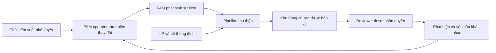

# PAM admin tự audit chính mình

## 1. Vấn đề: người vận hành kiểm soát luôn kết luận kiểm tra

PAM admin quản trị hệ thống kiểm soát truy cập đặc quyền: cấu hình vault, chính sách phê duyệt, connector, cơ chế ghi phiên và các quyền quản trị liên quan. Vì vậy, PAM admin cũng là một chủ thể có đặc quyền cần được kiểm soát.

Anti-pattern xuất hiện khi cùng một người vừa có khả năng thay đổi hoạt động của PAM, vừa tự chọn bằng chứng, tự đánh giá thay đổi đó và tự kết luận rằng kiểm soát vẫn hiệu quả. Khi ấy, báo cáo có thể đầy đủ về hình thức nhưng thiếu một bên đủ độc lập để phát hiện sai lệch.

Ví dụ: một quản trị viên tạm tắt ghi phiên để xử lý lỗi, sau đó tự xuất báo cáo những phiên còn được ghi và ký xác nhận “mọi phiên quản trị đều được giám sát”. Báo cáo đúng với dữ liệu đã chọn nhưng không chứng minh được tính đầy đủ của hoạt động thực tế.

Vấn đề cốt lõi không phải là mặc định PAM admin thiếu trung thực. Con người có thể bỏ sót lỗi của chính mình, chịu áp lực khôi phục dịch vụ hoặc hiểu khác nhau về điều kiện chấp nhận rủi ro. Một cơ chế kiểm tra tốt phải còn giá trị ngay cả khi người vận hành mắc lỗi, có xung đột lợi ích hoặc cố tình che giấu hành vi.

Trong bài này, “audit độc lập” được dùng theo nghĩa kiểm tra và kết luận bởi chủ thể không tự đánh giá công việc do mình sở hữu, có quyền tiếp cận bằng chứng phù hợp và có tuyến báo cáo đủ độc lập. Đây là nguyên tắc thiết kế kiểm soát; không đồng nghĩa mọi hoạt động review hằng ngày đều phải do kiểm toán nội bộ thực hiện.

Sau bài học, người học cần có thể:

- Nhận diện những quyền khiến PAM admin có thể kiểm soát cả hành vi và bằng chứng.
- Phân biệt tự kiểm tra vận hành, giám sát an ninh, review của chủ tài nguyên và audit độc lập.
- Thiết kế sự phân tách nhiệm vụ phù hợp với quy mô tổ chức.
- Xây dựng chuỗi bằng chứng đủ để kiểm tra tính đầy đủ, thay đổi cấu hình và cách đóng phát hiện.
- Xử lý ngoại lệ khẩn cấp mà vẫn giữ được khả năng truy cứu.

## 2. Những hoạt động nào vẫn cần PAM admin tham gia?

Một cuộc kiểm tra PAM khó có chất lượng nếu loại bỏ hoàn toàn đội vận hành. PAM admin thường hiểu rõ luồng cấp quyền, cơ chế luân chuyển credential, lỗi connector, giới hạn ghi phiên và những thay đổi gần đây.

Việc PAM admin cung cấp thông tin hoặc chạy self-check không tự động tạo ra anti-pattern. Xung đột xuất hiện khi họ đồng thời sở hữu quyền quyết định cuối cùng đối với phạm vi kiểm tra, bằng chứng được chấp nhận và kết quả về chính phần việc của mình.

| Hoạt động | PAM admin có thể thực hiện | Điểm cần bảo đảm độc lập |
| --- | --- | --- |
| Kiểm tra sức khỏe connector | Chạy kiểm tra, thu thập lỗi, đề xuất xử lý | Các lỗi làm mất kiểm soát phải được bên liên quan nhìn thấy |
| Giải thích cấu hình vault | Cung cấp cấu hình, giải thích mục đích và tác động | Người review được đối chiếu với nguồn có thể xác minh |
| Xuất dữ liệu theo yêu cầu | Hỗ trợ thao tác kỹ thuật theo phạm vi đã thống nhất | Không tự ý bỏ bản ghi hoặc chỉ cung cấp dữ liệu đã chọn |
| Điều tra phiên đặc quyền | Làm rõ ngữ cảnh vận hành, liên hệ chủ hệ thống | Không tự kết luận hành vi của chính mình là hợp lệ |
| Khắc phục phát hiện | Sửa cấu hình, thu hồi quyền, bổ sung cơ chế giám sát | Người kiểm tra lại và người đóng phát hiện khác người sửa |
| Đánh giá hiệu quả kiểm soát | Cung cấp đầu vào, phản biện sai sót kỹ thuật | Không tự ký kết luận cuối cùng cho kiểm soát mình quản trị |

Cần phân biệt bốn tầng công việc:

1. **Tự kiểm tra vận hành:** đội PAM xác nhận dịch vụ hoạt động, job rotation chạy, phiên có thể mở và lỗi được xử lý. Đây là nguồn tín hiệu hữu ích.
2. **Giám sát an ninh:** đội giám sát theo dõi sự kiện bất thường, thay đổi quyền, mất log hoặc phiên có hành vi cần điều tra.
3. **Review của chủ tài nguyên hoặc chủ kiểm soát:** xác nhận quyền truy cập còn cần thiết, phê duyệt đúng người và ngoại lệ còn phù hợp.
4. **Audit độc lập:** đánh giá thiết kế, việc thực hiện và bằng chứng của kiểm soát trong phạm vi đã xác định.

Một tài khoản chỉ đọc chưa làm cho người sử dụng trở nên độc lập nếu người đó vẫn tự đánh giá công việc của mình. Ngược lại, một người độc lập về vai trò nhưng chỉ nhận ảnh chụp do đối tượng được kiểm tra chọn sẵn cũng chưa có đủ điều kiện để đưa ra kết luận đáng tin.

## 3. Vì sao đặc quyền của PAM admin tạo ra xung đột lớn?

Hệ thống PAM có thể tập trung nhiều điểm kiểm soát trong cùng một mặt phẳng quản trị. Tùy sản phẩm và kiến trúc, một PAM admin hoặc một nhóm admin có thể tác động đến:

- Ai được yêu cầu truy cập và ai được phê duyệt.
- Quyền nào được cấp thường trực, quyền nào được cấp theo JIT.
- Credential nào được đưa vào vault và được luân chuyển.
- Phiên nào đi qua proxy, phiên nào được ghi và dữ liệu nào được lưu.
- Ai có thể đọc, xóa hoặc thay đổi thời hạn lưu bằng chứng.
- Connector nào được kết nối, tạm dừng hoặc loại khỏi phạm vi quản lý.
- Tài khoản khẩn cấp nào tồn tại và ai được sử dụng chúng.
- Quyền truy cập vào chính báo cáo và công cụ quản trị PAM.

Không nên mặc định một sản phẩm luôn cho phép một tài khoản làm tất cả những việc trên. Phải kiểm kê quyền thực tế. Tuy nhiên, mỗi tổ hợp quyền dưới đây đều cần được xem xét vì có thể làm suy yếu tính độc lập:

| Tổ hợp quyền | Rủi ro phát sinh | Cách tách hợp lý |
| --- | --- | --- |
| Sửa chính sách và tự phê duyệt thay đổi | Tự hợp thức hóa việc nới kiểm soát | Chủ kiểm soát phê duyệt; người vận hành triển khai |
| Sử dụng đặc quyền và tự review phiên của mình | Tự quyết định hành vi nào được chấp nhận | Reviewer khác chủ phiên |
| Quản trị nguồn log và độc quyền cung cấp log | Có thể chọn bỏ phần bất lợi hoặc che khoảng trống | Bên review tiếp cận nguồn độc lập, có kiểm tra độ đầy đủ |
| Sửa retention và quản trị kho bằng chứng | Có thể rút ngắn thời gian điều tra | Quyền lưu trữ, khóa giữ và phê duyệt thay đổi được tách |
| Khắc phục và tự đóng phát hiện | Sửa chưa đủ nhưng vẫn được ghi là hoàn tất | Người kiểm tra lại xác nhận trước khi đóng |
| Tạo tài khoản reviewer và tự dùng tài khoản đó | Hai tài khoản nhưng vẫn một người quyết định | Ràng buộc danh tính con người và người thực hiện |

Những mối liên hệ này phải được kiểm tra cả ở ngoài PAM. Ví dụ, quyền quản trị hệ điều hành của máy ghi phiên, quyền quản trị cloud chứa log hoặc quyền quản trị IdP có thể cho phép một người vượt qua sự phân tách đã cấu hình trong giao diện PAM.

Tách hai role trong PAM nhưng giao cả hai role cho cùng một người không giải quyết xung đột. Tách hai người nhưng cho một người quyền reset hoặc chiếm quyền đăng nhập của người còn lại mà không có kiểm soát bổ sung cũng có thể làm mất ý nghĩa của sự phân tách.

## 4. Một tình huống điển hình

Một doanh nghiệp dùng PAM để quản lý tài khoản quản trị máy chủ sản xuất. Nhóm PAM vừa vận hành vault vừa tạo báo cáo kiểm tra hằng tháng. Người phụ trách báo cáo cũng là người có quyền cấu hình ghi phiên.

Trong một đợt xử lý sự cố, người này cho phép một số kết nối đi theo đường truy cập dự phòng. Chính sách ghi phiên không được áp dụng trên đường đó. Thay đổi được mô tả là “tạm thời”, nhưng không có thời điểm hết hạn rõ ràng.

Cuối tháng, báo cáo được xuất từ danh sách recording thành công. Những phiên không có recording không xuất hiện trong tập dữ liệu này. Người phụ trách thấy tất cả recording đều mở được và kết luận rằng kiểm soát giám sát phiên đạt yêu cầu.

Chuỗi sai lệch gồm nhiều mắt xích:

1. Một người có quyền thay đổi kiểm soát.
2. Thay đổi không được một bên khác xác nhận tác động và thời hạn.
3. Dữ liệu đầu vào của báo cáo chỉ chứa những phiên đã ghi thành công.
4. Không có đối chiếu với sự kiện mở phiên hoặc log đăng nhập ở hệ thống đích.
5. Người triển khai cũng là người kết luận kiểm soát hiệu quả.
6. Không có ai chịu trách nhiệm theo dõi đường truy cập dự phòng còn tồn tại hay không.

Sai sót dễ bị bỏ qua là bước 3. Dù các recording được lưu bất biến, tập recording đó vẫn không chứng minh được rằng mọi phiên thuộc phạm vi đều đã được ghi.

Thiết kế tốt hơn cần lưu riêng sự kiện tạo yêu cầu, phê duyệt, cấp quyền, bắt đầu phiên và kết thúc phiên; đồng thời ghi nhận kết quả recording. Reviewer đối chiếu các nguồn theo định danh và thời gian, điều tra chênh lệch trước khi kết luận.

Không phải mọi kết nối đều có recording cùng dạng. Một phiên giao diện, một kết nối API và một lần sử dụng credential bởi dịch vụ có thể cần bằng chứng khác nhau. Phạm vi kiểm soát phải nêu rõ đối tượng nào bắt buộc ghi phiên, đối tượng nào được kiểm tra bằng sự kiện hoặc log của hệ thống đích.

## 5. Thiết kế phân tách nhiệm vụ từ quyền thực tế

### 5.1. Xác định những quyết định phải được tách

Không cần bắt đầu bằng một danh sách chức danh phức tạp. Hãy xác định các quyết định nhạy cảm:

- Ai đề xuất thay đổi chính sách truy cập đặc quyền?
- Ai chấp nhận tác động đến rủi ro và hoạt động kinh doanh?
- Ai thực hiện thay đổi?
- Ai xác minh thay đổi đã triển khai đúng?
- Ai kiểm tra bằng chứng định kỳ?
- Ai được chấp nhận ngoại lệ hoặc rủi ro còn lại?
- Ai được đóng phát hiện sau khắc phục?

Một người có thể thực hiện nhiều công việc vận hành phù hợp, nhưng không nên tự phê duyệt hoặc tự kết luận độc lập về chính hành động nhạy cảm của mình.

Cần kiểm tra cả người thay thế, tài khoản dịch vụ và quyền kế thừa từ nhóm. Nếu nhân sự được gán làm reviewer nhưng vẫn có role PAM admin thông qua một nhóm khác, ma trận vai trò trên giấy chưa phản ánh đúng thực tế.

### 5.2. Ma trận trách nhiệm tham khảo

Bảng dưới đây mô tả một cách phân công; tên đội và số người có thể thay đổi theo tổ chức.

| Công việc | PAM operator | Chủ tài nguyên/chủ kiểm soát | Giám sát an ninh | Reviewer/auditor được giao |
| --- | --- | --- | --- | --- |
| Đề xuất cấu hình kỹ thuật | Thực hiện | Cung cấp yêu cầu | Góp ý yêu cầu giám sát | Có thể đánh giá thiết kế |
| Phê duyệt nới quyền truy cập | Không tự phê duyệt | Quyết định theo thẩm quyền | Cung cấp đánh giá rủi ro khi cần | Kiểm tra sau theo phạm vi |
| Triển khai cấu hình | Thực hiện | Theo dõi kết quả | Theo dõi thay đổi nhạy cảm | Đọc bằng chứng khi kiểm tra |
| Review phiên của PAM operator | Giải thích ngữ cảnh | Xác nhận lý do nghiệp vụ | Điều tra tín hiệu bất thường | Người khác thực hiện review được giao |
| Khắc phục phát hiện | Thực hiện phần kỹ thuật | Chịu trách nhiệm xử lý rủi ro | Theo dõi dấu hiệu tái diễn | Kiểm tra lại theo phạm vi |
| Đóng phát hiện | Cung cấp bằng chứng | Xác nhận hành động thuộc trách nhiệm | Xác nhận phần giám sát nếu liên quan | Xác minh và đóng theo quy trình đã định |

Đội giám sát an ninh không tự động là kiểm toán độc lập. Nếu họ cũng quản trị pipeline log đang được đánh giá, phần việc đó vẫn cần một người kiểm tra khác hoặc cơ chế bù trừ phù hợp.

Cũng không nên biến kiểm toán thành người phê duyệt mọi thay đổi vận hành hằng ngày. Nếu người đánh giá độc lập trực tiếp quyết định và vận hành kiểm soát, họ có thể phải kiểm tra chính thiết kế do mình sở hữu trong kỳ sau. Vai trò tư vấn, vận hành và đưa ra kết luận cần được phân biệt rõ.

### 5.3. Cấp quyền reviewer theo least privilege

Reviewer cần xem được bằng chứng thuộc phạm vi, không cần quyền quản trị toàn bộ PAM.

Quyền có thể gồm đọc cấu hình liên quan, lịch sử thay đổi, sự kiện yêu cầu/phê duyệt, log cấp và thu hồi quyền, cùng recording đã được phép truy cập. Không cấp quyền lấy plaintext credential chỉ vì người đó làm audit.

Recording và log có thể chứa dữ liệu nhạy cảm. Quyền xem cần giới hạn theo đối tượng, thời gian và mục đích; thao tác xem, tải xuống hoặc xuất dữ liệu cũng phải được ghi nhận.

Khi một đợt kiểm tra cần quyền nâng cao, có thể cấp JIT với thời hạn và phê duyệt phù hợp. JEA hoặc cơ chế giới hạn chức năng giúp người review chỉ chạy thao tác kiểm tra cần thiết. Cấp quyền kiểm tra không nên trở thành đường tạo đặc quyền thường trực mới.

## 6. Bằng chứng phải độc lập đến mức nào?

### 6.1. Tách người tạo hoạt động khỏi quyền sửa bằng chứng

Một kiến trúc thường dùng là chuyển sự kiện PAM sang nền tảng thu thập và kho bằng chứng do nhóm khác quản trị. Quyền quản trị PAM không mặc nhiên kéo theo quyền sửa hoặc xóa bản lưu ở đích.



Sơ đồ thể hiện các trách nhiệm logic. Để đánh giá tính độc lập, vẫn phải xác minh ai có quyền trên từng thành phần, kể cả tài khoản cloud, hệ điều hành, CI/CD triển khai pipeline và khóa mã hóa.

“Gửi log sang SIEM” chưa đủ nếu PAM admin vẫn có quyền quản trị SIEM, sửa rule thu thập hoặc xóa index chứa dữ liệu của mình. Cần xem toàn bộ chuỗi quyền và khả năng làm gián đoạn luồng bằng chứng.

### 6.2. Phân biệt tính nguyên vẹn với tính đầy đủ

**Tính nguyên vẹn** trả lời: bản ghi đã được lưu có bị thay đổi hay không?

**Tính đầy đủ** trả lời: những sự kiện thuộc phạm vi cần có đã được thu thập đầy đủ hay chưa?

Một file có checksum hợp lệ có thể vẫn là file đã bỏ thiếu bản ghi trước khi tính checksum. Một kho lưu có cơ chế khóa giữ dữ liệu vẫn có thể thiếu sự kiện nếu agent bị dừng hoặc nguồn log bị tắt.

Vì vậy, cần kết hợp các biện pháp phù hợp:

- Bảo vệ bản lưu khỏi sửa hoặc xóa trái phép, theo tính năng và mô hình lưu trữ được chọn.
- Theo dõi sức khỏe collector, backlog, lỗi chuyển tiếp và thời điểm nhận sự kiện gần nhất.
- Phát hiện thay đổi cấu hình audit, filter, retention và quyền truy cập kho.
- Đối chiếu giữa yêu cầu truy cập, phiên PAM và đăng nhập của hệ thống đích.
- Đồng bộ thời gian và lưu cả thời điểm sự kiện lẫn thời điểm ingest khi có thể.
- Ghi nhận nguồn, phiên bản truy vấn và phạm vi thời gian khi xuất báo cáo.

Không thể kết luận “đã có hành vi che giấu” chỉ từ một khoảng trống log. Khoảng trống là một vấn đề cần điều tra; nguyên nhân có thể là lỗi kỹ thuật, bảo trì hợp lệ, sai múi giờ hoặc hành vi cố ý. Cần bằng chứng bổ sung để phân biệt.

### 6.3. Tập bằng chứng tối thiểu cho một thay đổi nhạy cảm

Với thay đổi chính sách PAM, một hồ sơ có thể gồm:

| Nhóm bằng chứng | Nội dung cần có | Câu hỏi reviewer trả lời |
| --- | --- | --- |
| Yêu cầu | Mục đích, phạm vi, tài nguyên, người yêu cầu | Vì sao thay đổi này cần thiết? |
| Phê duyệt | Người phê duyệt, thời điểm, điều kiện, thời hạn | Có người đủ thẩm quyền chấp nhận trước khi thực hiện không? |
| Cấu hình trước/sau | Giá trị cũ và mới hoặc diff có thể xác minh | Chính xác điều gì đã đổi? |
| Sự kiện triển khai | Danh tính người thực hiện, tài khoản, thời gian, kết quả | Ai thực sự đã triển khai? |
| Kiểm tra hiệu lực | Thử nghiệm cho phép/từ chối, cấp và thu hồi quyền, tình trạng ghi nhận | Kiểm soát có hoạt động như dự kiến không? |
| Kết thúc ngoại lệ | Hết hạn, rollback hoặc quyết định gia hạn có thẩm quyền | Thay đổi tạm thời đã được xử lý đến đâu? |

Nếu công cụ không tạo đủ các loại bằng chứng, cần ghi rõ giới hạn và thiết kế cách thu thập bổ sung. Không điền một kết luận “PASS” thay cho bằng chứng chưa có.

## 7. Quy trình review giúp tránh tự audit

### 7.1. Xác định phạm vi và nguồn dữ liệu

Trước khi lấy mẫu, người review phải biết tập hoạt động cần kiểm tra là gì. Ví dụ:

- Mọi lần thay đổi chính sách phê duyệt trong kỳ.
- Mọi lần cấp role quản trị PAM.
- Mọi lần dùng tài khoản break-glass.
- Những phiên quản trị thuộc phạm vi bắt buộc ghi.
- Những lần đọc hoặc xuất credential được đánh dấu nhạy cảm.
- Những thay đổi đối với nguồn log và kho bằng chứng.

Phạm vi cần có thời gian, hệ thống, nhóm danh tính và những loại trừ được chấp nhận. Khi chỉ kiểm tra mẫu, kết luận phải thể hiện giới hạn của mẫu; không biến kết quả vài phiên thành khẳng định mọi hoạt động đều tuân thủ.

### 7.2. Kiểm tra xung đột trước khi giao reviewer

Đối chiếu danh tính con người, không chỉ tên tài khoản.

Một người có thể có tài khoản thường, tài khoản quản trị và tài khoản truy cập khẩn cấp. Nếu chỉ so sánh chuỗi username, hệ thống có thể coi ba tài khoản này là ba người khác nhau.

Với tài khoản dịch vụ, cần xác định chủ sở hữu, người có thể sửa pipeline và người có thể truy xuất credential. Chủ sở hữu dịch vụ không nhất thiết là người đã trực tiếp thực hiện từng hành động, nhưng đó là đầu mối trách nhiệm cần ghi nhận.

Khi phát hiện xung đột, đổi người review hoặc áp dụng cơ chế bù trừ đã được xác định. Không cho người đó tự chọn lại mẫu để tránh phần việc có xung đột rồi vẫn gọi kết quả là review độc lập toàn phạm vi.

### 7.3. Đối chiếu dữ liệu thay vì chỉ đọc báo cáo tổng hợp

Giả sử một phiên thuộc diện bắt buộc ghi có các trường:

```yaml
sessionId: session-demo-204
actorPersonId: person-demo-17
actorAccount: pam-admin-demo
targetAsset: server-prod-demo
requestId: request-demo-618
approvalId: approval-demo-392
startedAt: "2026-10-15T02:10:00Z"
recordingRequired: true
recordingState: missing
changeId: change-demo-087
```

Đây là dữ liệu minh họa, không phải schema bắt buộc của một sản phẩm. Reviewer cần đối chiếu ít nhất:

1. Yêu cầu có tồn tại, đúng tài nguyên và đúng khoảng thời gian không?
2. Người phê duyệt có phù hợp với thẩm quyền và có xung đột không?
3. Quyền đã cấp có khớp yêu cầu, thời hạn và chính sách không?
4. Phiên có thực sự bắt đầu ở PAM và ở hệ thống đích không?
5. Tại sao recording thiếu? Có ngoại lệ đã được chấp nhận không?
6. Quyền đã được thu hồi sau phiên hoặc khi hết hạn chưa?
7. Thay đổi liên quan có làm mất kiểm soát trên các phiên khác không?

Không phải mọi nguồn đều có chung sessionId. Khi phải tương quan theo danh tính, tài nguyên và thời gian, cần ghi nhận độ tin cậy, sai lệch thời gian và các trường hợp không thể ghép chắc chắn.

### 7.4. Quy tắc phát hiện xung đột bằng mã giả

```text
for each review_item in review_scope:
    actor = resolve_person(review_item.actor_identity)
    reviewer = resolve_person(review_item.reviewer_identity)

    if actor is unknown or reviewer is unknown:
        flag("IDENTITY_NOT_RESOLVED")
        require_manual_review()

    else if actor == reviewer:
        flag("SELF_REVIEW_CONFLICT")
        assign_independent_reviewer()

    if review_item.affects_audit_configuration:
        require_change_evidence()
        require_independent_verification()

    if review_item.recording_required and review_item.recording_missing:
        flag("MISSING_REQUIRED_EVIDENCE")
        investigate_exception_or_collection_failure()
```

Quy tắc này phát hiện một số dấu hiệu cần xử lý, không tự quyết định có gian lận hay không. So sánh danh tính không phát hiện được mọi trường hợp thông đồng, sử dụng tài khoản người khác hoặc thao tác qua tài khoản dịch vụ. Cần kết hợp kiểm soát đăng nhập, quyền tài khoản và ngữ cảnh điều tra.

### 7.5. Đóng phát hiện bằng kiểm tra lại

PAM admin thực hiện khắc phục và cung cấp bằng chứng. Reviewer kiểm tra lại theo tiêu chí đã thống nhất, chẳng hạn:

- Chính sách đã được khôi phục và có lịch sử thay đổi.
- Các phiên mới thuộc phạm vi đều phát sinh bằng chứng cần thiết.
- Luồng thu thập log hoạt động và cảnh báo mất log đã được thử.
- Quyền reviewer/admin xung đột đã được tách.
- Ngoại lệ tạm thời đã hết hạn hoặc được gia hạn đúng thẩm quyền.

Nếu khoảng trống lịch sử không thể khôi phục, phải ghi rõ đó là phần bằng chứng còn thiếu. Việc sửa cấu hình hôm nay không tạo lại được recording của phiên hôm qua.

Đóng phát hiện là xác nhận hành động khắc phục đáp ứng tiêu chí hoặc rủi ro còn lại đã được người có thẩm quyền chấp nhận. Đây không phải việc xóa dấu vết của phát hiện cũ.

## 8. Các trường hợp khó trong thực tế

### 8.1. Nhóm nhỏ chỉ có một PAM admin

Một người vận hành không có nghĩa người đó phải là reviewer duy nhất. Có thể phân công chủ hệ thống, quản lý an ninh, một nhân sự kỹ thuật của nhóm khác hoặc bên đánh giá được thuê để thực hiện phần kiểm tra phù hợp với năng lực và thẩm quyền.

Biện pháp bù trừ có thể gồm log chuyển đến kho do người khác quản trị, phê duyệt thay đổi nhạy cảm bởi chủ kiểm soát, cảnh báo gửi trực tiếp đến người nhận độc lập và review định kỳ theo rủi ro.

Nếu tổ chức chưa thể có mức độc lập mong muốn, cần mô tả giới hạn, phạm vi bù trừ, người chấp nhận rủi ro và thời điểm xem lại. Không ghi “đã tách nhiệm vụ” chỉ vì admin dùng hai tài khoản khác nhau.

### 8.2. Xử lý sự cố khẩn cấp

Trong sự cố, tổ chức có thể cần cấp quyền break-glass hoặc thay đổi cấu hình nhanh. Quy trình nên xác định sẵn người được kích hoạt, phạm vi, thời hạn, cách thông báo và yêu cầu review sau sự kiện.

Người trực tiếp dùng quyền khẩn cấp cung cấp diễn biến và giải thích hành động, nhưng người khác kiểm tra tính phù hợp. Nếu không thể phê duyệt trước do điều kiện khẩn cấp đã xác định, bằng chứng phải thể hiện điều đó; không sửa thời gian phê duyệt để làm hồ sơ trông như đã được duyệt trước.

Ngay cả khi cơ chế ghi phiên bị lỗi, có thể còn log ở IdP, hệ điều hành đích, nền tảng cloud hoặc công cụ quản lý thay đổi. Những nguồn đó giúp điều tra nhưng không mặc nhiên tương đương với recording bị thiếu.

### 8.3. PAM do nhà cung cấp vận hành

Thuê ngoài vận hành không loại bỏ trách nhiệm kiểm soát. Cần biết nhà cung cấp có những quyền nào, ai của bên mình phê duyệt quyền truy cập, bằng chứng nằm ở đâu và ai được tiếp cận khi điều tra.

Báo cáo của nhà cung cấp là đầu vào có giá trị, nhưng không thay thế việc kiểm tra phạm vi dịch vụ, ngoại lệ và hoạt động đặc quyền liên quan đến môi trường của tổ chức. Cần tránh tình huống nhà cung cấp vừa vận hành, tự chọn log và tự ký xác nhận mọi hoạt động của họ đều hợp lệ.

### 8.4. Reviewer cần hỗ trợ kỹ thuật từ PAM admin

Hỗ trợ là bình thường, đặc biệt khi truy vấn dữ liệu phức tạp. Cách làm phù hợp là thống nhất phạm vi truy vấn, lưu điều kiện lọc và thời gian xuất, ghi nguồn dữ liệu và để reviewer có khả năng đối chiếu.

Nếu PAM admin phải chạy truy vấn do hạn chế quyền công cụ, reviewer có thể chứng kiến, kiểm tra kết quả qua nguồn khác và ghi rõ giới hạn tiếp cận. Không nên che giấu sự phụ thuộc này trong kết luận.

### 8.5. Review chính đội lưu trữ hoặc đội giám sát

Khi phạm vi kiểm tra chuyển sang pipeline log, SIEM hoặc quyền quản trị kho bằng chứng, các đội này trở thành đối tượng được kiểm tra. Một cơ chế độc lập không thể chỉ dựa vào tên đội.

Hãy áp dụng lại nguyên tắc: người thực hiện hoặc sở hữu kiểm soát cung cấp thông tin; người khác đủ thẩm quyền và năng lực đánh giá, kiểm tra lại và kết luận. Tính độc lập cần được đánh giá theo từng kiểm soát và từng nhiệm vụ.

## 9. Những cách sửa tưởng đúng nhưng vẫn giữ anti-pattern

| Cách làm | Vì sao chưa đủ | Điều chỉnh cần thiết |
| --- | --- | --- |
| Cho admin thêm tài khoản auditor | Danh tính con người và xung đột vẫn giữ nguyên | Giao reviewer khác và kiểm tra các role thực tế |
| Chỉ yêu cầu admin ký cam kết | Không tạo thêm khả năng phát hiện hoặc ngăn sửa bằng chứng | Tách quyền và bổ sung đối chiếu độc lập |
| Xuất báo cáo PDF mỗi tháng | Báo cáo có thể thiếu hoạt động hoặc thiếu nguồn kiểm chứng | Lưu nguồn, tiêu chí lọc và kiểm tra tính đầy đủ |
| Lưu log bất biến rồi coi như đủ | Log đã lưu có thể nguyên vẹn nhưng sự kiện vẫn bị bỏ sót trước khi lưu | Giám sát luồng thu thập và đối chiếu nguồn |
| Để người quản lý ký mà không xem bằng chứng | Chữ ký không chứng minh việc review đã xảy ra | Xác định câu hỏi kiểm tra và lưu kết quả đối chiếu |
| Đổi reviewer nhưng admin vẫn sửa được kết quả | Người vận hành vẫn kiểm soát đầu ra review | Tách quyền sửa, đóng và phê duyệt kết quả |
| Chỉ audit tài khoản quản trị ở hệ thống đích | Bỏ qua quyền trên PAM và hạ tầng bằng chứng | Bao gồm mặt phẳng quản trị PAM, IdP và log |
| Tự động gắn PASS khi không có cảnh báo | Không có cảnh báo có thể do thiếu dữ liệu hoặc lỗi rule | Xác minh dữ liệu và sức khỏe cơ chế phát hiện |

Tự động hóa có thể giúp phát hiện self-review, chọn mẫu và đối chiếu sự kiện. Tuy nhiên, cần biết ai được sửa rule, ai phê duyệt thay đổi và ai kiểm tra các trường hợp bị loại. Nếu PAM admin quản trị cả bộ quy tắc kiểm tra chính mình, xung đột có thể chỉ chuyển từ báo cáo thủ công sang mã nguồn.

## 10. Chỉ số theo dõi và cách diễn giải

Không có một tỷ lệ duy nhất chứng minh audit đã độc lập. Nên kết hợp chỉ số về phân quyền, bằng chứng và xử lý phát hiện.

| Chỉ số | Cách xác định | Điều cần tránh khi đọc kết quả |
| --- | --- | --- |
| Tỷ lệ review có xung đột danh tính | Số review mà actor và reviewer là cùng người / số review đã xác định danh tính | Bỏ qua các danh tính chưa ánh xạ |
| Review chưa xác định được danh tính | Số mục không liên kết được actor hoặc reviewer với chủ thể chịu trách nhiệm | Loại khỏi báo cáo để làm tỷ lệ xung đột đẹp hơn |
| Phiên thiếu bằng chứng bắt buộc | Số phiên thiếu loại bằng chứng được yêu cầu / số phiên thuộc phạm vi đó | Dùng tổng recording thành công làm mẫu số |
| Thay đổi nhạy cảm chưa được xác minh độc lập | Số thay đổi còn thiếu bước kiểm tra theo quy trình | Chỉ đếm ticket đã đóng |
| Độ trễ phát hiện mất log | Thời gian từ khi luồng log gián đoạn đến lúc được phát hiện | Coi “không có sự kiện” luôn là trạng thái bình thường |
| Phát hiện đóng rồi tái diễn | Các phát hiện cùng nguyên nhân quay lại sau khi đóng | Coi số ticket đóng là bằng chứng khắc phục hiệu quả |

Ví dụ, nếu 100 review có 8 trường hợp cùng người thực hiện và review, nhưng còn 30 review chưa xác định được danh tính, không nên báo “tỷ lệ self-review chỉ 8%” mà bỏ qua phần chưa biết. Cần công bố cả hai nhóm và làm rõ mẫu số.

Nhịp review nên dựa vào rủi ro, tần suất thay đổi và khả năng phát hiện. Các sự kiện như cấp quyền quản trị PAM, tắt ghi nhận, thay đổi retention hoặc dùng break-glass thường cần được xem xét sớm hơn báo cáo định kỳ. Bài học này không đặt một thời hạn cố định áp dụng cho mọi tổ chức.

## 11. Bài tập thiết kế

### Tình huống

Một nhóm có hai PAM admin là An và Bình. Cả hai có quyền sửa chính sách, quản trị recording và xuất báo cáo. An review hoạt động của Bình, Bình review hoạt động của An. Log được chuyển sang kho cloud nhưng cả hai vẫn thuộc nhóm quản trị subscription chứa kho đó.

Quản lý chỉ nhìn số phiên đã recording thành công. Một lần tắt recording trong cửa sổ bảo trì không được ghi thành ngoại lệ; sau bảo trì, cấu hình chưa được bật lại.

### Câu hỏi

1. Việc An và Bình review chéo đã giải quyết được những xung đột nào và còn thiếu gì?
2. Quyền cloud nào cần kiểm tra trước khi tuyên bố kho log độc lập?
3. Làm sao phát hiện các phiên bị thiếu recording nếu báo cáo hiện tại chỉ liệt kê recording thành công?
4. Ai nên kiểm tra lại việc bật recording và ai có thẩm quyền chấp nhận phần bằng chứng đã mất?
5. Những bằng chứng nào cần giữ để một người ngoài nhóm PAM hiểu được diễn biến?

### Hướng phân tích

Review chéo loại bỏ trường hợp một người trực tiếp ký review phiên của mình nếu việc gán danh tính và phạm vi là đúng. Tuy nhiên, hai admin vẫn cùng nắm quyền sửa dữ liệu, cấu hình và hạ tầng bằng chứng. Cần xem khả năng thông đồng, tác động chéo và quyền làm thay đổi kết quả review.

Đối với kho cloud, phải kiểm tra quyền dữ liệu lẫn quyền quản trị: ai có thể cấp lại quyền, sửa retention, thay đổi tuyến thu thập, tác động đến khóa mã hóa hoặc xóa tài nguyên. Tên role “read-only” ở ứng dụng chưa mô tả hết các đường tác động này.

Để phát hiện recording thiếu, xây dựng tập phiên thuộc phạm vi từ sự kiện khởi tạo/kết nối và nguồn của hệ thống đích, sau đó đối chiếu recording tương ứng. Những trường hợp không ghép được cần được điều tra, không tự bỏ khỏi tập dữ liệu.

Một reviewer phù hợp ngoài phần việc đã triển khai cần xác nhận cấu hình được khôi phục và kiểm thử phiên mới. Chủ rủi ro có thẩm quyền quyết định cách xử lý phần bằng chứng không thể phục hồi. Hai việc này liên quan nhưng không phải cùng một kết luận.

Hồ sơ nên giữ thay đổi trước/sau, danh tính thực hiện, thời điểm, phạm vi ảnh hưởng, sự kiện mất và khôi phục luồng bằng chứng, kết quả đối chiếu, phát hiện và quyết định về rủi ro còn lại.

## 12. Kết luận

PAM admin có thể tự kiểm tra hoạt động vận hành và cung cấp bằng chứng, nhưng không nên là người duy nhất đánh giá và kết luận về chính kiểm soát mình quản trị.

Một thiết kế có giá trị cần tách các quyết định nhạy cảm, kiểm tra quyền thực tế trên cả PAM lẫn hạ tầng liên quan, bảo vệ bằng chứng và kiểm tra tính đầy đủ của dữ liệu. Người khắc phục cung cấp kết quả; một người phù hợp khác kiểm tra lại trước khi đóng phát hiện.

Câu hỏi đánh giá thiết kế là: nếu PAM admin thực hiện một thay đổi sai hoặc bỏ sót thông tin, ai có khả năng phát hiện, dựa trên nguồn nào và ai có thẩm quyền yêu cầu xử lý?
