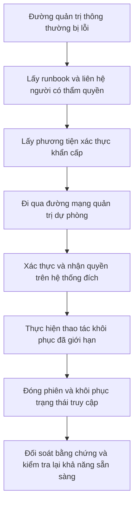

# Không kiểm thử break-glass

## 1. Vấn đề: phương án khẩn cấp chỉ tồn tại trên giấy

Một đội vận hành đã tạo tài khoản khẩn cấp, cất thông tin truy cập trong két và ghi trong tài liệu rằng có thể khôi phục quyền quản trị khi hệ thống PAM gặp sự cố. Sáu tháng sau, SSO ngừng hoạt động. Người trực không mở được tài liệu vì tài liệu yêu cầu SSO; người giữ phương tiện xác thực dự phòng đã chuyển bộ phận; tài khoản khẩn cấp còn bị một chính sách mới chặn đăng nhập. Đội có tài khoản, nhưng không có một đường truy cập khẩn cấp đã được chứng minh.

Đó là anti-pattern **không kiểm thử break-glass**: coi việc tạo tài khoản, lưu credential hoặc phê duyệt runbook là bằng chứng rằng tổ chức có thể sử dụng quyền đặc biệt khi đường quản trị thông thường bị gián đoạn.

Trong quản lý truy cập đặc quyền, break-glass là cơ chế truy cập khẩn cấp được chuẩn bị trước để xử lý tình huống đường quản trị bình thường không dùng được. Cơ chế này cần đồng thời đáp ứng ba yêu cầu:

- Người được phép có thể lấy quyền đủ để thực hiện nhiệm vụ khôi phục đã xác định.
- Tổ chức nhận biết và truy vết được việc sử dụng quyền đó.
- Sau khi hoàn tất, trạng thái truy cập được đưa về cấu hình an toàn đã quy định.

Nếu chỉ thử đăng nhập, đội mới kiểm tra một đoạn của quy trình. Nếu không thử thu hồi quyền hoặc khép lại phiên, một cuộc diễn tập có thể để lại chính đường truy cập đặc quyền mà PAM đang cố kiểm soát.

Sau bài học này, người học có thể nhận diện bằng chứng kiểm thử yếu, lập ma trận lỗi phụ thuộc, thiết kế diễn tập có giới hạn và đánh giá kết quả từ lúc tuyên bố sự cố đến lúc đóng quyền khẩn cấp.

## 2. Break-glass khác gì với quyền quản trị thông thường?

Trong đường quản trị thông thường, một người có thể đăng nhập qua IdP, hoàn tất MFA, xin quyền JIT, được phê duyệt rồi mở phiên qua PAM proxy. Chuỗi này giúp thực hiện least privilege và giới hạn thời gian có quyền. Tuy nhiên, một thành phần trong chuỗi có thể chính là hệ thống cần được sửa.

Ví dụ, muốn sửa cấu hình IdP phải đăng nhập qua IdP; muốn lấy mật khẩu sửa vault lại phải mở vault; muốn phê duyệt quyền JIT thì người phê duyệt cũng cần dịch vụ đang lỗi. Đây là phụ thuộc vòng: quyền khôi phục chỉ có thể lấy được sau khi đã khôi phục hệ thống.

Break-glass xử lý một số tình huống khóa truy cập như vậy bằng một đường đã thiết kế riêng. Nó không tự khôi phục máy chủ đã hỏng hoàn toàn, không thay backup và cũng không đảm bảo phục hồi được dữ liệu bị mất. Phải xác định rõ cơ chế cứu được **loại lỗi nào**, đối với **hệ thống đích nào**, trong **điều kiện nào**.

| Thuộc tính | Truy cập thông thường | Truy cập break-glass |
|---|---|---|
| Mục đích | Vận hành theo quy trình hàng ngày | Khôi phục khi đường quản trị thông thường không đáp ứng được |
| Cách kích hoạt | Workflow cấp quyền và mở phiên thường lệ | Điều kiện khẩn cấp, thẩm quyền và thủ tục riêng đã duyệt |
| Quyền | Vai trò theo công việc, ưu tiên JIT/JEA khi phù hợp | Đủ cho nhiệm vụ khôi phục; phạm vi ngoại lệ phải được định nghĩa |
| Phụ thuộc | Có thể dựa vào SSO, vault, phê duyệt và proxy | Tránh phụ thuộc vào thành phần cần cứu trong kịch bản được bảo vệ |
| Bằng chứng | Log và giám sát phiên bình thường | Bằng chứng kích hoạt, người dùng thực tế, hành động, kết thúc và khôi phục kiểm soát |
| Sau sử dụng | Hết phiên hoặc hết thời hạn cấp quyền | Kiểm tra trạng thái quyền, phiên, credential và giám sát theo thiết kế khẩn cấp |

Một số nền tảng cần tài khoản khẩn cấp có quyền thường trực để tránh phụ thuộc vào cơ chế kích hoạt vai trò. Nền tảng khác có thể dùng credential phát sinh theo sự cố hoặc quyền tạm thời. Không thể áp dụng một quy tắc chung như “mọi tài khoản break-glass phải bị vô hiệu hóa sau dùng”. Phải khôi phục **trạng thái chuẩn đã được thiết kế cho nền tảng đó** và kiểm tra đường cứu hộ vẫn sẵn sàng.

## 3. Vì sao anti-pattern này tồn tại lâu?

Break-glass hiếm khi được dùng trong vận hành bình thường. Chính đặc điểm ít dùng khiến hỏng hóc dễ bị che giấu. Một thay đổi nhỏ có thể làm mất khả năng truy cập mà không tạo lỗi trên luồng hàng ngày.

Các nguồn trôi cấu hình thường gặp gồm thay đổi chính sách xác thực, thay thiết bị quản trị, đổi ACL mạng, chuyển vị trí lưu credential, luân chuyển nhân sự, thay khóa mã hóa, sửa quy trình phê duyệt hoặc cập nhật quyền trên hệ thống đích. Một runbook từng đúng có thể không còn thực thi được sau các thay đổi này.

Cũng có nguyên nhân tổ chức: đội vận hành sợ thử trên production, đội bảo mật chỉ kiểm tra rằng tài khoản tồn tại, còn kiểm toán nhận ảnh chụp cấu hình thay cho bằng chứng thực thi. Không bên nào sở hữu toàn bộ hành trình khôi phục.

Những câu sau là dấu hiệu cần xem xét:

- “Đã tạo tài khoản rồi nên chắc dùng được.”
- “Một người quản trị đã đăng nhập thử năm ngoái.”
- “Nếu có sự cố, cứ gọi người đã triển khai hệ thống.”
- “Không cần báo động vì lần dùng này là diễn tập.”
- “Khóa credential được cất an toàn; chưa thử lấy ra theo ca trực thực tế.”
- “Đăng nhập được là đạt; phần cleanup làm sau.”

Điểm cần sửa không phải là tổ chức thêm một cuộc họp, mà là tạo bằng chứng rằng người có trách nhiệm có thể hoàn tất đúng đường khẩn cấp trong điều kiện lỗi đã nêu.

## 4. Kiểm tra phụ thuộc trước khi kiểm tra tài khoản

Không nên bắt đầu bằng câu hỏi “mật khẩu có đúng không?”. Hãy bắt đầu bằng “khi thành phần X hỏng, từng bước của đường khẩn cấp còn hoạt động không?”.



Mỗi nút trong sơ đồ đều có thể phụ thuộc vào dịch vụ đang lỗi. Ví dụ, credential được mã hóa là cần thiết, nhưng khóa giải mã nằm duy nhất trong vault đang ngừng hoạt động thì bản dự phòng không có giá trị cho kịch bản mất vault.

| Thành phần cần dùng | Câu hỏi kiểm thử | Ví dụ điểm thất bại |
|---|---|---|
| Runbook | Người trực đọc được khi SSO không hoạt động không? | Tài liệu nằm duy nhất sau cổng đăng nhập liên kết |
| Người có thẩm quyền | Có người thay thế và kênh xác minh độc lập không? | Mọi phê duyệt dồn vào một người đang vắng mặt |
| Credential hoặc thiết bị | Có lấy và sử dụng được đúng thủ tục không? | Thiết bị hết hạn, khóa không còn trong vị trí đã ghi |
| Thiết bị quản trị | Máy được chỉ định có hoạt động và có cấu hình cần thiết không? | Máy dự phòng cần đăng nhập vào chính domain đang lỗi |
| Mạng quản trị | Có đường tới control plane hoặc console được thiết kế không? | Đường dự phòng vẫn đi qua cùng gateway bị hỏng |
| Hệ thống đích | Quyền thực tế có đủ cho nhiệm vụ khôi phục không? | Đăng nhập được nhưng không có quyền sửa cấu hình cần cứu |
| Ghi nhận sự kiện | Có giữ được dấu vết khi SIEM không nhận log không? | Log nằm trên máy tạm và bị mất sau khi đóng phiên |
| Kết thúc truy cập | Có đóng phiên và xử lý quyền phát sinh được không? | Hệ thống phát token đã lỗi, cơ chế thu hồi không được kiểm tra |

“Độc lập” chỉ có ý nghĩa tương đối với lỗi cụ thể. Hai tài khoản ở cùng một IdP không tạo đường cứu hộ độc lập cho lỗi toàn bộ IdP. Hai vị trí lưu credential cũng chưa độc lập nếu cả hai cần cùng một khóa giải mã hoặc cùng một đường mạng.

Không thể loại bỏ mọi phụ thuộc. Mục tiêu là biết phụ thuộc còn lại, kiểm thử giả định quan trọng và ghi rõ giới hạn được bảo vệ.

## 5. Xác định thế nào là một lần kiểm thử đạt

Tiêu chí đạt phải được viết trước khi diễn tập. Nếu viết sau, đội rất dễ điều chỉnh tiêu chuẩn theo những gì tình cờ đã làm được.

Một kết quả có thể được đánh giá theo năm cổng sau:

1. **Kích hoạt hợp lệ:** có tình huống, mã sự cố hoặc diễn tập, người thực hiện, người cho phép và phạm vi được ghi nhận.
2. **Lấy được truy cập hữu dụng:** người trực dùng đường khẩn cấp để nhận đúng quyền trên đúng hệ thống trong thời gian mục tiêu.
3. **Thực hiện được nhiệm vụ đại diện:** một thao tác đã duyệt chứng minh quyền đủ cho loại khôi phục cần thiết, không chỉ mở được trang đăng nhập.
4. **Có khả năng phát hiện và đối soát:** sự kiện truy cập đến được người nhận; hoạt động quan trọng liên kết được với người thực hiện và mã sự cố.
5. **Khép lại an toàn:** quyền tạm, phiên, credential và các thay đổi diễn tập được xử lý; trạng thái chuẩn và khả năng sẵn sàng được kiểm tra lại.

Cổng thứ ba có thể dùng thao tác đọc một cấu hình đặc quyền hoặc thay đổi một đối tượng kiểm thử vô hại rồi hoàn nguyên, tùy quyền mà kịch bản cần chứng minh. Một thao tác chỉ đọc không chứng minh quyền sửa cấu hình; khi cần chứng minh quyền ghi, chọn đối tượng và điều kiện thử tương ứng trong phạm vi đã cho phép.

Không gộp mọi tình trạng vào PASS/FAIL của bước đăng nhập:

| Kết quả | Ý nghĩa | Cách ghi nhận |
|---|---|---|
| PASS | Tất cả cổng bắt buộc của kịch bản đều có bằng chứng đạt | Ghi phiên bản cấu hình, phạm vi và thời điểm hiệu lực của kết quả |
| FAIL | Đã thử và một điều kiện bắt buộc không đạt | Ghi bước lỗi, tác động, người sửa và yêu cầu kiểm thử lại |
| NOT_TESTED | Chưa thực thi hoặc chưa đủ bằng chứng | Không được tính là năng lực sẵn sàng đã chứng minh |
| ABORTED | Dừng theo tiêu chí an toàn hoặc vì phát hiện điều kiện ngoài kế hoạch | Ghi trạng thái còn lại, cleanup và điều kiện để thử lại |

Nếu truy cập được nhưng cảnh báo không tới hoặc phiên cũ vẫn dùng được trái với yêu cầu thiết kế, không công nhận toàn bộ kịch bản PASS. Có thể ghi từng bước đạt để hỗ trợ chẩn đoán, nhưng kết quả tổng phải phản ánh điều kiện chưa đạt.

## 6. Tổ chức diễn tập theo mức độ thực thi

Không cần gây mất dịch vụ thật để bắt đầu. Các cấp độ kiểm thử giải quyết những câu hỏi khác nhau và bổ sung cho nhau.

### 6.1. Rà soát tại bàn

Cho ca trực đi qua tình huống giả định bằng runbook hiện có. Yêu cầu họ tìm tài liệu, xác định người phê duyệt, chọn credential phù hợp và nêu điều kiện dừng. Hình thức này phát hiện lỗ hổng phân công và phụ thuộc thông tin, nhưng không chứng minh credential đăng nhập được.

### 6.2. Kiểm tra thành phần

Kiểm tra riêng vị trí lưu phương tiện xác thực, thiết bị quản trị, đường mạng dự phòng, vai trò đích hoặc luồng thông báo. Kết quả tốt giúp giảm rủi ro trước diễn tập tích hợp, nhưng không được suy ra rằng toàn chuỗi đã hoạt động.

### 6.3. Diễn tập tích hợp trong môi trường kiểm thử

Dùng môi trường đủ tương đồng để chặn một phụ thuộc cụ thể, chẳng hạn đường truy cập thông thường của máy diễn tập. Chạy từ kích hoạt đến cleanup. Ghi rõ khác biệt giữa môi trường thử và production, nhất là mạng, chính sách xác thực, quyền và dịch vụ logging.

### 6.4. Xác nhận có kiểm soát trên môi trường thật

Trong cửa sổ được duyệt, xác nhận các yếu tố chỉ production mới chứng minh được: credential thực tế, quyền thực tế, kênh cảnh báo và đường quản trị được chỉ định. Chọn nhiệm vụ tối thiểu có giá trị kiểm chứng; có người quan sát và đường khôi phục nếu thử thất bại.

Không tắt IdP hoặc vault production chỉ để chứng minh mình có thể đăng nhập khi nó tắt. Có thể giới hạn sự cố giả lập ở máy, tenant lab hoặc phân đoạn kiểm thử được phép. Nếu chưa tái hiện toàn bộ điều kiện, ghi nhận là kiểm thử có giới hạn thay vì gọi đó là bằng chứng end-to-end cho mọi sự cố.

## 7. Lập ma trận kịch bản theo lỗi thực tế

Mỗi hàng trong ma trận phải có giả định lỗi và bằng chứng riêng. Một lần đăng nhập thành công không bao phủ tất cả các hàng.

| Kịch bản | Điều cần chứng minh | Bằng chứng tối thiểu |
|---|---|---|
| SSO hoặc federation lỗi | Đường khẩn cấp không phải đi qua luồng SSO đang hỏng | Cách mô phỏng lỗi, dấu vết xác thực và truy cập đích |
| Vault không truy cập được | Phương tiện khẩn cấp có thể lấy theo thiết kế không dựa vào vault đó | Biên bản lấy phương tiện, người giữ, mốc thời gian và đăng nhập |
| JIT hoặc phê duyệt trực tuyến lỗi | Thủ tục khẩn cấp có thẩm quyền thay thế thực thi được | Bản ghi cho phép và quyền thực tế trên đích |
| PAM proxy hoặc bastion lỗi | Đường dự phòng có thể tới đúng đích và vẫn có dấu vết phù hợp | Đường kết nối, ID phiên hoặc dấu vết từ hệ thống đích |
| Thiết bị MFA thường lệ không dùng được | Phương thức đã thiết kế cho khẩn cấp vẫn hoạt động | Thiết bị hoặc phương thức thay thế và kết quả xác thực |
| Người giữ credential chính vắng mặt | Người thay thế hợp lệ có thể thực hiện đúng thủ tục | Vai trò ca trực, kiểm tra bàn giao và thời gian tiếp cận |
| Khu vực quản trị chính bị gián đoạn | Đường cứu hộ ở khu vực còn hoạt động đủ độc lập | Kiểm tra đường mạng, credential và hệ thống điều khiển còn lại |
| SIEM hoặc kênh báo động chính lỗi | Dấu vết được giữ và thông báo chuyển sang kênh dự phòng | Bản ghi cục bộ được bảo vệ, xác nhận người nhận và đối soát sau phục hồi |
| Kết thúc sử dụng quyền khẩn cấp | Quyền phát sinh được thu hồi và trạng thái chuẩn được khôi phục | Kết quả cleanup cùng kiểm tra lại truy cập hoặc phiên liên quan |

Cần bổ sung tài khoản dịch vụ và workload khi hệ thống có cơ chế cứu hộ riêng cho chúng. Không mặc định gắn mật khẩu của tài khoản khẩn cấp dùng bởi con người vào pipeline để vượt sự cố xác thực dịch vụ. Quy trình sửa workload phải có định danh, chủ sở hữu và phạm vi riêng.

## 8. Ví dụ kế hoạch diễn tập có thể kiểm chứng

Ví dụ dưới đây là **mô hình tài liệu nội bộ minh họa**, không phải schema hay cấu hình của một sản phẩm PAM. Mọi mốc thời gian là mục tiêu do tổ chức giả định trong ví dụ, cần hiệu chỉnh theo hệ thống.

```yaml
exercise:
  id: BG-DRILL-017
  objective: Khôi phục quyền quản trị lab khi luồng SSO thường lệ không dùng được
  environment: isolated-pam-lab
  target: lab-admin-control-plane
  runbook_version: bg-lab-v3
  failure:
    assumption: Chỉ đường SSO thông thường của máy diễn tập bị chặn
    boundary: Không tác động SSO hoặc mạng production
  roles:
    operator: on-call-operator
    authorizer: incident-lead
    observer: security-observer
    credential_custodian: designated-custodian
  credential_reference: BG-LAB-A
  allowed_action: Đọc cấu hình quản trị được chỉ định trong lab
  access_time_target_seconds: 600
  alert_ack_target_seconds: 180
  evidence:
    correlation_id: BG-DRILL-017
    required:
      - activation_record
      - access_audit_reference
      - allowed_action_result
      - alert_acknowledgement
      - cleanup_verification
  stop_conditions:
    - unexpected_production_target
    - credential_exposure
    - loss_of_observer_contact
    - loss_of_designated_recovery_path
  closure:
    - end_exercise_sessions
    - remove_exercise_temporary_grants
    - handle_credential_according_to_approved_policy
    - verify_normal_access
    - verify_emergency_readiness
    - reconcile_evidence
```

Tài liệu chỉ chứa tham chiếu credential, không chứa password, PIN, private key hoặc recovery code. Tham chiếu đó cũng phải được bảo vệ vì nó tiết lộ cấu trúc vận hành khẩn cấp.

Các vai trò trong ví dụ mô tả trách nhiệm; không bắt buộc mỗi vai trò luôn là một người riêng trong mọi tổ chức. Tuy nhiên, nếu thiết kế yêu cầu hai người cùng kiểm soát việc lấy credential thì phải thử đúng cơ chế đó, bao gồm tình huống người giữ chính vắng mặt. Không tự bỏ kiểm soát hai người trong lúc diễn tập chỉ để đạt thời gian mục tiêu.

## 9. Quy trình diễn tập từ đầu đến cuối

### Bước 1 — Xác nhận phạm vi và điều kiện bắt đầu

Kiểm tra mã diễn tập, hệ thống đích, người cho phép, người quan sát, đường liên lạc và phương án dừng. Xác nhận không có diễn tập hoặc thay đổi khác tranh chấp cùng tài khoản khẩn cấp. Nếu một credential được nhiều đội sử dụng cùng lúc, rất khó biết sự kiện thuộc phiên nào và ai có trách nhiệm cleanup.

Người quan sát xác nhận vẫn có đường khôi phục dự phòng. Không được cố tình làm mất đường quản trị cuối cùng đang hoạt động nếu chưa có kế hoạch phục hồi tương xứng.

### Bước 2 — Ghi nhận điều kiện lỗi

Chụp lại trạng thái hoặc lưu bằng chứng phù hợp cho thấy đường thông thường không đáp ứng kịch bản. Mô tả chính xác cách mô phỏng: chặn một endpoint trên máy lab khác với ngừng toàn bộ IdP. Giữ sự khác biệt này trong kết luận.

### Bước 3 — Kích hoạt thủ tục khẩn cấp

Người có thẩm quyền xác nhận lý do, phạm vi quyền, thời hạn dự kiến và người được thực hiện. Nếu hệ thống ticket chính không truy cập được, dùng phương án ghi nhận thay thế đã duyệt, rồi đối soát vào hệ thống chính sau khi phục hồi. Không để việc mất ticket đồng nghĩa với không có hồ sơ.

### Bước 4 — Lấy và sử dụng phương tiện xác thực

Dùng thiết bị quản trị và đường mạng được chỉ định. Người giữ credential thực hiện bàn giao hoặc hỗ trợ xác thực theo thiết kế. Không gửi secret qua chat, không dán vào command line có lịch sử ghi lại và không đưa secret vào video minh chứng.

Ghi thời điểm bắt đầu và thời điểm có **quyền hữu dụng**, không chỉ thời điểm giao diện đăng nhập xuất hiện. Nếu cần nhiều lần thử, ghi số lần và nguyên nhân thay vì chỉ giữ lần thành công.

### Bước 5 — Chứng minh quyền đủ cho nhiệm vụ

Thực hiện đúng thao tác đại diện được duyệt. Xác nhận tài khoản, vai trò và đích khớp phạm vi. Nếu quyền vượt dự kiến hoặc chọn nhầm đích, dừng để đánh giá; không tiếp tục tận dụng quyền rộng hơn vì đang ở trong diễn tập.

Với JEA hoặc tập lệnh quản trị giới hạn, cần chứng minh thao tác khôi phục bắt buộc được cho phép và thao tác ngoài phạm vi bị chặn. Với tài khoản khẩn cấp có quyền rộng theo thiết kế, kiểm tra kiểm soát sử dụng và trách nhiệm giám sát tương ứng thay vì giả định tài khoản đó có JEA.

### Bước 6 — Kiểm tra cảnh báo và bằng chứng

Người quan sát xác minh sự kiện xác thực và hoạt động đại diện xuất hiện tại nơi lưu trữ mong đợi. Người trực giám sát xác nhận đã nhận và hiểu thông báo. Một rule đã được bật hoặc một email được xếp hàng gửi chưa chứng minh người chịu trách nhiệm đã nhận được cảnh báo.

Nên gắn nhãn diễn tập để người xử lý biết ngữ cảnh. Không tắt toàn bộ cảnh báo cho tài khoản khẩn cấp. Sự kiện ngoài phạm vi hoặc ngoài thời gian diễn tập vẫn phải được phát hiện.

### Bước 7 — Khôi phục và đóng truy cập

Đóng phiên, xử lý credential, quyền tạm và thay đổi diễn tập theo thủ tục. Khôi phục đường thông thường. Sau đó kiểm tra lại rằng cả trạng thái vận hành bình thường và đường cứu hộ cho lần tới đều đáp ứng thiết kế.

### Bước 8 — Đối soát và xử lý phát hiện

Đối chiếu từng cổng đạt với bằng chứng. Mỗi phát hiện cần có mức ảnh hưởng, chủ sở hữu, thời hạn sửa và phạm vi phải thử lại. Chỉ đóng phát hiện sau khi có bằng chứng kiểm thử lại phù hợp; bản cập nhật runbook tự nó chưa chứng minh đã sửa lỗi thực thi.

## 10. Ví dụ: đăng nhập thành công nhưng diễn tập vẫn thất bại

Một đội thử kịch bản SSO không dùng được trong lab. Các mốc dưới đây minh họa vì sao cần chấm điểm toàn chuỗi.

| Mốc | Quan sát | Đánh giá |
|---|---|---|
| 09:00 | Tuyên bố bắt đầu diễn tập, người cho phép xác nhận phạm vi | Có hồ sơ kích hoạt |
| 09:04 | Lấy được phương tiện xác thực từ người giữ dự phòng | Bước lấy phương tiện hoạt động |
| 09:07 | Tài khoản khẩn cấp đăng nhập và đọc được cấu hình quản trị lab | Truy cập hữu dụng đạt mục tiêu 10 phút của ví dụ |
| 09:10 | Rule báo động có sự kiện nhưng không ai nhận thông báo | Cổng phát hiện chưa đạt |
| 09:15 | Đội đóng trình duyệt và cho rằng đã kết thúc | Chưa có bằng chứng phiên phía máy chủ đã kết thúc |
| 09:18 | Kiểm tra lại cho thấy một phiên liên quan còn hợp lệ ngoài thời hạn yêu cầu | Cổng khép lại chưa đạt |

Kết luận là FAIL cho kịch bản đầy đủ, dù phần truy cập hữu dụng đạt. Nguyên nhân thông báo có thể là nhóm nhận cũ; nguyên nhân phiên còn hiệu lực phải được xác định theo cơ chế token và session thực tế. Đóng cửa sổ trình duyệt không tương đương thu hồi phiên trên mọi hệ thống.

Lần sửa tiếp theo cần xác nhận người nhận đúng, thử lại luồng báo động, áp dụng cơ chế kết thúc phiên được nền tảng hỗ trợ và kiểm tra trạng thái phiên sau cleanup. Nếu một loại token không thể bị thu hồi ngay, kế hoạch phải nêu rõ thời gian sống, quyền còn lại và biện pháp hạn chế phù hợp; không ghi “đã thu hồi toàn bộ” khi chưa chứng minh được.

Ví dụ này cũng cho thấy sự khác nhau giữa **thời gian có truy cập quản trị** và **RTO của dịch vụ**. Có quyền sau bảy phút không có nghĩa dịch vụ đã phục hồi sau bảy phút. Đội vẫn cần thực hiện sửa chữa và xác nhận dịch vụ hoạt động.

## 11. Thiết kế bằng chứng mà không làm lộ credential

Bằng chứng hữu ích phải trả lời: ai kích hoạt, ai cho phép, sử dụng định danh nào, vào hệ thống nào, làm gì, vào lúc nào và trạng thái quyền sau khi kết thúc ra sao.

Ví dụ bản ghi dưới đây là dữ liệu minh họa đã loại bỏ secret:

```json
{
  "exerciseId": "BG-DRILL-017",
  "eventTime": "2026-11-27T02:07:00Z",
  "eventType": "EMERGENCY_ACCESS_ESTABLISHED",
  "operatorId": "operator-27",
  "authorizerId": "incident-lead-04",
  "emergencyPrincipalId": "bg-lab-a",
  "targetId": "lab-admin-control-plane",
  "sessionReference": "session-lab-071",
  "credentialReference": "BG-LAB-A",
  "runbookVersion": "bg-lab-v3",
  "result": "SUCCESS",
  "evidenceReference": "audit-event-071"
}
```

Không đưa access token, cookie phiên, PIN, password hoặc nội dung private key vào bản ghi. Mã tham chiếu audit dùng để định vị chứng cứ trong kho được bảo vệ, không phải để thay thế việc lưu chứng cứ.

Nếu dùng chung một định danh khẩn cấp theo thiết kế, log từ hệ thống đích có thể chỉ hiển thị tên định danh đó. Khi ấy phải kết hợp hồ sơ bàn giao, người thực hiện, máy quản trị, khoảng thời gian và ID phiên để gắn hoạt động với cá nhân. Không khẳng định khả năng quy trách nhiệm chỉ dựa vào tên tài khoản chung.

Thời gian trên các nguồn cần được đối chiếu. Nếu thiết bị có độ lệch giờ hoặc phải ghi nhận ngoại tuyến, lưu thông tin độ lệch đã biết và diễn giải khi hợp nhất timeline. Mốc thời gian chính xác giả tạo có thể làm người điều tra ghép nhầm các hành động.

Khi SIEM gián đoạn, quy trình có thể dùng log tại đích hoặc nơi đệm được kiểm soát, rồi chuyển và đối soát sau phục hồi. Cần xác minh quyền truy cập, dung lượng, tính toàn vẹn và việc không làm mất bản ghi khi chuyển tiếp. “Sẽ gom log sau” mà không có nơi lưu và người chịu trách nhiệm là một khoảng trống kiểm thử.

## 12. Kết thúc diễn tập là một phần của kiểm thử

Trạng thái đóng phải được xác định theo loại cơ chế khẩn cấp. Không dùng một checklist có lệnh giống nhau cho mọi hệ thống.

| Loại cơ chế | Việc cần xác nhận khi kết thúc | Rủi ro nếu chỉ đóng giao diện |
|---|---|---|
| Quyền tạm thời được cấp trong sự cố | Grant đã hết hạn hoặc bị gỡ; kiểm tra hiệu lực thực tế | Quyền còn tồn tại dù ticket đã đóng |
| Tài khoản khẩn cấp có quyền thường trực theo thiết kế | Vẫn sẵn sàng, được giám sát, không có quyền phát sinh ngoài baseline | Vô hiệu hóa nhầm đường cứu hộ hoặc để lại quyền bổ sung |
| Credential dùng một lần hoặc có thời hạn | Đã tiêu thụ, hết hạn hoặc bị thu hồi đúng cơ chế | Credential còn tái sử dụng được ngoài tình huống khẩn cấp |
| Mật khẩu dự phòng được công bố cho người thực hiện | Xử lý việc đổi, niêm phong và đồng bộ bản dự phòng theo chính sách | Một người tiếp tục biết secret còn hiệu lực hoặc bản dự phòng bị sai |
| Khóa phần cứng hoặc chứng thư | Thu hồi việc bàn giao, kiểm kê và đánh giá mất mát/lộ lọt theo chính sách | Thiết bị thất lạc hoặc không còn ở vị trí dùng cho ca trực tiếp theo |
| Session và token | Dùng cơ chế nền tảng hỗ trợ; kiểm tra trạng thái và giới hạn hiệu lực còn lại | Phiên vẫn truy cập được sau khi tuyên bố kết thúc |

Không tự xóa mọi phương tiện xác thực sau mỗi lần thử. Với password, credential phát sinh, khóa phần cứng và chứng thư, cách xử lý sau dùng có thể khác nhau. Thao tác đổi hoặc đăng ký lại credential cũng có thể làm hỏng bản dự phòng nếu không kiểm tra đồng bộ.

Khi một thao tác cleanup thất bại, phải giữ sự cố hoặc công việc khắc phục ở trạng thái đang xử lý, ghi rõ quyền còn lại và người sở hữu. Không cho kết quả PASS chỉ vì mọi người đã rời cuộc diễn tập.

## 13. Lịch kiểm thử phải theo cả thời gian và thay đổi

Lịch định kỳ giúp phát hiện trôi cấu hình và duy trì kỹ năng ca trực. Kiểm thử sau thay đổi giúp phát hiện mất hiệu lực ngay khi thay đổi tác động đến đường khẩn cấp.

Những thay đổi nên kích hoạt đánh giá hoặc kiểm thử lại gồm thay chính sách xác thực/điều kiện truy cập, đổi IdP hoặc vault, sửa phân quyền đích, đổi đường mạng quản trị, thay thiết bị khẩn cấp, thay người giữ credential, thay cơ chế log/cảnh báo và sửa quy trình khép lại.

Mức kiểm thử lại cần phù hợp tác động. Đổi số liên lạc cần xác nhận kênh thông báo và bàn giao; thay kiến trúc xác thực có thể đòi hỏi diễn tập tích hợp. Nếu chưa biết mức ảnh hưởng thì ghi rõ điều đó và giữ trạng thái sẵn sàng chưa được chứng minh cho phần bị tác động.

Với một nền tảng cụ thể, phải đối chiếu hướng dẫn hiện hành của nhà cung cấp. Chẳng hạn, Microsoft hướng dẫn xác nhận tài khoản emergency access của Entra ít nhất mỗi 90 ngày, gồm kiểm tra người được phép, đăng nhập và khả năng thực hiện tác vụ quản trị. Đây là hướng dẫn cho Entra, không phải chu kỳ bắt buộc chung cho mọi giải pháp PAM. [Microsoft Learn — Manage emergency access accounts](https://learn.microsoft.com/en-us/entra/identity/role-based-access-control/security-emergency-access).

Tần suất thực tế còn phụ thuộc mức quan trọng của hệ thống, tốc độ thay đổi, lịch trực và kết quả lần thử trước. Một lịch dày nhưng chỉ kiểm tra sự tồn tại của tài khoản không thay thế được một diễn tập đúng kịch bản.

## 14. Đo mức sẵn sàng bằng tiêu chí có ý nghĩa

Không nên báo “100% tài khoản break-glass đã được tạo” như bằng chứng khả năng phục hồi. Chỉ số đó mô tả inventory, không mô tả kết quả diễn tập.

Có thể theo dõi các chỉ số sau, với định nghĩa và mẫu số rõ ràng:

- **Độ bao phủ kịch bản còn hiệu lực:** số cặp hệ thống–kịch bản có lần thử đạt còn hiệu lực chia cho số cặp bắt buộc theo kế hoạch.
- **Thời gian đến truy cập hữu dụng:** từ mốc tuyên bố kích hoạt đã quy định đến khi có quyền đủ để thực hiện nhiệm vụ đại diện.
- **Thời gian xác nhận cảnh báo:** từ sự kiện cần báo đến khi người chịu trách nhiệm xác nhận nhận được; tách khỏi độ trễ đưa log vào SIEM.
- **Tỷ lệ khép lại đạt:** số diễn tập hoàn tất mọi bước cleanup bắt buộc chia cho số diễn tập đã thực hiện.
- **Phát hiện quá hạn:** các lỗi chưa sửa hoặc chưa được kiểm thử lại trong thời hạn đã giao.

Ví dụ, inventory có 12 cặp hệ thống–kịch bản bắt buộc. Có 9 cặp từng PASS, nhưng 2 cặp bị thay đổi kiến trúc sau lần thử; 3 cặp khác chưa thử. Độ bao phủ còn hiệu lực là 7/12, khoảng 58,3%, không phải 9/12 và càng không phải 100% vì có đủ tài khoản.

Đối với thời gian truy cập, cần giữ cả số lần FAIL và NOT_TESTED bên cạnh thời gian của lần thành công. Nếu chỉ lấy trung bình các lần thành công, một hệ thống không thể truy cập được có thể biến mất khỏi báo cáo.

“Còn hiệu lực” phải gắn với phiên bản hoặc trạng thái cấu hình, độ mới của lần thử và tập thay đổi đã biết. Không có bằng chứng mới sau thay đổi quan trọng thì không tự kéo dài hiệu lực của kết quả cũ.

## 15. Bài thực hành: thiết kế phép thử cho một đường cứu hộ

Giả sử một hệ thống quản trị lab có đường thường lệ qua SSO, workflow JIT, vault và PAM proxy. Đường khẩn cấp đã được thiết kế dùng phương tiện xác thực riêng, máy quản trị được chỉ định và console lab. Người giữ chính có người thay thế. Mục tiêu của bài thực hành là kiểm tra thiết kế này, không tạo thêm tài khoản hoặc tắt kiểm soát production.

Thực hiện các công việc sau trên giấy hoặc trong lab được cấp quyền:

1. Chọn một lỗi: SSO không dùng được đối với máy diễn tập. Viết chính xác ranh giới lỗi và điều kiện vẫn hoạt động.
2. Liệt kê phụ thuộc của từng bước từ tìm runbook đến đóng truy cập. Đánh dấu phụ thuộc nào vẫn cần SSO.
3. Chọn một thao tác đặc quyền đại diện có thể thực hiện an toàn trong lab. Giải thích nó chứng minh được loại quyền nào và chưa chứng minh loại quyền nào.
4. Định nghĩa người cho phép, người thao tác, người quan sát, thời gian mục tiêu và ít nhất ba điều kiện dừng.
5. Lập danh sách chứng cứ không chứa secret để chứng minh năm cổng đạt.
6. Xác định cách xử lý phiên, quyền tạm và phương tiện xác thực sau dùng theo thiết kế đã cho.
7. Đánh giá kết quả giả định: truy cập đạt thời gian mục tiêu, thao tác đại diện thành công, cảnh báo không đến và cleanup chưa được kiểm tra.

Với kết quả ở bước cuối, kịch bản không đạt đầy đủ. Cảnh báo là FAIL nếu đã thực thi nhưng không nhận được; cleanup là NOT_TESTED khi chưa thử. Cần sửa luồng thông báo, hoàn thành kiểm tra khép lại và thử lại phạm vi bị ảnh hưởng. Không đổi tên bài thử thành “chỉ thử login” sau khi kết quả xuất hiện để tuyên bố hoàn tất.

Sản phẩm thực hành nên gồm một ma trận phụ thuộc, một kế hoạch diễn tập ngắn và một bảng kết quả có liên kết chứng cứ. Không cần thu thập credential thật để hoàn thành phần thiết kế.

## 16. Các cách sửa dễ tạo ra anti-pattern mới

| Cách làm | Vì sao chưa giải quyết được vấn đề | Cách điều chỉnh |
|---|---|---|
| Thử bằng tài khoản admin thường lệ rồi suy ra break-glass dùng được | Hai đường có thể khác credential, chính sách và phụ thuộc | Thử đúng định danh và đường khẩn cấp trong phạm vi cho phép |
| Cho người triển khai tự làm theo trí nhớ | Không chứng minh ca trực thực thi được runbook | Luân phiên người trực và yêu cầu dùng tài liệu đã phát hành |
| Miễn mọi cơ chế xác thực cho tiện | Tăng khả năng lạm dụng quyền đặc biệt | Thiết kế phương thức khẩn cấp phù hợp nền tảng, đủ mạnh và tránh lỗi phụ thuộc đã chọn |
| Tắt cảnh báo suốt buổi diễn tập | Không kiểm chứng được phát hiện, có thể che hoạt động ngoài phạm vi | Gắn ngữ cảnh diễn tập và xác minh kênh nhận thông báo |
| Chỉ thử trên môi trường khác hẳn production | Chính sách hoặc topology thật chưa được xác nhận | Ghi rõ giới hạn và bổ sung xác nhận có kiểm soát cho phần khác biệt quan trọng |
| Đổi credential rồi không thử lại bản dự phòng | Lần sau có thể lấy được secret cũ | Xác nhận trạng thái mới và khả năng dùng của phương tiện dự phòng |
| Xem thời gian login là RTO của dịch vụ | Quyền quản trị chưa đồng nghĩa dịch vụ đã phục hồi | Đo riêng truy cập hữu dụng và phục hồi dịch vụ |
| Ghi PASS rồi mới tìm bằng chứng sau | Kết luận không có cơ sở kiểm chứng | Gắn từng tiêu chí với chứng cứ trước khi đóng kết quả |

## 17. Điều cần ghi nhớ

Break-glass chưa được kiểm thử là một giả định về khả năng truy cập, chưa phải năng lực phục hồi đã chứng minh. Đường khẩn cấp phải được kiểm tra dưới những lỗi phụ thuộc mà nó được thiết kế để chịu được.

Một phép thử có giá trị đi hết vòng đời: kích hoạt hợp lệ, lấy được quyền hữu dụng, thực hiện nhiệm vụ đại diện, phát hiện và lưu dấu vết, rồi khép lại quyền theo đúng thiết kế. Kết quả chỉ có ý nghĩa trong phạm vi, thời điểm và trạng thái cấu hình đã thử.

Người sở hữu quy trình cần duy trì lịch diễn tập, thử lại sau thay đổi có ảnh hưởng và giải quyết phát hiện bằng bằng chứng thực thi. Khi làm được điều đó, break-glass trở thành một phần có kiểm soát của PAM thay vì một tài khoản đặc quyền bị bỏ quên.
