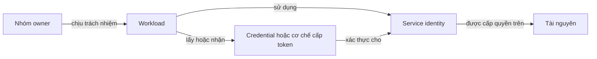

# Bỏ qua service account

## 1. Anti-pattern: chỉ quản lý người đăng nhập, bỏ quên danh tính chạy hệ thống

Một chương trình quản lý truy cập đặc quyền (Privileged Access Management — PAM) có thể kiểm soát chặt tài khoản quản trị viên nhưng vẫn để ứng dụng, agent và tác vụ định kỳ sử dụng quyền rất lớn mà không được kiểm kê. Đây là anti-pattern **bỏ qua service account**: coi tài khoản dịch vụ là chi tiết vận hành của ứng dụng, nằm ngoài phạm vi quản trị đặc quyền.

Service account là danh tính được một dịch vụ, tiến trình hoặc tác vụ tự động sử dụng để truy cập tài nguyên. Tùy hệ thống, nó có thể là tài khoản hệ điều hành, người dùng cơ sở dữ liệu, danh tính ứng dụng, tài khoản cloud hoặc một principal đại diện cho workload. Không phải mọi nền tảng đều gọi các đối tượng này bằng cùng một tên.

Một tài khoản dịch vụ không nhất thiết có đặc quyền. Tuy nhiên, nó cần được đánh giá nếu có thể đọc dữ liệu nhạy cảm, ghi cấu hình quan trọng, thay đổi quyền, quản lý credential, triển khai mã hoặc tác động đến hạ tầng trọng yếu. Phạm vi PAM nên dựa vào **khả năng thực tế và đường đi đến quyền nhạy cảm**, không chỉ dựa vào nhãn “admin”.

Ví dụ, một công ty đưa toàn bộ quản trị viên vào vault và ghi hình phiên SSH. Trong khi đó, ứng dụng đối soát vẫn dùng tài khoản cơ sở dữ liệu có quyền quản lý toàn bộ schema, mật khẩu không đổi trong nhiều năm và được dùng chung ở cả production lẫn staging. Báo cáo “100% tài khoản admin đã qua PAM” vẫn đúng theo mẫu số cũ, nhưng không phản ánh đường truy cập này.

Bài học cần rút ra: quản lý đặc quyền phải bao gồm cả danh tính con người và danh tính máy. Biện pháp kiểm soát cần phù hợp với cách mỗi loại danh tính hoạt động.

## 2. Phân biệt danh tính, credential, workload và quyền

Bỏ qua service account thường bắt đầu từ việc đồng nhất tài khoản với một chuỗi mật khẩu. Muốn kiểm soát đầy đủ, cần tách các thành phần sau.

| Thành phần | Câu hỏi cần trả lời | Ví dụ |
|---|---|---|
| Danh tính | Hệ thống đang công nhận chủ thể nào? | Principal của dịch vụ đối soát production |
| Workload | Tiến trình hoặc tác vụ nào sử dụng danh tính? | Job đối soát chạy mỗi đêm |
| Credential | Workload chứng minh danh tính bằng gì? | Mật khẩu, khóa riêng, chứng thư hoặc token |
| Quyền | Sau xác thực, chủ thể được làm gì? | Đọc giao dịch và ghi kết quả đối soát |
| Quan hệ tin cậy | Chủ thể nào được nhận hoặc sử dụng danh tính? | Một workload trong đúng môi trường được cấp token |
| Owner | Ai chịu trách nhiệm về mục đích và vòng đời? | Nhóm vận hành dịch vụ thanh toán |

Các thành phần có quan hệ nhưng không thay thế nhau:

- Đưa mật khẩu vào vault không tự thu hẹp quyền của tài khoản.
- Đổi mật khẩu không giải quyết việc nhiều ứng dụng dùng chung một danh tính.
- Dùng token ngắn hạn không bảo đảm workload nhận token có nguồn gốc hợp lệ.
- Gắn tên owner không chứng minh owner đã xác nhận dependency hoặc rà soát quyền.
- Có log truy cập vault không chứng minh đã ghi nhận mọi thao tác tại tài nguyên đích.

Credential cũng có thể cấp khả năng truy cập gián tiếp. Một tài khoản chỉ đọc kho cấu hình có thể lấy được secret của tài khoản mạnh hơn. Vì vậy, cần xem cả quyền truy cập secret, quyền sửa pipeline và quyền thay đổi quan hệ tin cậy, thay vì chỉ liệt kê vai trò trực tiếp.

## 3. Vì sao tài khoản dịch vụ dễ bị bỏ sót?

### 3.1. Tiêu chí kiểm kê thiên về con người

Nguồn kiểm kê thường là danh sách nhân viên, nhóm quản trị hoặc tài khoản được phép đăng nhập tương tác. Các danh tính chạy nền không xuất hiện trong những nguồn này, hoặc được loại ra vì “không có người dùng”.

Việc không có phiên đăng nhập của con người không làm mất khả năng đọc dữ liệu, thay đổi hệ thống hay sử dụng credential. Nó chỉ làm thay đổi cách cần xác thực và quy trách nhiệm.

### 3.2. Sợ gián đoạn nên miễn trừ vô thời hạn

Một ứng dụng cũ có thể phụ thuộc vào mật khẩu được nhúng trong cấu hình. Nhóm vận hành chưa biết hết nơi dùng nên không dám đổi mật khẩu hoặc giảm quyền. Ngoại lệ ban đầu để giữ dịch vụ hoạt động dần trở thành trạng thái mặc định.

Giữ tính sẵn sàng là yêu cầu thực tế. Sai lầm là không biến sự thiếu hiểu biết về dependency thành một công việc cần giải quyết, có owner, phạm vi và thời hạn.

### 3.3. Quyền cấp lúc triển khai không được thu lại

Trong giai đoạn cài đặt, ứng dụng có thể cần tạo bảng, sửa schema hoặc đăng ký thành phần. Sau triển khai, cùng tài khoản tiếp tục chạy tác vụ thông thường với toàn bộ quyền ban đầu.

Kết quả là một tiến trình chỉ cần đọc và ghi dữ liệu nghiệp vụ lại có thể quản trị cấu trúc hoặc thay đổi chính sách của hệ thống.

### 3.4. Trách nhiệm bị chia cắt

Nhóm ứng dụng quản lý cấu hình; nhóm nền tảng quản lý tài khoản; nhóm bảo mật quản lý vault; nhóm dữ liệu cấp quyền. Mỗi nhóm có một phần thông tin nhưng không ai chịu trách nhiệm xuyên suốt.

Khi xảy ra lỗi, các bên đều biết tài khoản tồn tại nhưng không ai biết ai được quyết định ngừng nó, ai phải kiểm thử rotation và ai xác nhận các consumer đã chuyển đổi.

### 3.5. Tên gọi tạo cảm giác an toàn

Các tên như `svc-report`, `backup-agent` hoặc `readonly-bot` chỉ mô tả ý định đặt tên. Chúng không phải bằng chứng rằng quyền thực tế chỉ đọc, tài khoản chỉ có một consumer hay credential được bảo vệ đúng cách.

## 4. Hậu quả: quyền tồn tại liên tục nhưng khó quy trách nhiệm

Giả sử một dịch vụ xuất báo cáo sử dụng tài khoản dùng chung với hệ thống sao lưu:

```text
Dịch vụ báo cáo ─┐
                ├── svc_shared ── đọc dữ liệu khách hàng
Agent sao lưu ──┘              └─ quản lý kho sao lưu
```

Nếu credential bị lộ từ cấu hình của dịch vụ báo cáo, phạm vi ảnh hưởng không còn giới hạn ở báo cáo. Kẻ nắm credential có thể có khả năng truy cập kho sao lưu tùy quyền thực tế, điều kiện truy cập và các biện pháp bảo vệ khác.

Việc dùng chung còn làm giảm chất lượng điều tra. Bản ghi “svc_shared thực hiện thao tác” chưa cho biết thao tác đến từ ứng dụng nào, phiên triển khai nào hoặc tiến trình cụ thể nào.

Những hậu quả điển hình gồm:

| Thiếu kiểm soát | Hậu quả có thể xảy ra |
|---|---|
| Không có owner hoạt động | Tài khoản tồn tại sau khi dịch vụ đã bị bỏ |
| Dùng chung danh tính giữa nhiều workload | Khó tách quyền và khó xác định nguồn thao tác |
| Credential lâu dài, nhiều bản sao | Khó xác định nơi cần thu hồi khi bị lộ |
| Quyền triển khai dùng cho runtime | Một lỗi ở runtime có thể tác động ngoài nhu cầu nghiệp vụ |
| Production và môi trường thử nghiệm dùng chung credential | Sự cố ở môi trường ít được kiểm soát có thể ảnh hưởng production |
| Không kiểm thử rotation | Đến lúc bắt buộc đổi credential mới phát hiện dependency bị thiếu |
| Chỉ thu log tại vault | Bỏ sót hành vi trực tiếp tại cơ sở dữ liệu, hệ điều hành hoặc dịch vụ đích |
| Ngoại lệ không có ngày xem xét | Khoảng trống kiểm soát kéo dài mà không được đánh giá lại |

Không nên mặc định rằng credential bị lộ luôn dẫn tới toàn bộ hậu quả trên. Tác động phụ thuộc quyền, mạng, quan hệ tin cậy và khả năng sử dụng credential. Chính các yếu tố đó phải được kiểm kê để xác định rủi ro.

## 5. Nhận diện service account bằng nhiều nguồn

Một danh sách tài khoản đơn lẻ thường không đủ. Cần đối chiếu cấu hình và bằng chứng sử dụng từ các hệ thống thuộc phạm vi được phép kiểm kê.

Các nguồn hữu ích có thể gồm:

- Cấu hình dịch vụ hệ điều hành, tác vụ theo lịch và agent vận hành.
- Principal và quyền tại cơ sở dữ liệu.
- Danh tính workload, vai trò ứng dụng và quan hệ tin cậy trên nền tảng.
- Tham chiếu đến secret trong cấu hình triển khai, pipeline và công cụ quản lý cấu hình.
- Metadata của secret trong vault và log cấp credential.
- Log xác thực, truy cập tài nguyên và lịch sử thay đổi quyền.
- Danh mục ứng dụng cùng thông tin owner nghiệp vụ, vận hành.

Mục tiêu là tìm **danh tính và quan hệ sử dụng**, không thu gom giá trị secret vào báo cáo. Bản kiểm kê chỉ nên lưu tham chiếu phù hợp, chẳng hạn đường dẫn đối tượng secret hoặc mã credential; không chép mật khẩu, private key hay token.

### 5.1. Tách “được cấu hình” khỏi “đã quan sát thấy”

Hai loại bằng chứng có vai trò khác nhau:

- Cấu hình cho biết một workload có ý định dùng danh tính.
- Log cho biết trong khoảng quan sát đã có một hoạt động cụ thể.
- Owner giải thích mục đích và xác nhận hoạt động dự kiến.
- Kiểm thử có kiểm soát giúp xác nhận các đường chạy ít xuất hiện.

Không thấy truy cập trong một tuần không đủ để kết luận tài khoản vô dụng nếu job chỉ chạy cuối tháng. Ngược lại, không thấy tài khoản trong cấu hình chính không có nghĩa nó không được sử dụng bởi tác vụ phụ hoặc cấu hình triển khai khác.

### 5.2. Trường kiểm kê tối thiểu

| Trường | Nội dung cần ghi |
|---|---|
| Identity ID | Định danh ổn định tại hệ thống quản lý danh tính |
| Loại danh tính | Hệ điều hành, database, ứng dụng, workload hoặc loại tương ứng |
| Workload và môi trường | Dịch vụ nào sử dụng, production hay môi trường khác |
| Owner và đầu mối dự phòng | Nhóm chịu trách nhiệm, không chỉ tên một cá nhân |
| Mục đích | Nghiệp vụ hoặc thao tác hệ thống cần thực hiện |
| Tài nguyên và quyền | Tài nguyên được truy cập, quyền trực tiếp và quan hệ cấp quyền liên quan |
| Cơ chế xác thực | Secret tĩnh, chứng thư, token ngắn hạn hoặc phương thức khác |
| Credential reference | Tham chiếu quản lý; không lưu giá trị bí mật |
| Consumer và dependency | Tiến trình, job, connector, cache hoặc bản triển khai liên quan |
| Bằng chứng sử dụng | Nguồn log, khoảng quan sát, lần dùng đã xác nhận |
| Kiểm soát vòng đời | Quy trình cấp mới, rotation, thu hồi và rà soát |
| Ngoại lệ | Lý do, phạm vi, owner phê duyệt, hạn xem xét và kế hoạch xử lý |

Nếu một trường chưa biết, nên ghi rõ “chưa xác minh” cùng việc cần thực hiện. Điền một owner hoặc ngày sử dụng suy đoán sẽ làm báo cáo có vẻ đầy đủ nhưng gây khó khăn khi xử lý sự cố.

## 6. Lập bản đồ dependency trước khi thay đổi

Mật khẩu của một service account có thể được dùng bởi nhiều thành phần hơn dự kiến: một job định kỳ, bản triển khai chưa được cập nhật, connection pool, agent dự phòng hoặc hệ thống khôi phục.

Bản đồ cần trả lời bốn quan hệ:



Với mỗi đường sử dụng, cần biết cách cập nhật và cách xác nhận đã chuyển đổi. Ví dụ:

| Consumer | Cách nhận credential | Điều cần kiểm tra khi đổi |
|---|---|---|
| Ứng dụng chạy liên tục | Nạp lúc khởi động | Có hỗ trợ nạp lại hay cần triển khai lại? |
| Job cuối tháng | Đọc lúc bắt đầu job | Có thể kiểm thử đường chạy trước kỳ thực tế không? |
| Connection pool | Tạo kết nối bằng credential đã nạp | Kết nối mới và kết nối đang mở phản ứng thế nào? |
| Agent dự phòng | Cấu hình riêng tại site dự phòng | Có bị bỏ quên khi cập nhật site chính không? |
| Pipeline triển khai | Lấy secret theo quyền của runner | Runner nào được phép lấy và log có che giá trị secret không? |

Không nên chỉ kiểm tra “ứng dụng vẫn trả HTTP 200”. Một kết nối cũ có thể vẫn hoạt động trong khi mọi kết nối mới đều thất bại. Kiểm thử cần bao phủ hành vi mà thay đổi credential thực sự tác động tới.

Nếu chưa xác định đủ dependency, chưa nên thu hồi hàng loạt chỉ để tăng tỷ lệ hoàn thành. Cần thu hẹp phạm vi thay đổi, bổ sung quan sát và kiểm thử, đồng thời ghi nhận phần chưa được xác minh.

## 7. Ưu tiên xử lý theo quyền và tác động

Không phải mọi service account cần cùng mức kiểm soát hoặc cùng thứ tự xử lý. Một tài khoản ghi số liệu tổng hợp ít nhạy cảm khác với tài khoản quản lý backup, kho secret hoặc hạ tầng định danh.

Có thể xem xét đồng thời các yếu tố:

1. **Tác động:** dữ liệu và chức năng nào bị ảnh hưởng nếu danh tính bị sử dụng sai?
2. **Phạm vi quyền:** một tài nguyên, một môi trường hay nhiều hệ thống?
3. **Khả năng tiếp cận credential:** credential có nhiều bản sao, xuất hiện trong cấu hình hoặc được nhiều workload dùng chung không?
4. **Quan hệ tin cậy:** ai có thể nhận token, đảm nhận vai trò hoặc sửa workload sử dụng danh tính?
5. **Khả năng phát hiện:** có nhận diện được nguồn thao tác và hành vi khác thường không?
6. **Khả năng thu hồi:** có biết hết consumer và đã thử quy trình chuyển đổi chưa?
7. **Mức chắc chắn của kiểm kê:** có owner xác nhận và bằng chứng đủ chu kỳ hoạt động không?

Một tài khoản có tác động lớn nhưng dependency chưa rõ thường cần ưu tiên **làm rõ và giảm rủi ro có kiểm soát**, không phải tự động vô hiệu hóa ngay.

Ví dụ thứ tự công việc cho một tài khoản dùng chung nhiều quyền có thể là: xác nhận owner → lập dependency → hạn chế nơi được lấy credential → tách consumer → thu hẹp quyền → triển khai rotation. Thứ tự cụ thể phụ thuộc kiến trúc và khả năng thay đổi của hệ thống.

## 8. Thiết kế quyền phù hợp với workload

### 8.1. Tách danh tính theo ranh giới trách nhiệm

Một nguyên tắc hữu ích là tách danh tính khi cần tách quyền, vòng đời hoặc khả năng quy trách nhiệm. Thông thường, các ứng dụng độc lập và các môi trường có mức tin cậy khác nhau không nên dùng chung credential.

Không cần máy móc tạo một danh tính cho từng tiến trình nếu nền tảng đã có mô hình danh tính phù hợp. Điều quan trọng là có thể giải thích ranh giới: ai quản lý, workload nào được dùng, được truy cập gì và có thể thu hồi riêng hay không.

### 8.2. Tách quyền triển khai khỏi quyền runtime

Ví dụ minh họa:

```text
Danh tính triển khai:
- Thực hiện migration đã được phê duyệt.
- Chỉ hoạt động trong luồng triển khai được kiểm soát.
- Không được ứng dụng runtime sử dụng.

Danh tính runtime:
- Đọc các bảng cần thiết.
- Ghi kết quả nghiệp vụ trong phạm vi đã xác định.
- Không tạo người dùng, cấp quyền hoặc sửa schema nếu không có nhu cầu.
```

Danh sách trên mô tả thiết kế, không phải cú pháp cấp quyền của một sản phẩm cụ thể. Khi triển khai thực tế, phải đối chiếu quyền hiệu lực, quyền kế thừa và các khả năng gián tiếp tại nền tảng đích.

### 8.3. Giới hạn sử dụng tương tác có mục đích

Nếu tài khoản chỉ phục vụ chạy nền, cần kiểm soát khả năng con người dùng nó cho công việc tương tác. Tuy nhiên, không áp dụng một thay đổi như khóa đăng nhập hoặc đổi login shell hàng loạt mà chưa hiểu mô hình chạy dịch vụ của hệ điều hành và nền tảng.

Công việc vận hành của con người nên dùng danh tính cá nhân với quyền phù hợp và khả năng truy vết. Nếu có tình huống cần thao tác bằng danh tính dịch vụ, phải xác định phạm vi, người chịu trách nhiệm và bằng chứng của lần sử dụng đó.

### 8.4. Áp dụng JIT/JEA theo cách workload có thể vận hành

Just-in-Time (JIT) và Just Enough Administration (JEA) thể hiện mục tiêu cấp quyền đúng lúc, đúng mức. Với workload, có thể hiện thực mục tiêu bằng credential hoặc quyền có thời hạn, thao tác giới hạn và cơ chế cấp tự động dựa trên chính sách.

Một tác vụ chạy nền mỗi giờ không thể mặc định chờ con người phê duyệt từng lần như phiên quản trị tương tác. Có thể phê duyệt trước chính sách của tác vụ và kiểm soát việc cấp quyền theo danh tính workload, phạm vi tài nguyên, thời hạn cùng điều kiện thực thi.

Nếu dịch vụ cần hoạt động liên tục, thiết kế phải bao gồm cấp lại trước khi hết hạn, xử lý lỗi và khả năng chịu gián đoạn của hệ thống cấp credential. Thời hạn ngắn không thay thế thiết kế về tính sẵn sàng.

## 9. Chọn cơ chế xác thực và bảo vệ đường cấp credential

Khi nền tảng hỗ trợ phù hợp, danh tính workload được xác minh và credential có thời hạn có thể giảm nhu cầu phân phối secret tĩnh lâu dài. Nhưng cần kiểm soát cả cơ chế cấp, không chỉ thời gian sống của token.

Những điều cần làm rõ gồm:

- Workload phải chứng minh nguồn gốc bằng bằng chứng gì?
- Quan hệ tin cậy có giới hạn đúng ứng dụng, môi trường và nơi thực thi không?
- Token được cấp để dùng tại tài nguyên hoặc audience nào?
- Quyền nhận được có đúng phạm vi tác vụ không?
- Thành phần nào có thể sửa chính sách cấp hoặc giả mạo đầu vào của quy trình?
- Khi nghi ngờ compromise, có thể ngăn cấp mới và xử lý credential đã phát hành thế nào?

Nếu vẫn cần secret tĩnh, vault hỗ trợ quản lý truy cập, phân phối, rotation và ghi nhận việc lấy secret. Workload cần có quyền lấy đúng secret cần thiết, không được đọc cả thư mục hoặc cả kho chỉ vì thuận tiện.

Vấn đề “secret để lấy secret” cũng phải được giải quyết. Nếu một token vault lâu dài được nhúng trong cùng cấu hình với ứng dụng và có quyền rộng, việc chuyển mật khẩu đích vào vault chỉ di chuyển một phần rủi ro.

Không áp MFA tương tác một cách máy móc cho tài khoản chạy nền. Việc phê duyệt chính sách và thao tác quản trị vẫn có thể yêu cầu xác thực mạnh của con người; còn workload cần cơ chế xác thực máy phù hợp và có thể kiểm tra nguồn gốc.

## 10. Rotation phải bao gồm consumer và khả năng phục hồi

Rotation là thay credential và chuyển các consumer sang trạng thái mới có kiểm soát. Chỉ cập nhật giá trị trong vault chưa chứng minh rotation đã hoàn tất.

Một quy trình tổng quát có thể gồm:

1. Xác nhận owner, danh sách consumer và phạm vi tài nguyên.
2. Kiểm tra các giới hạn của hệ thống đích: có hỗ trợ nhiều credential đồng thời hay chỉ một?
3. Xác định cách phân phối giá trị mới, hành vi cache và cách tạo kết nối mới.
4. Thực hiện thay đổi trong phạm vi đã thử nghiệm.
5. Xác nhận từng consumer đã dùng đường xác thực mới.
6. Vô hiệu hóa credential cũ khi đạt điều kiện chuyển đổi.
7. Xác nhận đường cũ không còn xác thực được và theo dõi tác vụ liên quan.
8. Lưu bằng chứng cùng các điểm còn cần theo dõi.

### 10.1. Khi hỗ trợ chuyển đổi có khoảng chồng lấn

Nếu hệ thống cho phép hai credential hoặc hai danh tính cùng hoạt động trong giai đoạn ngắn, có thể chuyển consumer theo đợt. Khoảng chồng lấn phải được giới hạn và có owner xác nhận kết thúc.

Không suy diễn rằng mọi nền tảng đều hỗ trợ hai mật khẩu cho cùng một tài khoản. Đôi khi cần một danh tính thay thế với quyền tương đương đã được kiểm tra; đôi khi cần một cửa sổ bảo trì.

### 10.2. Khi chỉ có một credential

Cần điều phối thời điểm thay đổi và cập nhật consumer, chuẩn bị cách khôi phục dịch vụ nếu có lỗi. Việc kiểm thử trước, quan sát kết nối mới và xác nhận các job ít chạy trở nên đặc biệt quan trọng.

Rollback không mặc định là đưa lại credential cũ. Nếu giá trị cũ đã bị lộ hoặc nghi ngờ bị lộ, khôi phục nó có thể khôi phục cả đường truy cập không mong muốn. Phương án phục hồi nên sử dụng credential mới khác hoặc điều chỉnh cấu hình theo kế hoạch ứng phó.

### 10.3. Credential hết hiệu lực chưa chắc mọi phiên đã kết thúc

Thay mật khẩu hoặc thu hồi một khóa có thể ngăn xác thực mới nhưng không nhất thiết kết thúc các phiên đã xác thực. Token đã phát hành cũng có thể còn hiệu lực tùy cơ chế kiểm tra tại tài nguyên.

Do đó, kế hoạch thu hồi cần phân biệt:

- Ngăn cấp thêm credential.
- Ngăn xác thực mới bằng credential cũ.
- Xử lý token còn hiệu lực.
- Kết thúc phiên hoặc kết nối đang hoạt động khi cần và khi nền tảng hỗ trợ.
- Kiểm tra lại quyền hoặc quan hệ tin cậy đã bị thay đổi.

Đây là các điều kiện riêng; không nên gộp thành một dấu kiểm “đã rotate”.

## 11. Giám sát hành vi và lưu bằng chứng ở nhiều lớp

Nhiều hoạt động của service account không có phiên SSH/RDP để ghi hình. Bằng chứng phù hợp có thể nằm ở log cấp credential, log ứng dụng, log xác thực, audit của tài nguyên và lịch sử thay đổi chính sách.

Một chuỗi liên kết hữu ích là:

```text
Lần thực thi workload
    → danh tính hoặc lần cấp credential
    → yêu cầu xác thực tại tài nguyên
    → thao tác được thực hiện
    → kết quả và thay đổi phát sinh
```

Tùy nền tảng, có thể liên kết bằng workload ID, deployment ID, job/run ID, principal ID hoặc mã tương quan. Không đưa giá trị token hay secret vào log để tạo liên kết.

### 11.1. Những thay đổi đáng chú ý

| Dấu hiệu | Điều cần kiểm tra |
|---|---|
| Danh tính xuất hiện ở môi trường mới | Có triển khai hợp lệ hay credential bị dùng sai nơi? |
| Có hành vi tương tác từ tài khoản chạy nền | Có quy trình vận hành được duyệt hay sử dụng ngoài mục đích? |
| Truy cập tài nguyên ngoài phạm vi đã xác nhận | Quyền dư, cấu hình sai hay hành vi không hợp lệ? |
| Tăng mạnh lỗi xác thực sau rotation | Consumer nào chưa chuyển hoặc cache nào còn giá trị cũ? |
| Thay đổi trust policy hoặc quyền lấy secret | Ai thực hiện, có phê duyệt và bằng chứng triển khai không? |
| Tài khoản ít hoạt động bỗng truy cập lượng lớn | Có job hợp lệ theo chu kỳ hay cần điều tra thêm? |
| Credential cũ tiếp tục được sử dụng | Còn consumer bị bỏ sót hay một nguồn dùng không được phép? |

Một tín hiệu đơn lẻ không tự chứng minh có tấn công. Cần đối chiếu lịch công việc, thay đổi đã phê duyệt và đặc điểm workload trước khi kết luận.

### 11.2. Bằng chứng cho kiểm toán

Một hồ sơ quản lý service account có thể gồm owner đã xác nhận, mục đích sử dụng, quyền được duyệt, bản đồ consumer, bằng chứng rotation, kết quả thử thu hồi và lịch sử ngoại lệ.

Những bằng chứng đó cần ghi nhận phạm vi và thời điểm. Báo cáo rotation thành công hôm nay không chứng minh dependency vẫn đầy đủ sau một lần triển khai vào tháng tới.

Nội dung log và báo cáo phải được bảo vệ phù hợp vì chúng có thể chứa định danh hệ thống, đường dẫn secret hoặc thông tin nghiệp vụ. Không cần lưu giá trị bí mật để chứng minh hoạt động kiểm soát.

## 12. Tình huống: sửa anti-pattern cho job đối soát

### 12.1. Trạng thái ban đầu

Job đối soát chạy lúc 02:00 và một báo cáo cuối tháng cùng dùng `svc_reconcile`. Tài khoản này có quyền quản trị database do được cấp lúc cài đặt. Secret nằm trong cấu hình của hai consumer; chỉ job hằng ngày được biết đến trong danh mục ứng dụng.

Nhóm PAM ban đầu định đưa secret vào vault rồi đặt lịch rotation hằng ngày. Nếu thực hiện ngay, báo cáo cuối tháng có thể thất bại vì vẫn dùng bản sao cũ.

### 12.2. Làm rõ trước khi đổi

Nhóm ứng dụng xác nhận các thao tác cần thiết của job và báo cáo. Nhóm dữ liệu kiểm tra quyền hiệu lực. Nhóm vận hành đối chiếu log với lịch chạy, xác định được cả consumer cuối tháng và môi trường dự phòng.

Kết quả kiểm kê:

| Hạng mục | Phát hiện | Thay đổi cần thiết |
|---|---|---|
| Quyền | Runtime đang có quyền quản trị | Tách quyền triển khai và quyền nghiệp vụ |
| Danh tính | Hai consumer dùng chung | Tách khi cần quyền và vòng đời riêng |
| Credential | Có bản sao cấu hình cũ | Dùng cơ chế phân phối được kiểm soát |
| Owner | Chỉ có người cài đặt đã chuyển nhóm | Giao trách nhiệm cho nhóm dịch vụ hiện tại |
| Dependency | Chưa ghi nhận job cuối tháng | Bổ sung lịch chạy và cách kiểm thử |
| Thu hồi | Chưa thử kết nối mới sau rotation | Đưa kiểm tra kết nối mới vào điều kiện nghiệm thu |

### 12.3. Chuyển đổi theo đợt

Đầu tiên, nhóm triển khai một danh tính runtime có quyền tối thiểu đã kiểm thử cho job đối soát. Migration dùng một danh tính riêng trong luồng triển khai.

Sau đó, nhóm chuyển job hằng ngày, kiểm tra kết nối mới và kết quả nghiệp vụ. Consumer cuối tháng được kiểm thử bằng một lần chạy có kiểm soát với dữ liệu phù hợp, thay vì chỉ chờ đến cuối tháng mới phát hiện lỗi.

Chỉ khi xác nhận cả các consumer đã biết và đường dự phòng, nhóm mới thu hồi đường cũ theo kế hoạch. Họ kiểm tra xem còn kết nối hoặc tác vụ nào dùng danh tính cũ, đồng thời giữ quan sát đủ các chu kỳ cần thiết.

### 12.4. Điều kiện hoàn tất

Công việc không kết thúc ở “secret đã vào vault”. Điều kiện hoàn tất phải bao gồm:

- Owner hiện tại đã xác nhận mục đích và trách nhiệm.
- Consumer cùng chu kỳ hoạt động đã được kiểm kê trong phạm vi xác định.
- Quyền runtime phù hợp với tác vụ được kiểm thử.
- Credential được phân phối theo cơ chế kiểm soát và không còn các bản sao sử dụng đã biết ngoài kế hoạch.
- Rotation và thu hồi đã được thử trên các đường sử dụng liên quan.
- Log đủ liên kết hành vi với workload trong khả năng nền tảng hỗ trợ.
- Các giới hạn hoặc ngoại lệ còn lại có hồ sơ xử lý.

Không thể bảo đảm đã tìm hết mọi bản sao secret chỉ từ một nguồn log. Vì vậy, kết luận cần nêu rõ bằng chứng sử dụng, nguồn cấu hình được kiểm kê và giới hạn quan sát.

## 13. Xử lý legacy và ngoại lệ có kiểm soát

Một ứng dụng cũ chưa hỗ trợ token ngắn hạn hoặc lấy secret động không nhất thiết phải dừng hoạt động ngay. Cần chọn biện pháp trong khả năng hệ thống và có kế hoạch giảm khoảng trống.

Ví dụ, trong thời gian chờ nâng cấp, có thể tách tài khoản riêng cho ứng dụng, giảm quyền tài nguyên, hạn chế nơi được sử dụng credential, giới hạn quyền đọc cấu hình, tăng quan sát và thực hiện rotation theo quy trình bảo trì đã kiểm thử.

Hồ sơ ngoại lệ nên trả lời:

| Nội dung | Yêu cầu |
|---|---|
| Lý do kỹ thuật | Hạn chế cụ thể nào khiến chưa áp dụng kiểm soát mục tiêu? |
| Phạm vi | Những danh tính, workload và tài nguyên nào nằm trong ngoại lệ? |
| Owner | Ai chịu trách nhiệm và ai chấp nhận rủi ro? |
| Kiểm soát hiện tại | Biện pháp nào đang giảm tác động hoặc khả năng sử dụng sai? |
| Khả năng thu hồi | Có thể xử lý thế nào nếu credential bị lộ? |
| Hạn xem xét | Khi nào phải đánh giá lại, dựa trên điều kiện nào? |
| Kế hoạch xử lý | Việc cần làm, dependency và điều kiện kết thúc ngoại lệ |

“Service account không áp dụng PAM” không phải một lý do kỹ thuật. Một ngoại lệ có thể hợp lệ vì giới hạn cụ thể, nhưng cần tiếp tục nằm trong kiểm kê và giám sát.

Nếu không tìm được owner, tài khoản cần được xử lý như đối tượng chưa rõ trách nhiệm. Hành động tiếp theo là xác minh consumer, mục đích và tác động; không mặc định bỏ qua, cũng không tự động xóa chỉ dựa trên tên lạ hoặc thời gian không đăng nhập tương tác.

## 14. Ứng phó khi credential dịch vụ bị nghi lộ

Ứng phó cần vừa giảm khả năng truy cập không được phép vừa hiểu tác động đến dịch vụ. Cách xử lý phụ thuộc mức khẩn cấp và quyền của danh tính, nhưng cần phân biệt các lớp công việc.

1. **Xác định phạm vi:** credential nào, danh tính nào, những consumer và tài nguyên nào có liên quan?
2. **Giữ bằng chứng:** ghi nhận log và thời điểm liên quan theo quy trình, tránh làm lộ thêm giá trị secret trong trao đổi xử lý.
3. **Ngăn đường truy cập tiếp tục:** xem xét khóa nguồn cấp credential, hạn chế quan hệ tin cậy hoặc chặn đường sử dụng không hợp lệ.
4. **Thay và chuyển đổi:** cấp credential mới theo cơ chế được kiểm soát, cập nhật consumer hợp lệ và xác nhận hoạt động.
5. **Thu hồi hiệu lực cũ:** xử lý khóa, token, phiên và kết nối theo khả năng nền tảng; không giả định một thao tác sẽ giải quyết tất cả.
6. **Tìm thay đổi tồn tại sau sự cố:** quyền mới, principal mới, cấu hình triển khai hoặc trust policy bị sửa.
7. **Khôi phục và theo dõi:** xác nhận tác vụ nghiệp vụ, quan sát lỗi xác thực và kiểm tra đường truy cập cũ.
8. **Cập nhật kiểm kê:** bổ sung consumer bị bỏ sót và điều chỉnh nguyên nhân khiến credential có thể bị lộ.

Nếu có bằng chứng truy cập trái phép đang diễn ra, có thể cần cô lập hoặc thu hồi trước khi hoàn thành toàn bộ kiểm kê. Đây là quyết định ứng phó dựa trên tác động, không phải lý do để bỏ qua việc ghi nhận hành động và khôi phục dịch vụ.

Ngược lại, một đợt rotation định kỳ không nên được điều hành như sự cố khẩn cấp nếu chưa có dấu hiệu compromise. Hai tình huống có mức ưu tiên và điều kiện chấp nhận gián đoạn khác nhau.

## 15. Đo lường để thấy khoảng trống thay vì che nó

Chỉ số phải có mẫu số, phạm vi và thời điểm rõ ràng. “Đã quản lý 50 tài khoản” không cho biết còn bao nhiêu danh tính chưa được phát hiện hoặc chưa có owner.

Một số chỉ số có thể dùng:

| Chỉ số | Cách diễn giải |
|---|---|
| Tỷ lệ owner đã xác nhận | Số danh tính có owner xác nhận còn hiệu lực / số danh tính trong kiểm kê thuộc phạm vi |
| Tỷ lệ dependency đã xác minh | Số danh tính có consumer và chu kỳ sử dụng được xác minh / tổng danh tính thuộc phạm vi |
| Tỷ lệ rà soát quyền | Số danh tính có quyền đã được kiểm tra trong kỳ / tổng danh tính phải rà soát trong kỳ |
| Tỷ lệ rotation đã kiểm chứng | Số danh tính đạt cả chuyển consumer và thu hồi đường cũ / số danh tính phải rotation trong kỳ |
| Số credential tĩnh dùng chung | Theo dõi các trường hợp nhiều workload dùng cùng giá trị bí mật |
| Số ngoại lệ quá hạn | Các ngoại lệ đã hết hạn xem xét nhưng chưa được xử lý hoặc gia hạn hợp lệ |
| Thời gian thu hồi trong kiểm thử | Thời gian từ quyết định thu hồi đến khi đạt các điều kiện hiệu lực đã định nghĩa |

Không trộn “đã phát hiện”, “đã đưa vào vault” và “đã kiểm soát đầy đủ” thành một trạng thái. Một danh tính có thể đã vào vault nhưng chưa giảm quyền hoặc chưa kiểm thử thu hồi.

Tỷ lệ cũng không thay thế đánh giá tác động. Một tài khoản còn ngoài kiểm soát nhưng quản lý toàn bộ kho backup có thể quan trọng hơn nhiều tài khoản quyền hẹp đã hoàn tất. Cần xem thêm phân bố theo mức ảnh hưởng và các đối tượng chưa đủ bằng chứng.

## 16. Thực hành: kiểm kê và đề xuất chuyển đổi một tài khoản

Giả sử một tổ chức có `svc_ops` được dùng bởi ba thành phần:

```text
backup-agent       chạy liên tục
inventory-sync     chạy mỗi ngày
recovery-check     chạy theo đợt diễn tập

svc_ops:
- Truy cập hệ thống quản lý backup.
- Đọc thông tin tài sản.
- Thực hiện một số thao tác phục hồi.
- Credential được khai báo trong nhiều cấu hình.
```

Hãy lập một bảng làm việc chỉ chứa metadata và tham chiếu, không ghi giá trị credential. Với mỗi consumer, xác định owner, tài nguyên, thao tác cần thiết, cách nhận credential, chu kỳ sử dụng và bằng chứng cần thu thập.

Sau đó, đề xuất ranh giới danh tính. Chẳng hạn, tác vụ đồng bộ inventory có thể cần một danh tính chỉ đọc, tách khỏi quyền phục hồi. Agent backup và tác vụ diễn tập cần được đánh giá riêng theo chức năng thực tế; không mặc định chúng cần cùng quyền vì cùng thuộc nhóm vận hành.

Kế hoạch chuyển đổi cần nêu:

- Consumer nào có thể chuyển trước và lý do.
- Quyền nào sẽ được giữ, bỏ hoặc tách.
- Cách kiểm tra credential mới bằng kết nối hoặc lần chạy mới.
- Cách kiểm thử tác vụ chỉ chạy trong đợt diễn tập.
- Điều kiện thu hồi credential cũ.
- Cách khôi phục nếu một consumer thất bại.
- Những giới hạn còn chưa xác minh và ai xử lý.

Một phương án tốt phải giải thích được cả hiệu quả kiểm soát lẫn tác động vận hành. Câu trả lời chỉ có “đưa tất cả vào vault” chưa xử lý ranh giới quyền, consumer và vòng đời.

## 17. Những cách sửa dễ biến thành anti-pattern mới

| Cách làm | Vì sao chưa đủ | Hướng điều chỉnh |
|---|---|---|
| Bỏ qua vì tài khoản không có người dùng | Workload vẫn có thể thực hiện thao tác nhạy cảm | Đánh giá quyền và tài nguyên thực tế |
| Chuyển secret vào vault rồi tuyên bố hoàn tất | Quyền dư và bản sao cũ có thể vẫn tồn tại | Kiểm tra cả quyền, consumer và hiệu lực cũ |
| Bật MFA tương tác cho mọi tài khoản dịch vụ | Có thể làm hỏng luồng chạy tự động | Dùng cơ chế xác thực workload phù hợp |
| Đổi mật khẩu đồng loạt để đạt KPI | Dependency chưa rõ có thể gây gián đoạn | Chuyển theo phạm vi đã xác minh và kiểm thử |
| Dùng một service account cho mọi ứng dụng | Khó tách quyền, truy vết và thu hồi riêng | Tách theo ranh giới quyền, môi trường và vòng đời |
| Coi token ngắn hạn là đủ | Trust policy sai vẫn cho chủ thể khác nhận token | Kiểm soát nguồn cấp, audience và phạm vi |
| Xóa tài khoản vì lâu không thấy đăng nhập | Có thể bỏ sót job hiếm chạy hoặc đường dự phòng | Đối chiếu cấu hình, chu kỳ và owner |
| Lưu secret trong biên bản để làm bằng chứng | Tạo thêm nơi chứa credential | Lưu tham chiếu và kết quả kiểm chứng |
| Giữ ngoại lệ mãi vì ứng dụng legacy | Khoảng trống không còn được đánh giá | Có owner, hạn xem xét và kế hoạch xử lý |

Service account được quản lý tốt khi tổ chức biết nó phục vụ workload nào, ai chịu trách nhiệm, có quyền gì, xác thực bằng cơ chế nào và thu hồi ra sao. Tránh anti-pattern này là đưa các danh tính chạy hệ thống vào cùng vòng đời quản trị đặc quyền, với cách kiểm soát phù hợp cho hoạt động tự động.
