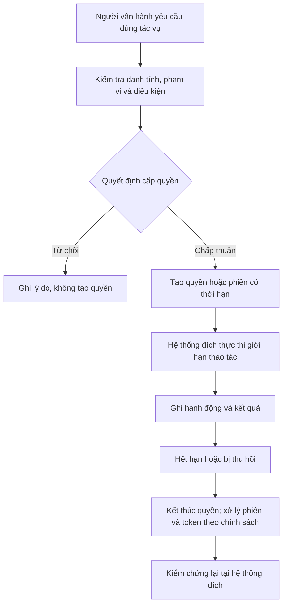

# Đã có JIT hoặc JEA

## 1. Mục này trong checklist production xác nhận điều gì?

Trong quản lý truy cập đặc quyền (Privileged Access Management — PAM), việc mua một công cụ hoặc bật một tính năng chưa chứng minh rằng quyền quản trị đã được kiểm soát. Mục **“Đã có JIT hoặc JEA”** cần xác nhận một cơ chế có hiệu lực trên tài nguyên production, được kiểm thử bằng danh tính thực và có bằng chứng về phạm vi quyền.

Hai hướng kiểm soát thường gặp là:

- **JIT — Just-in-Time access:** chỉ kích hoạt quyền khi có nhu cầu hợp lệ, trong khoảng thời gian xác định. Hết hạn hoặc có sự kiện thu hồi thì quyền phải kết thúc theo chính sách đã kiểm chứng.
- **JEA — Just Enough Administration:** chỉ cho phép thực hiện tập thao tác quản trị đủ cho công việc, trên đối tượng đã xác định. Người vận hành không cần nhận toàn bộ khả năng của tài khoản quản trị đứng phía sau.

JIT chủ yếu trả lời **“khi nào được dùng quyền?”**. JEA chủ yếu trả lời **“được làm những gì?”**. Hai câu hỏi bổ sung cho nhau; một cơ chế không tự động giải quyết câu hỏi còn lại.

Ví dụ, kỹ sư trực cần khởi động lại dịch vụ xử lý đơn hàng. Có thể cho phép họ kích hoạt vai trò bảo trì trong 20 phút, cung cấp một endpoint chỉ có thao tác khởi động lại đúng dịch vụ, hoặc kết hợp cả hai. Thời lượng 20 phút trong bài là giả định của tình huống, không phải ngưỡng an toàn áp dụng cho mọi hệ thống.

Một dòng checklist chỉ nên được đánh dấu đạt khi trả lời được:

> Ai được phép làm thao tác nào, trên tài nguyên nào, qua đường truy cập nào, trong điều kiện nào; khi điều kiện không còn thì điều gì ngăn quyền tiếp tục được sử dụng?

Bài học này hướng dẫn xây dựng bằng chứng nghiệm thu cho câu hỏi đó. Các bảng kiểm và tiêu chí định lượng bên dưới là mẫu thiết kế để đội triển khai điều chỉnh theo rủi ro của mình.

## 2. Phân biệt các hình thức dễ bị nhầm

| Cơ chế | Điều được giới hạn | Điều vẫn phải kiểm chứng |
|---|---|---|
| JIT kích hoạt một role | Khoảng thời gian role hoạt động | Role có quá rộng không; token và phiên cũ kết thúc thế nào |
| JIT cấp membership tạm thời | Thời gian thành viên thuộc nhóm | Membership lồng nhau, cache, phiên đăng nhập và quyền khác |
| JEA endpoint cho một tác vụ | Các chức năng được công bố cho người dùng | Tham số, mã chạy bên dưới, quyền Run-As và đường đi vòng |
| Mở cổng quản trị tạm thời | Khoảng thời gian có thể tiếp cận cổng mạng | Danh tính và quyền sau khi kết nối; kết nối đang mở khi cổng đóng |
| Mượn password từ vault có hạn | Thời gian được lấy secret qua vault | Secret còn dùng được ở đích không; đã đổi secret và xử lý phiên chưa |
| Ghi lại phiên của admin thường trực | Khả năng quan sát hoạt động | Quyền vẫn thường trực nếu không có kiểm soát khác |

Việc đóng cổng hoặc hết thời gian checkout secret không tương đương với thu hồi mọi khả năng quản trị ở hệ thống đích. Chẳng hạn, một mật khẩu đã được hiển thị có thể còn hợp lệ sau khi cửa sổ checkout đóng nếu cơ chế luân chuyển và cập nhật ở đích chưa hoàn tất.

Tương tự, endpoint có tên chứa “JEA” chưa chắc đã giới hạn đủ quyền. Cần xem tập lệnh hiệu lực và quyền của người dùng ngoài endpoint đó.

Trong hệ sinh thái Microsoft, JEA là công nghệ quản trị ủy quyền dựa trên PowerShell, cho phép giới hạn các cmdlet, function và chương trình bên ngoài mà người kết nối được sử dụng. Với nền tảng khác, có thể triển khai nguyên tắc giới hạn tác vụ bằng cơ chế phù hợp, nhưng phải mô tả đúng cơ chế thực thi thay vì mặc định mọi command allowlist đều có đặc tính giống JEA của PowerShell. Xem [tổng quan JEA của Microsoft](https://learn.microsoft.com/en-us/powershell/scripting/security/remoting/jea/overview).

### 2.1. Eligible không phải đang có quyền, nhưng vẫn là quyền cần quản trị

Một người có thể đủ điều kiện kích hoạt role nhưng chưa có active assignment. Đây là trạng thái khác với được cấp role thường trực. Tuy nhiên, danh sách đủ điều kiện vẫn quyết định ai có thể yêu cầu đặc quyền, nên phải có chủ sở hữu, giới hạn phạm vi và cơ chế rà soát.

Không nên chỉ đếm active assignment rồi kết luận rằng hệ thống không còn rủi ro đặc quyền. Nếu toàn bộ nhân viên đều có thể tự kích hoạt role quản trị rộng mà không có điều kiện phù hợp, cửa sổ lạm dụng vẫn lớn.

### 2.2. JIT không biến một role rộng thành role hẹp

Nếu một kỹ sư được quản trị toàn bộ máy chủ trong 20 phút, họ vẫn có thể thực hiện nhiều thay đổi ngoài nhiệm vụ trong 20 phút đó. Các thay đổi được tạo ra trong cửa sổ này có thể tồn tại lâu hơn thời gian kích hoạt quyền.

Do đó, nghiệm thu JIT cần đánh giá cả thời hạn lẫn phạm vi role. Nếu tác vụ chỉ cần khởi động lại một dịch vụ, role sửa mọi dịch vụ, tạo người dùng và thay cấu hình bảo mật cần được giải thích rõ hoặc thay bằng phương án hẹp hơn.

### 2.3. JEA không tự tạo thời hạn truy cập

Một endpoint giới hạn tác vụ có thể cho phép một nhóm kết nối bất kỳ lúc nào. Cách đó có thể phù hợp với công việc lặp lại, tác động thấp và đã được đánh giá rủi ro. Nhưng nó không tự chứng minh rằng chỉ người đang trực hoặc đang có yêu cầu hợp lệ mới được sử dụng.

Nếu tổ chức yêu cầu cả giới hạn thời gian, phải có thêm cơ chế kiểm soát điều kiện truy cập, chẳng hạn entitlement tạm thời hoặc cấp phiên qua PAM. Phải thử thời điểm điều kiện hết hiệu lực với cả phiên mới và phiên đã tồn tại.

## 3. Chọn JIT, JEA hay kết hợp dựa trên tác vụ

Đơn vị thiết kế nên là **tác vụ quản trị**, không chỉ là chức danh “admin”.

Một tác vụ có thể mô tả bằng bộ thông tin:

```text
Chủ thể: danh tính vận hành đã định danh
Mục đích: khôi phục OrderWorker khi kiểm tra vận hành yêu cầu
Tài nguyên: APP-PRD-02
Thao tác: xem trạng thái và khởi động lại OrderWorker
Đường truy cập: endpoint OrderWorkerMaintenance qua luồng PAM
Điều kiện: đang trực, có yêu cầu hợp lệ, xác thực theo chính sách
Thời hạn: tối đa 20 phút cho một lần kích hoạt trong ví dụ
Bằng chứng: request, quyết định cấp quyền, phiên, kết quả và thu hồi
```

Từ mô tả này mới chọn cơ chế:

| Tính chất tác vụ | Hướng thiết kế có thể xem xét | Câu hỏi nghiệm thu chính |
|---|---|---|
| Ít xảy ra, cần nhiều thao tác quản trị khác nhau | JIT với role hẹp nhất đáp ứng nhu cầu | Có kết thúc quyền và kiểm soát thay đổi tạo ra trong phiên không? |
| Lặp lại, đầu vào rõ, chỉ vài thao tác | JEA hoặc giao diện tác vụ hạn chế | Có thể gọi ngoài đối tượng và ngoài hành động cho phép không? |
| Tác vụ hẹp nhưng chỉ được làm trong cửa sổ bảo trì | JIT kết hợp JEA | Hết hạn có chặn được khả năng sử dụng endpoint thực tế không? |
| Tác vụ tự động bởi pipeline hoặc dịch vụ | Danh tính workload, quyền tối thiểu và credential ngắn hạn khi phù hợp | Có ràng buộc đúng job, môi trường, tài nguyên và xử lý credential còn hiệu lực không? |
| Khôi phục khi đường quản trị thông thường hỏng | Luồng break-glass được thiết kế riêng | Có kiểm soát người dùng, bằng chứng và đóng quyền sau sử dụng không? |

Từ “hoặc” trong checklist không có nghĩa rằng chỉ cần một triển khai thí điểm ở một máy là đạt cho toàn production. Phải xác định danh sách tác vụ trong phạm vi, cơ chế áp dụng cho từng tác vụ và ngoại lệ còn tồn tại.

Một tác vụ chưa có cơ chế thực thi chỉ nên được ghi là chưa đạt hoặc ngoại lệ có phê duyệt theo quy trình của tổ chức. Không gộp ngoại lệ đó vào nhóm đã có JIT/JEA để làm đẹp tỷ lệ bao phủ.

## 4. Chuỗi thực thi và các điểm phải có bằng chứng

Một luồng tham chiếu cho JIT kết hợp giới hạn tác vụ:



Luồng này phân biệt ba lớp:

1. **Quyết định:** có được cấp quyền cho yêu cầu này không?
2. **Thực thi:** hệ thống đích có chỉ cho phép quyền đã quyết định không?
3. **Bằng chứng:** có chứng minh được quyết định và hiệu lực thực tế không?

Một ticket được phê duyệt chỉ là bằng chứng của lớp quyết định. Nó không chứng minh nhóm đã được cập nhật đúng, role đã giới hạn đúng hoặc endpoint đã chặn lệnh ngoài phạm vi.

Một bản ghi “expired” trên giao diện cũng chỉ là một phần bằng chứng. Phải kiểm tra khả năng thực hiện thao tác ở hệ thống đích sau thời điểm hết hạn.

### 4.1. Mô hình trạng thái tối thiểu của một lần cấp quyền

```text
REQUESTED -> DENIED
REQUESTED -> APPROVED -> ACTIVATING -> ACTIVE
ACTIVE -> EXPIRED
ACTIVE -> REVOKED

Nếu kích hoạt hoặc thu hồi thất bại:
  ghi nhận trạng thái lỗi;
  đối soát quyền thực tế;
  xử lý phần quyền còn tồn tại;
  chỉ đóng yêu cầu khi có bằng chứng kết thúc phù hợp.
```

Không coi một sự kiện timeout giữa PAM và hệ thống đích là bằng chứng rằng đích chưa cấp quyền. Đích có thể đã thực hiện nhưng phản hồi bị mất. Cơ chế đối soát cần tìm theo định danh yêu cầu hoặc đối tượng quyền thay vì cấp thêm một quyền mới một cách mù quáng.

Gia hạn phải là quyết định có điều kiện, có thời điểm kết thúc mới và có log. Không để một tác vụ chạy định kỳ tự động kéo dài quyền mãi mà vẫn được thống kê là JIT.

## 5. Nghiệm thu JIT: quyền phải kết thúc ở nơi thực thi

### 5.1. Chứng minh không có quyền thường trực tương đương

Trước khi kích hoạt, dùng danh tính vận hành để thực hiện một thao tác kiểm tra đại diện. Thao tác cần đặc quyền phải bị từ chối.

Song song, kiểm tra các nguồn quyền liên quan: nhóm trực tiếp, nhóm lồng nhau, role ở phạm vi rộng hơn, tài khoản quản trị thứ hai và đường truy cập ngoài PAM. Nếu người thử vẫn có quyền qua một nguồn khác thì kết quả chưa chứng minh hiệu lực của JIT.

Cần chọn phép thử ít tác động, đủ phân biệt quyền. Không dùng một thao tác chỉ đọc vốn ai cũng được phép làm để kết luận quyền quản trị đã bị chặn.

### 5.2. Kiểm tra điều kiện của đúng yêu cầu

Yêu cầu phải gắn được với danh tính cụ thể, tác vụ, tài nguyên, thời lượng và lý do sử dụng. Nếu có phê duyệt, người phê duyệt phải có thẩm quyền với phạm vi đó và cơ chế tách vai trò phù hợp.

Các tình huống cần thử gồm yêu cầu thiếu dữ liệu, ngoài tài nguyên được phép, vượt thời lượng, người không đủ điều kiện, yêu cầu đã hết hiệu lực và yêu cầu được gửi lại sau khi đã đóng.

MFA là một điều kiện xác thực, không phải sự thay thế cho kiểm tra quyền. Người đã xác thực mạnh vẫn không được yêu cầu một role hoặc tài nguyên ngoài phạm vi được giao.

### 5.3. Kiểm tra cấp quyền và phạm vi đang hoạt động

Trong thời gian kích hoạt, người dùng phải làm được tác vụ được cấp và bị chặn ở tác vụ không được cấp. Kiểm tra cả đúng tài nguyên lẫn một tài nguyên nằm ngoài phạm vi.

Nếu hệ thống cấp membership tạm thời, cần ghi rõ membership nào được tạo, tại đâu và có role nào kế thừa từ membership đó. Nếu cấp token hoặc credential ngắn hạn, cần ghi rõ nơi xác thực, nơi phân quyền và điều kiện kết thúc hiệu lực.

Đừng dùng thời điểm bấm nút “Activate” làm mốc mặc định cho mọi phép đo. Nên lưu riêng thời điểm yêu cầu, chấp thuận, quyền thực sự dùng được và thời điểm kết thúc theo hợp đồng của hệ thống.

### 5.4. Kiểm tra hết hạn, thu hồi sớm, token và phiên

Cần phân biệt ít nhất bốn đối tượng:

- Assignment hoặc membership ở hệ thống quản lý quyền.
- Token, ticket hoặc credential đã được cấp.
- Phiên tương tác đã xác thực.
- Công việc hoặc tiến trình đã bắt đầu trong cửa sổ đặc quyền.

Thu hồi assignment không bảo đảm mọi đối tượng còn lại lập tức mất hiệu lực. Tài liệu Microsoft Entra PIM nêu rõ active assignment được bỏ khi deactivation, nhưng ứng dụng có thể vẫn cho truy cập do cache; hành vi phụ thuộc kiến trúc ứng dụng. Đây là lý do cần thử ở lớp sử dụng quyền thực tế. Xem [kích hoạt và hủy kích hoạt role trong PIM](https://learn.microsoft.com/en-us/entra/id-governance/privileged-identity-management/pim-how-to-activate-role).

Đội triển khai cần định nghĩa trước:

| Đối tượng | Điều phải xác định |
|---|---|
| Phiên mới sau hết hạn | Có bị từ chối ở đúng tài nguyên không? |
| Phiên cũ | Bị đóng, bị đánh giá lại quyền hay còn tồn tại đến một giới hạn cụ thể? |
| Token hoặc credential cũ | Có cơ chế thu hồi hoặc thời gian hiệu lực còn lại đã được đánh giá không? |
| Tác vụ đang chạy | Có tiếp tục không; ai chịu trách nhiệm theo dõi và dừng an toàn khi cần? |
| Thay đổi đã thực hiện | Có cần hoàn nguyên, rà soát hoặc xác nhận hoàn tất không? |

Không viết yêu cầu “mọi tiến trình phải bị kill ngay” nếu điều đó có thể làm hỏng dữ liệu hoặc chưa được thiết kế. Nhưng cũng không được giấu một phiên còn toàn quyền sau hết hạn dưới nhãn “JIT đã kết thúc”. Hành vi này phải được kiểm thử, ghi lại và phù hợp với tiêu chí đã chấp nhận.

Thu hồi sớm phải được thử riêng: người trực đổi ca, tài khoản bị khóa, yêu cầu bị hủy hoặc phát hiện sự cố. Một hệ thống chỉ thu hồi được khi đến lịch hết hạn chưa chứng minh đáp ứng yêu cầu ứng phó khẩn cấp.

### 5.5. Đo thời gian kết thúc quyền

Có thể dùng các mốc sau cho một lần thử:

```text
t_end       = thời điểm chính sách yêu cầu quyền kết thúc
t_control   = thời điểm assignment/membership đã được gỡ
t_new_deny  = thời điểm đích từ chối được phiên hoặc yêu cầu mới
t_old_limit = thời điểm phiên/token cũ đạt trạng thái giới hạn đã cam kết

Độ trễ thu hồi tại control plane = t_control - t_end
Độ trễ chặn truy cập mới         = t_new_deny - t_end
```

Đây là các chỉ số khác nhau. Nếu hệ thống đích không hỗ trợ vô hiệu hóa token ngay, hồ sơ phải ghi thời gian hiệu lực còn lại tối đa và biện pháp kiểm soát bổ sung phù hợp, thay vì báo độ trễ bằng không theo giao diện PAM.

Các mốc thời gian cần được đối chiếu trên nguồn đồng hồ đáng tin cậy. Chênh lệch múi giờ hoặc đồng hồ giữa các hệ thống có thể làm một phép thử thu hồi trông đúng dù thực tế sai.

## 6. Nghiệm thu JEA: kiểm tra quyền hiệu lực của người kết nối

### 6.1. Tách người kết nối khỏi danh tính thực thi

Trong một endpoint JEA, người kết nối được ánh xạ tới role capability. Lệnh có thể chạy dưới một danh tính Run-As có quyền cao hơn. Cần quản lý riêng quyền kết nối endpoint và quyền của danh tính thực thi.

PowerShell dùng file cấu hình phiên `.pssc` để xác định người được sử dụng endpoint, role và cấu hình chung. Việc dùng virtual account không tự động có nghĩa là quyền nền đã tối thiểu: quyền mặc định có thể rất cao, đặc biệt trên domain controller. Cần lựa chọn danh tính và nhóm quyền phù hợp thay vì sao chép cấu hình từ môi trường khác. Xem [cấu hình phiên JEA](https://learn.microsoft.com/en-us/powershell/scripting/security/remoting/jea/session-configurations).

Đối với tác vụ khởi động lại dịch vụ trên một application server, câu hỏi cần trả lời là danh tính thực thi có thật sự cần toàn bộ quyền quản trị máy hay có thể được cấp quyền điều khiển đúng dịch vụ bằng cơ chế của hệ điều hành.

### 6.2. Công bố chức năng cụ thể, giới hạn cả đầu vào

Kiểm tra tên lệnh là chưa đủ. Một lệnh được cho phép với tham số đường dẫn, đối tượng hoặc nội dung script tùy ý có thể tạo ra phạm vi thực thi lớn hơn mục đích ban đầu.

Với PowerShell JEA, role capability nằm trong file `.psrc`; có thể giới hạn lệnh, tham số và tập giá trị hợp lệ. Các role mà người dùng đồng thời được ánh xạ có thể hợp nhất thành quyền rộng hơn. Vì vậy cần kiểm tra tập quyền cuối cùng của từng nhóm danh tính, bao gồm người thuộc nhiều nhóm. Xem [role capabilities của JEA](https://learn.microsoft.com/en-us/powershell/scripting/security/remoting/jea/role-capabilities).

Trong thiết kế cho OrderWorker, nên trả lời được:

- Người dùng có chọn được tên một dịch vụ khác không?
- Có truyền được đường dẫn script, executable hoặc cấu hình tùy ý không?
- Có được sửa module hoặc mã mà endpoint sẽ chạy không?
- Có quyền sửa đường dẫn executable của chính dịch vụ được khởi động lại không?
- Có chức năng đọc dữ liệu hoặc xuất thông tin vượt nhu cầu vận hành không?

Điểm về quyền sửa executable rất quan trọng trong tình huống này: ngay cả một chức năng “chỉ restart đúng dịch vụ” cũng có thể tạo tác động ngoài dự kiến nếu người gọi được sửa mã sẽ chạy dưới tài khoản của dịch vụ.

### 6.3. Ví dụ giao diện tác vụ hẹp

Dưới đây là phần mã minh họa cho module tin cậy `OrderWorkerOps`. Mã cố định tên dịch vụ và không nhận đầu vào cho tên đối tượng hay nội dung lệnh.

```powershell
function Get-OrderWorkerStatus {
    [CmdletBinding()]
    param()

    Microsoft.PowerShell.Management\Get-Service -Name 'OrderWorker' -ErrorAction Stop |
        Microsoft.PowerShell.Utility\Select-Object -Property Name, Status
}

function Restart-OrderWorker {
    [CmdletBinding()]
    param()

    Microsoft.PowerShell.Management\Restart-Service -Name 'OrderWorker' -ErrorAction Stop
    Get-OrderWorkerStatus
}

Export-ModuleMember -Function Get-OrderWorkerStatus, Restart-OrderWorker
```

Role capability minh họa chỉ công bố hai function này:

```powershell
@{
    ModulesToImport         = 'OrderWorkerOps'
    VisibleFunctions        = @(
        'Get-OrderWorkerStatus'
        'Restart-OrderWorker'
    )
    VisibleCmdlets          = @()
    VisibleExternalCommands = @()
    VisibleProviders        = @()
}
```

Các đoạn mã trên mô tả giao diện tác vụ, chưa phải một triển khai JEA hoàn chỉnh. Vẫn cần cấu hình endpoint hạn chế, ánh xạ nhóm, quyền Run-As, bảo vệ file/module, log, kiểm tra phiên bản môi trường và kiểm thử hành vi. Những lệnh nền cần thiết cho phiên JEA còn phụ thuộc loại cấu hình phiên; hai function nghiệp vụ không đồng nghĩa với tổng cộng chỉ có hai lệnh trong mọi phiên.

Việc tên dịch vụ cố định giúp giảm đầu vào tùy ý, nhưng không thay thế kiểm tra rủi ro của chính tác vụ. Khởi động lại dịch vụ có thể gây gián đoạn, kích hoạt dependency hoặc tạo tác động tới job đang xử lý. Đội vận hành cần có kiểm tra điều kiện và quy trình phục hồi phù hợp với ứng dụng.

Nếu tác vụ bắt buộc nhận tham số, cần giới hạn tập giá trị, kiểu dữ liệu, quyền đối với đối tượng và trường hợp bỏ trống. Ví dụ, chỉ giới hạn các giá trị khi tham số được truyền chưa đủ nếu bỏ tham số lại khiến lệnh tác động lên toàn bộ đối tượng.

### 6.4. Kiểm tra khả năng đi vòng

Một người có Local Administrator thường trực vẫn có thể dùng RDP, endpoint PowerShell không hạn chế hoặc sửa cấu hình JEA. JEA không bảo vệ khỏi người vốn đã là quản trị viên đầy đủ trên hệ thống đó. Microsoft cũng lưu ý nguy cơ của wildcard hoặc công bố lệnh có khả năng chạy chương trình tùy ý. Xem [các lưu ý bảo mật JEA](https://learn.microsoft.com/en-us/powershell/scripting/security/remoting/jea/security-considerations).

Vì vậy phép thử phải bao gồm các đường truy cập thay thế có liên quan đến kiến trúc:

| Đường cần xem xét | Kết quả mong đợi cho người chỉ được bảo trì OrderWorker |
|---|---|
| Endpoint tác vụ được cấp | Chỉ thực hiện được tác vụ đã công bố |
| Endpoint PowerShell quản trị tổng quát | Không có quyền quản trị ngoài phạm vi |
| RDP hoặc công cụ quản trị khác | Không nhận được quyền tương đương qua tài khoản này |
| Tài khoản thứ hai và nhóm lồng nhau | Không tạo đường quản trị thường trực bị bỏ sót |
| File module, cấu hình endpoint, binary dịch vụ | Người vận hành không tự sửa được để mở rộng chức năng |

Mục tiêu là chứng minh danh tính thuộc phạm vi nghiệm thu không có một đường khác làm vô hiệu giới hạn đã thiết kế.

### 6.5. Thử lại sau mỗi thay đổi làm ảnh hưởng quyền

Một function mới, module mới hoặc thay đổi nhóm có thể làm phạm vi hiệu lực thay đổi. Cần thử với danh tính thực tế sau thay đổi, đặc biệt khi người dùng được ánh xạ nhiều role.

Có thể dùng `Get-PSSessionCapability` để hỗ trợ xem các lệnh được công bố cho một người dùng ở endpoint. Kết quả phụ thuộc membership dùng khi đánh giá; tài liệu Microsoft lưu ý trường hợp membership tạm thời trong luồng JIT. Do đó cần kiểm tra cả trạng thái trước kích hoạt, đang kích hoạt và sau hết hạn, kết hợp kết nối thực tế. Xem [kiểm toán và báo cáo JEA](https://learn.microsoft.com/en-us/powershell/scripting/security/remoting/jea/audit-and-report).

## 7. Bộ phép thử nghiệm thu production

Chuẩn bị tài khoản thử có quyền tương đương nhóm vận hành, một tác vụ đại diện và dữ liệu không nhạy cảm. Thử các tình huống có ảnh hưởng trong môi trường tương đương hoặc trong cửa sổ thay đổi đã được quản lý.

Không dùng tài khoản quản trị nền tảng để chứng minh người dùng thường đã bị giới hạn.

| Mã | Phép thử | Bằng chứng cần thu |
|---|---|---|
| T01 | Chưa kích hoạt, thử tác vụ cần đặc quyền | Kết quả từ chối ở đích và danh tính đã dùng |
| T02 | Người không đủ điều kiện yêu cầu quyền | Quyết định từ chối, không có quyền mới sinh ra |
| T03 | Yêu cầu ngoài tài nguyên hoặc ngoài thời lượng cho phép | Lý do từ chối và đối soát đích |
| T04 | Kích hoạt hợp lệ, thực hiện đúng tác vụ | Request, quyền hiệu lực và kết quả tác vụ |
| T05 | Trong cửa sổ hợp lệ, thử tác vụ hoặc đối tượng ngoài phạm vi | Kết quả chặn ở lớp thực thi |
| T06 | Để hết hạn tự nhiên, thử yêu cầu hoặc phiên mới | Thời điểm hết hạn và thời điểm đích từ chối |
| T07 | Duy trì phiên trước khi hết hạn rồi thử lại | Hành vi phiên cũ so với chính sách đã công bố |
| T08 | Thu hồi sớm khi phiên đang hoạt động | Quyết định thu hồi, thời gian hiệu lực và xử lý phiên |
| T09 | Thử quyền hiệu lực khi thuộc nhiều nhóm hoặc role | Danh sách quyền cuối cùng và phép thử ngoài phạm vi |
| T10 | Thử đường truy cập thay thế thuộc phạm vi kiểm tra | Bằng chứng không có đường quản trị tương đương |
| T11 | Mô phỏng lỗi kích hoạt hoặc lỗi thu hồi ở môi trường thử | Cảnh báo, đối soát, xử lý quyền còn sót |
| T12 | Chuyển ca hoặc loại người dùng khỏi nhóm đủ điều kiện | Không tạo quyền mới; quyền/phiên cũ được xử lý theo chính sách |
| T13 | Thay đổi cấu hình role hoặc endpoint rồi kiểm tra lại | Phiên bản cấu hình và kết quả hồi quy quyền |
| T14 | Truy tìm từ một hành động tới yêu cầu ban đầu | Chuỗi bằng chứng đủ để xác định người, quyền và tài nguyên |

Với triển khai chỉ JEA, những phép thử liên quan thời hạn JIT có thể không áp dụng. Phải ghi lý do và kiểm tra điều kiện truy cập mà thiết kế thực sự cam kết. Với triển khai chỉ JIT, vẫn phải kiểm tra phạm vi role; không được mặc định toàn bộ kiểm tra thao tác đều không áp dụng.

Một kết quả “không áp dụng” cần phản ánh kiến trúc và phạm vi được phê duyệt, không phải do đội triển khai chưa có cách đo.

## 8. Tình huống mẫu: duyệt yêu cầu đúng nhưng thu hồi chưa đạt

Đội vận hành triển khai JIT kết hợp endpoint bảo trì cho `APP-PRD-02`:

- Kỹ sư trực không có quyền quản trị thường trực.
- Sau khi yêu cầu hợp lệ được chấp thuận, kỹ sư được kết nối endpoint `OrderWorkerMaintenance` trong 20 phút.
- Endpoint chỉ công bố tác vụ xem trạng thái và khởi động lại `OrderWorker`.
- Hết thời hạn, thiết kế yêu cầu không mở được phiên mới và phiên bảo trì hiện tại phải kết thúc trong giới hạn đã thống nhất.

Kết quả thử ban đầu:

```text
09:00:00  Yêu cầu được chấp thuận
09:00:12  Kết nối endpoint thành công
09:03:10  Khởi động lại OrderWorker thành công
09:04:00  Thử chức năng ngoài phạm vi: bị từ chối
09:20:00  Assignment kết nối hết hạn
09:20:20  Phiên mới: bị từ chối
09:22:00  Phiên mở từ 09:00 vẫn gọi được Restart-OrderWorker
```

Kết quả cho thấy giới hạn chức năng đã có hiệu lực với phép thử được chọn, và luồng truy cập mới đã bị chặn sau hết hạn. Nhưng mục yêu cầu phiên hiện tại kết thúc chưa đạt. Không được báo toàn bộ JIT đã đạt chỉ vì assignment được gỡ đúng lịch.

Hướng xử lý cần dựa trên nền tảng: bổ sung cơ chế giới hạn hoặc kết thúc phiên có ràng buộc thời gian, kiểm tra khả năng cưỡng chế ở phía máy chủ, rồi thử lại. Nếu thiết kế được thay đổi để cho phép phiên tồn tại lâu hơn thì phải công bố rõ giới hạn mới, đánh giá rủi ro và có quyết định chấp nhận theo quy trình của tổ chức.

Không nên giả định việc xóa membership sẽ đóng ngay một phiên đã xác thực, cũng không nên dùng thao tác ngắt kết nối phía máy khách làm bằng chứng rằng phía máy chủ đã kết thúc phiên.

Sau khắc phục, bằng chứng cần bao gồm lần thử mới của T06, T07 và T08, chứ không chỉ ảnh chụp một thiết lập timeout.

## 9. Hồ sơ bằng chứng để đánh dấu checklist

Một bộ bằng chứng nên đủ để người không trực tiếp triển khai kiểm tra lại kết luận. Tối thiểu cần liên kết được:

```text
request_id
  -> danh tính yêu cầu và danh tính chấp thuận nếu có
  -> quyết định, phiên bản policy và phạm vi quyền
  -> assignment/credential/session phát sinh
  -> tài nguyên và hành động thực tế
  -> kết quả hành động
  -> hết hạn hoặc thu hồi
  -> phép thử quyền thực tế sau kết thúc
```

Không phải mọi sản phẩm đều cung cấp cùng một correlation ID xuyên suốt. Khi phải ghép bằng chứng giữa các hệ thống, cần lưu tiêu chí liên kết và tránh chỉ dựa vào tên hiển thị có thể trùng.

| Thành phần hồ sơ | Nội dung nên có |
|---|---|
| Phạm vi | Danh sách tài nguyên, tác vụ, danh tính/nhóm và trường hợp loại trừ |
| Thiết kế quyền | Role, endpoint, điều kiện cấp, thời hạn và quyền Run-As nếu có |
| Cấu hình thực tế | Phiên bản policy/module, phạm vi triển khai và người sở hữu |
| Kết quả kiểm thử | Đầu vào, danh tính, thời gian, kỳ vọng và kết quả quan sát |
| Kết thúc quyền | Quyền được gỡ, trạng thái phiên/token và số đo tại đích |
| Vận hành | Cảnh báo, người trực xử lý lỗi cấp/thu hồi và quy trình đối soát |
| Ngoại lệ | Rủi ro, biện pháp bù, người chịu trách nhiệm và hạn xem xét lại |
| Quyết định | Đạt, chưa đạt hoặc ngoại lệ theo đúng quy trình áp dụng |

Không đưa password, access token, private key hoặc dữ liệu nhạy cảm không cần thiết vào hồ sơ nghiệm thu. Bằng chứng cần định danh được sự kiện và kết quả; việc thu thập secret có thể tạo thêm một nơi phải bảo vệ.

Ví dụ ghi nhận kết quả cho tình huống trên:

```text
Mục kiểm tra: Đã có JIT hoặc JEA
Tác vụ: Bảo trì OrderWorker
Phạm vi: APP-PRD-02
Cơ chế: JIT cho quyền kết nối + endpoint JEA giới hạn tác vụ
Kết quả giới hạn thao tác: Đạt trong bộ phép thử đã ghi
Kết quả truy cập mới sau hết hạn: Đạt trong giới hạn đã thống nhất
Kết quả phiên đang mở: Chưa đạt
Quyết định tổng: Chưa đạt
Hành động tiếp theo: Hoàn thiện cưỡng chế thời hạn phiên và thử lại
Chủ sở hữu: Đội vận hành nền tảng
```

Đây là mẫu hồ sơ nghiệp vụ, không phải schema metadata của bài học hoặc cấu hình một sản phẩm PAM.

## 10. Xử lý lỗi và duy trì kiểm soát sau go-live

### 10.1. Không cấp thêm quyền khi không xác minh được điều kiện

Nếu dịch vụ phê duyệt, policy hoặc danh tính gặp lỗi, cần có hành vi xác định cho yêu cầu mới. Một thiết kế có thể từ chối cấp mới và chuyển nhu cầu khẩn cấp sang quy trình break-glass đã được kiểm soát.

Không dùng một tài khoản admin chung được chia sẻ rộng rãi làm fallback vô thời hạn. Khi sử dụng đường khẩn cấp, vẫn phải định danh người dùng, lưu lý do, theo dõi hành động và xử lý quyền hoặc credential sau sử dụng.

Đối với phiên đang chạy, không suy diễn rằng thành phần cấp quyền bị lỗi thì đích tự động chấm dứt đặc quyền. Cơ chế hết hạn, đóng phiên và đối soát phải được thiết kế và thử độc lập theo những phụ thuộc thực tế.

### 10.2. Lỗi thu hồi phải tạo công việc xử lý

Một luồng vận hành nên phân biệt “đã gửi yêu cầu thu hồi” với “đã xác minh thu hồi”. Nếu bước sau thất bại, cần phát hiện, cảnh báo và có người chịu trách nhiệm theo dõi đến khi xử lý xong.

Các tình huống cần nhận diện gồm assignment chưa gỡ, credential chưa đổi ở đích, phiên còn tồn tại hoặc hệ thống không truy vấn được để xác minh. Trạng thái không xác minh được không được đổi thành thành công chỉ để đóng ticket.

### 10.3. Phát hiện drift và quyền thường trực quay trở lại

Sau go-live, một thay đổi ngoài luồng có thể thêm lại người dùng vào nhóm admin hoặc mở rộng function của endpoint. Nghiệm thu một lần không ngăn được drift.

Có thể thực hiện đối soát theo chu kỳ và sau sự kiện thay đổi quan trọng:

- So sánh entitlement đang hoạt động với các yêu cầu còn hiệu lực.
- Tìm assignment đặc quyền thường trực chưa nằm trong danh sách ngoại lệ.
- Kiểm tra cấu hình endpoint, module tin cậy và quyền sửa chúng.
- Kiểm tra phiên kéo dài vượt giới hạn đã cam kết.
- Thử lại một tập tình huống đại diện sau cập nhật hệ điều hành, module hoặc policy.
- Rà soát người đủ điều kiện kích hoạt khi chuyển vai trò, nghỉ việc hoặc hết hợp đồng.

Tần suất đối soát và ngưỡng cảnh báo phải gắn với khả năng ảnh hưởng của quyền, thời gian hiệu lực và năng lực vận hành. Không có một con số duy nhất phù hợp mọi tài nguyên.

### 10.4. Theo dõi số liệu phản ánh hiệu lực

Một số chỉ số có thể dùng:

```text
Bao phủ kiểm soát =
  số tác vụ trong phạm vi đã có bằng chứng JIT/JEA đạt
  / tổng số tác vụ đặc quyền trong phạm vi

Tỷ lệ kết thúc quyền được xác minh =
  số lần cấp quyền đã kết thúc và được xác minh tại đích
  / tổng số lần cấp quyền cần kết thúc trong kỳ

Quyền còn sót =
  số assignment, credential hoặc phiên còn hiệu lực
  trái với chính sách đã cam kết
```

Mỗi chỉ số cần công bố mẫu số, phạm vi và cách xử lý trường hợp không đo được. Chỉ thống kê số lần bấm “Activate” hoặc số endpoint đã đăng ký không cho biết quyền có bị giới hạn và thu hồi đúng hay không.

Có thể bổ sung thời gian chờ phê duyệt, thời gian tác vụ và số lần dùng break-glass để nhận diện luồng hợp lệ quá khó sử dụng. Khi người vận hành liên tục phải đi đường khẩn cấp, cần xem lại thiết kế quyền và quy trình thay vì chỉ yêu cầu họ tuân thủ tốt hơn.

## 11. Những dấu hiệu chưa đủ điều kiện đánh dấu đạt

| Dấu hiệu | Thiếu bằng chứng gì? |
|---|---|
| “Đã mua license PAM/PIM” | Chưa chứng minh cấu hình và hiệu lực ở tài nguyên production |
| “Role đã chuyển sang eligible” | Chưa chứng minh điều kiện kích hoạt, phạm vi và kết thúc quyền |
| “Cổng quản trị chỉ mở 20 phút” | Chưa chứng minh quyền và kết nối sau khi cửa sổ mạng đóng |
| “Có endpoint JEA” | Chưa kiểm tra function, tham số, Run-As và quyền đi vòng |
| “Người dùng đã bị gỡ khỏi nhóm” | Chưa kiểm tra phiên/token cũ và quyền còn lại ở đích |
| “Có transcript nên an toàn” | Ghi lại hành động chưa chứng minh hành động ngoài phạm vi bị chặn |
| “Happy path chạy được” | Chưa có thử từ chối, hết hạn, thu hồi sớm và lỗi thực thi |
| “Pilot đạt trên một máy” | Chưa chứng minh bao phủ toàn phạm vi cần nghiệm thu |
| “Endpoint không đổi từ tháng trước” | Chưa xem xét thay đổi membership, module và quyền hệ thống đích |

Các dấu hiệu này có thể là một phần tiến độ triển khai. Chúng chưa phải kết luận về hiệu lực của toàn bộ kiểm soát.

## 12. Checklist chốt kết quả

Trước khi ký nhận mục “Đã có JIT hoặc JEA”, người nghiệm thu cần xác nhận:

- [ ] Đã liệt kê tác vụ, danh tính và tài nguyên production thuộc phạm vi.
- [ ] Mỗi tác vụ có cơ chế thực thi phù hợp; ngoại lệ được ghi riêng.
- [ ] Đã thử trạng thái không có quyền trước kích hoạt hoặc khi không đủ điều kiện.
- [ ] Đã chứng minh người dùng làm được đúng tác vụ trên đúng đối tượng.
- [ ] Đã thử các thao tác, đối tượng và đường truy cập ngoài phạm vi.
- [ ] Với JIT, đã đo hết hạn và thu hồi sớm tại hệ thống đích.
- [ ] Đã ghi rõ hành vi của token, credential, phiên cũ và tác vụ đang chạy.
- [ ] Với JEA, đã kiểm tra quyền hiệu lực, Run-As, mã/module tin cậy và quyền sửa chúng.
- [ ] Đã thử trường hợp thuộc nhiều nhóm hoặc nhiều role có liên quan.
- [ ] Đã nối được hành động thực tế với người yêu cầu, quyền và quyết định cấp.
- [ ] Đã có người xử lý lỗi thu hồi, đối soát drift và quy trình khẩn cấp.
- [ ] Các kết quả chưa đạt còn mở không bị ghi thành đã hoàn thành.

Điểm cốt lõi của mục checklist này là **bằng chứng về quyền thực tế**. Một triển khai đạt phải chứng minh quyền chỉ xuất hiện hoặc chỉ được sử dụng trong giới hạn đã thiết kế, đồng thời quan sát và xử lý được những trường hợp giới hạn đó chưa có hiệu lực.
