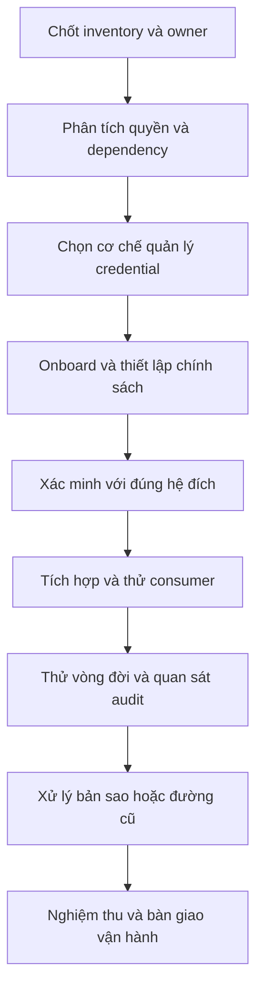

# Đã vault credential

## 1. Ý nghĩa của mục kiểm tra

Trong checklist đưa hệ thống quản lý truy cập đặc quyền (Privileged Access Management — PAM) vào production, “đã vault credential” có nghĩa là các credential đặc quyền trong phạm vi đã được đưa vào cơ chế quản lý bí mật có kiểm soát, được xác minh với hệ đích và có quy trình sử dụng, luân chuyển, thu hồi rõ ràng.

Credential có thể là mật khẩu tài khoản quản trị, mật khẩu tài khoản dịch vụ, private key SSH, khóa API hoặc thông tin xác thực dùng bởi tác vụ tự động. Tùy thiết kế, vault lưu credential tồn tại lâu dài, cấp credential động có thời hạn, hoặc quản lý tham chiếu đến một dịch vụ bí mật chuyên biệt. Không nên ép mọi loại credential vào cùng một cách lưu và cùng một chính sách rotation.

Việc tạo một object trong vault chỉ chứng minh rằng có một bản ghi. Để nghiệm thu production, cần trả lời được những câu hỏi cụ thể:

- Credential thuộc tài khoản nào, trên hệ thống và môi trường nào?
- Giá trị được quản lý có xác thực được với đúng hệ đích không?
- Ai hoặc workload nào được phép sử dụng; quyền đó có cần thiết không?
- Consumer thực tế đã dùng luồng được quản lý chưa?
- Credential có được luân chuyển, thu hồi và giám sát theo chính sách không?
- Những bản sao hoặc đường truy cập cũ đã được xử lý đến mức nào?
- Nếu chưa quản lý được một credential, ngoại lệ do ai chịu trách nhiệm và hết hạn khi nào?

Một credential được đặt trong vault nhưng vẫn nằm trong script, được chia sẻ qua chat và không có owner vẫn là một hạng mục chưa được xử lý đầy đủ.

### Mục tiêu học tập

Sau bài này, người học có thể lập danh sách credential cần quản lý, xác định bằng chứng nghiệm thu, kiểm tra luồng sử dụng và rotation, tính độ bao phủ có ý nghĩa, đồng thời phân biệt giữa một credential đã lưu và một credential đã sẵn sàng vận hành trong production.

## 2. Phân biệt các trạng thái dễ bị đánh đồng

| Trạng thái | Chứng minh được điều gì? | Chưa đủ để kết luận điều gì? |
|---|---|---|
| Discovered | Đã phát hiện tài khoản hoặc credential cần xem xét | Credential đã vào vault hoặc đã được kiểm soát |
| Registered | Đã có bản ghi và metadata trong vault | Giá trị đang đúng với hệ đích |
| Validated | Đã kiểm tra credential hoặc luồng cấp credential với đúng đích | Consumer production đã chuyển đổi đầy đủ |
| Integrated | Người dùng hoặc workload đã dùng đường truy cập được quản lý | Rotation và thu hồi đã vận hành thành công |
| Managed | Đã xác minh quyền, sử dụng, rotation hoặc cơ chế tương đương, audit và owner | Không còn bất kỳ rủi ro hoặc ngoại lệ nào |
| Accepted exception | Có ngoại lệ được phê duyệt, giới hạn và theo dõi | Credential đã đạt trạng thái Managed |

Các tên trạng thái trong bảng là mô hình học tập; tổ chức có thể dùng tên khác. Điều cần giữ là điều kiện chuyển trạng thái và bằng chứng tương ứng.

Với credential tĩnh, bước xác minh thường kiểm tra khả năng xác thực hiện tại. Với credential động, bước xác minh cần bao gồm luồng cấp, phạm vi quyền, thời hạn và hành vi sau khi credential hết hạn hoặc bị thu hồi. Một bản ghi metadata không thay thế được các kiểm tra này.

Cũng cần phân biệt ba khả năng:

1. **Lưu giữ:** bí mật được bảo vệ khi lưu trữ và chỉ được trả cho chủ thể được phép.
2. **Quản lý vòng đời:** có cơ chế thay đổi, hết hạn, thu hồi và xử lý sai lệch với hệ đích.
3. **Kiểm soát sử dụng đặc quyền:** có thể bao gồm phê duyệt, JIT/JEA, môi giới phiên hoặc giới hạn lệnh.

Một vault có chức năng lưu giữ không tự động cung cấp toàn bộ kiểm soát phiên PAM. Nghiệm thu cần đối chiếu đúng các khả năng đã thiết kế và cam kết.

## 3. Chốt phạm vi trước khi đếm credential

### 3.1. Đơn vị kiểm kê phải gắn với hệ đích

Không dùng username làm định danh duy nhất. Hai tài khoản cùng tên `admin` trên hai thiết bị có thể có credential, owner và chính sách khác nhau.

Một bản ghi kiểm kê nên nhận diện được:

| Thuộc tính | Mục đích |
|---|---|
| Inventory ID | Đối chiếu tài khoản và bằng chứng qua các công cụ |
| Asset ID, môi trường | Tránh nhầm development, staging và production |
| Loại tài khoản, định danh principal | Phân biệt tài khoản cá nhân, dùng chung và workload |
| Loại credential | Chọn cơ chế lưu, cấp phát và rotation phù hợp |
| Quyền thực tế | Nhận diện mức ảnh hưởng nếu credential bị lộ |
| Business owner, technical owner | Chốt trách nhiệm nghiệp vụ và vận hành |
| Consumer hoặc dependency | Biết ứng dụng, job hay người nào đang sử dụng |
| Vault object ID hoặc tham chiếu | Liên kết kiểm kê với bản ghi được quản lý |
| Trạng thái, ngày xác minh | Phân biệt dữ liệu đã kiểm tra và dữ liệu đã cũ |
| Ngoại lệ, hạn xử lý | Theo dõi phần chưa đáp ứng điều kiện |

Danh sách này chứa metadata cần thiết cho quản lý; không chứa password, private key, token hoặc mã khôi phục.

### 3.2. Các nhóm thường cần rà soát

Trong phạm vi PAM, nên đối chiếu ít nhất các nhóm đã được tổ chức xác định là đặc quyền:

- Tài khoản quản trị hệ điều hành, cơ sở dữ liệu, thiết bị mạng và thiết bị bảo mật.
- Tài khoản quản trị nền tảng cloud, cluster, hypervisor và công cụ triển khai.
- Tài khoản dịch vụ, automation và CI/CD có khả năng thay đổi production.
- Khóa SSH dùng để quản trị hoặc thực thi tự động trên tài sản nhạy cảm.
- API credential có quyền quản trị, tạo identity hoặc đọc dữ liệu nhạy cảm.
- Tài khoản vendor, tài khoản dùng chung và tài khoản ứng cứu khẩn cấp.
- Credential của connector, tác vụ backup hoặc thành phần PAM cần thiết để quản lý hệ đích.

Phạm vi chính thức có thể hẹp hoặc rộng hơn theo thiết kế. Không được loại một credential khỏi mẫu số chỉ vì hiện chưa có connector hoặc chưa rotation được.

### 3.3. Những trường hợp không nên onboard như một password tĩnh

Một workload đã dùng identity liên kết để nhận token ngắn hạn có thể không cần thêm một password lâu dài vào vault. Một private key không cho phép xuất khỏi phần cứng có thể được quản lý bằng chính sách sử dụng khóa, thay vì sao chép key vào kho khác. Với SSH certificate, đối tượng cần kiểm soát có thể là quyền ký, thời hạn certificate và cấu hình tin cậy.

Các trường hợp này cần bằng chứng về cơ chế thay thế và quyết định phạm vi. “Không lưu password” và “không cần kiểm soát đặc quyền” là hai kết luận khác nhau.

## 4. Điều kiện để một credential đạt mức nghiệm thu

Mỗi credential thuộc phạm vi nên có một hồ sơ nghiệm thu gắn với tài sản cụ thể. Bộ điều kiện dưới đây là ví dụ để tổ chức điều chỉnh theo mức rủi ro.

### 4.1. Nhận diện đúng và có owner

Bản ghi vault phải trỏ đến đúng principal, hệ đích và môi trường. Owner xác nhận mục đích sử dụng, quyền cần thiết và các consumer hiện có.

Nếu tài khoản không còn cần thiết, hướng xử lý có thể là vô hiệu hóa và thu hồi thay vì đưa vào vault để tiếp tục duy trì. Việc lưu giữ một tài khoản dư thừa không làm quyền của tài khoản đó trở nên cần thiết.

### 4.2. Bí mật được bảo vệ và truy xuất theo least privilege

Chủ thể sử dụng chỉ được đọc hoặc dùng đúng credential cần cho nhiệm vụ. Phải kiểm tra quyền hiệu lực, bao gồm quyền kế thừa qua group, vai trò quản trị và quyền của service identity.

Các quyền sau cần xem xét riêng nếu sản phẩm hỗ trợ:

- Xem metadata và tìm kiếm object.
- Lấy giá trị bí mật.
- Dùng credential qua một luồng môi giới mà không hiển thị giá trị.
- Sửa metadata hoặc chính sách.
- Thay đổi giá trị, yêu cầu rotation hoặc reconcile.
- Thay đổi quyền truy cập, xuất dữ liệu hoặc quản trị kho.

Không mặc định người sửa metadata cần quyền đọc bí mật; cũng không mặc định một tài khoản chỉ bị chặn giao diện là đã bị chặn qua API.

### 4.3. Giá trị hoặc luồng cấp phát đã được xác minh

Kiểm tra bằng một thao tác được phép, ít tác động và gắn đúng hệ đích. Ghi lại kết quả, thời điểm và người thực hiện; không lưu giá trị bí mật trong bằng chứng.

Nếu connector xác minh đăng nhập thành công nhưng workload dùng cơ chế xác thực khác, kết quả đó chưa chứng minh workload hoạt động. Ví dụ, kiểm tra password qua một giao thức quản trị không tự chứng minh ứng dụng đọc đúng secret hoặc có quyền truy cập cơ sở dữ liệu.

### 4.4. Consumer đã tích hợp và tránh phụ thuộc ngầm

Mỗi consumer cần có identity, chính sách và cách nhận credential rõ ràng. Kiểm tra ứng dụng thực sự dùng phiên bản hoặc luồng được quản lý, kể cả sau restart, reconnect và chạy job theo lịch.

Cấu hình chỉ chứa tham chiếu đến secret không chứng minh rằng secret chưa bao giờ bị ghi ra đĩa, log hoặc artifact. Cần kiểm tra đường truyền dữ liệu thực tế và cách ứng dụng xử lý bí mật sau khi nhận.

### 4.5. Vòng đời có thể vận hành

Credential tĩnh cần có chính sách rotation và khả năng thực thi hoặc một ngoại lệ được phê duyệt. Credential động cần có giới hạn thời gian, quyền, cơ chế gia hạn nếu có và kiểm tra hết hạn hoặc thu hồi phù hợp.

Không buộc mọi loại credential đổi theo cùng một chu kỳ. Chu kỳ và sự kiện kích hoạt phụ thuộc khả năng hệ đích, mức rủi ro, dependency và chính sách đã được phê duyệt.

### 4.6. Có audit, cảnh báo và hướng xử lý sự cố

Bản ghi truy cập, thay đổi quyền, xác minh, rotation và lỗi phải đủ để truy vết chủ thể và đối tượng. Cảnh báo cần có nơi tiếp nhận, owner và cách xử lý.

Việc có một file log trên máy vault chưa chứng minh rằng đội vận hành sẽ biết khi rotation thất bại nhiều ngày hoặc một identity tải hàng loạt bí mật.

### 4.7. Đường sử dụng cũ đã được xử lý

Đối chiếu script, cấu hình, hệ thống CI/CD, scheduler, tài liệu vận hành và các kho bí mật khác trong phạm vi chuyển đổi. Thu hồi bản cũ hoặc thay đổi credential theo kế hoạch để bản đã lộ không tiếp tục sử dụng được.

Không chỉ xóa secret khỏi phiên bản hiện tại của một file rồi kết luận đã hết rò rỉ. Lịch sử, artifact và bản sao lưu có thể còn dữ liệu; nếu đã có khả năng lộ, cần xử lý credential và phạm vi ảnh hưởng theo quy trình sự cố.

## 5. Quy trình đưa credential vào quản lý



Mỗi bước cần điều kiện đầu vào và đầu ra. Nếu kiểm tra thất bại, giữ trạng thái phản ánh đúng thực tế và quay lại bước liên quan; không đổi nhãn thành hoàn tất để khớp kế hoạch triển khai.

### Bước 1 — Chốt baseline và người chịu trách nhiệm

Lập snapshot inventory tại một thời điểm xác định, ghi nguồn phát hiện và xác nhận của owner. Nhận diện tài khoản không sử dụng, tài khoản không rõ chủ và credential dùng chung trên nhiều tài sản.

Baseline là cơ sở đối soát. Khi phát hiện thêm credential, cập nhật phạm vi và tính lại độ bao phủ, thay vì tiếp tục sử dụng mẫu số cũ.

### Bước 2 — Phân tích dependency và phương án chuyển đổi

Với mỗi credential, liệt kê các nơi sử dụng: ứng dụng, service, scheduler, agent, pipeline, công cụ quản trị và vendor. Xác định consumer nào cần lấy bí mật, consumer nào có thể dùng môi giới phiên hoặc identity ngắn hạn.

Thống nhất thời gian thay đổi, tiêu chí dừng, phương án phục hồi và người quyết định. Không rotation một tài khoản dịch vụ chưa rõ dependency chỉ để chứng minh connector hoạt động.

### Bước 3 — Thiết lập vùng quản lý và chính sách

Tách quyền truy cập theo môi trường, hệ thống và nhu cầu sử dụng. Gán owner, policy và nhãn phân loại. Xác định ai được yêu cầu truy cập, ai phê duyệt và ai được thay đổi chính sách.

Nếu có chức năng phê duyệt hoặc giới hạn thời gian, kiểm tra chúng thực sự áp dụng cho các đường truy xuất cần thiết. Đường API, automation và quyền quản trị có thể khác đường tương tác của người dùng.

### Bước 4 — Onboard bằng kênh được kiểm soát

Dùng cơ chế nhập hoặc kết nối đã được phê duyệt. Hạn chế việc tạo file trung gian chứa secret; nếu quy trình bắt buộc cần file tạm, phải có bảo vệ, thời gian tồn tại và cách xử lý phù hợp chính sách.

Không đưa password vào ticket, nội dung chat, ảnh chụp màn hình hoặc tham số lệnh có thể bị ghi vào lịch sử và công cụ giám sát. Báo cáo chỉ cần object ID, tài sản và kết quả thao tác.

### Bước 5 — Xác minh credential và consumer

Kiểm tra khả năng xác thực hiện tại trước khi thực hiện các thay đổi tiếp theo. Tích hợp consumer qua identity riêng và thử hành vi bình thường, từ chối trái quyền, reconnect và restart theo kế hoạch.

Nếu chỉ kiểm thử bằng tài khoản quản trị vault, có thể bỏ sót lỗi quyền của workload production. Kiểm tra phải dùng chủ thể đại diện cho luồng vận hành thực.

### Bước 6 — Thử vòng đời

Thực hiện rotation hoặc một vòng cấp phát–sử dụng–hết hạn phù hợp với loại credential. Xác nhận hệ đích, vault và consumer đạt trạng thái nhất quán sau thao tác.

Một job có trạng thái thành công là bằng chứng kỹ thuật cần xem xét, nhưng nghiệm thu còn cần kết quả consumer và các kiểm tra liên quan. Không coi trạng thái xanh ở một màn hình là thay thế cho toàn bộ luồng.

### Bước 7 — Xử lý bản sao cũ và bàn giao

Gỡ các tham chiếu hoặc bí mật cũ theo phạm vi đã xác định, thu hồi giá trị cũ khi phù hợp và cập nhật runbook. Bàn giao dashboard, cảnh báo, danh sách ngoại lệ và trách nhiệm xử lý.

Hồ sơ nghiệm thu cần ghi rõ phần đã đạt và phần chưa đạt. Người vận hành sau bàn giao phải tìm được owner khi có lỗi mà không cần hỏi lại nhóm dự án.

## 6. Metadata mẫu cho hồ sơ nghiệm thu

Ví dụ sau là cấu trúc hồ sơ minh họa, không phải cấu hình triển khai của một sản phẩm vault. Mọi tên và mã đều là dữ liệu giả; hồ sơ không chứa giá trị bí mật.

```yaml
inventory_id: PAM-INV-042
environment: production
asset_id: db-orders-prod
principal_id: svc_orders_runtime
credential_type: password
management_mode: managed_static

ownership:
  business_owner: orders-service-owner
  technical_owner: orders-platform-team
  vault_policy_owner: pam-operations

vault:
  object_ref: secret-object-042
  access_policy_ref: policy-orders-runtime
  lifecycle_policy_ref: policy-orders-db-rotation

consumers:
  - consumer_id: orders-api
    identity_ref: workload-orders-api-prod
    integration_method: authenticated-secret-retrieval

acceptance:
  state: managed
  target_authentication_evidence: EV-042-AUTH
  authorized_access_evidence: EV-042-ALLOW
  unauthorized_access_evidence: EV-042-DENY
  lifecycle_evidence: EV-042-ROTATE
  consumer_validation_evidence: EV-042-RUNTIME
  legacy_copy_review_evidence: EV-042-CLEANUP
  audit_delivery_evidence: EV-042-AUDIT
  review_record_ref: REVIEW-042

exception_ref: null
```

Trong hồ sơ thực tế, bằng chứng cần có thời gian thực hiện, người kiểm tra, phạm vi, kết quả và nơi lưu. Tham chiếu không tồn tại hoặc không truy cập được không đủ để nghiệm thu.

Không đặt password vào một field tên `example_value` để “dễ đối chiếu”. Không dùng hash của một password yếu như phương án che giấu thay thế; giá trị đó có thể tạo thêm dữ liệu phục vụ dò đoán. ID object, ID phiên bản không nhạy cảm và kết quả xác minh thường phù hợp hơn cho hồ sơ.

Một nhóm owner được ghi trong YAML cũng cần ánh xạ đến người hoặc nhóm thực sự đang trực và có trách nhiệm. Metadata chỉ hữu ích khi có quy trình duy trì nó.

## 7. Ma trận kiểm thử trước khi đánh dấu hoàn tất

Các kiểm tra phải chạy trong môi trường và cửa sổ thay đổi đã được cho phép. Với production, chọn phương pháp ít tác động và có tiêu chí dừng rõ ràng.

| Kiểm tra | Kết quả cần quan sát | Bằng chứng phù hợp |
|---|---|---|
| Đối chiếu inventory | Đúng principal, tài sản và môi trường | Inventory ID khớp object ID |
| Xác thực với đích | Credential hoặc luồng cấp phát sử dụng được | Kết quả kiểm tra, thời điểm, đích |
| Truy xuất hợp lệ | Identity đúng chỉ dùng được secret cần thiết | Audit event và policy hiệu lực |
| Truy xuất trái quyền | Identity không được cấp quyền bị từ chối | Kết quả từ chối và audit tương ứng |
| Truy cập qua nhóm kế thừa | Không có quyền mở rộng ngoài thiết kế | Kết quả phân tích effective permission |
| Rotation hoặc cấp phát lại | Hệ đích và vault đạt trạng thái dự kiến | Job ID, phiên bản tham chiếu, kết quả |
| Consumer sau thay đổi | Các luồng nghiệp vụ đại diện hoạt động | Kết quả thử ứng dụng hoặc job |
| Restart hoặc reconnect | Consumer nhận credential hợp lệ theo thiết kế | Kết quả khởi động hoặc kết nối mới |
| Credential cũ | Không tạo được xác thực mới sau thời gian chồng lấn cho phép | Kết quả thử có kiểm soát |
| Audit tới nơi giám sát | Sự kiện tới đúng nơi nhận và truy vết được | Correlation ID hoặc event ID |
| Identity đã bị thu hồi | Không lấy thêm bí mật hoặc cấp credential mới ngoài chính sách | Kết quả từ chối sau thu hồi |
| Lỗi phụ thuộc vault | Consumer phản ứng đúng chính sách đã thiết kế | Quan sát timeout, retry, cảnh báo |

Không cố tình thử đăng nhập sai nhiều lần bằng tài khoản production khi có nguy cơ khóa tài khoản. Phương pháp kiểm tra từ chối phải tính đến cơ chế bảo vệ của hệ đích.

Cần diễn giải cẩn thận hai kết quả thường gặp:

- Đổi password có thể ngăn xác thực mới bằng password cũ, nhưng một phiên đã mở có thể vẫn tồn tại. Việc kết thúc phiên là một kiểm soát riêng.
- Thu hồi quyền đọc vault ngăn chủ thể lấy secret tiếp theo; điều đó không tự xóa secret đã được chủ thể lấy trước đó. Có thể cần rotation, thu hồi token hoặc xử lý trên hệ đích theo tình huống.

Một bài kiểm tra chỉ được ghi PASS cho điều kiện đã thực sự quan sát. Không suy rộng từ một consumer thành toàn bộ dependency.

## 8. Rotation và tính nhất quán với hệ đích

### 8.1. Nhận diện các điểm có thể lệch

Với credential tĩnh, ít nhất ba thành phần cần được xem xét:

1. Credential đang được hệ đích chấp nhận.
2. Credential hoặc phiên bản mà vault coi là hiện hành.
3. Credential mà từng consumer đang sử dụng, bao gồm cache nếu có.

Quy trình rotation phải xử lý khi chỉ một phần thay đổi thành công. Ví dụ, hệ đích đã đổi password nhưng vault chưa cập nhật được; hoặc vault và hệ đích đã đồng bộ nhưng consumer vẫn giữ bản cũ.

Không có một thứ tự rotation chung an toàn cho mọi nền tảng. Thứ tự phụ thuộc khả năng hệ đích, connector, hỗ trợ nhiều credential đồng thời và cách cập nhật consumer.

### 8.2. Điều kiện nghiệm thu rotation

Một lần rotation có kiểm soát nên chứng minh:

- Tài khoản dùng để thực hiện thay đổi có đúng quyền cần thiết.
- Hệ đích nhận giá trị hoặc khóa mới theo thiết kế.
- Vault lưu hoặc tham chiếu đúng trạng thái hiện hành.
- Các consumer trong danh sách dependency nhận được credential phù hợp.
- Xác thực mới bằng credential cũ bị từ chối sau giai đoạn chuyển tiếp đã quy định.
- Sự kiện và lỗi được ghi nhận, có cảnh báo khi vượt thời gian chờ.
- Có người và quy trình xử lý trạng thái không nhất quán.

Đối với API key hoặc SSH key, nhiều hệ thống cho phép giai đoạn hai khóa cùng tồn tại để chuyển đổi. Giai đoạn này phải có giới hạn và tiêu chí kết thúc; thêm khóa mới rồi giữ khóa cũ vô thời hạn chưa hoàn thành rotation.

### 8.3. Phân biệt rollback và phục hồi

Rollback ứng dụng không đồng nghĩa khôi phục password cũ. Nếu password cũ đã bị lộ hoặc đã bị thu hồi, đưa nó trở lại có thể tái tạo rủi ro.

Phương án phục hồi có thể là tạo một credential mới, sửa quyền của workload hoặc khôi phục khả năng kết nối của connector. Runbook phải xác định trạng thái nào là nguồn thực tế, cách xác minh và ai có quyền thực hiện; không dựa vào bản password chép tay làm phương án mặc định.

Với credential không hỗ trợ tự động rotation, có thể cần quy trình thủ công có kiểm soát. Hồ sơ phải thể hiện rõ mức quản lý thực tế và ngoại lệ nếu chưa đáp ứng chính sách production.

## 9. Kiểm tra theo loại credential

### 9.1. Tài khoản quản trị do con người sử dụng

Kiểm tra định danh người yêu cầu và khả năng quy trách nhiệm cho từng lần dùng. Tài khoản đích dùng chung càng cần liên kết rõ người dùng thực, lý do, phê duyệt và phiên hoặc lượt checkout khi thiết kế yêu cầu.

Nếu hệ thống hỗ trợ môi giới phiên không hiển thị password, nên nghiệm thu đúng luồng đó. Nếu người dùng được phép xem password, cần hiểu họ có thể giữ một bản sao; chính sách checkout không tự ngăn sao chép sau khi secret được hiển thị.

### 9.2. Tài khoản dịch vụ

Đây thường là nhóm có nguy cơ gián đoạn khi rotation. Kiểm kê đủ service, scheduler, agent và job chạy ít thường xuyên. Một job cuối tháng có thể không xuất hiện trong đợt thử ngắn.

Tài khoản runtime nên có identity và quyền truy xuất phù hợp với ứng dụng. Tránh chia sẻ một identity đọc toàn bộ kho chỉ để giảm công tích hợp. Xác định cách ứng dụng nhận credential mới, hết cache và reconnect khi secret đổi.

### 9.3. SSH private key

Phân biệt việc cất private key và việc quản lý quyền truy cập tương ứng trên hệ đích. Private key đã vào vault nhưng public key vẫn được cài trên nhiều máy không được kiểm kê sẽ khiến phạm vi sử dụng khó kiểm soát.

Kiểm tra ánh xạ key–principal–asset, quyền truy xuất private key, các bản sao hiện hữu và cơ chế thay thế hoặc thu hồi. Fingerprint của public key có thể giúp đối chiếu; không đưa private key vào hồ sơ.

### 9.4. API credential và credential automation

Xác định scope, môi trường, chủ thể sở hữu và thời hạn. Kiểm tra quyền quản trị gián tiếp: một key có thể không mang nhãn “admin” nhưng vẫn tạo identity hoặc sửa pipeline triển khai.

Không coi việc đưa một API key quyền rộng vào vault là đã đạt least privilege. Vault kiểm soát ai lấy key; hệ đích vẫn quyết định key làm được gì.

### 9.5. Credential động và token ngắn hạn

Nghiệm thu luồng cấp phát, identity yêu cầu, phạm vi quyền, thời hạn và giới hạn gia hạn. Thử hành vi khi hết hạn hoặc thu hồi bằng cơ chế phù hợp với hệ đích.

Không giả định mọi loại token đều bị vô hiệu hóa ngay sau thao tác thu hồi ở nơi cấp. Cần xác định cách hệ đích kiểm tra token, độ trễ hiệu lực và xử lý phiên đã tồn tại.

### 9.6. Tài khoản khẩn cấp

Một credential khẩn cấp chỉ có thể lấy qua chính thành phần đang gặp sự cố sẽ tạo phụ thuộc vòng. Thiết kế truy cập khẩn cấp phải xét tình huống mất vault, mất dịch vụ identity hoặc mất mạng quản trị.

Cơ chế khẩn cấp phải được phê duyệt, bảo vệ riêng, giới hạn người sử dụng và có hậu kiểm. Nếu thiết kế cần một bản giữ ngoài luồng vault thông thường, bản đó phải nằm trong cơ chế quản lý ngoại lệ hoặc recovery rõ ràng, không trở thành password chung trong tài liệu.

## 10. Đo độ bao phủ và quản lý ngoại lệ

### 10.1. Dùng mẫu số đã được xác nhận

Một chỉ số cơ bản có thể là:

```text
Độ bao phủ Managed =
  Số credential thuộc phạm vi đạt điều kiện Managed
  ------------------------------------------------ × 100%
  Tổng credential thuộc phạm vi tại thời điểm đối soát
```

Không lấy tổng số object trong vault chia cho tổng số tài khoản rồi kết luận đã hoàn thành. Một tài khoản có thể có nhiều object trùng; một credential có thể được dùng trên nhiều đích; một bản ghi có thể đã ngừng sử dụng.

Cần chốt đơn vị đếm nhất quán và báo thêm độ bao phủ theo nhóm tài sản hoặc mức rủi ro khi cần. Chỉ số phản ánh chất lượng của inventory; credential chưa phát hiện được sẽ không tự xuất hiện trong mẫu số.

### 10.2. Ví dụ đối soát

Giả sử inventory đã xác nhận có 120 credential đặc quyền trong phạm vi:

| Nhóm trạng thái | Số lượng |
|---|---:|
| Đạt điều kiện Managed | 104 |
| Đã tạo object nhưng chưa xác minh consumer | 8 |
| Chưa quản lý được, có ngoại lệ được phê duyệt | 5 |
| Chưa quản lý được, chưa có ngoại lệ hợp lệ | 3 |
| Tổng | 120 |

Độ bao phủ Managed là `104 / 120 × 100% ≈ 86,7%`.

Tám credential mới tạo object chưa được cộng vào nhóm Managed. Năm ngoại lệ được ghi nhận riêng, không được biến thành năm credential đã quản lý. Ba credential chưa có xử lý hợp lệ là một khoảng trống cần được quyết định trước go-live.

Nếu toàn bộ ba khoảng trống còn lại nằm trên hệ thống trọng yếu, tỷ lệ chung không diễn tả đủ rủi ro. Cần báo danh tính tài sản, mức ảnh hưởng và owner; không dùng một tỷ lệ tổng để che mất nhóm này.

### 10.3. Hồ sơ ngoại lệ cần có gì?

Một ngoại lệ hữu ích cần chỉ rõ credential và asset, lý do chưa đáp ứng, rủi ro còn lại, kiểm soát bù, người chấp nhận, owner khắc phục và ngày hết hạn.

Ví dụ: thiết bị chưa có connector phù hợp, tạm thời dùng quy trình thay đổi credential thủ công với quyền truy cập bị giới hạn và kiểm tra định kỳ. Hồ sơ cần nói rõ cách xác minh, cách giám sát và mốc thay thế giải pháp.

Ngoại lệ hết hạn hoặc không có người chịu trách nhiệm không nên tiếp tục được tính như phần phạm vi đã xử lý. Quyết định go-live phải theo chính sách tổ chức và người có thẩm quyền chấp nhận rủi ro.

## 11. Bằng chứng nghiệm thu và bàn giao

### 11.1. Lưu bằng chứng vừa đủ, tránh tạo thêm bản sao bí mật

Bằng chứng có thể gồm:

- Snapshot inventory và kết quả đối soát với object vault.
- Cấu hình hoặc kết quả kiểm tra quyền hiệu lực đã che dữ liệu cần bảo vệ.
- Kết quả xác thực với đích và kết quả thử consumer.
- Job ID của rotation hoặc luồng cấp phát, cùng kết quả xác minh sau đó.
- Event ID, correlation ID hoặc kết quả truy vấn audit đã được giới hạn.
- Biên bản xử lý đường truy cập cũ và danh sách ngoại lệ.
- Phiên bản runbook, người nghiệm thu và thời điểm bàn giao.

Không đính kèm password, private key, access token, session cookie hoặc ảnh màn hình hiển thị secret. Ngay cả khi không chứa secret, inventory và tên tài sản vẫn là dữ liệu nhạy cảm cần quyền truy cập phù hợp.

### 11.2. Bàn giao phải gắn với thao tác hằng ngày

Nhóm vận hành cần biết cách xác định một credential bị lỗi, xem trạng thái xác minh, tiếp nhận cảnh báo rotation và liên hệ owner của consumer. Cũng cần biết khi nào phải dừng thay đổi và chuyển xử lý sự cố.

Phân công nên phân biệt người quản lý vault, owner hệ đích, owner ứng dụng và người chấp nhận ngoại lệ. Một nhóm có thể đảm nhiệm nhiều vai trò theo quy mô, nhưng trách nhiệm phải rõ và quyền phải phù hợp.

Bằng chứng nghiệm thu là ảnh chụp tại một thời điểm. Sau thay đổi owner, policy, connector, workload hoặc hệ đích, có thể cần kiểm tra lại các điều kiện bị ảnh hưởng.

## 12. Tình huống thực tế: tài khoản dịch vụ đã có trong vault

Nhóm Orders có tài khoản `svc_orders_runtime` dùng cho một API và một job đối soát. Dự án PAM đã tạo object trong vault, kiểm tra đăng nhập cơ sở dữ liệu thành công và đánh dấu “đã vault”.

Khi chuẩn bị production, nhóm phát hiện:

- API đã lấy secret qua identity riêng.
- Job đối soát vẫn đọc password từ cấu hình cũ.
- Quyền đọc secret còn cấp cho một nhóm hỗ trợ rộng do kế thừa.
- Chưa thử rotation cùng cả hai consumer.
- Dashboard chỉ hiển thị object tồn tại, không hiển thị ngày xác minh.

Nếu chỉ nhìn object count, tài khoản này trông như đã hoàn tất. Đối chiếu điều kiện nghiệm thu cho thấy trạng thái phù hợp hơn là đã đăng ký, đã xác minh đích và tích hợp chưa đầy đủ.

### Cách xử lý theo thứ tự

1. Owner xác nhận đủ dependency, bao gồm job đối soát và chu kỳ chạy.
2. Nhóm PAM sửa policy để chỉ các identity cần thiết có quyền; kiểm tra cả quyền kế thừa.
3. Owner job chuyển sang cơ chế truy xuất đã được phê duyệt và thử thực thi trong phạm vi cho phép.
4. Nhóm thống nhất cửa sổ rotation, kiểm tra hoạt động của API và job, kể cả kết nối mới.
5. Xác minh password cũ không tạo được xác thực mới sau thời gian chuyển tiếp; xử lý các bản sao cũ theo kế hoạch.
6. Kiểm tra audit, cảnh báo và bàn giao runbook cùng bằng chứng.

Chỉ khi các tiêu chí đã thống nhất được đáp ứng, tài khoản mới được tính vào nhóm Managed. Nếu job chưa tích hợp được, cần phản ánh đúng phần tồn đọng và xử lý theo quy trình ngoại lệ, thay vì giữ nhãn hoàn tất.

Tình huống này cho thấy dependency và quyền hiệu lực có thể quan trọng hơn việc đã nhập một secret thành công.

## 13. Các lỗi thường làm checklist mất ý nghĩa

| Cách làm | Hệ quả | Cách kiểm tra phù hợp |
|---|---|---|
| Đếm object làm bằng chứng hoàn tất | Có thể đếm object sai, trùng hoặc chưa dùng | Đối soát inventory và điều kiện Managed |
| Kiểm tra bằng quyền admin vault | Bỏ sót lỗi quyền của consumer | Thử bằng identity đại diện production |
| Cấp quyền đọc cho nhóm quá rộng | Tăng số chủ thể có thể lấy bí mật | Kiểm tra quyền hiệu lực và quyền kế thừa |
| Rotation nhưng bỏ qua dependency | Consumer có thể hỏng sau khi kết nối lại | Thử đủ consumer và tình huống reconnect |
| Giữ credential cũ để “dự phòng” | Duy trì đường truy cập không được kiểm soát | Phương án phục hồi có phê duyệt và kiểm tra |
| Ghi secret vào ticket nghiệm thu | Tạo thêm nơi lưu bí mật ngoài vault | Lưu ID và kết quả đã che dữ liệu |
| Ghi ngoại lệ không có hạn | Tồn đọng có thể kéo dài vô thời hạn | Theo dõi owner, hạn và quyết định gia hạn |
| Chỉ kiểm tra mật khẩu có đúng | Không chứng minh least privilege hoặc vòng đời | Kiểm tra cả quyền, consumer, lifecycle, audit |
| Cho phép fallback bằng secret hardcode | Luồng lỗi có thể bỏ qua kiểm soát | Thử lỗi phụ thuộc và đối chiếu thiết kế |
| Không duy trì inventory | Độ bao phủ giảm mà báo cáo vẫn xanh | Đối soát định kỳ và sau thay đổi |

Không nên tự động giải quyết mọi lỗi phụ thuộc vault bằng cách để workload đọc một file password dự phòng. Nếu thiết kế có cache hoặc chế độ giảm cấp, phải xác định dữ liệu nào được giữ, bảo vệ ra sao, trong bao lâu và khi nào buộc dừng. Đây là một quyết định vận hành cần được kiểm tra, không phải hành vi fallback ngầm.

## 14. Checklist nghiệm thu có thể dùng trong buổi review

Checklist dưới đây áp dụng cho phạm vi credential đã xác định. Các mục cần điều chỉnh theo loại credential và thiết kế thực tế; mục không áp dụng phải có lý do.

### Phạm vi và trách nhiệm

- [ ] Đã có inventory gắn credential với principal, asset và môi trường.
- [ ] Đã đối soát nhóm tài khoản quản trị, dịch vụ, automation và khẩn cấp trong phạm vi.
- [ ] Mỗi credential có owner; tài khoản không cần thiết có hướng thu hồi.
- [ ] Đã nhận diện consumer và các dependency quan trọng.

### Lưu giữ và quyền sử dụng

- [ ] Có object hoặc tham chiếu quản lý đúng loại credential.
- [ ] Metadata đủ để nhận diện và vận hành; hồ sơ không chứa secret.
- [ ] Quyền truy xuất tuân theo nhu cầu thực tế và có kiểm tra quyền kế thừa.
- [ ] Đã kiểm tra luồng được phép và từ chối trái quyền.
- [ ] Đã phân biệt quyền lấy secret, quyền quản trị và quyền thay đổi policy.

### Xác minh và vòng đời

- [ ] Đã xác minh credential hoặc luồng cấp phát với đúng hệ đích.
- [ ] Consumer dùng luồng được quản lý và hoạt động sau reconnect hoặc restart cần thiết.
- [ ] Rotation, hết hạn hoặc thu hồi đã được kiểm tra phù hợp với loại credential.
- [ ] Đã kiểm tra tính nhất quán giữa vault, hệ đích và consumer.
- [ ] Đã xác định cách xử lý credential cũ và các phiên đang tồn tại.
- [ ] Có quy trình xử lý lỗi và phục hồi được người vận hành hiểu rõ.

### Bằng chứng và quyết định production

- [ ] Audit truy vết được chủ thể, đối tượng, thời gian và kết quả.
- [ ] Cảnh báo đến đúng nhóm tiếp nhận và có owner xử lý.
- [ ] Các bản sao và đường sử dụng cũ đã được xử lý theo phạm vi chuyển đổi.
- [ ] Ngoại lệ có phê duyệt, kiểm soát bù, owner và ngày hết hạn.
- [ ] Độ bao phủ được tính trên inventory đã chốt, tách riêng phần chưa đạt.
- [ ] Runbook và bằng chứng bàn giao truy cập được bởi người có trách nhiệm.
- [ ] Người có thẩm quyền đã đưa ra quyết định nghiệm thu cho phạm vi cụ thể.

## 15. Duy trì trạng thái sau go-live

Mục “đã vault credential” cần tiếp tục được duy trì khi hệ thống thay đổi. Những sự kiện như tạo tài khoản mới, thêm máy chủ, đổi owner, thêm job, thay connector hoặc mở rộng quyền ứng dụng có thể làm điều kiện nghiệm thu trước đó không còn đủ.

Có thể đưa các hoạt động sau vào vận hành:

- Đối soát phát hiện mới với inventory và bản ghi vault.
- Theo dõi credential lâu chưa xác minh, rotation thất bại và ngoại lệ sắp hết hạn.
- Rà soát identity có quyền đọc nhiều secret hoặc có quyền tăng bất thường.
- Kiểm tra lại dependency khi ứng dụng triển khai phiên bản mới.
- Thu hồi quyền của người dùng, vendor hoặc workload không còn sử dụng.
- Lấy mẫu kiểm tra luồng truy cập và bằng chứng theo mức rủi ro.

Giá trị của vault nằm ở việc credential được nhận diện, sử dụng đúng quyền, quản lý vòng đời và truy vết trong vận hành. Nghiệm thu production cần chứng minh được những điều đó cho phạm vi cụ thể, thay vì chỉ xác nhận đã có một nơi để cất bí mật.
