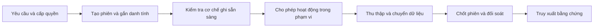

# Đã ghi session và command

## 1. Mục tiêu của mục kiểm tra production

Trong Privileged Access Management (PAM), một phiên truy cập được cấp đúng quyền vẫn có thể gây tác động lớn nếu người sử dụng thao tác nhầm, tài khoản bị chiếm hoặc quyền được dùng ngoài mục đích đã phê duyệt. Vì vậy, trước khi đưa hệ thống vào production, cần chứng minh rằng hoạt động đặc quyền nằm trong phạm vi triển khai đã được ghi nhận và có thể tra cứu lại.

Mục “Đã ghi session và command” không được hoàn tất chỉ vì quản trị viên đã bật một tùy chọn recording trên PAM. Kết quả cần đạt là một chuỗi bằng chứng liên tục: biết ai hoặc workload nào được cấp quyền, truy cập tài nguyên nào, qua đường nào, đã thực hiện hoạt động gì, dữ liệu được lưu ở đâu và có thể đọc lại đến mức chi tiết nào.

Sau bài này, người học có thể:

- Phân biệt ghi phiên, ghi command, audit của tài nguyên đích và log vận hành của recorder.
- Lập phạm vi coverage cho tài khoản quản trị, tài khoản dịch vụ và đường truy cập thay thế.
- Xây dựng tiêu chí kiểm thử từ lúc cấp quyền đến lúc truy xuất bằng chứng.
- Nhận diện phiên thiếu dữ liệu, command thiếu ngữ cảnh hoặc bản ghi có nguy cơ lộ credential.
- Ra quyết định đạt, chưa đạt hoặc chấp nhận ngoại lệ theo phạm vi và bằng chứng cụ thể.

Đích đến là khả năng quy trách nhiệm, điều tra sự cố và phục vụ kiểm toán. Ghi nhận hoạt động hỗ trợ least privilege, JIT/JEA, vault và luân chuyển credential; nó không tự thay thế các kiểm soát này.

## 2. Hiểu đúng “ghi session” và “ghi command”

### 2.1. Ghi session cho biết diễn biến của một kết nối

Một session là đơn vị truy cập được hệ thống theo dõi theo định danh và vòng đời. Tùy giao thức và kiến trúc, dữ liệu của session có thể gồm metadata kết nối, luồng terminal, hình ảnh màn hình, thao tác giao diện, trao đổi giao thức hoặc liên kết đến các sự kiện của tài nguyên đích.

Bản ghi phiên cần cho phép trả lời ít nhất:

- Danh tính đã xác thực và danh tính thực thi tại tài nguyên đích là gì?
- Tài nguyên, môi trường và điểm vào thuộc phạm vi nào?
- Phiên bắt đầu khi nào, có bị gián đoạn không và kết thúc theo cách nào?
- Có yêu cầu, phê duyệt hoặc grant JIT nào liên quan?
- Bản ghi đầy đủ, một phần, chưa hoàn tất hay đã mất khả năng truy xuất?

Không phải mọi sản phẩm hoặc giao thức đều cung cấp cùng dạng recording. Video màn hình của một phiên giao diện đồ họa và transcript của một terminal là hai dạng bằng chứng khác nhau. Chúng cần tiêu chí nghiệm thu riêng.

### 2.2. Ghi command cho biết hoạt động tại một lớp quan sát xác định

Command recording có thể ghi dòng nhập tại terminal, lời gọi thực thi, thao tác được chuẩn hóa hoặc sự kiện quản trị từ hệ thống đích. Ý nghĩa của từng bản ghi phụ thuộc vào điểm thu thập.

Ví dụ, một dòng hiển thị trong terminal chưa chắc đã được shell thực thi. Một command được thực thi chưa chắc đã thành công. Một mã thoát thành công cũng chưa chứng minh toàn bộ kết quả nghiệp vụ đúng như người yêu cầu mong muốn.

Cần phân biệt rõ:

| Dữ liệu | Có thể giúp xác định | Không đủ để tự kết luận |
|---|---|---|
| Dòng nhập hoặc transcript terminal | Nội dung nhìn thấy ở lớp terminal | Mọi tiến trình đã chạy, toàn bộ hành vi nền |
| Sự kiện thực thi | Hoạt động mà lớp thu thập nhận diện là thực thi | Mọi thay đổi dữ liệu hoặc kết quả nghiệp vụ |
| Mã thoát, trạng thái thao tác | Kết quả kỹ thuật theo cơ chế đang theo dõi | Thay đổi đã hợp lệ và được phê duyệt |
| Video hoặc ảnh phiên | Diễn biến giao diện trong phạm vi ghi | Danh sách command có cấu trúc, thao tác qua kênh khác |
| Audit của tài nguyên đích | Sự kiện mà tài nguyên thực sự phát sinh và lưu | Ai là người gốc nếu thiếu liên kết danh tính |
| Log recorder | Sức khỏe và vòng đời thành phần ghi | Nội dung đầy đủ của hoạt động quản trị |

Khi một shell mở shell con, chạy script, thực hiện pipeline hoặc gửi công việc sang hệ thống khác, recorder tại một điểm không mặc nhiên quan sát được mọi hoạt động phía sau. Phải mô tả giới hạn này trong phạm vi coverage.

### 2.3. Session, command và audit cần bổ trợ nhau

Ví dụ một kỹ sư mở phiên được PAM quản lý, dùng một tài khoản thực thi chung rồi cập nhật cấu hình dịch vụ. Có thể cần đối chiếu:

1. Log xác thực của kỹ sư.
2. Yêu cầu và quyết định cấp quyền.
3. Session được tạo bằng tài khoản thực thi.
4. Command hoặc thao tác được quan sát.
5. Audit thay đổi cấu hình ở tài nguyên đích.
6. Bằng chứng phiên và sự kiện đã được lưu trữ, truy xuất.

Nếu chỉ có tên tài khoản chung trên máy đích, việc truy ngược người sử dụng có thể không đủ chắc chắn. Nếu chỉ có video phiên, việc tìm một thao tác giữa nhiều giờ recording có thể khó. Kết hợp metadata, recording và audit đích giúp giảm các khoảng trống này.

## 3. Chốt phạm vi ghi nhận trước khi đánh dấu đạt

### 3.1. Phạm vi phải dựa trên đường truy cập thực tế

Một checklist đúng cần đi cùng inventory các tài nguyên và đường truy cập đặc quyền. Không lấy danh sách “đã onboard vào PAM” làm bằng chứng rằng mọi đường truy cập đều đã được kiểm soát.

Một ma trận coverage có thể có dạng sau:

| Nhóm đường truy cập | Bằng chứng cần kiểm tra | Điểm dễ bị bỏ sót |
|---|---|---|
| Terminal qua gateway hoặc proxy | Session ID, transcript, command nếu được hỗ trợ, audit đích | Kết nối thẳng hoặc shell con |
| Giao diện đồ họa | Recording màn hình, người dùng, tài nguyên, mốc thời gian | Thao tác qua console phụ hoặc công cụ khác |
| Quản trị cơ sở dữ liệu | Danh tính, kết nối và audit thao tác theo thiết kế | Công cụ dùng kết nối riêng ngoài đường quản lý |
| Console, API hoặc công cụ cloud | Audit thao tác, principal, tài nguyên và grant | API không đi qua recorder phiên |
| Tự động hóa, pipeline, tài khoản dịch vụ | Workload, run ID, credential reference, audit đích | Gán mọi hoạt động cho một người dùng không có căn cứ |
| Truy cập nhà cung cấp | Danh tính ngoài tổ chức, phê duyệt, thời hạn, recording | Tài khoản dùng chung hoặc kết nối lâu dài |
| Break-glass | Lần kích hoạt, người nhận quyền, hoạt động, hậu kiểm | Coi truy cập khẩn cấp là miễn ghi nhận |

Bảng này là điểm bắt đầu. Mỗi tổ chức cần điền đúng cơ chế đang dùng, khả năng thu thập thực tế và bằng chứng đã thử nghiệm. Với đường API, không nên tự tạo kỳ vọng có video như một phiên desktop; cần định nghĩa audit có cấu trúc phù hợp.

### 3.2. Mỗi dòng coverage cần có người chịu trách nhiệm

Tối thiểu, một mục coverage cần nêu:

- Nhóm tài nguyên và mức độ nhạy cảm.
- Đường truy cập được cho phép.
- Lớp thu thập: gateway, agent, ứng dụng đích hoặc kết hợp.
- Loại dữ liệu thu thập, giới hạn và dữ liệu không được thu thập.
- Chủ sở hữu vận hành, chủ sở hữu tài nguyên và người nghiệm thu.
- Các test case và evidence ID dùng để chứng minh kết quả.

Nếu có đường truy cập chưa ghi được nhưng vẫn được cho phép, phải ghi rõ ngoại lệ. Một ngoại lệ không biến thành coverage hoàn chỉnh chỉ vì có người đã chấp thuận rủi ro.

### 3.3. Chọn mẫu có chủ đích

Một phiên terminal thành công không đại diện cho tất cả giao thức, cấu hình và nhóm tài nguyên. Nên chọn mẫu theo các khác biệt có thể thay đổi hành vi recording:

- Giao thức và phiên bản cấu hình triển khai.
- Loại tài khoản: cá nhân, tài khoản dùng chung được kiểm soát, service account.
- Quyền ban đầu và tình huống nâng quyền.
- Luồng cấp quyền bình thường, JIT và break-glass.
- Phiên ngắn, phiên dài, reconnect và phiên bị ngắt.
- Đường truy cập từ nội bộ, nhà cung cấp hoặc automation.

Kết quả kiểm thử chỉ có giá trị trong phạm vi đã nêu. Sau khi thay đổi kiến trúc truy cập, recorder hoặc chính sách lưu trữ, cần xác định phần nào phải kiểm thử lại.

## 4. Thiết kế liên kết bằng chứng đủ để truy ngược

### 4.1. Session ID là khóa liên kết, không phải toàn bộ bằng chứng

Mỗi session cần một định danh ổn định trong phạm vi hệ thống. Nếu recorder, gateway và tài nguyên đích dùng các ID khác nhau, cần có bảng hoặc sự kiện mapping để liên kết chúng.

Không nên chỉ ghép dữ liệu theo “cùng tên tài khoản và gần cùng thời gian”. Hai người có thể sử dụng cùng một tài khoản thực thi ở hai phiên đồng thời. Cách ghép đó có thể tạo liên kết sai.

Các nhóm trường thường hữu ích:

| Nhóm | Ví dụ trường | Ý nghĩa |
|---|---|---|
| Định danh phiên | session_id, parent_session_id | Liên kết sự kiện với phiên và phiên cha nếu có |
| Danh tính gốc | actor_id, actor_type, identity_source | Người hoặc workload đã được xác thực |
| Danh tính thực thi | effective_principal, target_account_ref | Tài khoản hoặc role được dùng trên đích |
| Đích truy cập | target_id, environment, protocol | Phân biệt tài nguyên và môi trường |
| Cấp quyền | request_id, approval_ref, grant_id | Truy lại quyền và phạm vi được phép |
| Thời gian | event_time, received_at, time_source | Phân biệt lúc phát sinh và lúc tiếp nhận |
| Hoạt động | event_type, action_ref, result | Mô tả hoạt động theo lớp quan sát |
| Recording | recorder_id, evidence_ref, recording_state | Định vị dữ liệu và tình trạng ghi |
| Toàn vẹn | sequence, segment_ref, integrity_manifest_ref | Hỗ trợ phát hiện thiếu hoặc thay đổi dữ liệu |
| Quản trị lưu trữ | retention_class, access_policy_ref | Áp dụng chính sách phù hợp |

Đây là gợi ý thiết kế dữ liệu, không phải schema bắt buộc của mọi PAM. Tránh đưa giá trị credential vào trường metadata để “dễ điều tra”.

### 4.2. Danh tính gốc và danh tính thực thi phải tách biệt

Một kỹ sư có thể xác thực bằng tài khoản cá nhân rồi dùng tài khoản quản trị được vault cấp cho phiên. Khi đó:

- Actor là kỹ sư đã được xác thực.
- Effective principal là tài khoản quản trị ở tài nguyên đích.
- Request hoặc grant giải thích vì sao quyền này được cấp.
- Session và target audit cho biết hoạt động đã diễn ra.

Với workload, actor có thể là một định danh dịch vụ hoặc một lần chạy pipeline. Nếu có liên kết đến người khởi tạo hay người phê duyệt thì lưu liên kết đó; không suy diễn rằng người khởi tạo đã trực tiếp thực hiện mọi command.

Đối với nâng quyền trong phiên, cần biết thời điểm và phạm vi thay đổi danh tính thực thi trong khả năng thu thập. Không dùng danh tính ban đầu để mô tả toàn bộ hoạt động sau khi nâng quyền nếu bằng chứng cho thấy đã đổi principal.

### 4.3. Ví dụ sự kiện tổng hợp

Ví dụ dưới đây dùng dữ liệu giả, không chứa credential. Nó minh họa cách tách actor, principal, recording và nguồn quan sát.

```json
{
  "event_type": "privileged_action_observed",
  "session_id": "sess-lab-008",
  "actor": {
    "id": "engineer-demo",
    "type": "human"
  },
  "effective_principal": "ops-role-demo",
  "target_id": "sandbox-service-01",
  "environment": "acceptance-test",
  "request_id": "req-lab-008",
  "grant_id": "grant-lab-008",
  "event_time": "2026-01-15T08:00:20Z",
  "received_at": "2026-01-15T08:00:22Z",
  "sequence": 12,
  "observation": {
    "source": "terminal-recorder",
    "kind": "terminal-input",
    "display": "echo PAM_RECORDING_ACCEPTANCE_008",
    "execution_confirmed": false
  },
  "recording": {
    "state": "active",
    "evidence_ref": "evidence-lab-008-segment-01"
  }
}
```

Trường execution_confirmed mang giá trị false để nhấn mạnh giới hạn của ví dụ: sự kiện này ghi nhận đầu vào terminal. Nếu có bằng chứng thực thi hoặc audit đích, cần liên kết đến bằng chứng đó thay vì mặc nhiên coi dòng nhập là kết quả thực thi.

### 4.4. Thời gian và thứ tự sự kiện

Thời gian giúp liên kết sự kiện, nhưng cần tính đến lệch đồng hồ, độ trễ gửi và xử lý bất đồng bộ. Nên giữ cả thời điểm phát sinh và thời điểm tiếp nhận khi kiến trúc cho phép.

Sequence number có thể hỗ trợ nhận biết thiếu sự kiện trong một luồng xác định. Nó không tự chứng minh rằng mọi hoạt động đều đã được quan sát từ đầu. Cần biết sequence được tạo ở đâu, có reset sau reconnect không và áp dụng cho phiên hay từng segment.

Khi điều tra, không ép sắp xếp mọi sự kiện chỉ theo thời điểm đến SIEM. Một sự kiện đến muộn vẫn có thể mô tả hoạt động xảy ra sớm hơn. Nếu không xác định được thứ tự chắc chắn, phải thể hiện sự không chắc chắn trong báo cáo.

## 5. Nghiệm thu toàn bộ vòng đời recording

### 5.1. Bắt đầu ghi trước hoạt động đặc quyền đầu tiên

Cần kiểm tra thời điểm ghi so với thời điểm tài nguyên bắt đầu cho phép thao tác. Nếu người dùng đã có quyền thực hiện lệnh rồi recording mới sẵn sàng, phần đầu phiên có thể là khoảng trống.

Một luồng mong đợi trong kiến trúc có recorder trung gian:



Sơ đồ mô tả quan hệ cần nghiệm thu, không quy định mọi sản phẩm phải triển khai cùng một thứ tự kỹ thuật. Với audit đích hoặc API, cần thiết kế cơ chế tương đương để không bỏ lọt hoạt động trong phạm vi đã cam kết.

### 5.2. Trong phiên: xác minh đúng nội dung và ngữ cảnh

Các thao tác thử cần vô hại, có dấu hiệu nhận diện riêng và được thực hiện trên môi trường nghiệm thu được cho phép. Ví dụ dùng một chuỗi marker không nhạy cảm để tìm lại trong transcript.

Cần đối chiếu đồng thời:

- Marker xuất hiện trong đúng session.
- Tài nguyên và actor khớp với lần thử.
- Loại dữ liệu đúng như thiết kế: terminal input, output, video hay audit.
- Các trạng thái thao tác được mô tả đúng với lớp quan sát.
- Nếu có nâng quyền hoặc mở kết nối tiếp, liên kết không bị mất.
- Các sự kiện của hai phiên đồng thời không bị trộn lẫn.

Không dùng password thật, token thật hoặc dữ liệu khách hàng để tạo marker kiểm thử. Không thực hiện thao tác phá hủy chỉ để chứng minh recorder hoạt động.

### 5.3. Kết thúc phiên: phân biệt đóng kết nối và chốt bằng chứng

Đóng cửa sổ kết nối không đồng nghĩa recording đã được lưu hoàn chỉnh. Dữ liệu có thể còn nằm trong buffer, đang truyền hoặc đang xử lý để phát lại.

Cần định nghĩa rõ các trạng thái vận hành, chẳng hạn:

- Active: phiên vẫn đang diễn ra.
- Finalizing: phiên đã dừng nhưng bằng chứng chưa chốt.
- Complete: hệ thống xác nhận các điều kiện hoàn tất theo thiết kế.
- Partial: chỉ có một phần bằng chứng hoặc đã biết có khoảng trống.
- Unavailable: bằng chứng hiện không thể truy xuất.
- Unknown: chưa đủ thông tin để xác định tình trạng.

Tên trạng thái cụ thể tùy hệ thống. Điểm quan trọng là không biến mọi phiên đã đóng thành complete một cách tự động.

Khi phiên bị crash hoặc mất kết nối, có thể không có sự kiện kết thúc bình thường. Cơ chế đối soát cần phát hiện trường hợp này, đánh dấu trạng thái đúng và giữ lại bằng chứng đã có.

### 5.4. Readback phải đi đến dữ liệu thật

Nghiệm thu không dừng ở việc thấy một dòng session trong giao diện. Người có vai trò phù hợp phải tìm được phiên, mở recording hoặc tập sự kiện, kiểm tra phần đầu, phần cuối và các marker đã chọn.

Nếu recording gồm nhiều segment, cần kiểm tra việc chuyển đoạn và tính liên tục trong khả năng xác minh. Nếu có command index, cần thử tìm command và mở đúng ngữ cảnh phiên.

Một bằng chứng chỉ có metadata nhưng file recording bị mất, khóa giải mã không còn dùng được hoặc quyền truy cập sai vẫn chưa đáp ứng yêu cầu truy xuất.

## 6. Kiểm soát pipeline ghi nhận và tình huống lỗi

### 6.1. Theo dõi từ nguồn đến nơi lưu cuối

Một pipeline có thể gồm recorder, buffer cục bộ, dịch vụ tiếp nhận, kho recording, hệ thống lập chỉ mục và SIEM. Mỗi thành phần có thể có trạng thái khác nhau.

Ví dụ:

- Recorder đã nhận dữ liệu nhưng chưa chuyển đi.
- Dịch vụ tiếp nhận đã xác nhận nhưng kho dài hạn chưa hoàn tất.
- File recording còn nguyên nhưng chỉ mục tra cứu chưa cập nhật.
- SIEM đã nhận sự kiện bắt đầu phiên nhưng không có dữ liệu nội dung.
- Nội dung ghi được nhưng không thể giải mã hoặc phát lại sau khi đổi cấu hình.

Do đó, phải xác định mỗi ACK hoặc trạng thái “success” chứng minh điều gì. “Đã gửi log” không mặc nhiên có nghĩa “đã lưu bền vững và đọc được”.

### 6.2. Tín hiệu sức khỏe cần gắn với phạm vi phiên

Các chỉ số và cảnh báo hữu ích có thể gồm:

| Tín hiệu | Điều cần phát hiện | Hành động vận hành |
|---|---|---|
| Heartbeat recorder | Thành phần ngừng hoạt động | Xác định phạm vi phiên bị ảnh hưởng |
| Buffer hoặc backlog tăng | Dữ liệu chưa đến đích đúng hạn | Kiểm tra dung lượng, mạng và khả năng tiếp nhận |
| Lỗi ghi kho | Không lưu được recording | Áp dụng chính sách lỗi đã phê duyệt |
| Lỗi hoàn tất phiên | Recording treo ở trạng thái chốt | Đối soát và xử lý bằng chứng một phần |
| Mất sequence hoặc segment | Dấu hiệu thiếu dữ liệu | Đánh dấu phiên và điều tra nguyên nhân |
| Lỗi truy xuất hoặc giải mã | Dữ liệu tồn tại nhưng không đọc được | Kiểm tra quyền, khóa và phụ thuộc lưu trữ |
| Thiếu log ở một nhóm đích | Coverage suy giảm cục bộ | So sánh số phiên thực tế và số phiên có bằng chứng |

Một dashboard “recorder healthy” không đủ nếu chỉ phản ánh tiến trình còn chạy. Cần kiểm tra rằng dữ liệu của các đường truy cập trong phạm vi vẫn đi hết pipeline.

### 6.3. Quyết định khi không thể ghi phải có từ trước

Không có một lựa chọn duy nhất phù hợp cho mọi tài nguyên. Với một số đường truy cập rủi ro cao, tổ chức có thể yêu cầu không mở phiên mới nếu không bảo đảm recording. Với hoạt động tối quan trọng, có thể có quy trình khẩn cấp được giới hạn và hậu kiểm.

Chính sách cần trả lời:

- Không ghi được ở thời điểm mở phiên thì từ chối, chờ hay chuyển sang luồng khẩn cấp?
- Phiên đang chạy bị lỗi recorder thì tiếp tục, hạn chế hay ngắt theo điều kiện nào?
- Ai có quyền quyết định ngoại lệ và trong bao lâu?
- Cần lưu bằng chứng thay thế nào?
- Ai nhận cảnh báo và phải phản hồi trong thời hạn nào?
- Làm sao xác nhận recording đã phục hồi?

Việc ngắt đột ngột một phiên đang thực hiện thao tác quan trọng cũng có thể gây ảnh hưởng vận hành. Vì vậy, hành vi lỗi cần được thiết kế, thử nghiệm và thống nhất với chủ sở hữu tài nguyên; không để đội trực ca tự đoán vào lúc xảy ra sự cố.

### 6.4. Kiểm thử gián đoạn có kiểm soát

Trong môi trường thử nghiệm được cấp phép, có thể mô phỏng đích tiếp nhận tạm thời không sẵn sàng hoặc quá trình chuyển tiếp bị gián đoạn. Không làm đầy ổ đĩa production hoặc làm mất khóa thật để thử recorder.

Khi hệ thống phục hồi, cần kiểm tra:

1. Dữ liệu được giữ lại theo giới hạn buffer đã công bố.
2. Cảnh báo đã phát sinh và được chuyển đúng nơi.
3. Backlog được xử lý theo cơ chế đã thiết kế.
4. Sự kiện trùng hoặc đến muộn được nhận diện phù hợp.
5. Bản ghi thiếu được đánh dấu rõ, không bị báo hoàn chỉnh.
6. Phiên mới tuân theo chính sách lỗi và chính sách phục hồi.

Nếu phải dựa vào giả định chưa kiểm chứng về buffer hoặc khả năng phát lại sau lỗi, checklist chưa đủ bằng chứng để đạt.

## 7. Bảo vệ recording như dữ liệu nhạy cảm

### 7.1. Recording có thể chứa nhiều dữ liệu hơn dự kiến

Màn hình, terminal output và tham số command có thể chứa token, chuỗi kết nối, thông tin cá nhân hoặc cấu hình nhạy cảm. Việc đưa credential vào vault không bảo đảm credential sẽ không xuất hiện trong output của một công cụ.

Cần giảm rò rỉ ngay tại nguồn: tránh truyền secret trong command line nếu có cách an toàn phù hợp, hạn chế hiển thị secret và dùng credential injection theo thiết kế đã được phê duyệt. Tuy nhiên, injection cũng không tự ngăn ứng dụng đích in secret ra màn hình.

Che dữ liệu hoặc masking phải được thử nghiệm theo kênh thực tế. Một vùng được che trên video không bảo đảm dữ liệu đã được che trong transcript, command index, bản export hoặc log phụ trợ.

Dùng dữ liệu giả có hình dạng tương tự secret để kiểm tra cơ chế che. Nếu phát hiện credential thật bị ghi lại, cần xử lý như một tình huống lộ credential theo quy trình của tổ chức, bao gồm đánh giá và luân chuyển hoặc thu hồi phù hợp.

### 7.2. Tách quyền sử dụng PAM và quyền xem bằng chứng

Người được mở phiên quản trị không mặc nhiên có quyền xem toàn bộ recording của người khác. Tương tự, người vận hành PAM không nên tự có quyền sửa hoặc xóa mọi bằng chứng chỉ vì họ quản lý hạ tầng.

Mô hình phân quyền cần xem xét riêng:

- Tìm metadata phiên.
- Phát lại recording.
- Xem command hoặc dữ liệu đã được che.
- Export bằng chứng.
- Thay đổi thời hạn lưu.
- Xóa dữ liệu hoặc thay đổi chính sách recording.
- Quản lý khóa mã hóa và quyền giải mã.

Việc xem, export và thay đổi chính sách cần có audit riêng. Nếu audit của recorder chỉ nằm ở nơi mà chính quản trị viên recorder có thể sửa tùy ý, khả năng kiểm tra độc lập sẽ bị hạn chế.

### 7.3. Tính toàn vẹn và giới hạn của hash

Hash của recording hoặc manifest giúp phát hiện dữ liệu bị thay đổi khi có một giá trị đối chiếu đáng tin cậy. Nếu một người có thể sửa cả file lẫn hash tham chiếu mà không để lại dấu vết, việc tính hash đơn thuần chưa đủ.

Có thể kết hợp kiểm soát phân quyền, lưu trữ hạn chế sửa đổi, manifest được bảo vệ, cơ chế ký nếu phù hợp và audit độc lập. Cần kiểm thử theo cơ chế thực sự đang triển khai.

Tính toàn vẹn sau khi thu thập khác với tính đầy đủ tại thời điểm thu thập. Một file được bảo vệ hoàn hảo vẫn có thể thiếu đoạn đầu vì recorder khởi động muộn.

### 7.4. Thời hạn lưu, khóa và khả năng đọc lại

Thời hạn lưu cần được xác định theo phân loại dữ liệu, nhu cầu điều tra, chính sách tổ chức và yêu cầu áp dụng. Không tự chọn một con số chung cho mọi recording.

Nghiệm thu cần bảo đảm:

- Recording, chỉ mục và metadata có chính sách nhất quán với nhu cầu truy xuất.
- Khóa giải mã và phụ thuộc kỹ thuật được quản lý phù hợp trong thời gian cần đọc dữ liệu.
- Backup và restore của bằng chứng đã được thử theo phạm vi thiết kế.
- Việc xóa hết hạn và việc tạm giữ phục vụ điều tra được kiểm soát theo quy trình.
- Bản export có người nhận, mục đích, thời hạn và nơi lưu rõ ràng.

Nếu metadata còn nhưng recording đã hết hạn hoặc khóa không còn dùng được, hệ thống phải thể hiện đúng tình trạng thay vì tạo ấn tượng rằng vẫn có đầy đủ bằng chứng.

## 8. Bộ kiểm thử nghiệm thu từ đầu đến cuối

### 8.1. Chuẩn bị ca thử

Mỗi ca thử cần có ID, người thực hiện, môi trường, tài nguyên, đường truy cập, quyền được cấp, marker giả, kết quả mong đợi và nơi lưu evidence reference.

Không cần chạy cùng một bài thử ở mọi tài nguyên nếu đã có chiến lược chọn mẫu hợp lý. Tuy nhiên, các khác biệt quan trọng về giao thức, cấu hình hoặc khả năng recording phải được bao phủ.

### 8.2. Ma trận kiểm thử gợi ý

| ID | Tình huống | Kết quả cần quan sát |
|---|---|---|
| REC-01 | Mở và đóng phiên bình thường | Có danh tính, target, thời gian, nội dung và trạng thái hoàn tất |
| REC-02 | Thực hiện thao tác vô hại có marker | Tìm được marker trong đúng lớp dữ liệu và đúng phiên |
| REC-03 | Hai phiên đồng thời dùng cùng tài khoản thực thi | Không nhầm actor, session hoặc recording |
| REC-04 | Nâng quyền trong phạm vi cho phép | Theo dõi được thay đổi principal hoặc nêu rõ giới hạn coverage |
| REC-05 | Mất kết nối và kết nối lại | Không gắn nhầm phiên; biết đoạn nào tiếp nối hoặc bị thiếu |
| REC-06 | Phiên bị dừng bất thường | Có trạng thái phù hợp và bằng chứng còn lại được bảo toàn |
| REC-07 | Pipeline ghi nhận gián đoạn trong lab | Cảnh báo, buffer và hành vi lỗi đúng thiết kế |
| REC-08 | Truy cập qua đường không được phép | Bị kiểm soát theo chính sách, hoặc có phát hiện và ngoại lệ đã ghi rõ |
| REC-09 | Vai trò không có quyền xem hoặc export | Không đọc được dữ liệu; audit phản ánh lần truy cập theo thiết kế |
| REC-10 | Vai trò điều tra được cấp quyền phù hợp | Tra cứu và đọc được bằng chứng cần thiết |
| REC-11 | Dữ liệu giả cần masking | Kết quả che đúng trên các bề mặt đã cam kết |
| REC-12 | Truy xuất dữ liệu cũ hoặc dữ liệu đã restore | Nội dung và liên kết còn đọc được trong phạm vi chính sách |
| REC-13 | Luồng automation hoặc API trong phạm vi | Liên kết được workload, run, grant và audit thao tác |
| REC-14 | Luồng break-glass đã được phép thử | Có ghi nhận kích hoạt, hoạt động và hậu kiểm theo thiết kế |

Một test có thể có kết quả “không áp dụng” nếu đường truy cập đó thực sự ngoài phạm vi và có lý do được xác nhận. Không dùng “không áp dụng” để bỏ qua một đường vẫn đang tồn tại và được sử dụng.

### 8.3. Tập bằng chứng tối thiểu cho một ca thử

Bộ bằng chứng nên có:

- Mô tả ca thử và phạm vi cấu hình đã thử.
- Yêu cầu hoặc phê duyệt liên quan nếu luồng yêu cầu.
- Session ID và các ID liên kết.
- Evidence reference hoặc vị trí dữ liệu được bảo vệ.
- Kết quả đọc lại marker, phần đầu và phần cuối.
- Kết quả đối chiếu audit đích trong phạm vi cần thiết.
- Trạng thái recording, lỗi và giới hạn đã quan sát.
- Người kiểm tra, thời điểm kiểm tra và kết luận.

Ảnh chụp màn hình có thể hỗ trợ báo cáo, nhưng không thay thế file recording hoặc sự kiện gốc khi mục tiêu là chứng minh khả năng truy xuất. Không chép secret vào báo cáo nghiệm thu.

### 8.4. Đối soát số lượng phiên

Một kiểm tra hữu ích là so sánh các tập dữ liệu trong cùng phạm vi thời gian và định nghĩa:

- Phiên đặc quyền đã được tạo hoặc được phép thực hiện hoạt động.
- Phiên được recorder nhận diện.
- Phiên có bằng chứng đã chốt.
- Phiên có bằng chứng đọc lại được.

Có thể dùng một chỉ số theo phạm vi:

```text
Tỷ lệ phiên đạt bằng chứng =
  số phiên đáp ứng tiêu chí bằng chứng đã định nghĩa
  / số phiên đặc quyền thuộc phạm vi cần ghi nhận
```

Mẫu số phải bao gồm các phiên thực tế cần ghi, kể cả phiên lỗi nếu chúng đã có khả năng thực hiện hoạt động đặc quyền. Cần loại bản ghi trùng và giải thích các phiên chưa chốt trước khi diễn giải tỷ lệ.

Một tỷ lệ cao không tự bù cho việc thiếu recording của một tài nguyên đặc biệt quan trọng. Quyết định nghiệm thu cần xem cả mức độ ảnh hưởng của từng khoảng trống.

## 9. Ví dụ: command tìm được nhưng phiên vẫn chưa đạt

Một đội triển khai PAM cho nhóm máy chủ thử nghiệm. Tiêu chí đã thống nhất là thu thập terminal recording từ trước hoạt động đặc quyền đầu tiên đến khi kết thúc, gắn đúng actor và truy xuất được sau khi chốt phiên.

Lần thử có timeline:

| Mốc | Sự kiện quan sát |
|---|---|
| 08:00:00 | Yêu cầu được phê duyệt và tạo grant |
| 08:00:05 | Phiên cho phép kỹ sư thao tác trên đích |
| 08:00:09 | Recorder bắt đầu lưu nội dung |
| 08:00:15 | Marker được nhập trong terminal |
| 08:02:00 | Phiên đóng |
| 08:02:20 | Recording chuyển sang complete |
| 08:05:00 | Người kiểm tra tìm được marker và mở recording |

Nếu chỉ kiểm tra marker và trạng thái complete, có thể nhầm rằng đã đạt. Tuy nhiên, timeline cho thấy khoảng từ 08:00:05 đến 08:00:09 không có recording nội dung trong khi phiên đã cho phép thao tác.

Kết luận đúng là chưa đạt tiêu chí đã cam kết. Trạng thái complete ở đây chỉ phản ánh recording mà thành phần đã tạo, không xóa được khoảng trống trước khi nó bắt đầu.

Hướng xử lý:

1. Xác minh thời gian và nguồn quan sát để loại khả năng hiểu sai timeline.
2. Kiểm tra cơ chế cho phép thao tác so với cơ chế khởi tạo recorder.
3. Xác định các phiên và cấu hình khác có thể cùng bị ảnh hưởng.
4. Điều chỉnh cấu hình hoặc thiết kế theo quyền hạn đã được phê duyệt.
5. Chạy lại ca thử với bằng chứng mới.
6. Giữ kết quả cũ và liên kết đến lần khắc phục để bảo toàn lịch sử nghiệm thu.

Nếu audit đích có dữ liệu trong khoảng trống, dữ liệu đó có thể hỗ trợ điều tra. Nó chỉ đáp ứng thay thế cho yêu cầu recording nếu tiêu chí nghiệm thu được xem xét và chấp thuận lại một cách minh bạch.

## 10. Checklist quyết định trước production

### 10.1. Checklist có bằng chứng

| Mục kiểm tra | Bằng chứng để đánh dấu đạt |
|---|---|
| Đã xác định coverage | Inventory đường truy cập, tài nguyên, lớp thu thập và giới hạn |
| Đã liên kết danh tính | Phân biệt actor, principal, session và grant qua test thực tế |
| Đã ghi đúng loại dữ liệu | Recording và command hoặc audit đúng với cam kết từng kênh |
| Đã bao phủ vòng đời | Kiểm tra đầu phiên, hoạt động, kết thúc và tình huống bất thường |
| Đã kiểm tra nội dung | Marker và ngữ cảnh đúng, không lẫn giữa các phiên |
| Đã truy xuất từ kho lưu | Vai trò hợp lệ tìm và đọc được bằng chứng sau khi chốt |
| Đã phát hiện lỗi ghi | Có cảnh báo và ca thử gián đoạn chứng minh hành vi |
| Đã kiểm soát đường thay thế | Đường truy cập ngoài luồng được chặn hoặc quản lý theo ngoại lệ |
| Đã bảo vệ dữ liệu | Phân quyền xem, export, sửa chính sách và quản lý khóa phù hợp |
| Đã kiểm tra dữ liệu nhạy cảm | Có kết quả thử masking và giảm lộ dữ liệu bằng mẫu giả |
| Đã xác định retention | Chính sách lưu, xóa, tạm giữ và khả năng đọc lại được kiểm tra |
| Đã có người vận hành | Runbook, người nhận cảnh báo và trách nhiệm phản hồi rõ ràng |
| Đã ghi nhận ngoại lệ | Có phạm vi, chủ sở hữu rủi ro, thời hạn và biện pháp bù |
| Đã có quyết định nghiệm thu | Người có thẩm quyền chấp thuận đúng phạm vi và bằng chứng |

Dấu tick chỉ là kết quả tổng hợp. Mỗi mục cần tham chiếu đến bằng chứng có thể truy xuất, không chỉ một câu “đã cấu hình”.

### 10.2. Phân biệt ba loại kết luận

**Đạt:** Các tiêu chí trong phạm vi đã được kiểm chứng, recording và dữ liệu cần thiết truy xuất được, không còn khoảng trống trái với tiêu chí nghiệm thu.

**Chưa đạt:** Có thiếu hụt hoặc chưa có đủ bằng chứng. Ví dụ recorder chưa bao phủ đầu phiên, không truy cập được recording, nhầm actor hoặc không phát hiện mất dữ liệu.

**Chấp nhận ngoại lệ có giới hạn:** Một thiếu hụt được xác định rõ và được người có thẩm quyền chấp nhận trong phạm vi, thời hạn và biện pháp bù cụ thể. Báo cáo vẫn phải ghi thiếu hụt đó; không chuyển toàn bộ coverage thành đạt.

Không dùng tình trạng “SIEM đã có log” để thay thế kết luận về recording. Tương tự, có recording không đồng nghĩa các cảnh báo phát hiện hành vi bất thường đã được cấu hình hoặc kiểm thử.

### 10.3. Mẫu biên bản ngắn

```text
Mục: Đã ghi session và command
Phạm vi: <tài nguyên / đường truy cập / cấu hình>
Tiêu chí: <loại dữ liệu / vòng đời / khả năng truy xuất>
Thời gian kiểm thử: <bắt đầu - kết thúc, múi giờ>
Test cases: <danh sách ID>
Evidence references: <tham chiếu, không chứa credential>
Coverage gaps: <mô tả hoặc không có>
Known limitations: <giới hạn quan sát của từng kênh>
Failure behavior: <chính sách và ca thử tương ứng>
Exceptions: <ID / chủ sở hữu / hạn hiệu lực hoặc không có>
Kết luận: <đạt / chưa đạt / ngoại lệ có giới hạn>
Người nghiệm thu: <vai trò và định danh>
Điều kiện kiểm thử lại: <thay đổi cấu hình / lỗi / mốc rà soát>
```

Biên bản cần đủ để một người khác tìm lại bằng chứng và hiểu kết luận mà không phải hỏi người đã trực tiếp triển khai.

## 11. Runbook khi phát hiện phiên thiếu hoặc không đọc được recording

### 11.1. Khoanh vùng theo session và thời gian

Bắt đầu bằng các ID đã biết: session, request, actor, target và khoảng thời gian. Phân biệt lỗi tra cứu, lỗi quyền, lỗi giải mã, lỗi lưu trữ và dữ liệu thực sự không được thu thập.

Không mở rộng quyền xem recording cho nhiều người chỉ để “tìm cho nhanh”. Giao quyền điều tra theo phạm vi cần thiết và giữ audit của hoạt động truy cập bằng chứng.

### 11.2. Bảo toàn phần dữ liệu còn lại

Giữ các segment, metadata và log vận hành đang có theo quy trình. Tránh thay đổi hoặc xóa dữ liệu gốc trước khi xác định nguyên nhân. Nếu cần export phục vụ điều tra, ghi nguồn, thời điểm, người thực hiện, nơi nhận và giá trị kiểm tra toàn vẹn theo cơ chế của tổ chức.

Không tự bù đoạn thiếu bằng việc ghép một phiên khác hoặc suy đoán command từ trao đổi của người vận hành. Những thông tin đó có thể là lời khai hoặc dữ liệu bổ sung, nhưng cần được phân loại đúng nguồn.

### 11.3. Đánh giá phạm vi ảnh hưởng và xử lý truy cập

Kiểm tra xem lỗi thuộc một session, một recorder, một đường truy cập hay toàn bộ pipeline. Đối soát các phiên khác trong cùng thời gian và áp dụng chính sách lỗi đã được phê duyệt.

Nếu khoảng trống liên quan đến hoạt động đặc quyền đáng ngờ, chuyển sang quy trình ứng phó sự cố. Việc điều tra recording và việc hạn chế quyền hoặc luân chuyển credential cần được phối hợp theo tình huống, không coi khôi phục recorder là đã xử lý hết rủi ro.

### 11.4. Phục hồi và kiểm thử lại

Sau khi khôi phục thành phần hoặc cấu hình, chạy ca thử từ đầu đến cuối cho phần bị ảnh hưởng. Xác nhận cả dữ liệu mới và khả năng đọc dữ liệu cũ trong phạm vi cần thiết.

Cập nhật trạng thái các session đã biết thiếu dữ liệu. Một pipeline hiện hoạt động bình thường không làm cho các recording đã mất trong quá khứ trở nên đầy đủ.

## 12. Các lỗi triển khai thường gặp

| Sai lầm | Vì sao chưa đủ | Cách cải thiện |
|---|---|---|
| Chỉ chụp tùy chọn recording đã bật | Chưa chứng minh luồng dữ liệu thực tế | Chạy ca thử và đọc lại từ kho lưu |
| Coi shell history là audit đầy đủ | Phụ thuộc cơ chế shell và không chứng minh toàn bộ hoạt động | Dùng lớp thu thập phù hợp và nêu giới hạn |
| Có video thì bỏ audit đích | Video không bao phủ mọi thao tác hoặc kênh | Đối chiếu các nguồn theo mục tiêu điều tra |
| Ghi command nhưng thiếu actor | Khó quy trách nhiệm khi dùng principal chung | Liên kết actor, grant, session và principal |
| Dùng tỷ lệ recording chung che mất nhóm rủi ro cao | Chỉ số tổng không phản ánh mức độ ảnh hưởng | Đánh giá theo tài nguyên và đường truy cập |
| Cho rằng encrypted là không thể bị xóa | Mã hóa không tự bảo vệ khỏi mọi thay đổi hoặc mất dữ liệu | Kiểm soát quyền, lưu trữ, khóa và audit |
| Test masking chỉ trên giao diện xem | Dữ liệu có thể còn ở index hoặc export | Kiểm thử các bề mặt trong phạm vi cam kết |
| Coi recorder hoạt động là SIEM đã đầy đủ | Hai pipeline có thể có độ trễ và lỗi khác nhau | Nghiệm thu recording và chuyển tiếp sự kiện riêng |
| Đánh dấu complete cho phiên bị gián đoạn | Che mất mức độ đầy đủ thực tế | Dùng trạng thái partial hoặc unknown phù hợp |
| Không kiểm thử sau thay đổi | Cấu hình mới có thể làm mất coverage | Xác định điều kiện kiểm thử lại và chủ sở hữu |

## 13. Bài tập áp dụng

### Tình huống 1: Tài khoản chung có hai người sử dụng

Hai kỹ sư mở hai phiên cùng lúc, cùng dùng một tài khoản quản trị đích. Recording có đủ, nhưng báo cáo command chỉ chứa tên tài khoản đích và thời gian đến SIEM.

Hãy xác định dữ liệu cần bổ sung để liên kết chính xác actor và command. Đáp án cần đề cập session ID hoặc mapping đáng tin cậy, grant liên quan, nguồn thời gian và giới hạn của việc ghép theo thời gian gần nhau.

### Tình huống 2: Recorder khỏe nhưng recording không phát lại

Dashboard báo recorder online. Phiên đã complete, nhưng người điều tra có quyền hợp lệ vẫn không mở được recording cũ.

Hãy lập thứ tự kiểm tra để phân biệt lỗi chỉ mục, lưu trữ, quyền truy cập, khóa giải mã và tính tương thích của cơ chế đọc. Kết luận nghiệm thu phải dựa trên khả năng truy xuất thực tế, không chỉ trạng thái tiến trình.

### Tình huống 3: Luồng break-glass ngoài gateway

Khi gateway không sẵn sàng, đội vận hành sử dụng một đường khẩn cấp đã phê duyệt. Đường này không tạo video nhưng tài nguyên đích có audit riêng.

Hãy mô tả phạm vi ngoại lệ, bằng chứng cần thu, người chấp nhận rủi ro, thời hạn và bước hậu kiểm. Không tự gọi luồng này là recording đầy đủ nếu nó chỉ đáp ứng một phần mục tiêu.

### Tình huống 4: Token giả xuất hiện trong command index

Trong bài thử masking, video đã che chuỗi token giả nhưng command index và bản export vẫn hiển thị nguyên chuỗi.

Hãy chỉ ra vì sao test chưa đạt cam kết masking, những bề mặt cần kiểm thử lại và cách điều chỉnh luồng sử dụng credential để giảm việc đưa secret vào dữ liệu ghi nhận.

## 14. Ghi nhớ khi ký nghiệm thu

“Đã ghi session và command” là lời khẳng định có phạm vi và có bằng chứng: hoạt động đặc quyền cần theo dõi đã được thu thập ở lớp phù hợp, liên kết được danh tính, bảo vệ được dữ liệu và truy xuất lại được khi cần.

Trước khi ký, hãy tự trả lời bốn câu hỏi:

1. Những đường truy cập và loại hoạt động nào thực sự được bao phủ?
2. Có thể đi từ người hoặc workload đến quyền được cấp, phiên và hoạt động tương ứng không?
3. Nếu recording thiếu, lỗi hoặc không đọc được, hệ thống có thể hiện đúng và có người xử lý không?
4. Một người kiểm tra độc lập có thể đọc lại bằng chứng để xác nhận kết luận không?

Nếu còn câu trả lời chỉ dựa vào giả định, mục checklist cần tiếp tục được làm rõ trước khi chốt phạm vi production.
