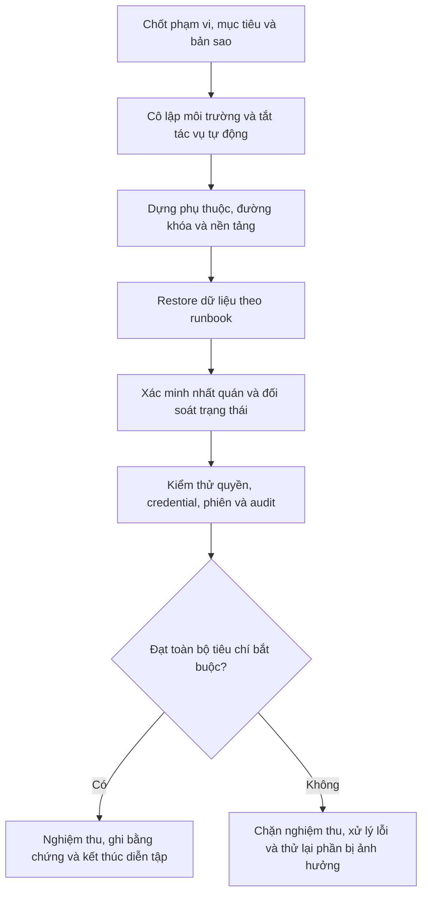

# Đã kiểm thử restore

## 1. Ý nghĩa của tiêu chí trong checklist production

Một hệ thống Privileged Access Management (PAM) có thể sao lưu thành công hằng ngày nhưng vẫn không khôi phục được khi cần. Bản sao có thể thiếu khóa giải mã, không tương thích với phiên bản triển khai, phụ thuộc vào một dịch vụ định danh đang ngừng hoạt động, hoặc chứa credential đã lỗi thời so với hệ thống đích.

Vì vậy, tiêu chí **“Đã kiểm thử restore”** chỉ nên được đánh dấu hoàn tất khi đội vận hành đã thực sự phục hồi từ bản sao được chọn, kiểm tra các chức năng và kiểm soát quan trọng, đo thời gian cùng mức mất dữ liệu, và lưu bằng chứng đủ để người khác đối chiếu.

Trong PAM, khôi phục không chỉ có nghĩa là mở lại giao diện quản trị. Kết quả cần chứng minh đồng thời:

- Người được phép có thể tiếp cận tài nguyên quản trị qua đúng quy trình.
- Người không được phép vẫn bị từ chối; least privilege, phê duyệt và giới hạn thời gian còn hiệu lực.
- Vault và hệ thống đích có trạng thái credential được xác minh, không phát tán lại secret cũ.
- Phiên truy cập và hành động quản trị được giám sát, ghi nhận, truy vết.
- Có thể vận hành an toàn sau phục hồi mà không phải duy trì một đường vòng quyền cao không kiểm soát.

Bài học này thuộc checklist đưa PAM vào production. Các bước dưới đây là khung thiết kế một cuộc diễn tập và nghiệm thu kết quả; thao tác phục hồi thực tế phải tuân theo cơ chế của sản phẩm, kiến trúc triển khai và runbook đã được phê duyệt.

### Mục tiêu học tập

Sau bài học, người học có thể xác định phạm vi restore của PAM, thiết kế phép thử có điều kiện đạt rõ ràng, phân biệt RTO với RPO, xử lý chênh lệch credential sau phục hồi, và đưa ra quyết định go/no-go dựa trên bằng chứng.

## 2. Phân biệt backup, restore, failover và diễn tập trên giấy

| Hoạt động | Câu hỏi được trả lời | Điều chưa được chứng minh |
|---|---|---|
| Backup | Có tạo được bản sao theo phạm vi đã khai báo không? | Bản sao có thể khôi phục và sử dụng được hay không |
| Kiểm tra checksum bản sao | Dữ liệu nhận về có khớp dấu kiểm tra tin cậy không? | Nội dung có đầy đủ, sạch, giải mã được và nhất quán nghiệp vụ không |
| Restore | Có dựng lại trạng thái từ một điểm phục hồi không? | Các luồng PAM đã an toàn và sẵn sàng cho người dùng chưa |
| Failover | Có chuyển sang thành phần dự phòng không? | Có phục hồi được khi dữ liệu hoặc cả hai bên đều hỏng không |
| Diễn tập trên giấy | Đội ngũ có hiểu vai trò, quyết định và trình tự không? | Công cụ, khóa, dữ liệu và phụ thuộc thực tế có hoạt động không |
| Kiểm thử phục hồi đầu cuối | Sau phục hồi, luồng quan trọng và kiểm soát bảo mật có đạt yêu cầu không? | Những thành phần hoặc tình huống chưa nằm trong phạm vi thử |

Một bản sao đồng bộ sang site dự phòng không đương nhiên thay thế backup. Nếu sai cấu hình, xóa nhầm hoặc dữ liệu độc hại được đồng bộ sang cả hai site, failover có thể chỉ đưa người dùng đến một bản lỗi khác.

Ngược lại, một cuộc restore database thành công cũng chưa chứng minh khả năng phục hồi toàn bộ dịch vụ. Database có thể đọc được trong khi vault không giải mã được, connector chưa xác thực, hay session gateway không ghi được bằng chứng.

Khi báo cáo, ghi rõ cấp độ đã kiểm thử. Không dùng kết quả “database restore thành công” để kết luận “PAM phục hồi đầu cuối thành công”.

## 3. Xác định đơn vị phục hồi và các trạng thái cần bảo toàn

PAM thường bao gồm nhiều miền dữ liệu và nhiều hệ thống nằm ngoài quyền sở hữu trực tiếp của đội PAM. Trước khi thử, cần lập danh mục thành phần, người chịu trách nhiệm, cách phục hồi và cách xác minh.

| Miền | Ví dụ | Điều phải xác minh sau restore |
|---|---|---|
| Dữ liệu vault | Đối tượng secret, metadata, lịch sử phiên bản | Đủ đối tượng trong phạm vi, giải mã được bằng đường khóa hợp lệ, không lộ secret trong báo cáo |
| Khóa và vật liệu mật mã | Key hierarchy, KMS/HSM, chứng thư, cấu hình trust | Đường truy cập khóa hoạt động; quyền dùng khóa đúng; khóa cần thiết chưa bị mất hoặc vô hiệu hóa |
| Chính sách quyền | Role, safe, entitlement, JIT/JEA, phê duyệt | Không nới quyền, không hồi sinh quyền đã bị thu hồi |
| Trạng thái workflow | Yêu cầu chờ duyệt, lease, checkout, phiên đang hoạt động | Có quyết định xử lý trạng thái cũ; không mặc nhiên phát lại quyền đã hết hạn |
| Cấu hình tích hợp | IdP, MFA, directory, connector, gateway, API client | Đúng danh tính, trust, endpoint, scope và đường mạng |
| Credential phía đích | Tài khoản máy chủ, tài khoản dịch vụ, key, certificate | Trạng thái được đối chiếu; truy cập và luân chuyển được theo quy trình |
| Audit và recording | Event, chỉ mục, bản ghi phiên, metadata lưu trữ | Tìm được, đọc được, đối chiếu đúng chủ thể và thời gian |
| Cấu hình vận hành | Lịch rotation, job, cảnh báo, đồng bộ thời gian | Job không tác động ngoài phạm vi; cảnh báo đi đúng nơi |
| Nền tảng triển khai | Database, storage, runtime, DNS, cân bằng tải | Tương thích, có tài nguyên và kết nối cần thiết để phục hồi |

### 3.1. Không giả định mọi thứ nằm trong một bản backup

Một gói backup cấu hình có thể không chứa recording. Một snapshot database có thể không chứa khóa trong HSM. Một backup vault có thể chỉ lưu tham chiếu đến KMS, trong khi quyền dùng khóa lại nằm trong một tài khoản hạ tầng khác.

Từng mục cần có ba thông tin riêng:

1. Thành phần nào được khôi phục từ bản sao.
2. Thành phần nào được dựng lại từ cấu hình hoặc quy trình cấp phát.
3. Thành phần nào phải còn tồn tại và được truy cập qua một phụ thuộc bên ngoài.

Nếu cuộc thử dùng KMS production đang hoạt động, báo cáo phải ghi rằng đường phụ thuộc KMS đó được sử dụng. Kết quả không chứng minh khả năng phục hồi khi chính KMS hoặc quyền truy cập khóa cũng bị mất.

### 3.2. Xác định ranh giới nhất quán

Dữ liệu database, metadata recording, object storage và audit có thể có các thời điểm chụp khác nhau. Phải biết điểm phục hồi nào là nhất quán hoặc các bước đối soát cần thiết để đạt trạng thái có thể vận hành.

Không ghép tùy ý database tại thời điểm A với storage tại thời điểm B rồi bỏ qua các đối tượng bị thiếu. Nếu kiến trúc cho phép phục hồi từng miền độc lập, cần mô tả rõ miền nào có thể chậm hơn, giới hạn mất dữ liệu và cách phát hiện khoảng trống.

## 4. Đặt điều kiện đạt trước khi bắt đầu

Tiêu chí chấp nhận phải được thống nhất trước cuộc thử. Nếu chỉ đặt ngưỡng sau khi thấy kết quả, phép đo khó giúp quyết định production.

Một bộ tiêu chí có thể bao gồm:

| Nhóm | Ví dụ điều kiện chấp nhận |
|---|---|
| Thời gian | Luồng truy cập quản trị trọng yếu hoạt động an toàn trong RTO đã duyệt |
| Dữ liệu | Mất dữ liệu thực đo không vượt RPO của từng miền bắt buộc |
| Vault | Bộ đối tượng kiểm thử được khôi phục đầy đủ và giải mã được trong luồng được kiểm soát |
| Credential | Các chênh lệch với đích được phát hiện; tài khoản bắt buộc đã đối soát hoặc được cách ly |
| Chính sách | Bộ phép thử cho phép và từ chối đều cho kết quả mong đợi |
| JIT/JEA | Cấp quyền đúng phạm vi, đúng hạn; hết hạn hoặc thu hồi có hiệu lực |
| Audit | Hành động sau restore được ghi và tìm lại được; khoảng thiếu lịch sử được nhận diện |
| Recording | Mẫu phiên thuộc phạm vi khôi phục có thể truy xuất và phát lại bởi người được phép |
| Vận hành | Rotation, connector, cảnh báo và đồng bộ thời gian được kiểm tra |
| Bằng chứng | Có bản sao định danh, log thời gian, kết quả, lỗi và người nghiệm thu |

Các con số trong bài chỉ là ví dụ thiết kế. Tổ chức cần chọn mục tiêu từ yêu cầu dịch vụ và rủi ro thực tế, không coi ví dụ là một mức chuẩn chung cho mọi PAM.

### 4.1. RTO: đo đến lúc dùng được an toàn

RTO là mục tiêu thời gian khôi phục dịch vụ theo phạm vi đã thống nhất. Cuộc thử cần xác định rõ mốc bắt đầu và kết thúc tương ứng với kế hoạch liên tục dịch vụ.

Nếu mục tiêu áp dụng từ lúc xảy ra gián đoạn, thời gian thực đo phải bao gồm phát hiện, tuyên bố sự cố, huy động người, lấy bản sao, dựng môi trường, khôi phục, đối soát và nghiệm thu. Nếu chỉ đo từ lúc kỹ sư bấm restore, đó là thời gian của một công đoạn; cần báo cáo riêng, không đánh đồng với toàn bộ RTO.

Mốc kết thúc không nên chỉ là “tiến trình database khởi động”. Với luồng quản trị máy chủ, mốc này có thể yêu cầu đăng nhập qua MFA, xin quyền, mở phiên, ghi nhận phiên và thu hồi quyền đều đạt.

### 4.2. RPO: đo mức mất dữ liệu có thể chấp nhận

RPO là mục tiêu về khoảng mất dữ liệu theo thời gian. Lịch backup mỗi 15 phút không tự chứng minh RPO thực tế là 15 phút: bản sao cuối có thể lỗi, thiếu log cần thiết, hoặc không phục hồi được.

Với mô hình khôi phục tại một điểm thời gian, có thể minh họa:

```text
Mất dữ liệu theo thời gian của miền D
  = thời điểm gián đoạn tham chiếu
    - thời điểm mới nhất đã xác minh phục hồi được của miền D
```

Cách tính phải phù hợp với dữ liệu và cơ chế khôi phục thực tế. Với event phân tán hoặc nhiều luồng ghi, cần đối chiếu thêm sequence, event ID, transaction marker hay watermark tin cậy. Một timestamp nhìn có vẻ mới không chứng minh toàn bộ sự kiện trước đó đều đã có.

Đánh giá riêng vault, chính sách và audit nếu chúng có yêu cầu khác nhau. Không lấy giá trị trung bình để che một miền quan trọng đã vượt ngưỡng.

## 5. Thiết kế môi trường thử để không tạo sự cố mới

Môi trường phục hồi cần đủ giống production để phép thử có giá trị, đồng thời có ranh giới rõ ràng để bản phục hồi không tự điều khiển hệ thống thật.

Các kiểm soát thường cần được chuẩn bị trước:

- Chặn kết nối đến đích production, trừ đường kết nối cụ thể đã được phê duyệt cho cuộc thử.
- Tắt hoặc cách ly job rotation, discovery, reconciliation, đồng bộ và tác vụ tự động trước lần khởi động đầu tiên.
- Dùng DNS, địa chỉ dịch vụ và hệ thống đích kiểm thử riêng; kiểm tra cả đường đi gián tiếp qua proxy hoặc connector.
- Không dùng lại danh tính máy hoặc khóa xác thực có thể khiến bản clone được hệ thống khác coi là production.
- Định tuyến email, webhook, cảnh báo và tích hợp ticket sang nơi kiểm thử.
- Giới hạn người có thể đọc dữ liệu phục hồi, vì một bản sao vault hoặc recording vẫn là dữ liệu nhạy cảm.
- Chỉ cho phép các phụ thuộc cần thiết và ghi rõ chúng là phụ thuộc production hay phụ thuộc mô phỏng.

Một firewall chặn chiều vào chưa đủ nếu scheduler trong bản clone vẫn được phép kết nối ra máy chủ thật và đổi password. Kiểm soát chiều ra cần có trước khi dịch vụ phục hồi hoạt động.

### 5.1. Dùng dữ liệu kiểm thử có khả năng đối chiếu

Tạo trước một bộ dữ liệu tổng hợp, ví dụ:

```text
safe: restore-lab-safe
account: restore-lab-svc
target: app-lab-01.example.invalid
request: restore-lab-request-042
session: restore-lab-session-042
audit_marker: restore-marker-017
```

Các định danh này là ví dụ, không phải credential. Bộ dữ liệu nên có đối tượng tồn tại trước điểm backup, thay đổi sau điểm backup, quyền hết hạn, quyền đã bị thu hồi và một phiên có recording.

Lưu kỳ vọng ở một nơi độc lập, được kiểm soát, không chỉ bên trong hệ thống sẽ bị phục hồi. Nếu cả dữ liệu lẫn “đáp án” đều lấy từ cùng một backup thiếu, hai bên vẫn có thể khớp mà không phát hiện mất dữ liệu.

### 5.2. Tách quyền thực hiện và quyền nghiệm thu

Người thực hiện restore cần quyền đủ cho công việc trong thời gian được cấp. Người nghiệm thu cần kiểm tra được kết quả nhưng không nhất thiết được xem secret. Người giữ vật liệu phục hồi khóa có thể thuộc một nhóm khác.

Phân tách này giúp kiểm tra một vấn đề thực tế: khi sự cố xảy ra ngoài giờ, có đủ người và quyền để khôi phục mà vẫn giữ được quy trình kiểm soát không?

## 6. Runbook kiểm thử restore đầu cuối

Trình tự cụ thể phụ thuộc sản phẩm. Khung sau nhấn mạnh các điểm quyết định và bằng chứng cần có.



### Bước 1 — Chốt phạm vi và chọn bản sao

Ghi nhận mã cuộc thử, người chỉ huy, thành phần nằm trong phạm vi, thời điểm gián đoạn giả lập và mục tiêu đã duyệt.

Định danh bản sao bằng mã backup, nguồn lưu, thời gian, phiên bản ứng dụng/schema cần thiết và thông tin kiểm tra tính toàn vẹn. Nếu là một chuỗi full/incremental/log, xác minh đủ chuỗi theo cơ chế được hỗ trợ.

Với kịch bản dữ liệu bị xâm phạm, cần đánh giá điểm phục hồi sạch và nguồn tin cậy. “Bản mới nhất” không đương nhiên là “bản an toàn nhất”. Khi phải lùi xa hơn để có dữ liệu sạch, phải báo cáo mức mất dữ liệu thực tế và tác động đến mục tiêu.

### Bước 2 — Kiểm tra điều kiện tiên quyết

Xác nhận tài nguyên tính toán, storage, phiên bản, gói cài đặt, license nếu có, bản cấu hình và tài liệu thao tác đều sẵn có.

Kiểm tra khả năng sử dụng khóa, chứng thư, quyền truy cập backup, cơ chế mở khóa và nhân sự cần tham gia. Không ghi vật liệu khóa hoặc recovery secret vào biên bản. Nếu chính PAM đang mất thì cách lấy quyền phục hồi không được phụ thuộc hoàn toàn vào PAM đó.

Một tài khoản khẩn cấp chỉ hữu ích nếu đã thử đăng nhập bằng quy trình được kiểm soát, có người chịu trách nhiệm và có log. Sự tồn tại của tên tài khoản trong tài liệu chưa chứng minh khả năng sử dụng.

### Bước 3 — Xác minh ranh giới cô lập trước khi khởi động

Chứng minh bản phục hồi không có đường tác động ngoài phạm vi. Kiểm tra route, DNS, danh tính connector và job tự động. Ghi lại cấu hình hoặc kết quả kiểm tra đã che dữ liệu nhạy cảm.

Chỉ chuyển sang restore khi ranh giới này đạt. Không khởi động đầy đủ rồi mới tìm cách ngăn rotation chạy nhầm.

### Bước 4 — Thực hiện restore và ghi mốc thời gian

Làm theo trình tự được hỗ trợ đối với khóa, dữ liệu, cấu hình và dịch vụ. Ghi thời điểm bắt đầu/kết thúc từng công đoạn, lỗi gặp phải, thời gian chờ và thao tác thủ công.

Nếu cần thay đổi runbook trong lúc thử, ghi rõ thay đổi cùng lý do. Một cuộc thử chỉ thành công nhờ kiến thức riêng của một kỹ sư nhưng không cập nhật được thành hướng dẫn lặp lại vẫn còn khoảng trống vận hành.

### Bước 5 — Xác minh dữ liệu trước khi mở luồng truy cập

Kiểm tra ứng dụng/schema tương thích, dữ liệu trọng yếu tồn tại, đường giải mã hợp lệ và các quan hệ giữa dữ liệu không bị đứt.

Đối chiếu bộ marker độc lập, phạm vi đối tượng, phiên bản và kết quả xử lý lỗi. Số lượng đối tượng là một phép kiểm tra hữu ích nhưng không đủ: có thể đủ số lượng mà sai quyền, sai liên kết hoặc thiếu đối tượng trọng yếu.

Không đòi hỏi ciphertext phải giống byte-for-byte sau mọi kiểu phục hồi. Một cơ chế re-encryption được hỗ trợ có thể thay đổi biểu diễn mã hóa. Cần phân biệt kiểm tra tính toàn vẹn gói backup với kiểm tra tính đúng đắn của dữ liệu phục hồi.

### Bước 6 — Đối soát credential và trạng thái quyền

Xử lý sai khác giữa dữ liệu được phục hồi và hệ thống ngoài PAM. Đây là bước bắt buộc trước khi cho phép tác vụ tự động tác động lên đích thật.

Xác minh các quyền đã hết hạn hoặc bị thu hồi, yêu cầu chờ duyệt và session cũ. Không coi snapshot cũ là nguồn duy nhất cho quyết định cấp quyền hiện tại.

### Bước 7 — Chạy phép thử chức năng và bảo mật

Kiểm thử cả đường được phép và đường phải bị từ chối. Bao phủ MFA, phê duyệt, JIT/JEA, thời hạn, recording, audit, rotation và cảnh báo theo phạm vi thiết kế.

Khi cần xác minh secret, dùng tài khoản kiểm thử và luồng được kiểm soát. Báo cáo kết quả xác thực, không xuất giá trị secret ra console, ảnh chụp hay file bằng chứng.

### Bước 8 — Nghiệm thu và kết thúc có kiểm soát

Tổng hợp RTO/RPO thực đo, các ca đạt/chưa đạt, phần chưa thử và lỗi còn mở. Chỉ người có vai trò nghiệm thu đã thống nhất mới chốt kết quả.

Sau diễn tập, thu hồi quyền tạm, vô hiệu hóa danh tính bản clone, xử lý dữ liệu thử theo chính sách lưu giữ và kiểm tra job thử không còn chạy. Giữ đủ bằng chứng cần thiết; việc kết thúc môi trường không đồng nghĩa xóa bằng chứng.

Trong một cuộc khôi phục sự cố thật, còn cần kế hoạch chuyển lưu lượng, ngăn hai bản cùng hoạt động và giám sát sau chuyển đổi. Một diễn tập cô lập không tự cấp phép cho các thao tác đó.

## 7. Điểm khó riêng của PAM: credential đã thay đổi sau backup

PAM kiểm soát nhiều trạng thái nằm ngoài database của chính nó. Khôi phục database về quá khứ không đưa password, SSH key hoặc certificate trên hệ thống đích quay về cùng thời điểm.

Xét ví dụ:

```text
09:00  Backup B1 chứa tham chiếu credential phiên bản v17.
09:05  Rotation trên đích thành công, credential hiện tại là v18.
09:08  PAM bị gián đoạn.
09:30  Môi trường phục hồi được dựng từ B1.
```

Nếu bản phục hồi sử dụng v17 để đăng nhập, xác thực có thể thất bại. Nếu tự động “sửa” bằng cách ghi v17 trở lại đích, hệ thống có thể làm hỏng ứng dụng đang dùng v18, phục hồi một secret đáng lẽ không còn dùng, hoặc làm sai trạng thái kiểm toán.

### 7.1. Phải xác định nguồn tin cậy và phương án đối soát

Quy trình xử lý cần được thiết kế cho từng loại credential:

| Tình trạng | Hướng xử lý cần kiểm chứng |
|---|---|
| Vault và đích nhất quán | Kiểm thử xác thực trên đích kiểm thử rồi cho phép luồng tiếp theo theo runbook |
| Vault cũ hơn đích | Xác minh chênh lệch và dùng cơ chế reconciliation hoặc tái cấp phát được hỗ trợ |
| Secret phục hồi nghi bị lộ | Giữ cô lập, thay credential theo kế hoạch và cập nhật bên tiêu thụ trước khi mở lại |
| Không xác minh được trạng thái đích | Chặn truy cập/tự động hóa liên quan hoặc giữ cách ly; báo người sở hữu đích |
| Key/certificate đã bị thu hồi ở bên ngoài | Không coi việc bản sao chứa khóa là bằng chứng nó còn hợp lệ; kiểm tra trạng thái trust và tái cấp khi cần |

Không có một thao tác “đồng bộ tất cả” an toàn cho mọi hệ thống. Tài khoản dịch vụ có thể được nhiều ứng dụng sử dụng; thay credential cần phối hợp cập nhật các bên tiêu thụ và kiểm tra hoạt động của chúng.

Quyền reconciliation cũng là quyền nhạy cảm. Nếu dùng một tài khoản phục hồi đặc biệt, phải kiểm soát phạm vi, thời hạn, người duyệt và log của chính tài khoản đó.

### 7.2. Kiểm thử được chênh lệch, không chỉ kiểm thử trường hợp khớp

Trong môi trường lab, chủ động tạo tình huống rotation xảy ra sau điểm backup. Sau restore, hệ thống cần phát hiện sai khác hoặc luồng kiểm tra cần nhận diện nó trước khi tác vụ gây tác động ngoài ý muốn.

Tiêu chí đạt có thể gồm: không retry gây khóa tài khoản, không ghi đè mù lên đích, có sự kiện cảnh báo, có quyết định của người sở hữu và có bằng chứng trạng thái cuối đã được xác minh.

### 7.3. Restore không được hồi sinh quyền cũ

Snapshot có thể chứa quyền quản trị đã bị thu hồi sau thời điểm backup. Nó cũng có thể chứa lease từng hợp lệ nhưng đã hết hạn hoặc tài khoản vendor đã offboard.

Cần đối chiếu với nguồn danh tính, thông tin thu hồi và chính sách hiện hành có thẩm quyền. Nếu nguồn này chưa sẵn sàng, không coi quyền trong snapshot là đủ cơ sở mở truy cập nhạy cảm.

Tùy cơ chế sản phẩm, token cũ có thể còn hiệu lực ở hệ thống khác dù database PAM đã được phục hồi. Phải kiểm thử chính sách vô hiệu hóa, tái xác thực hoặc thu hồi phù hợp, thay vì giả định một thao tác restore đã thu hồi toàn bộ token và session.

## 8. Ma trận kiểm thử tối thiểu theo luồng quan trọng

Ma trận dưới đây là ví dụ để xây bộ ca thử theo kiến trúc thực tế. Mỗi ca cần định danh, dữ liệu đầu vào, kết quả kỳ vọng, kết quả thực tế và nơi lưu bằng chứng.

| Mã | Phép thử | Kết quả cần quan sát |
|---|---|---|
| RS-01 | Phục hồi vault với đường khóa hợp lệ | Đọc được đối tượng thử qua luồng được cấp quyền; không lộ secret trong bằng chứng |
| RS-02 | Thiếu hoặc bị từ chối quyền dùng khóa | Vault không phát secret; lỗi rõ ràng, có audit/cảnh báo theo thiết kế |
| RS-03 | Người hợp lệ đăng nhập bằng MFA | Đúng danh tính, đúng chính sách, không bỏ qua MFA sau restore |
| RS-04 | Người không thuộc role truy cập safe | Bị từ chối và có sự kiện tương ứng |
| RS-05 | Yêu cầu quyền thiếu phê duyệt bắt buộc | Không mở phiên hoặc phát credential trái chính sách |
| RS-06 | Cấp quyền JIT rồi hết hạn | Quyền bị gỡ theo phạm vi thiết kế; kiểm tra cả hành vi phiên theo chính sách |
| RS-07 | Thử tác vụ ngoài phạm vi JEA | Bị giới hạn bởi cơ chế thực thi ở đích, không chỉ bị ẩn trên giao diện |
| RS-08 | Mở phiên qua gateway | Kết nối được đến đích thử và ghi nhận đúng chủ thể |
| RS-09 | Truy xuất recording đã phục hồi | Người được phép tìm và phát lại đúng phiên; người không được phép bị từ chối |
| RS-10 | Credential thay đổi sau backup | Chênh lệch được nhận diện và xử lý có kiểm soát |
| RS-11 | Rotation trên một tài khoản thử | Đích, vault và bên tiêu thụ đạt trạng thái thống nhất đã xác minh |
| RS-12 | Quyền đã bị thu hồi sau backup | Không được khôi phục thành quyền đang hoạt động trái phép |
| RS-13 | Ghi audit mới và chuyển đến nơi tiếp nhận | Có event, đúng correlation và định danh môi trường; phát hiện được đường chuyển log lỗi |
| RS-14 | Bản sao thiếu hoặc hỏng thành phần | Báo lỗi có thể hành động; không nghiệm thu nhầm trạng thái phục hồi một phần |
| RS-15 | Phụ thuộc quan trọng chưa sẵn sàng | Hành vi đúng chính sách đã duyệt, không tự mở quyền rộng để vượt lỗi |

Với recording, cần phân biệt phiên được khôi phục từ backup với phiên mới tạo sau restore. Hai loại này kiểm tra hai khả năng khác nhau: khả năng đọc lịch sử và khả năng tiếp tục tạo bằng chứng.

Với JIT, việc hết hạn một entitlement không luôn đồng nghĩa kết thúc ngay mọi session hoặc token đã được cấp. Phép thử phải đối chiếu chính sách dự kiến của từng loại phiên; không dùng một dấu “expired” trên UI làm bằng chứng duy nhất.

Nếu một tích hợp không nằm trong kiến trúc, ghi rõ không áp dụng kèm lý do. Nếu nó có trong kiến trúc nhưng chưa thử, ghi chưa thử; hai trạng thái này không thể thay thế cho nhau.

## 9. Xác minh audit và bằng chứng sau khôi phục

PAM thường phục vụ cả vận hành lẫn kiểm toán và ứng phó sự cố. Vì vậy, bộ bằng chứng cần trả lời được: ai thực hiện, trên môi trường nào, vào lúc nào, với bản sao nào, được kết quả gì và ai chấp nhận.

Một hồ sơ cuộc thử nên có:

- Phạm vi và phiên bản runbook.
- Mã backup/chuỗi backup, thời điểm và kiểm tra tính toàn vẹn từ nguồn tin cậy.
- Mốc thời gian thực đo, nguồn đồng hồ và các khoảng chờ.
- Marker hoặc tập dữ liệu đối chiếu độc lập.
- Kết quả từng ca thử, kể cả thất bại và phần chưa thực hiện.
- Quyết định đối soát credential, quyền và trạng thái workflow.
- Bằng chứng truy xuất recording và tạo audit mới.
- Các phụ thuộc bên ngoài đã sử dụng, giới hạn của phép thử.
- Người thực hiện, người nghiệm thu, lỗi còn mở và kế hoạch xử lý.

### 9.1. Không để hồ sơ thử trở thành nơi chứa secret

Báo cáo có thể ghi đối tượng thử, phiên bản, trạng thái và mã sự kiện. Không cần chép password, private key, token hoặc recovery share để chứng minh khôi phục thành công.

Nếu ảnh chụp giao diện có dữ liệu nhạy cảm, cần chọn cách thu bằng chứng hoặc che dữ liệu phù hợp trước khi chia sẻ. Quyền đọc hồ sơ cũng cần giới hạn, vì sơ đồ hạ tầng, định danh tài khoản và recording có thể tiết lộ thông tin quan trọng.

### 9.2. Phân biệt tính toàn vẹn và tính xác thực

Hash chỉ hữu ích khi có giá trị tham chiếu và nguồn tham chiếu đáng tin cậy. Nếu người sửa được backup cũng sửa được file hash đặt cùng chỗ, việc hai bên khớp không tự chứng minh backup chưa bị thay đổi.

Tùy kiến trúc, có thể dùng manifest được ký, kho bằng chứng có kiểm soát thay đổi, lưu trữ bất biến hoặc cơ chế xác thực tương đương. Mục tiêu là kiểm chứng nguồn gốc và thay đổi của bằng chứng, không chỉ ghi một chuỗi hash cho đủ biểu mẫu.

### 9.3. Nhận diện khoảng trống và sự kiện trùng

Restore có thể khiến log được gửi lại, index được dựng lại hoặc sequence nội bộ quay về giá trị trước đó. Nơi nhận log cần phân biệt nguồn, môi trường và lần phục hồi để không hiểu bản clone là production.

Việc có sự kiện mới đến SIEM không chứng minh lịch sử trước đó đã đầy đủ. Cần đối chiếu khoảng thời gian, marker và những phần được phục hồi theo phạm vi. Nếu có khoảng thiếu, ghi rõ thay vì lấp bằng suy đoán hoặc chỉnh log.

## 10. Ví dụ nghiệm thu với số liệu

Giả sử một cuộc thử đặt các mục tiêu sau:

```yaml
# Ví dụ hồ sơ thiết kế, không phải cấu hình của một sản phẩm PAM.
test_id: PAM-RESTORE-LAB-042
scope:
  - vault
  - access_policy
  - privileged_session
  - audit
recovery_objectives:
  rto_minutes: 60
  rpo_minutes:
    vault: 10
    access_policy: 10
    audit: 5
reference_interruption: "10:00"
recovery_ready: "10:52"
verified_recovery_points:
  vault: "09:54"
  access_policy: "09:54"
  audit: "09:52"
credential_reconciliation: PASS
authorization_tests: PASS
recording_tests: PASS
```

Trong ví dụ đơn giản này, các mốc đều thuộc cùng ngày và dùng đồng hồ đã đối chiếu. Mốc dữ liệu đã được xác minh bằng marker, không chỉ dựa vào tên file.

Thời gian phục hồi thực đo là 52 phút, đạt mục tiêu 60 phút. Vault và chính sách mất 6 phút dữ liệu, đạt mục tiêu 10 phút. Audit mất 8 phút dữ liệu, vượt mục tiêu 5 phút.

Kết luận phải là **chưa đạt tiêu chí restore tổng thể của phạm vi đã đặt**, dù phần lớn ca thử và RTO đều đạt. Không lấy trung bình các RPO để đổi kết luận.

Đội ngũ cần điều tra đường lưu/chuyển audit, chuỗi backup hoặc cách phục hồi liên quan, rồi thử lại phần bị ảnh hưởng. Nếu thay đổi tác động tới điểm nhất quán hoặc trình tự khởi động, phải chạy lại thêm các ca tích hợp có liên quan.

Trong một tình huống khẩn cấp, người có thẩm quyền có thể phải quyết định chấp nhận một mức rủi ro cụ thể. Quyết định đó cần được ghi riêng, có phạm vi và thời hạn; nó không làm phép thử vốn vượt tiêu chí trở thành PASS.

## 11. Mẫu biên bản để quyết định go/no-go

Một biên bản ngắn nhưng kiểm chứng được tốt hơn một bảng dài chỉ có dấu tích.

```text
TEST_ID:
MÔI_TRƯỜNG:
PHẠM_VI:
PHIÊN_BẢN_RUNBOOK:
BẢN_SAO_VÀ_ĐIỂM_PHỤC_HỒI:
PHỤ_THUỘC_ĐƯỢC_DÙNG:

MỐC_BẮT_ĐẦU:
MỐC_DỊCH_VỤ_SẴN_SÀNG_AN_TOÀN:
RTO_MỤC_TIÊU / THỰC_ĐO:
RPO_TỪNG_MIỀN_MỤC_TIÊU / THỰC_ĐO:

KẾT_QUẢ_DỮ_LIỆU_VÀ_KHÓA:
KẾT_QUẢ_CREDENTIAL_VÀ_ROTATION:
KẾT_QUẢ_QUYỀN_MFA_JIT_JEA:
KẾT_QUẢ_AUDIT_RECORDING:
CA_THẤT_BẠI / CHƯA_THỬ:
GIỚI_HẠN_CỦA_KẾT_LUẬN:
BẰNG_CHỨNG:
LỖI_CÒN_MỞ / NGƯỜI_PHỤ_TRÁCH / HẠN_XỬ_LÝ:

QUYẾT_ĐỊNH: GO | NO-GO
NGƯỜI_NGHIỆM_THU:
THỜI_ĐIỂM_NGHIỆM_THU:
XÁC_NHẬN_KẾT_THÚC_MÔI_TRƯỜNG_THỬ:
```

GO chỉ áp dụng cho cấu hình, phạm vi và điều kiện đã được đánh giá. Một lần phục hồi lab nhỏ không tự chứng minh thời gian phục hồi dataset production lớn hơn nhiều, cũng không chứng minh một site khác có đủ tài nguyên.

Nếu dùng dữ liệu mẫu hoặc thay thế phụ thuộc bằng mô phỏng, ghi rõ giới hạn. Muốn kết luận rộng hơn cần thêm bằng chứng tương ứng.

## 12. Các dấu hiệu phải giữ trạng thái chưa đạt

| Dấu hiệu | Vì sao không thể chốt hoàn tất | Việc cần làm rõ |
|---|---|---|
| Job backup xanh nhưng chưa restore lần nào | Mới chứng minh tạo bản sao | Thực hiện phục hồi có đo và kiểm tra |
| Chỉ mở được giao diện PAM | Chưa kiểm tra khóa, quyền và luồng đầu cuối | Chạy các ca bắt buộc |
| Phải tắt MFA hoặc cấp admin rộng mới dùng được | Dịch vụ chưa trở về trạng thái kiểm soát dự kiến | Sửa phụ thuộc/chính sách và thử lại |
| Không giải mã được một phần vault | Dữ liệu có thể tồn tại nhưng không sử dụng được | Kiểm tra key hierarchy, phiên bản và phạm vi backup |
| Credential trong vault không khớp đích | Có nguy cơ mất truy cập hoặc gây gián đoạn ứng dụng | Đối soát với người sở hữu và thử phương án xử lý |
| Quyền vendor đã thu hồi xuất hiện lại | Restore đã phục hồi quyền không còn hợp lệ | Đối chiếu nguồn hiện hành và sửa quy trình phục hồi |
| Có log mới nhưng mất lịch sử bắt buộc | Chưa đạt yêu cầu bằng chứng/RPO của miền đó | Xác định khoảng mất và sửa đường phục hồi |
| Không có mốc thời gian tin cậy | Không chứng minh được mục tiêu khôi phục | Đo lại hoặc bổ sung bằng chứng có thể đối chiếu |
| Phép thử dùng phụ thuộc còn sống nhưng báo toàn hệ thống | Kết luận vượt phạm vi bằng chứng | Thu hẹp kết luận hoặc thử kịch bản mất phụ thuộc |
| Chỉ một kỹ sư biết các bước bổ sung | Runbook chưa lặp lại được | Cập nhật hướng dẫn và diễn tập bởi người khác |

Không đánh dấu PASS cho một ca chưa chạy chỉ vì “thường thì sẽ hoạt động”. Trạng thái chưa thử giúp nhìn rõ việc còn thiếu; một dấu PASS suy đoán làm mất thông tin cần cho quyết định production.

## 13. Khi nào cần kiểm thử lại?

Kết quả restore gắn với thời điểm và cấu hình đã thử. Cần xây lịch diễn tập theo mức quan trọng của dịch vụ và xem xét thử lại khi có thay đổi ảnh hưởng khả năng phục hồi.

Những thay đổi thường cần đánh giá lại gồm nâng cấp ứng dụng hoặc schema, thay cơ chế backup, thay khóa/KMS/HSM, đổi nền tảng storage, tăng mạnh dung lượng recording, thay IdP/MFA, đổi connector, tái thiết kế JIT/JEA hoặc thay topology nhiều site.

Việc chỉ kiểm thử trong điều kiện thuận lợi có thể bỏ sót các tình huống quan trọng. Kế hoạch nên luân phiên các kịch bản như mất node, mất site, backup gần nhất không dùng được, phụ thuộc định danh gián đoạn và phục hồi từ điểm sạch sau sự cố bảo mật.

Không nhất thiết mọi thay đổi đều đòi lặp lại mọi ca. Xác định phần bị ảnh hưởng và quan hệ phụ thuộc, rồi chọn phạm vi thử đủ để chứng minh lại kết luận. Nếu không xác định được ảnh hưởng, chưa nên giữ nguyên giả định kết quả cũ vẫn còn hiệu lực.

## 14. Bài thực hành có hướng giải

Một đội chuẩn bị đưa PAM vào production có các bằng chứng sau:

- Restore database hoàn tất trong 25 phút.
- Giao diện quản trị mở được ở phút 31.
- Vault giải mã được bằng KMS production còn hoạt động.
- Một tài khoản dịch vụ đã rotate sau backup, nhưng đội chưa kiểm tra trạng thái bên đích.
- Role vendor đã bị thu hồi trước sự cố lại xuất hiện trong dữ liệu phục hồi.
- Recording cũ chưa thử phát lại; phiên mới đã có audit.
- RTO là 60 phút, nhưng chỉ bắt đầu bấm giờ lúc chạy lệnh restore.
- Báo cáo kết luận “PAM restore PASS”.

### Yêu cầu

Xác định kết luận có đủ cơ sở không, nêu các việc cần làm trước khi nghiệm thu và giới hạn nào phải giữ trong báo cáo.

### Hướng giải

Kết luận chưa đủ cơ sở. Thời gian 25 phút chỉ phản ánh công đoạn database; mốc 31 phút chỉ chứng minh giao diện lên. Chưa có phép đo từ mốc bắt đầu được định nghĩa cho mục tiêu RTO đến lúc luồng truy cập quản trị sẵn sàng an toàn.

Đội cần đối soát tài khoản đã rotate, kiểm thử phương án reconciliation hoặc tái cấp phát trong phạm vi được kiểm soát, và xác minh ứng dụng tiêu thụ credential tiếp tục hoạt động.

Role vendor xuất hiện lại cần được đối chiếu với nguồn thu hồi hiện hành. Không cho role đó cấp quyền chỉ vì nó tồn tại trong snapshot. Phải kiểm thử một yêu cầu của danh tính vendor tương ứng để chứng minh quyền đã thu hồi không hoạt động trở lại.

Cần thử truy xuất recording cũ, kiểm tra phạm vi lịch sử audit đã phục hồi và đo RPO theo từng miền. Audit của một phiên mới không thay thế các phép thử lịch sử này.

Kết quả về khóa chỉ chứng minh đường dùng KMS đang sẵn có hoạt động. Báo cáo phải giữ giới hạn đó; nếu kịch bản production yêu cầu phục hồi khi KMS hoặc quyền truy cập KMS mất, cần một cuộc thử phù hợp.

Sau khi hoàn tất các ca bắt buộc, đo lại hoặc bổ sung bằng chứng thời gian hợp lệ, sửa lỗi và nghiệm thu, đội mới có cơ sở quyết định tiêu chí đã đạt.

## 15. Checklist hoàn tất cho tiêu chí “Đã kiểm thử restore”

Trước khi đánh dấu hoàn tất, người nghiệm thu cần trả lời được các câu hỏi sau:

- [ ] Đã thực sự restore từ bản sao được định danh, trong môi trường và phạm vi đã phê duyệt.
- [ ] Đã xác minh đường khóa, tính nhất quán và dữ liệu quan trọng bằng kỳ vọng độc lập.
- [ ] Đã đo thời gian đến khi luồng trọng yếu dùng được an toàn, theo mốc của mục tiêu RTO.
- [ ] Đã đo mất dữ liệu và so sánh RPO riêng cho các miền bắt buộc.
- [ ] Đã đối soát credential và thử tình huống thay đổi xảy ra sau backup.
- [ ] Đã kiểm tra quyền bị thu hồi, MFA, phê duyệt, JIT/JEA và các phép thử từ chối.
- [ ] Đã xác minh phiên truy cập, khả năng tạo audit mới và khả năng đọc bằng chứng lịch sử trong phạm vi.
- [ ] Đã ghi rõ phụ thuộc, giới hạn, ca chưa thử và lỗi còn mở.
- [ ] Đã có người có thẩm quyền nghiệm thu dựa trên kết quả thực tế.
- [ ] Đã kết thúc môi trường thử, thu hồi quyền tạm và lưu bằng chứng theo chính sách.

Điểm quyết định của tiêu chí này là khả năng lặp lại: một đội được phân công phải có thể dùng bản sao, khóa, runbook và quyền phục hồi đã chuẩn bị để đưa PAM trở về trạng thái vận hành có kiểm soát. Bằng chứng phải cho thấy cả truy cập hợp lệ lẫn việc tiếp tục ngăn truy cập không hợp lệ sau phục hồi.
