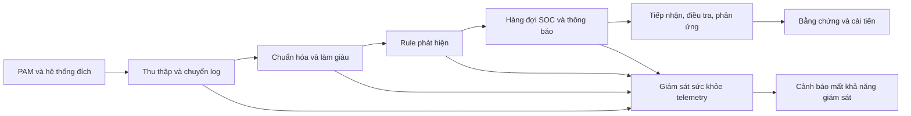

# Đã có alert SOC

## 1. Ý nghĩa của tiêu chí trong checklist production

Một hệ thống Privileged Access Management (PAM) có thể đã quản lý tài khoản đặc quyền, cấp quyền just-in-time (JIT), luân chuyển credential và ghi lại phiên quản trị nhưng vẫn để một hoạt động nguy hiểm kéo dài nếu không có người nhận biết và xử lý. Tiêu chí **“Đã có alert SOC”** xác nhận rằng những tín hiệu quan trọng đã được chuyển thành cảnh báo có thể vận hành bởi Security Operations Center (SOC).

Đây là tiêu chí về cả kỹ thuật và trách nhiệm vận hành. Một rule được bật trong công cụ giám sát chưa đủ để đánh dấu hoàn thành. Cần chứng minh rằng hoạt động được quan sát, dữ liệu đến nơi, rule đánh giá đúng, cảnh báo được gửi đến đúng ca trực và người tiếp nhận có thể tra cứu bằng chứng để quyết định bước tiếp theo.

Trong phạm vi PAM, alert SOC phải giúp trả lời những câu hỏi thực tế:

- Ai đang sử dụng quyền đặc biệt, bằng danh tính nào và trên tài sản nào?
- Hành động có nằm trong phạm vi được phê duyệt, đúng thời gian và đúng mục đích không?
- Có dấu hiệu lạm dụng tài khoản quản trị, credential dịch vụ, quyền quản trị PAM hoặc đường truy cập ngoài PAM không?
- Nếu hoạt động đáng ngờ xảy ra, ai tiếp nhận và có thể thực hiện biện pháp gì?
- Nếu luồng giám sát bị hỏng, tổ chức có biết rằng mình đang mất khả năng quan sát không?

Mục tiêu của bài học là xây dựng một cổng nghiệm thu có bằng chứng cho tiêu chí này. Các giá trị thời gian, mức ưu tiên và tên rule trong bài là ví dụ thiết kế; đội vận hành cần chốt chúng theo mức độ quan trọng của hệ thống và năng lực trực của mình.

## 2. Phân biệt event, log, alert và incident

Các khái niệm này liên quan nhưng không thay thế nhau.

| Khái niệm | Vai trò | Ví dụ trong PAM | Điều chưa được bảo đảm |
| --- | --- | --- | --- |
| Event | Một việc đã xảy ra tại nguồn | Bắt đầu phiên SSH, cấp lease JIT, đọc secret | Dữ liệu đã được gửi đi |
| Log | Bản ghi của event hoặc trạng thái hệ thống | Audit record về việc thay đổi chính sách vault | Có rule phát hiện và có người xử lý |
| Alert | Kết quả phát hiện cần được xem xét | Dùng tài khoản khẩn cấp trên máy chủ trọng yếu | Đã xác nhận có sự cố |
| Incident | Hồ sơ xử lý một tình huống theo quy trình sự cố | Tài khoản quản trị bị chiếm dụng và truy cập trái phép | Mọi alert cùng loại đều là sự cố |

Một lần đăng nhập quản trị thành công thường là event cần lưu. Nó có thể tạo alert nếu gắn với điều kiện rủi ro, như danh tính không được phép, tài sản không thuộc phạm vi cấp quyền hoặc phiên diễn ra sau khi quyền đã hết hạn.

Ngược lại, một lần dùng tài khoản break-glass thường cần thông báo cho SOC ngay cả khi đó là hoạt động hợp lệ. Giá trị của cảnh báo nằm ở việc có người kiểm tra lý do, phạm vi, thời gian sử dụng và công việc hậu kiểm. Không cần đợi chứng minh hành vi độc hại mới thông báo.

Không đồng nhất alert với cơ chế chặn. PAM có thể từ chối một yêu cầu vi phạm chính sách và đồng thời phát cảnh báo. SOC cũng cần nhận biết một số hành động đã bị chặn, đặc biệt khi có nhiều lần thử hoặc tài sản đích rất nhạy cảm.

## 3. Chuỗi cảnh báo phải được nghiệm thu từ đầu đến cuối

Một luồng phổ biến có hình dạng sau:



Không bắt buộc phải dùng cùng một kiến trúc hoặc sản phẩm. Một tổ chức có thể dùng SIEM để thu thập và tương quan, SOAR để điều phối, hệ thống ticket để quản lý ca và một kênh paging cho cảnh báo khẩn cấp. Điều cần kiểm chứng là từng mắt xích thực sự hoạt động.

Một cách kiểm thử yếu là gửi một thông báo thử vào nhóm chat rồi kết luận “SOC đã nhận alert”. Cách đó chỉ chứng minh một phần đường thông báo. Nó không chứng minh PAM sinh event, parser giữ đúng danh tính, rule có nhìn thấy event hay hồ sơ điều tra có liên kết đúng phiên.

Nghiệm thu đầy đủ cần tạo một hành động thử được cho phép tại nguồn, theo dõi hành động ấy qua toàn bộ chuỗi, xác nhận người trực nhận được và kiểm tra bằng chứng mà họ sử dụng để xử lý.

## 4. Xác định phạm vi trước khi viết rule

### 4.1. Phạm vi tài sản và đường truy cập

Phạm vi phải bắt đầu từ tài sản và quyền cần bảo vệ, không chỉ từ những log hiện dễ lấy.

Ví dụ một đợt triển khai bao gồm:

- Vault lưu credential quản trị của hệ thống production.
- Tài khoản quản trị của chính nền tảng PAM.
- Phiên SSH và RDP đi qua session broker.
- Quyền quản trị cloud được cấp trong thời gian ngắn.
- Service account và workload được phép lấy secret.
- Tài khoản break-glass dùng khi đường truy cập thông thường không hoạt động.

Với mỗi nhóm, cần ghi rõ cách quan sát. Log PAM có thể mô tả yêu cầu cấp quyền nhưng không đủ để chứng minh mọi hành động thực tế tại máy chủ đích. Một đường đăng nhập trực tiếp có thể bỏ qua broker, nên việc phát hiện bypass thường cần thêm log từ máy chủ, hệ thống định danh, cloud control plane hoặc thiết bị mạng phù hợp.

Không có log đích không có nghĩa là không tồn tại truy cập ngoài PAM. Nếu một đường truy cập trọng yếu chưa được quan sát, cần thể hiện đó là khoảng trống trong phạm vi nghiệm thu.

### 4.2. Phân biệt ba nhóm tín hiệu

**Nhóm sử dụng quyền:** ai xin quyền, ai được cấp, ai bắt đầu phiên, lấy secret hoặc dùng credential ở đâu.

**Nhóm thay đổi kiểm soát:** ai thêm quản trị viên PAM, đổi policy, giảm yêu cầu phê duyệt, thay đích gửi audit hoặc can thiệp vào ghi hình phiên.

**Nhóm sức khỏe giám sát:** log ngừng đến, parser lỗi, rule bị tắt, hàng đợi bị dồn hoặc kênh thông báo không hoạt động.

Chỉ theo dõi nhóm đầu sẽ bỏ sót khả năng một người có quyền cao thay đổi chính lớp kiểm soát. Chỉ theo dõi event nghiệp vụ mà không kiểm tra sức khỏe luồng dữ liệu cũng khiến “không có cảnh báo” bị hiểu sai thành “không có vấn đề”.

## 5. Danh mục cảnh báo PAM tối thiểu theo rủi ro

Bảng dưới là điểm bắt đầu để thiết kế coverage. Không phải mọi môi trường đều có đủ các tính năng hoặc nguồn dữ liệu này; mỗi hàng phải được ánh xạ sang phạm vi thực tế.

| Tình huống | Tín hiệu và ngữ cảnh cần có | Hướng xử lý ban đầu |
| --- | --- | --- |
| Sử dụng break-glass | Danh tính, tài khoản khẩn cấp, tài sản, thời điểm, lý do hoặc mã sự cố nếu có | Xác nhận người sử dụng, nhu cầu khẩn cấp và phạm vi; theo dõi hậu kiểm |
| Thay đổi quyền quản trị PAM | Audit thay đổi nhóm, vai trò, người thực hiện và đối tượng được cấp | Kiểm tra phê duyệt và phân tách trách nhiệm; đánh giá khả năng bị chiếm quyền |
| Giảm hoặc tắt kiểm soát | Thay policy MFA, phê duyệt, ghi phiên hoặc chuyển log | Xác minh thay đổi hợp lệ; xác định thời gian và tài sản mất bảo vệ |
| Sử dụng quyền ngoài phạm vi JIT | Event truy cập đích, danh tính, lease, tài sản và khoảng hiệu lực | Kiểm tra lease và độ trễ dữ liệu; xác minh hành động có thực sự ngoài quyền |
| Truy cập trực tiếp bỏ qua đường quản lý | Log đăng nhập đích và bản ghi phiên hoặc ngoại lệ được duyệt | Xác nhận đường truy cập, nguồn mạng và phạm vi ngoại lệ |
| Truy xuất secret bất thường | Danh tính người hoặc workload, secret reference, số lần và tập tài sản | Kiểm tra hành vi công việc; đánh giá lộ credential hoặc mở rộng phạm vi |
| Lỗi luân chuyển credential kéo dài | Kết quả rotate, tài khoản, lần thành công gần nhất và mức quan trọng | Chuyển PAM/SRE xử lý; đánh giá rủi ro credential cũ và sự cố ứng dụng |
| Nhiều lần truy cập bị từ chối | Kết quả xác thực hoặc phân quyền, danh tính, nguồn và mục tiêu | Phân biệt lỗi cấu hình, tác vụ cũ và hành vi dò quyền |
| Dùng tài khoản đã offboard hoặc thu hồi | Log sử dụng và trạng thái vòng đời danh tính | Xác minh thu hồi trên mọi hệ thống; đánh giá phiên hoặc credential còn hiệu lực |
| Mất audit hoặc ghi phiên | Health event, trạng thái collector, lỗi ghi hoặc mất heartbeat | Khôi phục quan sát; xác định cửa sổ thiếu bằng chứng và phạm vi ảnh hưởng |

Mỗi cảnh báo cần có lý do nghiệp vụ. Ví dụ, lấy nhiều secret có thể là tác vụ triển khai được phê duyệt, còn một lần đọc secret đặc biệt nhạy cảm bằng danh tính sai có thể đáng chú ý hơn. Không dùng số lượng làm tiêu chí duy nhất khi mức nhạy cảm và phạm vi quyền khác nhau.

Đối với command analytics, tránh chỉ dùng danh sách tên lệnh nguy hiểm. Ý nghĩa của một lệnh còn phụ thuộc tham số, quyền hiệu lực, tài sản đích và mục đích phiên. Một chuỗi văn bản giống lệnh có thể chỉ xuất hiện trong tài liệu được mở trong phiên, trong khi hành động tương đương có thể được thực hiện bằng công cụ khác.

## 6. Chuẩn hóa dữ liệu để SOC điều tra được

### 6.1. Các trường định danh và thời gian

Một bản ghi hữu ích nên cho phép nối các giai đoạn của cùng hoạt động mà không đưa credential thật vào hệ thống giám sát.

```json
{
  "event_id": "evt-demo-4821",
  "event_time": "2026-06-15T02:10:00Z",
  "ingest_time": "2026-06-15T02:10:08Z",
  "event_type": "privileged_session_started",
  "actor_id": "user-demo-17",
  "privileged_account_id": "acct-demo-04",
  "asset_id": "asset-demo-prod-02",
  "environment": "production",
  "session_id": "session-demo-771",
  "request_id": "request-demo-340",
  "lease_id": "lease-demo-085",
  "source_ip": "192.0.2.25",
  "outcome": "success",
  "asset_criticality": "high"
}
```

Dữ liệu trên là minh họa schema nội bộ, không phải payload hay API của một sản phẩm cụ thể.

Các định danh có vai trò khác nhau:

- `actor_id` chỉ người hoặc workload thực hiện yêu cầu.
- `privileged_account_id` chỉ tài khoản đặc quyền được dùng tại đích.
- `session_id` nối event với phiên được quản lý.
- `request_id` nối với hồ sơ yêu cầu và phê duyệt.
- `lease_id` nối với phạm vi quyền tạm thời.
- `asset_id` giữ sự nhất quán khi hostname hoặc địa chỉ mạng thay đổi.

Không được suy ra danh tính con người chỉ từ tài khoản dùng chung. Cần chuỗi liên kết từ người đăng nhập vào PAM, yêu cầu được duyệt, credential hoặc quyền được cấp, đến phiên ở đích. Nếu chuỗi bị thiếu, alert phải thể hiện tình trạng chưa xác định thay vì gắn nhầm một người.

### 6.2. Event time, ingest time và dữ liệu đến muộn

`event_time` mô tả khi hoạt động xảy ra tại nguồn; `ingest_time` mô tả khi hệ thống thu thập tiếp nhận. Chênh lệch giữa chúng giúp nhận biết độ trễ nhưng cũng chịu ảnh hưởng của sai lệch đồng hồ.

Rule tương quan cần xác định rõ dùng mốc nào, cho phép trễ bao lâu và xử lý event đến sai thứ tự thế nào. Ví dụ event bắt đầu phiên có thể đến trước bản ghi cấp lease. Nếu lập tức kết luận “không có phê duyệt” chỉ vì bản ghi chưa tới, SOC sẽ nhận nhiều cảnh báo sai.

Một thiết kế có thể tạo trạng thái chờ bổ sung ngữ cảnh trong một khoảng thời gian hữu hạn. Khi hết thời gian mà vẫn thiếu dữ liệu, tình huống phải được chuyển thành cảnh báo hoặc lỗi chất lượng dữ liệu theo chính sách đã chốt. Không để trạng thái chờ kéo dài vô hạn.

### 6.3. Làm giàu thông tin một cách có kiểm soát

SOC cần biết độ quan trọng của tài sản, chủ sở hữu, loại danh tính, thời gian cấp quyền và mã thay đổi liên quan. Những thông tin này thường đến từ inventory, hệ thống quản lý danh tính hoặc quản lý thay đổi.

Giá trị “có ticket” không tự chứng minh hành động được phép. Cần kiểm tra ticket đúng người, đúng tài sản, đúng hành động, đúng thời gian và đã được phê duyệt. Một mã ticket tồn tại nhưng hết hiệu lực không phải lý do để bỏ qua alert.

Nếu nguồn làm giàu bị lỗi hoặc dữ liệu quá cũ, cần đánh dấu rõ mức độ tin cậy. Không chuyển một giá trị thiếu thành `approved=true` hoặc tự gán một lease bất kỳ cho phiên.

## 7. Thiết kế rule thành một đơn vị có thể vận hành

Một rule sẵn sàng production cần nhiều hơn biểu thức điều kiện. Hồ sơ rule nên có:

| Thành phần | Nội dung cần chốt |
| --- | --- |
| Định danh | Rule ID ổn định, phiên bản và tên dễ hiểu |
| Mục tiêu | Rủi ro mà rule muốn phát hiện |
| Nguồn dữ liệu | Nguồn bắt buộc, trường cần có và cách kiểm tra chất lượng |
| Logic | Điều kiện, cửa sổ thời gian, tương quan và cách xử lý dữ liệu thiếu |
| Phạm vi | Tài sản, môi trường, loại danh tính và đường truy cập |
| Ưu tiên | Mức ảnh hưởng, mức khẩn cấp và lý do |
| Điều phối | Nhóm nhận, lịch trực, kênh chính, kênh dự phòng và escalation |
| Điều tra | Runbook, truy vấn liên quan và liên kết bằng chứng |
| Kiểm thử | Positive, negative, boundary, delayed và failure cases |
| Quản lý vòng đời | Owner, ngày review, lịch sử thay đổi và tiêu chí ngừng dùng |

### 7.1. Ví dụ logic phát hiện truy cập ngoài lease

Pseudocode sau diễn đạt ý tưởng nghiệp vụ; không thể dán trực tiếp vào SIEM.

```text
when a successful privileged action is observed on an in-scope asset:
    resolve the actor, target account and event timestamp

    if required identity or timestamp data is missing:
        create a data-quality finding
        route the unverified activity for risk-based review
        stop this authorization comparison

    obtain relevant lease and approved-exception records
    wait only within the documented late-arrival allowance

    if authorization data is unavailable:
        create an authorization-context-unavailable alert
        do not label the action as confirmed unauthorized
        stop this authorization comparison

    valid_lease =
        same actor
        and correct target account or permitted role
        and asset is within the approved scope
        and action is within the permitted capability
        and lease start <= event time < lease expiry
        and lease was not revoked before the action

    valid_exception =
        approved for this actor, asset, action and event time
        and not expired or revoked

    if not valid_lease and not valid_exception:
        emit an alert with the original event and comparison evidence
```

Một phiên bắt đầu trong thời gian lease không đồng nghĩa mọi hành động sau đó đều còn được phép. Cần hiểu sản phẩm thực thi hết hạn ra sao, phiên có bị đóng không, credential đã lấy có còn dùng được không và hệ thống đích có quan sát được hành động tiếp theo không.

Khi nguồn dữ liệu chỉ có event bắt đầu phiên, rule chỉ có thể kết luận trong phạm vi event đó. Không ghi trong tên hoặc mô tả rule rằng nó đã kiểm soát mọi lệnh sau hết hạn nếu không có dữ liệu và cơ chế tương ứng.

### 7.2. Mức ưu tiên và khả năng tiếp nhận

Severity thể hiện đánh giá mức nghiêm trọng theo quy ước của tổ chức; priority quyết định thứ tự và cách xử lý trong vận hành. Có thể dùng cùng một thang đo, nhưng phải giải thích rõ cách ánh xạ.

Một lần sử dụng break-glass trên tài sản trọng yếu có thể cần paging ngay dù chưa có dấu hiệu độc hại. Một lỗi rotate của tài khoản ít nhạy cảm có thể đi vào hàng đợi xử lý trong giờ làm việc, trong khi cùng lỗi đó trên tài khoản phục hồi trọng yếu có thể cần ưu tiên cao hơn.

Nếu không có SOC trực liên tục, không được thiết kế thời gian tiếp nhận như thể luôn có người trực. Cần nêu rõ khoảng thời gian được bao phủ, người on-call và cơ chế báo động ngoài giờ. Khoảng không có người chịu trách nhiệm là một phần của quyết định go-live.

### 7.3. Gom nhóm, chống trùng và ngoại lệ

Retry của collector hoặc replay sau gián đoạn có thể đưa cùng event vào nhiều lần. Cần phân biệt khử trùng theo event ID với gom nhiều event thành một ca điều tra.

Khóa gom nhóm có thể gồm rule ID, danh tính và tài sản trong một cửa sổ phù hợp. Không nên gom mọi tài khoản trên toàn môi trường vào một alert kéo dài cả ngày vì một tình huống mới có thể bị che khuất. Khi tín hiệu mới nghiêm trọng hơn, alert đã gom cần được nâng ưu tiên hoặc thông báo lại theo thiết kế.

Ngoại lệ phải có owner, lý do, phạm vi và ngày hết hạn. Một change window có thể điều chỉnh cách thông báo cho hoạt động đã biết, nhưng không nên vô hiệu hóa toàn bộ cảnh báo về việc tắt audit hoặc thay quyền quản trị PAM.

Ngoại lệ có hiệu lực không đồng nghĩa log bị xóa. Dữ liệu gốc, lý do áp dụng ngoại lệ và kết quả đánh giá phải còn phục vụ hậu kiểm.

## 8. Nội dung cảnh báo: đủ để hành động, hạn chế lộ dữ liệu

Một alert tốt nên có phần tóm tắt dễ đọc và phần bằng chứng có cấu trúc.

```yaml
alert_id: alert-demo-104
rule_id: PAM-UNSCOPED-ACCESS
rule_version: "1.0"
title: Truy cập đặc quyền chưa khớp phạm vi cấp quyền
priority: high
first_event_time: "2026-06-15T02:10:00Z"
detected_at: "2026-06-15T02:10:25Z"
actor_id: user-demo-17
asset_id: asset-demo-prod-02
session_id: session-demo-771
authorization_check: no_matching_authorization_after_wait
evidence_event_ids:
  - evt-demo-4821
assigned_queue: soc-production
runbook_id: RB-PAM-ACCESS-01
test_marker: false
```

Đây là ví dụ nội dung alert, không phải bằng chứng rằng một sự cố đã được xác nhận.

Thông báo gửi đến kênh chat hoặc paging chỉ cần thông tin tối thiểu để người trực nhận biết mức khẩn cấp và mở hồ sơ an toàn. Chi tiết nhạy cảm nên được truy cập qua liên kết yêu cầu xác thực và phân quyền, không qua đường dẫn công khai hoặc URL chứa token sử dụng dài hạn.

Không đưa password, private key, access token, nội dung secret hoặc toàn bộ bản ghi phiên vào thông báo. Command line cũng có thể chứa dữ liệu nhạy cảm, nên cần chính sách lọc và quyền xem phù hợp. Việc lọc dữ liệu không được làm mất hết dấu vết cần thiết để điều tra; có thể giữ bằng chứng gốc trong nơi lưu trữ hạn chế truy cập và chỉ đưa tham chiếu vào alert.

SOC có thể cần quyền xem audit và bản ghi phiên nhưng không mặc nhiên cần quyền đọc mọi secret hoặc sửa policy PAM. Thiết kế quyền điều tra theo least privilege và ghi audit cho chính việc truy cập bằng chứng.

## 9. Runbook và trách nhiệm xử lý

### 9.1. Những bước người trực cần thực hiện

Một runbook cho cảnh báo truy cập ngoài phạm vi có thể gồm:

1. Xác minh alert có phải bài kiểm thử đã được đăng ký hay không; vẫn lưu kết quả kiểm thử.
2. Kiểm tra nguồn dữ liệu, thời gian event và chất lượng ánh xạ danh tính.
3. Đối chiếu yêu cầu, phê duyệt, lease và ngoại lệ theo thời điểm hành động.
4. Xác định tài sản, quyền hiệu lực, phiên liên quan và hoạt động trước/sau.
5. Liên hệ owner hoặc người thực hiện qua kênh xác minh đã định, không chỉ tin lời xác nhận trong một tin nhắn không kiểm chứng.
6. Đánh giá mức ảnh hưởng và quyết định có mở hoặc nâng cấp incident.
7. Thực hiện biện pháp trong phạm vi được ủy quyền, hoặc chuyển cho người có thẩm quyền.
8. Lưu bằng chứng, quyết định, thời gian và công việc khắc phục.

Runbook phải nêu tình huống thiếu dữ liệu. Nếu không đọc được hồ sơ phê duyệt, người trực cần biết cách escalation thay vì đóng alert là false positive.

### 9.2. Ai được phép phản ứng?

| Vai trò | Trách nhiệm chính | Quyền cần được chốt trước |
| --- | --- | --- |
| SOC ca trực | Tiếp nhận, xác minh sơ bộ, bảo toàn liên kết bằng chứng | Xem audit, tạo incident và kích hoạt escalation |
| Detection owner | Duy trì rule, xử lý lỗi logic và chất lượng dữ liệu | Sửa rule qua quy trình thay đổi được kiểm soát |
| PAM owner | Kiểm tra lease, phiên, vault và policy | Thu hồi hoặc điều chỉnh trong phạm vi vận hành |
| System/application owner | Đánh giá tác động tại tài sản và dịch vụ | Phối hợp cô lập, phục hồi hoặc đổi credential |
| Incident lead | Điều phối sự cố có ảnh hưởng lớn | Quyết định phản ứng theo thẩm quyền đã quy định |

Không phải cảnh báo nào cũng nên tự động kết thúc phiên hoặc vô hiệu hóa tài khoản. Biện pháp đó có thể làm gián đoạn xử lý sự cố, tác vụ production hoặc khả năng phục hồi. Tự động hóa phản ứng chỉ nên bật khi đã xác định rõ phạm vi, điều kiện, tác động, cơ chế phê duyệt nếu cần và cách khôi phục.

Thu hồi lease không luôn vô hiệu hóa credential đã bị lấy ra. Chấm dứt phiên trên broker không luôn đóng mọi kết nối trực tiếp. Runbook phải kiểm tra hiệu lực thực tế tại đích và xem xét luân chuyển credential hoặc thu hồi token phù hợp.

## 10. Kiểm thử nghiệm thu trước go-live

### 10.1. Chuẩn bị một đợt kiểm thử có kiểm soát

Trước khi thử, xác định tài khoản và tài sản được phép dùng, người chịu trách nhiệm, khung giờ, thao tác, giới hạn tác động và cách dừng. Không tạo hành vi phá hoại hoặc dùng credential production không cần thiết chỉ để kích hoạt rule.

Gắn mã kiểm thử đủ để nối bằng chứng nhưng không để mọi event mang mã ấy tự động bị bỏ qua. SOC cần biết đó là bài kiểm thử khi triage; luồng cảnh báo vẫn phải chạy qua các bước đang được nghiệm thu.

Chốt trước các mốc cần ghi:

- Thời điểm hành động tại nguồn.
- Thời điểm collector và hệ thống giám sát nhận dữ liệu.
- Thời điểm rule tạo alert.
- Thời điểm thông báo được gửi hoặc delivery được xác nhận nếu kênh hỗ trợ.
- Thời điểm người trực acknowledge và bắt đầu triage.
- Thời điểm hoàn thành xử lý bài thử.

Một phản hồi HTTP thành công từ webhook có thể chỉ chứng minh hệ thống trung gian đã nhận thông điệp. Không dùng nó thay cho bằng chứng người có trách nhiệm đã thấy và tiếp nhận.

### 10.2. Ma trận kiểm thử tham khảo

| Ca thử | Hành động hoặc điều kiện | Kết quả cần quan sát |
| --- | --- | --- |
| Positive | Dùng tài khoản break-glass trong phạm vi kiểm thử | Alert đến đúng hàng đợi, đúng mức ưu tiên; người trực xác minh theo runbook |
| Negative | Phiên hợp lệ, đúng người, đúng tài sản, đúng lease | Không tạo alert vi phạm phạm vi; audit vẫn đầy đủ |
| Boundary | Event trước, tại và sau mốc hết hạn lease | Kết quả đúng quy ước thời gian đã định; không lệch múi giờ |
| Late arrival | Bản ghi lease đến sau event truy cập | Xử lý trong allowance; không bỏ qua vô hạn hoặc kết luận sai chắc chắn |
| Missing context | Nguồn phê duyệt hoặc làm giàu không khả dụng | Hiển thị tình trạng thiếu ngữ cảnh và chuyển đúng luồng xử lý |
| Duplicate | Gửi lại cùng event do retry | Không tạo nhiều ca vô ích; vẫn lưu dấu vết tiếp nhận theo thiết kế |
| Repeated activity | Nhiều event khác nhau cùng danh tính | Gom nhóm đúng; hoạt động mới hoặc tăng mức nguy hiểm vẫn được nhận biết |
| Pipeline failure | Gián đoạn một nguồn hoặc collector trong môi trường thử | Health alert xuất hiện; xác định được cửa sổ mất quan sát |
| Delivery failure | Kênh thông báo chính bị lỗi trong bài thử được duyệt | Có phát hiện lỗi, retry hữu hạn hoặc kênh dự phòng; không mất alert âm thầm |
| Outside hours | Kích hoạt thử theo lịch trực đã thống nhất | Đúng người on-call nhận và acknowledge |
| Evidence access | Người trực mở audit hoặc phiên liên quan | Truy cập đúng bằng chứng với quyền được cấp, không lộ secret |
| Recovery | Luồng dữ liệu được khôi phục và replay | Không mất event, không bão cảnh báo trùng; phân biệt event cũ và hoạt động mới |

Kiểm thử rule bằng event mô phỏng có ích cho logic nhưng không thay thế toàn bộ kiểm thử tại nguồn. Nếu chỉ replay dữ liệu vào SIEM, một lỗi export của PAM vẫn có thể bị bỏ sót.

Tương tự, thử thành công trên một loại máy chủ không tự chứng minh coverage cho mọi tài sản. Cần chọn mẫu đại diện cho các connector, vùng mạng, loại danh tính, đường truy cập và mức quan trọng thực sự khác nhau.

### 10.3. Đánh giá thời gian theo từng đoạn

Có thể dùng các phép đo sau:

```text
Độ trễ tiếp nhận = ingest_time - event_time
Độ trễ phát hiện = alert_created_at - event_time
Độ trễ gửi thông báo = notification_sent_at - alert_created_at
Thời gian tiếp nhận của con người = acknowledged_at - notification_sent_at
Thời gian đến hành động = first_response_action_at - event_time
```

Chỉ diễn giải những giá trị này khi các hệ thống dùng đồng hồ được kiểm soát và ý nghĩa timestamp đã rõ. Số âm hoặc dao động bất thường cần được điều tra trước khi tổng hợp thành chỉ số.

Ví dụ một tổ chức có thể đặt mục tiêu cảnh báo khẩn được tạo trong vòng hai phút và người on-call tiếp nhận trong năm phút tiếp theo. Đây là mục tiêu minh họa, không phải chuẩn bắt buộc. Với tác vụ rủi ro cao, tổng thời gian đến phản ứng mới là thông tin quan trọng; rule chạy nhanh nhưng không có người nhận vẫn không đáp ứng nhu cầu.

Không dùng một lần thử đẹp nhất làm đại diện cho khả năng vận hành. Cần quan sát cả khi tải cao, chuyển ca, dữ liệu đến muộn và kênh chính bị gián đoạn theo phạm vi nghiệm thu.

## 11. Giám sát chính luồng giám sát

Một vấn đề thường gặp là dashboard không có alert nhưng thực tế collector đã ngừng gửi log. Vì vậy cần có tín hiệu về khả năng quan sát, tách khỏi số lượng cảnh báo nghiệp vụ.

Các kiểm tra nên bao gồm:

- Thời điểm event hoặc heartbeat gần nhất của từng nguồn trong phạm vi.
- Độ trễ thu thập, số event bị loại và lỗi parser.
- Sự thay đổi bất thường về lượng log theo đặc điểm hoạt động của nguồn.
- Hàng đợi tồn đọng, retry và giới hạn lưu trữ.
- Rule bị tắt, thay cấu hình, lỗi thực thi hoặc không được đánh giá.
- Kết quả gửi thông báo, lỗi xác thực connector và người nhận không còn hợp lệ.
- Khả năng mở bằng chứng sau thay đổi quyền hoặc thời hạn lưu trữ.

Với một hệ thống ít hoạt động, việc không có event nghiệp vụ trong một giờ có thể bình thường. Dùng heartbeat hoặc cơ chế kiểm tra chủ động phù hợp sẽ đáng tin cậy hơn việc luôn áp một ngưỡng “phải có log mỗi phút”.

Kênh báo lỗi cho giám sát không nên hoàn toàn phụ thuộc vào đúng thành phần đang bị kiểm tra. Nếu SIEM ngừng hoạt động, một rule chỉ chạy bên trong SIEM có thể không thông báo được sự cố đó. Cần xác định cơ chế kiểm tra và đường báo động bổ sung theo mức quan trọng của dịch vụ.

Khi phát hiện mất log, công việc không dừng ở khôi phục kết nối. Phải xác định khoảng thời gian bị mù, tài sản liên quan, dữ liệu có thể replay và những hành động đặc quyền cần hậu kiểm. Nếu không thể phục hồi bằng chứng, ghi rõ giới hạn đó trong hồ sơ.

## 12. Giảm nhiễu mà vẫn giữ tín hiệu cần thiết

Rule nhiều false positive làm mất thời gian triage; rule im lặng do ngoại lệ quá rộng làm mất khả năng phát hiện. Cả hai đều cần được kiểm soát bằng dữ liệu và lý do rõ ràng.

Khi một alert bị đánh giá là nhiễu, cần phân loại nguyên nhân:

| Nguyên nhân | Hướng điều chỉnh |
| --- | --- |
| Parser hoặc ánh xạ danh tính sai | Sửa dữ liệu đầu vào, kiểm thử lại dữ liệu lịch sử có liên quan |
| Lease đến muộn | Điều chỉnh cơ chế tương quan và allowance có giới hạn |
| Tác vụ tự động hợp lệ chưa được mô hình hóa | Bổ sung danh tính workload, phạm vi và lịch hoạt động chính xác |
| Ngưỡng chưa phù hợp với tài sản | Phân nhóm theo mức quan trọng và baseline có cơ sở |
| Ngoại lệ nghiệp vụ thật | Ghi owner, phạm vi, lý do và ngày hết hạn |
| Runbook khó dùng hoặc thiếu quyền xem | Sửa điều kiện vận hành, không chỉ hạ severity |
| Rule trùng mục tiêu với rule khác | Rà soát coverage và điều phối alert, lưu quyết định thay đổi |

Không whitelist toàn bộ nhóm quản trị viên chỉ vì họ thường xuyên tạo alert. Họ chính là các danh tính có khả năng gây tác động lớn khi bị chiếm dụng hoặc sử dụng sai quyền.

Mỗi thay đổi rule hoặc ngoại lệ cần có phiên bản, người review và kết quả regression test cho các ca quan trọng. Khi thay đổi PAM, connector, schema event, cơ chế JIT hoặc inventory, phải xem xét lại những rule phụ thuộc vào chúng.

Một rule không phát alert trong thời gian dài chưa đủ để kết luận hoạt động tốt. Cần biết rule còn chạy, nguồn còn đến và một ca positive có kiểm soát vẫn kích hoạt được nó.

## 13. Bộ bằng chứng để đánh dấu hoàn thành

Cổng nghiệm thu nên tạo ra một bộ bằng chứng có thể truy vết, thay vì chỉ có ảnh chụp nút bật rule.

Một hồ sơ tối thiểu có thể gồm:

1. Danh sách tài sản, loại danh tính, đường truy cập và nguồn dữ liệu thuộc phạm vi.
2. Ma trận rủi ro đến rule, chỉ rõ những khoảng trống hoặc phạm vi loại trừ.
3. Rule ID, phiên bản, cấu hình ưu tiên và nhóm sở hữu.
4. Lịch trực, nhóm nhận, escalation và kết quả thử kênh dự phòng.
5. Runbook cùng bằng chứng người trực có quyền mở audit và phiên liên quan.
6. Test ID, thao tác thử, timestamp, event ID, alert ID và mã hồ sơ xử lý.
7. Kết quả positive, negative, boundary và các failure case quan trọng.
8. Chỉ số độ trễ, acknowledge và kết quả phản ứng của bài thử.
9. Danh sách ngoại lệ, owner, thời hạn và biện pháp bù đã được chấp thuận.
10. Người nghiệm thu, ngày nghiệm thu, phiên bản hệ thống và lịch kiểm tra lại.

Ví dụ một bản ghi nghiệm thu:

```text
Tiêu chí: Đã có alert SOC cho sử dụng break-glass
Phạm vi: Tài khoản khẩn cấp của nhóm máy chủ production đã kê khai
Rule: PAM-BREAKGLASS-USE, phiên bản 1.3
Bài thử: TEST-PAM-SOC-014
Event nguồn: evt-demo-4821
Alert: alert-demo-104
Hồ sơ xử lý: case-demo-031
Kết quả: Đúng danh tính, tài sản, thời gian; liên kết bằng chứng truy cập được
Thông báo: Ca trực chính nhận; kênh dự phòng đã được thử riêng
Tiếp nhận: Có acknowledge của người được phân công
Runbook: Đã xác minh người dùng và ghi kế hoạch hậu kiểm
Ngoại lệ còn mở: Không có trong phạm vi nghiệm thu này
Người nghiệm thu: Đại diện SOC và PAM owner
```

Các mã trên chỉ minh họa cách ghi bằng chứng. Một hồ sơ thật phải trỏ tới kết quả thật, có quyền truy cập phù hợp và được giữ theo chính sách lưu trữ của tổ chức.

## 14. Checklist go-live cho “Đã có alert SOC”

### 14.1. Dữ liệu và coverage

- [ ] Có phạm vi tài sản, danh tính và đường truy cập cần bảo vệ.
- [ ] Nguồn PAM và nguồn đích cần thiết đã được thu thập.
- [ ] Các trường danh tính, tài sản, session, request và lease được kiểm tra theo khả năng của từng nguồn.
- [ ] Thời gian event, thời gian tiếp nhận và múi giờ được xử lý nhất quán.
- [ ] Rủi ro trọng yếu có rule hoặc biện pháp thay thế được ghi rõ.
- [ ] Khoảng trống coverage không bị che bởi nhãn hoàn thành chung.

### 14.2. Phát hiện và điều phối

- [ ] Rule có ID, phiên bản, owner, mức ưu tiên và điều kiện dữ liệu thiếu.
- [ ] Có cách xử lý event đến muộn, trùng lặp và hoạt động lặp lại.
- [ ] Ngoại lệ có phạm vi, owner và thời hạn.
- [ ] Alert đến đúng hàng đợi và nhóm trực.
- [ ] Kênh khẩn cấp, escalation và đường dự phòng đã được thử.
- [ ] Có cơ chế nhận biết lỗi rule, collector và thông báo.

### 14.3. Con người và phản ứng

- [ ] Có lịch trực hoặc on-call phù hợp với thời gian cần bảo vệ.
- [ ] Người nhận có thể acknowledge và được theo dõi khi quá hạn.
- [ ] Runbook có bước xác minh, phân loại, escalation và lưu bằng chứng.
- [ ] Quyền xem bằng chứng đáp ứng nhu cầu điều tra.
- [ ] Quyền thu hồi, đóng phiên, đổi credential hoặc cô lập được xác định trước.
- [ ] Biện pháp phản ứng đã xét tác động đến dịch vụ và khả năng phục hồi.

### 14.4. Nghiệm thu và duy trì

- [ ] Đã thử từ hành động tại nguồn đến người nhận cuối cùng.
- [ ] Có ca positive, negative và boundary phù hợp.
- [ ] Đã thử mất dữ liệu và hỏng kênh thông báo theo kế hoạch.
- [ ] Có kết quả độ trễ và acknowledge đối chiếu với mục tiêu đã thống nhất.
- [ ] Có bộ bằng chứng và người chịu trách nhiệm nghiệm thu.
- [ ] Có lịch review, kiểm thử lại và theo dõi ngoại lệ hết hạn.

Nếu một đường truy cập production trọng yếu chưa tạo được alert hoặc không có ai chịu trách nhiệm tiếp nhận, tiêu chí chưa đạt cho phạm vi đó. Nếu tổ chức cho phép go-live có điều kiện, quyết định phải ghi rõ rủi ro còn mở, người chấp thuận, biện pháp bù và hạn khắc phục; không đổi tên khoảng trống thành “đã hoàn thành”.

## 15. Tình huống thực hành

Một nhóm đã đưa broker SSH vào production. Dashboard SIEM hiển thị log đăng nhập, rule “truy cập quản trị” được bật và webhook thử gửi thành công. Nhóm muốn đánh dấu “Đã có alert SOC”.

Trong bài thử sử dụng break-glass ngoài giờ, event có trong kho log nhưng không tạo paging. Điều tra cho thấy rule chỉ lọc phiên đi qua broker, trong khi tài khoản khẩn cấp đi trực tiếp đến máy chủ. Nhóm chat nhận webhook thử không gắn với lịch on-call. SOC cũng không có quyền xem audit của máy chủ đích.

Ba vấn đề khác nhau cần được giải quyết:

1. **Coverage:** bổ sung nguồn và logic phù hợp cho đường break-glass, nối được danh tính sử dụng với tài khoản và tài sản.
2. **Điều phối:** chốt hàng đợi, người trực, escalation và thử thông báo ngoài giờ từ một event thật.
3. **Khả năng điều tra:** cấp quyền xem bằng chứng phù hợp và thử runbook với người trực thực tế.

Sau khi sửa, nhóm thực hiện lại ca positive, một ca phiên hợp lệ và một ca gián đoạn collector. Việc nghiệm thu dựa trên event ID, alert ID, thời điểm người trực nhận, kết quả mở bằng chứng và hồ sơ xử lý. Không dùng lại kết quả webhook thử trước đó để thay cho bằng chứng mới.

### Bài tập tự kiểm tra

**Câu 1:** Một rule không phát alert trong ba mươi ngày có chứng minh môi trường an toàn không?

Không. Cần xác minh nguồn dữ liệu còn hoạt động, rule còn được đánh giá và ca positive có kiểm soát vẫn được phát hiện. Sự im lặng có thể do không có hành vi phù hợp, nhưng cũng có thể do luồng giám sát bị hỏng.

**Câu 2:** Có mã change ticket trong yêu cầu lấy secret thì có nên tự động bỏ qua alert không?

Không chỉ dựa trên sự tồn tại của mã. Cần đối chiếu người thực hiện, tài sản, hành động, thời gian và trạng thái phê duyệt. Những tín hiệu về can thiệp audit hoặc mở rộng quyền vẫn có thể cần được xem xét dù đang trong change window.

**Câu 3:** SOC nhận alert sau vài giây nhưng không có ai acknowledge ngoài giờ. Tiêu chí đã đạt chưa?

Chưa đạt nếu phạm vi bảo vệ yêu cầu phản ứng ngoài giờ. Đường chuyển thông báo hoạt động không thay thế trách nhiệm tiếp nhận, escalation và khả năng hành động.

**Câu 4:** Rule phát hiện không tìm thấy lease, nhưng API cung cấp thông tin lease đang lỗi. Có thể khẳng định truy cập trái phép không?

Chưa đủ căn cứ. Cần hiển thị tình trạng không xác minh được quyền, đánh giá rủi ro và chuyển xử lý theo runbook. Không biến việc thiếu dữ liệu thành bằng chứng chắc chắn về vi phạm hoặc thành mặc định được phép.

**Câu 5:** Vì sao cần kiểm thử hỏng collector và hỏng kênh gửi alert?

Hai lỗi này tạo ra những khoảng mù khác nhau. Hỏng collector làm rule thiếu dữ liệu; hỏng kênh gửi khiến alert có thể đã tồn tại nhưng người trực không biết. Nghiệm thu phải kiểm tra khả năng nhận biết và khắc phục cả hai.

## 16. Điều kiện chốt tiêu chí

Có thể đánh dấu “Đã có alert SOC” khi tổ chức chứng minh được một chuỗi hoàn chỉnh: hoạt động đặc quyền trọng yếu sinh dữ liệu phù hợp, rule chuyển dữ liệu thành cảnh báo đúng ngữ cảnh, cảnh báo đến người chịu trách nhiệm, người đó điều tra được và biết cách phản ứng trong thẩm quyền.

Bằng chứng phải bao phủ cả tình huống hoạt động bình thường lẫn hỏng đường giám sát. Rule, lịch trực, quyền xem bằng chứng, runbook và cơ chế health check cần được duy trì cùng nhau khi PAM hoặc hạ tầng thay đổi. Tiêu chí này xác nhận khả năng phát hiện và tiếp nhận đã được nghiệm thu trong phạm vi công bố; nó không thay thế việc kiểm kê quyền, least privilege, JIT/JEA, vault, rotation hoặc các lớp kiểm soát phòng ngừa khác.
