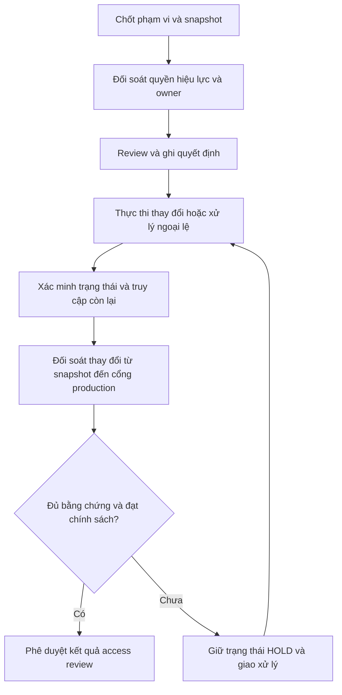

# Đã hoàn tất access review

## 1. Ý nghĩa của mục kiểm tra trước production

Trong một hệ thống quản lý truy cập đặc quyền (Privileged Access Management — PAM), access review là việc xác nhận có hệ thống rằng **đúng danh tính đang có đúng quyền, trên đúng tài nguyên, vì đúng mục đích và trong đúng thời gian**. Kết quả phải dẫn đến quyết định có người chịu trách nhiệm: giữ quyền, thu hẹp quyền, thu hồi quyền hoặc chấp nhận một ngoại lệ có thời hạn theo chính sách.

Mục checklist “Đã hoàn tất access review” chỉ được đánh dấu khi các quyết định đã có bằng chứng thực thi và xác minh tương ứng. Một danh sách tài khoản đã xuất, một email “đồng ý” hoặc một cuộc họp đã diễn ra chưa đủ để chứng minh điều đó.

Ví dụ, người vận hành được phép mở phiên SSH đến máy chủ thanh toán qua PAM. Hệ thống vẫn chưa kiểm soát đầy đủ nếu người đó còn một SSH key riêng cho phép đăng nhập trực tiếp và chạy `sudo` không giới hạn. Review chỉ nhìn nhóm người dùng của cổng PAM sẽ bỏ sót đường truy cập thực tế này.

Bài học đặt access review vào cổng quyết định đưa PAM vào production. Người học cần có khả năng:

- Xác định đủ phạm vi quyền đặc biệt của con người, tài khoản dịch vụ và nhà cung cấp.
- Đối chiếu quyền được yêu cầu với quyền hiệu lực tại PAM và hệ thống đích.
- Ghi quyết định rõ ràng, phân công xử lý và xác minh quyền sau thay đổi.
- Phân biệt một đợt review đã xử lý xong với một đợt mới hoàn tất phê duyệt trên giấy.
- Lập gói bằng chứng đủ dùng cho người phê duyệt production, kiểm toán và ứng phó sự cố.

Các mốc thời gian, tên hệ thống, số lượng và ngưỡng trong các ví dụ dưới đây là dữ liệu minh họa. Tổ chức cần đặt thời hạn, mức rủi ro và thẩm quyền chấp nhận ngoại lệ theo chính sách của mình.

## 2. Review quyền hiệu lực, không chỉ review tài khoản

### 2.1. Đơn vị review là một quan hệ truy cập

Một tài khoản có thể có nhiều quyền trên nhiều tài nguyên. Vì vậy, đơn vị quyết định nên biểu diễn được ít nhất:

```text
Danh tính → Quyền hoặc vai trò → Tài nguyên → Đường cấp quyền → Điều kiện
```

Trong đó, điều kiện có thể gồm môi trường, thời hạn, yêu cầu phê duyệt, MFA, giới hạn lệnh hoặc yêu cầu mở phiên được ghi hình qua PAM.

Ví dụ:

```text
Danh tính: operator-017
Quyền: thực thi runbook khởi động lại dịch vụ
Tài nguyên: nhóm máy chủ payment-prod
Đường cấp: nhóm vận hành → vai trò đủ điều kiện JIT → phiên PAM
Điều kiện: phê duyệt theo ticket; kích hoạt tối đa 45 phút; ghi nhận phiên
```

Quyền này khác với quyền `root` thường trực trên cùng nhóm máy chủ. Người review cần quyết định ở độ chi tiết cho phép phân biệt hai trường hợp đó.

Một phiếu ghi “giữ tài khoản operator-017” không cho biết có được giữ quyền đọc secret, thay chính sách vault, phê duyệt yêu cầu của người khác hay đăng nhập trực tiếp hay không.

### 2.2. Quyền hiệu lực có thể đến từ nhiều đường

Các nguồn thường phải đối chiếu bao gồm:

- Gán quyền trực tiếp cho người dùng hoặc tài khoản máy.
- Thành viên nhóm, kể cả nhóm lồng nhau và nhóm đồng bộ từ hệ thống danh tính.
- Vai trò, policy, cơ chế kế thừa và điều kiện tại hệ thống đích.
- Quyền truy cập secret hoặc credential trong vault.
- SSH key, certificate, token và cơ chế liên kết danh tính còn hiệu lực.
- Quyền đủ điều kiện kích hoạt JIT và quyền đang được kích hoạt.
- Quyền tại connector, runner hoặc hệ thống tự động hóa có thể dùng để thực hiện tác vụ đặc quyền.

Không thể suy luận quyền hiệu lực chỉ bằng cách cộng các tên role. Một policy có thể có điều kiện, giới hạn hoặc quy tắc từ chối làm thay đổi kết quả. Review phải dựa trên cách hệ thống đích đánh giá quyền, kết hợp dữ liệu cấu hình và kiểm tra phù hợp.

Nếu cùng một quyền đến từ hai đường khác nhau, thu hồi một đường chưa chứng minh rằng quyền đã mất. Cần lưu các đường cấp đã phát hiện và kiểm tra trạng thái hiệu lực sau cùng.

### 2.3. JIT/JEA vẫn cần access review

Just-in-Time (JIT) giới hạn thời gian kích hoạt quyền. Just Enough Administration (JEA) giới hạn tác vụ quản trị được phép. Cả hai hỗ trợ least privilege nhưng không thay thế review.

Người có quyền đủ điều kiện kích hoạt vai trò quản trị vẫn có một khả năng truy cập cần được tái xác nhận. Người quản lý định nghĩa JEA cũng có thể nới phạm vi lệnh hoặc tác vụ. Người phê duyệt yêu cầu JIT có quyền ảnh hưởng đến đường cấp quyền của người khác.

Do đó, một kết luận “không có quyền đặc quyền vì chưa ai đang kích hoạt JIT” là thiếu phạm vi. Phải review cả quyền đủ điều kiện, quyền đang hoạt động, người phê duyệt và người có thể thay đổi chính sách kiểm soát.

## 3. Phạm vi tối thiểu của đợt review

Phạm vi cần được chốt trước khi gửi yêu cầu phê duyệt. Với PAM sắp đưa vào production, nên lập ma trận danh tính, tài nguyên và lớp kiểm soát để tránh chỉ kiểm tra giao diện PAM.

| Nhóm phạm vi | Những quyền cần xem xét | Câu hỏi quyết định |
|---|---|---|
| Người quản trị và vận hành | Quyền tại đích, quyền mở phiên, đọc credential, kích hoạt JIT | Công việc hiện tại có cần quyền này và cần đến mức nào? |
| Tài khoản dịch vụ, workload, pipeline | Quyền máy, secret, token, quyền triển khai hoặc thay cấu hình | Workload nào sử dụng, ai sở hữu và quyền có bị dùng ngoài luồng dự kiến không? |
| Nhà cung cấp | Quyền hỗ trợ, tài nguyên được phép, lịch truy cập, cơ chế hết hạn | Hợp đồng và nhu cầu hỗ trợ còn hiệu lực không? |
| Tài khoản khẩn cấp | Break-glass, cơ chế mở khóa hoặc lấy credential dự phòng | Ai được dùng, điều kiện nào cho phép và ai kiểm tra sau sử dụng? |
| Quản trị nền tảng PAM | Sửa policy, tạo tài khoản quản trị, cấu hình vault, connector, audit | Có thể tự cấp quyền, bỏ kiểm soát hoặc tác động bằng chứng không? |
| Người phê duyệt và người review | Duyệt yêu cầu, duyệt ngoại lệ, xác nhận quyền của người khác | Có xung đột lợi ích hoặc khả năng tự phê duyệt không? |
| Đường ngoài PAM | Đăng nhập trực tiếp, tài khoản cục bộ, key/token cũ, kết nối quản trị khác | Có đường nào cho phép đi vòng chính sách PAM không? |

Ma trận cần gắn với danh sách tài nguyên production cụ thể: máy chủ, cơ sở dữ liệu, thiết bị mạng, môi trường cloud, nền tảng container hoặc ứng dụng nhạy cảm nằm trong phạm vi triển khai.

Không nên giới hạn review vào những tài khoản đã được onboard vào vault. Nếu mục tiêu triển khai bao gồm kiểm soát toàn bộ truy cập quản trị đến một nhóm tài nguyên, các tài khoản chưa onboard cũng là đối tượng phải kiểm kê và quyết định.

### Những trường hợp cần làm rõ

- **Tài khoản dùng chung:** phải xác định người hoặc nhóm được phép sử dụng, cơ chế quy trách nhiệm từng lần dùng và giới hạn truy cập. Có owner chưa đồng nghĩa có thể chấp nhận mô hình dùng chung.
- **Tài khoản không có owner:** chưa có người đủ trách nhiệm để tái xác nhận nhu cầu; đưa vào danh sách cần xử lý, không tự đánh dấu giữ quyền.
- **Danh tính đã nghỉ việc hoặc vendor hết hợp đồng:** đối chiếu trạng thái truy cập, credential và phiên liên quan; việc ngừng tài khoản nguồn có thể chưa xử lý hết các khả năng truy cập đã cấp.
- **Tài khoản dịch vụ ít hoạt động:** cần xét lịch batch, tác vụ theo tháng, DR hoặc phụ thuộc ứng dụng. Ít đăng nhập tương tác không chứng minh tài khoản không còn cần thiết.
- **Tài khoản có nhiều định danh:** liên kết danh tính tổ chức với tài khoản tại đích, alias và principal máy để không review trùng hoặc bỏ sót.

## 4. Ai có quyền đưa ra và xác nhận quyết định?

Một đợt review đáng tin cậy cần tách trách nhiệm về nhu cầu nghiệp vụ, mức quyền kỹ thuật, thực thi và chấp nhận rủi ro.

| Vai trò | Trách nhiệm chính | Giới hạn cần giữ |
|---|---|---|
| Chủ sở hữu ứng dụng/tài nguyên | Xác nhận nhu cầu và phạm vi truy cập đối với tài nguyên của mình | Không phê duyệt thay cho owner của tài nguyên khác |
| Quản lý nhân sự hoặc đơn vị sử dụng | Xác nhận vai trò công việc, tình trạng nhân sự hoặc nhu cầu hỗ trợ | Không mặc định có đủ hiểu biết để xác nhận mọi quyền kỹ thuật |
| Owner của tài khoản dịch vụ | Xác nhận workload, phụ thuộc và quyền tối thiểu cần dùng | Không chỉ xác nhận “ứng dụng vẫn chạy” rồi giữ mọi quyền |
| Nhóm PAM/IAM hoặc vận hành đích | Cung cấp dữ liệu và thực thi quyết định đã duyệt | Không tự chứng nhận nhu cầu của chính quyền quản trị mình đang giữ |
| Người xác minh | Đối chiếu trạng thái sau thay đổi với quyết định | Phải đáp ứng mức độc lập mà chính sách yêu cầu |
| Người có thẩm quyền chấp nhận rủi ro | Quyết định ngoại lệ trong hạn mức được giao | Không phê duyệt thay bằng ticket của nhóm kỹ thuật |
| Chủ trì cổng production | Đánh giá gói bằng chứng và kết luận trạng thái checklist | Không biến việc thiếu bằng chứng thành PASS để kịp lịch |

Không nhất thiết mỗi vai trò tương ứng một người riêng trong mọi tổ chức. Tuy nhiên, phải xử lý xung đột lợi ích và yêu cầu phân tách nhiệm vụ. Người có thể tự cấp quyền hoặc sửa log của PAM cần được review theo cơ chế kiểm soát độc lập thích hợp.

Nếu người review cũng là người hưởng quyền, chuyển quyết định sang người được ủy quyền phù hợp. Nếu người phê duyệt không phản hồi, escalates theo quy trình; không diễn giải im lặng thành đồng ý.

## 5. Chuẩn bị dữ liệu và bằng chứng đầu vào

### 5.1. Lập snapshot có thời điểm và nguồn

Mỗi đợt review nên có mã, phạm vi, thời điểm chụp dữ liệu, thời điểm quyết định và mốc hiệu lực cần kiểm tra trước production.

Ví dụ:

```text
Review ID: AR-PAM-PROD-027
Phạm vi: payment-prod và quyền quản trị PAM phục vụ payment-prod
Snapshot đầu vào: S0, thời điểm T0
Phiên bản tập dữ liệu: inventory-r17
Người chịu trách nhiệm: owner của phạm vi payment-prod
Mốc xác minh cuối: T1 trước cổng production
```

Nguồn dữ liệu có thể bao gồm inventory tài nguyên, hệ thống danh tính, entitlement tại đích, cấu hình PAM/vault, danh sách key hoặc token, thông tin nhân sự và hợp đồng, log sử dụng và ticket thay đổi.

Không cần thu thập giá trị secret để review quyền. Thông thường chỉ cần định danh credential, loại credential, owner, quyền sử dụng, thời hạn và trạng thái quản lý hoặc luân chuyển.

### 5.2. Đối soát độ bao phủ trước khi tính tỷ lệ hoàn thành

Cần trả lời được:

1. Danh sách tài nguyên trong review có khớp phạm vi production được phê duyệt không?
2. Các danh tính và quyền hiệu lực trên những tài nguyên đó đến từ nguồn nào?
3. Có nguồn nào chưa truy cập được, dữ liệu bị cắt trang, lỗi xuất hoặc dữ liệu quá cũ không?
4. Những quyền kế thừa và đường truy cập ngoài PAM đã được đối soát đến mức nào?
5. Có bản ghi thiếu owner, thiếu tài nguyên hoặc không xác định được ý nghĩa quyền không?

Tỷ lệ phê duyệt 100% trên một file xuất thiếu nửa số hệ thống đích vẫn không chứng minh review đầy đủ. Nếu chính sách cho phép lấy mẫu ở một hoạt động nào đó, báo rõ phạm vi mẫu và giới hạn kết luận; không dùng kết quả mẫu để tuyên bố đã tái xác nhận mọi quan hệ quyền.

### 5.3. Dữ liệu sử dụng hỗ trợ quyết định, không thay quyết định

Lần sử dụng gần nhất, tần suất kích hoạt JIT hoặc các lệnh đã chạy giúp phát hiện quyền thừa. Tuy nhiên:

- Có sử dụng không tự chứng minh sử dụng là hợp lệ.
- Không thấy log không tự chứng minh quyền không được dùng; có thể đang thiếu nguồn log.
- Không sử dụng trong cửa sổ quan sát chưa chắc đủ để thu hồi tài khoản phục vụ DR hoặc tác vụ ít chạy.
- Có ticket cũ chưa chứng minh người đó còn giữ cùng nhiệm vụ ở hiện tại.

Người có trách nhiệm cần kết hợp bằng chứng sử dụng với nhu cầu hiện tại và phạm vi quyền tối thiểu.

## 6. Bốn quyết định cần được ghi rõ

### 6.1. Giữ quyền — RETAIN

Giữ quyền khi owner xác nhận nhu cầu hiện tại, mức quyền phù hợp và điều kiện kiểm soát đáp ứng chính sách.

Lý do nên cụ thể, chẳng hạn: “Đội trực vận hành cần chạy runbook khôi phục dịch vụ trên payment-prod; giữ quyền JEA theo nhóm tác vụ đã duyệt và kích hoạt JIT theo ticket”. Lý do “vẫn cần” hoặc “đã có từ trước” không giúp người phê duyệt kiểm tra least privilege.

Quyền được giữ vẫn phải có ngày tái review hoặc sự kiện kích hoạt review tiếp theo. Một quyết định giữ quyền không có nghĩa là cấp vô thời hạn.

### 6.2. Thu hẹp quyền — REDUCE

Thu hẹp quyền khi nhu cầu còn tồn tại nhưng quyền hiện tại rộng hơn mức cần thiết. Một số hướng xử lý:

- Chuyển từ quyền quản trị thường trực sang đủ điều kiện JIT.
- Giới hạn tài nguyên, môi trường hoặc tập tác vụ.
- Thay quyền `root` tổng quát bằng vai trò hoặc cơ chế JEA phù hợp.
- Cho mở phiên được kiểm soát mà không cho đọc trực tiếp credential.
- Loại bỏ quyền sửa policy hoặc phê duyệt yêu cầu không thuộc nhiệm vụ.

Quyết định cần nêu cả quyền sẽ bỏ và quyền còn lại. Nếu chỉ ghi “giảm quyền”, người thực thi và người xác minh có thể hiểu khác nhau.

### 6.3. Thu hồi quyền — REVOKE

Thu hồi khi không còn nhu cầu, danh tính không còn hợp lệ hoặc quyền không được phép giữ theo chính sách.

Phải xác định đối tượng cần thu hồi: entitlement, thành viên nhóm, quyền đủ điều kiện JIT, credential, token, key hoặc đường cấp khác. Đồng thời đánh giá phiên đang chạy và khả năng truy cập còn lại sau khi đổi cấu hình.

Xóa gán role trên PAM có thể không làm mất quyền cục bộ tại máy chủ. Đổi password có thể không vô hiệu hóa một token đã phát hành. Hiệu lực thu hồi phụ thuộc cơ chế cụ thể, nên kết luận phải dựa trên trạng thái và bằng chứng thực tế của đường truy cập liên quan.

### 6.4. Ngoại lệ có thời hạn — EXCEPTION

Ngoại lệ chỉ hợp lệ nếu chính sách cho phép và người có thẩm quyền đã chấp nhận rủi ro. Hồ sơ cần có:

- Danh tính, quyền và tài nguyên cụ thể được ngoại lệ.
- Lý do chưa thể đáp ứng kiểm soát chuẩn và rủi ro còn lại.
- Owner chịu trách nhiệm cùng người phê duyệt đúng thẩm quyền.
- Biện pháp bù trừ, bằng chứng biện pháp đang hoạt động và giới hạn của nó.
- Ngày hết hạn, kế hoạch xử lý và cách theo dõi đến hạn.
- Điều kiện phải thu hồi hoặc chuyển sang xử lý sự cố sớm hơn.

Ví dụ, một tài khoản dịch vụ tạm thời còn quyền rộng do ứng dụng chưa tách vai trò. Ngoại lệ có thể yêu cầu giới hạn nguồn kết nối, quản lý credential trong vault và giám sát riêng, nhưng các biện pháp này không tự làm quyền rộng trở thành least privilege. Rủi ro còn lại phải được trình bày đúng.

“Sẽ bổ sung MFA sau”, “chờ vendor sửa” hoặc “đã mở ticket” chỉ là mô tả việc chưa xong. Chúng không tự tạo thành ngoại lệ được phê duyệt.

## 7. Quy trình hoàn tất review trước cổng production



### Bước 1 — Chốt phạm vi và tiêu chí kết thúc

Xác định tập tài nguyên, danh tính, loại quyền, nguồn dữ liệu, owner và người phê duyệt. Chốt điều kiện PASS, điều kiện cho phép ngoại lệ, mức độc lập khi xác minh và cách xử lý thay đổi phát sinh sau snapshot.

Nếu một nhóm tài nguyên không thuộc đợt triển khai, ghi rõ lý do loại trừ. Nếu một loại quyền thực sự không áp dụng, có thể ghi N/A kèm bằng chứng và người xác nhận. Không dùng N/A để che dữ liệu chưa thu thập được.

### Bước 2 — Chuẩn hóa và đối soát dữ liệu

Liên kết danh tính nguồn với tài khoản đích, xác định owner, tổng hợp các đường cấp và nhận diện quyền hiệu lực. Giải quyết các bản ghi trùng nhưng giữ đủ dấu vết truy nguyên.

Các mục chưa rõ owner, ý nghĩa role hoặc nguồn cấp cần được làm rõ trước khi kết luận. Nếu thiếu dữ liệu làm ảnh hưởng phạm vi, ghi nhận thiếu sót và đánh giá tác động đến cổng production.

### Bước 3 — Gửi review đến đúng người

Người review phải thấy được danh tính, tài nguyên, quyền hiện tại, đường cấp, điều kiện kiểm soát, bằng chứng sử dụng có liên quan và các lựa chọn quyết định.

Không gửi một danh sách tên tài khoản rồi yêu cầu “approve all”. Với quyền nhạy cảm, trình bày rõ khả năng thực tế như đọc credential, sửa chính sách, quản trị tài nguyên hoặc tác động log; tránh chỉ dùng mã role khó hiểu.

### Bước 4 — Ghi quyết định và giao việc xử lý

Mỗi quan hệ quyền trong phạm vi phải có quyết định, lý do, người quyết định và thời điểm. Quyết định REDUCE hoặc REVOKE cần có người thực thi, hạn xử lý và liên kết thay đổi.

Một review record có thể đi qua các trạng thái nội bộ minh họa:

```text
IN_REVIEW → DECIDED → IMPLEMENTED → VERIFIED → CLOSED
```

Đây là mô hình trạng thái để thiết kế quy trình, không phải tên trạng thái bắt buộc của sản phẩm PAM. Với RETAIN, bước IMPLEMENTED có thể không cần thay đổi cấu hình, nhưng vẫn cần đối chiếu quyền đang có với quyết định giữ quyền. Với ngoại lệ, cần xác minh điều kiện và biện pháp bù trừ trước khi đóng theo quy trình ngoại lệ.

### Bước 5 — Thực thi có kiểm soát và xét phụ thuộc

Đưa thay đổi vào quy trình vận hành phù hợp. Với tài khoản máy, xác định phụ thuộc trước khi thu hồi hoặc giảm quyền để tránh làm gián đoạn dịch vụ ngoài dự kiến.

Nếu cần kiểm thử trong môi trường được phép hoặc triển khai theo giai đoạn, ghi kế hoạch và tiêu chí xác minh. Nhu cầu giữ dịch vụ hoạt động có thể ảnh hưởng cách thực hiện, nhưng không tự cho phép bỏ qua quyết định review hoặc giữ quyền rộng vô thời hạn.

Nếu thay đổi gây lỗi và phải rollback, ghi nhận quyền nào đã được khôi phục và đánh giá lại trạng thái review. Không để record tiếp tục là VERIFIED khi hệ thống đã trở về cấu hình quyền cũ.

### Bước 6 — Xác minh quyền sau thực thi

Người xác minh đối chiếu trạng thái sau thay đổi với quyết định. Tùy loại quyền, bằng chứng có thể gồm:

- Trạng thái gán role, thành viên nhóm và quyền tại hệ thống đích sau thay đổi.
- Khả năng kích hoạt JIT, thời hạn kích hoạt và luồng phê duyệt.
- Trạng thái key, token, credential và phiên liên quan.
- Kiểm tra quyền hiệu lực hoặc thử tác vụ được phép trong điều kiện kiểm thử đã duyệt.
- Log chứng minh thay đổi hoặc kiểm tra đã diễn ra trên đúng đối tượng.

Với REDUCE, cần kiểm tra cả hai mặt: tác vụ cần thiết vẫn được phép và khả năng vượt phạm vi đã bị loại bỏ. Với REVOKE, xác nhận không còn các đường cấp quyền nằm trong quyết định cần xử lý.

Không chạy thử lệnh phá hủy trên production chỉ để chứng minh rằng một quyền đã bị thu hồi. Có thể dùng dữ liệu cấu hình, cơ chế đánh giá quyền, kiểm tra không gây tác động hoặc môi trường kiểm thử phù hợp. Nêu giới hạn của phương pháp nếu chưa kiểm chứng được toàn bộ hành vi.

### Bước 7 — Đối soát thay đổi từ snapshot đến thời điểm chốt

Review có thể kéo dài nhiều ngày. Quyền, nhân sự và tài nguyên có thể thay đổi sau T0. Trước khi chốt tại T1, cần thu thập hoặc đối soát phần thay đổi phát sinh và đưa các thay đổi liên quan vào quyết định cuối.

Các biện pháp tổ chức có thể gồm hạn chế thay đổi quyền trong một cửa sổ được phê duyệt hoặc bắt buộc mọi thay đổi đi qua luồng kiểm soát và review phần chênh lệch. Chọn cách phù hợp với vận hành; không mặc định hệ thống thực tế đứng yên trong suốt đợt review.

Nếu một tài khoản mới được thêm vào nhóm quản trị sau khi nhóm đã được phê duyệt, quyền của tài khoản mới phải được xử lý. Phê duyệt danh sách cũ không bao phủ tự động thành viên mới.

### Bước 8 — Chốt kết quả, bằng chứng và chu kỳ tiếp theo

Người có thẩm quyền xem xét độ bao phủ, quyết định, thực thi, xác minh, ngoại lệ và phần thay đổi đến T1. Gói kết quả phải cho phép truy từ một quyền đến quyết định và bằng chứng tương ứng.

Ghi ngày chốt, phạm vi có hiệu lực, các ngoại lệ còn được chấp nhận và ngày review tiếp theo. Lên lịch hoặc định nghĩa trigger review lại khi người dùng đổi nhiệm vụ, nghỉ việc, vendor kết thúc hợp đồng, có sự cố hoặc hệ thống thay đổi đáng kể.

## 8. Mẫu record và gói bằng chứng

### 8.1. Record cho một quyết định thu hẹp quyền

Ví dụ dưới đây chỉ minh họa dữ liệu cần lưu trong hồ sơ review; không phải cấu hình để áp dụng trực tiếp lên PAM.

```yaml
reviewId: AR-PAM-PROD-027
recordId: AR-027-042
snapshotId: inventory-r17
principalRef: operator-017
resourceRef: payment-prod
currentAccess:
  entitlementRef: unrestricted-admin
  grantPaths:
    - direct-local-group
    - pam-standing-role
decision: REDUCE
approvedAccess:
  entitlementRef: payment-approved-runbooks
  mode: JIT_JEA
  maxActivationMinutes: 45
  approvalRequired: true
  sessionRecordingRequired: true
reason: Chi can thuc hien runbook van hanh da duoc phe duyet
decisionOwnerRef: payment-resource-owner
decisionEvidenceRef: evidence/AR-027-042/approval
implementation:
  changeRef: CHG-0842
  executorRef: pam-operator-006
  state: IMPLEMENTED
verification:
  verifierRef: independent-reviewer-003
  state: VERIFIED
  evidenceRefs:
    - evidence/AR-027-042/target-entitlements-after
    - evidence/AR-027-042/pam-policy-after
    - evidence/AR-027-042/effective-access-check
nextReviewRef: review-calendar/payment-prod
```

Trong hệ thống hồ sơ thực tế, bổ sung thời điểm quyết định, thực thi, xác minh, phiên bản policy và thời hạn review bằng định dạng thời gian thống nhất. Các tham chiếu bằng chứng cần trỏ đến đối tượng được quản lý, có quyền đọc và thời hạn lưu phù hợp.

Record trên cần chứng minh đã xử lý cả `direct-local-group` và `pam-standing-role`. Nếu chỉ đổi vai trò PAM nhưng còn nhóm cục bộ không giới hạn, quyết định REDUCE chưa được xác minh hoàn tất.

### 8.2. Thành phần của gói bàn giao

Một gói kết quả có thể tổ chức theo sáu nhóm thông tin:

1. **Phạm vi và nguồn:** tài nguyên, tập quyền, nguồn dữ liệu, thời điểm snapshot, tiêu chí loại trừ và kết quả đối soát.
2. **Quyết định:** record của từng quan hệ quyền, lý do, reviewer, người phê duyệt và thời điểm.
3. **Thực thi:** thay đổi đã áp dụng, người thực hiện, ticket và trạng thái cuối, kể cả rollback nếu có.
4. **Xác minh:** trạng thái sau thay đổi, phương pháp kiểm tra, người xác minh và kết quả.
5. **Ngoại lệ:** hồ sơ chấp nhận rủi ro, biện pháp bù trừ, ngày hết hạn và owner xử lý tiếp.
6. **Kết luận:** phần thay đổi từ T0 đến T1, tổng hợp còn tồn tại, người chốt và lịch review tiếp theo.

Bảo vệ gói bằng chứng như dữ liệu nhạy cảm về cấu trúc quyền. Chỉ người được phép mới được xem hoặc sửa. Tránh đưa password, private key, token, dữ liệu phiên không cần thiết hoặc thông tin cá nhân thừa vào báo cáo tổng hợp.

Có thể dùng checksum hoặc cơ chế phiên bản để hỗ trợ nhận biết dữ liệu đã thay đổi. Tuy nhiên, checksum riêng lẻ không chứng minh ai phê duyệt hoặc dữ liệu nguồn đầy đủ; cần kết hợp với provenance, quyền truy cập và lịch sử hồ sơ phù hợp.

## 9. Tiêu chí PASS, có điều kiện và HOLD

Các tên kết luận dưới đây là cách diễn đạt cho cổng review minh họa. Quy trình chính thức của tổ chức quyết định tên và thẩm quyền, nhưng phải giữ rõ ý nghĩa.

| Kết luận | Điều kiện | Cách ghi vào checklist |
|---|---|---|
| PASS | Phạm vi đầy đủ; mọi quyền có quyết định hợp lệ; việc xử lý đã xác minh; không còn ngoại lệ mở ảnh hưởng kết luận | Ghi hoàn tất cùng mã review, phạm vi và bằng chứng chốt |
| Hoàn tất có điều kiện | Chỉ còn ngoại lệ mà chính sách cho phép; đã được đúng thẩm quyền chấp nhận; biện pháp bù trừ đã xác minh; có hạn và owner | Ghi rõ có điều kiện và tham chiếu ngoại lệ; chỉ dùng nếu cổng production cho phép |
| HOLD | Còn thiếu phạm vi, quyết định, thực thi, xác minh hoặc ngoại lệ chưa hợp lệ; có điều kiện bắt buộc chưa đạt | Giữ mục checklist chưa đạt và giao xử lý cụ thể |

Không dùng “hoàn tất có điều kiện” khi chính sách yêu cầu đóng toàn bộ ngoại lệ trước production. Cũng không dùng ngoại lệ để bỏ qua một điều cấm mà người phê duyệt không có thẩm quyền miễn trừ.

Một đợt review có thể hoàn tất thủ tục nhưng kết luận là chưa đủ điều kiện production. Báo cáo cần tách rõ hai ý: công việc review đã được thực hiện đến đâu và trạng thái quyền hiện tại có vượt qua cổng triển khai không.

### Checklist bằng chứng trước khi chốt

- [ ] Phạm vi tài nguyên, danh tính và quan hệ quyền đã được đối soát với nguồn có thẩm quyền.
- [ ] Quyền tại PAM, tại đích và các đường ngoài PAM đã được xem xét theo phạm vi triển khai.
- [ ] Mọi record có owner, reviewer phù hợp, quyết định rõ và lý do hiện hành.
- [ ] Quyền quản trị PAM, quyền phê duyệt, tài khoản máy, vendor và break-glass đã được bao phủ.
- [ ] Mọi quyết định REDUCE/REVOKE đã được thực thi và xác minh, hoặc được xử lý đúng theo cơ chế ngoại lệ mà cổng cho phép.
- [ ] Các quyền giữ lại đã được đối chiếu với mức quyền và điều kiện được duyệt.
- [ ] Phiên, token, credential và nhiều đường cấp quyền đã được xét khi đánh giá hiệu lực thu hồi.
- [ ] Ngoại lệ còn hiệu lực, đúng thẩm quyền, có hạn, owner và bằng chứng biện pháp bù trừ.
- [ ] Thay đổi quyền từ snapshot đến mốc chốt đã được đối soát và xử lý.
- [ ] Người có thẩm quyền đã chốt kết luận; bằng chứng có thể truy xuất; lịch hoặc trigger review lại đã được xác định.

## 10. Đo tiến độ đúng để tránh hoàn thành giả

Nên theo dõi riêng tỷ lệ có quyết định và tỷ lệ xử lý đã được xác minh. Hai tỷ lệ này trả lời hai câu hỏi khác nhau.

```text
Tỷ lệ có quyết định
  = số quan hệ quyền có quyết định hợp lệ
    / tổng số quan hệ quyền trong phạm vi đã đối soát

Tỷ lệ xác minh thay đổi
  = số quyết định cần thay đổi đã thực thi và xác minh
    / tổng số quyết định cần thay đổi
```

Cần quy định cách đếm trước khi báo cáo: một record đại diện quyền hiệu lực hay từng đường cấp quyền, cách xử lý trùng lặp và cách bổ sung thay đổi sau snapshot. Không đổi mẫu số giữa đợt mà không giải thích.

Nếu mẫu số bằng 0, ghi N/A hoặc diễn giải phù hợp thay vì thực hiện phép chia hoặc tự gán 100%. Ví dụ, không có quyết định cần thay đổi có thể làm chỉ số thứ hai không áp dụng, nhưng vẫn phải chứng minh phạm vi và các quyết định giữ quyền là hợp lệ.

Các chỉ số hữu ích khác gồm số record thiếu owner, số quyền chưa rõ hiệu lực, số quyết định quá hạn, số ngoại lệ sắp hết hạn và số thay đổi mới chưa review. Không gộp chúng vào một điểm trung bình khiến một quyền đặc biệt nguy hiểm bị che khuất.

Ngay cả khi các tỷ lệ đạt 100%, vẫn cần xét điều kiện bắt buộc và mức rủi ro. Một tài khoản có quyền sửa audit và tự cấp quyền có thể đủ để giữ cổng ở HOLD nếu vi phạm chính sách.

## 11. Tình huống thực hành: đã phê duyệt đủ nhưng chưa thể chốt

Đội triển khai review 240 quan hệ quyền đã đối soát trong phạm vi payment-prod. Kết quả quyết định:

| Quyết định | Số lượng | Bằng chứng cần để kết thúc |
|---|---:|---|
| RETAIN | 160 | Nhu cầu hiện tại và quyền hiệu lực khớp quyết định |
| REVOKE | 50 | Quyền và các khả năng truy cập cần thu hồi đã được xử lý, xác minh |
| REDUCE | 22 | Quyền mới đáp ứng nhu cầu và quyền vượt phạm vi đã bị loại bỏ |
| EXCEPTION | 8 | Phê duyệt đúng thẩm quyền, hạn, owner và biện pháp bù trừ được xác minh |
| Tổng | 240 | Đối soát đầy đủ record và kết luận |

Tất cả 240 record đã có quyết định. Trong số 72 quyết định cần thay đổi, 71 đã được xác minh. Một tài khoản máy đã bị bỏ role nhưng một token đã phát hành vẫn còn khả năng truy cập trong điều kiện đang áp dụng; đội chưa xác minh được thời điểm khả năng đó chấm dứt.

Khi đó:

```text
Tỷ lệ có quyết định = 240 / 240 = 100%
Tỷ lệ xác minh thay đổi = 71 / 72 ≈ 98,6%
Kết luận cổng access review = HOLD
```

Lý do HOLD là có quyết định thu hồi chưa được chứng minh hoàn tất. Không thể thay bằng dòng “đã xóa role”. Đội cần xác định cơ chế hiệu lực token của hệ thống liên quan, thực hiện cách xử lý được phép và lưu bằng chứng xác minh. Nếu lựa chọn chờ hết hạn, phải kiểm soát khả năng cấp mới và chứng minh điều kiện hết hiệu lực thực tế; trước khi đó record chưa đạt tiêu chí thu hồi.

Sau khi record này được xác minh, đội vẫn phải đối soát phần thay đổi đến T1 và kiểm tra 8 ngoại lệ. Nếu chính sách cho phép chúng và mọi điều kiện đã đạt, có thể đề nghị kết luận hoàn tất có điều kiện. Nếu cổng yêu cầu không còn ngoại lệ, kết luận vẫn là HOLD cho đến khi xử lý đủ.

Các câu hỏi để tự đánh giá tình huống:

1. Nếu chỉ đếm tài khoản thay vì quan hệ quyền, những quyết định nào có thể bị che khuất?
2. Nếu token đã hết hạn nhưng principal vẫn có đường lấy token mới, có thể đóng record REVOKE không?
3. Nếu owner tài khoản máy đã chuyển nhóm sau ngày phê duyệt, ai cần xác nhận lại trách nhiệm?
4. Nếu một ngoại lệ hết hạn trước ngày production, hồ sơ review cần thay đổi như thế nào?
5. Nếu phát hiện một key quản trị ngoài PAM sau snapshot, vì sao tỷ lệ 100% cũ không còn đủ để kết luận?

Hướng trả lời cần quay lại quyền hiệu lực và bằng chứng tại mốc chốt: bao phủ đủ đường truy cập, xác nhận đúng owner, xử lý khả năng truy cập còn lại và đánh giá lại các điều kiện đã thay đổi.

## 12. Những lỗi thường gặp khi đánh dấu checklist

| Cách làm dễ gây sai | Hệ quả | Cách xử lý phù hợp |
|---|---|---|
| Dùng email “approve all” cho một danh sách account | Không rõ quyền, tài nguyên và lý do giữ | Review theo quan hệ quyền với ngữ cảnh đủ để quyết định |
| Cho người đang hưởng quyền tự chốt quyền của mình | Thiếu kiểm soát xung đột lợi ích | Chuyển cho reviewer và người phê duyệt phù hợp |
| Chỉ kiểm tra người dùng trên PAM | Bỏ sót quyền ở đích, tài khoản máy và đường đi vòng | Đối soát nhiều nguồn theo phạm vi production |
| Đóng record ngay khi tạo ticket thu hồi | Việc cần làm bị hiểu là việc đã làm | Chỉ đóng khi đã có bằng chứng thực thi và xác minh |
| Xóa một gán role rồi kết luận mất quyền | Quyền còn từ nhóm, key, token hoặc đường khác | Xác minh quyền hiệu lực và các khả năng truy cập liên quan |
| Dùng ít sử dụng làm lý do duy nhất để thu hồi tài khoản máy | Có thể làm hỏng tác vụ batch hoặc DR | Xác minh workload, phụ thuộc và nhu cầu với owner |
| Để ngoại lệ không có ngày hết hạn | Quyền rộng trở thành trạng thái thường trực | Đặt hạn, owner, biện pháp bù trừ và cơ chế xử lý đến hạn |
| Không review thay đổi sau snapshot | Gói phê duyệt lệch trạng thái trước production | Đối soát phần chênh lệch đến mốc chốt |
| Coi đổi password là thu hồi mọi truy cập | Phiên, token hoặc key khác có thể còn hiệu lực | Kiểm tra vòng đời từng loại khả năng truy cập |
| Ghi PASS dựa trên tỷ lệ trung bình cao | Rủi ro nghiêm trọng có thể bị che | Áp tiêu chí bắt buộc và đánh giá từng tồn tại quan trọng |

## 13. Mẫu ghi kết quả để bàn giao production

Một kết luận tốt phải cụ thể đủ để người khác kiểm tra lại phạm vi và điều kiện của nó. Ví dụ:

> Access review AR-PAM-PROD-027 đã bao phủ các quan hệ quyền của payment-prod và quyền quản trị PAM liên quan theo inventory-r17, được đối soát phần thay đổi đến mốc T1. Các quyết định giữ, giảm và thu hồi quyền đã được xác minh theo hồ sơ. Còn 8 ngoại lệ có thời hạn được phê duyệt theo chính sách và biện pháp bù trừ đã được kiểm tra. Đề nghị ghi “Hoàn tất có điều kiện” cho mục access review; tham chiếu danh sách ngoại lệ, bằng chứng và lịch review tiếp theo trong gói bàn giao.

Nếu chưa đạt, viết theo dữ liệu còn thiếu, chẳng hạn: “HOLD do chưa xác minh hiệu lực thu hồi của một tài khoản máy; owner và hạn xử lý ghi trong record AR-027-118”. Tránh mô tả mơ hồ như “cơ bản hoàn tất”.

Việc ký kết quả access review chỉ chốt một mục của checklist production. Người phê duyệt triển khai vẫn cần dựa vào toàn bộ các cổng liên quan. Phần access review có giá trị khi người nhận có thể lần theo từng quyết định đến trạng thái quyền thực tế, biết ngoại lệ nào còn tồn tại và biết ai chịu trách nhiệm ở lần review tiếp theo.
