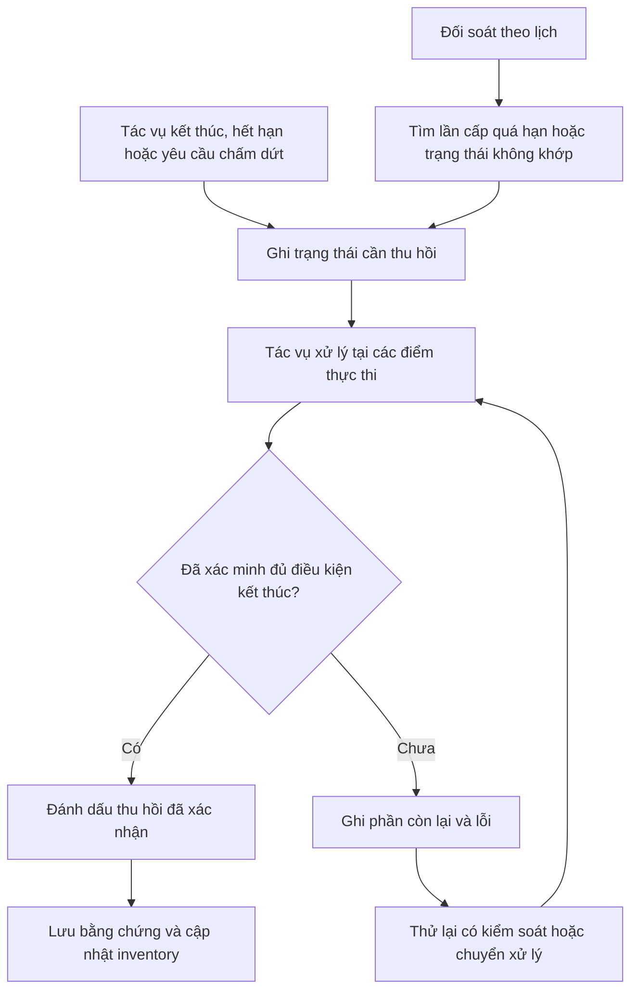

# Thu hồi quyền sau tác vụ

## 1. Thu hồi là phần bắt buộc của vòng đời JIT/JEA

Trong PAM, cấp quyền tạm thời chỉ có ý nghĩa khi quyền được kết thúc theo đúng phạm vi và điều kiện đã thiết kế. **Thu hồi quyền sau tác vụ** là quá trình làm mất hiệu lực khả năng truy cập đặc quyền đã cấp cho một nhiệm vụ, xử lý các phiên hoặc credential liên quan và xác nhận kết quả tại những điểm thực thi.

Hai nguyên tắc bổ sung cho nhau:

- **JIT — Just-in-Time:** quyền được kích hoạt khi cần và có giới hạn thời gian.
- **JEA — Just Enough Administration:** khả năng quản trị được giới hạn vào nhiệm vụ cần thiết, bằng cơ chế mà nền tảng hỗ trợ.

JIT xác định khi nào quyền nên tồn tại. JEA giới hạn việc có thể làm trong thời gian đó. Quá trình thu hồi phải bảo đảm quyền không tiếp tục được sử dụng ngoài vòng đời đã cho phép.

Một bộ đếm hết giờ trên cổng PAM chưa đủ chứng minh quyền đã hết hiệu lực. Nếu hệ thống đích vẫn chấp nhận phiên, token hoặc một vai trò được cấp trước đó, khả năng đặc quyền có thể còn tồn tại.

Cần tách ba mốc:

1. **Tác vụ kết thúc:** công việc nghiệp vụ hoặc vận hành đã hoàn thành, thất bại hay bị hủy.
2. **Thu hồi được yêu cầu:** hệ thống điều phối đã phát lệnh xử lý quyền.
3. **Thu hồi được xác nhận:** các điều kiện kết thúc truy cập đã được kiểm tra tại những lớp liên quan.

Ba mốc có thể cách nhau một khoảng thời gian. Báo cáo phải phản ánh đúng khoảng đó và phần quyền còn hiệu lực, thay vì coi chúng là cùng một sự kiện.

## 2. Thu hồi cái gì? Nhìn đủ các lớp truy cập

Một lần cấp quyền có thể tạo ra nhiều đối tượng với vòng đời khác nhau.

| Lớp | Ví dụ | Điều cần xử lý khi kết thúc |
|---|---|---|
| Điều kiện được nhận quyền | Đủ điều kiện kích hoạt một vai trò | Quyết định có giữ điều kiện cho nhiệm vụ tương lai không |
| Quyền đã kích hoạt | Vai trò hoặc thành viên nhóm được thêm tạm thời | Kết thúc đúng lần kích hoạt và kiểm tra hiệu lực tại đích |
| Credential | Mật khẩu được cấp, khóa, chứng thư hoặc token | Thu hồi, thay, giới hạn hoặc chờ hết hạn theo cơ chế phù hợp |
| Phiên | Phiên SSH, phiên quản trị web hoặc kết nối cơ sở dữ liệu | Xác định có cần và có thể kết thúc phiên đang mở không |
| Tiến trình hoặc công việc | Tiến trình con, job đang chạy, thao tác bất đồng bộ | Áp dụng chính sách kết thúc hoặc tiếp tục có kiểm soát |
| Đường cấp lại quyền | Quyền gia hạn, quan hệ tin cậy hoặc cơ chế phát hành credential | Ngăn cấp lại ngoài nhiệm vụ được cho phép |
| Đối tượng đặc quyền phát sinh | Credential hoặc quyền mới được tạo trong quá trình làm việc | Kiểm tra và xử lý theo phạm vi đã định, không bỏ sót đường truy cập mới |

Không phải nhiệm vụ nào cũng tạo ra mọi lớp. Tuy nhiên, thiết kế phải nêu rõ lớp nào tồn tại, ai kiểm soát và bằng chứng nào xác nhận kết quả.

### 2.1. Điều kiện đủ để yêu cầu khác với quyền đang hoạt động

Một kỹ sư có thể tiếp tục đủ điều kiện yêu cầu vai trò bảo trì cho các nhiệm vụ sau, trong khi lần kích hoạt hiện tại đã kết thúc. Giữ điều kiện đó không nhất thiết là lỗi thu hồi, nếu phù hợp chính sách.

Ngược lại, khi nhân viên đổi vị trí hoặc mất điều kiện sử dụng đặc quyền, có thể phải thu hồi cả khả năng yêu cầu quyền trong tương lai. Không nên dùng một thao tác gỡ vai trò tạm thời để thay thế toàn bộ quy trình thay đổi vòng đời danh tính.

### 2.2. Thu hồi theo lần cấp quyền, không tùy tiện khóa toàn bộ danh tính

Nếu Lan được cấp quyền khởi động lại một dịch vụ trong 30 phút, kết thúc nhiệm vụ thường cần xử lý lần cấp đó. Khóa toàn bộ danh tính làm việc của Lan có thể ảnh hưởng những quyền hợp lệ khác.

Một tài khoản cũng có thể đồng thời nhận quyền từ nhiều nhiệm vụ, vai trò hoặc nhóm. Cần xác định quyền nào do lần cấp hiện tại tạo ra và quyền nào tồn tại độc lập. Nếu vẫn còn một đường quyền tương đương, phải ghi nhận khả năng còn lại và cơ sở của nó, không tuyên bố chủ thể đã hết mọi đặc quyền.

## 3. Thiết kế điều kiện kết thúc ngay khi cấp quyền

### 3.1. Những sự kiện có thể khởi động thu hồi

| Sự kiện | Ý nghĩa | Điều cần chú ý |
|---|---|---|
| Tác vụ hoàn thành sớm | Không còn nhu cầu sử dụng lần cấp hiện tại | Có thể thu hồi trước hạn thay vì đợi hết cửa sổ |
| Hết thời hạn | Quyền không được tiếp tục vượt thời điểm đã cho phép | Không phụ thuộc người dùng nhớ bấm kết thúc |
| Người dùng hủy hoặc kết thúc phiên | Chủ thể không tiếp tục nhiệm vụ | Kiểm tra tác vụ nền và các phiên khác liên quan |
| Nhiệm vụ thất bại | Công việc không đạt kết quả mong muốn | Quyền không nên tồn tại vô hạn để chờ sửa lỗi |
| Chủ thể mất điều kiện | Tài khoản bị khóa, đổi vai trò hoặc thiết bị không còn đáp ứng chính sách | Xác định các lớp truy cập đã phát hành trước đó |
| Phát hiện rủi ro hoặc sự cố | Cần ngăn việc sử dụng tiếp | Có thể yêu cầu kết thúc khẩn cấp và bảo toàn bằng chứng |
| Người có trách nhiệm chấm dứt quyền | Nhu cầu hoặc quyết định cấp quyền thay đổi | Ghi nhận cơ sở quyết định và phạm vi |

Có thể có nhiều sự kiện cùng xảy ra. Quy trình phải xử lý được việc tác vụ hoàn thành đồng thời với hết hạn hoặc với một yêu cầu chấm dứt từ người vận hành.

### 3.2. Thời hạn phải được giới hạn bởi chính sách

Một yêu cầu có thể đề xuất thời lượng, nhưng thời hạn thực tế phải được hệ thống quyết định và thực thi. Việc người dùng mở phiên hoặc tạo thêm hoạt động không nên tự động kéo dài quyền nếu chính sách không cho phép.

Gia hạn cần được đánh giá như một quyết định có điều kiện: nhiệm vụ còn cần không, phạm vi có đổi không và thời điểm kết thúc mới là gì. Giữ cùng một mã phiên không có nghĩa có thể bỏ qua việc đánh giá lại.

Nếu yêu cầu đã hết hạn trước khi kích hoạt thành công, tác vụ xử lý đến muộn không được làm quyền sống lại. Cơ chế cấp và thu hồi phải cùng kiểm tra vòng đời của lần cấp.

### 3.3. Ví dụ một bản mô tả vòng đời

Dữ liệu sau là minh họa thiết kế, không phải cấu hình tự thực thi của sản phẩm:

```json
{
  "grant_id": "G-271",
  "subject_reference": "person-1842",
  "resource_reference": "orders-prod-connection-service",
  "allowed_actions": [
    "read_service_health",
    "restart_service"
  ],
  "valid_from": "2026-11-26T09:00:00Z",
  "valid_until": "2026-11-26T09:30:00Z",
  "revoke_on": [
    "task_completed",
    "task_cancelled",
    "expiry",
    "risk_termination"
  ],
  "renewal_requires_new_decision": true,
  "revocation_requirements": [
    "prevent_new_use_of_this_grant",
    "remove_temporary_entitlement",
    "handle_linked_sessions",
    "handle_issued_credentials",
    "verify_target_state"
  ],
  "policy_reference": "POL-MAINT-04"
}
```

Mỗi yêu cầu thu hồi trong ví dụ còn phải được ánh xạ sang khả năng thực tế của nền tảng. Một trường ghi “handle linked sessions” chỉ là yêu cầu; nó không bảo đảm mọi phiên tự kết thúc nếu chưa có cơ chế thực thi.

## 4. Trạng thái điều phối khác với trạng thái quyền tại đích

Một quy trình rõ ràng có thể dùng các trạng thái sau:

| Trạng thái logic | Ý nghĩa | Có thể coi quyền đã kết thúc đầy đủ chưa? |
|---|---|---|
| Đang hoạt động | Lần cấp được phép sử dụng trong phạm vi đã định | Chưa |
| Đã yêu cầu thu hồi | Đã ghi nhận sự kiện kết thúc và yêu cầu xử lý | Chưa |
| Đang thu hồi | Các bước tại hệ thống đích đang thực hiện | Chưa |
| Thu hồi một phần | Một số lớp đã kết thúc, phần khác còn hiệu lực hoặc chưa xác minh | Chưa |
| Lỗi cần xử lý | Có bước không hoàn tất, cần thử lại hoặc chuyển người phụ trách | Chưa |
| Đã xác nhận thu hồi | Các điều kiện kết thúc đã công bố được kiểm tra đạt | Có, trong đúng phạm vi được xác nhận |

**Hết hạn** là một sự kiện thời gian, không tự thay thế trạng thái đã xác nhận thu hồi. Một nền tảng có thể từ chối quyền trực tiếp theo thời hạn; nền tảng khác cần một thao tác cập nhật hoặc xử lý phiên bổ sung.

Nếu chỉ có thể xác nhận quyền tạm thời đã bị gỡ nhưng token còn hiệu lực, cần ghi “thu hồi một phần” và mô tả phần còn lại. Không đổi tên trạng thái để che đi giới hạn kỹ thuật.

Một ngoại lệ được chấp nhận cũng phải được biểu diễn riêng với kết quả thu hồi đầy đủ: lý do, phạm vi còn hiệu lực, thời hạn và người nhận trách nhiệm cần được truy xuất.

## 5. Trình tự xử lý sau khi tác vụ kết thúc

### Bước 1: Xác nhận sự kiện và đúng lần cấp quyền

Kiểm tra nguồn gửi sự kiện, mã nhiệm vụ và mã lần cấp. Một thông báo do client tự gửi không nên có khả năng thu hồi nhầm quyền của người khác hoặc kết thúc nhiệm vụ không liên quan.

Ghi nhận lý do và thời điểm sự kiện. Với sự kiện đến muộn hoặc lặp lại, đối chiếu phiên bản và trạng thái hiện tại để quyết định bước tiếp theo.

### Bước 2: Ngăn việc sử dụng mới từ lần cấp đang kết thúc

Tùy nền tảng, có thể đánh dấu lần cấp không còn được dùng để phát hành phiên hoặc credential mới, chặn gia hạn và gỡ điều kiện kích hoạt của chính nhiệm vụ đó.

Điểm này giúp tránh tình huống vừa đóng một phiên thì chủ thể dùng cùng lần cấp để mở phiên khác. Tuy nhiên, nếu chủ thể có một quyền hợp lệ độc lập, phải phân biệt đường đó trong đánh giá và báo cáo.

### Bước 3: Gỡ hoặc hết hiệu lực quyền tạm thời tại đích

Thực hiện thay đổi tương ứng với cách quyền được cấp: kết thúc vai trò tạm thời, gỡ quan hệ nhóm do nhiệm vụ tạo ra, vô hiệu hóa tài khoản dùng riêng cho nhiệm vụ hoặc đóng đường truy cập đã thiết lập.

Không dùng một thay đổi rộng hơn phạm vi cần thiết nếu chưa có cơ sở. Đặc biệt, không xóa quyền có sẵn của một tác vụ khác chỉ vì hai tác vụ dùng chung vai trò.

### Bước 4: Xử lý phiên, credential và tiến trình liên quan

Xác định các đối tượng đã phát hành hoặc tạo trong phạm vi lần cấp. Áp dụng chính sách kết thúc đã định cho từng loại và ghi lại kết quả.

Thứ tự cụ thể phụ thuộc cơ chế nền tảng và tác động. Trong tình huống sự cố, có thể ưu tiên chặn truy cập ngay; trong bảo trì bình thường, có thể cần đưa một thao tác đang xử lý về điểm kết thúc an toàn. Các lựa chọn đó cần được thiết kế trước thay vì kéo dài quyền không giới hạn khi gặp khó.

### Bước 5: Xác minh tại điểm thực thi

Đọc trạng thái từ hệ thống đích và, khi phù hợp, thực hiện phép kiểm tra truy cập có kiểm soát bằng đúng ngữ cảnh cần xác minh. Kiểm tra phải nằm trong phạm vi được phép và không gây thay đổi nghiệp vụ ngoài ý muốn.

Một kết quả từ chối cần được diễn giải đúng: nó có thể do quyền đã mất, do mạng lỗi hoặc do tài nguyên không hoạt động. Cần bằng chứng đủ để phân biệt, không coi mọi lỗi kết nối là thu hồi thành công.

### Bước 6: Ghi bằng chứng và xử lý phần chưa hoàn tất

Nối yêu cầu, quyết định cấp quyền, sự kiện kết thúc, từng bước thu hồi và kết quả xác minh. Nếu một bước lỗi hoặc chưa biết, tạo việc xử lý có người chịu trách nhiệm.

Không coi việc gửi yêu cầu thu hồi thành công là kết quả cuối của toàn bộ quy trình.

## 6. Những lớp thường tiếp tục hiệu lực sau khi gỡ vai trò

### 6.1. Phiên tương tác và kết nối tồn tại lâu

Một phiên SSH, shell quản trị hoặc kết nối cơ sở dữ liệu có thể đã được thiết lập khi quyền còn hiệu lực. Gỡ vai trò tại nguồn không luôn làm phiên đó bị đóng hoặc thay đổi ngay ngữ cảnh quyền của tiến trình.

Cần biết nền tảng có kiểm tra quyền ở mỗi hành động hay chỉ tại một số thời điểm. Nếu muốn kết thúc phiên, xác định cơ chế, phạm vi và tác động tới các tiến trình con hoặc công việc đang chạy.

Giao diện đóng cửa sổ không tự chứng minh phiên tại máy chủ đã kết thúc. Đường truy cập và bằng chứng tại đích mới cho biết điều gì thực sự còn tồn tại.

### 6.2. Token và cache quyết định quyền

Token có thời hạn có thể được hệ thống đích chấp nhận cho tới khi hết hạn, trừ khi có cơ chế thu hồi hoặc kiểm tra bổ sung được thực thi. Một số hệ thống còn lưu cache kết quả cấp quyền hoặc thông tin thành viên nhóm.

Đánh giá cần nêu rõ thời hạn token, khả năng thu hồi sớm, độ trễ cập nhật và nơi áp dụng chính sách. Không mặc định việc xóa một vai trò khiến mọi token đã phát hành lập tức vô dụng.

Nếu không thể thu hồi token ngay, có thể cần quyền hẹp hơn, thời hạn ngắn hơn hoặc một điểm thực thi bổ sung được thiết kế phù hợp. Điểm trung gian chỉ giúp khi đường truy cập thực sự phải đi qua nó và không có đường tương đương bỏ qua kiểm soát trong phạm vi cần bảo vệ.

### 6.3. Credential tĩnh đã được cấp ra ngoài

Nếu người dùng từng nhận mật khẩu hoặc khóa, kết thúc phiên không làm họ quên giá trị đó. Có thể cần thay mật khẩu, gỡ khóa khỏi nơi tin cậy hoặc xử lý theo cơ chế của hệ thống đích.

Luân chuyển phải xét những bên sử dụng hợp lệ khác. Với tài khoản dùng chung hoặc dịch vụ, thay credential mà không xử lý phụ thuộc có thể làm tác vụ khác thất bại.

Xóa bản ghi trong vault không tự thu hồi credential tại đích. Vault và hệ thống xác thực phải được đối soát theo quy trình phù hợp.

### 6.4. Tiến trình nền và thao tác bất đồng bộ

Một lệnh đã khởi chạy có thể tạo công việc tiếp tục chạy sau khi người dùng rời phiên. Cần phân biệt công việc nghiệp vụ được phép hoàn tất với tiến trình đặc quyền tồn tại ngoài vòng đời dự kiến.

Nếu cho phép một job tiếp tục, nên có mô hình thực thi riêng: danh tính dịch vụ có phạm vi, thời hạn, chủ sở hữu và bằng chứng. Không dùng việc “job đang chạy” làm lý do giữ vô hạn shell quản trị hoặc credential của người khởi tạo.

Thu hồi quyền không tự hoàn tác những thay đổi đã commit. Khôi phục dữ liệu, hoàn nguyên cấu hình hay xử lý tác dụng phụ là các việc riêng, cần dựa trên nhiệm vụ và quy trình thay đổi.

## 7. Làm cho quá trình thu hồi chịu được lỗi

### 7.1. Không chỉ dùng bộ đếm trong một tiến trình

Nếu việc thu hồi chỉ dựa vào một bộ đếm trong bộ nhớ của dịch vụ điều phối, khởi động lại dịch vụ có thể làm mất lịch xử lý. Trạng thái lần cấp và thời hạn cần được lưu bền vững, có cơ chế tìm lại các lần cấp đã đến hạn.

Khi nền tảng hỗ trợ, nên có giới hạn hiệu lực được thực thi tại đích hoặc trong credential, thay vì hoàn toàn trông chờ một tác vụ dọn dẹp bên ngoài. Tuy nhiên, vẫn phải đánh giá phiên và tác vụ đã khởi chạy; một thời hạn tại một lớp không tự giới hạn mọi lớp khác.

Có thể kết hợp hai đường:

- Sự kiện tác vụ hoàn thành hoặc bị hủy để thu hồi sớm.
- Cơ chế kiểm tra thời hạn và đối soát để xử lý khi sự kiện bị mất hoặc tác vụ điều phối gặp lỗi.

### 7.2. Thử lại phải an toàn khi lặp

Một sự kiện kết thúc có thể được gửi nhiều lần. Một tác vụ thu hồi có thể đã hoàn thành ở đích nhưng phản hồi bị mất. Cơ chế xử lý cần chịu được việc thực hiện lại mà không gây tác động ngoài dự kiến.

Đó là yêu cầu về **idempotency**: lặp lại cùng một yêu cầu logic vẫn hướng tới cùng trạng thái mong muốn, không nhân thêm tác dụng phụ.

Ví dụ, nếu quan hệ quyền của lần cấp đã được gỡ thì bước lặp lại có thể ghi nhận đã đạt trạng thái mong muốn. Nhưng nếu không tìm thấy đối tượng vì đích không truy cập được, không được suy luận như vậy.

Luân chuyển credential nhiều lần liên tiếp cũng không mặc nhiên an toàn như một thao tác idempotent. Cần theo dõi phiên bản và trạng thái từng bước để tránh các bên sử dụng bị lệch bí mật.

### 7.3. Đối soát trạng thái mong muốn với trạng thái quan sát



Đối soát cần kiểm tra cả lần cấp được ghi là còn hoạt động quá hạn và trường hợp hệ thống điều phối đã đóng nhưng đích vẫn còn quyền. Chỉ quét các tác vụ lỗi trong hàng đợi có thể bỏ sót sai lệch không phát sinh lỗi rõ ràng.

### 7.4. Không thử lại vô hạn mà không có người biết

Cần chính sách về khoảng chờ, số lần thử phù hợp, thời điểm chuyển người phụ trách và hành động khi rủi ro vượt ngưỡng. Các mốc phụ thuộc mức quan trọng của tài nguyên và khả năng nền tảng.

Nếu hệ thống đích mất kết nối, có thể biết lần cấp không còn được phép ở lớp điều phối nhưng chưa biết trạng thái quyền tại đích. Ghi rõ phần đã chặn và phần chưa xác minh; không đổi thành thành công chỉ để đóng hàng đợi.

Những giới hạn hiệu lực được thiết kế trước có thể giảm thời gian quyền còn tồn tại khi mất kết nối. Khả năng đó phải được xác minh trong đúng ngữ cảnh, bao gồm token, phiên và sai lệch thời gian mà nền tảng chấp nhận.

## 8. Nhiều tác vụ đồng thời và tranh chấp trạng thái

### 8.1. Một chủ thể có thể có nhiều lần cấp hợp lệ

Lan có hai nhiệm vụ: kiểm tra dịch vụ A và bảo trì dịch vụ B. Nếu cả hai được ánh xạ vào một nhóm quản trị dùng chung, gỡ nhóm sau khi nhiệm vụ A kết thúc có thể làm gián đoạn B.

Thiết kế nên giảm việc dùng một quyền rộng cho các nhiệm vụ khác nhau. Khi phải chia sẻ một đối tượng quyền, cần quản lý quan hệ giữa lần cấp, quyền có sẵn và những nhiệm vụ còn hiệu lực.

Đếm số lần cấp tại hệ thống điều phối có thể hỗ trợ, nhưng không đủ nếu hệ thống đích còn thay đổi ngoài luồng. Cần đối soát với nguồn quyền thực tế và xác định ai được phép sửa.

Kết quả thu hồi của A có thể là: đường cấp từ A đã kết thúc; Lan vẫn có quyền từ B trong phạm vi được phép. Không nên báo Lan đã hết mọi quyền quản trị nếu điều đó không đúng.

### 8.2. Gia hạn và thu hồi có thể xảy ra cùng lúc

Một yêu cầu gia hạn có thể đến khi tác vụ hết hạn đang được xử lý. Cần cơ chế kiểm soát phiên bản hoặc thứ tự chuyển trạng thái để tránh:

- Tác vụ cấp quyền đến muộn làm sống lại lần cấp đã bị chấm dứt.
- Tác vụ thu hồi cũ gỡ nhầm quyền thuộc một lần cấp mới đã được duyệt.
- Một sự kiện lặp làm thay đổi thời hạn mà không có quyết định mới.
- Một kết quả xác minh cũ được dùng cho trạng thái mới.

Mã lần cấp, phiên bản, mã thao tác và thời điểm hiệu lực giúp phân biệt các trường hợp này. Cách thực hiện cụ thể phụ thuộc nền tảng, nhưng quy tắc cần rõ: mọi thay đổi phải khớp đúng đối tượng và vòng đời hiện tại.

### 8.3. Quyền có trước nhiệm vụ

Nếu người dùng vốn đã có quyền thường trực tương đương, việc gỡ quyền JIT không làm mất quyền nền. Đây là một vấn đề thiết kế và kiểm kê, không phải lỗi có thể giải quyết bằng cách chỉ đóng lần cấp.

Trước khi tuyên bố mô hình đã giảm quyền thường trực, cần xem mọi đường cấp quyền tương đương: nhóm, vai trò, tài khoản cục bộ, credential dùng chung và quan hệ ủy quyền. Phạm vi thu hồi phải được giải thích bằng bức tranh này.

## 9. Ví dụ: tác vụ hoàn tất nhưng token chưa hết hiệu lực

### 9.1. Bối cảnh

Lan nhận lần cấp `G-271` để xem tình trạng và khởi động lại một dịch vụ sản xuất. Cửa sổ được duyệt là 09:00–09:30 UTC; tác vụ hoàn thành lúc 09:12.

Trong ví dụ giả định này, hệ thống có một token đã phát hành, hết hạn lúc 09:20. Đích có thể tiếp tục chấp nhận token đó theo phạm vi đã cấp và không có cơ chế thu hồi sớm được áp dụng cho đường này. Đây là đặc điểm của ví dụ, không phải mô tả chung cho mọi token.

### 9.2. Diễn biến và kết luận đúng

| Thời điểm UTC | Sự kiện | Điều có thể kết luận |
|---|---|---|
| 09:00:00 | Quyền được kích hoạt | Lần cấp bắt đầu có hiệu lực theo chính sách |
| 09:12:00 | Tác vụ được xác nhận hoàn thành | Có căn cứ bắt đầu kết thúc quyền sớm |
| 09:12:02 | Lần cấp không còn được dùng để mở truy cập mới | Đã chặn đường phát hành mới từ lần cấp này theo kiểm soát tương ứng |
| 09:12:04 | Quyền tạm thời được gỡ tại đích | Quan hệ quyền đó đã được xử lý; chưa kết luận mọi token hết hiệu lực |
| 09:12:06 | Phiên tương tác liên quan được xác nhận kết thúc | Đã xử lý phiên được định danh |
| 09:12:08 | Xác minh cho thấy token cũ vẫn còn hiệu lực theo cơ chế của đích | Thu hồi còn một phần chưa hoàn tất |
| 09:20:05 | Kiểm tra có kiểm soát xác nhận đích từ chối token đã hết hạn và các điều kiện khác đều đạt | Có thể kết thúc hồ sơ theo phạm vi đã xác nhận |

Tại 09:12:08, báo cáo “đã thu hồi hoàn toàn” sẽ không đúng. Bản ghi cần chỉ ra phần còn hiệu lực, phạm vi tác động và mốc dự kiến xử lý tiếp.

Việc kiểm tra sau 09:20 phải xét cấu hình thời gian và nguồn bằng chứng thực tế. Chỉ nhìn thời hạn ghi trong token mà không biết đích có thực thi đúng không chưa đủ cho mọi mức yêu cầu xác minh.

### 9.3. Cải thiện từ khoảng trống đã phát hiện

Nếu yêu cầu kiểm soát đòi chặn ngay sau khi hoàn thành, kiến trúc hiện tại chưa đáp ứng cho đường token này. Có thể đánh giá token ngắn hạn hơn, cơ chế kiểm tra thu hồi ở đích hoặc đường truy cập có điểm kiểm soát phù hợp.

Mỗi phương án có chi phí và giới hạn. Token ngắn hạn giảm cửa sổ còn hiệu lực nhưng không làm cửa sổ bằng không. Điểm trung gian không bảo vệ đường truy cập trực tiếp nằm ngoài nó. Cơ chế thu hồi cũng cần được kiểm tra khi mất kết nối hoặc cache chưa cập nhật.

Khoảng thời gian được chấp nhận phải là quyết định chính sách có căn cứ, không phải một giới hạn bị phát hiện rồi tự coi là phù hợp.

## 10. Thu hồi cho tài khoản dịch vụ và workload

### 10.1. Ràng buộc quyền với từng lần chạy

Với pipeline hoặc job tự động, nên liên kết lần cấp với danh tính workload, mã lần chạy, tài nguyên và thời hạn. Khi lần chạy hoàn tất hoặc thất bại, sự kiện đó có thể khởi động thu hồi.

Không áp nguyên xi cách đóng phiên người dùng cho mọi workload. Một job có thể có nhiều giai đoạn, tác vụ con hoặc một phần công việc được hệ thống khác tiếp nhận.

Cần xác định lúc nào công việc cần đặc quyền thực sự kết thúc, thành phần nào phát sự kiện và nguồn nào xác nhận. Một tiến trình worker ngừng gửi tín hiệu không luôn chứng minh tác vụ tại đích đã dừng.

### 10.2. Gia hạn credential không được kéo dài quyền ngoài nhiệm vụ

Một workload có thể được cấp credential ngắn hạn và có khả năng yêu cầu credential mới. Nếu không kết thúc quan hệ cấp lại, credential ngắn hạn có thể được nối tiếp liên tục.

Do đó, quy trình cần xử lý cả lần cấp hiện tại và điều kiện phát hành mới trong phạm vi nhiệm vụ. Các quan hệ tin cậy dùng chung cho nhiều tác vụ phải được thay đổi thận trọng để không chặn những lần chạy hợp lệ khác.

### 10.3. Thất bại và hủy không được bỏ qua dọn dẹp

Nếu quyền chỉ được thu hồi khi job báo thành công, các lần thất bại, bị hủy hoặc máy chạy bị mất sẽ để lại đặc quyền. Cần một đường thu hồi độc lập dựa trên thời hạn và đối soát, bên cạnh bước kết thúc của ứng dụng.

Ứng dụng có thể hỗ trợ báo hoàn tất sớm, nhưng không nên là cơ chế duy nhất bảo đảm quyền có giới hạn thời gian.

## 11. JEA giảm những gì phải thu hồi, nhưng không thay thế thu hồi

Một nhiệm vụ chỉ được phép đọc tình trạng và khởi động lại một dịch vụ tạo ra ít khả năng phát sinh đặc quyền mới hơn một shell quản trị toàn diện. Vì vậy, JEA có thể làm phạm vi kết thúc quyền dễ xác định hơn.

Tuy nhiên, phải kiểm tra chính công cụ được cho phép: tham số, chương trình con, tập tin mà nó đọc hoặc thực thi và khả năng thay đổi thành phần liên quan. Chỉ giới hạn tên lệnh chưa chắc giới hạn đúng khả năng quản trị.

Nếu nhiệm vụ có thể tạo tài khoản, khóa hoặc quyền mới, cần xác định chúng là đầu ra nghiệp vụ được duyệt hay đối tượng tạm phải xử lý. Theo dõi theo mã nhiệm vụ và phạm vi cụ thể giúp tránh hai lỗi:

- Bỏ sót một đường truy cập đặc quyền mới được tạo trong thời gian cấp quyền.
- Xóa nhầm tài nguyên hoặc quyền hợp lệ chỉ vì chúng được tạo trong cùng cửa sổ thời gian.

Thu hồi không phải thao tác xóa toàn bộ thay đổi của nhiệm vụ. Bản cấu hình mới, dữ liệu đã xử lý hoặc tài nguyên được phê duyệt có thể cần tiếp tục tồn tại. Quyết định hoàn nguyên phải được quản lý riêng.

## 12. Bằng chứng để chứng minh quyền đã kết thúc

### 12.1. Những thông tin cần nối được

| Nhóm | Bằng chứng hữu ích |
|---|---|
| Danh tính và nhiệm vụ | Chủ thể, nguồn danh tính, mã yêu cầu và lý do |
| Quyết định cấp | Mã lần cấp, phạm vi, thời hạn và phiên bản chính sách |
| Quyền thực tế | Vai trò, principal, credential hoặc đường truy cập đã được kích hoạt |
| Sự kiện kết thúc | Loại sự kiện, nguồn, thời điểm và mã tác vụ |
| Các bước thu hồi | Đích, đối tượng, mã thao tác, lần thử, kết quả và lỗi |
| Xác minh | Trạng thái tại đích, nguồn quan sát, thời điểm và phạm vi kiểm tra |
| Phần còn lại | Quyền hoặc phiên còn hiệu lực, ngoại lệ và người xử lý |

Mã lần cấp nên xuất hiện hoặc được liên kết đáng tin cậy trong các bản ghi liên quan. Khi một đích không biết mã đó, cần lưu ánh xạ giữa mã lần cấp và các đối tượng tại đích.

Không cần ghi giá trị token, mật khẩu hay khóa riêng để chứng minh chúng đã được xử lý. Có thể dùng định danh credential hoặc tham chiếu quản lý không có khả năng xác thực.

### 12.2. Thời gian và độ trễ

Phân biệt thời điểm sự kiện xảy ra, thời điểm hệ thống tiếp nhận và thời điểm xác minh thành công. Đồng bộ thời gian và ghi múi giờ giúp đối chiếu; khi nguồn có sai lệch cần nêu rõ giới hạn.

Ví dụ, độ trễ thu hồi nên đo từ sự kiện kết thúc có căn cứ tới lúc điều kiện kết thúc được xác nhận. Nếu chỉ đo thời gian xử lý của một tác vụ gỡ vai trò, số liệu có thể bỏ qua khoảng quyền còn hiệu lực trước hoặc sau tác vụ đó.

### 12.3. Bảo vệ kho bằng chứng

Người có quyền trên tài nguyên không nên mặc nhiên có khả năng sửa mọi bằng chứng về hoạt động của mình. Có thể cần lưu trữ và quản trị bằng miền quyền tách biệt, bảo vệ việc truyền dữ liệu và theo dõi truy cập kho bằng chứng.

Log cục bộ, ghi hình phiên và kết quả từ cổng PAM có vai trò khác nhau. Cần kết hợp nguồn phù hợp và giữ rõ nguồn gốc; không giả định một nguồn đã bao phủ mọi đường truy cập.

## 13. Ngoại lệ, sự cố và khôi phục

### 13.1. Khi thu hồi thông thường không hoàn tất

Ngoại lệ cần mô tả điều kiện còn tồn tại, tài nguyên chịu ảnh hưởng, thời hạn dự kiến, biện pháp bổ sung và người chịu trách nhiệm. Trạng thái phải tiếp tục phản ánh sự thật kỹ thuật.

Nếu phải giữ một tác vụ đang chạy để tránh hỏng dữ liệu, ghi rõ tác vụ nào được tiếp tục và quyền nào vẫn bị chặn. Không giữ toàn bộ quyền quản trị chỉ vì một phần công việc chưa kết thúc.

### 13.2. Khi có dấu hiệu bị lạm dụng

Có thể cần ưu tiên ngăn truy cập, kết thúc phiên, xử lý credential và kiểm tra các quyền phát sinh. Đồng thời giữ bằng chứng theo quy trình ứng phó.

Thu hồi lần cấp ban đầu không tự chứng minh môi trường đã an toàn. Nếu chủ thể đã tạo thêm tài khoản, đánh cắp bí mật hoặc thay cấu hình, cần điều tra và xử lý các tác động đó.

### 13.3. Đường khẩn cấp

Quy trình break-glass cần có vòng đời cấp và thu hồi riêng, đặc biệt khi IdP hoặc cổng PAM không khả dụng. Phải xác định ai giữ trách nhiệm, cách ghi nhận sử dụng và cách xử lý credential sau khôi phục.

Không nên để đường khẩn cấp trở thành quyền thường trực ngoài kiểm kê. Cũng cần bảo đảm việc thu hồi không vô tình loại bỏ mọi khả năng khôi phục hợp lệ của hệ thống.

## 14. Đánh giá thiết kế trước khi mở rộng

Các tình huống đáng kiểm tra trong một chương trình triển khai gồm tác vụ hoàn tất sớm, hết hạn khi phiên còn mở, token không thu hồi được ngay, đích mất kết nối, bộ điều phối khởi động lại, sự kiện lặp, yêu cầu đến muộn và nhiều nhiệm vụ dùng chung đối tượng quyền.

Với mỗi tình huống, cần biết kết quả mong đợi, nguồn xác minh và ai xử lý khi khác kỳ vọng. Kiểm tra không chỉ xem giao diện có đổi trạng thái mà phải xem khả năng truy cập thực tế.

Những chỉ số hữu ích gồm:

- Tỷ lệ lần cấp có điều kiện kết thúc và phạm vi thu hồi rõ ràng.
- Tỷ lệ lần cấp quá hạn còn quyền tại đích hoặc chưa được xác minh.
- Thời gian từ sự kiện kết thúc tới kết quả xác nhận, kèm các trường hợp kéo dài.
- Số bước thu hồi lỗi, số ngoại lệ quá hạn và thời gian xử lý.
- Mức bao phủ của phiên, credential và đường truy cập trong quy trình.
- Tác động vận hành do thu hồi sai phạm vi hoặc sai thời điểm.

Mẫu số cần rõ: thu hồi đầy đủ cho những đích nào, loại credential nào và trong khoảng thời gian nào. “100% yêu cầu đã gửi thành công” không phải “100% quyền đã hết hiệu lực”.

## 15. Những nhầm lẫn thường gặp

| Nhầm lẫn | Cách hiểu đúng |
|---|---|
| Hết thời gian trên cổng là mọi quyền đã hết | Cần biết điểm thực thi và vòng đời từng lớp |
| Gỡ nhóm là đóng mọi phiên | Phiên và tiến trình có thể giữ ngữ cảnh đã thiết lập |
| Token ngắn hạn luôn thu hồi ngay được | Thời hạn và khả năng thu hồi sớm là hai thuộc tính khác nhau |
| Đóng cửa sổ terminal là phiên đã kết thúc | Cần xác nhận tại hệ thống và đường truy cập liên quan |
| Thu hồi là khóa toàn bộ tài khoản | Thường cần xử lý đúng lần cấp và quyền của nhiệm vụ |
| Mọi tác vụ dùng chung vai trò có thể gỡ cùng lúc | Cần phân biệt các lần cấp hợp lệ và quyền có sẵn |
| Retry chỉ cần gửi lại mọi bước | Một số bước có tác dụng phụ; cần quản lý trạng thái và phiên bản |
| Job thất bại thì quyền sẽ tự biến mất | Cần đường xử lý độc lập cho thất bại, mất sự kiện và hết hạn |
| Thu hồi quyền là hoàn nguyên mọi thay đổi | Quyền và kết quả nghiệp vụ có vòng đời khác nhau |
| Có log gửi lệnh là đã chứng minh thu hồi | Cần kết quả và phạm vi xác minh tại điểm thực thi |

## 16. Ghi nhớ cốt lõi

Thu hồi quyền sau tác vụ là một quá trình có trạng thái, gồm **ngăn dùng mới, kết thúc quyền tại đích, xử lý phiên và credential, kiểm tra kết quả và lưu bằng chứng**. Điều kiện kết thúc phải được thiết kế ngay từ lúc cấp quyền.

JIT/JEA đạt hiệu quả khi phạm vi và thời gian được thực thi trên đường truy cập thực tế, kể cả lúc lỗi, có nhiều nhiệm vụ hoặc tác vụ kết thúc bất thường. Khi chưa thể kết thúc một lớp truy cập, phải biểu diễn đúng phần còn lại và trách nhiệm xử lý, thay vì coi lệnh thu hồi đã gửi là công việc đã hoàn tất.
