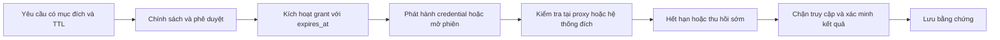

# TTL của quyền đặc biệt

## 1. TTL trả lời câu hỏi nào trong PAM?

Trong quản lý quyền truy cập đặc biệt (Privileged Access Management — PAM), TTL (*time to live*) là thời lượng hiệu lực của một đối tượng cấp quyền hoặc phương tiện truy cập. Khi nói “quyền quản trị có TTL 20 phút”, phải xác định rõ đối tượng nào hết hạn, thời điểm bắt đầu tính và thành phần nào thực thi việc hết hạn.

TTL giúp biến quyền quản trị thường trực thành quyền chỉ tồn tại trong một khoảng thời gian có chủ đích. Tuy nhiên, một con số trên cổng yêu cầu truy cập chưa bảo đảm hệ thống đích thực sự ngừng cho phép thao tác khi thời gian kết thúc.

Ba câu hỏi cần trả lời cùng lúc:

1. **Ai được làm gì trên đâu?** Xác định người hoặc workload, hành động và tài nguyên được phép.
2. **Được phép từ lúc nào đến lúc nào?** Xác định mốc bắt đầu, hạn cuối và điều kiện kết thúc sớm.
3. **Cơ chế nào ngăn tiếp tục truy cập?** Xác định nơi kiểm tra quyền, xử lý credential, phiên và quyền phát sinh.

Trong chương JIT và JEA, TTL là chiều thời gian của **JIT — Just-in-Time**, còn **JEA — Just-Enough Access** giới hạn tập thao tác và tài nguyên. Quyền toàn năng trong 5 phút vẫn có thể gây thiệt hại lớn; quyền rất hẹp nhưng không có thời hạn vẫn tạo ra quyền tồn đọng. Thiết kế PAM cần cả hai chiều này.

Bài học áp dụng cho tài khoản quản trị con người, tài khoản dịch vụ và truy cập hạ tầng nhạy cảm. Các giá trị thời gian trong ví dụ là giả định để thiết kế, không phải thời hạn chuẩn bắt buộc cho mọi tổ chức.

## 2. Đừng gộp mọi thời hạn thành một TTL

Một yêu cầu JIT thường tạo ra nhiều đối tượng có vòng đời khác nhau:

| Đối tượng hoặc thời hạn | Ý nghĩa | Điều không được mặc nhiên suy ra |
|---|---|---|
| Thời gian chờ phê duyệt | Khoảng thời gian yêu cầu còn được xét duyệt | Được phê duyệt tức là quyền đã bắt đầu có hiệu lực |
| Hạn kích hoạt | Hạn cuối để người yêu cầu bắt đầu sử dụng phê duyệt | Chưa kích hoạt thì có thể giữ phê duyệt vô hạn |
| TTL của grant | Thời lượng một lần cấp quyền JIT có hiệu lực | Mọi token và kết nối tự kết thúc cùng grant |
| TTL của credential hoặc token | Thời gian một phương tiện xác thực hoặc ủy quyền còn được chấp nhận theo cơ chế của nó | Token hết hạn sẽ dừng ngay mọi công việc đã khởi chạy |
| Giới hạn tuyệt đối của phiên | Hạn cuối một phiên được tiếp tục | Người dùng hoạt động liên tục sẽ được kéo dài phiên |
| Idle timeout | Thời lượng không hoạt động trước khi đóng phiên | Phiên đang hoạt động vẫn bị giới hạn bởi cùng cơ chế |
| Thời gian thuê mật khẩu từ vault | Khoảng thời gian được checkout hoặc sử dụng theo chính sách vault | Mật khẩu đã được sao chép ra ngoài tự mất hiệu lực khi checkout kết thúc |
| Thời gian lưu bằng chứng | Khoảng thời gian lưu log, phê duyệt, bản ghi phiên | Hết quyền thì phải xóa bằng chứng |

TTL của **grant** là trọng tâm của bài này. Những TTL khác cần được phối hợp để grant hết hạn có ý nghĩa thực tế.

Ví dụ: Lan được cấp quyền quản trị cơ sở dữ liệu từ 09:00 đến 09:20. Một credential phát hành lúc 09:15 có thời hạn riêng 30 phút sẽ tạo ra khoảng truy cập ngoài dự kiến nếu cơ sở dữ liệu vẫn chấp nhận nó sau 09:20 và không có lớp kiểm tra khác. Nếu một kết nối đã xác thực vẫn chạy truy vấn sau 09:20, việc xóa grant trên cổng PAM cũng chưa đủ chứng minh truy cập đã dừng.

Với mật khẩu tĩnh, hết thời gian checkout chỉ kết thúc quyền thuê theo hệ thống vault. Để vô hiệu hóa bản sao đã lấy ra, phải thay đổi credential tại nơi xác thực hoặc có một cơ chế chặn truy cập khác đã được kiểm chứng. Thu hồi mật khẩu có thể ảnh hưởng ứng dụng đang dùng chung, nên cần quản lý phụ thuộc ngay từ thiết kế.

## 3. Xác định chính xác mốc bắt đầu và hạn cuối

### 3.1. Hai mô hình bắt đầu thường gặp

**Bắt đầu khi phê duyệt hoặc cấp quyền:** nếu phê duyệt lúc 09:00 với TTL 20 phút, quyền hết hạn lúc 09:20 dù người dùng đến 09:12 mới đăng nhập. Mô hình này đơn giản nhưng có thể làm mất phần lớn thời gian hữu ích khi việc cấp phát hoặc đăng nhập chậm.

**Bắt đầu khi kích hoạt:** phê duyệt cho phép kích hoạt trước một thời điểm nhất định; TTL bắt đầu khi kích hoạt thành công. Mô hình này cần hạn kích hoạt để một phê duyệt cũ không trở thành quyền quản trị có thể sử dụng tùy ý nhiều ngày sau đó.

Ví dụ:

- Yêu cầu được duyệt lúc 09:00.
- Phải kích hoạt trước 09:10; tại đúng 09:10 đã bị coi là quá hạn kích hoạt.
- Người dùng kích hoạt thành công lúc 09:07.
- TTL được phép là 20 phút; cửa sổ thay đổi kết thúc lúc 09:25.
- Grant hết hạn lúc 09:25, vì cửa sổ thay đổi chặn thời hạn 09:27 tính từ lúc kích hoạt.

Cần ghi rõ “kích hoạt thành công” là sự kiện nào. Nếu hệ thống đích chỉ sẵn sàng sau vài phút cấp phát, không tự động cộng thời gian trễ vào hạn cuối đã duyệt. Có thể kết thúc lần cấp thất bại và tạo lần cấp mới nếu chính sách cho phép, nhưng phải có quyết định và dấu vết rõ ràng.

### 3.2. Dùng thời điểm hết hạn tuyệt đối

Một mô hình đơn giản:

```text
allowed_duration = min(requested_duration, policy_max_duration)

expires_at = min(
    activated_at + allowed_duration,
    approved_window_end,
    parent_grant_expires_at
)

valid(now) = status == ACTIVE
             and activated_at <= now
             and now < expires_at
             and no_revocation
             and required_context_is_still_valid
```

`approved_window_end` và `parent_grant_expires_at` chỉ tham gia nếu tồn tại. Nếu `expires_at <= activated_at`, phải từ chối kích hoạt. Tại đúng `expires_at`, quyền đã hết hạn; không thêm một khoảng ân hạn ngầm.

`expires_at` nên là thời điểm tuyệt đối, được trao đổi bằng định dạng có múi giờ rõ ràng, chẳng hạn `2026-11-26T02:25:00Z`. Giao diện có thể hiển thị giờ địa phương kèm múi giờ. Trong công thức, thời gian hiện tại phải đến từ thành phần có thẩm quyền, không lấy đồng hồ hoặc bộ đếm của trình duyệt làm nguồn quyết định.

Phải phân biệt yêu cầu “được kích hoạt đến 09:10” với yêu cầu “mọi truy cập phải chấm dứt trước 09:10”. Trường thứ nhất chặn thời điểm bắt đầu; trường thứ hai chặn thời điểm kết thúc. Tên trường và giao diện cần thể hiện đúng ý nghĩa này.

## 4. Chọn TTL theo công việc và rủi ro

TTL hợp lý đủ cho một nhiệm vụ xác định, đồng thời hạn chế thời gian credential bị lợi dụng hoặc quyền bị bỏ quên. Không có một con số tối ưu chung cho mọi truy cập PAM.

Các yếu tố cần xem xét:

- **Mức đặc quyền:** xem trạng thái dịch vụ khác với đổi cấu hình xác thực, tạo tài khoản quản trị hoặc đọc bí mật.
- **Độ nhạy của tài nguyên:** môi trường thử nghiệm, hệ thống sản xuất và hệ thống lưu dữ liệu nhạy cảm có hậu quả khác nhau.
- **Thời gian thao tác thực tế:** đo thời gian thực hiện nhiệm vụ, gồm xác minh và bước khôi phục đã được duyệt.
- **Mức kiểm soát phiên:** truy cập qua proxy có khả năng chặn khác với credential tải xuống dùng trực tiếp.
- **Ngữ cảnh truy cập:** tình trạng thiết bị, độ mới của xác thực, lịch thay đổi và dấu hiệu bất thường có thể ảnh hưởng quyết định.
- **Khả năng thu hồi:** hệ thống không hỗ trợ ngắt phiên hoặc vô hiệu hóa token tức thời cần cách cấp quyền phù hợp với giới hạn đó.
- **Loại chủ thể:** quản trị viên thao tác thủ công khác với workload cần credential ngắn hạn được cấp tự động.

Một bảng giả định cho bài thực hành:

| Nhiệm vụ | Quyền tối thiểu | TTL minh họa | Điều kiện kết thúc sớm |
|---|---|---|---|
| Xem log để điều tra lỗi | Đọc log của một dịch vụ | 15 phút | Hoàn tất chẩn đoán hoặc ngữ cảnh truy cập không còn hợp lệ |
| Khởi động lại một dịch vụ | Chạy lệnh được cho phép trên máy đích | 10 phút | Đã xác minh dịch vụ ổn định |
| Thay đổi cấu hình theo ticket | Sửa nhóm cấu hình đã duyệt | 30 phút | Ticket bị hủy hoặc phát hiện hành vi ngoài phạm vi |
| Workload thực hiện bước triển khai | Quyền triển khai một thành phần | 5 phút cho credential của bước | Bước triển khai bị hủy hoặc thất bại |

Các con số này cần được điều chỉnh bằng dữ liệu vận hành. Nếu phần lớn nhiệm vụ phải gia hạn, hãy tìm nguyên nhân: TTL quá ngắn, phạm vi công việc quá lớn, thủ tục cấp quyền chậm hay nhiệm vụ chưa được tách nhỏ. Không tự động nâng TTL tối đa chỉ vì người dùng thấy bất tiện.

TTL rất ngắn cũng có chi phí: tăng số lần cấp credential, phụ thuộc vào độ sẵn sàng của dịch vụ cấp phát và có thể làm gián đoạn thao tác. Cách giảm chi phí nên bắt đầu từ tự động hóa và thu hẹp nhiệm vụ, thay vì duy trì quyền quản trị vĩnh viễn.

## 5. TTL phải được thực thi ở đâu?

### 5.1. Từ cổng yêu cầu đến hệ thống đích

Luồng truy cập điển hình:



Cổng PAM là nơi quản lý quyết định, nhưng nơi thực thi thường là proxy, máy đích, dịch vụ xác thực, cơ sở dữ liệu hoặc các thành phần phối hợp. Phải biết thành phần nào đọc `expires_at` và kiểm tra ở thời điểm nào.

Có ba lớp cần kiểm chứng riêng:

1. **Cấp mới:** sau khi grant hết hạn, không thể đổi grant lấy credential hoặc mở phiên đặc quyền mới.
2. **Sử dụng credential đã cấp:** credential cũ không tiếp tục tạo ra truy cập đặc quyền sau hạn cuối theo cam kết của thiết kế.
3. **Hoạt động đang diễn ra:** phiên, kết nối và tác vụ dài có cách xử lý được quy định rõ.

Xóa một dòng cấp quyền trong hệ thống trung tâm thường mới giải quyết một phần của lớp đầu tiên.

### 5.2. Ràng buộc credential con

Một nguyên tắc thiết kế hữu ích:

```text
child_expires_at <= parent_grant_expires_at

credential_duration = min(
    credential_policy_max,
    parent_grant_expires_at - issuer_now
)
```

Nếu thời lượng còn lại không dương, từ chối cấp. Nếu giao thức hoặc nhà cung cấp yêu cầu thời lượng tối thiểu lớn hơn thời gian còn lại, không phát hành credential vượt hạn rồi coi như đã đáp ứng TTL. Cần từ chối lần cấp đó hoặc dùng cơ chế thực thi khác có thể chặn ở hạn cuối.

Quan hệ cha–con có thể kéo dài qua nhiều lớp: grant PAM → phiên quản trị → token cho dịch vụ khác → credential tạm thời. Nếu một lớp cho phép tạo credential dài hạn, TTL của grant ban đầu có thể mất tác dụng bảo vệ ở lớp sau.

Ràng buộc hạn cuối chỉ xử lý **hết hạn theo lịch**. Khi grant bị thu hồi sớm, credential con có `expires_at` hợp lệ vẫn có thể tiếp tục được chấp nhận nếu không có cơ chế kiểm tra hoặc thu hồi tương ứng.

### 5.3. Phiên đang mở và tác vụ dài

Phải phân biệt các sự kiện sau:

- Không được đăng nhập lại.
- Không được gửi thao tác đặc quyền mới trên kết nối hiện có.
- Phiên hiện có bị ngắt.
- Tác vụ đã khởi chạy bị dừng hoặc bị hạn chế tiếp tục.

Các sự kiện này không tự động xảy ra cùng nhau. Chẳng hạn, credential chỉ được kiểm tra lúc thiết lập kết nối thì hết hạn credential chưa chắc đóng kết nối đang mở. Tiến trình được tạo trước khi hết TTL cũng có thể tiếp tục chạy sau khi phiên kết thúc.

Chính sách cần xác định ranh giới cho từng loại tác vụ:

- Với lệnh tương tác: chặn lệnh mới và ngắt phiên theo hạn cuối đã cam kết.
- Với công việc nền đã được duyệt: giao cho một danh tính workload riêng có quyền, thời hạn và log riêng; không để tiến trình âm thầm giữ toàn bộ quyền của người gọi.
- Với thao tác khó ngắt giữa chừng: chỉ cho bắt đầu nếu còn đủ thời gian theo quy tắc vận hành, hoặc thiết kế cơ chế bàn giao và hoàn tất có kiểm soát.
- Với yêu cầu được xếp hàng: kiểm tra quyền khi thực thi, không chỉ lúc đưa vào hàng đợi. Yêu cầu đến trước hạn nhưng chạy sau hạn không mặc nhiên còn hợp lệ.

Đóng phiên không đồng nghĩa hoàn tác thay đổi đã ghi vào hệ thống. Việc khôi phục cấu hình, dữ liệu hoặc tài nguyên phải được xử lý bằng quy trình riêng.

## 6. Hết TTL khác với thu hồi sớm

**Hết TTL** là kết thúc hiệu lực theo hạn cuối đã biết. **Thu hồi sớm** là kết thúc trước hạn do hoàn tất công việc, hủy yêu cầu, đổi ngữ cảnh hoặc có sự cố.

Ví dụ: grant có hạn cuối 09:30 nhưng phát hiện truy cập bất thường lúc 09:08. Chờ đến 09:30 mới xử lý sẽ bỏ qua mục đích của thu hồi khẩn cấp.

Một luồng thu hồi có thể gồm:

1. Ghi nhận quyết định thu hồi, người hoặc cơ chế thực hiện và lý do.
2. Chặn kích hoạt, cấp credential, refresh và mở phiên mới từ grant đó.
3. Gửi yêu cầu kết thúc phiên hoặc vô hiệu hóa quyền tại các điểm thực thi liên quan.
4. Xử lý credential đã tiết lộ, bao gồm luân chuyển bí mật nếu cần và nếu có thể thực hiện an toàn.
5. Xác minh kết quả tại điểm đích; ghi nhận thành phần chưa xử lý được.

Không mặc định mọi token đều có thể thu hồi tức thời. Token được bên nhận tự xác minh mà không hỏi trạng thái trung tâm có thể còn được chấp nhận đến hạn của nó, trừ khi có lớp thực thi bổ sung. Khi thiết kế, phải nêu rõ độ trễ hoặc giới hạn thu hồi; không dùng nhãn “REVOKED” trong cổng quản lý để che một kết nối vẫn còn đặc quyền.

Nếu hệ thống đích mất kết nối, việc ghi nhận thu hồi tại trung tâm vẫn cần diễn ra. Tuy nhiên, kết quả thực thi ở đích phải được ghi là chưa xác minh hoặc thất bại, kèm cảnh báo và quy trình xử lý. Cơ chế hết hạn cục bộ tại điểm thực thi giúp giảm phụ thuộc vào thông báo từ trung tâm.

## 7. Gia hạn, refresh và cấp lại quyền

Ba thao tác này có thể trông giống nhau trên giao diện nhưng có ý nghĩa khác nhau:

| Thao tác | Mục đích | Ràng buộc cần giữ |
|---|---|---|
| Refresh credential | Đổi credential ngắn hạn trong cùng grant còn hiệu lực | Credential mới không vượt `expires_at` của grant |
| Gia hạn grant | Dời hạn cuối của lần cấp quyền hiện tại | Phải là quyết định mới, tuân giới hạn và lưu dấu vết |
| Cấp grant mới | Tạo một lần truy cập sau một quyết định mới | Không tự khôi phục quyền từ grant đã hết hạn hoặc bị thu hồi |

Không dùng “còn hoạt động” làm lý do tự động kéo dài quyền. Idle timeout có thể được đặt lại khi có hoạt động, nhưng giới hạn tuyệt đối của grant phải được giữ nguyên nếu chưa có quyết định gia hạn hợp lệ.

Một chính sách gia hạn nên trả lời:

- Được yêu cầu gia hạn vào thời điểm nào?
- Có cần xác thực lại hoặc duyệt lại không?
- Có giới hạn tổng thời gian liên tục qua nhiều lần gia hạn không?
- Cửa sổ thay đổi hoặc grant cha có còn cho phép thời hạn mới không?
- Nếu phê duyệt gia hạn đến sau khi grant đã hết hạn thì xử lý như cấp mới hay từ chối?
- Các phiên và credential hiện tại có thực sự nhận hạn mới không?

Ví dụ: grant hết hạn lúc 09:20. Yêu cầu gia hạn được gửi lúc 09:18 nhưng chưa được duyệt. Quyền vẫn kết thúc lúc 09:20. Không cho truy cập tiếp chỉ vì có yêu cầu đang chờ.

Với workload, việc lấy credential mới thường được tự động hóa. Điều này không có nghĩa workload cần quyền quản trị vô hạn. Mỗi lần cấp vẫn phải dựa trên danh tính workload, nhiệm vụ được phép, ngữ cảnh hiện tại và grant hoặc chính sách có hiệu lực. Tác vụ bị hủy phải làm mất cơ sở cấp tiếp credential.

## 8. Đồng hồ, bộ nhớ đệm và lỗi phân tán

### 8.1. Sai lệch đồng hồ

Hai máy có đồng hồ lệch nhau có thể đánh giá cùng một `expires_at` khác nhau. Thiết kế cần đồng bộ thời gian, theo dõi mức sai lệch và quy định cách xử lý khi không tin cậy được đồng hồ.

Với hệ thống có yêu cầu chặn sớm để tránh vượt hạn, có thể áp dụng một biên an toàn đã được thiết kế và kiểm chứng:

```text
if enforcement_now + safety_margin >= expires_at:
    deny_privileged_action
```

Biên này làm thời gian sử dụng thực tế ngắn hơn. Nó không thay thế đồng bộ thời gian và không chữa được sai lệch không có giới hạn. Nếu một thư viện kiểm tra token cho phép dung sai sau hạn cuối, phải tính dung sai đó vào đánh giá khoảng truy cập thực tế.

Một tiến trình có thể dùng đồng hồ đơn điệu để đo thời gian đã trôi, tránh ảnh hưởng khi đồng hồ hệ thống bị điều chỉnh trong lúc chạy. Nhưng khi khởi động lại hoặc trao đổi giữa các máy, vẫn cần đối chiếu hạn cuối bằng nguồn thời gian có thẩm quyền; không được khởi động lại bộ đếm TTL từ đầu.

### 8.2. Bộ nhớ đệm quyền

Cache không được kéo dài thời hạn mà quyết định gốc cho phép. Với bản ghi cache về grant:

```text
cache_expires_at = min(
    fetched_at + configured_cache_duration,
    grant_expires_at
)
```

Ngay cả khi cache chưa bị loại khỏi bộ nhớ, việc kiểm tra quyền vẫn phải xét hạn cuối. Một mục cache còn tồn tại không phải bằng chứng rằng quyền còn hợp lệ.

Đối với thu hồi sớm, cache có thể giữ quyết định cũ đến lần cập nhật tiếp theo. Cần xác định độ trễ chấp nhận được, cách phát tín hiệu thu hồi và điều gì xảy ra khi mất liên lạc. Không đồng nhất “cache chưa hết hạn” với “grant chưa bị thu hồi”.

### 8.3. Bộ lập lịch và dịch vụ trung tâm gặp lỗi

Không nên dựa hoàn toàn vào một tác vụ định kỳ xóa quyền sau TTL. Nếu tác vụ chạy chậm, người dùng vẫn có thể dùng quyền đã quá hạn.

Thiết kế tốt phối hợp hai việc:

- **Thực thi:** điểm quyết định hoặc điểm thực thi kiểm tra hạn cuối để từ chối truy cập quá hạn.
- **Dọn dẹp và đối soát:** thu hồi role còn sót, đóng tài nguyên phiên, xử lý lease và kiểm tra hệ thống đích.

Nếu không xác minh được điều kiện bắt buộc để cấp hoặc gia hạn quyền, từ chối lần cấp hoặc gia hạn đó. Với grant đã tồn tại, hành vi khi mất kết nối phải được định nghĩa trước: một điểm thực thi có thể tiếp tục dùng quyết định đã xác minh đến hạn cuối cục bộ nếu mô hình rủi ro cho phép, nhưng không được tự gia hạn vì dịch vụ trung tâm đang lỗi.

Khi hệ thống khôi phục, quá trình đối soát phải dùng hạn cuối gốc. Việc phát lại sự kiện, thử lại lời gọi hoặc khởi động lại dịch vụ không được biến grant cũ thành grant mới còn đầy TTL.

## 9. Một chính sách minh họa có thể đọc được

Đoạn YAML dưới đây là mô hình chính sách để học, không phải cấu hình chạy trực tiếp cho một sản phẩm cụ thể:

```yaml
policy:
  purpose: restart-one-production-service
  subject_type: human
  resource_scope: production/service-a
  allowed_actions:
    - inspect_service_health
    - restart_service
  grant:
    starts_on: successful_activation
    activation_window_minutes: 10
    maximum_duration_minutes: 15
    hard_deadline: approved_change_window_end
    automatic_extension: false
  credentials:
    maximum_duration_minutes: 5
    must_not_outlive_grant: true
    refresh_requires_active_grant: true
  session:
    idle_timeout_minutes: 3
    absolute_deadline: grant_expires_at
    reject_new_commands_at_deadline: true
    disconnect_at_deadline: true
  extension:
    requires_new_decision: true
    maximum_continuous_duration_minutes: 30
  evidence:
    record_activation: true
    record_credential_issuance_without_secret: true
    record_expiry_enforcement: true
    record_revocation_result: true
```

Ý nghĩa của chính sách:

- Người vận hành chỉ được xem trạng thái và khởi động lại đúng dịch vụ, không nhận quyền quản trị mọi máy.
- Có tối đa 10 phút để kích hoạt sau khi phê duyệt; sau kích hoạt, grant có tối đa 15 phút và còn bị chặn bởi cửa sổ thay đổi.
- Mỗi credential có tối đa 5 phút, đồng thời phải kết thúc không muộn hơn grant.
- Không hoạt động 3 phút thì phiên có thể bị đóng sớm; thao tác liên tục cũng không vượt hạn cuối của grant.
- Gia hạn là một quyết định mới. Các lần gia hạn hợp lệ vẫn không được vượt giới hạn liên tục 30 phút hoặc các hạn cuối khác.

Các trường `disconnect_at_deadline` và `must_not_outlive_grant` thể hiện yêu cầu thiết kế. Chỉ đánh dấu triển khai đạt yêu cầu khi điểm thực thi thực sự hỗ trợ và đã có bằng chứng kiểm chứng. Nếu không có khả năng đó, phải thay đổi kiến trúc hoặc mô tả rõ giới hạn để người phê duyệt đánh giá.

## 10. Ví dụ xuyên suốt: khởi động lại dịch vụ sản xuất

Minh cần khởi động lại `service-a` để xử lý lỗi. Phiếu thay đổi cho phép thao tác đến 09:30. Chính sách áp dụng TTL tối đa 15 phút và credential tối đa 5 phút.

| Thời điểm | Sự kiện | Kết quả mong đợi |
|---|---|---|
| 09:00 | Minh gửi yêu cầu cho đúng dịch vụ | Chưa có quyền đặc biệt |
| 09:02 | Phê duyệt hoàn tất; cho kích hoạt trước 09:12 | Chỉ có quyền kích hoạt trong cửa sổ này |
| 09:06 | Kích hoạt thành công | Grant có hạn cuối 09:21 |
| 09:06 | Cấp credential đầu tiên | Hết hạn không muộn hơn 09:11 |
| 09:10 | Refresh khi grant còn hợp lệ | Credential mới có hạn cuối không muộn hơn 09:15 |
| 09:18 | Cần credential tiếp theo | Hạn cuối bị chặn ở 09:21, không được thành 09:23 |
| 09:19 | Hoàn tất và xác minh dịch vụ ổn định | Kết thúc grant sớm, chặn cấp tiếp và xử lý phiên |
| 09:20 | Thử dùng lại credential đã lấy | Bị chặn theo thiết kế thu hồi sớm, hoặc phải ghi nhận khoảng hiệu lực còn lại nếu kiến trúc chưa đáp ứng |

Nếu không kết thúc sớm, tại 09:21 phải chặn truy cập theo lịch hết hạn. Nếu chính sách credential không cho cấp thời lượng 3 phút ở 09:18, lần cấp đó bị từ chối hoặc đi qua cơ chế khác đã bảo đảm hạn cuối; không âm thầm cấp thêm 5 phút.

Giả sử Minh đã tạo một tài khoản quản trị mới lúc 09:17. Việc grant hết hạn lúc 09:21 không tự xóa tài khoản đó. Đây là lý do JEA phải cấm hành động tạo đường truy cập lâu dài khi nhiệm vụ chỉ cần khởi động lại dịch vụ, đồng thời giám sát các thay đổi quyền. TTL hạn chế thời gian sử dụng quyền gốc; nó không tự khắc phục mọi hiệu ứng mà quyền đó đã tạo ra.

## 11. Khi nào TTL chưa đủ?

Các tình huống sau cần thêm kiểm soát:

**Credential bị sao chép:** người dùng lấy mật khẩu từ vault rồi kết nối trực tiếp. Nếu mật khẩu vẫn hợp lệ, đóng phiên trên cổng PAM có thể không ảnh hưởng kết nối ngoài cổng. Có thể cần proxy bắt buộc, giới hạn đường mạng, credential tạm thời hoặc luân chuyển bí mật có quản lý phụ thuộc.

**Tạo quyền bền vững:** một grant ngắn nhưng cho phép thêm khóa đăng nhập, tạo service account, gán role hoặc đặt tác vụ định kỳ có thể để lại đường truy cập sau hạn cuối. Cần thu hẹp hành động và đối soát thay đổi quyền.

**Tác vụ dài hơn grant:** một tiến trình nền hoặc tác vụ triển khai có thể tồn tại sau phiên tương tác. Phải xác định danh tính thực thi, thời hạn và hành vi khi hủy; không coi ngắt phiên là đã dừng mọi tiến trình.

**Quyền quản trị thường trực vẫn còn:** bật JIT cho một đường truy cập nhưng giữ một đường quản trị trực tiếp khác sẽ để lại rủi ro ngoài phạm vi TTL đó. Kiểm kê và giảm quyền thường trực là điều kiện để JIT tạo ra hiệu quả thực tế.

**Truy cập khẩn cấp:** tài khoản hoặc luồng break-glass cũng cần thời hạn, bằng chứng và xử lý credential sau sử dụng. Ngoại lệ phục vụ ứng phó sự cố cần có phạm vi và trách nhiệm rõ ràng; không nên biến thành một đường quyền vô thời hạn.

## 12. Bằng chứng và chỉ số vận hành

Một bản ghi cấp quyền hữu ích cho kiểm toán nên cho phép nối được toàn bộ chuỗi quyết định và sử dụng:

| Nhóm thông tin | Dữ liệu cần có |
|---|---|
| Định danh | Grant ID, request ID, danh tính người hoặc workload, tài nguyên, tập hành động |
| Cơ sở cấp quyền | Mục đích, phiếu thay đổi hoặc sự cố, phiên bản chính sách, quyết định phê duyệt |
| Thời gian | Thời điểm yêu cầu, phê duyệt, kích hoạt, `expires_at` và các lần thay đổi hạn cuối |
| Liên kết thực thi | Session ID, mã tham chiếu credential hoặc lease, điểm thực thi liên quan |
| Kết thúc | Lý do hết hạn hoặc thu hồi, thời điểm gửi lệnh, xác nhận từ đích, lỗi còn tồn tại |
| Kiểm chứng | Thời điểm và kết quả xác minh không còn khả năng truy cập đặc quyền |

Không ghi giá trị mật khẩu, private key hay token vào log. Dùng mã tham chiếu đủ để đối chiếu mà không tiết lộ bí mật. Bản ghi phiên và log có thể chứa dữ liệu nhạy cảm; phải có quyền đọc và thời gian lưu riêng, độc lập với TTL của grant.

Các chỉ số có ích:

- Số grant đã hết hạn nhưng chưa xác minh hoàn tất thu hồi hoặc dọn dẹp.
- Số lần cấp credential có hạn cuối vượt grant cha; mục tiêu của thiết kế có ràng buộc này là không có trường hợp vi phạm.
- Khoảng thời gian từ quyết định thu hồi đến khi từng điểm thực thi xác nhận; báo riêng trường hợp chưa có xác nhận.
- Số lần thử truy cập sau hết hạn, cùng kết quả thực tế tại đích.
- Tỷ lệ gia hạn và tổng thời gian đặc quyền liên tục theo loại nhiệm vụ.
- Số trường hợp clock skew, cache hoặc lỗi kết nối ảnh hưởng quyết định hết hạn.

Thời điểm nhận xác nhận thu hồi và thời điểm kiểm tra không truy cập được là hai loại bằng chứng khác nhau. Chỉ số trung bình tốt không làm mất đi một phiên quá hạn còn tồn tại; cần theo dõi cả trường hợp chậm nhất và các trường hợp chưa kết thúc.

## 13. Bài thực hành: chứng minh quyền thực sự hết hạn

Thực hiện trong môi trường thử nghiệm được phép, với một tài nguyên không quan trọng và quyền hẹp. Đặt TTL đủ ngắn để quan sát nhưng đủ thời gian ghi nhận các mốc. Không thử thay đổi đồng hồ hoặc dừng dịch vụ kiểm soát trên hệ thống sản xuất để làm bài tập.

### 13.1. Chuẩn bị

1. Chọn một hành động đặc quyền có thể kiểm tra an toàn, chẳng hạn xem trạng thái một dịch vụ thử nghiệm.
2. Xác định nơi cấp grant, nơi phát hành credential và nơi thực thi quyền.
3. Ghi lại mốc bắt đầu, hạn cuối, hành vi dự kiến với phiên đang mở và đường truy cập trực tiếp nếu có.
4. Chuẩn bị log chứa mã tham chiếu, không thu thập giá trị bí mật vào báo cáo.

### 13.2. Các tình huống cần quan sát

| Tình huống | Kết quả cần chứng minh |
|---|---|
| Trước kích hoạt | Chưa thể thực hiện hành động đặc quyền |
| Trong thời hạn | Chỉ thực hiện được hành động và tài nguyên đã duyệt |
| Ngay tại và sau hạn cuối | Không cấp mới hoặc refresh dựa trên grant hết hạn |
| Dùng lại credential cũ sau hạn | Bị từ chối theo phạm vi bảo đảm của thiết kế |
| Giữ phiên hoạt động liên tục | Hoạt động không làm dời hạn cuối tuyệt đối |
| Kết nối đã mở trước hạn | Cơ chế chặn hoặc ngắt phiên hoạt động đúng chính sách |
| Hủy grant trước hạn | Không cấp tiếp; kết quả xử lý credential và phiên được ghi nhận |
| Yêu cầu gia hạn đang chờ | Không có quyền tiếp tục chỉ nhờ trạng thái chờ duyệt |
| Thử lại yêu cầu cấp cũ | Không khởi động lại TTL hoặc tạo grant trùng ngoài quyết định |
| Mô phỏng lỗi trung tâm trong lab | Điểm thực thi không tự kéo dài hạn cuối đã biết |

Không nhất thiết có thể điều khiển chính xác từng mili giây bằng thao tác tay. Khi kiểm chứng ranh giới thời gian, cần dựa vào timestamp phía máy chủ hoặc công cụ thử nghiệm phù hợp với môi trường. Ghi nhận độ chính xác đo và sai lệch đồng hồ để không kết luận quá mức từ một lần thử sát ranh giới.

### 13.3. Cách lập kết quả

Với mỗi tình huống, lưu: điều kiện ban đầu, hành động kiểm tra, thời điểm từ nguồn nào, kết quả thực tế, mã log liên quan và kết luận đạt hay chưa đạt. Nếu chỉ biết grant đã chuyển trạng thái trên cổng PAM mà chưa thử ở đích, ghi rõ là **chưa đủ bằng chứng về thực thi**.

Một kết quả chưa đạt cần chỉ ra lớp còn cho phép truy cập: cấp credential, cache, kết nối đang mở, quyền tại hệ thống đích hay tác vụ được tạo trước đó. Thông tin này giúp sửa đúng cơ chế thay vì chỉ giảm con số TTL trên giao diện.

## 14. Các lỗi thiết kế thường gặp

| Lỗi | Hệ quả | Hướng xử lý |
|---|---|---|
| Chỉ hiển thị đồng hồ đếm ngược ở giao diện | Máy chủ vẫn chấp nhận truy cập sau hạn | Kiểm tra thời gian tại điểm thực thi có thẩm quyền |
| Xóa grant bằng lịch chạy định kỳ là cơ chế duy nhất | Lịch chậm khiến quyền kéo dài | Kiểm tra `expires_at` khi quyết định truy cập; đối soát để dọn phần còn sót |
| Cấp credential con dài hơn grant | Quyền thực tế vượt thời gian được duyệt | Chặn hạn cuối credential theo grant hoặc thay cơ chế truy cập |
| Refresh tự kéo dài grant | Credential ngắn hạn trở thành truy cập liên tục | Giữ hạn cuối grant qua các lần refresh |
| Chỉ kiểm tra TTL lúc đăng nhập | Kết nối cũ vẫn có thể thao tác quá hạn | Xác định kiểm tra từng thao tác, giới hạn phiên và cơ chế ngắt |
| Khởi động lại hệ thống rồi tính lại TTL | Grant đã hết hạn có thể sống lại | Lưu hạn cuối tuyệt đối và khôi phục từ dữ liệu đó |
| Coi hết hạn checkout là mật khẩu vô hiệu | Bản sao mật khẩu vẫn dùng được | Xác minh tại nơi xác thực; phối hợp luân chuyển hoặc kiểm soát đường truy cập |
| Đóng phiên rồi coi tác vụ nền đã dừng | Quyền hoặc hoạt động đặc biệt còn tồn tại | Quản lý danh tính và vòng đời của tác vụ riêng |
| Đặt TTL cực ngắn nhưng quyền quá rộng | Vẫn đủ thời gian tạo hậu quả lớn | Kết hợp TTL với JEA và giới hạn hành động nhạy cảm |

Thiết kế TTL đạt mục đích khi có thể trả lời bằng bằng chứng: quyền bắt đầu lúc nào, vì sao được cấp trong khoảng đó, thành phần nào chặn sau hạn cuối, và còn credential, phiên hoặc hoạt động nào cần xử lý. Con số TTL là đầu vào của chính sách; hành vi thực tế tại điểm sử dụng quyền mới quyết định phạm vi bảo vệ.
