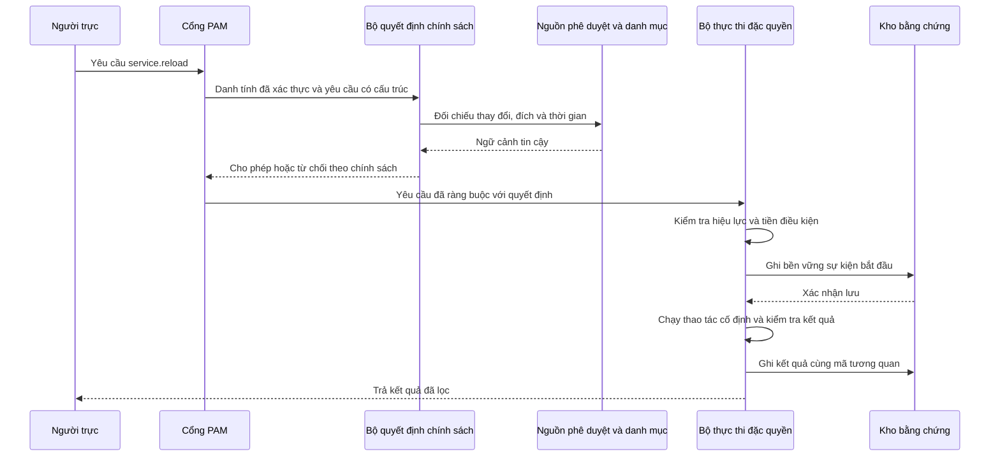

# Just-enough command

Trong chương **JIT và JEA** của quản lý truy cập đặc quyền (Privileged Access Management — PAM), *just-enough command* là cách chỉ cho phép thực hiện những thao tác đặc quyền cần thiết để hoàn thành một công việc xác định. Phạm vi cho phép phải bao gồm ý nghĩa của thao tác, tham số, tài nguyên đích, danh tính thực thi và điều kiện sử dụng; chỉ liệt kê tên chương trình chưa đủ.

Bài học tập trung vào tài khoản quản trị, tài khoản dịch vụ và hạ tầng nhạy cảm. Mục tiêu là chuyển yêu cầu vận hành thành quyền tối thiểu có thể thực thi và kiểm toán: người vận hành làm được việc cần làm, hệ thống giữ được ranh giới quyền, và mỗi lần sử dụng quyền đều có bằng chứng để điều tra.

## 1. Kết quả cần đạt

Sau bài học, bạn có thể:

- Phân biệt giới hạn thời gian của JIT với giới hạn thao tác của JEA.
- Biến một yêu cầu như “nạp lại cấu hình dịch vụ” thành một thao tác có hợp đồng đầu vào và đầu ra rõ ràng.
- Nhận diện các đường mở rộng quyền thông qua tham số, shell, đường dẫn, cấu hình và chương trình được gọi gián tiếp.
- Thiết kế điểm thực thi chính sách, kiểm thử các yêu cầu được phép và bị từ chối, và lưu bằng chứng phù hợp.
- Áp dụng cùng nguyên tắc cho người dùng tương tác và tác vụ tự động dùng danh tính dịch vụ.

Bạn nên biết khái niệm tài khoản đặc quyền, phân quyền theo vai trò và nhật ký kiểm toán. Không cần một sản phẩm PAM cụ thể để hiểu các ví dụ.

## 2. JIT giới hạn khi nào, JEA giới hạn được làm gì

**Just-in-time access (JIT)** cấp hoặc kích hoạt quyền trong khoảng thời gian cần thiết. **Just-enough administration/access (JEA)** thu hẹp những tác vụ mà chủ thể có thể thực hiện. Just-enough command là một cách triển khai JEA ở mức thao tác.

| Khía cạnh | Câu hỏi cần trả lời | Ví dụ |
| --- | --- | --- |
| Chủ thể | Ai được yêu cầu thao tác? | Người trực vận hành đã xác thực |
| Thời gian | Quyền có hiệu lực lúc nào? | Phiên kích hoạt tối đa 15 phút |
| Thao tác | Được thực hiện chức năng nào? | Nạp lại cấu hình dịch vụ được chỉ định |
| Đối tượng | Tác động lên tài nguyên nào? | Nhóm máy chủ thuộc một ứng dụng |
| Tham số | Những lựa chọn nào hợp lệ? | Chỉ dịch vụ đã đăng ký, không nhận cờ tùy ý |
| Điều kiện | Cần đáp ứng yêu cầu nào? | Phiếu thay đổi còn hiệu lực, có phê duyệt |
| Thực thi | Thành phần nào giữ và dùng quyền? | Bộ thực thi đặc quyền được bảo vệ |
| Bằng chứng | Có thể chứng minh điều gì đã xảy ra? | Quyết định chính sách và kết quả theo từng đích |

Một phiên quản trị toàn quyền kéo dài năm phút vẫn cho phép nhiều hành động nguy hiểm trong năm phút đó. Ngược lại, một thao tác được giới hạn tốt nhưng cấp vĩnh viễn vẫn có thể bị lạm dụng về sau. Kết hợp JIT và JEA giúp giới hạn cả thời gian lẫn phạm vi quyền.

Có thể diễn đạt điều kiện cho phép bằng giao của các ràng buộc:

```text
Cho phép = đúng chủ thể
         ∧ đúng thao tác
         ∧ đúng tham số
         ∧ đúng tài nguyên đích
         ∧ đúng khoảng thời gian
         ∧ đủ điều kiện phê duyệt
         ∧ đi qua điểm thực thi được kiểm soát
```

Thiếu một điều kiện thì yêu cầu phải bị từ chối theo chính sách. Giao diện chỉ ẩn nút bấm không tạo ra ranh giới bảo mật nếu API phía sau vẫn cho phép gọi thao tác rộng hơn.

## 3. Từ tên lệnh đến hợp đồng thao tác

### 3.1. Vì sao cho phép một binary là chưa đủ?

Một chương trình có thể hỗ trợ nhiều chức năng. Trình soạn thảo có thể mở shell hoặc sửa tệp khởi động; công cụ sao lưu có thể đọc dữ liệu nhạy cảm; công cụ quản lý dịch vụ có thể tác động lên dịch vụ khác; một tiện ích có thể gọi chương trình phụ qua plugin hoặc tùy chọn cấu hình.

Vì vậy, quy tắc “được chạy công cụ X với quyền quản trị” thường quá rộng. Câu hỏi cần đặt ra là:

> Với mọi đầu vào mà người được cấp quyền có thể kiểm soát, công cụ này có thể làm những việc gì dưới danh tính đặc quyền?

Phạm vi thực tế bao gồm cả quyền gián tiếp. Nếu người dùng được nạp lại cấu hình của dịch vụ đặc quyền và đồng thời sửa được cấu hình có khả năng nạp mã, quyền “nạp lại” có thể trở thành đường thực thi mã đặc quyền.

### 3.2. Hợp đồng thao tác cần có gì?

Thay vì cung cấp một dòng lệnh tự do, hãy định nghĩa một hành động nghiệp vụ hẹp:

```text
Tên hành động: service.reload
Đầu vào: service_id, environment, change_id
Đích: tài nguyên lấy từ danh mục quản lý phía máy chủ
Danh tính thực thi: danh tính dành riêng cho thao tác
Tiền điều kiện: quyền JIT còn hiệu lực; thay đổi hợp lệ; đích được phê duyệt
Hậu điều kiện: ghi kết quả nạp lại và kiểm tra trạng thái theo quy trình
Đầu ra: kết quả đã lọc, không trả credential hoặc nội dung bí mật
```

Hợp đồng này không đồng nghĩa thao tác luôn an toàn. Việc nạp lại vẫn có thể gây gián đoạn nếu cấu hình sai. Quy trình cần xác định kiểm tra cấu hình, ngưỡng tác động, cách dừng và phương án khôi phục phù hợp với dịch vụ.

### 3.3. Những thành phần tạo nên phạm vi lệnh

| Thành phần | Thiết kế có kiểm soát | Ví dụ rủi ro khi bỏ qua |
| --- | --- | --- |
| Chương trình | Chỉ định chương trình và nguồn cài đặt tin cậy | Tìm chương trình qua đường dẫn tìm kiếm do người dùng sửa |
| Hành động | Một tập hữu hạn các hành động nghiệp vụ | Cho gọi mọi lệnh con của công cụ quản trị |
| Tham số | Kiểu dữ liệu, tập giá trị, độ dài và quan hệ hợp lệ | Thêm cờ nạp plugin hoặc chọn tệp cấu hình tùy ý |
| Đối tượng | Mã tài nguyên được phân giải và kiểm tra phía máy chủ | Đổi hostname để tác động sang hệ thống khác |
| Danh tính | Quyền tối thiểu tại hệ điều hành hoặc nền tảng | Mọi thao tác đều chạy dưới tài khoản toàn quyền |
| Môi trường | Thư mục làm việc, biến môi trường và cấu hình được kiểm soát | Nạp thư viện hoặc tệp khởi tạo từ vị trí có thể ghi |
| Phụ thuộc | Script, cấu hình, binary và thư viện được bảo vệ | Sửa script rồi chờ bộ thực thi đặc quyền gọi script đó |
| Đầu ra | Trường thông tin cần thiết được lọc | Đọc được token trong log hoặc bản chẩn đoán |
| Vòng đời | Giới hạn thời gian, số lần và cơ chế hủy | Quyền hết hạn nhưng vẫn khởi tạo được thao tác mới |

## 4. Ví dụ xuyên suốt: nạp lại cấu hình một dịch vụ

### 4.1. Yêu cầu vận hành

Nhóm trực cần nạp lại cấu hình `edge-proxy` trên các máy chủ được ghi trong phiếu thay đổi `CHG-1042`. Người trực không cần sửa cấu hình hệ thống, tạo tài khoản, cài phần mềm hay mở shell quản trị.

Giả định của ví dụ:

- Cấu hình đã được kiểm tra và triển khai bằng một quy trình riêng có phê duyệt.
- Danh mục tài nguyên ánh xạ đúng dịch vụ, môi trường và các máy chủ liên quan.
- Người trực không có đường truy cập trực tiếp để lấy credential của bộ thực thi.
- Binary, cấu hình dịch vụ và các phụ thuộc thực thi không cho người trực sửa bằng quyền thông thường hoặc quyền khác mà họ đang có.
- Chính sách giới hạn thao tác mới chỉ được chấp nhận trong thời gian JIT còn hiệu lực; thao tác đang chạy được xử lý theo quy tắc vòng đời riêng.

Những giả định này phải được kiểm chứng khi triển khai. Nếu chúng không đúng, giới hạn ở lớp giao diện gọi lệnh sẽ không đủ.

### 4.2. Giao diện yêu cầu

Ví dụ sau là **giao diện minh họa tự định nghĩa**, không phải công cụ PAM có sẵn và không phải lệnh để chạy trực tiếp:

```text
pamctl service reload \
  --service edge-proxy \
  --environment production \
  --change CHG-1042
```

Giao diện không nhận `--command`, `--shell`, đường dẫn executable, tài khoản thực thi hay cờ tùy ý chuyển tiếp cho chương trình bên dưới. Người yêu cầu chỉ chọn các trường nghiệp vụ mà chính sách đã mô hình hóa.

Mã `CHG-1042` không phải bằng chứng phê duyệt chỉ vì có mặt trên dòng lệnh. Máy chủ phải tra cứu nguồn thay đổi tin cậy và kiểm tra người yêu cầu, hành động, tài nguyên, trạng thái phê duyệt và thời gian áp dụng.

### 4.3. Chính sách minh họa

Cấu trúc YAML dưới đây chỉ diễn đạt ý tưởng. Đây không phải cú pháp cấu hình của một nhà cung cấp hay cấu hình triển khai hoàn chỉnh.

```yaml
policy_id: edge-proxy-reload-v1
request_schema:
  action:
    enum: [service.reload]
  service_id:
    enum: [edge-proxy]
  environment:
    enum: [production]
  change_id:
    type: string
    max_length: 64
  reject_unknown_fields: true

subject:
  required_group: platform-oncall
  authentication: approved-strong-authentication

jit:
  required: true
  max_activation_minutes: 15

approval:
  source: trusted-change-system
  bind_to: [subject_id, action, service_id, target_ids, time_window]
  requester_cannot_approve_own_request: true

targets:
  source: managed-inventory
  require_change_target_match: true
  max_targets_per_request: 2

execution:
  operation: fixed-service-reload-adapter
  identity: dedicated-service-reload-identity
  accept_raw_command: false
  accept_environment_overrides: false
  timeout_seconds: 30
  max_concurrent_targets: 1
  max_attempts_per_activation: 1

audit:
  require_durable_start_record: true
  output_profile: sanitized-operation-result
```

Danh sách nhóm không thay thế kiểm tra danh tính. Tương tự, giới hạn hai đích mỗi yêu cầu không ngăn chia nhỏ thành nhiều yêu cầu; cần thêm hạn mức trên lần kích hoạt hoặc phiếu thay đổi nếu mục tiêu là giới hạn tổng phạm vi tác động.

Danh tính thực thi phải có khả năng cần thiết trên hệ thống đích. Việc đặt tên tài khoản là `dedicated-service-reload-identity` không tự tạo ra quyền tối thiểu. Nếu nền tảng không thể cấp quyền nhỏ đến mức mong muốn, bộ thực thi có thể phải giữ quyền rộng hơn; khi đó nó là một thành phần tin cậy quan trọng, cần được cô lập và bảo vệ tương xứng.

### 4.4. Luồng quyết định và thực thi



Sơ đồ thể hiện nhánh được phép. Nếu kiểm tra thất bại hoặc không lưu được sự kiện bắt đầu theo chính sách của ví dụ, hệ thống không khởi chạy thao tác đặc quyền.

Bộ thực thi phải xác minh nguồn yêu cầu, tính toàn vẹn và các ràng buộc của quyết định. Không được tin một trường `allowed: true` do phía khách gửi lên. Nếu dùng vé thực thi, vé cần được bảo vệ, có thời hạn, ràng buộc với hành động và đích cụ thể, đồng thời có cơ chế ngăn dùng lại ngoài chính sách.

## 5. Kiểm soát tham số và tránh mở rộng quyền

### 5.1. Không nối chuỗi để tạo lệnh shell

Mẫu giả mã nguy hiểm:

```text
run_as_privileged("service-tool reload " + user_input)
```

Nếu chuỗi này được shell diễn giải, đầu vào có thể trở thành cú pháp điều khiển hoặc một lệnh bổ sung. Ngay cả khi không có shell, đầu vào bắt đầu bằng dấu gạch ngang vẫn có thể bị chương trình đích hiểu là tùy chọn.

Mẫu thiết kế phù hợp hơn:

```text
request = parse_strict_schema(input)
subject = authenticated_subject_from_session()
context = load_trusted_context(subject, request.change_id)

validate_business_fields(request)
targets = resolve_targets_from_inventory(request, context)
decision = authorize(subject, request, targets, context)
require(decision.is_allowed)

invoke_protected_adapter(
    operation = FIXED_RELOAD_OPERATION,
    service = SERVICE_MAP[request.service_id],
    targets = targets,
    authorization = decision
)
```

Bên trong adapter, nếu cần tạo tiến trình, hãy gọi chương trình cố định bằng danh sách đối số được tạo từ dữ liệu đã kiểm tra, không dùng shell và không chuyển tiếp tùy chọn thừa. Cần hiểu parser của chương trình đích: mảng đối số giúp tránh diễn giải shell nhưng không tự giải quyết lạm dụng tùy chọn, đọc tệp tùy ý hay chức năng nguy hiểm vốn có của chương trình.

### 5.2. Kiểm tra ngữ nghĩa, không chỉ hình dạng

Một mã dịch vụ chỉ chứa chữ và số vẫn có thể trỏ đến dịch vụ ngoài quyền. Một mã phiếu thay đổi đúng định dạng vẫn có thể đã đóng. Một địa chỉ hợp lệ vẫn có thể thuộc hệ thống khác.

Cần kiểm tra đồng thời:

1. **Cú pháp:** đúng kiểu, độ dài, mã hóa và tập ký tự cần thiết; không nhận trường lạ hoặc tham số lặp có cách hiểu mơ hồ.
2. **Ngữ nghĩa:** giá trị tồn tại, thuộc tập cho phép và có ý nghĩa đúng trong nghiệp vụ.
3. **Quan hệ:** người yêu cầu, thao tác, môi trường, tập đích và phê duyệt phải khớp nhau.
4. **Thời điểm:** quyền, phê duyệt và trạng thái tài nguyên vẫn hợp lệ ngay trước hành động nhạy cảm.

Phân giải đầu vào một lần theo quy tắc nhất quán và dùng cùng biểu diễn đã kiểm tra trong quyết định lẫn thực thi. Nếu hai thành phần giải mã hoặc chuẩn hóa khác nhau, một yêu cầu có thể được duyệt theo một nghĩa và chạy theo nghĩa khác.

### 5.3. Đường dẫn, cấu hình và tài nguyên có thể thay đổi

Ưu tiên mã tài nguyên do máy chủ ánh xạ thay vì nhận đường dẫn tự do. Khi thao tác bắt buộc xử lý tệp, chính sách phải xác định thư mục gốc, quyền sở hữu, liên kết tượng trưng, điểm gắn kết và khả năng thay thế tệp giữa lúc kiểm tra với lúc sử dụng.

Việc kiểm tra chuỗi bắt đầu bằng một thư mục không chứng minh tệp cuối cùng nằm trong phạm vi cho phép. Khi nền tảng hỗ trợ, cần sử dụng cách mở và thao tác trên tài nguyên đã được xác thực mà không mở lại một đường dẫn có thể bị đổi sau kiểm tra. Cách triển khai cụ thể tùy hệ điều hành và API được dùng.

Với ví dụ nạp lại dịch vụ, phạm vi cần bảo vệ bao gồm cả định nghĩa dịch vụ, executable, script khởi động, cấu hình, plugin và các thư mục chứa chúng. Một quyền sửa ở nơi khác có thể làm mất ý nghĩa của hạn chế lệnh hiện tại.

## 6. Điểm thực thi phải là ranh giới quyền thật

Một triển khai thường có hai vai trò logic:

- **Bộ quyết định chính sách:** trả lời chủ thể có được thực hiện hành động này trên những đích này trong ngữ cảnh hiện tại không.
- **Điểm thực thi chính sách:** chỉ thực hiện hành động sau khi đã xác minh quyết định và điều kiện thực tế.

Hai vai trò có thể nằm trong cùng một thành phần hoặc các dịch vụ khác nhau. Điều quan trọng là mọi đường tới quyền đặc biệt đều phải chịu kiểm soát tương đương.

### 6.1. Tránh đường đi vòng

Nếu người trực vẫn đăng nhập được bằng một tài khoản quản trị dùng chung, lấy được khóa SSH đặc quyền hoặc gọi trực tiếp API đích bằng token rộng quyền, cổng just-enough command không chặn được các đường đó. Cần kiểm kê và thu hẹp những đường truy cập đang tồn tại.

Credential của bộ thực thi nên được cung cấp qua cơ chế quản lý bí mật phù hợp, chẳng hạn vault hoặc danh tính workload. Không trả credential cho người gọi; không nhúng vào mã nguồn, dòng lệnh dễ lộ hoặc log. Việc luân chuyển và thu hồi credential phải phù hợp với khả năng của hệ thống đích và quy trình vận hành.

### 6.2. Bảo vệ chính bộ thực thi

Người chỉ được gọi thao tác không được tự sửa adapter, chính sách, danh mục đích hoặc log kiểm toán. Quyền cập nhật những thành phần này cần được tách khỏi quyền vận hành và có quy trình kiểm soát thay đổi.

Các thuộc tính cần bảo vệ gồm:

- Nguồn triển khai và phiên bản của chương trình thực thi.
- Quyền ghi lên tệp, thư mục cha, cấu hình và phụ thuộc.
- Biến môi trường, thư mục làm việc, đường dẫn tìm chương trình và cơ chế nạp plugin.
- Kênh giao tiếp giữa cổng PAM, bộ quyết định, bộ thực thi và hệ thống đích.
- Khả năng đối chiếu chính sách đang thực thi với phiên bản đã phê duyệt.

Ở môi trường Windows, một endpoint quản trị có tập thao tác hạn chế có thể phục vụ mục tiêu này; ở môi trường Unix, có thể dùng wrapper đặc quyền hoặc cơ chế ủy quyền hẹp. Dù dùng nền tảng nào, công cụ có khả năng gọi shell, chạy script tùy ý hoặc thay cấu hình thực thi cần được phân tích như một đường mở rộng quyền. Không thể suy ra an toàn chỉ từ tên cơ chế.

## 7. Ràng buộc thời gian và vòng đời thao tác

Quyền kích hoạt 15 phút không có nghĩa mọi tiến trình sẽ tự kết thúc sau 15 phút. Phải quy định riêng thời điểm nhận yêu cầu, thời điểm bắt đầu và cách xử lý công việc đang chạy.

Với ví dụ này, có thể chọn:

- Chỉ tiếp nhận và bắt đầu thao tác khi quyền JIT còn hiệu lực.
- Yêu cầu nằm trong hàng đợi phải được kiểm tra lại trước lúc bắt đầu.
- Mỗi đích có thời gian chờ 30 giây; nếu vượt ngưỡng, dừng chờ và truy vấn trạng thái đích theo quy trình.
- Khi quyền bị thu hồi, không khởi tạo thao tác trên đích tiếp theo; xử lý thao tác đã bắt đầu theo khả năng hủy an toàn của nền tảng.
- Không tự tăng quyền, kéo dài phiên hoặc chuyển sang shell khi thao tác thất bại.

Hủy tiến trình phía bộ thực thi không luôn hủy được tác động đã gửi đến máy đích. Mất kết nối cũng không chứng minh thao tác chưa xảy ra. Cần ghi trạng thái `unknown` khi chưa xác nhận được kết quả, đối chiếu trạng thái thực tế rồi mới quyết định thử lại.

Lệnh nạp lại cũng không mặc nhiên an toàn khi lặp. Nên dùng mã yêu cầu duy nhất, cơ chế chống lặp và quy tắc thử lại rõ ràng. Nếu đã cấp quyền cho một lần thực hiện, một lần thử lại không được âm thầm biến thành lần thực hiện thứ hai ngoài phạm vi phê duyệt.

## 8. Nhật ký, đầu ra và bằng chứng kiểm toán

Nhật ký cần giúp trả lời: **ai yêu cầu, được duyệt điều gì, tác động lên đâu, dưới danh tính nào, khi nào, và kết quả thực tế ra sao**.

Một sự kiện minh họa:

```json
{
  "event_type": "privileged_operation_finished",
  "request_id": "REQ-7102",
  "activation_id": "ACT-5021",
  "subject_id": "user:oncall-17",
  "executor_identity": "service:reload-adapter",
  "action": "service.reload",
  "service_id": "edge-proxy",
  "environment": "production",
  "target_id": "asset:proxy-02",
  "change_id": "CHG-1042",
  "policy_version": "edge-proxy-reload-v1",
  "adapter_version": "reload-adapter-v3",
  "authorization_decision": "allow",
  "started_at": "2026-11-26T02:10:00Z",
  "finished_at": "2026-11-26T02:10:03Z",
  "execution_result": "accepted",
  "post_check": "healthy",
  "output_profile": "sanitized-operation-result"
}
```

Đây là dữ liệu giả định. Trong triển khai thật, cần có sự kiện bắt đầu, kết thúc và từ chối, liên kết được với nguồn phê duyệt và bản ghi trên hệ thống đích. Mã trả về thành công hoặc trạng thái `accepted` chỉ phản ánh một bước; kiểm tra sức khỏe và hành vi dịch vụ cung cấp bằng chứng bổ sung về kết quả vận hành.

Bằng chứng cần được lưu ở nơi người vận hành không thể tùy ý sửa hoặc xóa, có kiểm soát truy cập, đồng bộ thời gian và chính sách lưu giữ phù hợp. Hash đơn lẻ không đủ chứng minh toàn bộ chuỗi sự kiện đầy đủ nếu kẻ tấn công có thể xóa cả bản ghi lẫn hash.

Đầu ra của lệnh cũng là một kênh cấp quyền. Chỉ trả thông tin cần thiết cho nhiệm vụ; lọc token, mật khẩu, chuỗi kết nối và dữ liệu nhạy cảm. Giới hạn kích thước và định dạng đầu ra để tránh đưa nội dung không tin cậy vào terminal hoặc hệ thống xem log một cách nguy hiểm.

Với tác vụ có cấu trúc, bản ghi thao tác thường hữu ích hơn chỉ có video phiên. Nếu có phiên tương tác, giám sát và ghi phiên có thể bổ sung ngữ cảnh, nhưng không thay thế chính sách giới hạn lệnh hay sự kiện từ hệ thống đích.

## 9. Ma trận kiểm thử ranh giới quyền

Kiểm thử phải chứng minh cả hai mặt: tác vụ hợp lệ chạy được và các biến thể vượt phạm vi bị chặn. Bảng sau là kế hoạch kiểm thử trong môi trường thực hành được phép, không phải kết quả kiểm thử của một hệ thống đã triển khai.

| Tình huống | Kết quả mong đợi | Bằng chứng cần quan sát |
| --- | --- | --- |
| Người trực hợp lệ, thay đổi hợp lệ, đúng dịch vụ và đích | Thực hiện theo giới hạn đã duyệt | Quyết định cho phép, bản ghi bắt đầu, kết quả trên đích |
| Đúng nhóm nhưng chưa kích hoạt JIT | Từ chối trước thực thi | Lý do từ chối, không có tác động trên đích |
| Phiếu thay đổi đúng định dạng nhưng đã đóng | Từ chối | Kết quả đối chiếu nguồn thay đổi |
| Đổi môi trường hoặc chọn tài nguyên ngoài phiếu | Từ chối | Phạm vi không khớp, không gọi adapter trên đích lạ |
| Gửi thêm trường chỉ định shell, executable hoặc danh tính chạy | Từ chối theo schema | Bản ghi đầu vào không hợp lệ đã lọc dữ liệu nhạy cảm |
| Gửi chuỗi chứa cú pháp điều khiển hoặc cờ ngoài tập cho phép | Từ chối đầu vào | Không tạo lệnh shell, không chuyển tiếp cờ |
| Gọi trực tiếp API thực thi bỏ qua giao diện | Vẫn yêu cầu xác thực và ủy quyền | Quyết định tại điểm thực thi |
| Sửa hoặc phát lại vé thực thi | Từ chối theo cơ chế toàn vẹn và chống lặp | Sự kiện vé không hợp lệ hoặc đã sử dụng |
| Quyền hết hạn trong lúc yêu cầu còn ở hàng đợi | Không khởi chạy | Quyết định kiểm tra lại tại thời điểm bắt đầu |
| Cố sửa adapter, định nghĩa dịch vụ hoặc phụ thuộc | Bị quyền nền tảng chặn | Quyền tệp và sự kiện truy cập tương ứng |
| Gửi lại yêu cầu sau khi mất kết nối | Đối chiếu trước khi thực thi lại | Mã yêu cầu, kết quả truy vấn và quyết định thử lại |
| Kho kiểm toán không xác nhận lưu sự kiện bắt đầu | Không khởi chạy theo chính sách ví dụ | Cảnh báo và bản ghi lỗi kênh kiểm toán |
| Một đích thành công, một đích chưa xác định | Trả kết quả riêng từng đích | Không gộp toàn bộ thành thành công |
| Đầu ra chứa dữ liệu bí mật trong môi trường thử nghiệm | Lọc trước khi trả và lưu | Bản ghi đã lọc, không phát tán bí mật thử nghiệm |

Kiểm tra thêm hiệu lực thu hồi, giới hạn đồng thời và tổng số lần chạy. Kiểm thử trực tiếp trên điểm thực thi giúp phát hiện các trường hợp giao diện chặn đúng nhưng API vẫn bỏ lọt.

## 10. Áp dụng cho tài khoản dịch vụ và tự động hóa

Một pipeline hoặc tác vụ định kỳ cũng có thể yêu cầu thao tác đặc quyền. Nguyên tắc không thay đổi, nhưng chủ thể là danh tính workload thay vì một người dùng tương tác.

Ví dụ, pipeline triển khai chỉ được gọi `service.reload` sau khi bản cấu hình đã được phê duyệt. Chính sách cần ràng buộc danh tính workload, nguồn pipeline tin cậy, phiên bản artifact và tập tài nguyên đã duyệt. Không tin trường `pipeline_id` do bất kỳ máy khách nào tự khai báo.

Quyền thường trực của tài khoản dịch vụ cần được kiểm kê. Ưu tiên quyền có thời hạn hoặc credential ngắn hạn nếu hệ thống hỗ trợ; quản lý luân chuyển và thu hồi khi phải dùng credential dài hạn. Không để một pipeline chỉ cần nạp lại dịch vụ nắm token quản trị toàn bộ hạ tầng.

Khi chuỗi tự động hóa gọi qua nhiều dịch vụ, danh tính và phạm vi được ủy quyền phải được truyền theo cơ chế tin cậy. Một dịch vụ trung gian không được dùng quyền rộng của chính nó để làm mọi điều người gọi yêu cầu. Nó vẫn phải kiểm tra người gọi có quyền yêu cầu đúng hành động và đúng đích hay không.

## 11. Lỗi thiết kế thường gặp

| Thiết kế | Vì sao ranh giới quyền yếu | Hướng cải thiện |
| --- | --- | --- |
| Cho phép mọi lệnh có tiền tố giống nhau | Không mô hình hóa đầy đủ parser, tham số và chức năng | Dùng hành động có schema, tập giá trị và adapter cố định |
| Chỉ chặn một vài từ khóa nguy hiểm | Dễ bỏ sót cách biểu diễn hoặc đường thực thi khác | Chỉ cho phép đầu vào cần thiết và loại bỏ lệnh tự do |
| Cho chạy script nhưng người gọi sửa được script | Quyền thực tế trở thành thực thi mã tùy ý | Bảo vệ tệp, thư mục và quy trình phát hành |
| Cho sửa cấu hình rồi nạp lại dịch vụ đặc quyền | Cấu hình có thể điều khiển mã hoặc tài nguyên được truy cập | Phân tích ngữ nghĩa cấu hình và tách quyền thay đổi |
| Chỉ kiểm tra ở phía khách | Có thể gọi trực tiếp API phía máy chủ | Kiểm tra tại mọi điểm vào và điểm thực thi |
| Cấp shell để người trực tự xử lý khi lỗi | Mở rộng mạnh phạm vi đã duyệt | Cung cấp tác vụ chẩn đoán hẹp hoặc quy trình nâng quyền riêng |
| Dùng chung danh tính thực thi và mất dấu người gọi | Khó quy trách nhiệm và điều tra | Giữ liên kết chủ thể, lần kích hoạt, yêu cầu và đích |
| Xem quyền chỉ đọc là vô hại | Có thể đọc secret hoặc dữ liệu nhạy cảm | Giới hạn nguồn dữ liệu, trường được đọc và đầu ra |
| Tự thử lại khi hết thời gian chờ | Có thể lặp tác động đã xảy ra | Đối chiếu trạng thái và áp dụng quy tắc chống lặp |
| Ngoại lệ khẩn cấp thành quyền thường trực | Mất ranh giới của tác vụ thông thường | Quản lý break-glass riêng, có thời hạn và xem xét sau sự kiện |

Break-glass là đường xử lý ngoại lệ có kiểm soát, không phải một cờ cho phép tùy ý bỏ qua chính sách. Việc kích hoạt cần nhận diện được người sử dụng, phạm vi, thời hạn và bằng chứng để xem xét sau sự cố.

## 12. Bài thực hành thiết kế

Giả sử nhóm vận hành cần ba khả năng: xem sức khỏe dịch vụ, nạp lại cấu hình đã duyệt và đọc phần log phục vụ chẩn đoán.

### Bước 1: Viết ba hợp đồng riêng

Không gom thành “quyền quản trị dịch vụ”. Xác định cho từng hành động: danh tính gọi, đầu vào, tài nguyên, thời gian, tiền điều kiện, kết quả trả về và tác động cho phép.

Một phương án:

| Hành động | Đầu vào cần thiết | Giới hạn đặc thù |
| --- | --- | --- |
| `service.health.read` | Mã dịch vụ, môi trường | Chỉ các chỉ số sức khỏe đã định nghĩa |
| `service.reload` | Mã dịch vụ, môi trường, phiếu thay đổi | JIT, phê duyệt, đích và hạn mức thực thi |
| `service.logs.read` | Mã dịch vụ, khoảng thời gian, mức log | Giới hạn thời gian, số dòng và lọc bí mật |

### Bước 2: Liệt kê quyền gián tiếp

Kiểm tra người gọi có sửa được cấu hình, script, binary, plugin, nguồn danh mục hay chính sách không. Kiểm tra đầu ra log có làm lộ credential để đi vòng cổng PAM không. Đánh giá tổng quyền từ nhiều vai trò, không xem từng vai trò như thể chúng tồn tại riêng lẻ.

### Bước 3: Mô tả cơ chế thực thi

Vẽ đường đi từ danh tính đến tài nguyên. Tại mỗi điểm, ghi rõ dữ liệu nào do người gọi kiểm soát, dữ liệu nào được lấy từ nguồn tin cậy và thành phần nào có quyền đặc biệt. Đánh dấu nơi xác thực, nơi quyết định quyền và nơi thực thi.

### Bước 4: Định nghĩa bằng chứng và ca kiểm thử

Chọn các trường đủ liên kết người gọi với tác động trên đích. Viết ít nhất một tình huống hợp lệ và một tình huống vượt quyền cho mỗi ràng buộc. Bổ sung trường hợp quyền hết hạn, thu hồi, mất kết nối và kết quả chỉ thành công một phần.

### Tiêu chí hoàn thành thiết kế

Thiết kế đủ để xem xét khi mỗi thao tác có phạm vi rõ, người gọi không thể chuyển nó thành lệnh tùy ý, quyền gián tiếp đã được phân tích, và có cách kiểm chứng cả quyết định quyền lẫn kết quả vận hành. Nếu còn cần một tài khoản toàn quyền trực tiếp để hoàn thành công việc thường ngày, cần xác định tác vụ còn thiếu và thiết kế thêm hợp đồng phù hợp.

## 13. Tự kiểm tra kiến thức

**1. Có quyền JIT trong năm phút thì có cần giới hạn lệnh không?**  
Có. JIT giới hạn thời gian; trong khoảng đó, quyền rộng vẫn cho phép nhiều tác động ngoài nhiệm vụ. Cần giới hạn cả hành động và tài nguyên.

**2. Gọi chương trình bằng mảng đối số đã đủ an toàn chưa?**  
Chưa. Cách này tránh một lớp diễn giải shell, nhưng chương trình vẫn có thể nhận tùy chọn nguy hiểm hoặc truy cập tài nguyên ngoài phạm vi. Cần kiểm soát ngữ nghĩa tham số và chức năng được phép.

**3. Vì sao phải bảo vệ cấu hình khi chỉ cấp quyền nạp lại dịch vụ?**  
Nếu cấu hình điều khiển mã được nạp, đường dẫn executable hoặc tài nguyên nhạy cảm, người sửa được cấu hình có thể kết hợp quyền đó với thao tác nạp lại để mở rộng quyền.

**4. Có thể coi hết thời gian chờ là thao tác thất bại và chạy lại ngay không?**  
Không. Thao tác có thể đã xảy ra trên hệ thống đích. Cần ghi nhận kết quả chưa xác định, đối chiếu trạng thái và áp dụng quy tắc thử lại.

**5. Chỉ lưu video phiên có đủ cho kiểm toán không?**  
Không. Cần liên kết danh tính, phê duyệt, phiên bản chính sách, yêu cầu, danh tính thực thi, tài nguyên và kết quả. Video có thể bổ sung ngữ cảnh cho phiên tương tác.

Just-enough command có giá trị khi ranh giới được thực thi xuyên suốt từ yêu cầu đến tác động thực tế. Một tác vụ hẹp, được cấp đúng lúc, không làm lộ credential và để lại bằng chứng rõ ràng giúp PAM phục vụ vận hành, kiểm toán và ứng phó sự cố trong cùng một mô hình quyền tối thiểu.