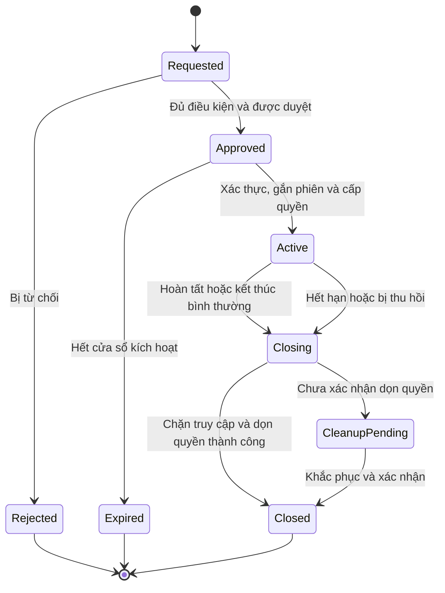

# Session-specific privilege: quyền đặc quyền gắn với từng phiên

## 1. Mục tiêu và ý nghĩa trong PAM

**Session-specific privilege** là cách cấp và thực thi quyền đặc quyền cho một phiên truy cập cụ thể. Quyền chỉ có giá trị trong ngữ cảnh đã được xác định: ai khởi tạo phiên, đi tới tài nguyên nào, được làm gì, từ môi trường nào và trong khoảng thời gian nào. Một phiên khác của cùng người dùng không mặc nhiên được hưởng quyền đó.

Trong quản lý truy cập đặc quyền (PAM), đây là cách kết hợp hai nguyên tắc của chương JIT và JEA:

- **Just-in-time (JIT):** quyền được kích hoạt khi cần và kết thúc theo thời hạn hoặc sự kiện đã quy định.
- **Just-enough access (JEA):** quyền chỉ bao gồm các thao tác và tài nguyên cần thiết để hoàn thành công việc.
- **Ràng buộc theo phiên:** phần quyền JIT/JEA đó chỉ được sử dụng qua phiên được chấp thuận, không lan sang những kết nối khác.

Ví dụ, một kỹ sư cần khởi động lại dịch vụ thanh toán trên máy `app-pay-03` để xử lý sự cố. Thay vì thêm kỹ sư vào nhóm quản trị toàn bộ máy chủ trong 30 phút, hệ thống tạo phiên `ses-7f21`, cho phép kiểm tra trạng thái và khởi động lại đúng dịch vụ trong tối đa 15 phút. Việc mở một SSH session khác không tự tạo ra quyền tương đương.

Mục tiêu học tập của bài là:

1. Phân biệt danh tính, phiên, credential và quyền của phiên.
2. Thiết kế grant đủ chặt để quyền không thoát khỏi phiên đã duyệt.
3. Hiểu cách thực thi, hết hạn và thu hồi quyền trên các hệ thống khác nhau.
4. Xây dựng bằng chứng phục vụ kiểm toán và ứng phó sự cố cho tài khoản quản trị, tài khoản dịch vụ và hạ tầng nhạy cảm.

## 2. Bốn khái niệm cần tách rõ

| Khái niệm | Trả lời câu hỏi | Ví dụ |
|---|---|---|
| Danh tính người yêu cầu | Ai chịu trách nhiệm cho công việc? | Kỹ sư `an.ops` hoặc workload `deploy-prod` |
| Danh tính thực thi | Tài nguyên đích thấy chủ thể nào? | Tài khoản tạm trên máy đích hoặc service principal |
| Phiên | Công việc đang diễn ra qua ngữ cảnh truy cập nào? | Phiên SSH, phiên quản trị cơ sở dữ liệu, ngữ cảnh gọi API |
| Grant của phiên | Ngữ cảnh đó được làm gì, tới đâu và đến khi nào? | Chỉ đọc trạng thái và restart một dịch vụ trước 10:15 |

**Credential** là phương tiện chứng minh hoặc sử dụng danh tính: mật khẩu, khóa, chứng thư, token hoặc cơ chế xác thực tương đương. Credential không đồng nghĩa với toàn bộ chính sách phân quyền. Một credential có thể mở được kết nối nhưng các thao tác bên trong vẫn phải chịu kiểm tra quyền.

Cần phân biệt thêm:

- **Request:** yêu cầu truy cập, có mục đích và phạm vi mong muốn.
- **Approval:** quyết định cho phép một phạm vi sau khi xem xét yêu cầu.
- **Grant:** quyền thực tế đã được cấp, có giới hạn và điều kiện thực thi.
- **Session:** ngữ cảnh sử dụng grant, có vòng đời riêng.

Một request có thể tạo nhiều lần thử kết nối. Các lần thử không nên cùng dùng lại grant mà không có quy tắc rõ ràng. Nếu cho phép kết nối lại sau mất mạng, phải xác định kết nối lại có tiếp tục phiên cũ hay tạo phiên mới, còn thời hạn bao nhiêu và cần xác thực lại điều gì.

### 2.1. Phiên không nhất thiết là một kết nối TCP

Một phiên làm việc logic có thể gồm nhiều kết nối: giao diện quản trị, kênh truyền lệnh và kênh truyền file. Ngược lại, một kết nối lâu dài hoặc một connection pool có thể phục vụ nhiều người dùng hay nhiều công việc.

Vì vậy, `session_id` trong thiết kế PAM cần đại diện cho **ranh giới quyền**, không chỉ là số định danh của socket. Tất cả các kênh con phải được nhận diện và kiểm soát; một kết nối phụ không được trở thành đường đi vòng qua chính sách.

Đối với API không có kết nối liên tục, phiên có thể là ngữ cảnh ủy quyền gồm danh tính, job, grant và credential ngắn hạn. Mỗi request vẫn phải chứng minh rằng nó thuộc ngữ cảnh hợp lệ đó.

## 3. So sánh với quyền thường trực và JIT theo tài khoản

| Mô hình | Đơn vị được cấp quyền | Điểm cần chú ý |
|---|---|---|
| Quyền thường trực | Tài khoản hoặc nhóm | Quyền tồn tại giữa các lần làm việc, làm tăng khoảng thời gian có thể bị lạm dụng |
| JIT theo tài khoản | Tài khoản trong một khoảng thời gian | Nhiều phiên của cùng tài khoản có thể được hưởng quyền vừa kích hoạt |
| Quyền gắn với phiên | Một phiên hoặc ngữ cảnh ủy quyền xác định | Phải ràng buộc và kiểm tra quyền tại mọi đường truy cập có thể sử dụng grant |

JIT theo tài khoản có thể phù hợp với một số nền tảng, nhưng không tự trở thành quyền theo phiên. Nếu hệ thống chỉ thêm người dùng vào nhóm quản trị trong 15 phút, một phiên mở sẵn hoặc một kết nối trực tiếp khác có thể nhận được tác động của thay đổi đó, tùy cách tài nguyên đánh giá quyền và lưu thông tin xác thực.

Cũng không thể suy ra rằng xóa tài khoản khỏi nhóm sẽ lập tức làm mất quyền trong mọi phiên đã mở. Có hệ thống giữ quyền trong token, tiến trình hoặc phiên đăng nhập đến một mốc làm mới hoặc kết thúc cụ thể. Thiết kế phải xác định hành vi thực tế của từng loại tài nguyên.

Ví dụ về phạm vi:

```text
Yêu cầu quá rộng:
  an.ops có quyền admin trên nhóm máy chủ thanh toán trong 1 giờ.

Yêu cầu theo phiên:
  Phiên ses-7f21 của an.ops được kiểm tra trạng thái và restart
  payment-api trên app-pay-03, trong 15 phút, qua cổng PAM đã chỉ định.
```

Điểm quyết định không phải là có gắn nhãn `session_id` trong log hay không. Cần có cơ chế từ chối việc sử dụng quyền ở ngoài phiên được cấp.

## 4. Mô hình quyền của một phiên

Có thể mô tả một grant như sau:

```text
G = {
  grant_id,
  request_id,
  requester,
  execution_identity,
  session_binding,
  target_scope,
  allowed_actions,
  valid_from,
  expires_at,
  conditions,
  policy_version,
  approval_reference,
  revocation_state
}
```

| Thành phần | Vai trò | Ví dụ giới hạn |
|---|---|---|
| `requester` | Gắn trách nhiệm với chủ thể yêu cầu | Một người dùng hoặc workload đã xác thực |
| `execution_identity` | Xác định danh tính dùng ở đích | Danh tính tạm cho riêng grant |
| `session_binding` | Chứng minh request thuộc phiên đã duyệt | Liên kết phiên phía máy chủ và khóa của client |
| `target_scope` | Hạn chế tài nguyên | Một máy, một cơ sở dữ liệu, một namespace |
| `allowed_actions` | Hạn chế thao tác | Đọc trạng thái, restart dịch vụ cụ thể |
| `valid_from`, `expires_at` | Giới hạn thời gian tuyệt đối | Từ khi kích hoạt đến mốc hết hạn |
| `conditions` | Giữ ngữ cảnh truy cập phù hợp | Thiết bị hợp lệ, đường đi bắt buộc, mức xác thực |
| `revocation_state` | Cho phép chặn trước hạn | Active hoặc revoked |

Không nhất thiết mọi trường đều nằm trong credential mà người dùng giữ. Một số trường có thể chỉ được lưu tại hệ thống ủy quyền và được cổng PAM hoặc tài nguyên đích tra cứu qua tham chiếu grant.

### 4.1. Quyền hiệu lực là giao của các giới hạn

Một mô hình tư duy hữu ích là:

```text
Quyền hiệu lực của phiên
  = quyền nền tảng cho phép
    ∩ chính sách PAM hiện hành
    ∩ phạm vi được phê duyệt
    ∩ ràng buộc của grant
    ∩ điều kiện còn hợp lệ tại thời điểm thao tác
```

Ví dụ, approval cho phép restart một dịch vụ không có nghĩa hệ thống phải cấp shell quản trị toàn máy. Nếu cơ chế thực thi không biểu diễn được phạm vi hẹp đó, cần dùng một thao tác quản trị đã đóng gói, một tác vụ tự động có đầu vào giới hạn hoặc một cách tiếp cận khác phù hợp với mức rủi ro.

Đây là mô hình thiết kế, không phải lời bảo đảm rằng mọi sản phẩm tự động tính được giao của các tập quyền. Cần triển khai các giới hạn ở những điểm có thể thực thi chúng.

### 4.2. Điều kiện quyết định cho một thao tác

Một yêu cầu chỉ được phép khi đồng thời thỏa mãn:

```text
allow = authenticated
    AND proof_matches_bound_session
    AND target_in_scope
    AND action_in_scope
    AND arguments_in_scope
    AND valid_from <= now < expires_at
    AND grant_is_active
    AND required_context_is_valid
```

Kiểm tra `arguments_in_scope` rất quan trọng. Cho phép lệnh `restart-service` nhưng không kiểm soát tên dịch vụ có thể biến quyền restart một dịch vụ thành quyền tác động đến nhiều dịch vụ. Đường dẫn, namespace, tên tài nguyên và các tham số khác cũng cần được chuẩn hóa và kiểm tra tại nơi có hiểu biết phù hợp về chúng.

## 5. Vòng đời của quyền theo phiên



### 5.1. Yêu cầu và phê duyệt

Yêu cầu nên nêu rõ công việc, đích, tập thao tác, thời lượng và mã sự cố hoặc thay đổi nếu quy trình có sử dụng. Người phê duyệt đánh giá phạm vi thực tế, đặc biệt với thao tác sửa cấu hình, quản lý danh tính hoặc tác động đến dữ liệu nhạy cảm.

Tách **cửa sổ được phép kích hoạt** khỏi **thời lượng phiên sau kích hoạt**. Ví dụ, approval có thể dùng từ 09:00 đến 10:00, nhưng mỗi phiên chỉ được hoạt động tối đa 15 phút. Chính sách phải xác định phiên có được vượt qua 10:00 hay không; không để cách hiểu này phụ thuộc vào phía client.

### 5.2. Kích hoạt và gắn phiên

Khi kích hoạt, hệ thống xác thực chủ thể và mức bảo đảm cần thiết, tạo định danh phiên, gắn grant với phiên và chuẩn bị danh tính thực thi. Nếu phải xác thực lại hoặc kiểm tra thiết bị, thực hiện trước khi mở đường tới đích.

Không cấp credential có thể dùng ở bất kỳ đâu rồi chỉ ghi lại rằng nó được tạo cho một phiên. Đó mới là mối liên hệ phục vụ truy vết; để trở thành ràng buộc thực thi, còn phải kiểm soát nơi và cách credential có thể được sử dụng.

### 5.3. Sử dụng và tái đánh giá

Trong phiên, các thao tác phải đi qua điểm kiểm soát phù hợp. Các sự kiện như thay đổi rủi ro thiết bị, tắt danh tính hoặc thu hồi approval có thể dẫn đến yêu cầu xác thực lại, giảm quyền hoặc kết thúc phiên theo chính sách đã thiết kế.

Thao tác nhạy cảm hơn phạm vi đã duyệt cần một quyết định mới. Không tự mở rộng grant hiện tại chỉ vì người dùng đã đăng nhập vào phiên đặc quyền.

### 5.4. Kết thúc và dọn quyền

Khi công việc xong, hết hạn hoặc bị thu hồi, hệ thống cần xử lý cả khả năng truy cập lẫn quyền còn sót lại:

1. Đánh dấu grant không còn dùng được và chặn thao tác mới.
2. Kết thúc hoặc cô lập phiên và các kênh con theo mức độ khẩn cấp.
3. Thu hồi credential, tài khoản tạm hoặc quyền được tạo thêm tại đích nếu cơ chế hỗ trợ.
4. Xử lý tiến trình, job hoặc tài nguyên được tạo trong phiên theo chính sách.
5. Xác nhận kết quả và ghi nhận phần chưa dọn xong để xử lý tiếp.

Không ghi `Closed` thành công nếu mới đóng giao diện người dùng trong khi quyền ở đích còn tồn tại. Trạng thái `CleanupPending` cần cảnh báo, chủ thể chịu trách nhiệm và biện pháp hạn chế truy cập trong thời gian khắc phục.

## 6. Các cách thực thi và giới hạn của chúng

### 6.1. Cổng PAM hoặc session broker

Cổng PAM có thể xác thực người dùng, đưa credential tới đích, giới hạn đường kết nối, ghi nhận hoạt động và kết thúc phiên. Việc giữ credential khỏi phía người dùng giúp giảm nguy cơ sao chép và sử dụng lại bên ngoài phiên.

Tuy nhiên, có cổng trung gian không tự bảo đảm JEA. Nếu cổng chỉ chuyển tiếp một giao thức mã hóa mà không hiểu thao tác, hoặc mở một shell có quyền rộng, cổng có thể chỉ kiểm soát được kết nối và thời lượng. Để hạn chế thao tác phải có cơ chế hiểu giao thức, kiểm soát tại đích hoặc dùng tác vụ quản trị được giới hạn sẵn.

Cần xem xét đường truy cập trực tiếp tới đích. Nếu cùng credential vẫn dùng được qua một đường khác, phải có ràng buộc ở mạng, danh tính hoặc tài nguyên để đường đó không phá vỡ thiết kế phiên.

### 6.2. Danh tính hoặc credential tạm tại đích

Một cách khác là tạo tài khoản tạm, cấp chứng thư ngắn hạn hoặc dùng token có phạm vi hẹp. Mỗi grant có danh tính hay tham chiếu riêng để hỗ trợ truy vết và thu hồi độc lập.

Thời hạn ngắn giúp giảm thời gian credential có thể bị lạm dụng, nhưng không thay thế hoàn toàn ràng buộc phiên. Với bearer token, bên sở hữu token thường có thể sử dụng nó theo điều kiện mà tài nguyên chấp nhận. Việc thêm trường `session_id` không tự ngăn token bị sao chép.

Nếu nền tảng hỗ trợ, có thể gắn việc sử dụng credential với khóa mà client phải chứng minh sở hữu, giới hạn audience hoặc dùng xác thực giữa các thành phần. Những cơ chế này cần được kiểm tra tương thích với tài nguyên và mô hình đe dọa cụ thể.

### 6.3. Điểm thực thi tại tài nguyên

Máy chủ, cơ sở dữ liệu hoặc API có thể áp dụng vai trò, quyền đối tượng, thủ tục quản trị hoặc endpoint chuyên biệt. Đây thường là nơi kiểm tra ý nghĩa thao tác tốt hơn so với một cổng chỉ thấy luồng dữ liệu.

Ví dụ, API quản trị có thể chỉ cung cấp hành động restart cho một service ID nằm trong grant; cơ sở dữ liệu có thể cấp vai trò tạm chỉ đủ đọc các view cần thiết. Nếu sử dụng tài khoản chung ở phía đích, phải duy trì liên kết đáng tin cậy giữa danh tính thật, grant và hoạt động mà đích quan sát được.

### 6.4. Những quyền dễ thoát khỏi phạm vi phiên

Một thao tác có vẻ hẹp có thể tạo ra khả năng thực thi rộng hơn:

- Trình soạn thảo, trình phân trang hoặc công cụ quản trị có chức năng gọi shell.
- Sửa unit dịch vụ, script khởi động hoặc plugin mà tiến trình đặc quyền sẽ nạp.
- Đọc file chứa secret rồi sử dụng secret đó ở một phiên khác.
- Tạo khóa truy cập, tài khoản, tác vụ định kỳ hoặc cơ chế tự khởi động.
- Chuyển tiếp agent, mở tunnel hoặc tải file thực thi qua kênh chưa kiểm soát.

Vì vậy, chỉ lọc tên lệnh hoặc các chuỗi lệnh nguy hiểm thường chưa đủ để chứng minh JEA. Cần xét cả tác dụng gián tiếp, tham số và quyền nền của danh tính thực thi.

## 7. Ví dụ thiết kế: restart dịch vụ thanh toán

Tình huống: kỹ sư trực ca cần phục hồi `payment-api` trên `app-pay-03`. Kỹ sư cần xem trạng thái, đọc log đã được hạn chế dữ liệu và restart dịch vụ; không cần sửa unit, đọc kho credential hoặc mở shell toàn quyền.

Mẫu dưới đây là **mô hình chính sách minh họa**, không phải cấu hình có thể nạp trực tiếp vào một sản phẩm PAM:

```yaml
request:
  id: req-1842
  requester: an.ops
  reason: restore-payment-api
  incident_ref: INC-2048

grant:
  id: gr-91ac
  session_id: ses-7f21
  target:
    host_id: app-pay-03
    service_id: payment-api
  actions:
    - service.read_status
    - service.read_sanitized_logs
    - service.restart
  constraints:
    allowed_log_window_minutes: 10
    allow_service_definition_change: false
    allow_interactive_shell: false
    allow_port_forwarding: false
    allow_file_transfer: false
  timing:
    valid_from: '2026-11-26T10:00:00+07:00'
    expires_at: '2026-11-26T10:15:00+07:00'
    idle_timeout_seconds: 180
  binding:
    gateway_id: pam-gw-01
    client_key_reference: key-ref-6c2d
  policy_version: pam-payment-12
```

Các điều kiện trong mẫu chỉ có tác dụng khi có điểm thực thi hỗ trợ chúng. Chẳng hạn, `allow_interactive_shell: false` phải tương ứng với thiết kế không cấp shell, thay vì một nhãn được lưu nhưng không kiểm tra.

Đối với thao tác restart, một luồng xử lý có thể là:

```text
handle_request(authenticated_channel, request):
    context = resolve_verified_channel_context(authenticated_channel)
    grant = load_grant(context.grant_reference)
    now = trusted_server_time()

    deny_unless(grant exists and grant.state == ACTIVE)
    deny_unless(context.requester == grant.requester)
    deny_unless(verify_session_proof(context, grant.session_binding))
    deny_unless(grant.valid_from <= now < grant.expires_at)
    deny_unless(context.required_conditions_are_valid)
    deny_unless(request.target == grant.target)
    deny_unless(request.action in grant.allowed_actions)
    deny_unless(validate_action_arguments(request, grant))

    result = invoke_fixed_admin_operation(request, grant)
    append_audit_event(context, grant, request, result)
    return result
```

Đoạn mã là pseudocode mô tả các điểm kiểm tra. `context` được lấy từ kênh đã xác thực, không phải từ `session_id` mà client tự khai. `invoke_fixed_admin_operation` ánh xạ tới thao tác cố định với đối số đã kiểm tra; không ghép đầu vào người dùng thành chuỗi shell tùy ý.

Trong triển khai thực, quyết định cho phép và thời điểm thao tác bắt đầu có thể cách nhau. Với thao tác nhạy cảm, cần giảm khoảng cách này, kiểm tra lại trạng thái tại điểm thực thi khi có thể và ghi rõ giới hạn về thao tác đang chạy khi grant bị thu hồi.

### 7.1. Diễn biến và kết quả mong đợi

| Thời điểm | Sự kiện | Kết quả |
|---|---|---|
| 10:00 | Kích hoạt `ses-7f21` | Tạo grant với đích và thao tác đã duyệt |
| 10:02 | Đọc trạng thái `payment-api` | Cho phép, có audit event |
| 10:04 | Yêu cầu restart cùng dịch vụ | Cho phép qua thao tác quản trị cố định |
| 10:05 | Yêu cầu restart dịch vụ khác | Từ chối do ngoài phạm vi |
| 10:06 | Mở phiên thứ hai để dùng cùng grant | Từ chối nếu không có liên kết phiên hợp lệ |
| 10:08 | Hoàn tất công việc | Đóng phiên, thu hồi quyền, xác nhận dọn xong |
| 10:15 | Thử dùng lại credential hoặc grant cũ | Từ chối; ghi nhận sự kiện nếu cần điều tra |

Nếu cần sửa cấu hình để xử lý tiếp, kỹ sư phải yêu cầu phạm vi mới. Việc restart thành công không tạo ra quyền sửa cấu hình.

## 8. Thời hạn, thu hồi và thao tác đang chạy

### 8.1. Ba loại thời gian khác nhau

| Loại giới hạn | Ý nghĩa | Rủi ro nếu nhầm lẫn |
|---|---|---|
| Thời hạn tuyệt đối | Mốc kết thúc quyền của grant | Hoạt động liên tục có thể kéo dài quyền nếu chỉ dựa vào idle timeout |
| Idle timeout | Ngắt phiên sau một thời gian không hoạt động theo định nghĩa của hệ thống | Keepalive hoặc hoạt động tự động có thể làm sai ý nghĩa nếu được tính là thao tác người dùng |
| Thời hạn credential | Mốc credential không còn được chấp nhận theo cơ chế xác thực tương ứng | Không nhất thiết kết thúc phiên hoặc tiến trình đã xác thực trước đó |

Nếu credential hết hạn sau grant thì điểm ủy quyền vẫn phải chặn sử dụng sau mốc của grant. Nếu muốn kiểm soát ngay cả khi không tra cứu được grant trực tuyến, cần thiết kế thời hạn và phạm vi credential phù hợp với mức rủi ro đó.

Gia hạn phiên là một quyết định cấp quyền có thay đổi. Cần đánh giá lại điều kiện và ghi sự kiện gia hạn; không tự làm mới vô hạn chỉ vì phiên có lưu lượng.

### 8.2. Thu hồi không chỉ là xóa token

Có ít nhất ba hành động khác nhau:

1. **Chặn thao tác mới:** grant không còn được chấp nhận.
2. **Kết thúc phiên:** đóng kết nối hoặc vô hiệu hóa ngữ cảnh tại đích.
3. **Xử lý tác động còn tồn tại:** credential bị lộ, tiến trình nền, job đang chạy hoặc thay đổi đã ghi vào hệ thống.

Token tự chứa có thể tiếp tục được tài nguyên chấp nhận đến khi hết hạn nếu tài nguyên không có cơ chế kiểm tra thu hồi phù hợp. Token có thể thu hồi ở hệ thống phát hành cũng không bảo đảm mọi điểm thực thi biết ngay việc thu hồi nếu có cache hoặc độ trễ truyền trạng thái.

Cần xác định rõ độ trễ thu hồi tối đa có thể chấp nhận, những nơi giữ cache, cách đồng bộ trạng thái và cách chứng minh mục tiêu đã đạt. Không mô tả hệ thống là thu hồi tức thời khi chưa có bằng chứng từ toàn bộ đường thực thi.

### 8.3. Thao tác đã bắt đầu có thể cần cách xử lý riêng

Một lệnh sao lưu, truy vấn dài hoặc job triển khai có thể tiếp tục chạy sau khi phiên bị ngắt. Hệ thống phải quy định loại thao tác nào bị hủy, loại nào được hoàn tất có kiểm soát và cách chuyển quyền giám sát cho chủ thể phù hợp.

Quyền theo phiên giới hạn việc thực hiện công việc; nó không tự hoàn tác dữ liệu đã sửa, secret đã đọc hoặc tài khoản đã tạo. Việc khôi phục cấu hình, thay secret hay xử lý sự cố là các hành động tiếp theo phải có chủ thể và quy trình rõ ràng.

### 8.4. Khi mất kết nối tới hệ thống chính sách

Với thao tác đặc quyền mới, thiết kế thường cần từ chối khi không đủ căn cứ xác định quyền hợp lệ. Đối với phiên đang hoạt động, phải định nghĩa trước cách xử lý: kết thúc, giới hạn thêm hoặc cho phép một tập công việc an toàn trong thời gian rất ngắn có giới hạn.

Mọi lựa chọn phải có mốc kết thúc có thể thực thi tại chỗ. Việc mất kết nối không được âm thầm làm grant tồn tại vô hạn. Đồng hồ phía máy chủ và sự sai lệch thời gian giữa các điểm kiểm soát cũng cần được quản lý theo chính sách thời hạn.

## 9. Tài khoản dịch vụ, tác vụ tự động và connection pool

### 9.1. Gắn quyền với lần chạy công việc

Đối với tài khoản dịch vụ, một phiên có thể là lần chạy pipeline, tác vụ bảo trì hoặc job xử lý sự cố. Chủ thể yêu cầu là workload đã xác thực; người hoặc nhóm chịu trách nhiệm vận hành vẫn cần được ghi nhận riêng.

Ví dụ, pipeline `deploy-prod` nhận grant cho job `job-62`, chỉ được cập nhật một deployment trong một namespace. Grant kết thúc khi job hoàn tất, bị hủy hoặc tới thời hạn tối đa. Không dùng một service account đặc quyền thường trực cho mọi job rồi chỉ phân biệt chúng bằng tên trong log.

Các bước quan trọng gồm:

- Dùng bằng chứng danh tính workload có thể kiểm tra, không tin trực tiếp tên job do request gửi lên.
- Tạo phạm vi quyền phù hợp với môi trường, tài nguyên và hành động của lần chạy.
- Giữ credential khỏi log, tham số dòng lệnh dễ bị quan sát và artifact của pipeline.
- Xử lý cả job con, bước retry và bước dọn dẹp khi job chính kết thúc.

### 9.2. Không để quyền rò qua connection pool

Connection pool có thể tái sử dụng kết nối giữa nhiều request. Nếu request A nâng quyền trên một kết nối rồi trả kết nối đó vào pool, request B có nguy cơ nhận ngữ cảnh còn giữ vai trò, transaction hoặc biến phiên của A.

Một thiết kế phù hợp có thể tách pool theo danh tính hoặc phạm vi quyền, hoặc đặt và xác minh lại ngữ cảnh cho mỗi lần mượn kết nối bằng cơ chế được tài nguyên hỗ trợ. Khi không thể bảo đảm làm sạch trạng thái, hủy kết nối đặc quyền trước khi cho công việc khác sử dụng.

Không dùng trường `session_id` trong dữ liệu ứng dụng làm bằng chứng duy nhất rằng kết nối cơ sở dữ liệu đang có đúng quyền. Cần liên kết được ngữ cảnh ứng dụng với quyền mà cơ sở dữ liệu thực sự thực thi.

### 9.3. Ủy quyền qua nhiều dịch vụ

Nếu phiên gọi dịch vụ A, rồi A gọi dịch vụ B, quyền không nên tự động mở rộng thành toàn bộ quyền nền của A hoặc B. Cần phân biệt danh tính gọi dịch vụ với phạm vi công việc được ủy quyền, giữ đúng audience và chỉ chuyển tiếp thông tin thật sự cần thiết.

Thiết kế chuỗi gọi phải chỉ ra nơi grant gốc được kiểm tra, nơi phạm vi bị thu hẹp và nơi ngăn dịch vụ trung gian thực hiện yêu cầu vượt quyền. Việc chuyển tiếp nguyên credential đặc quyền qua mọi dịch vụ làm tăng phạm vi có thể bị lạm dụng nếu một dịch vụ bị xâm phạm.

## 10. Giám sát và bằng chứng kiểm toán

Một bản ghi phiên hữu ích phải trả lời được: ai yêu cầu, ai duyệt, dùng danh tính thực thi nào, truy cập đích nào, làm gì, theo chính sách nào và quyền đã kết thúc ra sao.

| Nhóm bằng chứng | Nội dung nên liên kết |
|---|---|
| Yêu cầu và phê duyệt | Request ID, lý do, phạm vi được duyệt, người duyệt, thời điểm |
| Danh tính và ngữ cảnh | Chủ thể thực, danh tính thực thi, tham chiếu thiết bị hoặc workload, mức xác thực |
| Phiên và grant | Session ID, grant ID, đích, thời hạn, phiên bản chính sách, lần gia hạn |
| Hoạt động | Thao tác, đối số đã lọc phù hợp, thời điểm, quyết định cho phép hoặc từ chối, kết quả |
| Kết thúc | Nguyên nhân đóng, thời điểm thu hồi, xác nhận tại đích, tác vụ dọn dẹp còn thiếu |

Không ghi mật khẩu, private key, bearer token hoặc nội dung secret vào audit log. Log và bản ghi phiên có thể chứa dữ liệu nhạy cảm; cần giới hạn người xem, thời gian lưu và hoạt động xuất dữ liệu theo yêu cầu của tổ chức.

Ghi hình hoặc ghi terminal hỗ trợ điều tra nhưng không thay thế kiểm soát quyền. Với API, truy vấn tự động hoặc thao tác qua nhiều kênh, bản ghi hình cũng có thể không thể hiện đầy đủ hành động thực tế tại đích.

Các ID do hệ thống tin cậy cấp giúp liên kết sự kiện giữa cổng PAM, kho credential và tài nguyên. Nếu đích chỉ thấy một tài khoản chung và thiếu liên kết đáng tin cậy với phiên gốc, việc quy trách nhiệm sẽ kém chắc chắn.

Các chỉ số vận hành có thể theo dõi:

- Tỷ lệ phiên kết thúc có xác nhận thu hồi và dọn quyền thành công.
- Độ trễ từ quyết định thu hồi đến khi các điểm thực thi từ chối sử dụng grant.
- Số phiên còn mở sau mốc hết hạn hoặc số grant ở trạng thái dọn dẹp chưa hoàn tất.
- Số lần dùng grant ngoài phiên, sai đích hoặc ngoài tập thao tác được phép.
- Số lần sử dụng đường khẩn cấp và thời gian hoàn tất xem xét sau sự kiện.

Cần định nghĩa rõ cách đo. Ví dụ, đóng kết nối ở cổng PAM không đủ để tính rằng mọi tác động tại tài nguyên đã kết thúc.

## 11. Mối đe dọa và lỗi thiết kế thường gặp

| Tình huống | Vì sao thiết kế yếu | Hướng kiểm soát |
|---|---|---|
| Dùng lại credential ở phiên khác | Credential chỉ gắn nhãn phiên, không có ràng buộc sử dụng | Kiểm tra liên kết phiên, giữ credential tại broker hoặc dùng cơ chế chứng minh phù hợp |
| Cấp quyền nhóm toàn cục khi mở một phiên | Quyền thuộc tài khoản, có thể ảnh hưởng nhiều phiên | Dùng danh tính tạm, vai trò theo ngữ cảnh hoặc điểm thực thi riêng |
| Mở được đường trực tiếp tới đích | Chính sách chỉ nằm ở gateway | Kiểm soát đường truy cập và quyền tại đích theo mô hình đã chọn |
| Hết hạn nhưng tiến trình vẫn chạy đặc quyền | Chỉ xử lý vòng đời kết nối | Quản lý job, tiến trình con và thao tác đang chạy |
| Tự gia hạn nhờ keepalive | Nhầm hoạt động mạng với nhu cầu được phê duyệt | Đặt thời hạn tuyệt đối, định nghĩa idle timeout và yêu cầu gia hạn rõ ràng |
| Pool dùng lại kết nối còn quyền | Ngữ cảnh quyền sống lâu hơn request | Tách pool hoặc xác minh làm sạch trạng thái trước khi tái sử dụng |
| Lọc lệnh nhưng cho phép sửa script đặc quyền | Quyền gián tiếp vượt giới hạn thao tác | Đánh giá tác dụng thực tế và dùng thao tác quản trị cố định |
| Chỉ có video, thiếu grant và kết quả thu hồi | Không chứng minh được giới hạn và vòng đời quyền | Liên kết log chính sách, phiên, hoạt động và dọn quyền |

Một phiên được giám sát vẫn có thể thực hiện hành động quá rộng nếu danh tính phía đích có quyền quá lớn. Bản ghi hoạt động giúp truy vết; JEA cần cơ chế ngăn hoặc giới hạn hành động ngay khi thực hiện.

## 12. Truy cập khẩn cấp và ứng phó sự cố

Khi luồng PAM bình thường gặp sự cố, có thể cần đường truy cập khẩn cấp. Đường này phải được thiết kế trước với danh tính rõ ràng, phạm vi cần thiết, thời hạn, cảnh báo và bằng chứng phù hợp với khả năng của hạ tầng lúc đó.

Nếu hạ tầng khẩn cấp không thể đáp ứng đầy đủ ràng buộc theo phiên, phải ghi nhận phần bảo đảm bị giảm. Không coi tài khoản khẩn cấp có quyền rộng là tương đương với JIT/JEA chỉ vì nó được sử dụng trong thời gian ngắn.

Sau khi dùng đường khẩn cấp, cần kết thúc quyền còn tồn tại, thay credential khi đã bị tiết lộ hoặc theo thiết kế của cơ chế đó, đối chiếu hoạt động và khôi phục đường truy cập chuẩn.

Trong một sự cố nghi ngờ lộ credential của phiên:

1. Xác định grant, các phiên liên quan và tài nguyên đã truy cập từ nguồn bằng chứng tin cậy.
2. Thu hồi quyền và ngăn tiếp tục sử dụng tại những điểm thực thi liên quan.
3. Tìm tiến trình, job, khóa, tài khoản hoặc thay đổi bền vững được tạo trong thời gian đặc quyền.
4. Bảo toàn bằng chứng và xử lý credential bị ảnh hưởng theo mức độ lộ lọt.
5. Xác nhận dọn quyền tại đích trước khi đóng hồ sơ khắc phục.

Không giới hạn điều tra vào phiên đang hiển thị trong PAM nếu credential có khả năng đã được dùng bên ngoài đường truy cập đó.

## 13. Bài tập thiết kế

Thiết kế một phiên cho kỹ sư cơ sở dữ liệu cần đọc trạng thái replication trên một cụm sản xuất trong 10 phút. Kỹ sư không được sửa dữ liệu, thay cấu hình hoặc truy cập cụm khác.

Hãy mô tả:

1. Danh tính người yêu cầu, danh tính thực thi và phạm vi tài nguyên.
2. Các thao tác đọc thực sự cần thiết và dữ liệu đầu ra có thể nhạy cảm.
3. Cách liên kết grant với phiên và ngăn dùng credential ở phiên khác.
4. Thời hạn tuyệt đối, idle timeout và hành vi khi người dùng kết nối lại.
5. Cách chặn thao tác mới, xử lý truy vấn đang chạy và xác nhận thu hồi.
6. Những bằng chứng cần có để chứng minh phiên đã kết thúc đúng phạm vi.

Một hướng giải phù hợp là dùng vai trò chỉ đọc các thông tin vận hành cần thiết, đi qua đường truy cập được kiểm soát và cấp grant riêng cho phiên. Tuy nhiên, vai trò cụ thể phải được xác định theo quyền mà hệ quản trị cơ sở dữ liệu thực tế hỗ trợ. Không giả định mọi lệnh mang tên kiểm tra trạng thái đều vô hại hoặc mọi metadata đều được phép công khai.

Dùng bốn tình huống để tự kiểm tra thiết kế: cùng người dùng mở phiên thứ hai; credential bị sao chép; phiên hết hạn khi truy vấn còn chạy; hệ thống cấp quyền mất kết nối. Với mỗi tình huống, chỉ ra điểm nào từ chối, điểm nào dọn quyền và bằng chứng nào xác nhận kết quả.

## 14. Ghi nhớ

Session-specific privilege là quyền được giới hạn và thực thi theo một phiên cụ thể. JIT giới hạn thời gian; JEA giới hạn năng lực; ràng buộc theo phiên giới hạn ngữ cảnh được sử dụng phần quyền đó.

Một thiết kế đầy đủ phải nối được yêu cầu, approval, grant, danh tính thực thi, thao tác tại đích và xác nhận kết thúc. Nhãn phiên, credential ngắn hạn hay bản ghi hoạt động đều chỉ là một phần của thiết kế. Điều cần chứng minh là quyền không được sử dụng ngoài phạm vi đã duyệt và phần quyền tạm đã được xử lý khi phiên kết thúc.
