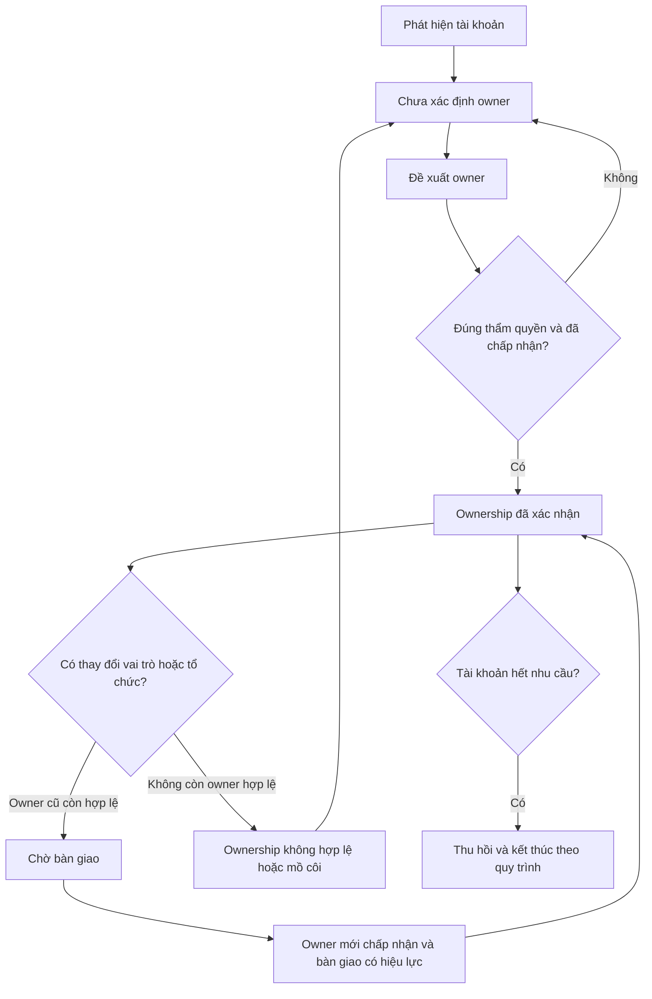

# Owner của privileged account

Một tài khoản đặc quyền có thể được lưu credential trong vault, ghi lại mọi phiên và đổi mật khẩu định kỳ nhưng vẫn thiếu câu trả lời cho câu hỏi quan trọng: **ai chịu trách nhiệm giải thích vì sao tài khoản này cần tồn tại, được phép làm gì và phải xử lý thế nào khi có thay đổi hoặc sự cố?**

Trong quản lý truy cập đặc quyền (Privileged Access Management — PAM), owner của privileged account là chủ thể được tổ chức giao trách nhiệm rõ ràng đối với việc duy trì tài khoản đặc quyền trong phạm vi đã xác định. Ownership phải được chấp nhận, có thể kiểm chứng và có cơ chế kế nhiệm. Một tên được điền vào bảng kiểm kê chưa đủ tạo ra trách nhiệm thực tế.

Bài học thuộc chương **Inventory và ownership**, áp dụng cho tài khoản quản trị của con người, tài khoản dịch vụ và tài khoản truy cập hạ tầng nhạy cảm. Việc xác định owner tạo nền tảng cho kiểm kê quyền, least privilege, JIT/JEA, quản lý credential trong vault, luân chuyển, giám sát phiên và lưu bằng chứng kiểm toán.

## 1. Kết quả cần đạt

Sau bài học, bạn có thể:

- Phân biệt owner chịu trách nhiệm với người sử dụng tài khoản, người giữ credential, người phê duyệt truy cập và người vận hành PAM.
- Xác định những thông tin cần có để ownership gắn đúng với một tài khoản và phạm vi quyền của nó.
- Mô tả quy trình nhận ownership, xem xét định kỳ, chuyển giao và kết thúc vòng đời.
- Xử lý trường hợp không tìm thấy owner hoặc owner rời tổ chức mà vẫn cân nhắc phụ thuộc vận hành.
- Chọn bằng chứng chứng minh owner thực sự nhận trách nhiệm, thay vì chỉ có tên trong inventory.

## 2. Owner chịu trách nhiệm về điều gì?

### 2.1. Trách nhiệm cốt lõi

Trong mô hình của bài học, **owner chịu trách nhiệm cuối cùng về sự cần thiết và vòng đời của tài khoản**. Các trách nhiệm kỹ thuật và phê duyệt quyền được phân công thêm theo chính sách tổ chức.

Owner cần bảo đảm có câu trả lời và đầu mối thực hiện cho các vấn đề sau:

| Vấn đề | Câu hỏi owner phải giải thích được |
| --- | --- |
| Mục đích | Tài khoản phục vụ công việc, dịch vụ hoặc tình huống khẩn cấp nào? |
| Phạm vi | Tài khoản tác động được tới hệ thống, môi trường và dữ liệu nào? |
| Đặc quyền | Những khả năng nào thực sự cần; có thể giảm quyền hoặc chuyển sang JIT/JEA không? |
| Người sử dụng | Chủ thể nào được dùng hoặc được yêu cầu sử dụng tài khoản, theo chính sách nào? |
| Credential | Ai vận hành vault, luân chuyển, thu hồi và khôi phục khi credential gặp vấn đề? |
| Phụ thuộc | Dịch vụ, job, pipeline hoặc hệ thống nào có thể bị ảnh hưởng khi thay đổi tài khoản? |
| Giám sát | Ai tiếp nhận dấu hiệu bất thường, xem xét phiên và xử lý ngoại lệ? |
| Vòng đời | Khi nào cần xem xét lại, chuyển giao, vô hiệu hóa hoặc xóa tài khoản? |
| Bằng chứng | Có thể truy ngược các quyết định và hành động tới tài khoản cụ thể không? |

Owner không nhất thiết trực tiếp thực hiện mọi tác vụ. Họ có thể phối hợp với người quản trị hệ thống, đội IAM/PAM và người vận hành dịch vụ. Tuy nhiên, không thể coi việc giao cho đội khác là lý do để không xác nhận nhu cầu hoặc không trả lời yêu cầu xem xét tài khoản.

### 2.2. Ownership không tự cấp quyền sử dụng

Ghi một người là owner không đồng nghĩa người đó được đọc secret, mở phiên quản trị hoặc tự tăng quyền. Quyền thực thi phải được cấp theo chính sách truy cập riêng, với xác thực, phê duyệt và giới hạn phù hợp.

Ngược lại, người có quyền sử dụng tài khoản chưa chắc là owner. Một nhân viên trực vận hành có thể được JIT để xử lý sự cố nhưng không có thẩm quyền quyết định tài khoản được duy trì vĩnh viễn.

Cần tách ba câu hỏi:

```text
Ai chịu trách nhiệm tài khoản còn cần tồn tại?     -> ownership
Ai được phép yêu cầu hoặc sử dụng quyền?          -> authorization
Ai đang thực hiện thao tác tại thời điểm cụ thể?  -> attribution
```

Cả ba phải liên kết được trong bằng chứng nhưng không nên bị nhập thành một vai trò mặc định.

## 3. Phân biệt các vai trò liên quan

Tên vai trò có thể khác giữa các tổ chức. Bảng sau là mô hình để thiết kế trách nhiệm, không phải một cơ cấu bắt buộc.

| Vai trò | Trách nhiệm điển hình | Điểm cần phân biệt |
| --- | --- | --- |
| Account owner | Xác nhận nhu cầu, vòng đời và đầu mối chịu trách nhiệm của tài khoản | Không mặc nhiên có quyền dùng tài khoản |
| System/resource owner | Quyết định điều kiện cho phép tác động lên hệ thống hoặc tài nguyên mình phụ trách | Có thể khác owner của tài khoản dùng trên nhiều hệ thống |
| Technical owner | Hiểu phụ thuộc, kế hoạch thay đổi và cách xử lý kỹ thuật | Không mặc nhiên được tự phê duyệt mọi quyền |
| Custodian/đội vận hành PAM | Vận hành vault, connector, chính sách phiên và các tác vụ quản lý được giao | Quản lý nền tảng không đồng nghĩa sở hữu mục đích nghiệp vụ của mọi tài khoản |
| Authorized user/workload | Thực hiện tác vụ trong phạm vi được cấp | Phải giữ được dấu vết danh tính thực tế |
| Access approver | Phê duyệt yêu cầu trong phạm vi được ủy quyền | Cần xử lý xung đột với người yêu cầu |
| Security/đội ứng phó | Đặt yêu cầu kiểm soát, điều tra và phối hợp khi có sự cố | Không nên trở thành owner mặc định cho mọi tài khoản chưa rõ chủ |
| Reviewer | Xem xét định kỳ hoặc đánh giá bằng chứng | Cần mức độc lập phù hợp với rủi ro và chính sách |

Một người có thể giữ nhiều vai trò nếu tổ chức cho phép, nhưng phải nhận diện xung đột. Ví dụ, owner đồng thời là người sử dụng tài khoản không nên vì vậy có khả năng tự phê duyệt yêu cầu đặc quyền của chính mình khi chính sách yêu cầu phê duyệt độc lập.

### Ma trận trách nhiệm minh họa

Trong RACI, `A` là đầu mối chịu trách nhiệm cuối cùng cho một hoạt động, `R` là người thực hiện, `C` là bên cần tham vấn và `I` là bên được thông báo. Ma trận dưới đây phải được điều chỉnh và chấp thuận theo mô hình tổ chức thực tế.

| Hoạt động | Account owner | Resource owner | Technical owner | Đội IAM/PAM |
| --- | --- | --- | --- | --- |
| Xác nhận nhu cầu duy trì tài khoản | A | C | R | I |
| Xác định phạm vi quyền trên tài nguyên | R | A | R | C |
| Triển khai gán quyền đã được duyệt | C | A | C | R |
| Lập và vận hành kế hoạch luân chuyển credential | C | C | A | R |
| Xác nhận kết thúc nhu cầu sử dụng | A | C | R | I |
| Thực hiện thu hồi sau quyết định hợp lệ | C | A | R | R |

Mỗi hàng có một đầu mối `A`. Việc account owner chịu trách nhiệm vòng đời không thay thế thẩm quyền của resource owner đối với quyền trên tài nguyên. Những hoạt động như phê duyệt truy cập cá nhân, phản ứng sự cố và kiểm tra độc lập cần quy định riêng nếu chưa nằm trong ma trận này.

## 4. Chọn owner có thể thực hiện trách nhiệm

### 4.1. Tiêu chí lựa chọn

Owner cần có đủ thẩm quyền và khả năng để:

- Hiểu mục đích và giới hạn sử dụng của tài khoản.
- Xác nhận hoặc yêu cầu xác nhận quyền với người phụ trách tài nguyên.
- Huy động technical owner khi luân chuyển, khôi phục hoặc gỡ bỏ tài khoản.
- Tiếp nhận và phản hồi yêu cầu xem xét, cảnh báo và quy trình ứng phó.
- Chấp nhận trách nhiệm, chỉ định đường liên hệ và thực hiện bàn giao khi thay đổi vai trò.

Không chọn owner chỉ vì họ là người tạo tài khoản, người đăng nhập gần nhất hoặc người được ghi trong một log cũ. Những thông tin này là manh mối điều tra; chúng chưa phải bằng chứng người đó nhận trách nhiệm.

### 4.2. Cá nhân, vai trò và đội chịu trách nhiệm

Một cá nhân xác định giúp trách nhiệm rõ ràng nhưng dễ lỗi thời khi chuyển vị trí. Một vai trò tổ chức hoặc đội ổn định giúp duy trì liên hệ, nhưng tên nhóm chung chung có thể khiến không ai nhận xử lý.

Một cách tổ chức phù hợp là lưu:

```text
Vai trò/đội sở hữu: định danh ổn định của đơn vị chịu trách nhiệm
Người chịu trách nhiệm hiện tại: một đầu mối được xác nhận
Technical owner: đầu mối vận hành và phụ thuộc
Đầu mối dự phòng: được ủy quyền rõ, có phạm vi và thời hạn nếu cần
Đường escalation: nơi xử lý khi các đầu mối trên không phản hồi
```

Nếu ownership được biểu diễn bằng vai trò, phải phân giải được ai đang giữ vai trò đó tại thời điểm cần ra quyết định. Một địa chỉ email nhóm chỉ là kênh liên lạc; sự tồn tại của mailbox không chứng minh có người đang nhận trách nhiệm.

Đầu mối dự phòng giúp tiếp tục xử lý công việc khi owner vắng mặt, nhưng không tạo hai owner cuối cùng mâu thuẫn. Cần mô tả lúc nào được thay mặt quyết định và ai giải quyết nếu có bất đồng.

### 4.3. Tài khoản dùng trên nhiều tài nguyên

Một tài khoản có thể truy cập nhiều hệ thống. Vẫn cần một account owner chịu trách nhiệm vòng đời tài khoản, đồng thời xác định resource owner cho từng phạm vi quyền.

Nếu nhiều đội có mục đích và vòng đời khác nhau nhưng dùng chung một tài khoản, việc tìm owner thường bộc lộ thiết kế khó quản lý. Có thể cần tách tài khoản hoặc danh tính workload theo nhiệm vụ để giảm quyền, giảm phụ thuộc và làm rõ trách nhiệm. Việc tách phải được lên kế hoạch, không tự xóa hay đổi credential chỉ để làm gọn inventory.

## 5. Ownership phải gắn với tài khoản chính xác

Tên đăng nhập không phải định danh đủ tin cậy. `admin` trên hai máy chủ là hai principal khác nhau; cùng một tên được tạo lại sau khi xóa có thể thuộc một vòng đời mới.

Bản ghi ownership nên sử dụng định danh ổn định của principal từ hệ thống nguồn, kèm tenant/domain/realm và tài nguyên liên quan. Đổi tên tài khoản không nên làm mất lịch sử ownership.

### Bộ thông tin tối thiểu

| Nhóm | Thông tin cần có |
| --- | --- |
| Định danh | ID inventory, ID principal nguồn, hệ thống/realm, tên hiển thị |
| Phân loại | Tài khoản người dùng, dịch vụ, dùng chung, cục bộ hoặc khẩn cấp |
| Mục đích | Công việc/dịch vụ được phục vụ và lý do cần đặc quyền |
| Phạm vi | Môi trường, tài nguyên, khả năng đặc biệt và đường cấp quyền |
| Trách nhiệm | Account owner, đội sở hữu, technical owner, dự phòng và escalation |
| Chấp nhận | Trạng thái ownership, người chấp nhận, thời điểm và bằng chứng |
| Quản lý truy cập | Chính sách JIT/JEA, phê duyệt, phiên và ngoại lệ liên quan |
| Credential | Tham chiếu tới nơi quản lý secret và chính sách luân chuyển; không lưu secret |
| Phụ thuộc | Dịch vụ, job, pipeline, tài liệu khôi phục hoặc kế hoạch thay đổi |
| Vòng đời | Thời điểm xác minh, kỳ xem xét tiếp theo, thay đổi và trạng thái tài khoản |

Ownership, trạng thái tài khoản và trạng thái quản lý PAM là các thuộc tính khác nhau. Một tài khoản có owner đã xác nhận vẫn có thể chưa được onboard vào vault; một tài khoản đang hoạt động vẫn có thể đang thiếu owner. Không nên dùng một trạng thái “đã quản lý” chung để che khuất những khác biệt này.

## 6. Ví dụ bản ghi ownership

Ví dụ JSON dưới đây là dữ liệu giả định và mô hình tự định nghĩa để học thiết kế inventory. Nó không phải cấu hình của một nhà cung cấp PAM.

```json
{
  "inventory_id": "pa-0184",
  "source_system": "database-platform",
  "realm_id": "tenant:production-a",
  "source_principal_id": "principal:84531",
  "account_name": "svc_orders_reconcile",
  "account_type": "service",
  "account_state": "active",
  "environment": "production",
  "purpose": "Reconcile order settlement batches",
  "resource_ids": ["database:orders-settlement"],
  "privileged_capabilities": ["settlement.reconcile.execute"],
  "ownership": {
    "state": "confirmed",
    "owning_team_id": "team:orders-platform",
    "accountable_person_id": "person:service-owner-12",
    "technical_owner_team_id": "team:orders-operations",
    "delegate_person_id": "person:delegate-07",
    "escalation_policy_ref": "policy:orders-escalation",
    "accepted_at": "2026-11-20T03:00:00Z",
    "acceptance_evidence_ref": "audit:owner-acceptance-6041",
    "last_verified_at": "2026-11-20T03:00:00Z",
    "next_review_due_at": "2027-02-20T03:00:00Z"
  },
  "access_policy_ref": "policy:orders-reconcile-workload",
  "credential_management_ref": "vault-item:pa-0184",
  "rotation_policy_ref": "policy:service-credential-rotation",
  "dependency_refs": ["job:settlement-reconciliation"],
  "change_record_ref": "change:account-owner-204"
}
```

Các định danh và ngày xem xét chỉ là ví dụ, không phải chu kỳ bắt buộc. Tần suất xem xét cần dựa trên mức nhạy cảm, loại tài khoản, tốc độ thay đổi và yêu cầu của tổ chức.

Một capability trong inventory cần ánh xạ tới quyền thực tế trên nền tảng. Không được tự gắn nhãn “quyền hẹp” nếu tài khoản nguồn còn vai trò quản trị khác hoặc có thể mở rộng quyền gián tiếp.

Trường `credential_management_ref` chỉ là tham chiếu, không chứa mật khẩu, private key hay token. Chính tham chiếu vault, danh sách tài khoản và đường escalation cũng có thể là dữ liệu nhạy cảm; cần giới hạn người được đọc hoặc thay đổi.

Bản ghi `confirmed` chỉ có giá trị khi người được chỉ định thực sự chấp nhận trách nhiệm và nguồn tham chiếu còn hiệu lực. Nó không phải bằng chứng thay thế cho cấu hình quyền, kiểm thử luân chuyển hoặc log phiên.

## 7. Quy trình xác lập owner

### Bước 1: Phát hiện và định danh tài khoản

Thu thập tài khoản trong phạm vi được ủy quyền từ hệ thống danh tính, máy chủ, cơ sở dữ liệu, nền tảng cloud, vault hoặc danh mục ứng dụng. Liên kết các nguồn bằng định danh principal và realm, không chỉ dựa vào tên đăng nhập.

Giữ thông tin nguồn, thời điểm quan sát và độ tin cậy của liên kết. Một tài khoản xuất hiện ở nhiều nguồn không nên bị đếm thành nhiều tài khoản; hai tài khoản trùng tên ở hai hệ thống không nên bị gộp lại.

### Bước 2: Tìm owner ứng viên

Có thể dùng thông tin người yêu cầu tạo tài khoản, đội sở hữu ứng dụng, hồ sơ thay đổi, pipeline, job phụ thuộc và log sử dụng để tìm người có khả năng chịu trách nhiệm.

Phải phân biệt **owner ứng viên** với **owner đã xác nhận**. Log cho thấy một người từng chạy job chỉ chứng minh hành vi sử dụng trong phạm vi log, không chứng minh người đó có thẩm quyền quản lý vòng đời tài khoản.

### Bước 3: Xác nhận mục đích và phạm vi

Gửi cho owner ứng viên một hồ sơ đủ để nhận diện tài khoản và ra quyết định:

- Tài khoản nào, thuộc realm và hệ thống nào.
- Công việc nào cần tài khoản và ai chịu ảnh hưởng khi thay đổi.
- Quyền hiện tại, quyền cần thiết và đường truy cập đã phát hiện.
- Chính sách truy cập, credential, giám sát và ngoại lệ đang áp dụng.
- Trách nhiệm cần nhận và các đầu mối kỹ thuật hỗ trợ.

Nếu tài khoản không thuộc phạm vi của người đó, ghi nhận việc từ chối và đầu mối được đề xuất. Không sửa owner thành tên mới chỉ vì người cũ chuyển tiếp yêu cầu.

### Bước 4: Ghi nhận chấp nhận và thẩm quyền

Kiểm tra người nhận có đúng vai trò tổ chức và thẩm quyền không. Ghi lại việc chấp nhận, ngày hiệu lực, người xác nhận và tham chiếu bằng chứng.

Việc nhận ownership không thay thế quyết định phê duyệt quyền. Nếu phạm vi quyền không phù hợp, account owner phối hợp với resource owner để xem xét riêng; không mặc định giữ nguyên quyền chỉ vì đã có người nhận trách nhiệm.

### Bước 5: Hoàn thiện đầu mối và kiểm soát

Xác nhận technical owner, đầu mối dự phòng và đường escalation có thể sử dụng. Đối chiếu với cấu hình PAM, chính sách JIT/JEA, cơ chế quản lý credential và phụ thuộc dịch vụ.

Các kiểm tra cần thiết phải theo quy trình được phép và phù hợp môi trường. Không xoay credential hoặc thu hồi quyền trên production chỉ để kiểm tra thông tin owner nếu chưa có đánh giá phụ thuộc và kế hoạch thay đổi.

### Bước 6: Đặt lịch xem xét và cơ chế cập nhật theo sự kiện

Xem xét định kỳ giúp phát hiện thông tin cũ. Sự kiện như nhân sự nghỉ việc, chuyển đội, ứng dụng đổi owner, thay đổi tài nguyên hoặc phát hiện quyền mới cần kích hoạt xem xét sớm hơn.

Một ownership hợp lệ tại ngày xác nhận không tự duy trì chính xác mãi mãi. Hệ thống cần phát hiện khi người chịu trách nhiệm không còn hoạt động hoặc vai trò tổ chức đã thay đổi.

## 8. Vòng đời ownership và bàn giao

Có thể mô hình hóa trạng thái ownership như sau; trạng thái này độc lập với việc tài khoản đang hoạt động hay đã vô hiệu hóa.



### 8.1. Bàn giao có điểm hiệu lực rõ ràng

Một lần bàn giao nên có:

1. Lý do thay đổi và tài khoản/phạm vi liên quan.
2. Owner cũ và owner mới được nhận diện bằng định danh ổn định.
3. Chấp nhận của owner mới, cùng xác nhận thẩm quyền cần thiết.
4. Danh sách quyền, phụ thuộc, ngoại lệ và việc còn tồn đọng.
5. Mốc chuyển trách nhiệm, cập nhật đầu mối và bằng chứng hoàn tất.
6. Xem xét lại quyền sử dụng của owner cũ nếu họ từng được cấp quyền; quyền đó không tự mất chỉ vì đổi ownership.

Trong thời gian chờ bàn giao, chỉ có thể giữ owner cũ là đầu mối chịu trách nhiệm khi người đó vẫn hợp lệ và tiếp tục nhận trách nhiệm. Nếu owner cũ đã nghỉ việc hoặc mất thẩm quyền, không được giữ trạng thái `confirmed` để chờ người mới nhận. Cần chuyển sang trạng thái chưa có owner hợp lệ và dùng đường escalation.

### 8.2. Không đổi credential mặc định chỉ vì đổi owner

Ownership là trách nhiệm quản trị, còn credential là phương tiện xác thực. Nếu owner cũ chưa từng truy cập secret, đổi owner không tự chứng minh cần luân chuyển ngay mọi credential.

Ngược lại, nếu người rời vai trò có thể giữ credential, khóa hoặc phiên còn hiệu lực, chỉ đổi tên owner trong inventory không xử lý được rủi ro. Phải đánh giá và thực hiện thu hồi quyền, xử lý phiên, luân chuyển hoặc vô hiệu hóa credential theo quy trình phù hợp.

### 8.3. Kết thúc vòng đời tài khoản

Khi hết nhu cầu, owner xác nhận quyết định về vòng đời và phối hợp các bên thực hiện. Cần kiểm tra phụ thuộc, dừng hoặc chuyển workload, thu hồi các đường quyền và credential, xử lý phiên còn tồn tại, rồi xác minh trạng thái trên hệ thống đích.

Không chỉ xóa bản ghi khỏi inventory. Bản ghi lịch sử cần được giữ theo chính sách để điều tra ai từng chịu trách nhiệm và tài khoản đã được xử lý thế nào.

## 9. Khi không tìm thấy owner

### 9.1. Phân biệt các vấn đề

| Trạng thái | Ý nghĩa |
| --- | --- |
| Chưa xác định owner | Đã phát hiện tài khoản nhưng chưa xác nhận được người chịu trách nhiệm |
| Owner không còn hợp lệ | Có tên owner cũ nhưng người hoặc vai trò đó không còn nhận được trách nhiệm |
| Ownership đang tranh chấp | Nhiều bên từ chối hoặc có quyết định mâu thuẫn |
| Quá hạn xem xét | Có owner đã xác nhận nhưng chưa hoàn tất lần xem xét đến hạn |
| Tài khoản không sử dụng | Không thấy sử dụng theo dữ liệu và cửa sổ quan sát đã chọn |

Các trạng thái trên không tương đương. Tài khoản ít sử dụng có thể là break-glass hợp lệ; tài khoản hoạt động mỗi ngày vẫn có thể không có owner. Không có log sử dụng cũng có thể do thiếu bao phủ giám sát, chưa chắc tài khoản đã không còn cần thiết.

### 9.2. Cách xử lý theo mức rủi ro

Quy trình nên thực hiện đồng thời việc tìm owner và đánh giá khả năng bị lạm dụng:

- Xác minh tài khoản, quyền hiệu lực, đường truy cập và phạm vi tài nguyên nhạy cảm.
- Tìm phụ thuộc từ ứng dụng, job, log, cấu hình và các đầu mối quản lý hệ thống trong phạm vi được phép.
- Chỉ định đầu mối xử lý tạm thời có thẩm quyền; ghi rõ đây là trách nhiệm tạm thời và chưa phải xác nhận đầy đủ nhu cầu sử dụng.
- Đánh giá biện pháp như hạn chế truy cập mới, tăng giám sát, thu hẹp đường sử dụng hoặc luân chuyển credential theo mức rủi ro và phụ thuộc.
- Nếu có dấu hiệu credential bị lộ hoặc đang bị lạm dụng, chuyển sang quy trình ứng phó sự cố với thẩm quyền tương ứng.
- Đặt hạn xử lý và đường escalation, giữ bằng chứng cho quyết định tiếp tục, hạn chế hoặc vô hiệu hóa.

Không thể áp dụng máy móc “không có owner thì xóa ngay” cho mọi tài khoản production. Một tài khoản có thể đang chạy sao lưu, tích hợp hoặc khôi phục khẩn cấp. Cần kiểm soát rủi ro mà vẫn hiểu tác động vận hành; trường hợp rủi ro khẩn cấp cần được quyết định theo quy trình ứng phó, không chờ vô thời hạn việc đi tìm owner.

Đội PAM có thể tiếp nhận và điều phối hồ sơ nhưng không nên tự nhận ownership nghiệp vụ cho toàn bộ tài khoản chưa rõ nguồn gốc. Nếu tạm giao trách nhiệm cho một bên, phải có quyết định, phạm vi, thời hạn và kế hoạch hoàn thiện.

## 10. Ví dụ: tài khoản dịch vụ còn quyền rộng, owner đã chuyển đội

Một job đối soát production dùng tài khoản `svc_orders_reconcile`. Inventory ghi tên người đã chuyển khỏi đội ba tháng trước; credential nằm trong vault và được luân chuyển, nhưng tài khoản vẫn có quyền quản trị rộng trên cơ sở dữ liệu.

### Phân tích

Có ít nhất ba vấn đề độc lập:

1. Thông tin owner không còn được xác nhận; trạng thái ownership cần được xử lý.
2. Quyền thực tế rộng hơn nhu cầu được mô tả; cần đánh giá least privilege/JEA.
3. Luân chuyển credential đang hoạt động không chứng minh hai vấn đề trên đã được giải quyết.

### Hướng giải quyết

Đội quản lý dịch vụ được xác định là owner ứng viên dựa trên ứng dụng và job phụ thuộc. Người có thẩm quyền của đội xác nhận mục đích, nhận trách nhiệm vòng đời và chỉ định technical owner. Resource owner của cơ sở dữ liệu tham gia xem xét phạm vi quyền.

Technical owner mô tả chính xác những thao tác job cần dùng và các phụ thuộc của credential. Đội IAM/PAM cùng bên vận hành cơ sở dữ liệu thiết kế cách thực thi hẹp hơn, kế hoạch thay đổi, kiểm tra tương thích và phương án khôi phục. Nếu có thể cấp quyền chỉ cho thời gian job chạy, đánh giá JIT với danh tính workload phù hợp; nếu vẫn cần quyền thường trực hẹp, ghi nhận đúng trạng thái đó.

### Bằng chứng hoàn tất

Hồ sơ cần có owner đã chấp nhận, phạm vi tài khoản và tài nguyên đúng, quyết định quyền được duyệt, tham chiếu thay đổi, kết quả kiểm tra job và dữ liệu quyền trên hệ thống đích. Cập nhật thông tin ownership và giảm quyền là hai kết quả cần chứng minh riêng.

Nếu người owner cũ từng có quyền lấy credential, xem xét thu hồi đường đó và xử lý credential/phiên theo rủi ro. Nếu họ chỉ là đầu mối nghiệp vụ, không được tự suy rằng họ đã có secret chỉ từ trường owner.

## 11. Những trường hợp cần quy định riêng

### 11.1. Tài khoản quản trị gắn với một người

Người dùng được gắn với tài khoản bằng định danh danh tính. Nhưng nhu cầu có tài khoản và phạm vi quyền vẫn cần người có thẩm quyền xác nhận theo chính sách. Không nên để một người tự duy trì mọi quyền của chính mình chỉ vì tài khoản mang tên họ.

Khi người dùng nghỉ việc hoặc chuyển vị trí, xử lý quyền truy cập theo sự kiện nhân sự và đánh giá nhiệm vụ còn lại. Việc account owner chưa phản hồi không nên làm vô hiệu quy trình thu hồi bắt buộc đã được tổ chức thiết lập.

### 11.2. Tài khoản dùng chung

Owner chịu trách nhiệm vòng đời của tài khoản, còn mỗi lần sử dụng phải truy được tới người thực hiện khi cơ chế cho phép. Ưu tiên danh tính cá nhân và quyền hẹp thay cho chia sẻ credential trực tiếp.

Nếu chưa thể bỏ tài khoản dùng chung, cần xác định danh sách chủ thể được phép, cơ chế cấp phiên hoặc checkout, quy tắc đồng thời, giám sát và xử lý credential sau sử dụng. Một owner được chỉ định không khắc phục được việc mất dấu ai đã thực hiện thao tác.

### 11.3. Tài khoản nhà cung cấp hoặc bên thứ ba

Cần một đầu mối bảo trợ trong tổ chức để chịu trách nhiệm nhu cầu và thời hạn hợp tác. Người liên hệ phía nhà cung cấp là đầu mối phối hợp, không nên là nơi duy nhất quyết định quyền trên tài nguyên của tổ chức.

Gắn thời hạn với công việc hoặc hợp đồng, xác định người dùng thực tế, phạm vi JIT/JEA và điều kiện kết thúc. Khi thay đổi nhân sự nhà cung cấp hoặc kết thúc công việc, cần cập nhật danh tính và thu hồi các đường truy cập tương ứng.

### 11.4. Tài khoản break-glass

Owner cần bảo đảm có quy trình sử dụng khẩn cấp, điều kiện kích hoạt, đường liên hệ dự phòng, cách khôi phục credential và xem xét sau sử dụng. Nếu cơ chế yêu cầu hai người phối hợp, phải xác định rõ trách nhiệm từng người và khả năng thực hiện khi có sự cố.

Cần tính tới trường hợp hệ thống IAM/PAM thông thường không khả dụng. Một đường khôi phục chỉ dùng được khi chính hệ thống đang hỏng vẫn hoạt động có thể không đáp ứng mục tiêu khẩn cấp.

Thông tin owner, cách liên hệ và tài liệu cần thiết phải được truy cập bởi người được phép trong tình huống đó. Mọi phương án dự phòng vẫn cần bảo vệ secret, giới hạn quyền và lưu bằng chứng theo khả năng thực tế; không biến break-glass thành tài khoản dùng thường ngày.

## 12. Kiểm chứng ownership và lưu bằng chứng

### 12.1. Tiêu chí ownership có thể kiểm chứng

Một hồ sơ nên được coi là đủ để xem xét khi:

- Nhận diện đúng tài khoản và hệ thống nguồn bằng định danh ổn định.
- Có owner hợp lệ, đã nhận trách nhiệm và có thẩm quyền tương ứng.
- Có mục đích, phạm vi quyền và các resource owner liên quan.
- Có technical owner, phụ thuộc và đường escalation khả dụng.
- Có liên kết tới chính sách truy cập, quản lý credential và xử lý ngoại lệ.
- Có thời điểm xác nhận, thời hạn xem xét và lịch sử bàn giao.
- Có cách truy ngược tới bằng chứng nguồn; không chứa secret trong hồ sơ.

Tính đầy đủ của ownership không chứng minh mọi kiểm soát PAM đã hoạt động đúng. Cần đối chiếu riêng cấu hình quyền, luân chuyển credential, giám sát phiên và thu hồi khi đánh giá các kiểm soát đó.

### 12.2. Những bằng chứng nên giữ

| Sự kiện | Bằng chứng phù hợp |
| --- | --- |
| Nhận ownership | Hồ sơ tài khoản, người nhận, thẩm quyền, thời điểm và nội dung trách nhiệm đã chấp nhận |
| Xem xét định kỳ | Phạm vi được xem xét, kết luận, ngoại lệ và việc cần xử lý |
| Chuyển giao | Người cũ/người mới, mốc hiệu lực, chấp nhận và các hạng mục bàn giao |
| Thay đổi quyền | Quyết định đúng thẩm quyền và trạng thái quyền thực tế sau thay đổi |
| Luân chuyển hoặc thu hồi credential | Kết quả tác vụ và kiểm tra cần thiết, không lưu giá trị secret |
| Ứng phó sự cố | Quyết định, phạm vi tác động, người thực hiện và kết quả theo từng hệ thống |
| Kết thúc tài khoản | Xác nhận hết nhu cầu, xử lý phụ thuộc và bằng chứng thu hồi trên đích |

Lịch sử phải cho biết ai đã sửa owner, sửa từ giá trị nào sang giá trị nào và có hiệu lực khi nào. Không ghi đè thông tin hiện tại rồi làm mất người chịu trách nhiệm tại thời điểm một sự cố trong quá khứ.

Quyền sửa inventory cần được kiểm soát. Nếu bất kỳ người sử dụng nào cũng đổi được owner hoặc người phê duyệt của tài khoản mình dùng, dữ liệu ownership có thể trở thành đường vượt qua kiểm soát. Hệ thống phê duyệt cần xác minh vai trò từ nguồn tin cậy, không chỉ tin một trường owner do người yêu cầu tự gửi lên.

### 12.3. Chỉ số theo dõi chất lượng

Có thể đo:

```text
Tỷ lệ có owner đã xác nhận
  = số tài khoản có owner hợp lệ và bằng chứng chấp nhận
    / tổng tài khoản đặc quyền đã phát hiện trong phạm vi

Tỷ lệ xem xét đúng hạn
  = số hồ sơ hoàn thành xem xét trong hạn
    / số hồ sơ đến hạn trong kỳ
```

Nếu mẫu số bằng không, báo không áp dụng thay vì tự coi là 100%. Cần công bố phạm vi kiểm kê và độ mới của dữ liệu; tỷ lệ tốt trên danh mục thiếu tài khoản không chứng minh toàn bộ hệ thống đã có owner.

Theo dõi thêm số tài khoản chưa có owner, số hồ sơ quá hạn, thời gian xử lý bàn giao và quyền còn tồn tại sau khi tài khoản hết nhu cầu. Tách người dùng, dịch vụ, dùng chung và khẩn cấp để tránh che khuất nhóm rủi ro cao.

Ví dụ, 95 trong 100 tài khoản có owner hợp lệ cho tỷ lệ 95%. Nếu một phần trong 95 hồ sơ đó đã quá hạn xem xét, cần báo thêm số quá hạn; không trình bày “có owner” như thể đồng nghĩa mọi quyền và phụ thuộc vừa được xác minh.

## 13. Bài thực hành xác nhận owner

Trong một môi trường thực hành, bạn được cung cấp ba hồ sơ:

| Tài khoản | Hiện trạng |
| --- | --- |
| `admin_ops_named` | Gắn với một người; người đó đang tự phê duyệt yêu cầu đặc quyền của mình |
| `svc_backup_prod` | Job còn chạy; owner cũ đã nghỉ việc; credential nằm trong vault |
| `emergency_admin` | Rất ít sử dụng; có owner nhưng thiếu đầu mối dự phòng và bằng chứng kiểm tra khôi phục |

Với mỗi hồ sơ, hãy xác định principal và hệ thống nguồn, owner ứng viên, bên có thẩm quyền trên tài nguyên, phụ thuộc cần xác minh và bằng chứng còn thiếu.

Một hướng xử lý phù hợp:

1. Với `admin_ops_named`, giữ liên kết người dùng nhưng xem lại thẩm quyền phê duyệt. Chỉ định người phê duyệt phù hợp với chính sách phân tách nhiệm vụ; không giải quyết bằng cách đổi owner hình thức.
2. Với `svc_backup_prod`, đánh dấu không còn owner hợp lệ, kích hoạt escalation và tìm đội chịu trách nhiệm dịch vụ sao lưu. Đánh giá phụ thuộc và rủi ro trước thay đổi; vault không thay thế ownership.
3. Với `emergency_admin`, xác minh nhu cầu break-glass, trách nhiệm dự phòng và phương án khôi phục khi các hệ thống quản lý thông thường không khả dụng. Không kết luận tài khoản thừa chỉ vì ít đăng nhập.

Sản phẩm của bài thực hành là hồ sơ ownership đã phân tích, các quyết định cần thẩm quyền và kế hoạch xử lý có bằng chứng. Không tự chạy thay đổi trên hệ thống production từ dữ liệu bài tập.

## 14. Tự kiểm tra kiến thức

**1. Người tạo tài khoản có tự động là owner không?**  
Không. Đây là manh mối tìm người chịu trách nhiệm. Ownership cần đúng thẩm quyền, được chấp nhận và gắn với mục đích cùng vòng đời hiện tại.

**2. Owner có mặc nhiên được đọc mật khẩu trong vault không?**  
Không. Ownership và quyền sử dụng credential là hai quyết định khác nhau. Quyền truy cập phải tuân theo chính sách riêng.

**3. Có thể ghi một đội chung làm owner không?**  
Có thể biểu diễn bằng vai trò hoặc đội nếu mô hình tổ chức cho phép, nhưng phải phân giải được người chịu trách nhiệm hiện tại, có chấp nhận và có đường escalation. Một tên nhóm không có ai nhận xử lý là chưa đủ.

**4. Owner cũ đã nghỉ việc nhưng người mới chưa nhận thì có giữ trạng thái đã xác nhận không?**  
Không. Cần thể hiện không còn owner hợp lệ và xử lý qua escalation hoặc giao trách nhiệm tạm thời có thẩm quyền. Không dùng tên người đã rời tổ chức để che khoảng trống trách nhiệm.

**5. Tài khoản không có owner có nên bị xóa ngay không?**  
Không áp dụng máy móc. Phải đánh giá quyền, phụ thuộc và mức rủi ro, đồng thời xử lý theo quy trình phù hợp. Dấu hiệu đang bị lạm dụng cần được chuyển sang ứng phó sự cố, không chờ việc tìm owner vô thời hạn.

**6. Đổi owner trong inventory có đồng nghĩa quyền truy cập của người cũ đã mất không?**  
Không. Cần xem xét và thu hồi riêng những quyền, credential hoặc phiên mà người cũ có thể sử dụng, rồi xác minh kết quả trên các hệ thống liên quan.

Ownership có hiệu lực khi một đầu mối đúng thẩm quyền thực sự nhận trách nhiệm, có đủ thông tin và có cơ chế phối hợp để quyết định vòng đời tài khoản. Inventory cần giữ được liên kết giữa trách nhiệm đó với tài khoản, quyền thực tế, phụ thuộc và bằng chứng trong suốt thời gian tài khoản tồn tại.