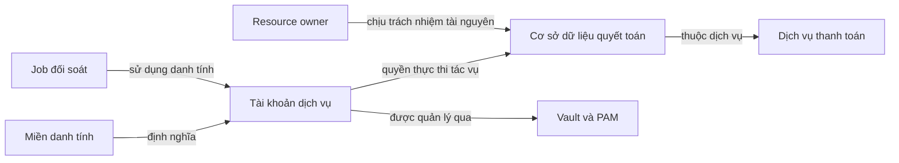

# Associated asset

Trong inventory của hệ thống quản lý truy cập đặc quyền (Privileged Access Management — PAM), **associated asset** là tài sản được liên kết với một tài khoản hoặc danh tính đặc quyền theo một quan hệ có ý nghĩa xác định. Liên kết này giúp trả lời tài khoản thuộc miền quản lý nào, quyền tác động ở đâu, workload nào phụ thuộc vào credential và bên nào chịu trách nhiệm đối với tài nguyên liên quan.

Một ô hostname điền trong hồ sơ tài khoản thường chưa đủ. Tài khoản có thể được định nghĩa trong một thư mục tập trung, được dùng bởi một pipeline và có quyền trên nhiều máy chủ hoặc dịch vụ cloud. Nếu những quan hệ này bị gộp vào cùng một trường, inventory dễ mô tả sai phạm vi đặc quyền và tác động khi luân chuyển, thu hồi hoặc ứng phó sự cố.

Bài học thuộc chương **Inventory và ownership**, tập trung vào liên kết tài khoản quản trị, tài khoản dịch vụ và hạ tầng nhạy cảm. Mục tiêu là xây dựng dữ liệu đủ rõ để phục vụ least privilege, JIT/JEA, quản lý vault, luân chuyển credential, giám sát phiên và lưu bằng chứng kiểm toán.

Tên trường và cách biểu diễn associated asset có thể khác nhau giữa các sản phẩm PAM. Các mô hình bên dưới dùng để học thiết kế inventory, không giả định mọi sản phẩm có cùng cấu trúc hoặc cùng ý nghĩa cho một trường.

## 1. Kết quả cần đạt

Sau bài học, bạn có thể:

- Nhận diện những tài sản cần liên kết với một tài khoản đặc quyền.
- Phân biệt nơi định nghĩa principal, tài nguyên chịu tác động quyền và workload sử dụng tài khoản.
- Chọn định danh tài sản và principal tránh nhầm lẫn do trùng tên, đổi IP hoặc tái tạo tài nguyên.
- Xác nhận liên kết bằng bằng chứng phù hợp và giữ được trạng thái chưa xác định.
- Sử dụng liên kết để đánh giá phạm vi tác động và hỗ trợ quyết định PAM mà không suy diễn quyền từ một nhãn inventory.

## 2. Asset trong phạm vi PAM là gì?

Asset là đối tượng có giá trị hoặc cần được bảo vệ trong phạm vi quản lý. Nó không chỉ là máy vật lý.

| Nhóm tài sản | Ví dụ | Đặc điểm liên quan tới PAM |
| --- | --- | --- |
| Máy chủ và hệ điều hành | Máy vật lý, VM, máy quản trị | Có tài khoản cục bộ, đường đăng nhập và cơ chế nâng quyền |
| Thiết bị hạ tầng | Thiết bị mạng, thiết bị lưu trữ | Có tài khoản quản trị thiết bị hoặc miền quản lý tập trung |
| Nền tảng dữ liệu | Cụm cơ sở dữ liệu, instance, kho dữ liệu | Quyền ứng dụng, dữ liệu và quản trị có thể khác nhau |
| Tài nguyên cloud | Miền tài khoản, project, nhóm tài nguyên, workload | Quyền có thể kế thừa hoặc áp dụng theo điều kiện |
| Nền tảng container | Cluster, namespace, tài nguyên quản trị | Danh tính workload và tài nguyên có vòng đời nhanh |
| Ứng dụng và dịch vụ | Dịch vụ nghiệp vụ, cổng quản trị, ứng dụng SaaS | Có thể dùng tài khoản quản trị ứng dụng riêng |
| Công cụ tự động hóa | Pipeline, runner, job định kỳ | Là nơi sử dụng credential và có thể làm thay đổi tài nguyên khác |
| Hệ thống quản lý quyền và bí mật | Thư mục danh tính, vault, cổng PAM | Bị xâm phạm có thể ảnh hưởng nhiều tài sản phía sau |

Cần phân biệt **tài sản logic** với **thành phần triển khai**. Một dịch vụ cơ sở dữ liệu có thể có nhiều node và endpoint; một hostname có thể trỏ qua bộ cân bằng tải tới nhiều node. Việc tài khoản quản trị một database không tự chứng minh nó có quyền quản trị hệ điều hành của các node đó.

Không phải mọi quan hệ phụ thuộc đều là quyền đặc biệt. Liên kết một job với tài khoản nó sử dụng giúp phân tích luân chuyển credential, nhưng không có nghĩa tài khoản đó quản trị máy chạy job.

## 3. Ba câu hỏi không nên gộp chung

### 3.1. Principal được định nghĩa ở đâu?

Đây là hệ thống hoặc miền danh tính tạo ra và nhận diện tài khoản: máy chủ cục bộ, thư mục tổ chức, tenant, cơ sở dữ liệu hoặc ứng dụng.

Hai tài khoản cùng tên `admin` trên hai máy chủ có thể là hai principal hoàn toàn khác nhau. Một tài khoản trong thư mục tập trung có thể là cùng một principal được dùng trên nhiều tài nguyên.

Quan hệ này giúp xác định đúng đối tượng cần thay đổi khi khóa tài khoản, cập nhật xác thực hoặc xử lý vòng đời principal. Nó không tự liệt kê tất cả tài nguyên mà principal được phép truy cập.

### 3.2. Quyền của principal có hiệu lực trên tài nguyên nào?

Đây là phạm vi quyền thực tế, xét chính sách, nhóm, vai trò, kế thừa và điều kiện của nền tảng. Có thể là một dịch vụ, nhiều máy chủ, một namespace hoặc cả miền tài nguyên.

Cần lưu cả **khả năng được phép** và **điều kiện áp dụng**. Quyền đọc trạng thái dịch vụ và quyền tạo tài khoản quản trị trên cùng asset là hai khả năng rất khác nhau.

Liên kết tài khoản với một tài sản không chứng minh quyền đang có hiệu lực. Muốn dùng dữ liệu cho quyết định truy cập, phải đối chiếu với nguồn quyền tin cậy và độ mới phù hợp.

### 3.3. Ai hoặc workload nào đang sử dụng tài khoản?

Đây là quan hệ sử dụng hoặc phụ thuộc. Ví dụ, job đối soát dùng credential để gọi cơ sở dữ liệu, hoặc nhóm vận hành yêu cầu phiên qua PAM.

Quan hệ này giúp biết ai sẽ bị ảnh hưởng khi đổi credential, ngừng cấp quyền hoặc vô hiệu hóa tài khoản. Một tài khoản có thể được nhiều workload sử dụng; một workload cũng có thể dùng nhiều danh tính với mục đích khác nhau.

```text
Nơi định nghĩa principal  -> nhận diện và vòng đời danh tính
Tài nguyên chịu quyền     -> phạm vi khả năng và tác động
Workload/người sử dụng    -> phụ thuộc và quy trách nhiệm sử dụng
```

Địa chỉ máy chủ mà connector PAM kết nối tới còn là một thông tin khác. Máy trung gian, gateway hoặc endpoint quản trị có thể chỉ nằm trên đường truy cập, không phải toàn bộ tài nguyên mà quyền tác động.

## 4. Mô hình hóa quan hệ thay vì chỉ gắn nhãn

Một mô hình liên kết nên có loại quan hệ rõ ràng. Bảng dưới đây sử dụng tên tự định nghĩa để minh họa.

| Loại quan hệ | Diễn giải | Không nên suy ra |
| --- | --- | --- |
| `defined_in` | Principal được định nghĩa trong hệ thống hoặc realm này | Có toàn quyền trên mọi tài nguyên thuộc realm |
| `authorized_on` | Có quyền đã đối chiếu trên tài nguyên, kèm capability và điều kiện | Đã sử dụng quyền hoặc được phép mọi thao tác |
| `used_by` | Tài khoản được người/workload này sử dụng theo hồ sơ hoặc bằng chứng | Tài khoản quản trị chính workload đó |
| `observed_access_to` | Có sự kiện sử dụng được quan sát tới đích này | Đó là toàn bộ quyền hoặc truy cập đã được phê duyệt |
| `managed_via` | Tài khoản/phiên được quản lý qua vault, connector hoặc cổng này | Không còn đường truy cập trực tiếp khác |
| `member_of_scope` | Asset nằm trong một phạm vi tài nguyên hoặc tập tài sản | Thành viên trong phạm vi đồng nghĩa được cấp quyền |

### 4.1. Quan hệ nhiều-nhiều

Một tài khoản đặc quyền tập trung có thể có quyền trên nhiều tài sản. Một tài sản có thể có tài khoản quản trị cá nhân, tài khoản dịch vụ và tài khoản break-glass cùng liên quan.



Trong sơ đồ, job, cơ sở dữ liệu, dịch vụ và vault đều liên quan nhưng giữ vai trò khác nhau. Không gộp tất cả thành một hostname rồi dùng nó để đại diện cho quyền.

### 4.2. Mỗi quan hệ cần có vòng đời

Liên kết nên ghi nguồn phát hiện, thời điểm quan sát, thời gian hiệu lực nếu biết, trạng thái xác minh và bằng chứng. Khi thay đổi triển khai, không xóa lịch sử liên kết chỉ vì trạng thái hiện tại đã khác.

Ví dụ, tài khoản từng truy cập `database:settlement-old` trước khi di chuyển sang `database:settlement-new`. Điều tra một sự kiện trong quá khứ cần dùng liên kết có hiệu lực tại thời điểm đó, không chỉ danh sách asset hiện tại.

## 5. Định danh tài sản và tài khoản chính xác

### 5.1. Không dùng IP hoặc tên hiển thị làm khóa duy nhất

IP có thể thay đổi, được tái sử dụng hoặc dùng chung qua proxy/NAT. Hostname có thể là alias, endpoint logic hoặc được tái tạo. Tên tài nguyên cloud có thể trùng giữa các tenant, vùng hoặc project.

Nên sử dụng định danh bền vững do nguồn tin cậy cung cấp, kèm miền chứa nó. Với tài nguyên không có ID ổn định toàn cục, cần khóa tổ hợp và dấu vết vòng đời đủ để tránh gộp nhầm.

```text
Định danh principal:
  (hệ thống nguồn, realm/tenant, principal_id, thông tin vòng đời nếu cần)

Định danh asset:
  (nguồn quản lý, miền tài nguyên, asset_id, thông tin vòng đời nếu cần)
```

ID chỉ có ý nghĩa trong namespace của nó. Một ID cục bộ giống nhau trong hai hệ thống không chứng minh đó là cùng đối tượng.

### 5.2. Tài nguyên bị xóa rồi tạo lại

Nếu một VM mới nhận lại hostname và IP của VM cũ, không tự mang toàn bộ liên kết quyền của VM cũ sang VM mới. Cần đối chiếu ID tài nguyên, dấu vết provisioning và chính sách dự định áp dụng.

Tương tự, một tài khoản bị xóa rồi tạo lại cùng tên có thể có ID principal mới. Inventory phải phân biệt vòng đời cũ và mới, giữ lịch sử thay vì nối chúng thành một tài khoản liên tục.

### 5.3. Nhãn môi trường và độ nhạy cảm

Nhãn `production`, mức nhạy cảm và owner của asset hỗ trợ chính sách, nhưng cần nguồn quản lý và kiểm soát sửa đổi. Nếu người yêu cầu tự đổi nhãn tài sản để được quyền mạnh hơn, chính nhãn trở thành đường vượt chính sách.

Khi nhãn ảnh hưởng tới phê duyệt JIT/JEA, điểm quyết định phải lấy dữ liệu từ nguồn tin cậy và phát hiện xung đột hoặc dữ liệu quá cũ. Inventory hỗ trợ quyết định; nó không thay thế cơ chế thực thi quyền trên hệ thống đích.

## 6. Bộ dữ liệu liên kết tối thiểu

Tách bản ghi tài khoản, bản ghi asset và quan hệ giữa chúng giúp cập nhật từng đối tượng mà vẫn giữ được ngữ nghĩa.

| Nhóm dữ liệu | Nội dung cần có |
| --- | --- |
| Principal | ID inventory, ID nguồn, realm, loại tài khoản, trạng thái vòng đời |
| Asset | ID ổn định, loại tài sản, môi trường, miền quản lý và trạng thái vòng đời |
| Quan hệ | Loại quan hệ, chiều liên kết, phạm vi và điều kiện áp dụng |
| Quyền | Capability hoặc tham chiếu chính sách quyền; tách quyền cấu hình khỏi sử dụng quan sát được |
| Ownership | Account owner và resource owner hoặc tham chiếu tới nguồn ownership tin cậy |
| Nguồn | Hệ thống cung cấp dữ liệu, thời điểm quan sát và bằng chứng |
| Xác minh | Trạng thái, người/quy trình xác minh, thời điểm đối soát và hạn xem xét |
| Lịch sử | Bắt đầu/kết thúc liên kết nếu biết, thay đổi và lý do |

Ví dụ JSON sau là mô hình tự định nghĩa, dùng định danh giả định và không chứa secret:

```json
{
  "account": {
    "inventory_id": "pa-0214",
    "source_system": "database-platform",
    "realm_id": "db-instance:finance-prod-01",
    "principal_id": "principal:84531",
    "display_name": "svc_settlement",
    "account_owner_ref": "owner-record:settlement-service"
  },
  "associations": [
    {
      "relationship": "defined_in",
      "asset_id": "db-instance:finance-prod-01",
      "validation_state": "verified",
      "evidence_ref": "snapshot:principal-directory-210"
    },
    {
      "relationship": "authorized_on",
      "asset_id": "database:settlement-prod",
      "capability_ids": ["settlement.reconcile.execute"],
      "authorization_policy_ref": "policy:settlement-workload",
      "validation_state": "verified",
      "assessed_at": "2026-11-26T03:00:00Z",
      "evidence_ref": "snapshot:effective-grants-211"
    },
    {
      "relationship": "used_by",
      "asset_id": "job:settlement-reconcile",
      "validation_state": "verified",
      "evidence_ref": "config:job-identity-binding-212"
    },
    {
      "relationship": "managed_via",
      "asset_id": "vault-item:pa-0214",
      "validation_state": "verified",
      "evidence_ref": "config:pam-onboarding-213"
    }
  ]
}
```

Trạng thái `verified` có nghĩa liên kết đã được xác minh theo phương pháp được ghi nhận; không có nghĩa mọi đường cấp quyền khác đều đã được loại bỏ. `assessed_at` là thời điểm đối soát, không nhất thiết là thời điểm quyền bắt đầu tồn tại.

Một tham chiếu chính sách phải dẫn được tới nội dung và phiên bản có hiệu lực tại thời điểm cần xem xét. Nếu chỉ lưu tên chính sách rồi nội dung bị đổi, việc giải thích quyền tại một thời điểm trong quá khứ sẽ khó chính xác.

## 7. Quy trình phát hiện và đối soát

### Bước 1: Lập danh sách nguồn theo từng loại quan hệ

Nguồn phù hợp phụ thuộc điều đang cần chứng minh:

- Hệ thống danh tính hoặc nền tảng đích cung cấp principal và realm.
- Chính sách IAM, nhóm, vai trò và phân quyền tài nguyên cung cấp dữ liệu để tính quyền.
- CMDB, danh mục cloud hoặc nguồn provisioning cung cấp asset và vòng đời.
- Cấu hình ứng dụng, pipeline, job và cơ chế gắn danh tính workload cung cấp quan hệ sử dụng.
- PAM/vault cung cấp liên kết quản lý credential, connector và phiên.
- Log tại điểm thực thi cung cấp sự kiện sử dụng đã quan sát.

Không có một nguồn luôn đúng cho mọi thuộc tính. CMDB có thể xác định asset owner nhưng chưa phản ánh quyền cục bộ; PAM biết phiên đi qua nó nhưng có thể không biết tài khoản còn được dùng trực tiếp.

Thu thập bằng quyền đọc tối thiểu trong phạm vi được phép. Không sao chép mật khẩu, private key hoặc token vào inventory chỉ để chứng minh workload sử dụng tài khoản.

### Bước 2: Chuẩn hóa ID trước khi ghép dữ liệu

Dùng ID nguồn, tenant/realm và loại đối tượng để ghép chính xác. Giữ tên hiển thị, DNS và IP như thuộc tính hoặc alias có thời gian hiệu lực.

Nếu chỉ có hostname, cần thêm bằng chứng từ nguồn tài sản hoặc provisioning trước khi xác nhận. Khi không đủ dữ liệu, giữ liên kết đề xuất để điều tra; không tự biến suy đoán thành quan hệ đã xác minh.

### Bước 3: Phân loại quan hệ và kiểm tra ngữ nghĩa

Xác định dữ liệu đang chứng minh nơi định nghĩa tài khoản, quyền cấu hình, phụ thuộc credential hay hành vi sử dụng. Một lần đăng nhập thành công không đủ để suy ra tài khoản quản trị mọi tài nguyên trên máy đó.

Một chính sách chứa wildcard hoặc phạm vi động cần được giữ lại cả biểu thức gốc và cách phân giải. Danh sách các tài sản đã thấy hôm nay không chứng minh quyền chỉ giới hạn ở danh sách đó.

### Bước 4: Đối chiếu quyền hiệu lực và điều kiện

Khi xác nhận `authorized_on`, phải xét các quan hệ và điều kiện ảnh hưởng tới quyền theo ngữ nghĩa của nền tảng: gán trực tiếp, nhóm, vai trò, kế thừa, hạn chế và cơ chế ủy quyền liên quan.

Nếu chưa thể phân giải đầy đủ, ghi rõ quyền mới được quan sát ở mức cấu hình, phần chưa đánh giá và phạm vi kết luận. Không dùng một phép nối tên tài khoản với tên role để khẳng định đã tính đủ quyền hiệu lực.

### Bước 5: Xử lý xung đột với owner liên quan

Account owner xác nhận mục đích và vòng đời tài khoản; resource owner xác nhận tài nguyên và phạm vi quyền theo thẩm quyền. Technical owner giải thích workload và phụ thuộc triển khai.

Nếu hai nguồn mâu thuẫn, ghi lại giá trị từng nguồn, độ mới và phương án xác minh. Không chọn giá trị có lợi nhất cho báo cáo hoặc sửa owner tài sản chỉ để hoàn tất liên kết.

### Bước 6: Lưu bằng chứng, trạng thái và lịch sử

Có thể dùng các trạng thái liên kết:

| Trạng thái | Cách hiểu |
| --- | --- |
| Đề xuất | Có manh mối nhưng chưa đủ bằng chứng xác nhận |
| Đã xác minh | Đạt tiêu chí xác minh cho loại quan hệ và thời điểm đã ghi |
| Xung đột | Nguồn hoặc bên chịu trách nhiệm đang có kết luận không khớp |
| Quá cũ | Chưa được đối soát trong thời hạn yêu cầu |
| Chưa xác định | Không đủ dữ liệu để kết luận |
| Đã kết thúc | Có bằng chứng liên kết không còn hiệu lực từ thời điểm xác định |

Không có dữ liệu không đồng nghĩa không có liên kết. Việc một asset biến mất khỏi kết quả thu thập có thể do lỗi connector hoặc thiếu quyền đọc, chưa đủ để kết luận tài nguyên đã bị xóa.

## 8. Ví dụ xuyên suốt: tài khoản dịch vụ đối soát

### 8.1. Hiện trạng

Inventory ghi tài khoản `svc_settlement` với một associated asset là `runner-finance-01`. Vault đã quản lý credential và log cho thấy job trên runner từng sử dụng tài khoản.

Nếu chỉ nhìn bản ghi này, người vận hành có thể nhầm rằng tài khoản thuộc hệ điều hành của runner hoặc quyền chỉ ảnh hưởng tới runner. Thực tế cần xác minh ba điều riêng:

1. Principal được tạo trong instance cơ sở dữ liệu nào.
2. Quyền được cấp trên database và những đối tượng nào.
3. Job hoặc workload nào đang lấy và sử dụng credential.

### 8.2. Kết quả đối soát giả định

Qua dữ liệu principal, quyền trên đích và cấu hình job, nhóm quản lý xác nhận:

| Đối tượng | Vai trò trong quan hệ |
| --- | --- |
| `db-instance:finance-prod-01` | Nơi định nghĩa principal |
| `database:settlement-prod` | Tài nguyên nơi quyền đối soát áp dụng |
| `job:settlement-reconcile` | Workload sử dụng tài khoản |
| `runner-finance-01` | Thành phần triển khai từng chạy workload |
| `vault-item:pa-0214` | Nơi quản lý credential theo cấu hình PAM |

Nhóm giữ liên kết job ổn định và cập nhật lịch sử runner khi triển khai thay đổi. Nếu job chuyển sang runner mới, quan hệ sử dụng của job với tài khoản có thể vẫn tồn tại; quan hệ với máy cũ cần được xác minh và kết thúc theo bằng chứng.

### 8.3. Áp dụng vào luân chuyển credential

Trước khi luân chuyển, technical owner đối chiếu toàn bộ consumer đã biết, cơ chế nhận secret, cache, kết nối dài hạn và kế hoạch cập nhật. Một lần sử dụng được quan sát từ runner không chứng minh đó là consumer duy nhất.

Nếu có consumer chưa rõ, cần ghi nhận rủi ro, tìm thêm dữ liệu và quyết định theo quy trình thay đổi. Không tự luân chuyển trên production để xem ứng dụng nào hỏng rồi bổ sung inventory.

### 8.4. Áp dụng vào least privilege và JIT/JEA

Resource owner của database xem xét capability thực sự cần cho job. Nếu tài khoản còn quyền quản trị instance, đó là một phạm vi khác cần được phát hiện và xử lý, không được che khuất bởi nhãn “job đối soát”.

Có thể đánh giá JEA để chỉ cho phép tác vụ đã định nghĩa, hoặc JIT để quyền chỉ tồn tại trong thời gian cần thiết nếu nền tảng và workload hỗ trợ. Chỉ cập nhật associated asset không tự thu hẹp hay hết hạn quyền; cần thay đổi chính sách và xác minh kết quả trên đích.

## 9. Cập nhật theo vòng đời tài sản

### 9.1. Đổi tên hoặc địa chỉ

Khi ID tài sản giữ nguyên nhưng hostname/IP đổi, cập nhật thuộc tính và alias, giữ lịch sử liên kết. Kiểm tra các cấu hình kết nối còn dùng địa chỉ cũ để tránh truy cập nhầm tài nguyên sau khi IP được tái sử dụng.

### 9.2. Di chuyển hoặc thay thế tài nguyên

Khi đổi sang tài nguyên có ID mới, tạo quan hệ mới và xác nhận quyền cùng phụ thuộc. Không tự sao chép liên kết đã xác minh nếu nguồn dữ liệu mới chưa chứng minh principal và quyền vẫn đúng.

Trong giai đoạn chuyển đổi, một tài khoản có thể tác động cả tài nguyên cũ lẫn mới. Inventory cần thể hiện hai phạm vi đang tồn tại, kèm mốc kết thúc dự kiến và xác nhận thu hồi thực tế.

### 9.3. Xóa hoặc ngừng sử dụng asset

Xóa asset không tự chứng minh tài khoản và credential đã hết tác dụng. Tài khoản tập trung có thể còn quyền trên tài sản khác; credential có thể được tái sử dụng; cấu hình tự động hóa có thể tiếp tục giữ tham chiếu cũ.

Cần đối chiếu quan hệ còn lại, thu hồi quyền và credential trong phạm vi đã duyệt, cập nhật consumer, rồi ghi bằng chứng. Không xóa bản ghi inventory lịch sử để làm biến mất liên kết cần cho kiểm toán.

### 9.4. Tài nguyên tạm thời và phạm vi động

Với VM, container hoặc workload tồn tại ngắn, chỉ kiểm kê thủ công từng instance có thể nhanh lỗi thời. Có thể liên kết tài khoản với workload logic hoặc phạm vi tài nguyên theo policy, đồng thời lưu membership và tài nguyên thực tế tại thời điểm thực thi.

Cần giữ ranh giới của phạm vi: tenant, môi trường, selector, namespace và điều kiện liên quan. Nhãn hoặc selector thay đổi có thể mở rộng tập đích, vì vậy thay đổi đó phải được kiểm soát và đánh giá như một thay đổi có thể ảnh hưởng quyền.

## 10. Sử dụng associated asset trong các quyết định PAM

### 10.1. Xác định owner và bên phê duyệt

Liên kết tài sản giúp tìm resource owner có thẩm quyền đối với từng phạm vi truy cập. Account owner quản lý sự cần thiết và vòng đời tài khoản; asset/resource owner quyết định quyền tác động lên tài nguyên theo chính sách tổ chức.

Không tự sao chép owner của một asset thành owner của tài khoản dùng trên nhiều asset. Nếu các phạm vi thuộc nhiều đội, cần mô hình phê duyệt rõ ràng, kiểm tra điều kiện từng phạm vi hoặc xem xét tách danh tính theo nhiệm vụ.

Một liên kết asset chưa xác minh chỉ là đầu mối tìm người liên quan. Nó không phải bằng chứng đủ để chuyển thẩm quyền phê duyệt sang người được ghi trên asset đó.

### 10.2. Giới hạn JIT/JEA đúng tập đích

Yêu cầu truy cập nên được ràng buộc với định danh tài nguyên hoặc phạm vi có kiểm soát, capability và khoảng thời gian. Máy chủ phải phân giải đích từ nguồn tin cậy, không tin một hostname hoặc asset ID do phía khách tự khai mà chưa kiểm tra.

Trước khi bắt đầu thao tác nhạy cảm, cần kiểm tra điều kiện còn hiệu lực. Nếu tài nguyên được chuyển môi trường hoặc phạm vi động đã đổi thành viên, chính sách phải xử lý thay đổi đó theo quy tắc đã định nghĩa.

Một tài khoản được giới hạn tốt ở giao diện PAM nhưng còn đăng nhập trực tiếp tới tài nguyên khác vẫn có đường quyền ngoài phạm vi đó. Associated asset cần giúp phát hiện khoảng trống này, không chỉ liệt kê các đích đã onboard.

### 10.3. Giám sát phiên và đối chiếu đích thực tế

Bằng chứng phiên nên liên kết được người/workload yêu cầu, principal được dùng, tài nguyên đích, capability hoặc hành động, thời gian và chính sách áp dụng.

Nếu endpoint quản trị là gateway hoặc cụm logic, cần giữ được đích thực tế ở mức cần thiết cho điều tra. Tên hiển thị trong yêu cầu không luôn đủ để chứng minh kết nối đã tới đúng tài nguyên, đặc biệt khi DNS, alias hoặc định tuyến thay đổi.

Một phiên có đích ngoài tập dự kiến là tín hiệu cần xem xét. Có thể do inventory cũ, cấu hình connector sai hoặc hành vi không được phép; cần đối chiếu bằng chứng trước khi kết luận nguyên nhân.

### 10.4. Phân tích phạm vi tác động khi có sự cố

Nếu credential bị lộ, liên kết có ngữ nghĩa rõ giúp xác định:

- Principal nào bị ảnh hưởng và được định nghĩa trong miền nào.
- Tài nguyên nào có quyền đã xác nhận, quyền gì và với điều kiện nào.
- Những đích nào đã có hoạt động được quan sát trong giai đoạn điều tra.
- Workload nào có thể gián đoạn khi luân chuyển hoặc thu hồi.
- Owner nào cần tham gia quyết định và khôi phục.

Không coi mọi node nối trong đồ thị là tài nguyên đã bị quản trị hoặc xâm phạm. Một đường `used_by` hoặc quan hệ phụ thuộc ứng dụng không tương đương một đường cấp quyền. Khi đánh giá phạm vi tác động tiềm năng, phải dùng đúng ngữ nghĩa từng quan hệ, tách phần đã xác nhận và phần cần điều tra thêm.

## 11. Lỗi mô hình hóa thường gặp

| Cách làm | Vấn đề | Cách cải thiện |
| --- | --- | --- |
| Mỗi tài khoản chỉ có một ô hostname | Không biểu diễn được nhiều đích và vai trò khác nhau | Tách asset và các quan hệ có loại rõ ràng |
| Dùng IP làm định danh duy nhất | IP thay đổi hoặc bị tái sử dụng | Dùng ID nguồn và lịch sử địa chỉ |
| Gộp tài khoản trùng tên | Có thể nhập hai principal khác realm thành một | Ghép theo ID principal và miền nguồn |
| Xem mọi đích trong log là quyền đã được duyệt | Hành vi quan sát không đồng nghĩa ủy quyền hợp lệ | Giữ riêng quan hệ quan sát và quyền đối chiếu |
| Cho rằng không có log nghĩa là không có quyền | Quyền chưa sử dụng hoặc thiếu giám sát vẫn tồn tại | Đối chiếu nguồn phân quyền và độ bao phủ log |
| Chỉ ghi máy chạy ứng dụng | Bỏ sót tài nguyên nơi quyền tác động | Ghi workload sử dụng và đích chịu quyền riêng |
| Chỉ ghi connector PAM | Nhầm đường truy cập với tài nguyên đích | Giữ cả endpoint quản lý và đích thực tế |
| Sao chép liên kết cũ sang asset được tạo lại | Có thể cấp nhầm quyền cho vòng đời mới | Xác minh ID và policy provisioning |
| Dùng nhãn inventory để thay thế kiểm tra quyền | Nhãn không tự tạo ranh giới thực thi | Xác minh quyền và điều kiện tại điểm quyết định/đích |
| Xóa liên kết khi nguồn thu thập lỗi | Thiếu dữ liệu bị coi là quyền đã mất | Giữ trạng thái chưa xác định và xử lý lỗi nguồn |

Nếu phát hiện cùng credential được dùng ở nhiều principal hoặc nhiều tài sản, đó là vấn đề cần đánh giá riêng về tái sử dụng bí mật và phạm vi tác động. Không gộp các principal thành một chỉ vì credential giống nhau, và không lưu secret vào inventory để làm khóa ghép.

Với tài khoản break-glass, việc ít có log sử dụng không làm liên kết asset trở nên không cần thiết. Cần biết đúng tập tài nguyên có thể khôi phục, điều kiện sử dụng và cách xác minh liên kết mà không gây thay đổi ngoài quy trình.

## 12. Bằng chứng và chất lượng dữ liệu

### 12.1. Tiêu chí của một liên kết có thể kiểm chứng

Một liên kết nên đủ các thông tin sau để có thể xem xét:

1. Đúng principal, realm và vòng đời tài khoản.
2. Đúng asset, miền tài nguyên và vòng đời tài sản.
3. Loại quan hệ rõ, không nhầm quyền với sử dụng hoặc phụ thuộc.
4. Capability, phạm vi và điều kiện nếu quan hệ liên quan tới quyền.
5. Nguồn dữ liệu, thời điểm, bằng chứng và phương pháp xác minh.
6. Owner hoặc đầu mối xử lý xung đột theo từng đối tượng.
7. Lịch sử thay đổi và trạng thái chưa xác định nếu thiếu dữ liệu.

Bằng chứng có thể là ảnh chụp quyền đã kiểm soát truy cập, hồ sơ provisioning, cấu hình gắn danh tính workload, sự kiện phiên hoặc quyết định xác nhận của người có thẩm quyền. Mỗi loại chỉ chứng minh những điều phù hợp với nó; quyết định phê duyệt không thay thế trạng thái quyền thực tế trên đích.

Kho bằng chứng cần bảo vệ khỏi sửa/xóa trái phép, có mã tương quan và mốc thời gian nhất quán. Không công bố rộng danh sách tài khoản quản trị, topology, đường truy cập hoặc tham chiếu vault chỉ vì đó là metadata.

### 12.2. Chỉ số nên theo dõi

| Chỉ số | Ý nghĩa và giới hạn |
| --- | --- |
| Tài khoản có ít nhất một liên kết đích đã xác minh | Cho biết mức bao phủ ban đầu; không chứng minh toàn bộ tập đích đã được xác định |
| Liên kết chưa xác định hoặc xung đột | Khối lượng cần điều tra và khả năng ảnh hưởng tới quyết định |
| Liên kết quá cũ | Dữ liệu chưa được đối soát theo thời hạn yêu cầu |
| Tài khoản liên quan asset đã kết thúc vòng đời | Cần kiểm tra quyền và phụ thuộc còn tồn tại |
| Truy cập quan sát ngoài tập đích dự kiến | Cần xem xét sai lệch giữa thực tế và inventory |
| Tài khoản có phạm vi rộng chưa phân giải | Cần ghi rõ wildcard, điều kiện và giới hạn của phân tích |

Ví dụ, 80 trong 100 tài khoản có ít nhất một đích đã xác minh chỉ cho phép báo tỷ lệ bao phủ ban đầu là 80%. Không thể kết luận 80% mọi quan hệ quyền đã được kiểm kê, vì một tài khoản trong nhóm đó có thể còn nhiều đích chưa biết.

Công bố mẫu số, phạm vi tài sản và độ mới của từng nguồn. Nếu mẫu số bằng không, báo không áp dụng. Nếu dữ liệu nguồn thiếu, giữ phần chưa xác định thay vì tự giảm mẫu số để làm đẹp tỷ lệ.

Khi so sánh các kỳ, phân biệt quyền thật sự đã bị thu hồi với liên kết bị loại do thay đổi cách phân loại. Nếu tiêu chí chuẩn hóa thay đổi, ghi phiên bản và ảnh hưởng tới kết quả.

## 13. Bài thực hành thiết kế liên kết

Bạn nhận được hồ sơ sau trong môi trường thực hành:

```text
Tên tài khoản: svc_report
Associated asset hiện tại: 10.20.30.40
Credential: được quản lý trong vault
Log sử dụng: có một phiên từ runner-report-01
Ghi chú: dùng cho báo cáo production
```

Chưa có ID principal, realm, ID asset hoặc bằng chứng phân quyền. Không được giả định địa chỉ IP là nơi định nghĩa tài khoản, là đích duy nhất hoặc vẫn thuộc cùng tài sản tại thời điểm hiện tại.

### Nhiệm vụ

- Lập danh sách thông tin cần bổ sung để nhận diện principal và tài sản.
- Chia các liên kết dự kiến thành nơi định nghĩa, đích chịu quyền, workload sử dụng và đường quản lý PAM.
- Xác định nguồn và bằng chứng cho từng liên kết.
- Đánh dấu điều đã biết, điều chỉ là manh mối và điều chưa thể kết luận.
- Nêu những owner cần tham gia trước khi đổi quyền hoặc luân chuyển credential.

### Một hướng xử lý

Trước hết đối chiếu ID principal và realm từ nền tảng nguồn. Tra nguồn tài sản và lịch sử địa chỉ để xác định IP thuộc đối tượng nào tại thời điểm liên quan. Xem cấu hình job và gắn danh tính workload để xác nhận consumer; đối chiếu quyền trên hệ thống đích để xác định capability cùng phạm vi.

Giữ sự kiện phiên như quan hệ `observed_access_to` khi có đủ thông tin đích. Nếu chưa xác nhận được job sử dụng credential theo cách nào, giữ quan hệ sử dụng ở trạng thái đề xuất. Đối chiếu riêng cấu hình vault/PAM, không suy rằng mọi lần sử dụng đều đi qua PAM.

Kết quả cần là hồ sơ có quan hệ rõ, nguồn bằng chứng và phần còn chưa xác định. Nếu chỉ thay địa chỉ IP bằng một hostname dễ đọc hơn mà không xác minh những yếu tố trên, bài toán associated asset chưa được giải quyết.

## 14. Tự kiểm tra kiến thức

**1. Một associated asset có luôn là máy chủ nơi tài khoản được tạo không?**  
Không. Tùy mô hình, liên kết có thể nói về nơi định nghĩa principal, tài nguyên chịu quyền, consumer hoặc đường quản lý. Cần ghi loại quan hệ để không nhầm ý nghĩa.

**2. Vì sao hostname hoặc IP chưa đủ làm định danh duy nhất?**  
Chúng có thể đổi, trùng, là alias hoặc được tái sử dụng. Cần ID nguồn, miền chứa đối tượng và thông tin vòng đời phù hợp.

**3. Tài khoản có quyền trên database thì có được coi là quản trị hệ điều hành của máy chạy database không?**  
Không. Đó là hai phạm vi quyền khác nhau. Muốn khẳng định quyền trên hệ điều hành cần bằng chứng riêng.

**4. Log cho thấy chỉ một runner sử dụng tài khoản có chứng minh chỉ có một consumer không?**  
Không. Có thể còn consumer chưa hoạt động trong cửa sổ quan sát hoặc chưa được giám sát. Cần đối chiếu cấu hình và các nguồn khác.

**5. Xóa asset có tự làm credential mất tác dụng không?**  
Không. Principal có thể còn tồn tại và còn quyền ở nơi khác. Cần xem xét quyền, credential, phiên và phụ thuộc còn lại theo phạm vi đã duyệt.

**6. Chỉ cập nhật liên kết trong inventory có thu hẹp quyền không?**  
Không. Đó là thay đổi dữ liệu quản lý. Giảm quyền cần thay đổi chính sách thực thi và xác minh hiệu lực trên hệ thống đích.

Associated asset hữu ích khi mỗi liên kết mô tả đúng một quan hệ có bằng chứng, thời gian và phạm vi rõ ràng. Từ đó PAM mới có cơ sở để chọn đúng đích, mời đúng bên chịu trách nhiệm và đánh giá tác động của quyền trên hạ tầng nhạy cảm.