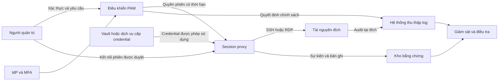

# Session proxy

Trong kiến trúc Privileged Access Management (PAM), **session proxy** là thành phần trung gian thiết lập và chuyển tiếp phiên truy cập đặc quyền giữa người sử dụng và tài nguyên đích. Thành phần này tạo một điểm thực thi chính sách trên đường đi của phiên, đồng thời cung cấp dữ liệu để giám sát và điều tra hoạt động quản trị.

Bài học thuộc chương **Kiến trúc PAM**, trong phạm vi kiểm soát tài khoản quản trị, tài khoản dịch vụ và hạ tầng nhạy cảm. Trọng tâm là thiết kế session proxy phối hợp với kiểm kê tài nguyên, least privilege, cấp quyền đúng lúc (JIT), giới hạn khả năng thao tác (JEA), vault, luân chuyển credential và lưu bằng chứng kiểm toán. Với tác vụ tự động của dịch vụ, cần phân biệt phiên quản trị đi qua proxy với luồng ứng dụng lấy secret hoặc dùng danh tính workload; không phải mọi kết nối của dịch vụ đều cần biến thành phiên tương tác qua session proxy.

Sau bài học, bạn có thể:

- Giải thích vai trò của session proxy và mối quan hệ với vault, bộ máy chính sách và hệ thống ghi phiên.
- Mô tả luồng mở, giám sát và kết thúc một phiên quản trị SSH hoặc RDP.
- Nhận diện đường truy cập bỏ qua proxy, giới hạn của việc ghi phiên và rủi ro từ chính proxy.
- Đề xuất chính sách vận hành, tính sẵn sàng và bằng chứng cho một kịch bản truy cập production.

## 1. Session proxy giải quyết vấn đề gì?

Giả sử quản trị viên cần sửa cấu hình trên máy chủ production. Nếu họ nhận mật khẩu quản trị rồi kết nối trực tiếp, tổ chức phải giải quyết nhiều vấn đề riêng lẻ: ai thực sự sử dụng tài khoản, quyền được cấp trong bao lâu, phiên đã làm gì, có thể dừng phiên ngay không, và mật khẩu có tiếp tục được dùng sau ca bảo trì không.

Session proxy đưa kết nối qua một thành phần do PAM quản lý:

```text
Người quản trị → Session proxy → Tài nguyên đích
                       ↑
            Chính sách, credential, ghi phiên
```

Mô hình này có thể giúp:

- Ràng buộc một phiên với danh tính cá nhân, tài nguyên, lý do và thời hạn được duyệt.
- Sử dụng credential đích mà không cần hiển thị credential đó cho người truy cập, nếu giao thức và cách tích hợp hỗ trợ.
- Hạn chế giao thức hoặc kênh phụ được phép sử dụng.
- Giám sát, ghi nhận hoạt động và ngắt kết nối được proxy quản lý khi có vi phạm.
- Liên kết phiên với bằng chứng để phục vụ kiểm toán và ứng phó sự cố.

Các lợi ích này cần được thiết kế và cấu hình. Chỉ đặt một máy trung gian vào mạng chưa tạo ra đầy đủ những kiểm soát trên. Session proxy cũng không tự giảm quyền của tài khoản ở đích: nếu tài khoản đích vẫn là `root` hoặc có quyền quản trị toàn hệ thống, phạm vi tác động của phiên vẫn rất lớn.

## 2. Phân biệt với các thành phần gần nhau

| Thành phần | Vai trò chính | Quan hệ với session proxy |
|---|---|---|
| Identity provider (IdP) | Xác thực danh tính, cung cấp ngữ cảnh như MFA hoặc nhóm người dùng | Cung cấp đầu vào xác thực; không tự chứng minh rằng một thao tác quản trị cụ thể được phép |
| Bộ máy chính sách PAM | Đánh giá ai được truy cập tài nguyên nào, theo điều kiện và thời hạn nào | Quyết định cho phép; proxy thực thi các quyết định liên quan đến kết nối và phiên |
| Vault | Bảo vệ secret, kiểm soát việc lấy và luân chuyển credential | Có thể cung cấp credential cho proxy; không tự chuyển tiếp hoặc ghi mọi phiên |
| Session proxy | Trung gian giao thức và thực thi kiểm soát trên đường phiên | Kết nối người sử dụng với tài nguyên đích, phát sinh dữ liệu phiên |
| Bastion hoặc jump host | Tạo điểm đi vào mạng quản trị | Có thể chỉ là máy để đăng nhập rồi tiếp tục SSH/RDP; mức kiểm soát phụ thuộc triển khai |
| VPN | Cung cấp đường truyền vào mạng theo chính sách mạng | Có thể là lớp truy cập ban đầu; không thay thế chính sách cho từng tài khoản và phiên đặc quyền |
| Bộ ghi phiên và kho bằng chứng | Thu thập, lưu và bảo vệ dữ liệu hoạt động | Có thể nằm cùng hoặc tách khỏi proxy; cần kiểm soát truy cập và tính toàn vẹn riêng |
| Agent trên máy đích | Thực thi kiểm soát hoặc thu thập sự kiện tại tài nguyên | Bổ sung khả năng quan sát những gì diễn ra bên trong hệ điều hành |

Một sản phẩm có thể gộp nhiều vai trò vào một dịch vụ. Khi thiết kế kiến trúc, vẫn cần xác định rõ nơi xác thực, nơi quyết định quyền, nơi xử lý credential và nơi lưu bằng chứng.

Một jump host chỉ cung cấp shell cho người dùng cũng có thể trở thành nơi họ mở các kết nối tùy ý. Muốn sử dụng như một thành phần kiểm soát PAM, cần bổ sung chính sách, quản lý credential, theo dõi và giới hạn đường ra phù hợp.

## 3. Ranh giới tin cậy trong kiến trúc

Có thể chia kiến trúc thành ba luồng có yêu cầu bảo vệ khác nhau:

1. **Luồng điều khiển:** xác thực, phê duyệt, đánh giá chính sách, cấp quyền và thu hồi quyền.
2. **Luồng dữ liệu phiên:** lưu lượng SSH, RDP hoặc giao thức được proxy hỗ trợ giữa client, proxy và máy đích.
3. **Luồng bằng chứng:** sự kiện, bản ghi phiên, metadata và thông tin kiểm chứng được chuyển vào kho lưu trữ.



Sơ đồ mô tả các vai trò logic, không bắt buộc mỗi vai trò phải là một máy chủ riêng.

### 3.1 Hai chặng kết nối và khả năng quan sát

Một proxy có khả năng kiểm tra nội dung thường kết thúc kết nối từ client rồi tạo kết nối riêng tới đích. Khi đó tồn tại hai chặng bảo mật:

- Client đến proxy: client phải xác minh danh tính dịch vụ proxy.
- Proxy đến đích: proxy phải xác minh đúng máy chủ và dùng credential được phép cho tài nguyên đó.

Với SSH, việc xác minh host key hoặc chứng thư máy đích giúp giảm rủi ro kết nối tới máy giả mạo. Với RDP, cần xác minh danh tính máy chủ và cấu hình bảo mật phù hợp với cơ chế xác thực được triển khai. Không nên mặc định bỏ kiểm tra danh tính đích chỉ vì kết nối phát sinh trong mạng nội bộ.

Nếu proxy chỉ chuyển tiếp một luồng mã hóa xuyên suốt mà không kết thúc hoặc giải mã giao thức, khả năng quan sát nội dung bị giới hạn. Thiết kế cần nêu rõ proxy nhìn thấy metadata kết nối, nội dung terminal, hình ảnh màn hình hay các sự kiện ở mức ứng dụng. Không thể đồng thời giả định proxy hoàn toàn không thấy nội dung và vẫn ghi được toàn bộ thao tác từ chính luồng đó.

### 3.2 Proxy trở thành tài sản có độ nhạy cảm cao

Tùy kiến trúc, proxy có thể xử lý credential, dữ liệu màn hình, lệnh quản trị hoặc kết nối tới nhiều vùng production. Nếu bị chiếm quyền, proxy có thể trở thành điểm xuất phát của tấn công vào nhiều tài nguyên.

Các biện pháp cần có gồm hardening, cập nhật, danh tính dịch vụ riêng, giảm quyền lấy secret, kiểm soát đường mạng, bảo vệ khóa và giám sát thay đổi cấu hình. Quyền quản trị proxy, quyền quản lý vault và quyền xem bằng chứng nên được phân tách theo trách nhiệm.

## 4. Vòng đời một phiên được kiểm soát

Một luồng tham chiếu có thể diễn ra như sau:

1. **Xác định tài nguyên:** người dùng chọn máy đích từ danh mục đã kiểm kê. Mỗi tài nguyên có chủ sở hữu, môi trường, mức nhạy cảm và tập giao thức được hỗ trợ.
2. **Xác thực danh tính:** PAM xác thực người dùng qua IdP và áp dụng MFA theo chính sách. Ngữ cảnh thiết bị hoặc vị trí chỉ được dùng nếu hệ thống thực sự thu thập và kiểm chứng các thuộc tính đó.
3. **Yêu cầu truy cập:** yêu cầu chỉ rõ tài nguyên, vai trò đích, mục đích, mã thay đổi hoặc sự cố và khoảng thời gian cần dùng.
4. **Đánh giá và phê duyệt:** chính sách kiểm tra quyền, phạm vi, thời gian và yêu cầu phê duyệt. Nếu điều kiện không đủ, phiên không được tạo.
5. **Tạo quyền mở phiên:** hệ thống cấp một quyền hoặc token có thời hạn, ràng buộc với người dùng và tài nguyên. Proxy kiểm tra hiệu lực trước khi kết nối; cần có cơ chế hạn chế phát lại hoặc mở phiên ngoài phạm vi được duyệt.
6. **Chuẩn bị credential:** proxy nhận credential từ vault, sử dụng chứng thư ngắn hạn hoặc nhận credential tạm thời theo khả năng tích hợp. Credential chỉ có quyền cần thiết tại đích.
7. **Thiết lập kết nối:** proxy xác minh máy đích, đăng nhập bằng danh tính được cấp và áp dụng chính sách cho các kênh của giao thức. Sự kiện bắt đầu phiên được ghi với một mã phiên duy nhất.
8. **Vận hành và giám sát:** hoạt động đi qua proxy, được ghi theo chính sách. Các sự kiện bất thường có thể dẫn đến cảnh báo, kiểm tra lại hoặc ngắt phiên.
9. **Kết thúc phiên:** người dùng thoát, hết thời hạn hoặc phiên bị dừng. Proxy đóng các kết nối liên quan và ghi lý do kết thúc.
10. **Thu hồi và đối soát:** quyền tạm thời được thu hồi, credential được hủy hoặc luân chuyển khi phù hợp. Bản ghi và sự kiện tại đích được đối chiếu để xác định phiên có hoàn tất việc thu hồi hay còn hành động cần xử lý.

Phải phân biệt các thời hạn sau:

| Thời hạn | Ý nghĩa |
|---|---|
| Thời gian chờ dùng quyền mở phiên | Người dùng được phép bắt đầu kết nối trong bao lâu |
| Thời hạn phê duyệt truy cập | Khoảng thời gian hoạt động được cho phép |
| Thời lượng tối đa của phiên | Giới hạn tổng thời gian của một phiên đã mở |
| Timeout không hoạt động | Khoảng im lặng trước khi phiên bị đóng, theo cách đo của giao thức |
| Thời hạn credential hoặc chứng thư | Khi nào credential không còn được chấp nhận cho xác thực mới |

Hết hạn credential hoặc token mở phiên không có nghĩa kết nối đã xác thực sẽ tự đóng. Ví dụ, việc một chứng thư SSH hết hạn sau khi đăng nhập không tự động ngắt phiên SSH đang chạy. Muốn giới hạn phiên đang hoạt động, cần cơ chế thực thi riêng ở proxy hoặc tại đích.

## 5. Kiểm soát SSH qua session proxy

SSH bao gồm nhiều kiểu kênh và tác vụ. Chỉ kiểm tra đăng nhập thành công chưa đủ để xác định toàn bộ phạm vi truy cập.

| Khả năng SSH | Rủi ro hoặc giới hạn cần xét | Kiểm soát tham chiếu |
|---|---|---|
| Shell tương tác | Người dùng thực hiện nhiều thao tác trong một shell, có thể nâng quyền nếu đích cho phép | Quyền hệ điều hành tối thiểu, `sudo` có phạm vi, audit tại đích |
| Chạy lệnh không tương tác | Có thể không tạo terminal giống phiên tương tác | Kiểm tra hỗ trợ ghi nhận kênh thực thi và metadata của lệnh |
| SCP hoặc SFTP | Dữ liệu có thể được đưa ra hoặc đưa vào hệ thống | Tách chính sách truyền tệp, ghi metadata và kiểm soát vị trí theo khả năng thực thi |
| TCP forwarding | Có thể tạo đường hầm tới dịch vụ khác, vượt phạm vi tài nguyên được duyệt | Tắt mặc định khi không cần; chỉ mở trường hợp có mục đích và phạm vi cụ thể |
| Agent forwarding | Cho phép máy từ xa yêu cầu agent thực hiện xác thực, làm tăng khả năng bị lạm dụng khi máy đó bị xâm nhập | Hạn chế hoặc vô hiệu hóa khi không cần; tránh mang quyền xác thực sang máy đích ngoài thiết kế |
| X11 forwarding và kênh mở rộng | Tạo thêm bề mặt truyền dữ liệu và tương tác ngoài shell | Chỉ bật những kênh nằm trong chính sách đã xác định |

Một session proxy không mặc nhiên hỗ trợ kiểm tra hoặc chặn tất cả các mục trên. Cần xác minh cả ở proxy và cấu hình SSH phía máy đích, đặc biệt khi có thể kết nối bằng client khác hoặc mở nhiều kênh trong cùng kết nối.

### 5.1 Vì sao lọc chuỗi lệnh chưa phải JEA?

Một danh sách cho phép dựa trên biểu thức chính quy có thể bị ảnh hưởng bởi shell expansion, script, alias, trình thông dịch, trình soạn thảo có chức năng mở shell hoặc lệnh gọi chương trình khác. Khi người dùng vẫn có shell với quyền rộng, việc chặn vài tên lệnh không tạo thành ranh giới phân quyền đáng tin cậy.

Để giới hạn đúng khả năng thao tác, cần phối hợp quyền ở đích: vai trò hệ điều hành, `sudo` được thiết kế cẩn thận, endpoint quản trị giới hạn hoặc cơ chế chạy tác vụ có đầu vào được kiểm soát. JEA trong hệ sinh thái Windows còn có nghĩa cụ thể liên quan đến endpoint PowerShell giới hạn; một proxy RDP hoặc bộ lọc lệnh không tự tạo ra cơ chế đó.

### 5.2 Nội dung terminal không phải toàn bộ hành vi của máy

Bản ghi terminal giúp xem những gì đi qua kênh terminal, nhưng có thể không phản ánh đầy đủ truyền tệp, kết nối đường hầm hoặc các thay đổi được thực hiện bởi chương trình chạy nền. Nội dung hiển thị cũng không luôn khớp một đối một với tiến trình và syscall thực sự được thực thi.

Vì vậy, điều tra phiên SSH thường cần kết hợp mã phiên PAM với log xác thực, sự kiện nâng quyền và audit ở máy đích. Phạm vi thu thập phải được mô tả rõ để người kiểm toán hiểu bằng chứng chứng minh được điều gì.

## 6. Kiểm soát RDP qua session proxy

Với RDP, người quản trị tương tác với giao diện đồ họa. Proxy hoặc thành phần ghi phiên có thể ghi màn hình và các sự kiện liên quan tùy khả năng của giải pháp, nhưng việc ghi hình không tự diễn giải đầy đủ mọi thay đổi bên trong hệ điều hành.

Những điểm thiết kế quan trọng gồm:

- **Danh tính đăng nhập:** xác định dùng tài khoản cá nhân, tài khoản tạm thời hay tài khoản được quản lý dùng chung; cần liên kết rõ người dùng PAM với tài khoản Windows thực tế.
- **Quyền ở đích:** tài khoản thuộc nhóm nào, có thể nâng quyền theo cách nào, ứng dụng nào được chạy và quyền đó tồn tại bao lâu.
- **Chuyển hướng thiết bị và dữ liệu:** clipboard, ổ đĩa, máy in và các kênh chuyển hướng khác phải được cho phép theo nhu cầu. Một bản ghi màn hình không bảo đảm phản ánh toàn bộ dữ liệu đi qua các kênh này.
- **Phạm vi giao diện:** nếu chỉ cần một công cụ quản trị, có thể xem xét cơ chế cung cấp ứng dụng hoặc môi trường hạn chế phù hợp. Cung cấp một ứng dụng từ xa vẫn cần xem xét khả năng ứng dụng mở shell hoặc công cụ khác.
- **Đăng xuất và ngắt kết nối:** đóng kết nối ở proxy có thể chỉ làm phiên Windows chuyển sang trạng thái disconnected. Cần kiểm tra chính sách logoff và cơ chế xử lý phiên còn tồn tại tại đích.
- **Khởi động lại máy:** một lần reboot có thể kết thúc kết nối hiện tại; kết nối lại phải tuân thủ quyền truy cập còn hiệu lực và được ghi nhận đúng phiên hoặc phiên mới theo thiết kế.

Thông tin hiển thị trên màn hình có thể chứa secret hoặc dữ liệu nhạy cảm. Bản ghi RDP vì thế cần cơ chế phân quyền xem, ghi nhận lượt xem, thời hạn lưu và phương thức che hoặc giảm thu thập dữ liệu khi có thể thực hiện mà vẫn đáp ứng mục đích kiểm soát.

## 7. Chặn đường truy cập bỏ qua proxy

Proxy chỉ kiểm soát các phiên thực sự đi qua nó. Nếu một máy quản trị vẫn có thể SSH trực tiếp vào production bằng credential khác, người dùng có thể bỏ qua điểm kiểm soát này.

### 7.1 Thiết kế mạng và quyền xác thực cùng nhau

Ví dụ, một vùng Linux production có thể áp dụng:

- Cổng SSH quản trị chỉ nhận lưu lượng từ các node proxy được chỉ định hoặc một đường khẩn cấp được kiểm soát riêng.
- Máy người dùng không có đường quản trị trực tiếp tới nhóm máy production này.
- Tài khoản và chính sách xác thực ở đích không để tồn tại các credential cá nhân có quyền rộng ngoài kiểm kê.
- Đường ra từ proxy chỉ đến các tài nguyên và dịch vụ phụ trợ cần thiết, thay vì toàn bộ mạng nội bộ.
- Nếu có nhiều vùng tin cậy, dùng nhóm proxy hoặc connector phù hợp với từng vùng để giảm phạm vi ảnh hưởng khi một thành phần bị xâm nhập.

Giới hạn nguồn mạng không thay thế việc xác thực và phân quyền ở đích. Máy đích vẫn cần kiểm tra danh tính kết nối và quyền thực tế của tài khoản.

### 7.2 Kiểm kê cả các đường quản trị khác

Các đường cần đưa vào mô hình đe dọa có thể bao gồm console của hypervisor, console cloud, VPN cũ, công cụ remote support, cổng quản trị thiết bị, agent quản trị hoặc tài khoản cục bộ khẩn cấp.

Không phải mọi đường đó đều phải chuyển qua cùng một session proxy. Tuy nhiên, mỗi đường cần có chủ sở hữu, mục đích, kiểm soát tương đương phù hợp với rủi ro và cơ chế ghi bằng chứng. Một đường khẩn cấp hoạt động độc lập với PAM có thể cần thiết để phục hồi PAM, nhưng không nên trở thành đường truy cập thường ngày không được giám sát.

## 8. Phối hợp với vault, JIT và least privilege

### 8.1 Không hiển thị credential chỉ là một lớp bảo vệ

Việc proxy sử dụng credential thay người dùng giúp giảm nhu cầu chia sẻ hoặc sao chép mật khẩu. Credential vẫn có thể tồn tại trong bộ nhớ hoặc trong luồng xử lý của các thành phần tham gia, tùy phương án tích hợp.

Người dùng cũng có thể thực hiện hành vi nguy hiểm ngay trong phiên hợp lệ dù chưa từng biết mật khẩu. Vì vậy, cần phối hợp quyền tối thiểu, giới hạn thời gian, kiểm soát kênh và giám sát hành động.

Proxy chỉ nên được phép lấy credential thuộc tập tài nguyên mà nó phục vụ. Danh tính dịch vụ của proxy phải được bảo vệ và có thể thu hồi; không nên cấp cho mọi proxy quyền đọc toàn bộ vault chỉ để đơn giản hóa triển khai.

### 8.2 JIT phải gắn với trạng thái ở đích

JIT có thể được thực hiện bằng nhiều cách: thêm một quyền tạm thời, tạo tài khoản tạm, cấp chứng thư ngắn hạn hoặc mở một quyền kết nối có thời hạn. Cần phân biệt:

- **Cấp quyền kết nối:** người dùng được mở phiên qua proxy.
- **Cấp quyền tài khoản:** danh tính đăng nhập được đích chấp nhận.
- **Cấp quyền hành động:** tài khoản ở đích được làm những việc cụ thể.

Một thiết kế chỉ giới hạn quyền mở phiên nhưng giữ tài khoản quản trị dùng chung có quyền thường trực vẫn để lại quyền rộng tại tài nguyên. Nếu JIT tạo hoặc sửa quyền ở đích, cần thu hồi quyền và kiểm chứng kết quả sau phiên.

### 8.3 Luân chuyển credential phải xét các bên phụ thuộc

Với credential được quản lý dùng chung, cần tránh đổi mật khẩu không phối hợp làm hỏng phiên hoặc tác vụ khác đang sử dụng credential đó. Tài khoản dịch vụ có thể còn được ứng dụng sử dụng ngoài PAM; việc luân chuyển cần cập nhật các bên phụ thuộc và có phương án khôi phục phù hợp.

Với credential tạm thời, ưu tiên hết hiệu lực hoặc thu hồi theo thiết kế và kiểm tra việc dọn tài khoản, quyền hoặc khóa được tạo. Đóng kết nối không đồng nghĩa các thay đổi về quyền đã được dọn sạch.

## 9. Quy trách nhiệm và bảo vệ bằng chứng

### 9.1 Liên kết danh tính cá nhân với phiên đích

Nếu nhiều người dùng cùng một tài khoản quản trị, log ở máy đích có thể chỉ hiển thị tên tài khoản đó. Để quy trách nhiệm, cần có chuỗi liên kết:

```text
Danh tính cá nhân
  → Yêu cầu và quyết định phê duyệt
  → Mã phiên PAM
  → Tài khoản, tài nguyên và kết nối đích
  → Bản ghi phiên và sự kiện tại đích
```

Tài khoản cá nhân hoặc credential ngắn hạn riêng cho phiên thường giúp tăng khả năng phân biệt, khi môi trường hỗ trợ. Nếu phải dùng tài khoản chung, cần lưu ánh xạ đủ chính xác và kiểm soát các truy cập trực tiếp có thể phá vỡ ánh xạ đó.

### 9.2 Dữ liệu tối thiểu của một phiên

Các trường nên được xem xét gồm:

| Nhóm dữ liệu | Ví dụ |
|---|---|
| Liên kết | `session_id`, `request_id`, mã thay đổi hoặc sự cố |
| Danh tính | Định danh người dùng từ IdP, tài khoản đích, danh tính proxy |
| Phạm vi | Tài nguyên đích, môi trường, giao thức, vai trò được cấp |
| Chính sách | Quy tắc và phiên bản chính sách, người duyệt, thời hạn cho phép |
| Thời gian | Bắt đầu, kết thúc, thời điểm cấp và thu hồi quyền |
| Kết quả | Kết nối thành công hoặc thất bại, lý do ngắt, kết quả thu hồi |
| Bằng chứng | Tham chiếu bản ghi, phạm vi được ghi, khoảng trống và trạng thái chuyển bản ghi |

Đồng bộ thời gian và dùng mã liên kết nhất quán giúp đối chiếu log. Không ghi mật khẩu, private key hoặc token xác thực vào metadata để tiện điều tra.

### 9.3 Tính toàn vẹn, khả năng truy cập và thời hạn lưu

Kho bằng chứng cần mã hóa phù hợp, phân quyền đọc, audit việc truy xuất và cơ chế phát hiện hoặc ngăn sửa/xóa trái phép. Có thể dùng lưu trữ bất biến theo chính sách và thiết kế bảo vệ khóa tách khỏi quyền vận hành proxy.

Hash có ích để phát hiện thay đổi so với một giá trị tham chiếu đáng tin cậy. Nếu kẻ tấn công có thể sửa cả bản ghi lẫn hash trong cùng nơi lưu, riêng phép băm không đủ tạo bằng chứng chống sửa. Thiết kế có thể cần chữ ký, dấu thời gian hoặc nơi giữ giá trị kiểm chứng độc lập.

Thời hạn lưu dựa trên nhu cầu điều tra, kiểm toán và quy định áp dụng cho tổ chức. Sau thời hạn, việc xóa cũng cần theo chính sách. Năng lực xem bản ghi phải được kiểm tra định kỳ để tránh trường hợp có dữ liệu nhưng thiếu khóa giải mã hoặc công cụ phát lại.

## 10. Tính sẵn sàng và hành vi khi lỗi

Proxy nằm trên đường truy cập quản trị nên vừa là điểm kiểm soát vừa là một phụ thuộc vận hành. Thiết kế chỉ có một node có thể làm mất khả năng bảo trì hạ tầng khi node đó lỗi.

### 10.1 Mở rộng và dự phòng

- Sử dụng nhiều node theo vùng và năng lực cần thiết; cân bằng tải phải hiểu yêu cầu của giao thức và phương thức kết nối.
- Dự trù đồng thời số phiên, CPU cho xử lý giao thức, băng thông, bộ đệm ghi và tốc độ đẩy bằng chứng.
- Xem xét độ trễ tới máy đích và kho ghi; RDP và SSH có đặc điểm tài nguyên khác nhau.
- Bảo vệ và dự phòng cả dịch vụ điều khiển, vault, phân giải tên, đồng bộ thời gian và kho bằng chứng theo mức độ phụ thuộc thực tế.

Thêm một proxy dự phòng không mặc nhiên di chuyển được phiên đang hoạt động. Nếu node xử lý phiên chết, kết nối có thể bị mất; người dùng thường phải mở lại một phiên theo chính sách. Cần mô tả và kiểm thử khả năng giữ phiên, kết nối lại hoặc phục hồi mà giải pháp thực tế cung cấp.

### 10.2 Quyết định rõ khi thành phần phụ thuộc lỗi

| Sự cố | Hành vi tham chiếu cần thiết kế |
|---|---|
| Không xác thực hoặc không đánh giá được chính sách | Từ chối phiên mới khi không có căn cứ cấp quyền hợp lệ |
| Vault không khả dụng | Từ chối phiên mới cần credential từ vault; đánh giá riêng phiên đã được thiết lập |
| Bộ ghi hoặc kho bằng chứng gián đoạn | Với phiên bắt buộc ghi, dùng bộ đệm bảo vệ có giới hạn nếu được phép; xác định khi nào phải từ chối hoặc ngắt phiên |
| Dịch vụ điều khiển mất liên lạc với proxy | Quy định phiên hiện có được tiếp tục đến giới hạn nào và proxy thực thi thời hạn bằng cách nào |
| Node proxy bị lỗi | Cảnh báo, xác định phiên bị ảnh hưởng, xử lý trạng thái tại đích và cho phép kết nối lại qua quy trình hợp lệ |
| Thu hồi quyền hoặc luân chuyển thất bại | Phát sinh sự kiện xử lý còn tồn đọng, có chủ sở hữu và bước xác minh hoàn tất |

Với bản ghi bắt buộc, bộ đệm cục bộ cần được mã hóa, giới hạn dung lượng và giám sát. Cần quy định điều gì xảy ra khi bộ đệm đầy, node mất dữ liệu hoặc thời gian gián đoạn vượt ngưỡng; không âm thầm coi phiên thiếu bằng chứng là đã ghi đầy đủ.

Chính sách phiên đang chạy cần tách khỏi chính sách mở phiên mới. Một phiên đã có credential và kết nối tới đích có thể tiếp tục khi vault gián đoạn, nhưng vẫn phải tuân thủ thời hạn và điều kiện tiếp tục đã thiết kế. Nếu quyết định ngắt phiên, cần xem xét cả tác động của việc gián đoạn thao tác bảo trì đang thực hiện.

### 10.3 Truy cập khẩn cấp

Đường break-glass cần có danh tính, quyền, điều kiện kích hoạt, thời hạn và bằng chứng sử dụng rõ ràng. Khi cần hoạt động độc lập với PAM để phục hồi sự cố, phải biết cách kiểm toán đường đó và đối soát sau khi hệ thống hoạt động trở lại. Credential khẩn cấp được bảo vệ, kiểm tra khả dụng và luân chuyển sau sử dụng theo chính sách phù hợp.

## 11. Ví dụ: bảo trì dịch vụ Linux production

Một kỹ sư cần khởi động lại dịch vụ `billing-api` trên máy `prod-linux-07` trong ca bảo trì. Yêu cầu là chỉ cho phép công việc đó trong 30 phút, không truyền tệp và không tạo đường hầm tới các dịch vụ khác.

### 11.1 Chính sách mong muốn

Cấu hình dưới đây là **mô hình minh họa**, không phải cú pháp của một sản phẩm PAM hay một cấu hình có thể triển khai trực tiếp:

```yaml
access_policy:
  name: production-service-maintenance
  requester_group: production-operators
  target_asset: prod-linux-07
  protocol: SSH
  target_role: billing-service-operator
  justification_required: true
  change_reference_required: true
  approval_required: true
  mfa_required: true
  maximum_session_minutes: 30
  idle_timeout_minutes: 5
  recording_required: true
  channels:
    interactive_shell: true
    file_transfer: false
    tcp_forwarding: false
    agent_forwarding: false
    x11_forwarding: false
```

Những thuộc tính như `mfa_required` hoặc `recording_required` mô tả ý định chính sách. Triển khai thực tế phải xác định thành phần kiểm tra, bằng chứng kiểm tra và hành vi khi thành phần đó không hoạt động.

### 11.2 Quyền và đường kết nối thực tế

- Tài khoản đích chỉ có quyền vận hành cần thiết cho `billing-api`; nếu sử dụng `sudo`, phải giới hạn cả lệnh, đối số và những phụ thuộc có thể mở rộng quyền. Khả năng sửa script hoặc unit mà lệnh quản trị sẽ chạy cũng cần được xét.
- Máy production chỉ nhận SSH quản trị từ nhóm proxy được chỉ định. Kênh chuyển tệp và forwarding được giới hạn tại những lớp có khả năng thực thi tương ứng.
- Proxy sử dụng credential được vault quản lý hoặc credential ngắn hạn; người dùng được ánh xạ vào đúng yêu cầu và mã phiên.
- Log dịch vụ và audit tại đích được dùng để xác nhận thời điểm khởi động lại. Bản ghi terminal bổ sung bối cảnh thao tác.

Cho phép shell tương tác vẫn cho người dùng thực hiện những hành động nằm trong quyền cơ sở của tài khoản. Nếu yêu cầu thực sự chỉ là một thao tác cố định, cần đánh giá liệu một tác vụ quản trị được giới hạn có phù hợp hơn việc cấp shell hay không.

### 11.3 Kết thúc và đối soát

Khi kỹ sư thoát hoặc hết 30 phút, proxy đóng phiên theo chính sách. Hệ thống thu hồi quyền tạm thời và xử lý credential theo cơ chế đã chọn. Người vận hành đối chiếu sự kiện khởi động lại, mã thay đổi, thời gian phiên và trạng thái thu hồi.

Nếu kết nối bị ngắt nhưng một tiến trình hoặc tác vụ nền vẫn tiếp tục ở máy đích, phải đánh giá tác vụ đó riêng. Ngắt session proxy không bảo đảm mọi hành động đã phát động trên máy đích đều dừng hoặc được hoàn tác.

## 12. Tình huống ứng phó sự cố

Hệ thống giám sát phát hiện một phiên được duyệt để bảo trì dịch vụ nhưng đang tìm cách truy cập tài nguyên khác. Một quy trình có thể gồm:

1. Xác định mã phiên, người dùng, tài nguyên, tài khoản đích và chính sách đã cấp quyền.
2. Kiểm tra phạm vi quan sát: sự kiện xuất phát từ proxy, audit máy đích hay công cụ giám sát khác.
3. Ngắt phiên bị nghi ngờ và thu hồi quyền mở phiên mới theo quyết định ứng phó.
4. Kiểm tra các phiên khác, credential, token, kết nối mạng và tác vụ tại đích có thể còn hoạt động. Vô hiệu hóa tài khoản hoặc luân chuyển credential theo phạm vi sự cố khi cần.
5. Bảo toàn bản ghi và log liên quan, kiểm soát quyền truy cập bằng chứng, ghi lại hành động của người xử lý.
6. Xác định có đường đi bỏ qua proxy hoặc quyền dư thừa nào đã cho phép hành vi; sửa kiểm soát trước khi cấp quyền trở lại.

Thu hồi quyền ở PAM, đóng kết nối và thu hồi khả năng hoạt động ở đích là các hành động khác nhau. Quy trình cần xác nhận kết quả của từng hành động phù hợp với sự cố.

## 13. Kiểm chứng thiết kế trong thực hành

Trong một môi trường lab được phép quản trị, có thể dùng các tình huống sau để kiểm chứng kiến trúc. Đây là gợi ý thực hành cho người học, không phải kết quả kiểm thử của một sản phẩm cụ thể.

| Tình huống | Điều cần quan sát |
|---|---|
| Mở phiên khi không có quyền hoặc quá thời hạn | Kết nối bị từ chối, có sự kiện giải thích và không tạo quyền ngoài dự kiến |
| Truy cập trực tiếp từ máy người dùng tới máy đích | Đường quản trị ngoài thiết kế bị chặn hoặc được xử lý như một ngoại lệ có kiểm soát |
| Dùng forwarding hoặc truyền tệp khi chính sách cấm | Kênh bị từ chối tại lớp có khả năng thực thi; việc thử sử dụng được ghi theo thiết kế |
| Giữ phiên mở tới hết thời lượng tối đa | Phiên được xử lý đúng chính sách, thay vì chỉ hết hạn token mở phiên |
| Mất kết nối tới vault hoặc kho bằng chứng | Phiên mới và phiên đang chạy có hành vi đúng với thiết kế lỗi |
| Dừng một node proxy | Biết phiên nào bị mất, cách kết nối lại và cách xử lý trạng thái còn lại ở đích |
| Thu hồi quyền thất bại | Có cảnh báo và đầu việc xử lý; không coi phiên đã hoàn tất thu hồi |
| Tìm lại một phiên để kiểm toán | Có thể liên kết người dùng, yêu cầu, tài khoản đích, bản ghi và audit liên quan |

Các chỉ số vận hành hữu ích gồm tỷ lệ phiên mở thành công, thời gian thiết lập, số phiên đồng thời, độ trễ chuyển bằng chứng, số bản ghi thiếu, số lần truy cập bỏ qua đường chuẩn và thời gian hoàn tất thu hồi. Một dashboard chỉ hiển thị proxy còn sống chưa đủ phản ánh khả năng kiểm soát truy cập và bảo toàn bằng chứng.

## 14. Những điểm cần ghi nhớ

Session proxy tạo ra điểm kiểm soát cho phiên đặc quyền, nhưng hiệu quả phụ thuộc vào chính sách, quyền ở đích và việc kiểm soát các đường truy cập khác. Vault bảo vệ credential; JIT giới hạn thời điểm có quyền; quyền tối thiểu và cơ chế giới hạn thao tác giảm phạm vi hành động; ghi phiên và audit cung cấp bằng chứng bổ sung cho nhau.

Một thiết kế có thể vận hành được phải trả lời rõ: ai đang truy cập, vào tài nguyên nào, với quyền gì, trong bao lâu, qua những kênh nào, bằng chứng nằm ở đâu, và khi lỗi xảy ra thì quyền truy cập cùng các tác vụ tại đích được xử lý ra sao.
