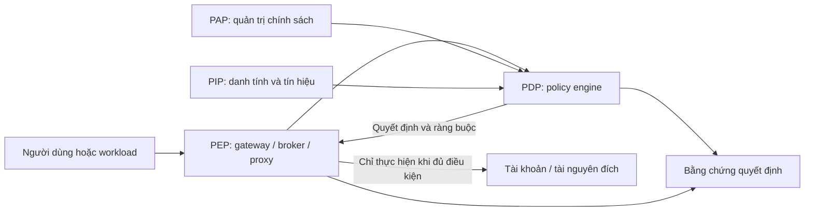

# Policy engine trong kiến trúc PAM

## 1. Policy engine giải quyết vấn đề gì?

Trong hệ thống quản lý truy cập đặc quyền (Privileged Access Management — PAM), xác thực thành công chỉ cho biết danh tính vừa được kiểm chứng. Nó chưa trả lời người đó có được sử dụng tài khoản quản trị nào, trên tài nguyên nào, để làm gì và trong bao lâu.

Một kỹ sư có thể thuộc nhóm vận hành cơ sở dữ liệu nhưng chỉ được xem trạng thái của cụm production, không được xuất dữ liệu hay thay đổi cấu hình. Một dịch vụ có thể được lấy credential cho đúng tác vụ đã đăng ký, nhưng không được dùng credential đó để đăng nhập tương tác. Các giới hạn này cần được đánh giá theo ngữ cảnh của từng yêu cầu.

**Policy engine là thành phần đánh giá chính sách để đưa ra quyết định cấp, từ chối hoặc yêu cầu hoàn tất điều kiện trước khi sử dụng quyền đặc biệt.** Nó phối hợp danh tính, quyền được đề nghị, tài nguyên, hành động, tín hiệu rủi ro và các ràng buộc vận hành.

Trong phạm vi PAM dành cho tài khoản quản trị, dịch vụ và hạ tầng nhạy cảm, policy engine giúp chuyển nguyên tắc least privilege thành quyết định cụ thể:

- Có cấp quyền không, và cấp cho danh tính nào?
- Quyền áp dụng trên tài khoản, hệ thống và hành động nào?
- Quyền được kích hoạt lúc nào và tự hết hạn lúc nào?
- Có cần MFA bổ sung, phê duyệt, ticket hợp lệ hoặc thiết bị được quản lý không?
- Có bắt buộc truy cập qua proxy, giới hạn lệnh, ghi hình phiên hoặc che giấu credential không?
- Khi tín hiệu thay đổi hoặc xảy ra sự cố, quyền và phiên hiện hữu được xử lý ra sao?

Policy engine không tự làm cho môi trường an toàn chỉ bằng việc trả về `ALLOW`. Quyết định cần được thực thi đúng, có thời hạn, có bằng chứng và có cơ chế xử lý khi điều kiện không còn đúng.

## 2. Vị trí của policy engine trong kiến trúc

Để thiết kế rõ trách nhiệm, có thể phân tách bốn vai trò logic sau. Một sản phẩm có thể gộp nhiều vai trò trong cùng dịch vụ hoặc tiến trình.

| Vai trò | Trách nhiệm | Ví dụ trong PAM |
|---|---|---|
| PAP — Policy Administration Point | Soạn, kiểm tra, phê duyệt và phát hành chính sách | Quản trị quy tắc cấp quyền quản trị production |
| PIP — Policy Information Point | Cung cấp thuộc tính và tín hiệu cho việc đánh giá | Nhóm danh tính, nhãn tài nguyên, trạng thái thiết bị, ticket, rủi ro |
| PDP — Policy Decision Point | Đánh giá yêu cầu bằng phiên bản chính sách xác định | Policy engine trả quyết định cùng phạm vi và ràng buộc |
| PEP — Policy Enforcement Point | Chặn hoặc cho phép hành động, áp dụng ràng buộc | Gateway, credential broker, session proxy, agent hoặc API trước tài nguyên |

Policy engine chủ yếu thực hiện vai trò PDP. Ranh giới này quan trọng: PDP có thể yêu cầu ghi phiên nhưng chính PEP phải bảo đảm phiên thực sự được ghi trước khi mở đường truy cập.



Đường truy cập phải đi qua một điểm thực thi đáng tin cậy. Nếu người dùng vẫn có thể SSH trực tiếp vào máy chủ bằng credential quản trị dùng lâu dài, họ có thể bỏ qua quyết định của policy engine. Kiến trúc cần xử lý các đường truy cập trực tiếp, tài khoản cục bộ, khóa tĩnh, API quản trị và đường cứu hộ theo chính sách tương ứng.

### Liên hệ với các thành phần PAM khác

| Thành phần | Policy engine quyết định | Thành phần thực thi |
|---|---|---|
| Credential broker / vault | Ai được sử dụng secret nào, cho mục đích gì; có được nhận secret hay chỉ được kết nối | Kiểm tra quyền, cấp hoặc sử dụng credential theo cách được phép |
| JIT — Just-in-Time | Khi nào kích hoạt quyền, phạm vi và thời hạn | Provisioner tạo quyền tạm, lịch thu hồi và bộ đối soát kiểm tra quyền đã bị gỡ |
| JEA — Just Enough Administration | Tập tác vụ hoặc lệnh quản trị được phép | Endpoint, vai trò đích hoặc cơ chế thực thi giới hạn lệnh |
| Session proxy | Điều kiện mở phiên, ghi phiên, giới hạn chức năng | Mở, giám sát, hạn chế và kết thúc phiên |
| Credential rotation | Danh tính nào được gọi tác vụ luân chuyển và trong điều kiện nào | Dịch vụ luân chuyển cập nhật credential và xác minh kết quả |
| Thu thập bằng chứng | Những sự kiện nào phải được ghi và liên kết | Hệ thống audit lưu sự kiện, bảo vệ tính toàn vẹn và kiểm soát truy cập |

Giới hạn JEA chỉ có ý nghĩa nếu cơ chế phía đích đủ khả năng cưỡng chế. Cho phép shell hoặc công cụ có thể thoát ra shell thường làm suy yếu danh sách lệnh đơn giản. Không nên coi một bộ lọc chuỗi lệnh là ranh giới quyền đầy đủ.

## 3. Mô hình một yêu cầu quyết định

Một yêu cầu nên mô tả rõ **chủ thể, hành động, tài nguyên và ngữ cảnh**. Tránh yêu cầu mơ hồ như “cho phép admin”, vì không thể xác định phạm vi thực thi hay kiểm toán.

Ví dụ dưới đây là dữ liệu minh họa, không phải schema của một sản phẩm cụ thể:

```json
{
  "request_id": "req-7421",
  "subject": {
    "id": "user:linh",
    "type": "human",
    "authentication_event_id": "authn-318"
  },
  "action": "session.start",
  "resource": {
    "id": "server:payments-prod-02",
    "account_id": "account:payments-operator",
    "requested_profile": "service-restart"
  },
  "requested_duration_seconds": 900,
  "context": {
    "device_reference": "device:managed-87",
    "ticket_reference": "change:CHG-2048",
    "purpose": "Khoi dong lai dich vu theo thay doi da duyet"
  }
}
```

Các giá trị do máy khách gửi chỉ là dữ liệu yêu cầu. Engine hoặc một dịch vụ đáng tin cậy phải xác minh chủ thể từ phiên xác thực, tra cứu tài nguyên theo định danh chuẩn và lấy thuộc tính có thẩm quyền. Người dùng không được tự khai `is_admin=true`, `mfa_passed=true` hay `risk=low` rồi dùng những giá trị đó để nhận quyền.

Những nhóm thuộc tính thường cần thiết gồm:

| Nhóm | Thuộc tính gợi ý | Nguồn có thẩm quyền |
|---|---|---|
| Danh tính | ID ổn định, loại danh tính, trạng thái hoạt động, nhóm/vai trò | Hệ thống danh tính và quản lý vòng đời tài khoản |
| Tài nguyên | Chủ sở hữu, môi trường, mức nhạy cảm, tài khoản đặc quyền | Danh mục tài nguyên được quản trị và kiểm kê PAM |
| Hành động | Mở phiên, dùng credential, đọc secret, đổi cấu hình, luân chuyển | Danh mục hành động và khả năng của PEP |
| Xác thực | Phương thức, thời điểm, mức bảo đảm, ràng buộc phiên | Nhà cung cấp xác thực hoặc dịch vụ danh tính |
| Thiết bị và rủi ro | Tình trạng quản lý, tín hiệu xâm nhập, mức rủi ro | Dịch vụ quản lý thiết bị và hệ thống phát hiện |
| Công việc | Ticket, đối tượng được duyệt, cửa sổ thay đổi | Hệ thống phê duyệt và quản lý thay đổi |
| Vận hành | Khả năng ghi phiên, tình trạng proxy, ngân sách quyền tạm | Dịch vụ PAM và các điểm thực thi |

Với mỗi thuộc tính, cần xác định nguồn, thời điểm quan sát, thời hạn được coi là còn mới và cách xử lý khi thiếu. Một nhãn tài nguyên không xác định không được tự động coi là `dev`; một tín hiệu rủi ro không lấy được cũng không có nghĩa là rủi ro thấp.

Kiểm kê quyền là đầu vào quan trọng. Nếu một tài khoản quản trị hoặc một máy chủ nhạy cảm chưa được đưa vào danh mục, engine có thể đánh giá trên dữ liệu thiếu, hoặc không xuất hiện trên đường truy cập của tài nguyên đó.

## 4. Từ nguyên tắc least privilege đến chính sách cụ thể

Chính sách cần liên kết nhu cầu nghiệp vụ với một quyền có thể thực thi. Có thể kết hợp vai trò với thuộc tính thay vì chỉ dựa vào một nhóm rộng.

- **RBAC:** nhóm vận hành thanh toán được phép đề nghị tác vụ vận hành thanh toán.
- **ABAC:** chỉ áp dụng cho tài nguyên có chủ sở hữu tương ứng, đúng môi trường và đúng cửa sổ thay đổi.
- **Ràng buộc theo ngữ cảnh:** thiết bị đạt yêu cầu, MFA đủ mới, rủi ro trong ngưỡng và hạ tầng ghi phiên sẵn sàng.
- **Ràng buộc theo hành động:** được khởi động lại dịch vụ cụ thể nhưng không mặc nhiên được mở shell root hoặc xuất credential.

Một phát biểu chính sách có thể là:

> Kỹ sư trực thuộc nhóm vận hành thanh toán được yêu cầu profile `service-restart` trên máy chủ production của thanh toán trong tối đa 15 phút, khi ticket bao phủ đúng tài nguyên và hành động đã được phê duyệt, MFA còn hiệu lực theo ngưỡng quy định, thiết bị đạt yêu cầu và phiên bắt buộc đi qua proxy có ghi phiên.

Các con số trong bài là lựa chọn minh họa cho tình huống học tập, không phải thời hạn chuẩn áp dụng cho mọi tổ chức. Ngưỡng thực tế cần phù hợp mức nhạy cảm, khả năng thực thi và nhu cầu công việc.

### Tách rõ quyền đề nghị, quyền phê duyệt và quyền sử dụng

Một người có quyền gửi yêu cầu không nhất thiết có quyền tự phê duyệt. Người được giao phê duyệt cũng không mặc nhiên được sử dụng quyền đang được xét.

Đối với tác vụ nhạy cảm, chính sách có thể yêu cầu người phê duyệt khác người đề nghị và thuộc nhóm được ủy quyền cho tài nguyên. Phê duyệt cần gắn với định danh người dùng, hành động, tài nguyên, profile và khoảng thời gian cụ thể. Thay đổi một yếu tố vượt phạm vi phê duyệt phải dẫn đến đánh giá lại.

Một ticket có trạng thái “đã duyệt” nhưng dành cho máy chủ khác hoặc tác vụ khác không đủ để cấp quyền. Cũng cần kiểm tra ticket chưa bị hủy hoặc thu hồi và còn trong hiệu lực.

## 5. Kết quả quyết định và quy tắc kết hợp

Để minh họa, bài dùng ba kết quả. Sản phẩm thực tế có thể có tên gọi hoặc mô hình phản hồi khác.

| Kết quả | Ý nghĩa | PEP được làm gì? |
|---|---|---|
| `DENY` | Yêu cầu bị cấm, không đủ thông tin bắt buộc hoặc không thể đánh giá an toàn | Chặn hành động đặc quyền và ghi lý do phù hợp |
| `PENDING` | Yêu cầu còn thiếu điều kiện có thể hoàn tất, như MFA bổ sung hoặc phê duyệt | Hướng dẫn hoàn tất điều kiện; chưa cấp quyền, chưa trả secret, chưa mở phiên |
| `ALLOW` | Yêu cầu được chấp nhận trong phạm vi và điều kiện xác định | Chỉ thực hiện sau khi áp dụng được mọi ràng buộc bắt buộc |

Trong mô hình của bài, **mặc định là từ chối**. Chính sách cũng cần quy định rõ cách kết hợp khi nhiều quy tắc cùng khớp. Ví dụ chọn quy tắc “từ chối tường minh thắng cho phép”: tài khoản đang bị đình chỉ vẫn bị chặn dù còn nằm trong nhóm vận hành.

Đây là lựa chọn thiết kế phải được khai báo và kiểm thử, không phải giả định rằng mọi engine đều xử lý thứ tự giống nhau. Tránh để một quy tắc cấp quyền rộng vô tình che khuất điều kiện bảo vệ production.

### Ràng buộc bắt buộc và thông tin giải thích

Quyết định cần phân biệt:

- **Ràng buộc bắt buộc:** proxy bắt buộc, ghi phiên, profile JEA, thời điểm hết hạn, không cho xuất credential, giới hạn chuyển tệp.
- **Thông tin giải thích:** lý do, ID quy tắc, gợi ý xử lý hoặc mô tả cho người vận hành.

PEP không được bỏ qua ràng buộc không hỗ trợ. Nếu policy yêu cầu ghi phiên nhưng recorder không sẵn sàng, việc nhận `ALLOW` từ PDP vẫn chưa đủ để mở phiên.

Một phản hồi minh họa:

```json
{
  "decision_id": "dec-8812",
  "request_id": "req-7421",
  "effect": "ALLOW",
  "policy_version": "pam-prod-v17",
  "subject_id": "user:linh",
  "resource_id": "server:payments-prod-02",
  "account_id": "account:payments-operator",
  "action": "session.start",
  "profile": "service-restart",
  "activate_before": "2026-11-26T02:01:00Z",
  "access_expires_at": "2026-11-26T02:15:00Z",
  "audience": "pam-session-proxy",
  "obligations": {
    "record_session": true,
    "credential_export": false,
    "file_transfer": false,
    "revoke_on_high_risk": true
  },
  "reason_codes": ["ROLE_MATCH", "CHANGE_APPROVED", "CONTEXT_ACCEPTED"]
}
```

`activate_before` là hạn dùng để bắt đầu thực thi quyết định; `access_expires_at` là mốc hết quyền. Đến gần mốc hết quyền mới kích hoạt không được làm thời hạn tự kéo dài thêm 15 phút. PEP phải kiểm tra danh tính, phạm vi, audience, tính toàn vẹn, hiệu lực và chống phát lại theo giao thức đã thiết kế.

Phản hồi JSON ở trên không tự có khả năng chống sửa đổi. Việc truyền và sử dụng quyết định cần một kênh xác thực phù hợp, hoặc một cơ chế xác minh quyết định như chữ ký cùng quản lý khóa và chống phát lại. Chỉ thêm trường `decision_id` không đủ ngăn tái sử dụng.

## 6. Luồng cấp quyền JIT và thực thi JEA

Một luồng đầy đủ cho yêu cầu khởi động lại dịch vụ production có thể diễn ra như sau:

1. Người dùng xác thực. Gateway xác định danh tính từ phiên đáng tin cậy và chuẩn hóa tài nguyên, tài khoản, hành động được yêu cầu.
2. PDP lấy thuộc tính cần thiết từ PIP; kiểm tra nguồn và độ mới theo chính sách.
3. Nếu cần MFA bổ sung hoặc phê duyệt, PDP trả `PENDING`. Hệ thống chờ điều kiện hoàn tất; chưa tạo quyền đặc biệt để người dùng sử dụng.
4. Khi điều kiện đã hoàn tất, PDP đánh giá lại toàn bộ yêu cầu với ngữ cảnh hiện tại. Phê duyệt cũ không thay thế bước này.
5. PDP trả `ALLOW` kèm phạm vi, profile JEA, hạn kích hoạt, hạn truy cập và các ràng buộc.
6. PEP xác minh quyết định. Provisioner tạo quyền tạm; hệ thống xác nhận cơ chế thu hồi và giới hạn phía đích có thể thực thi. Nếu bước chuẩn bị lỗi, luồng không được coi là đã cấp quyền thành công; phần quyền đã tạo cần được hoàn tác hoặc đưa vào xử lý khắc phục.
7. Proxy chuẩn bị ghi phiên, áp dụng giới hạn chuyển tệp và kết nối bằng credential được quản lý. Người dùng chỉ nhận chức năng nằm trong profile được phép.
8. Các sự kiện mở phiên, sử dụng quyền, thay đổi rủi ro và kết thúc được liên kết với quyết định ban đầu.
9. Khi hết hạn hoặc có sự kiện thu hồi, hệ thống gỡ quyền tạm và xử lý phiên/token theo khả năng thực thi. Bộ đối soát kiểm tra trạng thái đích thay vì chỉ tin rằng tác vụ thu hồi đã được gửi.

Quyền JIT hết hạn trong hệ thống điều phối không bảo đảm phiên đang mở cũng hết hiệu lực. Ví dụ, xóa thành viên khỏi một nhóm có thể không loại bỏ quyền đã nằm trong phiên đăng nhập hoặc token đang dùng. Kiến trúc phải xác định cần đóng phiên, vô hiệu hóa token, gỡ quyền ở đích hay kết hợp các cách này.

Tương tự, thay đổi mật khẩu thường không tự kết thúc mọi phiên đã xác thực. Luân chuyển credential là một phần của vòng đời quyền; cơ chế dừng phiên và thu hồi quyền cần được thiết kế riêng.

## 7. Mã giả đánh giá chính sách

Đoạn mã dưới đây minh họa thứ tự tư duy, không phải cấu hình có thể triển khai trực tiếp. Các hàm lấy dữ liệu cần có xác thực, kiểm soát thời gian chờ, xử lý lỗi và hợp đồng độ mới rõ ràng.

```text
evaluate(request, trusted_context):
    if not valid_request_shape(request):
        return DENY("INVALID_REQUEST")

    subject = resolve_authenticated_subject(trusted_context)
    resource = resolve_managed_resource(request.resource_id)
    if subject is UNKNOWN or resource is UNKNOWN:
        return DENY("UNRESOLVED_IDENTITY_OR_RESOURCE")

    facts = load_authoritative_facts(subject, resource, request.action)
    if missing_or_stale_required_facts(facts):
        return DENY("REQUIRED_CONTEXT_UNAVAILABLE")

    if explicitly_denied(subject, resource, request.action, facts):
        return DENY("EXPLICIT_DENY")

    profile = resolve_permitted_profile(subject, resource, request.action)
    if profile is NONE or not request_within_profile(request, profile):
        return DENY("OUT_OF_SCOPE")

    if facts.risk == HIGH or facts.device_state == NONCOMPLIANT:
        return DENY("CONTEXT_REJECTED")

    if subject.type == HUMAN:
        if not fresh_required_mfa(facts):
            return PENDING("STEP_UP_REQUIRED")
    else:
        if not valid_bound_workload_identity(facts):
            return DENY("WORKLOAD_IDENTITY_REJECTED")

    if approval_required(profile):
        if approval_expired_cancelled_or_wrong_scope(facts):
            return DENY("APPROVAL_INVALID")
        if approval_not_yet_granted(facts):
            return PENDING("APPROVAL_REQUIRED")

    if not enforcement_capabilities_available(profile, facts):
        return DENY("ENFORCEMENT_UNAVAILABLE")

    expires_at = minimum_of(
        requested_end_time(request),
        profile_maximum_end_time(profile),
        approved_window_end(facts),
        applicable_credential_or_identity_expiry(facts)
    )
    if expires_at <= now():
        return DENY("NO_VALID_ACCESS_WINDOW")

    return ALLOW(bound_scope(request, profile), expires_at,
                 mandatory_obligations(profile), policy_version())
```

Trong mã giả, các giá trị thời hạn không áp dụng được loại khỏi phép lấy nhỏ nhất; giá trị bắt buộc mà thiếu phải gây lỗi kiểm tra trước đó. Không được dùng “không có dữ liệu” như một thời hạn vô hạn để né điều kiện bắt buộc.

`ALLOW` còn cần được kiểm tra lần cuối tại PEP. Khoảng thời gian từ đánh giá đến sử dụng có thể xuất hiện thay đổi trạng thái; các điều kiện quan trọng phải được ràng buộc trong quyết định hoặc kiểm tra lại sát thời điểm thực thi.

## 8. Chính sách cho tài khoản dịch vụ và workload

Không thể bê nguyên luồng dành cho con người sang dịch vụ. Một ứng dụng chạy nền không nên dùng tài khoản người quản trị hay nhận một ngoại lệ MFA vĩnh viễn chỉ vì không có người bấm xác nhận.

Policy engine cần đánh giá danh tính workload được kiểm chứng và các ràng buộc tương ứng:

- Workload thuộc môi trường nào, do ai sở hữu và được triển khai từ nguồn nào?
- Danh tính có bị ràng buộc với đúng workload hoặc môi trường thực thi theo cơ chế hiện có không?
- Dịch vụ được dùng secret nào, kết nối đến tài nguyên nào và thực hiện hành động nào?
- Credential có thời hạn nào, được luân chuyển ra sao và ứng dụng xử lý thay đổi credential thế nào?
- Có cho lấy plaintext secret không, hay chỉ cho broker thực hiện kết nối thay?
- Khi workload bị đánh dấu xâm nhập, cơ chế nào chặn lần cấp tiếp theo và xử lý quyền đang có?

Ví dụ, `workload:invoice-batch-prod` chỉ được yêu cầu credential dành cho vai trò đọc bảng đối soát trên cơ sở dữ liệu đã đăng ký. Nó không được sử dụng quyền này để mở phiên SSH hoặc lấy secret của môi trường khác. Quyền đọc cơ sở dữ liệu cuối cùng vẫn phải được cấu hình ở cơ sở dữ liệu, không chỉ ghi trong metadata của policy engine.

Với việc luân chuyển tự động, cần giới hạn riêng danh tính gọi tác vụ rotation. Quyền được luân chuyển một secret không nhất thiết bao gồm quyền xem giá trị secret đó hoặc truy cập ứng dụng bằng secret sau khi đổi.

## 9. Tín hiệu thay đổi, đánh giá lại và thu hồi

Đánh giá ở thời điểm mở phiên là cần thiết nhưng chưa đủ cho truy cập đặc quyền kéo dài. Một tài khoản có thể bị đình chỉ, ticket bị hủy hoặc thiết bị bị phát hiện xâm nhập sau khi quyền đã được cấp.

Các cách triển khai bổ trợ nhau gồm:

- **Đánh giá lại định kỳ:** giới hạn khoảng thời gian sử dụng quyết định cũ, nhưng không phản ứng ngay lập tức.
- **Đánh giá theo sự kiện:** xử lý tín hiệu thay đổi từ danh tính, ticket hoặc hệ thống phát hiện; cần bảo đảm sự kiện đến đúng nơi và có cơ chế đối soát khi mất sự kiện.
- **Quyết định hoặc lease ngắn hạn:** giảm thời gian sống của quyền khi không thể tiếp tục xác nhận điều kiện; cần tính đến tác động khi mất kết nối.
- **Thu hồi tại điểm thực thi:** đóng phiên hoặc gỡ quyền tại nơi có khả năng thực sự ngăn hoạt động tiếp diễn.

Ví dụ quy trình khi nhận tín hiệu thiết bị rủi ro cao:

1. Chặn yêu cầu đặc quyền mới của danh tính hoặc thiết bị trong phạm vi bị ảnh hưởng.
2. Liên kết tín hiệu với các lease, phiên và quyền tạm đang hoạt động.
3. Ra quyết định thu hồi theo chính sách; gửi yêu cầu đến các PEP và hệ thống đích.
4. Kiểm tra kết quả đóng phiên, gỡ quyền và vô hiệu hóa token nếu có hỗ trợ.
5. Cảnh báo khi hành động chưa thành công; cô lập qua biện pháp thay thế đã thiết kế nếu cần.
6. Lưu thời điểm phát hiện, quyết định, thực thi và phần quyền còn tồn tại để phục vụ ứng phó sự cố.

Không nên ghi “đã thu hồi” chỉ vì message được đưa vào hàng đợi. Cần phân biệt yêu cầu đã phát, PEP đã xác nhận và trạng thái đích đã được kiểm chứng. Độ trễ thu hồi phải được quan sát và đưa vào giới hạn rủi ro của thiết kế.

## 10. Cache, lỗi phụ thuộc và tính sẵn sàng

Policy engine nằm trên đường cấp quyền, nên lỗi của nó có thể ảnh hưởng vận hành. Tăng tính sẵn sàng cần đi cùng việc giữ nguyên ranh giới kiểm soát.

### Cache chính sách và cache quyết định là hai việc khác nhau

Cache một gói chính sách đã được kiểm tra tính toàn vẹn có thể giúp PDP đánh giá cục bộ khi kênh phân phối chính sách gián đoạn. Tuy vậy, các dữ kiện động như trạng thái đình chỉ hoặc ticket vẫn có yêu cầu độ mới riêng. Một bản chính sách hợp lệ không làm dữ kiện cũ trở nên hợp lệ.

Cache quyết định `ALLOW` có nguy cơ tái sử dụng quyền sai ngữ cảnh. Nếu được phép cache, khóa và điều kiện sử dụng phải bao phủ đầy đủ các yếu tố liên quan: chủ thể, phiên xác thực hoặc workload, tài nguyên, tài khoản, hành động, profile, phiên bản chính sách, thời hạn và các thuộc tính chi phối quyết định. Chính sách phải quy định khi nào vô hiệu cache; với một số tác vụ nhạy cảm, lựa chọn phù hợp là không tái sử dụng quyết định cấp quyền.

| Tình huống | Hành vi thiết kế trong ví dụ |
|---|---|
| PDP không thể đánh giá yêu cầu mới | Không cấp quyền đặc biệt mới; trả lỗi có thể theo dõi |
| Không lấy được trạng thái bắt buộc của ticket | Chặn yêu cầu phụ thuộc ticket; không coi là đã được duyệt |
| Không tải được bản chính sách mới | Chỉ dùng bản đã được xác minh trong khoảng hiệu lực được quy định; hết giới hạn thì chặn yêu cầu mới |
| Recorder không sẵn sàng khi bắt buộc ghi phiên | Không mở phiên yêu cầu ghi hình |
| Không ghi được bằng chứng tại nơi bắt buộc phải ghi trước khi cấp | Chặn cấp quyền, trừ khi có cơ chế đệm bền vững được chính sách cho phép |
| Mất kết nối điều khiển trong một phiên đang chạy | Áp dụng chính sách đã định trước cho phiên hiện hữu, như lease ngắn hoặc kết thúc khi quá hạn |

“Fail closed” cần được mô tả cho từng hành động và giai đoạn. Chặn cấp quyền mới không tự xác định việc phải kết thúc mọi phiên đang chạy ngay lập tức. Hành vi với phiên hiện hữu cần cân bằng yêu cầu an toàn và vận hành, được chấp thuận trước và thực thi nhất quán.

Đối với độ sẵn sàng, có thể triển khai nhiều PDP, phân phối chính sách có phiên bản, xác thực giao tiếp dịch vụ, đặt thời gian chờ hữu hạn, giám sát nguồn thuộc tính và đồng bộ thời gian. Các biện pháp này giúp giảm gián đoạn nhưng không cho phép tự động chuyển lỗi thành `ALLOW`.

### Truy cập khẩn cấp

Break-glass là một đường truy cập khẩn cấp được thiết kế trước, có danh tính hoặc credential được bảo vệ, phạm vi tối thiểu và bằng chứng phù hợp. Nó không phải nhánh `catch` trả về `ALLOW` khi PDP hoặc PIP lỗi.

Thiết kế cần xác định điều kiện kích hoạt, người được dùng, cách lấy quyền khi thành phần trung tâm không sẵn sàng, khả năng ghi nhận cục bộ bền vững, thời hạn, thông báo và đối soát sau sử dụng. Các yêu cầu phê duyệt phải phù hợp kịch bản khẩn cấp dự kiến; không được giả định người duyệt hoặc hệ thống ticket luôn truy cập được. Sau sự kiện, kiểm tra quyền tồn dư và luân chuyển credential theo quy trình đã định.

## 11. Quản trị vòng đời chính sách

Thay đổi policy là thay đổi khả năng truy cập hạ tầng. Quyền sửa policy cần được kiểm soát tương xứng với quyền mà policy có thể cấp.

Một quy trình phát hành có thể gồm:

1. Mô tả mục đích, chủ sở hữu tài nguyên và phạm vi bị ảnh hưởng.
2. Viết chính sách với ngữ nghĩa rõ về từ chối, thuộc tính thiếu, xung đột và ràng buộc thực thi.
3. Rà soát độc lập theo mức nhạy cảm; tránh để cùng một người tự mở rộng quyền cho mình rồi tự phê duyệt.
4. Kiểm tra các tình huống cho phép, từ chối và mất phụ thuộc trên dữ liệu thử nghiệm không chứa secret.
5. Đánh giá tác động bằng mô phỏng hoặc chế độ chỉ quan sát nếu nền tảng hỗ trợ; trong giai đoạn này, bộ kiểm soát đang có vẫn phải thực thi truy cập thật.
6. Phát hành có phiên bản, theo dõi số lượng từ chối bất thường và khả năng thực thi ràng buộc.
7. Duy trì cơ chế quay về phiên bản đã biết và xử lý riêng các grant, lease hoặc phiên đã cấp theo phiên bản trước.

Rollback chính sách không mặc nhiên thu hồi mọi quyền đã được cấp bởi chính sách lỗi. Nếu một bản phát hành cho phép sai, cần tìm các quyết định và phiên liên quan, đánh giá lại, thu hồi hoặc xử lý theo quy trình sự cố.

Không đặt secret vào policy, log hoặc bộ dữ liệu kiểm tra. Policy nên tham chiếu định danh credential hoặc tài nguyên; giá trị credential thuộc cơ chế lưu giữ và sử dụng secret.

## 12. Bằng chứng kiểm toán và khả năng giải thích

Một bản ghi “user được phép truy cập” thường không đủ để giải thích vì sao và chứng minh quyền đã được sử dụng trong giới hạn. Cần nối quyết định với lần thực thi và trạng thái kết thúc.

| Nhóm bằng chứng | Trường hoặc nội dung cần cân nhắc |
|---|---|
| Liên kết | Request ID, decision ID, session ID, lease ID, ticket hoặc approval ID |
| Chủ thể và phạm vi | ID ổn định của người dùng/workload, tài khoản đích, tài nguyên, hành động và profile |
| Quyết định | Kết quả, mã lý do, phiên bản chính sách, các quy tắc liên quan |
| Ngữ cảnh đánh giá | Nguồn thuộc tính, mốc quan sát, độ mới và những giá trị cần thiết để giải thích |
| Thời gian | Thời điểm yêu cầu, đánh giá, kích hoạt, hết hạn và thu hồi |
| Thực thi | PEP nào xử lý, ràng buộc nào đã áp dụng, lỗi và kết quả xác nhận |
| Phiên và sự cố | Tham chiếu bản ghi phiên, sự kiện rủi ro, quyết định kết thúc và quyền tồn dư |

Thu thập bằng chứng cần giới hạn dữ liệu theo mục đích và chính sách lưu giữ. Không ghi mật khẩu, token, private key hoặc toàn bộ nội dung nhạy cảm chỉ để giải thích một quyết định. Bản ghi phiên cũng có thể chứa thông tin nhạy cảm nên cần kiểm soát truy cập, bảo vệ tính toàn vẹn và quản lý thời hạn lưu phù hợp.

Thông báo cho người dùng và bản ghi điều tra có thể có mức chi tiết khác nhau. Người yêu cầu cần biết hành động tiếp theo, chẳng hạn hoàn tất MFA; họ không cần nhận toàn bộ quy tắc nội bộ hoặc danh sách tài khoản đặc quyền mà họ không có quyền thấy.

Một câu hỏi kiểm toán cụ thể là: “Vì sao user Linh được khởi động lại dịch vụ trên máy chủ thanh toán lúc 09:00?” Hệ thống cần chỉ ra policy phiên bản nào, phạm vi ticket nào, điều kiện nào được xác minh, profile nào được thực thi và quyền đã chấm dứt ra sao.

## 13. Những lỗi thiết kế thường gặp

| Lỗi | Hệ quả | Cách thiết kế phù hợp hơn |
|---|---|---|
| Chỉ kiểm tra tên nhóm quản trị | Quyền rộng, không gắn mục đích hoặc tài nguyên cụ thể | Kết hợp nhóm/vai trò với phạm vi tài nguyên, hành động và điều kiện |
| Tin thuộc tính do máy khách tự khai | Người gọi có thể tự nâng quyền | Dùng danh tính đã xác thực và thuộc tính từ nguồn có thẩm quyền |
| Coi phê duyệt là cấp quyền vĩnh viễn | Ticket cũ vẫn được dùng sau khi ngữ cảnh đổi | Gắn phê duyệt với phạm vi, thời hạn và đánh giá lại trước kích hoạt |
| PEP bỏ qua ràng buộc không hỗ trợ | Policy nhìn có vẻ chặt nhưng truy cập thực tế vẫn rộng | Kiểm tra khả năng thực thi và chặn nếu thiếu ràng buộc bắt buộc |
| Dùng chung quyền mở phiên và đọc secret | Credential có thể bị lấy ra dùng ngoài đường giám sát | Tách hành động, quyền và đường truy cập tương ứng |
| Cache `ALLOW` chỉ theo user ID | Quyết định bị dùng cho sai tài nguyên hoặc tác vụ | Ràng buộc đầy đủ phạm vi và hạn dùng, hoặc không cache quyết định |
| Chỉ gỡ nhóm khi hết hạn JIT | Phiên hoặc token còn quyền sử dụng | Kết hợp thu hồi tại đích, xử lý phiên/token và xác minh trạng thái |
| Có lỗi phụ thuộc thì cho phép để tránh gián đoạn | Mất kiểm soát khi hệ thống suy giảm | Hành vi lỗi được định trước, HA và đường khẩn cấp có kiểm soát |
| Không lưu phiên bản chính sách | Khó tái dựng nguyên nhân quyết định | Lưu ID phiên bản và bằng chứng đầu vào tối thiểu cần thiết |
| Quản trị policy không được bảo vệ | Người sửa policy có thể tự cấp quyền mạnh hơn | Kiểm soát quyền sửa, phê duyệt và audit thay đổi policy |

## 14. Tình huống thực hành

Giả sử nhóm vận hành có ba loại yêu cầu trên cụm thanh toán production:

- `service.status`: xem trạng thái dịch vụ bằng profile chỉ đọc.
- `service.restart`: khởi động lại đúng dịch vụ đã được chỉ định.
- `credential.read`: lấy giá trị credential quản trị ra ngoài PAM.

Chính sách minh họa cho phép nhóm vận hành đề nghị hai hành động đầu qua proxy, từ thiết bị đạt yêu cầu và với MFA còn mới. Tác vụ restart cần ticket đúng phạm vi và phê duyệt độc lập. Cả hai profile đều bị giới hạn thời hạn và được ghi nhận theo chính sách. `credential.read` bị từ chối đối với nhóm này. Giả sử các điều kiện không được nêu trong mỗi dòng dưới đây đều đã đạt.

| Yêu cầu hoặc sự kiện | Kết quả mong đợi | Giải thích |
|---|---|---|
| Xem trạng thái bằng profile chỉ đọc, đủ điều kiện | `ALLOW` có giới hạn | Quyền không bao gồm restart hoặc xuất credential |
| Restart, ticket chưa được phê duyệt | `PENDING` | Chưa tạo grant đặc quyền hay mở phiên |
| Restart, ticket được duyệt cho máy chủ khác | `DENY` | Phê duyệt không bao phủ tài nguyên yêu cầu |
| Restart, tài khoản vừa bị đình chỉ | `DENY` | Từ chối tường minh thắng các điều kiện cho phép |
| Lấy plaintext credential quản trị | `DENY` | Ngoài phạm vi quyền của nhóm |
| Mở phiên khi proxy không thể ghi phiên bắt buộc | Không mở phiên | Ràng buộc thực thi chưa được đáp ứng |
| Tín hiệu rủi ro cao xuất hiện khi phiên đang chạy | Kích hoạt quy trình thu hồi | Cần xác nhận kết quả tại PEP và hệ thống đích |
| Đã gửi lệnh gỡ quyền nhưng tài nguyên đích không phản hồi | Chưa xác nhận thu hồi thành công | Ghi trạng thái chưa hoàn tất và kích hoạt khắc phục |

Khi thiết kế chính sách của riêng mình, hãy trả lời các câu hỏi sau:

1. Nguồn nào xác nhận tài nguyên thuộc cụm thanh toán production, và dữ liệu được coi là còn mới trong bao lâu?
2. Điểm nào thực sự ngăn kỹ sư mở shell ngoài profile đã cấp?
3. Quyền đã được tạo một phần sẽ được hoàn tác thế nào nếu mở phiên thất bại?
4. Sự kiện nào làm quyết định hết hiệu lực trước hạn, và cách nào xác nhận quyền đã bị gỡ?
5. Từ một session ID, có lần ngược được đến người phê duyệt, phiên bản policy và bằng chứng thực thi không?

Policy engine phát huy vai trò khi mỗi quyết định gắn chặt với phạm vi quyền, bằng chứng ngữ cảnh và khả năng thực thi. Trong kiến trúc PAM, chuỗi quyết định, cấp quyền tạm, giới hạn tác vụ, giám sát phiên và xác minh thu hồi tạo nên cơ chế kiểm soát truy cập đặc quyền có thể vận hành và kiểm toán.
