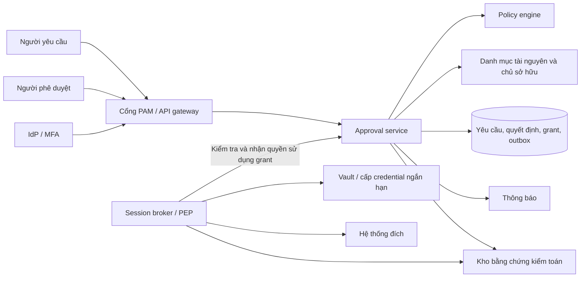
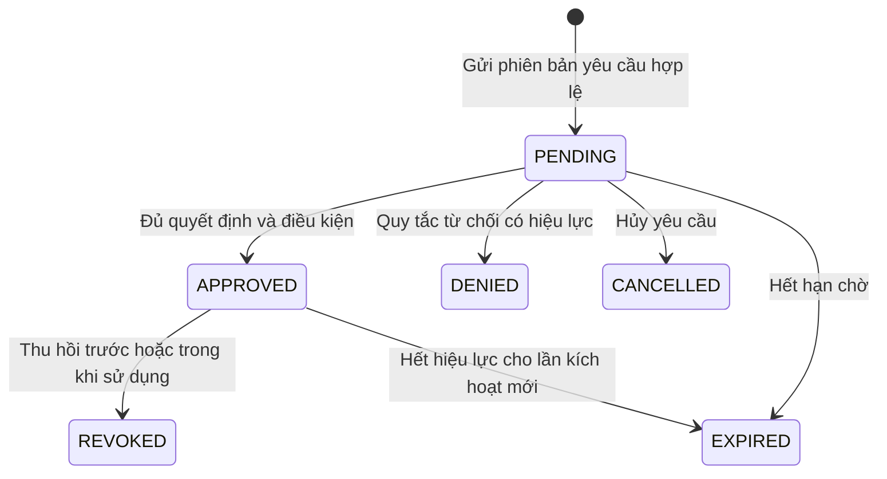

# Approval service trong kiến trúc PAM

## 1. Approval service giải quyết vấn đề gì?

Trong quản lý truy cập đặc quyền (Privileged Access Management, PAM), một người có thể đã đăng nhập thành công, thuộc nhóm vận hành và có nhu cầu xử lý sự cố, nhưng vẫn chưa được phép mở phiên quản trị vào hệ thống production. Quyền thành viên trả lời người đó thuộc nhóm nào; quy trình phê duyệt trả lời một câu hỏi hẹp hơn: **ai cho phép chủ thể này thực hiện tác vụ nào, trên tài nguyên nào, trong khoảng thời gian nào và với điều kiện gì?**

Approval service là thành phần điều phối yêu cầu và quyết định phê duyệt cho quyền đặc biệt. Nó lưu yêu cầu, xác định người có thẩm quyền, thu thập quyết định, áp dụng quy tắc phân tách trách nhiệm và cung cấp kết quả để hệ thống PAM thực thi. Một kết quả phê duyệt phải đủ cụ thể để liên kết với quyền được cấp và bằng chứng sử dụng quyền sau đó.

Ví dụ, kỹ sư trực cần xem thông tin chẩn đoán trên cơ sở dữ liệu thanh toán production trong 20 phút. Approval service có thể yêu cầu chủ sở hữu dịch vụ và người trực an ninh cùng phê duyệt. Sau đó, PAM cấp một phiên chỉ đọc, giới hạn đúng cơ sở dữ liệu, gắn với danh tính kỹ sư và hết hạn sau thời lượng cho phép. Người dùng không cần nhận mật khẩu tài khoản quản trị dùng chung.

Bài học thuộc phần kiến trúc PAM, tập trung vào tài khoản quản trị, danh tính dịch vụ và hạ tầng nhạy cảm. Mục tiêu là hiểu cách thiết kế approval service để hỗ trợ least privilege, cấp quyền vừa đúng lúc (JIT), giới hạn tác vụ hoặc quyền thực thi (JEA), tích hợp vault và giám sát phiên, đồng thời giữ được bằng chứng cho kiểm toán và ứng phó sự cố.

## 2. Phân biệt phê duyệt, đánh giá chính sách và thực thi quyền

Ba chức năng này liên quan nhưng không thay thế nhau:

| Chức năng | Câu hỏi chính | Ví dụ kết quả |
|---|---|---|
| Xác thực danh tính | Ai đang gửi yêu cầu hoặc phê duyệt? | Danh tính người dùng đã được xác thực với mức bảo đảm cần thiết |
| Đánh giá chính sách | Tác vụ có phù hợp với quy tắc hiện hành không? | Được yêu cầu phiên chẩn đoán, cần hai nhóm phê duyệt, tối đa 20 phút |
| Phê duyệt | Người có thẩm quyền có chấp thuận yêu cầu cụ thể không? | Chủ dịch vụ và an ninh chấp thuận phiên cho tài nguyên xác định |
| Thực thi | Có cho phép hành động này ngay lúc này không? | Session broker mở phiên giới hạn sau khi kiểm tra grant |

Approval service có thể gọi một policy engine riêng hoặc tích hợp một bộ quy tắc nội bộ. Điểm quan trọng là giữ rõ trách nhiệm: sự đồng ý của con người là một đầu vào của quyết định cấp quyền; nó không tự vô hiệu hóa giới hạn bắt buộc của chính sách.

Nếu chính sách cấm truy cập từ thiết bị không đạt yêu cầu, một lần bấm “Approve” không được biến thiết bị đó thành hợp lệ. Tương tự, phê duyệt quyền chẩn đoán không cho phép người yêu cầu đổi sang tài khoản có quyền ghi dữ liệu.

Các tác vụ rủi ro thấp có thể được chính sách cho phép tự động khi đủ điều kiện. Khi đó, hệ thống cần ghi rõ quyết định tự động, phiên bản chính sách và ngữ cảnh đánh giá; không tạo bản ghi giả rằng một người đã phê duyệt.

## 3. Vị trí trong kiến trúc PAM



PEP (Policy Enforcement Point) là điểm thực thi quyền. Trong ví dụ này, session broker kiểm tra và dùng grant trước khi mở kết nối; hệ thống đích tiếp tục thực thi quyền tài khoản, vai trò hoặc các giới hạn tác vụ tương ứng.

Các ranh giới tin cậy cần được giữ rõ:

- Trình duyệt và ứng dụng khách cung cấp yêu cầu, không tự xác nhận vai trò phê duyệt, độ tin cậy của thiết bị hay trạng thái “đã được duyệt”.
- API xác thực danh tính người dùng; approval service kiểm tra quyền của người yêu cầu và người phê duyệt đối với từng tài nguyên.
- Liên kết thông báo chỉ đưa người dùng về giao diện quyết định đã xác thực. Việc mở liên kết bằng phương thức GET không được tạo quyết định phê duyệt.
- Session broker dùng danh tính dịch vụ được xác thực để kiểm tra grant. Một thông điệp “approved” trên hàng đợi chưa đủ để mở phiên.
- Vault chỉ phục vụ thành phần đã được cho phép theo chính sách tích hợp. Người phê duyệt không cần quyền xem secret để duyệt một yêu cầu.

Nếu người dùng vẫn có đường SSH, RDP hoặc kết nối cơ sở dữ liệu trực tiếp bằng tài khoản đặc quyền thường trực, approval service có thể bị đi vòng. Vì vậy, thiết kế PAM phải đồng thời quản lý đường mạng, tài khoản, credential và điểm thực thi quyền.

## 4. Dữ liệu nào cần được gắn vào một yêu cầu?

Một yêu cầu kiểu “xin quyền admin trong hôm nay” quá rộng để kiểm soát. Approval service cần diễn đạt rõ phạm vi và điều kiện.

| Nhóm dữ liệu | Nội dung cần xác định | Ý nghĩa kiểm soát |
|---|---|---|
| Chủ thể | Người khởi tạo, người hưởng quyền, loại danh tính | Phân biệt người gửi yêu cầu với tài khoản thực sự được cấp quyền |
| Tài nguyên | ID tài nguyên ổn định, môi trường, ranh giới tenant | Tránh đổi từ staging sang production hoặc từ hệ thống này sang hệ thống khác |
| Tác vụ | Mẫu quyền, vai trò, tập hành động được phép | Hỗ trợ least privilege và JEA |
| Mục đích | Lý do, mã sự cố hoặc thay đổi, điều kiện công việc | Tạo cơ sở để người phê duyệt đánh giá |
| Thời gian | Cửa sổ được bắt đầu, thời lượng phiên tối đa, hạn yêu cầu | Tách thời điểm kích hoạt khỏi thời lượng sử dụng |
| Chính sách | Phiên bản, ngữ cảnh rủi ro, quy tắc phê duyệt | Giải thích vì sao yêu cầu cần các quyết định cụ thể |
| Quyết định | Danh tính người duyệt, kết quả, thời điểm, căn cứ thẩm quyền | Chứng minh ai đã quyết định và quyết định trong phạm vi nào |
| Thực thi | Grant, lần kích hoạt, phiên, lần thu hồi | Nối sự đồng ý với quyền đã được sử dụng |

Các thuộc tính bảo mật như môi trường, chủ sở hữu và quan hệ tài nguyên nên được lấy hoặc xác minh từ nguồn có thẩm quyền phía máy chủ. Không tin trường `environment` do ứng dụng khách gửi chỉ vì nó ghi “development”. Mã ticket cũng cần được kiểm tra theo chính sách phù hợp; một chuỗi có hình thức giống mã sự cố không chứng minh sự cố tồn tại hay người yêu cầu được tham gia.

Sau khi gửi duyệt, phần nội dung xác định quyền phải bất biến theo từng phiên bản yêu cầu. Nếu đổi tài nguyên, vai trò, người hưởng quyền, khoảng thời gian hoặc phạm vi hành động, phải tạo phiên bản hoặc yêu cầu mới và đánh giá lại các quyết định liên quan. Một phê duyệt cho phiên bản cũ không được tự động chuyển sang phiên bản rộng hơn.

Có thể dùng digest của biểu diễn chuẩn hóa để ràng buộc quyết định và grant với nội dung yêu cầu. Digest hỗ trợ phát hiện thay đổi; nó không thay thế xác thực, kiểm soát truy cập hay kho lưu trữ đáng tin cậy.

## 5. Luồng từ yêu cầu đến phiên đặc quyền

Một luồng triển khai điển hình gồm các bước sau:

1. **Tiếp nhận:** xác thực người yêu cầu, kiểm tra tenant và quyền gửi yêu cầu cho tài nguyên. Máy chủ chuẩn hóa ID và mẫu quyền.
2. **Đánh giá ban đầu:** policy engine xác định tác vụ có được phép yêu cầu không, mức rủi ro, giới hạn thời gian và các nhóm phê duyệt cần thiết.
3. **Đóng băng phiên bản:** lưu nội dung cần duyệt và phiên bản chính sách; đưa yêu cầu vào trạng thái chờ. Gửi thông báo bằng một cơ chế có thể thử lại.
4. **Thu thập quyết định:** mỗi người phê duyệt được xác thực, được kiểm tra thẩm quyền và xem đúng phạm vi cần quyết định. Lưu chấp thuận hoặc từ chối cùng căn cứ.
5. **Tổng hợp:** chỉ chuyển sang được duyệt khi đáp ứng đúng số lượng, nhóm vai trò và điều kiện phân tách trách nhiệm. Chính sách phải quy định rõ hiệu lực của một lần từ chối.
6. **Kích hoạt:** người hưởng quyền đề nghị bắt đầu phiên. Approval service và PEP kiểm tra lại điều kiện động trước khi nhận quyền sử dụng grant.
7. **Cấp quyền thực tế:** broker lấy credential từ vault, xin credential ngắn hạn hoặc tạo quyền JIT theo cơ chế của hệ thống đích. Phạm vi thực tế phải nằm trong phạm vi đã duyệt.
8. **Theo dõi và kết thúc:** giám sát phiên, thực thi hạn thời gian, dọn quyền tạm thời, thu hồi credential khi phù hợp và liên kết bằng chứng với yêu cầu gốc.

Một lần phê duyệt không đồng nghĩa người dùng được quyền truy cập ngay lập tức trong mọi hoàn cảnh. Tại thời điểm kích hoạt, tài khoản có thể đã bị vô hiệu hóa, tài nguyên đã đổi chủ, thiết bị không còn đạt yêu cầu hoặc sự cố đã kết thúc. Các thay đổi đó phải được xét theo chính sách hiện hành.

## 6. Thiết kế quy tắc phê duyệt và phân tách trách nhiệm

### 6.1. Người có thẩm quyền phải gắn với tài nguyên

Không nên chỉ kiểm tra người duyệt có một vai trò chung tên là `approver`. Họ cần có thẩm quyền đối với đúng tài nguyên, môi trường và loại yêu cầu. Một người có thể được duyệt hệ thống thử nghiệm nhưng không được duyệt hệ thống thanh toán production.

Nguồn xác định chủ sở hữu và người trực cần có quy trình cập nhật. Nếu không tìm được người có thẩm quyền hoặc dữ liệu không còn đủ mới theo chính sách, yêu cầu cần được giữ chờ hoặc chuyển tuyến theo quy trình xác định, không tự động chấp thuận.

### 6.2. Tách người yêu cầu, người hưởng quyền và người duyệt

Trường hợp trợ lý vận hành gửi yêu cầu thay một kỹ sư cho thấy ba danh tính này có thể khác nhau. Quy tắc chống tự duyệt phải xem cả người khởi tạo lẫn người hưởng quyền, đồng thời xét các quan hệ xung đột do tổ chức quy định.

Nếu yêu cầu cần hai người duyệt, phải đếm hai danh tính thực sự khác nhau. Hai tài khoản của cùng một người hoặc một người đồng thời thuộc hai nhóm không đương nhiên đáp ứng yêu cầu hai người độc lập. Cần quy định cách ánh xạ tài khoản về danh tính nhân sự và cách xử lý người giữ nhiều vai trò.

| Mức nhạy cảm minh họa | Yêu cầu phê duyệt có thể áp dụng | Giới hạn đi kèm |
|---|---|---|
| Chẩn đoán môi trường thử nghiệm | Tự động theo chính sách hoặc chủ tài nguyên | Mẫu quyền hẹp, thời lượng ngắn |
| Chẩn đoán production | Chủ dịch vụ và người trực được chỉ định | Phiên chỉ đọc, xác thực tăng cường khi cần |
| Thay đổi cấu hình production | Chủ dịch vụ và người phê duyệt thay đổi độc lập | Ticket hợp lệ, cửa sổ thay đổi, giám sát phiên |
| Truy cập tài khoản quản trị nền tảng | Quy trình nghiêm ngặt theo rủi ro | Phân tách trách nhiệm, hạn chế đường truy cập, bằng chứng đầy đủ |

Bảng này minh họa cách thiết kế; số người duyệt và thời lượng phải do chính sách của tổ chức xác định, không phải một giá trị cố định cho mọi hệ thống.

### 6.3. Ủy quyền và chuyển cấp

Ủy quyền cần có người ủy quyền, người nhận, phạm vi, thời hạn và điều kiện áp dụng. Người nhận ủy quyền vẫn phải qua kiểm tra xung đột lợi ích. Hệ thống ghi cả người thực hiện quyết định và căn cứ ủy quyền.

Khi quá thời gian phản hồi, hệ thống có thể nhắc việc hoặc chuyển tới người có thẩm quyền khác. Chuyển cấp không có nghĩa tự duyệt khi hết giờ. Việc giảm yêu cầu từ hai người xuống một người phải là một chính sách ngoại lệ riêng, có điều kiện và bằng chứng rõ ràng.

## 7. Trạng thái yêu cầu và vòng đời grant

Nên phân biệt trạng thái quyết định của yêu cầu với trạng thái sử dụng quyền. Việc giữ hai vòng đời riêng giúp giải thích trường hợp đã được duyệt nhưng chưa mở phiên, hoặc phiên đã kết thúc trong khi lịch sử phê duyệt vẫn còn.



Sơ đồ mô tả trạng thái nghiệp vụ chính; lịch sử các quyết định vẫn phải được giữ sau khi hết hạn hoặc thu hồi. Một yêu cầu bị từ chối không được quay về được duyệt chỉ bằng một thông báo cũ đến muộn. Việc mở lại, nếu có, phải theo quy tắc rõ ràng và tạo lịch sử hoặc phiên bản mới.

Với grant chỉ cho phép một lần kích hoạt, vòng đời có thể là:

```text
AVAILABLE -> RESERVED -> ACTIVE -> CLOSED
    |           |          |
    +-> EXPIRED +-> FAILED  +-> REVOKED
```

`RESERVED` biểu thị một lần kích hoạt đã nhận quyền sử dụng grant nhưng quá trình mở phiên chưa hoàn tất. Đặt trạng thái này và gắn `activation_id` phải là thao tác nguyên tử. Khi broker thử lại sau lỗi mạng, nó tiếp tục cùng lần kích hoạt thay vì tạo thêm phiên.

Nếu không biết phiên ở hệ thống đích đã được tạo hay chưa, không tự đưa grant về `AVAILABLE`. Cần đối soát theo `activation_id` hoặc định danh tương đương của hệ thống đích. Nếu phải thử lại bằng một lần kích hoạt mới, chính sách phải xác nhận lần trước đã được vô hiệu hóa và ghi rõ lịch sử. Không nên hứa hẹn “thực hiện đúng một lần” trên nhiều hệ thống chỉ nhờ một giao dịch cơ sở dữ liệu cục bộ.

## 8. Grant phải hẹp, có thời hạn và kiểm tra được

Grant là kết quả cho phép một hành động trong phạm vi cụ thể. Nó có thể được biểu diễn bằng bản ghi máy chủ và một tham chiếu khó đoán, hoặc bằng token có chữ ký kèm cơ chế xác minh phù hợp.

Một thiết kế cần ràng buộc ít nhất:

- Yêu cầu và phiên bản nội dung đã được duyệt.
- Danh tính hưởng quyền, tenant và tài nguyên đích.
- Tác vụ, mẫu quyền và các giới hạn bắt buộc.
- Thời điểm sớm nhất được dùng và hạn được kích hoạt.
- Thời lượng tối đa của phiên hoặc quyền JIT sau kích hoạt.
- Số lần kích hoạt cho phép; định danh duy nhất để chống sử dụng lặp ngoài ý muốn.
- Thành phần được phép nhận và đổi grant, chẳng hạn một nhóm session broker cụ thể.
- Trạng thái thu hồi và các điều kiện phải kiểm tra lại.

Tham chiếu khó đoán không tự thay thế kiểm tra quyền. Bên gọi vẫn phải được xác thực và được phép đổi grant. Với token có chữ ký, chữ ký bảo vệ tính toàn vẹn; để thu hồi ngay và ngăn dùng lại, thường vẫn cần kiểm tra trạng thái có thẩm quyền hoặc một cơ chế kiểm soát tương đương. Không đưa mật khẩu hay private key vào grant.

Cần phân biệt ba loại thời gian:

| Mốc | Câu hỏi |
|---|---|
| Hạn chờ quyết định | Người có thẩm quyền phải quyết định trước lúc nào? |
| Cửa sổ kích hoạt | Người hưởng quyền được bắt đầu phiên trong khoảng nào? |
| Hạn sử dụng thực tế | Phiên hoặc quyền JIT phải kết thúc lúc nào? |

Ví dụ, được bắt đầu trong khoảng 09:05–09:15 và được dùng tối đa 20 phút khác với quyền kết thúc tuyệt đối lúc 09:25. Nếu chính sách có cả hai điều kiện, hạn kết thúc phiên phải lấy giới hạn sớm hơn. Đánh giá thời gian bằng đồng hồ đáng tin cậy phía máy chủ và có quy tắc xử lý độ lệch; không dựa vào giờ trên trình duyệt.

## 9. Ví dụ yêu cầu chẩn đoán production

Giả sử kỹ sư trực cần chẩn đoán độ trễ của cơ sở dữ liệu thanh toán. Yêu cầu đã được máy chủ chuẩn hóa có thể có dạng minh họa sau; đây không phải đặc tả API của một sản phẩm PAM cụ thể.

```json
{
  "request_id": "req-00521",
  "request_version": 1,
  "requester_id": "user-oncall-17",
  "beneficiary_id": "user-oncall-17",
  "tenant_id": "tenant-internal",
  "resource_id": "db-payments-prod-01",
  "action": "database.session.open",
  "role_template": "diagnostic-readonly",
  "purpose": "Chan doan do tre truy van",
  "incident_id": "INC-00521",
  "start_not_before": "2026-11-26T09:05:00+07:00",
  "start_before": "2026-11-26T09:15:00+07:00",
  "session_max_seconds": 1200,
  "absolute_access_deadline": "2026-11-26T09:30:00+07:00",
  "max_activations": 1,
  "policy_version": "pam-policy-v7",
  "approval_rule": "service-owner-and-security-oncall"
}
```

Trước khi chấp thuận, giao diện hiển thị rõ production, đúng ID tài nguyên, vai trò chỉ đọc, thời lượng, người hưởng quyền và mã sự cố. Người duyệt phải có đủ thông tin để hiểu tác động; không chỉ thấy một nút đồng ý với tiêu đề chung chung.

Nếu hai người có thẩm quyền duyệt và kỹ sư kích hoạt lúc 09:12, hạn kết thúc là thời điểm sớm hơn giữa 09:32 và 09:30, tức 09:30. Người dùng kích hoạt lúc 09:16 thì bị từ chối dù hạn kết thúc tuyệt đối vẫn chưa đến.

Sau khi nhận grant, broker yêu cầu vault hoặc dịch vụ danh tính cấp credential đúng mẫu `diagnostic-readonly`. Hệ thống cơ sở dữ liệu phải thực sự giới hạn quyền đọc và phạm vi dữ liệu; tên mẫu không tự tạo ra giới hạn kỹ thuật. Broker liên kết session ID với yêu cầu, ghi nhận diễn biến theo chính sách và kết thúc quyền đúng hạn.

Nếu credential là mật khẩu dùng chung được lấy từ vault, thiết kế phải kiểm soát việc lộ mật khẩu và việc tiếp tục sử dụng sau phiên. Tùy hệ thống, cần luân chuyển credential, thu hồi quyền tạm hoặc áp dụng giới hạn từ phía đích. Xóa một grant trong approval service không tự làm mật khẩu cũ mất hiệu lực.

## 10. Kích hoạt an toàn và xử lý cạnh tranh

Khoảng cách giữa lúc được duyệt và lúc mở phiên tạo ra nguy cơ TOCTOU: điều kiện được kiểm tra trước đó có thể đã thay đổi khi quyền được sử dụng. Các kiểm tra động cần diễn ra gần thời điểm thực thi, với thời hạn hiệu lực rõ ràng.

Mã giả sau minh họa ranh giới xử lý, không phải mã triển khai hoàn chỉnh:

```text
activate(grant_ref, activation_key, authenticated_context):
    verify_caller_is_allowed_broker(authenticated_context)
    verify_beneficiary_binding(authenticated_context)
    obtain_current_context_from_authoritative_sources()

    transaction:
        grant = lock_grant(grant_ref)
        verify_request_version_and_decision_state(grant)
        verify_time_window_and_not_revoked(grant)
        verify_current_policy_and_context_are_acceptable(grant)

        previous = find_activation(grant.id, activation_key)
        if previous exists:
            require_same_request_parameters(previous)
            return previous.result_or_pending_state

        require grant.state == AVAILABLE
        require grant.allowed_activations == 1
        create_activation_with_unique_key(activation_key)
        set_grant_state(RESERVED)
        append_audit_and_outbox_event()
    commit

    result = ensure_target_session_for_same_activation()
    record_activation_outcome(result)
    return result
```

Một triển khai thực tế cần xác định cách lấy và kiểm tra độ mới của ngữ cảnh, phiên bản chính sách và tín hiệu thu hồi. Không nên giữ khóa cơ sở dữ liệu trong khi chờ người duyệt hoặc một lời gọi mạng kéo dài. Có thể lấy ngữ cảnh trước, rồi trong giao dịch kiểm tra phiên bản và hạn hiệu lực đã ràng buộc; nếu dữ liệu đã đổi hoặc không đủ mới thì đánh giá lại trước khi cấp quyền.

Khóa hàng, cập nhật có điều kiện hoặc kiểm tra phiên bản giúp ngăn hai broker cùng đổi một grant một lần. `activation_key` phải gắn với cùng grant, cùng chủ thể và cùng tham số; dùng lại khóa với nội dung khác phải bị từ chối. Cần ràng buộc duy nhất trong kho dữ liệu, không chỉ kiểm tra bằng mã ứng dụng trước khi ghi.

Việc gọi hệ thống đích nằm ngoài giao dịch cục bộ. Broker cần khả năng thử lại có kiểm soát, xác định kết quả đang chờ, đối soát phiên đã tạo và dọn quyền còn sót. Nếu nền tảng đích không hỗ trợ tạo phiên hoặc quyền theo cách có thể đối soát, phải thiết kế giới hạn và quy trình xử lý phù hợp trước khi tuyên bố an toàn khi thử lại.

## 11. Thông báo, hàng đợi và tính nhất quán

Thông báo giúp người duyệt biết có việc cần xử lý; kho trạng thái của approval service mới là căn cứ ra quyết định. Email, ứng dụng chat hoặc thông điệp trên hàng đợi có thể đến chậm, lặp hoặc sai thứ tự.

Một mẫu triển khai hữu ích là transactional outbox: cập nhật trạng thái yêu cầu, ghi sự kiện kiểm toán cục bộ và ghi sự kiện chờ phát trong cùng giao dịch. Tiến trình phát sự kiện có thể gửi lại; bên nhận xử lý trùng bằng event ID hoặc phiên bản. Điều này giảm nguy cơ trạng thái đã đổi nhưng sự kiện bị mất giữa lúc ghi và gửi, nhưng không làm việc giao nhận trên toàn hệ thống tự động trở thành đúng một lần.

Khi nhận sự kiện “approved”, broker phải kiểm tra lại trạng thái có thẩm quyền trước khi mở phiên. Sự kiện thu hồi có thể đến trước một sự kiện phê duyệt cũ; phiên bản tăng dần và quy tắc chuyển trạng thái phải ngăn sự kiện cũ làm sống lại quyền đã bị thu hồi.

Giao diện cũng cần hiển thị kết quả thật từ máy chủ. Nếu người dùng bấm duyệt rồi mất kết nối, lần thử lại phải trả về quyết định đã lưu hoặc trạng thái đang xử lý. Không tạo thêm một người duyệt hoặc cộng thêm một phiếu chỉ vì cùng một yêu cầu HTTP được gửi lại.

## 12. Lỗi dịch vụ và quyền truy cập khẩn cấp

Với đường cấp quyền thông thường, nếu không xác minh được một điều kiện bắt buộc thì không cấp phiên mới. Tuy nhiên, cần phân biệt lỗi thông báo với lỗi kiểm tra thẩm quyền: mất dịch vụ gửi email không nhất thiết ngăn một người đã đăng nhập vào cổng PAM xử lý yêu cầu hợp lệ.

| Tình huống | Hành vi cần thiết kế |
|---|---|
| Không gửi được thông báo | Giữ yêu cầu, thử gửi lại, cho phép xem hàng chờ qua cổng đã xác thực |
| Không xác minh được chính sách bắt buộc | Chưa cấp quyền mới; nếu dùng cache thì phải có chính sách về độ mới và phạm vi |
| Không xác minh được danh tính hoặc thẩm quyền người duyệt | Không nhận quyết định mới |
| Hai người duyệt cùng lúc | Cập nhật có kiểm soát cạnh tranh, tính lại điều kiện từ dữ liệu đã lưu |
| Lưu quyết định thành công nhưng phản hồi bị mất | Lần thử lại trả kết quả cũ dựa trên khóa chống trùng |
| Được duyệt nhưng vault không cấp credential | Ghi kích hoạt lỗi hoặc đang chờ; đối soát trước khi cho thử lại |
| Approval service ngừng khi phiên đang chạy | PEP và hệ thống đích vẫn giữ giới hạn đã thiết lập; áp dụng quy tắc kiểm tra tiếp hoặc kết thúc theo chính sách |
| Thu hồi nhưng broker chưa nhận được sự kiện | Dùng cơ chế kiểm tra trạng thái hoặc lease theo thiết kế; có đường chặn quyền phía đích và cảnh báo |

Không thể hứa thu hồi tức thì chỉ bằng một sự kiện bất đồng bộ. Thiết kế phải nêu rõ độ trễ phát hiện, tần suất kiểm tra, thành phần thực thi chấm dứt và thời gian sống tối đa của quyền ở hệ thống đích.

Break-glass là đường truy cập khẩn cấp được thiết kế trước cho tình huống cần duy trì vận hành hoặc ứng cứu khi đường thông thường không đáp ứng được. Nó cần danh tính đủ mạnh, phạm vi và thời gian hẹp, người chịu trách nhiệm, ghi nhận bằng chứng, thông báo và hậu kiểm. Đường này cũng cần được chuẩn bị cho loại sự cố dự kiến; một cơ chế hoàn toàn phụ thuộc vào approval service đang ngừng hoạt động không giải quyết được chính sự cố đó.

Không biến mọi timeout thành break-glass tự động. Nếu dùng credential khẩn cấp, phải kiểm soát lưu giữ, truy xuất và luân chuyển sau sử dụng; nếu dùng quyền JIT khẩn cấp, phải chứng minh việc hết hạn và dọn quyền. Ngoại lệ phải để lại lịch sử riêng, không sửa lịch sử thành “đã được phê duyệt bình thường”.

## 13. Phê duyệt cho danh tính dịch vụ

Không chỉ con người sử dụng quyền đặc biệt. Pipeline triển khai, tác vụ sao lưu hoặc công cụ tự động cũng có thể cần quyền trên hạ tầng nhạy cảm.

Với workload, yêu cầu nên gắn với danh tính dịch vụ đã xác thực, môi trường, tài nguyên, phạm vi tác vụ và ngữ cảnh thực thi có thể xác minh. Nếu dùng mã phiên bản phần mềm, job ID hoặc digest artifact làm điều kiện, máy chủ phải kiểm tra chúng từ nguồn đáng tin cậy thay vì chỉ nhận chuỗi do bên gọi khai báo.

Ví dụ, một thay đổi triển khai production được người có thẩm quyền duyệt cho đúng workload và cửa sổ thay đổi. Khi pipeline chạy, PAM cấp credential ngắn hạn cho workload đó, giới hạn đúng tài nguyên; người bấm duyệt không được nhận secret của pipeline. Nếu pipeline chuyển sang workload, artifact hoặc phạm vi ngoài điều kiện đã duyệt, hệ thống cần đánh giá lại theo chính sách.

Tác vụ định kỳ có thể dùng chính sách cho phép tự động với phạm vi ổn định, chủ sở hữu rõ ràng và lịch rà soát. Không nên yêu cầu một người bấm duyệt liên tục đến mức họ bỏ qua nội dung; cũng không nên dùng một lần phê duyệt rộng làm quyền quản trị thường trực cho mọi lần chạy về sau.

## 14. Bằng chứng kiểm toán và ứng phó sự cố

Một chuỗi bằng chứng hữu ích phải nối được:

```text
Yêu cầu + phiên bản
    -> chính sách và ngữ cảnh đánh giá
    -> từng quyết định và căn cứ thẩm quyền
    -> grant và lần kích hoạt
    -> credential/lease hoặc quyền JIT được cấp
    -> phiên đặc quyền và hành động quan sát được
    -> hết hạn, thu hồi, dọn quyền và kết quả
```

Mỗi sự kiện nên có event ID, request ID, phiên bản yêu cầu, danh tính hành động, thời điểm phía máy chủ, kết quả và mã lý do. Với sự kiện liên quan, thêm grant ID, activation ID, session ID và correlation ID. Nội dung cần đủ để trả lời “ai duyệt điều gì” mà không phải suy đoán từ một thông báo chung chung.

Kho bằng chứng cần kiểm soát quyền đọc, quyền ghi, thời gian lưu và bảo vệ khỏi sửa hoặc xóa trái phép. Log ở máy chủ ứng dụng có thể bị thay đổi không tự là bằng chứng bất biến. Có thể kết hợp ghi bổ sung, lưu trữ chống sửa theo thiết kế và tách quyền quản trị kho bằng chứng khỏi quyền vận hành approval service.

Không ghi secret, token có thể sử dụng hoặc nội dung nhạy cảm không cần thiết vào log. Lý do yêu cầu và nội dung phiên có thể chứa dữ liệu nhạy cảm; cần giới hạn dữ liệu, phân quyền truy xuất và lưu theo chính sách. Việc ghi hình hoặc ghi lệnh cũng cần phù hợp với giao thức và khả năng kỹ thuật thực tế.

Trong ứng phó sự cố, nhóm điều tra cần truy được từ một phiên bất thường về quyết định phê duyệt, rồi xác định các grant và phiên khác liên quan. Thu hồi phải dẫn tới hành động thực thi: ngăn kích hoạt mới, chặn hoặc kết thúc phiên theo chính sách, thu hồi quyền phía đích và xử lý credential có thể đã lộ. Lưu cả kết quả thành công lẫn thất bại của từng bước.

## 15. Rủi ro thiết kế thường gặp

| Sai sót | Hậu quả | Hướng xử lý |
|---|---|---|
| Duyệt một nhãn tài nguyên có thể bị đổi nghĩa | Quyền được dùng cho đích khác với đích người duyệt thấy | Dùng ID ổn định, ràng buộc phiên bản và xác minh ánh xạ |
| Cho phép sửa phạm vi sau khi duyệt | Quyết định hẹp biến thành quyền rộng | Đóng băng nội dung; thay đổi thì duyệt lại |
| Chỉ kiểm tra người duyệt ở giao diện | Có thể gọi API để bỏ qua quy tắc | Kiểm tra thẩm quyền và phân tách trách nhiệm phía máy chủ |
| Đếm số lần bấm thay vì danh tính độc lập | Một người có thể đáp ứng nhiều phiếu | Đếm danh tính và nhóm theo chính sách rõ ràng |
| Xem ticket hoặc MFA là đủ để phê duyệt | Bỏ qua phạm vi và thẩm quyền | Dùng chúng như điều kiện, kết hợp quyết định chính sách |
| Cho phép dùng lại grant tùy ý | Một lần duyệt tạo nhiều phiên ngoài dự kiến | Ràng buộc số lần dùng, thao tác nguyên tử và khóa chống trùng |
| Tin thông báo đã duyệt mà không kiểm tra lại | Mở phiên từ trạng thái cũ hoặc đã thu hồi | Kiểm tra trạng thái có thẩm quyền khi kích hoạt |
| Chỉ hết hạn trong approval service | Phiên, token hoặc quyền ở đích vẫn tồn tại | Thực thi hạn tại broker và hệ thống đích, đối soát việc dọn quyền |
| Để quản trị approval service tự sửa quyết định | Có thể tự cấp quyền và xóa dấu vết | Tách quyền quản trị, kiểm soát thay đổi, bảo vệ bằng chứng |
| Duyệt hàng loạt mà không thấy phạm vi từng yêu cầu | Người duyệt khó nhận ra yêu cầu bất thường | Hiển thị rủi ro và nội dung cụ thể; giới hạn thao tác hàng loạt |

## 16. Bài thực hành thiết kế

Thiết kế luồng phê duyệt cho yêu cầu xem chẩn đoán cơ sở dữ liệu production trong ví dụ trên. Không cần truy cập hệ thống thật; có thể mô tả bằng sơ đồ và bảng quyết định.

1. Liệt kê người khởi tạo, người hưởng quyền, hai nhóm phê duyệt và các điều kiện khiến một người không được quyết định.
2. Xác định ID tài nguyên, mẫu quyền chỉ đọc, cửa sổ kích hoạt, hạn kết thúc tuyệt đối và số lần kích hoạt.
3. Vẽ trạng thái yêu cầu và grant. Chỉ ra nơi đóng băng nội dung, nơi kiểm tra lại chính sách và nơi ghi bằng chứng.
4. Mô tả cách session broker nhận quyền sử dụng grant, lấy credential đúng phạm vi và giới hạn phiên tại đích.
5. Xử lý trường hợp phản hồi kích hoạt bị mất sau khi phiên đã được tạo; chỉ rõ cách tránh mở phiên thứ hai khi thử lại.
6. Xử lý việc thu hồi lúc phiên đang chạy và trường hợp broker mất kết nối với approval service.

Tự kiểm tra thiết kế bằng các tình huống sau:

- Người yêu cầu cũng thuộc một nhóm phê duyệt: quy tắc xung đột phải được áp dụng trước khi ghi nhận phiếu hợp lệ.
- Người dùng đổi từ chỉ đọc sang quản trị sau khi có một phiếu: phiên bản cũ không được dùng để cấp quyền mới.
- Hai broker đồng thời đổi cùng một grant: chỉ một lần kích hoạt mới được nhận quyền sử dụng; lần thử lại hợp lệ theo cùng khóa phải nối với lần đó.
- Sự kiện phê duyệt cũ đến sau sự kiện thu hồi: không được làm quyền sống lại.
- Phiên được mở sát hạn cuối: hạn thực tế phải tuân thủ mọi giới hạn thời gian liên quan.
- Vault báo timeout sau khi cấp lease: cần đối soát và xử lý lease, không tự coi là chưa cấp gì.

Một thiết kế hoàn chỉnh cần chỉ ra thành phần thực thi cho từng giới hạn, cách xử lý khi thành phần đó lỗi và bằng chứng chứng minh kết quả. Đó là cơ sở để approval service trở thành một phần kiểm soát quyền thực tế trong PAM, thay vì chỉ là nơi lưu các lần bấm đồng ý.

