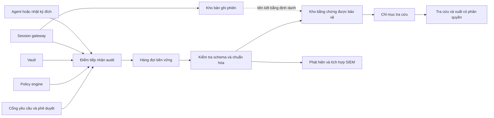

# Audit service trong kiến trúc PAM

Audit service là thành phần tiếp nhận, chuẩn hóa, bảo vệ và cung cấp bằng chứng về hoạt động truy cập đặc quyền. Trong hệ thống Privileged Access Management (PAM), dịch vụ này giúp trả lời: ai yêu cầu quyền, ai phê duyệt, chính sách nào được áp dụng, quyền nào thực sự được cấp, người dùng đã làm gì và quyền đã được thu hồi hay chưa.

Một bản ghi “đăng nhập thành công” chỉ phản ánh một điểm trong chuỗi hoạt động. Với tài khoản quản trị, tài khoản dịch vụ và hạ tầng nhạy cảm, cần nối được toàn bộ chuỗi từ yêu cầu đến kết thúc truy cập. Đó là nền tảng để kiểm toán, điều tra sự cố và đánh giá việc thực thi least privilege, cấp quyền đúng lúc (JIT) và giới hạn tác vụ (JEA).

## 1. Mục tiêu và phạm vi trách nhiệm

Sau bài này, người học có thể:

- Xác định vị trí của audit service trong kiến trúc PAM và phân biệt nhật ký kiểm toán với bản ghi phiên.
- Thiết kế sự kiện có đủ danh tính, ngữ cảnh cấp quyền và thông tin đối chiếu.
- Giải thích cách duy trì bằng chứng khi có sự kiện trùng, đến muộn, mất kết nối hoặc lỗi kho lưu trữ.
- Phân tách quyền quản trị PAM với quyền quản trị bằng chứng kiểm toán.
- Lần theo một yêu cầu JIT từ phê duyệt đến thu hồi và phát hiện các mắt xích còn thiếu.

Audit service không trực tiếp thay thế policy engine, vault hoặc session gateway. Policy engine ra quyết định theo chính sách; vault quản lý bí mật; gateway hoặc cơ chế tương đương thực thi truy cập và có thể ghi lại phiên. Audit service nhận bằng chứng từ các thành phần đó, bảo toàn ngữ cảnh và phục vụ tra cứu có kiểm soát.

| Thành phần | Ví dụ hoạt động cần được ghi nhận | Giá trị đối với kiểm toán |
| --- | --- | --- |
| Cổng yêu cầu và bộ phận phê duyệt | Tạo yêu cầu, phê duyệt, từ chối, hủy yêu cầu | Xác định mục đích, người chịu trách nhiệm và thời hạn đã được chấp thuận |
| Policy engine | Cho phép hoặc từ chối; phiên bản chính sách; điều kiện đi kèm | Giải thích cơ sở quyết định tại thời điểm đánh giá |
| Vault | Cấp phát credential, checkout, cập nhật phiên bản, kết quả luân chuyển | Chứng minh vòng đời credential mà không ghi nội dung bí mật |
| Session gateway và đích truy cập | Mở phiên, thực hiện tác vụ, chấm dứt kết nối | Đối chiếu việc sử dụng quyền với phạm vi đã cấp |
| Bộ điều phối JIT/JEA | Cấp quyền, hết hạn, thu hồi, lỗi thu hồi | Kiểm tra quyền có được giới hạn và kết thúc thực sự hay không |
| Audit service | Nhận, lưu, xuất, xem, xóa theo quy trình | Kiểm soát chính việc tiếp cận và quản lý bằng chứng |

## 2. Audit event, telemetry và bản ghi phiên

Ba loại dữ liệu sau có thể liên quan với nhau nhưng không có cùng mục đích:

| Loại dữ liệu | Ví dụ | Câu hỏi chính |
| --- | --- | --- |
| Sự kiện kiểm toán | `privilege.granted`, `credential.rotation.failed`, `audit.exported` | Ai đã tác động lên đối tượng nào, bằng thẩm quyền gì và kết quả ra sao? |
| Telemetry vận hành | Độ trễ hàng đợi, tỷ lệ lỗi ghi, dung lượng bộ đệm | Hệ thống thu thập và lưu trữ có hoạt động ổn định không? |
| Bản ghi phiên | Video màn hình, luồng terminal hoặc bản ghi giao thức | Trong phạm vi quan sát được, phiên đã diễn ra như thế nào? |

Không áp dụng lấy mẫu tùy tiện cho các sự kiện kiểm toán bắt buộc chỉ vì hệ thống telemetry đang lấy mẫu. Đồng thời, không giả định video phiên chứa đủ lý do phê duyệt hoặc phiên bản chính sách. Audit event cần liên kết tới các bằng chứng liên quan bằng định danh ổn định.

Phạm vi quan sát phụ thuộc giao thức và cách triển khai. Ví dụ, gateway có thể thấy kết nối được mở nhưng không đọc được thao tác nằm trong một kênh mã hóa đầu cuối; nhật ký câu lệnh cũng không tự chứng minh toàn bộ tác động bên trong một chương trình được chạy. Tài liệu vận hành phải nêu rõ phần nào được quan sát, phần nào cần đối chiếu bằng nhật ký từ máy chủ hoặc ứng dụng đích.

## 3. Luồng xử lý tham chiếu



Đây là luồng tham chiếu, không bắt buộc mọi hệ thống phải dùng cùng số lượng dịch vụ. Có thể gộp các bước nếu vẫn giữ được các thuộc tính cần thiết:

1. **Xác thực nguồn gửi:** audit service xác định nguồn phát sự kiện và quyền gửi của nguồn đó. Ví dụ, một gateway chỉ được gửi trong phạm vi môi trường hoặc tổ chức được phân công.
2. **Tiếp nhận bền vững:** xác định rõ khi nào một sự kiện được coi là đã nhận an toàn. Xác nhận HTTP thành công nhưng dữ liệu mới nằm trong bộ nhớ không tương đương với đã lưu bền vững.
3. **Kiểm tra và chuẩn hóa:** kiểm tra phiên bản schema, trường bắt buộc, độ dài, kiểu dữ liệu và các giá trị có thể làm hỏng định dạng nhật ký.
4. **Lưu bằng chứng:** bảo vệ dữ liệu gốc, dữ liệu chuẩn hóa và liên kết đến bản ghi phiên theo thiết kế đã chọn.
5. **Tra cứu và phân tích:** xây chỉ mục, nối các sự kiện và phát hiện mẫu bất thường.
6. **Quản lý vòng đời:** lưu giữ, khóa bảo toàn khi điều tra, xuất có kiểm soát và xóa theo quy trình được phê duyệt.

Nếu chỉ mục tìm kiếm bị lỗi, bằng chứng gốc vẫn cần tồn tại để có thể lập lại chỉ mục. Nếu SIEM ngừng nhận, bằng chứng trong PAM vẫn phải được duy trì theo cam kết của hệ thống; gửi sự kiện sang SIEM không tự thay thế trách nhiệm lưu bằng chứng.

## 4. Thiết kế sự kiện đủ ngữ cảnh

### 4.1. Các nhóm trường cốt lõi

| Nhóm | Trường minh họa | Ý nghĩa |
| --- | --- | --- |
| Định danh | `event_id`, `event_type`, `schema_version` | Phân biệt từng lần phát sinh và cách hiểu cấu trúc sự kiện |
| Nguồn và thời gian | `producer_id`, `producer_sequence`, `occurred_at`, `received_at` | Xác định nguồn, thứ tự trong phạm vi nguồn và thời điểm tiếp nhận |
| Chủ thể | `actor.subject_id`, `actor.type`, `authn_context_ref` | Giữ danh tính người hoặc workload khởi tạo cùng ngữ cảnh xác thực cần thiết |
| Danh tính hiệu lực | `effective_principal` | Tài khoản hoặc vai trò thực sự được sử dụng ở hệ thống đích |
| Đối tượng | `target_id`, `environment`, `resource_scope` | Xác định đúng tài nguyên và giới hạn quyền |
| Thẩm quyền | `request_id`, `approval_ref`, `policy_id`, `policy_version`, `decision_id` | Nối yêu cầu, phê duyệt và quyết định chính sách |
| Hành động và kết quả | `action`, `outcome`, `reason_code` | Phân biệt điều được yêu cầu với kết quả thực thi đã quan sát |
| Liên kết | `grant_id`, `session_id`, `credential_version_ref`, `recording_ref` | Nối các bằng chứng thuộc cùng chuỗi truy cập |
| Bảo toàn | Tham chiếu manifest, checksum, chữ ký nếu áp dụng | Hỗ trợ kiểm tra toàn vẹn và nguồn gốc bằng chứng |

Không phải sự kiện nào cũng có tất cả các trường. Một lần đăng nhập bị từ chối có thể chưa có `session_id`; một workload tự động có thể không đi qua bước phê duyệt thủ công. Schema phải quy định rõ trường nào bắt buộc theo từng loại sự kiện và cách biểu diễn trường không áp dụng.

Dùng định danh ổn định thay vì chỉ ghi tên hiển thị. Tên người dùng, tên nhóm hoặc địa chỉ IP có thể thay đổi, dùng chung hoặc bị tái sử dụng. Với danh tính liên kết qua nhiều hệ thống, lưu cả nguồn định danh và mã đối tượng khi cần để tránh gán nhầm hai chủ thể trùng tên.

### 4.2. Giữ cả danh tính gốc và danh tính hiệu lực

Giả sử kỹ sư An đăng nhập bằng tài khoản cá nhân nhưng vào máy chủ dưới tài khoản `root` do PAM quản lý. Nếu chỉ ghi `root`, điều tra viên không biết người nào đã sử dụng đặc quyền. Nếu chỉ ghi An, người đọc lại không biết quyền thực sự ở đích là gì.

Vì vậy, cần nối được:

- Chủ thể khởi tạo: tài khoản cá nhân hoặc workload có định danh.
- Ngữ cảnh xác thực: tham chiếu tới lần xác thực và mức bảo đảm phù hợp.
- Quyết định cấp quyền: yêu cầu, phê duyệt, chính sách và phạm vi hiệu lực.
- Danh tính hiệu lực ở đích: tài khoản quản trị, vai trò tạm thời hoặc service account được sử dụng.
- Bằng chứng thực thi: kết quả từ gateway, hệ thống đích hoặc cả hai.

Với truy cập tự động, có thể ghi `actor.type=workload`, định danh workload và mã lần chạy. Người sở hữu dịch vụ là một thuộc tính quản trị riêng; không nên biến họ thành người trực tiếp thực hiện mọi hành động của tiến trình.

### 4.3. Ví dụ một sự kiện cấp quyền

Ví dụ JSON sau là schema minh họa, không phải định dạng bắt buộc của một sản phẩm:

```json
{
  "schema_version": "1.0",
  "event_id": "evt-7f3c2",
  "event_type": "privilege.granted",
  "producer_id": "jit-controller-prod-01",
  "producer_sequence": 8421,
  "occurred_at": "2026-11-26T02:00:03Z",
  "received_at": "2026-11-26T02:00:04Z",
  "actor": {
    "subject_id": "idp:user:an-1042",
    "type": "human",
    "authn_context_ref": "authn-318"
  },
  "effective_principal": "role:temporary-db-maintainer",
  "request_id": "req-482",
  "approval_ref": "approval-922",
  "decision_id": "decision-675",
  "policy_id": "prod-db-maintenance",
  "policy_version": "17",
  "grant_id": "grant-804",
  "target_id": "asset:db-prod-02",
  "environment": "production",
  "resource_scope": ["database:orders"],
  "action": "grant_temporary_role",
  "outcome": "success",
  "reason_code": "APPROVED_MAINTENANCE",
  "valid_until": "2026-11-26T02:30:03Z"
}
```

Sự kiện này chứng minh bộ điều phối báo đã cấp quyền. Nó chưa chứng minh người dùng đã mở phiên, thực hiện thao tác hay quyền đã được thu hồi. Những việc đó cần các sự kiện riêng. `valid_until` mô tả thời hạn cấp quyền; một sự kiện thu hồi thành công hoặc bằng chứng hết hiệu lực từ hệ thống đích mới giúp xác nhận trạng thái sau thời hạn.

Không ghi password, private key, access token, mã khôi phục MFA hoặc chuỗi kết nối chứa bí mật vào sự kiện. Thay vào đó, lưu định danh đối tượng bí mật và tham chiếu phiên bản khi cần đối chiếu. Nội dung câu lệnh, URL và thông báo lỗi cũng có thể chứa bí mật nên cần quy tắc thu thập, che dữ liệu và phân quyền phù hợp ngay từ nguồn.

## 5. Nối bằng chứng theo vòng đời truy cập

Một chuỗi JIT điển hình có thể gồm các sự kiện sau. Tên sự kiện là quy ước minh họa:

| Giai đoạn | Sự kiện | Điều cần xác minh |
| --- | --- | --- |
| Đề nghị | `access.requested` | Ai yêu cầu quyền nào, cho tài nguyên nào, trong bao lâu và vì mục đích gì? |
| Phê duyệt | `access.approved` hoặc `access.denied` | Ai quyết định, phạm vi được duyệt và thời điểm nào? |
| Đánh giá | `policy.evaluated` | Quyết định, phiên bản chính sách và điều kiện kèm theo là gì? |
| Cấp quyền | `privilege.granted` hoặc `privilege.grant_failed` | Quyền đã được tạo ở đích hay mới được yêu cầu? |
| Sử dụng | `session.started`, sự kiện thao tác nếu quan sát được | Ai thực sự dùng quyền, bằng tài khoản hiệu lực nào? |
| Kết thúc phiên | `session.ended` hoặc `session.terminated` | Phiên đã kết thúc bằng cách nào; có kết nối còn tồn tại không? |
| Thu hồi | `privilege.revoked` hoặc `privilege.revoke_failed` | Quyền đã được thu hồi ở đích, hay tiến trình thu hồi gặp lỗi? |
| Xử lý credential | `credential.rotated` hoặc `credential.rotation_failed` | Credential cần luân chuyển sau sử dụng đã được cập nhật thành công chưa? |

Không suy luận rằng “phiên đã đóng” đồng nghĩa với “mọi đặc quyền đã biến mất”. Quyền ở đích có thể vẫn tồn tại; token đã cấp có thể còn hiệu lực tùy cơ chế; một tác vụ được khởi chạy có thể tiếp tục sau khi kết nối đóng. Audit service phải biểu diễn các trạng thái khác nhau để đội vận hành phát hiện phần còn tồn đọng.

Với JEA, cần đủ dữ liệu để đối chiếu tập tác vụ được phép với hành động đã quan sát. Ví dụ, yêu cầu chỉ cho phép khởi động lại một dịch vụ nhưng phiên lại có khả năng mở shell tổng quát là dấu hiệu cần xem xét. Audit service cung cấp bằng chứng cho việc đối chiếu; cơ chế JEA phải được thực thi ở thành phần có khả năng chặn tác vụ.

Các quyết định từ chối cũng có giá trị: nhiều lần yêu cầu quyền vượt phạm vi, xác thực thất bại hoặc cố truy cập tài nguyên không được phép có thể giúp phát hiện hành vi dò tìm quyền. Tuy nhiên, phải kiểm soát tốc độ và dung lượng để một nguồn lỗi hoặc nguồn bị xâm nhập không làm tê liệt toàn bộ luồng tiếp nhận.

## 6. Tính toàn vẹn, đầy đủ và nguồn gốc

Ba thuộc tính này cần được đánh giá riêng:

- **Toàn vẹn:** dữ liệu đã lưu có bị sửa hoặc thay thế không?
- **Đầy đủ:** có sự kiện đáng lẽ phải xuất hiện nhưng bị bỏ qua không?
- **Nguồn gốc:** sự kiện được tiếp nhận từ thành phần nào và thành phần đó được xác thực ra sao?

Một tệp có checksum hợp lệ vẫn có thể thiếu nhiều sự kiện. Một nguồn gửi đã được xác thực vẫn có thể báo sai nếu chính nguồn bị chiếm quyền. Vì vậy, không có một trường hoặc một kỹ thuật đơn lẻ chứng minh được mọi thuộc tính.

### 6.1. Bảo vệ dữ liệu đã lưu

Các biện pháp có thể kết hợp gồm kho chỉ thêm mới, cơ chế lưu bất biến hoặc WORM theo thời hạn, phân quyền riêng cho quản trị lưu trữ, mã hóa và quản lý khóa tách biệt. Cần kiểm tra cả quyền có thể đổi cấu hình lưu giữ hoặc làm mất khóa giải mã; bảo vệ khỏi sửa bản ghi nhưng để một quản trị viên đơn lẻ xóa khóa vẫn có thể làm bằng chứng không dùng được.

Checksum hữu ích để phát hiện thay đổi khi giá trị tham chiếu được bảo vệ. Nếu cùng một chủ thể sửa được cả dữ liệu lẫn checksum, checksum đó không cung cấp bảo đảm độc lập. Chuỗi băm, manifest được ký hoặc chữ ký theo lô có thể bổ sung khả năng kiểm tra, nhưng vẫn cần bảo vệ khóa, ghi nhận việc dùng khóa và quản lý các mốc tham chiếu đáng tin cậy.

Chuỗi băm tự thân không bảo đảm phát hiện mọi trường hợp cắt bỏ phần cuối nếu không có mốc đối chiếu độc lập. Cũng không nên gọi dữ liệu là “không thể sửa” chỉ vì giao diện ứng dụng không cho sửa; phải xét cả quyền quản trị kho, bản sao lưu và hạ tầng bên dưới.

### 6.2. Phát hiện thiếu sự kiện

Có thể dùng số thứ tự trong phạm vi một nguồn phát để phát hiện khoảng trống, kết hợp heartbeat, bộ đếm gửi/nhận và đối soát với nguồn. Số thứ tự cần quy định hành vi khi tiến trình khởi động lại; thêm định danh phiên nguồn hoặc epoch nếu bộ đếm có thể được đặt lại.

Khoảng trống mới phát hiện có thể do sự kiện đến muộn, chưa chắc là mất dữ liệu vĩnh viễn. Hệ thống cần trạng thái theo dõi khoảng trống, thời hạn đối soát và cách đánh dấu đã khôi phục. Không âm thầm bỏ qua một khoảng trống chỉ để báo cáo trông đầy đủ.

Đối chiếu giữa các nguồn giúp tăng độ tin cậy. Ví dụ, gateway có phiên đang hoạt động nhưng audit service không có sự kiện mở phiên; hoặc vault đã phát credential nhưng không có yêu cầu và quyết định được liên kết. Những bất nhất này cần được điều tra thay vì tự tạo sự kiện thành công để lấp chỗ thiếu.

## 7. Giao nhận tin cậy và xử lý lỗi

### 7.1. Sự kiện trùng và đến sai thứ tự

Một thiết kế thường dùng cơ chế gửi lại khi chưa nhận được xác nhận bền vững. Khi đó có thể xuất hiện sự kiện trùng. Nguồn nên giữ nguyên `event_id` cho các lần gửi lại của cùng một sự kiện; bộ tiếp nhận xử lý idempotent theo phạm vi định danh đã quy định.

Nếu cùng `event_id` xuất hiện với nội dung khác, cần coi đó là xung đột để điều tra, không mặc định bản đến sau được phép ghi đè. Có thể lưu bằng chứng xung đột trong khu vực cách ly được bảo vệ và phát cảnh báo.

Không giả định mọi nguồn gửi đúng thứ tự. Một sự kiện kết thúc phiên có thể đến trước sự kiện mở phiên vì đường truyền hoặc hàng đợi khác nhau. Cần giữ cả thời điểm phát sinh và tiếp nhận; dùng định danh quan hệ và số thứ tự nguồn để dựng lại chuỗi, thay vì chỉ sắp xếp theo thời gian nhận.

Đồng bộ thời gian giúp đối chiếu nhưng không biến đồng hồ thành nguồn chân lý tuyệt đối. Khi độ lệch vượt ngưỡng, nên đánh dấu chất lượng thời gian của nguồn. Tránh khẳng định thứ tự tuyệt đối giữa hai máy chỉ từ hai timestamp gần nhau.

### 7.2. Mất kết nối với audit service

Nguồn phát có thể cần bộ đệm bền vững được bảo vệ và gửi bù khi kết nối phục hồi. Bộ đệm phải có giới hạn dung lượng, tuổi dữ liệu, quyền đọc và chính sách xử lý khi gần đầy. Không sử dụng một bộ đệm vô hạn như lời giải cho mọi lỗi lưu trữ.

| Tình huống | Hành vi cần thiết kế rõ | Bằng chứng cần giữ |
| --- | --- | --- |
| Audit service không phản hồi | Retry có kiểm soát, lưu đệm và cảnh báo | Thời điểm mất kết nối, số lượng chờ, lần gửi lại |
| Kho bằng chứng ghi thất bại | Không xác nhận thành công trước mức bền vững đã cam kết | Lỗi ghi, trạng thái sự kiện chưa được xác nhận |
| Schema không hợp lệ | Cách ly có kiểm soát; thông báo cho nguồn | Lý do từ chối, định danh nguồn, dữ liệu lỗi được bảo vệ phù hợp |
| Bộ đệm gần đầy | Nâng mức cảnh báo và áp dụng chế độ vận hành đã phê duyệt | Mốc dung lượng, quyết định hạn chế hoặc dừng thao tác |
| Bộ đệm đã đầy | Thực thi chính sách rủi ro cho loại truy cập tương ứng | Hoạt động bị chặn hoặc cho phép theo ngoại lệ, người chịu trách nhiệm |
| Bản ghi phiên chưa tải xong | Tách trạng thái phiên khỏi trạng thái bằng chứng | Danh sách đoạn còn thiếu, tiến độ và lỗi tải lên |

Đối với thao tác đặc quyền có yêu cầu bằng chứng chặt chẽ, có thể từ chối mở phiên mới khi không còn khả năng ghi nhận an toàn. Với kịch bản khẩn cấp, tổ chức có thể cho phép đường break-glass theo quy trình riêng, kèm ghi nhận cục bộ nếu khả thi, cảnh báo và đối soát sau đó. Đây là lựa chọn phải được thiết kế và phê duyệt trước; audit service không nên tự thay đổi hành vi chỉ vì gặp lỗi.

Chế độ ngoại lệ không được được mô tả là đã có đủ bằng chứng nếu thực tế tồn tại khoảng trống. Khi phục hồi, cần đánh dấu rõ dữ liệu được gửi bù, dữ liệu chưa khôi phục được và phạm vi ảnh hưởng.

### 7.3. Tránh khoảng trống giữa thực thi và ghi nhận

Có hai lỗi đối xứng: cấp quyền thành công nhưng mất sự kiện audit; hoặc đã ghi “thành công” dù hệ thống đích chưa thực hiện. Không khắc phục bằng cách luôn ghi thành công trước mọi tác vụ.

Trong phần trạng thái thuộc cùng cơ sở dữ liệu của một thành phần, transactional outbox có thể giúp ghi thay đổi trạng thái và sự kiện cần gửi trong cùng giao dịch, rồi chuyển sự kiện ra ngoài bằng tiến trình riêng. Tuy nhiên, giao dịch đó không tự bao phủ thao tác trên máy chủ hoặc API đích bên ngoài.

Với thao tác bên ngoài, nên ghi nhận các bước yêu cầu, thử thực hiện, kết quả quan sát được và lần đối soát sau đó. Nếu mất phản hồi, trạng thái có thể là `unknown` hoặc `pending_reconciliation`; không nên quy về thất bại hay thành công khi chưa có bằng chứng.

## 8. Kiểm soát người dùng và quản trị audit service

Người quản trị PAM có thể cấu hình truy cập đặc quyền nhưng không nên mặc nhiên có khả năng sửa hoặc xóa dấu vết về chính mình. Tách nhiệm vụ cần được triển khai ở cả lớp ứng dụng, kho lưu trữ và quản lý khóa.

| Vai trò minh họa | Quyền thường cần | Giới hạn cần cân nhắc |
| --- | --- | --- |
| Vận hành PAM | Xem tình trạng luồng audit và lỗi tích hợp | Không tự sửa dữ liệu bằng chứng đã lưu |
| Điều tra sự cố | Tìm sự kiện, xem bản ghi phiên theo phạm vi được cấp | Hạn chế theo môi trường, tổ chức, hồ sơ điều tra và thời hạn |
| Kiểm toán viên | Đọc hoặc nhận bộ bằng chứng được phê duyệt | Không tự thay đổi chính sách hoặc nguồn dữ liệu đang được đánh giá |
| Quản trị kho audit | Duy trì lưu trữ, sao lưu, khôi phục | Kiểm soát riêng quyền đọc nội dung, đổi lưu giữ và xóa |
| Quản trị khóa | Quản lý vòng đời khóa | Tránh tập trung cả khả năng đọc, sửa dữ liệu và kiểm soát khóa vào một người |

Audit service cũng phải ghi nhận các thao tác nhạy cảm của chính nó: đăng nhập quản trị, thay đổi bộ lọc thu thập, thay đổi thời hạn lưu giữ, cấp quyền đọc, xem bản ghi phiên, xuất bằng chứng, thay khóa và thao tác xóa.

Cần bảo vệ luồng ghi nhận các thay đổi quản trị bằng một ranh giới độc lập phù hợp. Nếu người có thể tắt audit đồng thời có thể xóa mọi dấu vết về lần tắt đó, thiết kế vẫn còn một điểm yếu quan trọng.

Nhật ký kiểm toán có thể chứa dữ liệu cá nhân, tên tài nguyên và thông tin vận hành nhạy cảm. Áp dụng nguyên tắc chỉ thu thập phần cần thiết, phân quyền tới mức trường hoặc đối tượng khi phù hợp, và ghi lại các lần truy xuất nhạy cảm. Với bản ghi phiên, cần xác định rõ cơ chế hạn chế hoặc che dữ liệu trước khi dữ liệu nhạy cảm đi vào bản ghi.

## 9. Lưu giữ, truy vấn và xuất bằng chứng

### 9.1. Lưu giữ theo loại dữ liệu

Không chọn một thời hạn chung chỉ vì dễ cấu hình. Sự kiện quyết định chính sách, dữ liệu phiên và telemetry vận hành có thể có thời hạn khác nhau tùy yêu cầu tổ chức, hợp đồng và phạm vi áp dụng. Bài học này không ấn định một số ngày mang tính bắt buộc.

Cần quản lý đồng bộ vòng đời giữa sự kiện và đối tượng được tham chiếu. Giữ `recording_ref` trong nhiều năm không có nghĩa là video vẫn còn nếu kho video đã xóa sớm hơn. Khi hết thời hạn, việc xóa cũng phải xét bản sao, chỉ mục, bản xuất và cơ chế khóa bảo toàn cho hồ sơ điều tra đang mở.

Khóa bảo toàn phải có chủ thể yêu cầu, phạm vi, lý do và quy trình gỡ khóa. Đồng thời, sao lưu cần có kiểm tra khôi phục để chứng minh rằng bằng chứng vẫn đọc được, giải mã được và đối chiếu được sau sự cố.

### 9.2. Truy vấn phục vụ điều tra

Những câu hỏi thiết thực gồm:

- Ai đã truy cập hệ thống sản xuất bằng tài khoản quản trị trong một khoảng thời gian?
- Phiên nào có đặc quyền cao nhưng không nối được tới quyết định hoặc ngoại lệ hợp lệ?
- Quyền JIT nào đã hết hạn nhưng chưa có bằng chứng thu hồi?
- Lần dùng credential nào không có kết quả luân chuyển theo chính sách áp dụng?
- Nguồn phát nào có khoảng trống số thứ tự, độ trễ cao hoặc ngừng gửi?
- Ai đã xem hoặc xuất bản ghi phiên liên quan đến sự cố?

Kết quả truy vấn cần phân biệt “không tìm thấy sự kiện” với “đã chứng minh hành động không xảy ra”. Nếu chỉ mục chưa bắt kịp, nguồn đang mất kết nối hoặc bộ lọc sai phạm vi, kết quả rỗng chưa đủ để kết luận.

### 9.3. Một gói bằng chứng có thể kiểm tra được

Khi xuất bằng chứng cho một hồ sơ, nên kèm manifest mô tả phạm vi thời gian, tiêu chí chọn dữ liệu, múi giờ, định danh sự kiện, phiên bản schema, các tệp liên quan và checksum. Nếu dùng chữ ký, cần có thông tin để xác minh chữ ký và nguồn tin cậy tương ứng.

Ghi nhận ai yêu cầu, ai thực hiện xuất, thời điểm, nơi tiếp nhận và các lần chuyển giao tiếp theo theo quy trình tổ chức. Checksum hỗ trợ kiểm tra dữ liệu có thay đổi sau xuất; hồ sơ chuyển giao giúp theo dõi việc quản lý bằng chứng. Hai việc bổ sung cho nhau.

Nếu cần tạo bản đã che dữ liệu, nên chỉ rõ đó là bản dẫn xuất, mô tả phần đã che và liên kết về bản gốc được bảo vệ. Không âm thầm sửa bản gốc rồi vẫn mô tả nó là dữ liệu nguyên bản.

## 10. Tình huống xuyên suốt: bảo trì cơ sở dữ liệu sản xuất

An cần quyền bảo trì cơ sở dữ liệu `orders` trong 30 phút. Quy trình yêu cầu phê duyệt và chỉ cho phép một số tác vụ bảo trì qua cơ chế JEA đã cấu hình.

1. Cổng yêu cầu tạo `req-482`, ghi danh tính An, tài nguyên, mục đích và khoảng thời gian đề nghị.
2. Người có thẩm quyền phê duyệt. Sự kiện ghi người phê duyệt, thời điểm và phạm vi được duyệt; không chỉ lưu chuỗi “approved”.
3. Policy engine đánh giá ngữ cảnh và phát `decision-675` cùng phiên bản chính sách. Tham chiếu đến kết quả xác thực được giữ để đối chiếu.
4. Bộ điều phối cấp `grant-804` và nhận xác nhận phù hợp từ hệ thống đích. Sự kiện cấp quyền nêu danh tính hiệu lực và thời hạn.
5. Gateway mở phiên có `session_id` riêng. Các sự kiện phiên liên kết về yêu cầu, quyết định và grant; bản ghi phiên có tham chiếu tới manifest.
6. Trong phiên, một tác vụ ngoài danh sách được phép bị chặn. Cơ chế thực thi phát sự kiện từ chối; audit service lưu và nối với phiên tương ứng.
7. Người dùng ngắt kết nối. Sự kiện kết thúc phiên xuất hiện, nhưng bộ điều phối chưa nhận được xác nhận thu hồi do lỗi API đích.
8. Audit thể hiện `privilege.revoke_failed` hoặc trạng thái chờ đối soát thay vì đánh dấu toàn bộ truy cập đã hoàn tất.
9. Đội vận hành xử lý lỗi, đối soát đích và ghi nhận thu hồi thành công. Nếu credential thuộc loại cần luân chuyển sau sử dụng, kết quả luân chuyển cũng được liên kết.
10. Điều tra viên truy vấn chuỗi bằng định danh, kiểm tra tính toàn vẹn của bản ghi và thấy rõ khoảng thời gian quyền còn tồn tại sau khi phiên đóng.

Điểm cần học từ tình huống này là sự khác biệt giữa ý định, quyết định và kết quả thực thi. Audit service có ích khi biểu diễn trung thực cả các bước thất bại và chưa xác định, thay vì chỉ gom các thông báo thành công.

## 11. Chỉ số vận hành và các lỗi thiết kế thường gặp

Các chỉ số nên gắn với khả năng giữ và sử dụng bằng chứng:

| Chỉ số | Điều cần quan sát |
| --- | --- |
| Độ trễ tiếp nhận và lập chỉ mục | Phân biệt dữ liệu đã lưu an toàn với dữ liệu đã tìm kiếm được |
| Tuổi sự kiện lâu nhất trong hàng đợi | Phát hiện gửi bù chậm và nguy cơ quá giới hạn lưu đệm |
| Dung lượng, tốc độ tăng của bộ đệm | Dự báo thời điểm cần hạn chế hoạt động trước khi đầy |
| Khoảng trống theo nguồn | Theo dõi sự kiện đến muộn, mất dữ liệu và tiến độ đối soát |
| Tỷ lệ từ chối schema, xung đột định danh | Phát hiện lỗi tích hợp hoặc hành vi bất thường |
| Tỷ lệ bản ghi phiên hoàn chỉnh | Nhận diện đoạn chưa tải lên, tệp hỏng và manifest thiếu |
| Nguồn không phát heartbeat | Phát hiện agent, gateway hoặc connector mất hoạt động |
| Kết quả khôi phục bằng chứng | Xác minh dữ liệu và khóa giải mã còn sử dụng được |

Đặt ngưỡng theo nhu cầu điều tra và mức rủi ro thực tế. Trung bình độ trễ thấp có thể che khuất một nguồn quan trọng đã ngừng gửi nhiều giờ, nên cần theo dõi theo nguồn và môi trường.

Các lỗi thiết kế phổ biến gồm:

- Chỉ ghi tài khoản dùng chung, làm mất người hoặc workload khởi tạo.
- Ghi quyết định cho phép nhưng không có sự kiện kết quả thực thi và thu hồi.
- Dùng chỉ mục tìm kiếm làm bản sao bằng chứng duy nhất.
- Cho phép một quản trị viên vừa dùng đặc quyền vừa xóa mọi dấu vết liên quan.
- Ghi bí mật vào log để tiện gỡ lỗi, rồi mở quyền đọc audit quá rộng.
- Tin rằng có video là đã quan sát được mọi thao tác và mọi tác động.
- Gắn nhãn toàn bộ phiên là thành công dù bản ghi thiếu đoạn hoặc quyền chưa được thu hồi.
- Chỉ kiểm tra luồng hoạt động bình thường mà chưa xác định hành vi khi audit mất kết nối.

## 12. Bài thực hành thiết kế

Hãy thiết kế audit cho một đường truy cập SSH của người quản trị và một workload dùng credential từ vault. Không cần chọn sản phẩm; tập trung vào luồng và bằng chứng.

1. Liệt kê nguồn phát và các loại sự kiện từ yêu cầu đến kết thúc sử dụng quyền.
2. Chọn bộ định danh để nối danh tính gốc, danh tính hiệu lực, quyết định, credential và phiên.
3. Viết một sự kiện thành công, một sự kiện từ chối và một sự kiện chưa xác định kết quả; chỉ ra trường nào bắt buộc cho từng loại.
4. Mô tả hành vi khi nguồn bị mất kết nối, gửi trùng, đồng hồ lệch và bộ đệm gần đầy.
5. Xác định ai có thể đọc, xuất, thay đổi lưu giữ và xóa dữ liệu; nêu cách ghi nhận các thao tác đó.
6. Dựng một chuỗi có phiên đã đóng nhưng quyền chưa thu hồi. Viết điều kiện truy vấn để phát hiện trạng thái này.
7. Xác định cách kiểm tra gói bằng chứng đã xuất và cách biểu diễn đoạn bản ghi còn thiếu.

Kết quả thực hành cần cho thấy mỗi kết luận dựa trên sự kiện nào và giới hạn quan sát nằm ở đâu. Với PAM, một audit service được thiết kế tốt giúp đội ngũ truy vết việc sử dụng quyền và nhận ra phần bằng chứng chưa đủ để kết luận.
