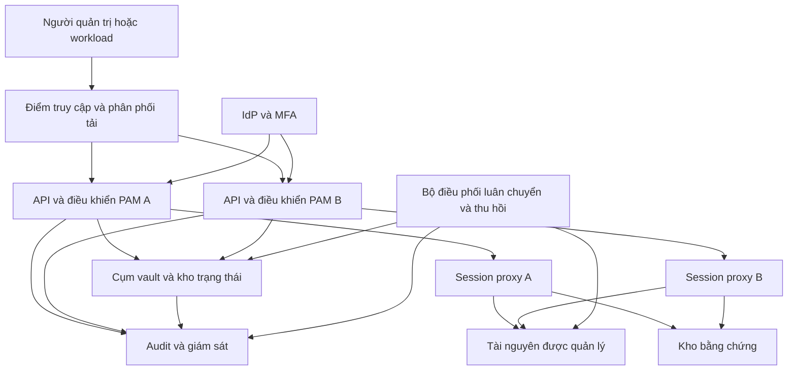

# High availability của PAM

**High availability (HA)** của Privileged Access Management (PAM) là khả năng duy trì các chức năng truy cập đặc quyền cần thiết khi một thành phần gặp lỗi, trong giới hạn gián đoạn đã xác định. Với PAM, tính sẵn sàng phải đi cùng tính đúng đắn của việc cấp quyền, bảo vệ credential và khả năng lưu bằng chứng. Một hệ thống vẫn nhận kết nối nhưng bỏ qua phê duyệt hoặc cấp quyền ngoài phạm vi không thể được coi là đáp ứng mục tiêu vận hành an toàn.

Bài học thuộc chương **Kiến trúc PAM**, trong phạm vi bảo vệ tài khoản quản trị, tài khoản dịch vụ và hạ tầng nhạy cảm. Các ví dụ kết hợp kiểm kê quyền, least privilege, JIT/JEA, vault, luân chuyển credential, giám sát phiên và bằng chứng phục vụ kiểm toán, ứng phó sự cố.

Sau bài học, bạn có thể:

- Phân biệt HA, sao chép dữ liệu, sao lưu và disaster recovery (DR).
- Xác định những thành phần và phụ thuộc có thể làm gián đoạn một luồng truy cập PAM.
- Giải thích quorum, split-brain và yêu cầu phối hợp khi chuyển vai trò xử lý credential.
- Thiết kế hành vi cho phiên đang chạy, yêu cầu mới và công việc còn dang dở khi xảy ra lỗi.
- Đặt mục tiêu và xây dựng tình huống kiểm chứng failover, phục hồi dữ liệu và thu hồi quyền.

## 1. Bắt đầu từ luồng nghiệp vụ cần duy trì

PAM thường bao gồm nhiều dịch vụ có trạng thái và mức độ quan trọng khác nhau. Câu hỏi “PAM có HA hay chưa?” chỉ hữu ích khi làm rõ cần duy trì chức năng nào:

- Quản trị viên đăng nhập, được phê duyệt và mở phiên mới.
- Phiên SSH hoặc RDP đã mở tiếp tục hoạt động trong giới hạn được phép.
- Workload lấy credential hoặc nhận danh tính cần thiết để kết nối tới dịch vụ đích.
- Credential được luân chuyển và đồng bộ với tài nguyên đích.
- Quyền JIT hết hạn được thu hồi đúng thời điểm.
- Bản ghi phiên và log chính sách được bảo toàn, truy xuất được.
- Nhóm ứng phó có thể truy cập khẩn cấp để phục hồi hạ tầng.

Một proxy dự phòng có thể giúp mở phiên mới sau khi proxy chính lỗi nhưng không bảo toàn phiên đang chạy trên node bị lỗi. Một vault dự phòng có thể chứa dữ liệu credential nhưng vẫn không phục vụ được nếu khóa giải mã hoặc hệ thống xác thực không khả dụng. Vì vậy, đánh giá HA phải theo toàn bộ đường đi của từng chức năng.

### Ví dụ phân tách yêu cầu

Đối với một ca bảo trì production, tổ chức có thể chấp nhận người dùng phải kết nối lại trong vài phút sau lỗi một proxy. Tuy nhiên, tổ chức không chấp nhận việc mất thông tin ai đã mở phiên, tự bỏ yêu cầu MFA, hoặc để quyền quản trị tạm thời tồn tại vô hạn.

Đây là ba yêu cầu khác nhau: thời gian tiếp tục công việc, tính toàn vẹn của kiểm soát truy cập và khả năng truy vết. Kiến trúc HA cần trả lời cả ba.

## 2. HA, replication, backup và DR

| Khái niệm | Mục đích | Giới hạn cần hiểu |
|---|---|---|
| HA | Giảm gián đoạn do các lỗi đã dự kiến trong phạm vi thiết kế | Không bảo đảm chịu được mọi thảm họa hoặc mọi lỗi đồng thời |
| Replication | Duy trì bản sao dữ liệu hoặc trạng thái giữa các node | Có thể sao chép cả việc xóa nhầm, sửa sai hoặc dữ liệu bị phá hoại |
| Backup | Giữ bản phục hồi tại những thời điểm xác định | Có bản sao chưa chứng minh rằng có thể khôi phục đúng và kịp thời |
| DR | Khôi phục dịch vụ sau sự cố vượt phạm vi HA thông thường | Cần dữ liệu, khóa, hạ tầng, thứ tự phục hồi và kiểm chứng quyền truy cập |
| Load balancing | Phân phối kết nối hoặc yêu cầu tới nhiều node | Không tự giải quyết trạng thái, quorum hay đồng bộ credential |

HA thường xử lý các sự cố như mất một node hoặc một miền lỗi nằm trong thiết kế. DR có thể phải xử lý mất toàn bộ khu vực triển khai, hỏng dữ liệu diện rộng hoặc cần khôi phục từ một thời điểm sạch. Hai phạm vi có thể giao nhau nhưng không thể thay thế cho nhau.

Một cụm có nhiều bản sao trực tuyến vẫn cần backup. Bản backup của cơ sở dữ liệu vault cũng có thể không đủ nếu thiếu khóa giải mã, cấu hình tích hợp hoặc vật liệu khôi phục mà giải pháp yêu cầu.

## 3. Đặt mục tiêu theo chức năng và dữ liệu

### 3.1 SLO, RTO và RPO

- **SLO về tính sẵn sàng:** mục tiêu chất lượng dịch vụ trong một khoảng thời gian, ví dụ tỷ lệ yêu cầu mở phiên hợp lệ được hoàn tất trong thời gian quy định.
- **RTO (Recovery Time Objective):** thời gian gián đoạn mục tiêu tối đa để khôi phục chức năng trong một kịch bản sự cố xác định.
- **RPO (Recovery Point Objective):** mức mất dữ liệu theo thời gian có thể chấp nhận khi phục hồi.

Nếu dùng cách đo theo thời gian, SLO 99,95% trong một tháng giả định 30 ngày tương ứng khoảng 21,6 phút gián đoạn. Nếu dùng cách đo theo số yêu cầu, phải tính theo yêu cầu thay vì chuyển trực tiếp thành số phút. Cần công bố cửa sổ đo, điều kiện được tính và các ngoại lệ nếu có.

Yêu cầu bị từ chối đúng chính sách không nên được coi là lỗi sẵn sàng. Ngược lại, cho phép một yêu cầu trái phép không phải một lần phục vụ thành công; đó là sự cố kiểm soát cần được đo và xử lý riêng.

### 3.2 Không dùng một RPO cho mọi loại trạng thái

| Loại dữ liệu hoặc trạng thái | Hệ quả nếu mất hoặc phục hồi bản cũ |
|---|---|
| Credential trong vault | Có thể không còn khớp credential thực tế ở đích |
| Chính sách và phê duyệt | Có thể thiếu quyết định mới hoặc khôi phục lại một quyền đã thu hồi |
| Lease, quyền JIT và lịch thu hồi | Có thể để quyền tồn tại lâu hơn dự kiến hoặc không biết công việc nào còn dang dở |
| Metadata phiên | Mất liên kết giữa danh tính cá nhân, tài khoản đích và bản ghi |
| Bản ghi phiên | Tạo khoảng trống bằng chứng về hành động quản trị |
| Khóa và cấu hình mật mã | Có dữ liệu nhưng không giải mã hoặc xác minh được |

RPO bằng 0 cho một cơ sở dữ liệu không có nghĩa mọi tác động trên máy đích, bản ghi phiên và dịch vụ phụ trợ đều đã được bảo toàn. Đặc biệt, thay đổi mật khẩu tại đích và lưu phiên bản mới vào vault thường không nằm trong cùng một giao dịch nguyên tử.

Các con số mục tiêu cần được chọn theo nghiệp vụ rồi kiểm chứng trên kiến trúc thực tế. Không nên gán cho sản phẩm một RTO hoặc RPO chỉ từ việc sản phẩm có nhãn HA.

## 4. Lập bản đồ thành phần và phụ thuộc

Một kiến trúc tham chiếu có thể được mô tả như sau:



Sơ đồ thể hiện vai trò logic, không quy định số node hay cơ chế cluster cụ thể của bất kỳ sản phẩm nào.

### Các phụ thuộc dễ bị bỏ sót

- DNS, định tuyến, firewall và load balancer.
- IdP, MFA và nguồn thuộc tính người dùng hoặc thiết bị.
- Cơ sở dữ liệu, message broker, scheduler và kho lưu trạng thái công việc.
- Dịch vụ khóa như KMS hoặc HSM nếu kiến trúc sử dụng chúng.
- Hệ thống thời gian và hạ tầng chứng thư.
- Dung lượng và đường truyền tới kho ghi phiên, log hoặc backup.
- Tài khoản dịch vụ để proxy kết nối, để luân chuyển credential hoặc để thu hồi quyền.
- Dịch vụ quản lý bí mật dùng để khởi động lại chính PAM.

Hai node PAM dùng chung một nguồn điện, một ổ lưu trữ không dự phòng hoặc một đường mạng duy nhất vẫn có thể cùng mất dịch vụ. Cần phân tích **miền lỗi**: nhóm thành phần có thể hỏng cùng nhau vì một nguyên nhân chung.

## 5. Chọn mô hình HA theo loại thành phần

### 5.1 Active-active cho lớp có thể phân phối yêu cầu

Nhiều node cùng phục vụ có thể phù hợp với API, giao diện hoặc proxy độc lập khi kiến trúc hỗ trợ. Điều kiện cần xem xét gồm:

- Trạng thái xác thực và quyết định quyền có được chia sẻ hoặc xác minh nhất quán không.
- Yêu cầu chuyển sang node khác có cần session affinity không.
- Kết nối dài sống bao lâu và load balancer xử lý timeout như thế nào.
- Khi mất một node, các node còn lại có đủ năng lực chịu tải không.
- Việc triển khai phiên bản mới có tương thích với trạng thái dùng chung không.

Giao diện web còn hoạt động không chứng minh chức năng mở phiên hoặc lấy secret còn hoạt động. Health check cần phản ánh đúng loại yêu cầu mà node nhận xử lý.

### 5.2 Active-passive hoặc một writer cho trạng thái nhạy cảm

Một số thành phần có thể dùng node chính và node dự phòng, hoặc có nhiều node nhưng chỉ một bên được phép ghi tại một thời điểm. Mục tiêu là kiểm soát các thay đổi như cập nhật phiên bản credential, cấp lease hoặc thực hiện một công việc luân chuyển.

Cần xác định:

- Cơ chế phát hiện lỗi và quyết định chuyển vai trò.
- Cách chứng minh node cũ không còn được phép ghi hoặc thực hiện tác động ở đích.
- Mức dữ liệu đã đồng bộ trước khi thăng node mới.
- Cách các client tìm node có quyền phục vụ sau chuyển vai trò.
- Cách xử lý các yêu cầu bị timeout nhưng có thể đã thực hiện thành công.

Đổi địa chỉ kết nối sang một node khác chưa đủ tạo ra failover an toàn nếu cả hai node vẫn có thể thực hiện thao tác thay đổi credential.

### 5.3 Không suy cơ chế cluster từ tên vai trò

Một vault có thể dùng consensus, replication primary-replica hoặc cơ chế riêng. Session proxy có thể không cần đồng bộ nội dung phiên giữa các node. Kho bằng chứng có thể dùng một dịch vụ lưu trữ với đặc tính khác cơ sở dữ liệu chính.

Thiết kế phải dựa trên khả năng triển khai thực tế của từng thành phần. Không tự thêm node biểu quyết, witness hoặc cơ chế promote mà hệ thống không hỗ trợ.

## 6. Quorum và chống split-brain

**Split-brain** xảy ra khi các phía bị chia cắt đều hoạt động như thể mình có thẩm quyền, dẫn tới quyết định hoặc thay đổi trạng thái mâu thuẫn. Trong PAM, hậu quả có thể là hai bên cùng đổi mật khẩu một tài khoản, cấp quyền dựa trên trạng thái cũ hoặc ghi nhận hai kết quả khác nhau cho một công việc.

Trong một mô hình consensus yêu cầu đa số, cụm ba node biểu quyết cần ít nhất hai phiếu để tiếp tục những thao tác cần quorum. Nếu một node lỗi, hai node còn lại có thể duy trì quorum, với điều kiện các giả định khác của hệ thống vẫn được đáp ứng.

### 6.1 Số node phải đi cùng vị trí đặt node

Giả sử ba node được đặt theo cách hai node ở vùng A, một node ở vùng B:

- Mất vùng B còn hai node ở A, có thể còn đa số.
- Mất vùng A chỉ còn một node ở B, không còn đa số.

Mô hình này không chịu lỗi mất bất kỳ vùng nào một cách đối xứng. Nếu cần chịu mất một miền lỗi bất kỳ, phải thiết kế số phiếu, vị trí đặt và độ trễ mạng phù hợp với mô hình được hỗ trợ. Việc trải nhiều vùng cũng không tự bảo đảm tính độc lập nếu các vùng còn chung một phụ thuộc quan trọng.

### 6.2 Giới hạn quyền của bên mất thẩm quyền

Cơ chế **fencing** nhằm ngăn node hoặc worker cũ tiếp tục thực hiện thao tác sau khi mất vai trò. Cách triển khai có thể liên quan tới epoch, fencing token, điều phối worker, thu hồi quyền hoặc cô lập node tùy hệ thống.

Khóa phân tán có thời hạn không tự giải quyết mọi tình huống: một worker bị treo có thể thức dậy sau khi khóa hết hạn và tiếp tục công việc cũ. Tài nguyên đích như máy chủ đổi mật khẩu cũng có thể không hiểu fencing token của PAM. Khi đó cần cơ chế phối hợp hoặc cô lập để các tác động ở đích thực sự chỉ do bên có thẩm quyền thực hiện.

Trong phân hoạch mạng, có thể cần từ chối ghi hoặc cấp quyền mới ở bên không đủ thẩm quyền để giữ tính nhất quán. Mở ghi trên cả hai phía chỉ để duy trì phản hồi có thể làm hỏng chính trạng thái dùng để bảo vệ truy cập.

## 7. HA cho vault và credential

### 7.1 Tính sẵn sàng của dữ liệu và khóa

Để phục vụ một secret, hệ thống cần nhiều điều kiện đồng thời:

1. Dữ liệu credential có thể đọc được.
2. Khóa cần thiết để giải mã hoặc sử dụng credential khả dụng.
3. Danh tính yêu cầu được xác thực.
4. Chính sách cho phép thao tác trong ngữ cảnh hiện tại.
5. Hệ thống ghi nhận việc sử dụng theo yêu cầu audit.

Sao chép dữ liệu vault mà bỏ qua cơ chế khởi động, mở khóa hoặc kết nối tới dịch vụ khóa có thể tạo ra cụm dự phòng không sử dụng được sau sự cố. Vật liệu khôi phục phải được bảo vệ và thử nghiệm theo cơ chế của giải pháp; không lưu tất cả dữ liệu cùng khóa khôi phục dưới một tài khoản quản trị duy nhất để thuận tiện.

### 7.2 Lệch trạng thái trong luân chuyển credential

Xét một công việc đổi mật khẩu:

```text
T0: Vault và máy đích cùng dùng phiên bản credential v17.
T1: Worker đổi thành công mật khẩu ở máy đích sang v18.
T2: Worker hoặc kết nối lỗi trước khi ghi nhận hoàn tất vào trạng thái PAM.
T3: Một worker khác tiếp nhận công việc nhưng chưa biết bước T1 đã thành công.
```

Nếu worker mới tự động dùng v17, xác thực có thể thất bại. Nếu lập tức tạo thêm một mật khẩu khác mà không đối soát, hệ thống có thể tạo thêm trạng thái không nhất quán.

Luồng luân chuyển cần có mã công việc, trạng thái bước, phiên bản credential và quy trình xử lý kết quả chưa chắc chắn. Khi nhận tiếp công việc, worker phải xác định trạng thái mong muốn và trạng thái quan sát được theo cơ chế được bảo vệ, rồi mới thử lại hoặc thực hiện reconciliation. Không đưa mật khẩu vào log để đối soát.

**Idempotency** giúp một thao tác lặp lại không tạo thêm tác động ngoài dự kiến, nhưng thao tác đặt mật khẩu trên mọi loại đích không mặc nhiên có đặc tính này. Cần thiết kế ở mức workflow và hiểu khả năng của đích. Không giả định vault và máy đích tham gia một giao dịch nguyên tử.

### 7.3 Tài khoản dịch vụ và ứng dụng phụ thuộc

Với tài khoản dịch vụ, thay credential có thể tác động tới nhiều ứng dụng và pool kết nối. HA của PAM cần đi cùng quy trình cập nhật bên sử dụng, kiểm tra sức khỏe dịch vụ và xử lý lỗi chuyển phiên bản credential.

Nếu cho phép ứng dụng dùng credential đã cache khi vault tạm gián đoạn, phải quy định phạm vi, thời hạn, bảo vệ cache và điều kiện thu hồi. Cache không phải giải pháp chung cho mọi secret: dùng credential đã thu hồi hoặc quá hạn có thể phá vỡ mục tiêu của JIT và luân chuyển.

## 8. HA cho session proxy và phiên đang chạy

### 8.1 Phân biệt mở phiên mới với giữ phiên hiện có

Một session proxy thường giữ các kết nối và trạng thái giao thức của phiên. Nếu node đó bị dừng đột ngột, proxy khác không mặc nhiên tiếp quản được luồng SSH hoặc RDP đang hoạt động.

Cần xác định hành vi theo giải pháp thực tế:

- Phiên có bị ngắt khi node xử lý mất không.
- Người dùng kết nối lại bằng phiên mới hay có cơ chế nối lại được hỗ trợ.
- Quyền, MFA và phê duyệt nào cần được kiểm tra lại.
- Session ID, bản ghi cũ và lần kết nối mới được liên kết thế nào.
- Tại máy đích còn session, tiến trình hoặc tác vụ nền nào tồn tại.

Với RDP, mất kết nối có thể để lại session Windows ở trạng thái disconnected. Với SSH, một tác vụ đã tách khỏi terminal có thể tiếp tục. Khả năng người dùng mất đường truyền và khả năng tác vụ ở đích đã dừng là hai vấn đề riêng.

### 8.2 Connection draining khi bảo trì

Khi chủ động bảo trì một proxy:

1. Ngừng đưa phiên mới tới node cần bảo trì.
2. Theo dõi những phiên còn hoạt động và thời hạn của chúng.
3. Cho phiên hoàn tất trong cửa sổ cho phép, hoặc kết thúc theo quy trình đã thống nhất.
4. Xác nhận bản ghi đã được chuyển và các công việc dọn dẹp không còn tồn đọng.
5. Sau đó mới dừng node hoặc thay phiên bản.

Thời gian drain phải xét thời lượng phiên thực tế. Các node còn lại cũng phải đủ năng lực trong thời gian bảo trì; nếu cụm thường chạy gần hết công suất, có thêm node dự phòng chưa chắc đáp ứng khi một node bị rút ra.

### 8.3 Mất liên lạc với điều khiển PAM

Một proxy đã mở phiên có thể còn đủ trạng thái để tiếp tục khi dịch vụ điều khiển lỗi. Điều này chỉ phù hợp nếu có chính sách rõ về thời hạn, điều kiện tiếp tục, quyền ngắt và ghi bằng chứng.

Nếu hệ thống dùng quyết định hoặc token đã được cấp trước, proxy cần kiểm chứng phạm vi và thời hạn, đồng thời thực thi thời gian kết thúc bằng cơ chế phù hợp. Không được tự gia hạn vô hạn vì không liên lạc được với bộ điều khiển. Sự cố đồng hồ hoặc thông tin thu hồi đến trễ cũng phải được đưa vào thiết kế.

## 9. HA cho phê duyệt, JIT và thu hồi quyền

### 9.1 Tạo lại yêu cầu không đồng nghĩa tạo lại quyền

Client có thể gửi lại yêu cầu sau timeout vì không biết lần trước đã thành công hay chưa. Luồng cấp quyền nên có định danh yêu cầu và khả năng nhận diện việc lặp lại để tránh cấp nhiều quyền, tạo nhiều tài khoản tạm hoặc mở rộng thời hạn ngoài dự kiến.

Thông tin cần lưu có thể bao gồm người yêu cầu, tài nguyên, vai trò, điều kiện phê duyệt, phiên bản chính sách, thời điểm hết hạn và trạng thái thực thi. Khi failover, node mới phải biết quyền nào đã cấp và việc nào còn chưa hoàn tất.

### 9.2 Thu hồi không được phụ thuộc vào một timer dễ mất

Nếu một scheduler chỉ giữ timer trong bộ nhớ, khởi động lại có thể làm mất công việc thu hồi. Đối với quyền JIT, cần cơ chế lưu thời hạn bền vững và công việc đối soát sau phục hồi.

Có thể tăng mức bảo vệ bằng cách dùng tài khoản, lease hoặc credential có thời hạn do đích thực thi khi được hỗ trợ. Tuy nhiên, credential hết hạn thường giới hạn xác thực mới; không thể mặc định nó kết thúc mọi phiên đã xác thực hoặc mọi tiến trình đã chạy.

Quyền JEA hoặc endpoint giới hạn thao tác cũng cần cấu hình đúng và khả dụng ở đích. HA của lớp cấp quyền không thay thế việc giới hạn hành động thực tế.

### 9.3 Khôi phục dữ liệu cũ có thể khôi phục cả quyền cũ

Sau khi restore một bản backup, trạng thái PAM có thể cũ hơn trạng thái đích. Một quyền đã thu hồi có thể xuất hiện trở lại trong dữ liệu phục hồi; một tài khoản được tạo sau thời điểm backup có thể còn tồn tại ở đích nhưng không có trong danh mục hiện tại.

Trước khi mở lại luồng cấp quyền thông thường, cần đối soát quyền đang tồn tại, lease, tài khoản tạm và credential. Cách đối soát phụ thuộc khả năng truy vấn và kiểm soát đích, nhưng không nên bỏ qua chỉ vì cơ sở dữ liệu đã khởi động được.

## 10. HA cho giám sát và kho bằng chứng

Một luồng truy cập có yêu cầu ghi phiên cần cả khả năng mở phiên lẫn khả năng bảo toàn bản ghi. Khi kho bằng chứng gián đoạn, kiến trúc có thể dùng bộ đệm cục bộ được bảo vệ nếu chính sách và giải pháp cho phép.

Bộ đệm cần có:

- Mã hóa, kiểm soát quyền đọc và cơ chế bảo vệ khóa phù hợp.
- Giới hạn dung lượng, giám sát mức đầy và tuổi dữ liệu chưa chuyển.
- Cơ chế phát hiện trùng lặp, thiếu đoạn hoặc lỗi toàn vẹn khi gửi lại.
- Hành vi cụ thể khi hết dung lượng hoặc quá thời gian gián đoạn cho phép.
- Khả năng liên kết các đoạn bản ghi với phiên sau khi chuyển node hoặc kết nối lại.

Nếu node proxy bị mất hoàn toàn trước khi chuyển dữ liệu, bản ghi chỉ còn trong bộ đệm node đó có thể bị mất. Đây phải là một phần của mục tiêu phục hồi bằng chứng, không bị che khuất bởi RPO của vault.

Kho bằng chứng cần tính khả dụng để ghi và để đọc lại. Kiểm tra khả năng phát lại, quyền truy cập và khóa giải mã là một phần của kiểm chứng phục hồi. Replication giúp tăng khả năng tồn tại dữ liệu nhưng không tự ngăn việc sửa hoặc xóa trái phép lan sang bản sao khác; cần cơ chế bảo vệ tính toàn vẹn và lưu giữ tương ứng.

## 11. Quy định hành vi khi phụ thuộc lỗi

Không nên chỉ dùng một nhãn “fail-open” hoặc “fail-closed” cho toàn bộ PAM. Phải mô tả theo thao tác và trạng thái. Một chính sách tham chiếu có thể như sau:

| Lỗi hoặc trạng thái | Yêu cầu mới | Phiên hoặc công việc đã tồn tại |
|---|---|---|
| IdP hoặc MFA không đáp ứng | Không tự bỏ bước xác thực bắt buộc; chỉ chấp nhận bằng chứng còn hợp lệ nếu thiết kế cho phép | Xử lý theo thời hạn và chính sách kiểm tra lại của phiên |
| Không đủ quorum hoặc không có writer hợp lệ | Từ chối thao tác cần trạng thái có thẩm quyền | Hạn chế thao tác thay đổi; duy trì hoặc ngắt phiên theo chính sách riêng |
| Vault không cung cấp được credential | Không mở phiên cần credential mà hệ thống không thể cung cấp hợp lệ | Phiên đã xác thực có thể tiếp tục nếu các điều kiện khác vẫn được đáp ứng |
| Kho bằng chứng lỗi | Từ chối phiên bắt buộc ghi nếu không có phương án bộ đệm được chấp nhận | Đệm trong giới hạn hoặc ngắt theo chính sách, ghi nhận rõ khoảng trống |
| Proxy lỗi | Điều hướng yêu cầu mới tới proxy khỏe nếu còn năng lực | Xử lý mất kết nối, trạng thái ở đích và việc kết nối lại |
| Không thu hồi được quyền | Không coi công việc đã hoàn tất; có thể hạn chế cấp tiếp tùy rủi ro | Cảnh báo, gán người xử lý, đối soát và xác nhận thu hồi |
| Dịch vụ khóa không khả dụng | Thao tác cần khóa có thể bị từ chối tùy kiến trúc | Hành vi phụ thuộc cơ chế sử dụng và bảo vệ khóa thực tế |

Chính sách cần nêu ai có quyền thay đổi hành vi trong sự cố và bằng chứng nào phải lưu. Không để thao tác chuyển sang node dự phòng tự động mở rộng quyền, bỏ phê duyệt hoặc đưa credential ra ngoài phạm vi bảo vệ.

## 12. Kiến trúc tham chiếu cho một hệ thống production

Giả sử tổ chức cần PAM cho máy chủ Linux, Windows và một số tài khoản dịch vụ. Mục tiêu minh họa là tiếp tục mở phiên sau lỗi một proxy và không để mất quyền kiểm soát các công việc luân chuyển, thu hồi. Đây là bài toán thiết kế, không phải cam kết năng lực của một sản phẩm.

### 12.1 Phân bố thành phần

- Lớp API có nhiều instance, được phân phối tải qua một điểm truy cập cũng có cơ chế dự phòng.
- Nhóm proxy có ít nhất năng lực chịu tải khi một node không phục vụ; các node nằm trên những miền lỗi phù hợp.
- Vault và kho trạng thái dùng mô hình cluster được hỗ trợ. Nếu mô hình yêu cầu đa số, vị trí các node biểu quyết được chọn theo sự cố cần chịu được.
- Bộ điều phối công việc lưu trạng thái bền vững, kiểm soát bên thực thi và có bước reconciliation sau chuyển vai trò.
- Kho bằng chứng có khả năng tiếp nhận dự phòng; proxy có bộ đệm giới hạn theo chính sách.
- Backup và vật liệu phục hồi được bảo vệ ngoài phạm vi lỗi mà chúng cần khắc phục.
- IdP, DNS, thời gian, khóa và đường quản trị khẩn cấp được đưa vào cùng phân tích phụ thuộc.

### 12.2 Mẫu yêu cầu vận hành

Ví dụ dưới đây chỉ biểu diễn ý định chính sách, không phải cú pháp có thể triển khai trực tiếp:

```yaml
availability_objectives:
  new_privileged_sessions:
    tolerate_one_proxy_failure: true
    reauthorization_on_reconnect: according_to_policy
  active_sessions:
    transparent_migration_assumed: false
    maximum_lifetime_enforced_during_control_loss: true
  credential_rotation:
    durable_job_state_required: true
    single_authorized_executor_required: true
    reconcile_uncertain_outcome_before_retry: true
  temporary_access:
    durable_expiration_required: true
    verify_revocation_after_recovery: true
  evidence:
    recording_required_for_production: true
    bounded_protected_buffer_allowed: true
    reject_new_recorded_sessions_when_buffer_exhausted: true
```

Khi hiện thực hóa, từng thuộc tính phải có thành phần chịu trách nhiệm, cách quan sát và tình huống kiểm chứng. Một trường cấu hình trong tài liệu không tự bảo đảm rằng hệ thống thực thi được yêu cầu đó.

### 12.3 Lỗi một proxy trong giờ bảo trì

Một quản trị viên đang sửa cấu hình qua proxy A thì A lỗi:

1. Hệ thống phát hiện node không còn đủ điều kiện nhận kết nối và ngừng đưa phiên mới tới A.
2. Phiên đang đi qua A có thể mất. Giám sát đánh dấu kết thúc bất thường và xác định tình trạng bản ghi đã chuyển.
3. Người dùng kết nối lại qua B với kiểm tra quyền còn hiệu lực theo chính sách, không tự cấp thêm thời gian bảo trì.
4. Người vận hành kiểm tra session hoặc tiến trình còn ở máy đích để tránh chạy lặp thao tác đang thực hiện.
5. Hệ thống đối soát quyền tạm thời, credential và các đoạn bằng chứng liên quan.

Kết quả thành công không nhất thiết là người dùng không thấy gián đoạn. Kết quả phải đáp ứng mục tiêu gián đoạn, không mất kiểm soát quyền và có thể giải thích những gì xảy ra trong sự cố.

## 13. Kế hoạch failover, DR và failback

### 13.1 Chuyển vai trò trong phạm vi HA

Một quy trình tham chiếu gồm:

1. Xác nhận thành phần lỗi và phạm vi tác động; tránh promote chỉ từ một dấu hiệu giám sát không đủ tin cậy.
2. Xác nhận bên được phép xử lý trạng thái và ngăn bên cũ tiếp tục ghi hoặc tác động ở đích.
3. Kiểm tra mức đồng bộ, khóa và các phụ thuộc của node nhận vai trò.
4. Chuyển luồng yêu cầu, kiểm tra credential, cấp quyền và ghi bằng chứng bằng các thao tác phù hợp.
5. Đối soát yêu cầu chưa rõ kết quả, công việc luân chuyển, quyền cần thu hồi và bản ghi còn đệm.
6. Ghi nhận thời gian phát hiện, chuyển vai trò, khôi phục chức năng và các dữ liệu bị ảnh hưởng.

### 13.2 Phục hồi sau sự cố vượt phạm vi HA

DR có thể phải phục hồi từ backup hoặc sử dụng một môi trường khác. Thứ tự tham chiếu là khôi phục hạ tầng và đường truy cập cần thiết, khóa hoặc cơ chế mở khóa, dữ liệu cùng cấu hình phù hợp, rồi các dịch vụ xác thực, điều khiển, proxy và bằng chứng theo quan hệ phụ thuộc thực tế.

Trước khi mở truy cập rộng, cần kiểm tra:

- Credential phục hồi có khớp với máy đích không.
- Quyền nào tồn tại ở đích nhưng thiếu trong dữ liệu vừa khôi phục.
- Những phê duyệt, token hoặc lease nào đã hết hiệu lực hoặc đã thu hồi.
- Bản ghi và audit có khoảng trống ở đâu.
- Danh tính và khóa nào cần thay vì bị ảnh hưởng bởi nguyên nhân sự cố.

Nếu nguyên nhân là xâm nhập, việc sao chép nguyên trạng môi trường cũ sang nơi dự phòng có thể mang theo quyền hoặc cấu hình bị thay đổi trái phép. Điểm phục hồi cần được chọn theo bằng chứng về trạng thái tin cậy.

### 13.3 Failback không phải chỉ bật lại node cũ

Node cũ khi trở lại có thể chứa dữ liệu lạc hậu hoặc các công việc còn trong hàng đợi. Không đưa node đó trở lại vai trò ghi trước khi xử lý dữ liệu phân kỳ, đồng bộ theo quy trình được hỗ trợ và ngăn các tác vụ cũ thực thi lại ngoài ý muốn.

Cần xác định hệ thống nào là nguồn trạng thái có thẩm quyền, cách nhập lại node và cách đối soát các tác động đã thực hiện ở đích. Failback nên có kế hoạch riêng với điều kiện dừng và cách quay lại cấu hình đang phục vụ nếu kiểm tra không đạt.

## 14. Break-glass và phụ thuộc vòng

Một lỗi kiến trúc thường gặp là cần PAM để vào máy chủ sửa PAM, trong khi PAM đã mất khả năng cấp truy cập. Một dạng khác là PAM cần lấy secret từ chính dịch vụ chưa thể khởi động để phục hồi dịch vụ đó.

Đường khẩn cấp cần phá được vòng phụ thuộc nhưng vẫn được kiểm soát:

- Xác định danh tính, tài nguyên và quyền tối thiểu cho từng mục đích phục hồi.
- Bảo vệ credential hoặc vật liệu khôi phục bằng phương thức có thể sử dụng khi các phụ thuộc chính không hoạt động.
- Quy định người được kích hoạt, điều kiện sử dụng và cách ghi nhận độc lập khi cần.
- Giới hạn thời gian, đối soát hành động, thu hồi quyền và luân chuyển credential sau sử dụng theo chính sách.
- Thử nghiệm khả năng truy cập và phục hồi có kiểm soát trước khi xảy ra sự cố thật.

Break-glass hỗ trợ phục hồi; nó cần được tính vào kiểm kê quyền và kiểm toán như các đường đặc quyền khác. Một credential khẩn cấp chưa bao giờ được xác minh có thể không giúp khôi phục khi cần.

## 15. Kiểm chứng bằng lỗi có kiểm soát

Trong một môi trường thực hành hoặc diễn tập được phép, có thể dùng ma trận sau để kiểm chứng. Đây là đề xuất tình huống học tập, không phải kết quả kiểm thử thực tế của hệ thống nào.

| Tình huống | Điều cần xác nhận |
|---|---|
| Dừng một API instance | Yêu cầu hợp lệ được chuyển đúng; không lặp cấp quyền hoặc mất liên kết audit |
| Dừng một proxy có phiên hoạt động | Hiểu rõ phiên bị ảnh hưởng, cách kết nối lại và tình trạng máy đích |
| Chia cắt node có vai trò ghi khỏi các node khác | Chỉ phía có thẩm quyền được tiếp tục thao tác cần tính nhất quán |
| Dừng worker trong lúc đổi credential | Phát hiện kết quả chưa chắc chắn, không tự lặp tác động thiếu đối soát |
| Mất scheduler thu hồi | Thời hạn không biến mất và quyền hết hạn được tìm, xử lý sau phục hồi |
| Ngắt kho bằng chứng rồi làm đầy bộ đệm | Không âm thầm bỏ ghi; hành vi từ chối hoặc ngắt đúng chính sách |
| Mất IdP, MFA hoặc dịch vụ khóa | Không tự bỏ kiểm soát bắt buộc; biết chức năng nào còn phục vụ được |
| Khôi phục từ backup | Có dữ liệu, khóa, cấu hình tương thích; đối soát được credential và quyền ở đích |
| Đưa node cũ trở lại | Không xuất hiện writer cũ hoặc công việc cũ tác động trái phép |
| Sử dụng đường break-glass | Phục hồi được chức năng cần thiết và có bằng chứng cùng bước thu hồi sau sử dụng |

Mỗi tình huống nên có điều kiện bắt đầu, kết quả mong đợi, giới hạn ảnh hưởng, cách kết thúc diễn tập và bằng chứng thu thập. Đo thời gian khôi phục chức năng thực tế thay vì chỉ thời gian tiến trình khởi động lại.

### Chỉ số vận hành hữu ích

- Tỷ lệ và độ trễ mở phiên hợp lệ, lấy credential và hoàn tất phê duyệt.
- Năng lực còn lại khi một node không phục vụ và số phiên trên từng proxy.
- Độ trễ replication, trạng thái quorum và tuổi công việc đang chờ.
- Số lần luân chuyển chưa rõ kết quả, credential không khớp và quyền thu hồi quá hạn.
- Dung lượng, tuổi dữ liệu trong bộ đệm và tỷ lệ bản ghi thiếu hoặc không phát lại được.
- Thời gian phát hiện, failover, khôi phục nghiệp vụ và đối soát hoàn tất.
- Kết quả thử phục hồi backup và tình trạng các phụ thuộc cần để mở khóa, xác thực, ghi bằng chứng.

Những chỉ số này giúp phân biệt một cụm còn phản hồi với một dịch vụ thực sự còn cấp đúng quyền, bảo vệ credential, thu hồi đúng hạn và lưu được bằng chứng. Tính sẵn sàng của PAM được chứng minh bằng khả năng hoàn thành những luồng đó trong các tình huống lỗi đã xác định.
