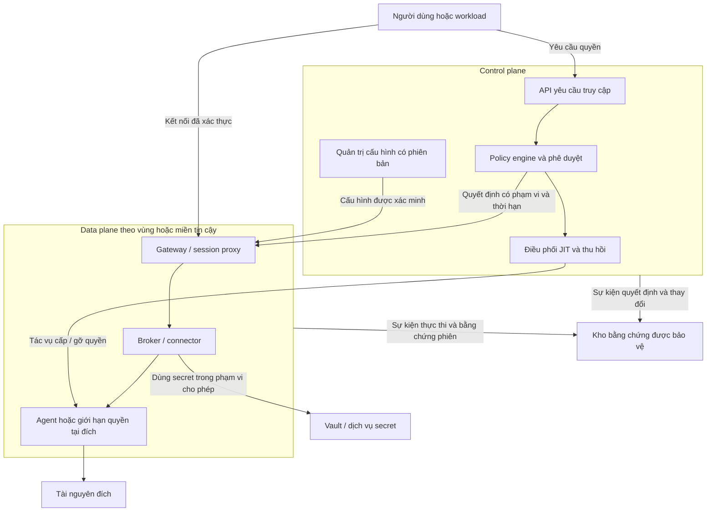

# Tách control plane và data plane trong kiến trúc PAM

## 1. Vì sao cần tách hai plane?

Một hệ thống quản lý truy cập đặc quyền (Privileged Access Management — PAM) vừa phải quyết định ai được sử dụng quyền quản trị, vừa phải xử lý việc sử dụng quyền đó trên hệ thống thật. Hai nhóm công việc có đặc điểm vận hành và rủi ro khác nhau.

Việc phê duyệt một yêu cầu quản trị production cần thông tin danh tính, chính sách, ticket và thời hạn. Trong khi đó, việc chuyển tiếp một phiên SSH hoặc RDP cần kết nối ổn định, băng thông, xử lý giao thức và khả năng giám sát liên tục. Nếu mọi việc nằm trong một khối không có ranh giới rõ, một đợt tải phiên lớn có thể ảnh hưởng quyết định cấp quyền; một lỗi ở bộ xử lý giao thức cũng có thể tiếp cận chức năng quản trị chính sách.

Tách **control plane** và **data plane** giúp xác định rõ nơi ra quyết định, nơi thực thi, dữ liệu được phép đi qua từng ranh giới và hành vi khi thành phần lỗi. Trong PAM, mục tiêu là duy trì least privilege cho tài khoản quản trị, tài khoản dịch vụ và hạ tầng nhạy cảm, đồng thời có thể cấp quyền JIT, giới hạn tác vụ JEA, quản lý credential, giám sát phiên và lưu bằng chứng kiểm toán.

Tách plane trước hết là một quyết định về trách nhiệm và ranh giới tin cậy. Hai plane có thể được triển khai thành các dịch vụ, tiến trình, cụm hoặc vùng mạng riêng tùy yêu cầu. Chỉ đặt tên hai nhóm dịch vụ khác nhau chưa tạo ra sự cách ly nếu chúng vẫn dùng chung tài khoản quản trị toàn quyền hoặc có thể sửa dữ liệu nội bộ của nhau.

## 2. Định nghĩa theo hành vi

### Control plane: quyết định và điều phối

Control plane quản lý trạng thái mong muốn và điều kiện sử dụng đặc quyền. Những chức năng thường thuộc nhóm này gồm:

- Quản trị danh mục tài nguyên, tài khoản đặc quyền và chủ sở hữu.
- Nhận yêu cầu, đánh giá chính sách, điều phối MFA bổ sung và phê duyệt.
- Xác định phạm vi quyền, profile JEA, thời hạn JIT và điều kiện ghi phiên.
- Phân phối cấu hình có phiên bản cho các điểm thực thi.
- Điều phối cấp, thu hồi và đối soát quyền tạm.
- Điều phối luân chuyển credential, tiếp nhận trạng thái và phục vụ điều tra.

Control plane không nhất thiết phải nhìn thấy nội dung của mọi phiên SSH, từng câu lệnh SQL hoặc giá trị plaintext của mọi secret để làm các công việc này.

### Data plane: thực hiện truy cập và áp dụng kiểm soát

Data plane nằm trên đường sử dụng quyền hoặc truy cập tài nguyên. Những chức năng thường thuộc nhóm này gồm:

- Gateway hoặc proxy chấp nhận kết nối trong phạm vi đã được cấp.
- Broker sử dụng hoặc cấp credential theo quyền đã xác minh.
- Connector thiết lập kết nối đến tài nguyên đích.
- Endpoint hoặc agent thực thi profile JEA và quyền tạm tại đích.
- Chuyển tiếp SSH, RDP, luồng cơ sở dữ liệu hoặc API quản trị theo khả năng nền tảng.
- Áp dụng giới hạn phiên, kết thúc phiên và thu thập bằng chứng sử dụng.

Data plane không phải một đường ống không có logic bảo vệ. Nó phải kiểm tra quyền thực thi, thời hạn, ràng buộc và tình trạng hiện tại cần thiết trước khi cho hành động tiếp diễn. Control plane ra quyết định không có nghĩa data plane được bỏ qua việc xác minh quyết định.

### Phân loại thao tác thay vì gắn nhãn tuyệt đối cho dịch vụ

Một dịch vụ có thể đảm nhiệm cả hai loại thao tác. Ví dụ, vault có API quản trị chính sách truy cập, đồng thời có API dùng secret để thiết lập kết nối. Credential broker có thể hỏi policy engine trên kênh điều khiển rồi dùng credential trên đường truy cập.

| Hoạt động | Vai trò chủ yếu trong mô hình bài học | Điểm cần phân biệt |
|---|---|---|
| Sửa chính sách cấp quyền production | Control plane | Có thể ảnh hưởng nhiều tài nguyên dù không chuyển tiếp phiên |
| Trả quyết định cho một yêu cầu mở phiên | Control plane | Quyết định phải được ràng buộc với đúng phạm vi |
| Kiểm tra grant và mở kết nối SSH | Data plane | Cần xác minh trước khi thực hiện truy cập |
| Dùng secret từ vault để đăng nhập đích | Data plane / thao tác nhạy cảm của đường truy cập | Không mặc nhiên được xuất secret cho người dùng |
| Lập lịch đổi mật khẩu | Control plane | Chỉ điều phối thời điểm và quy trình |
| Đổi mật khẩu thật trên tài nguyên | Thao tác thực thi qua connector | Cần quyền riêng tại đích và xử lý kết quả |
| Thu nội dung phiên | Gắn với data plane | Không nên bắt mọi byte phải đi qua API điều khiển trung tâm |
| Tìm kiếm bằng chứng phục vụ kiểm toán | Dịch vụ quản lý bằng chứng | Có thể là một thành phần riêng, dùng quyền đọc phù hợp |

Cách phân chia này là mô hình kiến trúc để phân tích; tên gọi trong sản phẩm thực tế có thể khác.

## 3. Kiến trúc tham chiếu



Sơ đồ thể hiện quan hệ logic; một luồng dữ liệu có thể được kết nối theo hướng ngược lại hoặc dùng hàng đợi tùy cách triển khai. Ví dụ, một connector trong mạng riêng có thể chủ động thiết lập kênh điều khiển ra ngoài thay vì cho phép kết nối quản trị từ trung tâm vào mạng đó.

Vault và kho bằng chứng được biểu diễn riêng vì chúng có ranh giới dữ liệu và quyền truy cập cần thiết kế độc lập. Không nên ép mọi thành phần vào một trong hai ô rồi bỏ qua việc bảo vệ secret hoặc bản ghi phiên.

## 4. Ba loại luồng cần vẽ riêng

### Luồng điều khiển

Luồng điều khiển mang yêu cầu và quyết định: danh tính nào được cấp quyền, trên tài nguyên nào, cho hành động nào, có hiệu lực bao lâu. Nó cũng mang cấu hình, lệnh thu hồi, kết quả phê duyệt và trạng thái thực thi.

Một thông điệp cấp quyền nên dùng định danh tài nguyên và profile đã đăng ký. Không nên cho người gọi chỉ định tùy ý địa chỉ đích, tài khoản quản trị hoặc lệnh hệ thống rồi coi đó là cấu hình đáng tin cậy.

### Luồng truy cập

Luồng truy cập mang hoạt động thực tế: phím gõ và màn hình RDP, phiên SSH, truy vấn cơ sở dữ liệu, lời gọi API hoặc hành động dùng credential. Đây thường là phần cần băng thông, xử lý giao thức và giới hạn kết nối rõ ràng.

Trong mô hình proxy có khả năng quan sát và kiểm soát nội dung, proxy thường kết thúc hoặc tham gia thiết lập các kênh bảo mật theo giao thức tương ứng. Điều đó làm nó trở thành thành phần nhạy cảm cần bảo vệ. Không nên vừa giả định nội dung hoàn toàn vô hình với proxy vừa kỳ vọng proxy ghi lại hoặc lọc mọi thao tác bên trong.

### Luồng bằng chứng

Sự kiện quyết định, trạng thái cấp quyền và bản ghi phiên cần được liên kết nhưng có thể dùng các đường vận chuyển, mức ưu tiên và kho lưu khác nhau. Một video phiên lớn không cần đi qua cùng hàng đợi xử lý yêu cầu cấp quyền tương tác.

Luồng bằng chứng thường được lưu bền vững rồi chuyển đến kho tập trung. Cần xác định rõ thế nào là “đã ghi nhận”: đã tạo sự kiện trong bộ nhớ, đã lưu bền vững cục bộ hay đã được kho đích xác nhận. Những mốc này không tương đương nhau.

## 5. Hợp đồng giữa quyết định và thực thi

Ranh giới quan trọng nhất là hợp đồng từ control plane sang data plane. Một giá trị `allow=true` đứng riêng không đủ để mở phiên quản trị an toàn.

Một grant hoặc lease cần xác định tối thiểu các yếu tố phù hợp với thiết kế:

| Thành phần hợp đồng | Mục đích |
|---|---|
| ID yêu cầu và ID grant | Liên kết, chống xử lý trùng và truy vết |
| Chủ thể đã xác thực | Ngăn dùng quyền của danh tính khác |
| Tài nguyên, tài khoản và hành động | Giới hạn nơi và cách sử dụng quyền |
| Profile quyền | Liên kết với tập tác vụ có thể thực thi tại đích |
| Điểm thực thi hoặc audience | Giới hạn thành phần được phép nhận quyết định |
| Phiên bản chính sách và cấu hình liên quan | Giải thích quyết định và phát hiện khác biệt phiên bản |
| Hạn kích hoạt và hạn hết quyền | Giới hạn thời gian dùng grant và thời gian sử dụng quyền |
| Ràng buộc bắt buộc | Ghi phiên, không xuất credential, giới hạn truyền tệp hoặc điều kiện khác |
| Cơ chế chống phát lại | Hạn chế việc dùng lại một grant ngoài số lần hoặc phạm vi cho phép |

Ví dụ minh họa dưới đây không phải cấu hình có thể triển khai trực tiếp:

```json
{
  "grant_id": "grant-610",
  "request_id": "req-610",
  "subject_id": "user:an",
  "resource_id": "server:billing-prod-03",
  "account_id": "account:billing-operator",
  "action": "session.start",
  "profile_id": "billing-service-restart",
  "audience": "proxy:zone-prod-a",
  "policy_version": "pam-access-v8",
  "activate_before": "2026-11-26T03:01:00Z",
  "access_expires_at": "2026-11-26T03:15:00Z",
  "obligations": {
    "record_session": true,
    "credential_export": false,
    "file_transfer": false
  }
}
```

Data plane cần xác minh nguồn phát hành, tính toàn vẹn, danh tính người kết nối, audience, phạm vi, thời hạn và trạng thái sử dụng/thu hồi theo giao thức. Thông điệp JSON tự nó không có khả năng chống giả mạo. Thiết kế có thể dùng kênh dịch vụ đã xác thực, quyết định có chữ ký hoặc tra cứu trực tuyến, kết hợp với quản lý khóa và trạng thái chống phát lại phù hợp.

Mã hóa đường truyền và chữ ký quyết định giải quyết những vấn đề khác nhau. Chữ ký không tự che giấu nội dung; kênh được mã hóa cũng không tự ngăn ứng dụng dùng lại một grant hợp lệ nhiều lần. Một `grant_id` chỉ giúp định danh; chống dùng lại cần cơ chế thực thi số lần sử dụng hoặc ràng buộc tương đương.

Data plane phải từ chối nếu không hỗ trợ một ràng buộc bắt buộc. Ví dụ, proxy không có khả năng ghi phiên không được bỏ qua `record_session=true`. Cũng cần xác minh profile đã được triển khai đúng tại đích trước khi coi quyền JEA là có hiệu lực.

## 6. Luồng hoàn chỉnh cho một phiên JIT/JEA

Giả sử kỹ sư An cần khởi động lại dịch vụ thanh toán trên một máy chủ production trong tối đa 15 phút. Tổ chức yêu cầu MFA còn mới, ticket đúng phạm vi, phê duyệt độc lập và ghi phiên. Các thời hạn trong ví dụ là lựa chọn minh họa, không phải chuẩn chung.

1. **Đề nghị:** control plane nhận yêu cầu gắn với danh tính đã xác thực, tài nguyên được kiểm kê, tài khoản và profile cụ thể.
2. **Đánh giá:** policy engine xác minh nhóm/vai trò, trạng thái danh tính, MFA, thiết bị, ticket và các điều kiện liên quan từ nguồn có thẩm quyền.
3. **Hoàn tất điều kiện:** nếu còn chờ phê duyệt hoặc xác thực bổ sung, hệ thống chưa cho sử dụng quyền. Khi điều kiện hoàn tất, yêu cầu được đánh giá lại theo trạng thái hiện tại.
4. **Chuẩn bị:** bộ điều phối chọn data plane đúng vùng và yêu cầu chuẩn bị quyền tạm. Connector chỉ được tạo quyền trong phạm vi đã cấp; tác vụ có định danh để xử lý lặp an toàn.
5. **Xác nhận:** data plane và hệ thống đích xác nhận profile, quyền tạm, khả năng ghi phiên và giới hạn liên quan. Một phần chuẩn bị thất bại phải được hoàn tác hoặc đưa vào quy trình khắc phục có theo dõi.
6. **Kích hoạt:** data plane xác minh grant trước hạn kích hoạt; ánh xạ đúng người kết nối và đúng tài nguyên. Broker dùng credential được quản lý để tạo kết nối mà không cần trả plaintext cho kỹ sư nếu chính sách không cho phép xuất credential.
7. **Sử dụng:** thao tác đi qua cơ chế thực thi đã định. Proxy, endpoint và vai trò phía đích phối hợp giới hạn tác vụ; không mặc nhiên cấp shell quản trị toàn quyền chỉ vì đã vào proxy.
8. **Giám sát:** bằng chứng phiên và sự kiện thực thi được gắn với request ID, grant ID, session ID và phiên bản chính sách.
9. **Kết thúc:** đến hạn hoặc có yêu cầu thu hồi, hệ thống xử lý phiên, token và quyền tại đích theo chính sách. Bộ đối soát xác minh quyền đã được gỡ và phát hiện quyền còn tồn dư.

Thông điệp điều khiển có thể được gửi lại do timeout hoặc mất phản hồi. Tác vụ tạo/gỡ quyền cần có tính idempotent hoặc kiểm tra trạng thái tương đương để cùng một yêu cầu không tạo nhiều quyền ngoài ý muốn. Việc không nhận được phản hồi chưa đủ kết luận rằng thao tác ở đích chưa xảy ra.

## 7. Ranh giới tin cậy và quyền của từng thành phần

Tách plane chỉ có giá trị bảo vệ khi quyền và đường kết nối cũng được giới hạn. Data plane xử lý nội dung và giao thức từ nhiều nguồn; control plane có khả năng thay đổi chính sách cho nhiều tài nguyên. Cả hai đều cần được bảo vệ theo tác động thực tế của chúng.

| Ranh giới | Quy tắc thiết kế |
|---|---|
| Người dùng → control plane | Xác thực, chống giả mạo yêu cầu, kiểm tra quyền gửi và phê duyệt |
| Control plane → data plane | Danh tính dịch vụ, xác thực hai phía nếu phù hợp, quyền theo API và xác minh phạm vi |
| Data plane → control plane | Chỉ báo trạng thái hoặc dùng API cần thiết; không được tự sửa chính sách hay tự phát hành grant |
| Data plane → vault | Chỉ dùng secret được cấp trong phạm vi tài nguyên; không có quyền liệt kê hoặc xuất mọi secret |
| Connector → tài nguyên | Quyền tối thiểu cho tác vụ được hỗ trợ, tách theo vùng/tài nguyên khi cần |
| Người vận hành → hai plane | Quyền quản trị tách theo chức năng, truy cập quản trị được audit và kiểm soát |
| Thành phần → kho bằng chứng | Quyền ghi và đọc phù hợp; hạn chế khả năng sửa/xóa dấu vết |

Một proxy cho phép gọi mọi API quản trị control plane bằng cùng credential nội bộ làm tăng phạm vi ảnh hưởng nếu proxy bị xâm nhập. Tương tự, cho control plane quyền đọc trực tiếp toàn bộ nội dung secret hoặc phiên dù không cần thiết làm tăng lượng dữ liệu có thể bị lộ.

Cách ly mạng hỗ trợ thu hẹp đường truy cập, nhưng không thay thế phân quyền ở API. Các dịch vụ trong cùng mạng riêng vẫn cần xác thực và kiểm tra quyền. Mỗi thông điệp trạng thái từ connector cũng phải được kiểm tra nguồn và liên kết với tác vụ hợp lệ; một báo cáo “đã gỡ quyền” tự khai không nên là bằng chứng duy nhất cho tài nguyên đặc biệt nhạy cảm.

### Không biến connector thành điểm chuyển tiếp tùy ý

Connector thường có đường đến tài nguyên nhạy cảm. Nó chỉ nên chấp nhận tài nguyên và thao tác trong danh mục được phép, kiểm tra ánh xạ tài nguyên tại thời điểm thực thi và giới hạn kết nối ra ngoài theo nhu cầu.

Việc cho phép một yêu cầu chứa URL, hostname hoặc chuỗi lệnh tùy ý có thể biến connector thành công cụ truy cập nội bộ ngoài phạm vi PAM. Định danh tài nguyên từ control plane phải được giải quyết bằng cấu hình đáng tin cậy, không bằng giá trị chưa xác minh do người dùng gửi.

## 8. Phân vùng để giới hạn phạm vi ảnh hưởng

Một control plane có thể điều phối nhiều nhóm data plane đặt gần các tài nguyên thuộc từng vùng, môi trường hoặc miền tin cậy. Thiết kế này giúp giảm độ trễ và giới hạn tác động của lỗi hoặc xâm nhập ở một nhóm thực thi.

Ví dụ:

- Data plane production chỉ tiếp cận tài nguyên production được chỉ định.
- Data plane development dùng credential, danh tính và cấu hình riêng.
- Một vùng nhạy cảm có connector và đường quản trị riêng theo yêu cầu của vùng.
- Các workload được cấp danh tính riêng, không dùng chung tài khoản của kỹ sư vận hành.

Tuy nhiên, control plane dùng chung vẫn có thể là điểm có phạm vi tác động lớn. Nếu một quản trị viên có thể sửa chính sách cho mọi vùng, việc tách proxy theo vùng không ngăn người đó mở rộng quyền qua chính sách. Cần phân quyền quản trị, phạm vi phát hành cấu hình và cơ chế rà soát tương ứng; khi yêu cầu cách ly cao hơn, có thể cần tách cả miền điều khiển.

Không nên cho rằng tách plane tự động tạo ra cách ly tenant hoặc cách ly production/development. Những thuộc tính này phải được kiểm tra ở danh tính, khóa, dữ liệu, kết nối mạng, quy trình quản trị và chính sách cấp quyền.

## 9. Mất kết nối và hành vi suy giảm

Một câu hỏi thiết kế quan trọng là: “Nếu control plane lỗi lúc đang có phiên quản trị, chuyện gì xảy ra?” Không có một câu trả lời chung cho mọi tài nguyên. Hành vi cần được định trước theo loại yêu cầu, giai đoạn phiên và mức nhạy cảm.

| Tình huống | Hành vi cần định nghĩa |
|---|---|
| Không thể đánh giá yêu cầu mới | Không tự biến lỗi thành cho phép; trả trạng thái lỗi có thể theo dõi |
| Có grant hợp lệ nhưng chưa kích hoạt | Chỉ kích hoạt nếu cơ chế kiểm tra cục bộ/thu hồi và chính sách cho phép; nếu cần kiểm tra trực tuyến mà không thực hiện được thì chặn |
| Phiên đã chạy, mất kênh điều khiển | Áp dụng hạn lease và quy tắc tiếp tục/kết thúc đã được chấp thuận trước |
| Proxy khởi động lại | Đánh dấu gián đoạn, xử lý quyền tồn dư và đánh giá yêu cầu kết nối lại |
| Vault không sẵn sàng | Không tạo kết nối cần credential chưa lấy được; xử lý phiên đang có theo cơ chế phiên thực tế |
| Không thể ghi phiên bắt buộc | Chặn mở phiên mới; xử lý phiên hiện hữu theo chính sách mất ghi nhận |
| Không chuyển được bằng chứng về kho trung tâm | Chỉ tiếp tục trong phạm vi cơ chế đệm bền vững và giới hạn đã định |
| Không liên lạc được tài nguyên khi gỡ quyền | Ghi trạng thái chưa xác minh, thử lại có giới hạn và kích hoạt khắc phục |

“Fail closed” cần được diễn giải cụ thể. Chặn cấp quyền mới không tự giải quyết cách xử lý phiên đã chạy; kết thúc ngay mọi phiên cũng có thể gây gián đoạn công việc nhạy cảm. Chính sách cần chỉ rõ trường hợp nào được tiếp tục đến hạn, trường hợp nào phải đóng sớm và điểm nào có khả năng thực thi điều đó.

### Giới hạn của vận hành offline

Data plane có thể xác minh chữ ký, thời hạn và một số thuộc tính cục bộ khi không kết nối control plane. Nó không thể tự biết một người vừa bị đình chỉ ở hệ thống danh tính hoặc một grant vừa bị thu hồi nếu thông tin đó chưa đến được nơi thực thi.

Vì vậy, cho phép sử dụng quyền trong lúc mất kết nối tạo ra một khoảng trễ thu hồi. Lease ngắn, đánh giá định kỳ, thông báo sự kiện và thời hạn tối đa dùng dữ liệu cũ có thể giới hạn khoảng trễ này. Nếu tài nguyên yêu cầu xác nhận trực tuyến cho mỗi lần sử dụng, mất khả năng xác nhận phải dẫn đến chặn hành động đó.

Cache gói chính sách và cache quyết định không giống nhau. Một bản policy đã được xác minh vẫn có thể sử dụng thuộc tính rủi ro hoặc trạng thái danh tính đã cũ. Engine cần quy tắc độ mới cho từng dữ kiện, không chỉ kiểm tra phiên bản policy.

### Truy cập khẩn cấp

Đường break-glass cần được thiết kế trước với danh tính/credential được bảo vệ, phạm vi tối thiểu khả thi, điều kiện kích hoạt, cách lưu bằng chứng và đối soát sau sử dụng. Không được dùng việc control plane không phản hồi làm lý do mở một đường quản trị không kiểm soát.

Nếu mục đích của break-glass là sử dụng khi thành phần trung tâm lỗi, các phụ thuộc như ticket, phê duyệt và lưu bằng chứng cũng cần phương án phù hợp. Một quy trình khẩn cấp phụ thuộc hoàn toàn vào chính dịch vụ đang hỏng sẽ không đạt mục tiêu vận hành.

## 10. Thu hồi quyền là một luồng phân tán

Control plane đánh dấu grant đã thu hồi chưa có nghĩa quyền thực tế đã biến mất. Có thể còn phiên proxy, token đăng nhập, thành viên nhóm, quyền trên cơ sở dữ liệu hoặc credential đã bị lấy ra ngoài.

Một luồng thu hồi cần phân biệt các mốc:

```text
Phát hiện hết hạn / sự kiện rủi ro
    -> Quyết định thu hồi
    -> Chặn kích hoạt hoặc cấp quyền mới
    -> Gửi yêu cầu tới các điểm thực thi
    -> Điểm thực thi xác nhận đã xử lý
    -> Kiểm tra trạng thái tại đích
    -> Đóng tác vụ hoặc cảnh báo quyền còn tồn dư
```

Trong khi một tác vụ chưa hoàn tất, hệ thống nên giữ trạng thái như `REVOKE_REQUESTED` hoặc `REVOKE_UNCONFIRMED` thay vì báo thành công ngay. Tên trạng thái cụ thể tùy sản phẩm; điều quan trọng là không gộp “đã gửi” với “đã thực thi”.

Gỡ một thành viên nhóm có thể không vô hiệu hóa token đã phát hành. Đổi mật khẩu thường không tự kết thúc mọi phiên đã xác thực. Data plane và hệ thống đích phải phối hợp đóng phiên, gỡ quyền, vô hiệu hóa token hoặc thực hiện biện pháp khác theo khả năng của giao thức.

Nếu credential có thể được xuất ra ngoài, việc thu hồi có thêm rủi ro: người nhận có thể sử dụng nó qua đường không đi qua proxy. Thiết kế cần quyết định có cho xuất không, giới hạn đường sử dụng, dùng credential ngắn hạn khi phù hợp và luân chuyển/vô hiệu hóa theo quy trình. Vẫn cần kiểm tra các phiên đã được tạo từ credential đó.

Chỉ số vận hành hữu ích là thời gian từ quyết định thu hồi đến khi quyền thực sự không còn sử dụng được. Cần quan sát cả độ trễ và số tác vụ chưa xác minh để tránh một bức tranh thành công giả do chỉ đếm message đã gửi.

## 11. Mở rộng, tính sẵn sàng và tương thích phiên bản

Hai plane thường cần cách mở rộng khác nhau:

| Thành phần | Yếu tố tải chính | Ràng buộc khi mở rộng |
|---|---|---|
| API yêu cầu và policy engine | Số yêu cầu, chi phí lấy thuộc tính, độ trễ quyết định | Tính nhất quán chính sách, độ mới dữ kiện, chống xử lý trùng |
| Bộ điều phối JIT/rotation | Số tác vụ và thời gian phản hồi của tài nguyên | Retry, idempotency, giới hạn quyền và đối soát |
| Session proxy | Số phiên đồng thời, băng thông và xử lý giao thức | Trạng thái phiên, bộ nhớ, đường đến tài nguyên |
| Hệ thống ghi phiên | Lưu lượng ghi, tốc độ lưu trữ và chuyển dữ liệu | Dung lượng đệm, tính bền vững, hạn lưu và bảo vệ nội dung |
| Connector | Số kết nối và thao tác theo vùng | Giới hạn tài nguyên đích và cô lập lỗi |

Đưa thêm proxy không đảm bảo một phiên SSH/RDP đang chạy sẽ được chuyển sang proxy khác mà không gián đoạn. Nếu nền tảng không hỗ trợ di chuyển trạng thái phiên, proxy lỗi có thể làm phiên mất kết nối. Kế hoạch HA cần mô tả đúng bảo đảm cho yêu cầu mới và cho phiên hiện hữu.

Khi nâng cấp, một control plane mới có thể phát hành ràng buộc mà data plane cũ chưa hiểu. Cần hợp đồng phiên bản và thông tin khả năng thực thi; ràng buộc bắt buộc không được âm thầm bỏ qua. Có thể triển khai thăm dò trên một nhóm thực thi trước, theo dõi rồi mở rộng, với cơ chế quay lại phiên bản đã biết.

Rollback cấu hình không tự loại bỏ những grant đã cấp theo cấu hình lỗi. Cần truy tìm grant/phiên liên quan và quyết định đánh giá lại, kết thúc hoặc thu hồi quyền. Trong thời gian nhiều phiên bản cùng tồn tại, bằng chứng phải chỉ ra phiên bản nào thực sự ra quyết định và phiên bản nào thực thi.

## 12. Quan sát và bằng chứng kiểm toán

Tách plane làm tăng nhu cầu liên kết bằng chứng. Một sự kiện ở control plane chỉ chứng minh hệ thống đã quyết định hoặc điều phối điều gì; sự kiện ở data plane và trạng thái tài nguyên cho biết điều gì thực sự xảy ra.

| Nguồn | Bằng chứng gợi ý |
|---|---|
| Control plane | Chủ thể yêu cầu, tài nguyên, action, người phê duyệt, phiên bản policy, grant và thời hạn |
| Data plane | Proxy/connector xử lý, thời điểm xác minh, ràng buộc đã áp dụng, session ID và lỗi thực thi |
| Hệ thống đích | Quyền đã tạo/gỡ, danh tính dùng tại đích, kết quả tác vụ và dấu vết đăng nhập |
| Hệ thống bằng chứng | Trạng thái lưu bền vững, tham chiếu bản ghi, tính toàn vẹn và sự kiện truy cập bằng chứng |

Request ID, grant ID, task ID và session ID cần được nối với nhau theo giao thức. Đồng bộ thời gian và ghi cả thời điểm phát sinh lẫn thời điểm tiếp nhận giúp phân tích độ trễ; không nên suy diễn thứ tự toàn bộ sự kiện chỉ từ thời điểm log được tập trung về kho.

Các chỉ số nên theo dõi gồm độ trễ đánh giá, tỷ lệ cấp quyền lỗi, số phiên đồng thời, khả năng ghi phiên, dung lượng đệm còn lại, độ mới cấu hình và số tác vụ thu hồi chưa xác nhận. Cảnh báo cần phân biệt control plane không ra quyết định được với data plane không thực thi được quyết định.

Không ghi password, private key hoặc token vào log để tiện truy vết. Bản ghi phiên có thể chứa nội dung nhạy cảm và cần quyền xem, mã hóa, bảo vệ tính toàn vẹn, quản lý lưu giữ phù hợp. Người được sửa policy không mặc nhiên cần quyền xem mọi bản ghi phiên; người điều tra cũng không mặc nhiên cần quyền phát hành grant.

## 13. Những ngộ nhận và lỗi thiết kế thường gặp

| Ngộ nhận hoặc lỗi | Tác động | Cách xử lý |
|---|---|---|
| Tách hai dịch vụ nhưng dùng chung tài khoản toàn quyền | Một thành phần lỗi có thể chiếm quyền thành phần còn lại | Danh tính riêng, quyền theo chức năng và bảo vệ API |
| Data plane chỉ cần tin cờ `ALLOW` | Quyền có thể bị dùng sai chủ thể, tài nguyên hoặc thời hạn | Grant có phạm vi, xác minh và ràng buộc thực thi |
| Control plane phải chuyển tiếp mọi byte của phiên | Tải phiên ảnh hưởng đường cấp quyền | Tách luồng điều khiển, truy cập và bằng chứng theo nhu cầu |
| Data plane được phép hoạt động vô hạn với cấu hình cũ | Không giới hạn được tác động của thu hồi hoặc thay đổi chính sách | Giới hạn độ cũ, lease và hành vi mất kết nối rõ ràng |
| Thu hồi xong khi message đã được gửi | Quyền tồn dư không được phát hiện | Xác nhận thực thi và đối soát trạng thái tại đích |
| Luân chuyển credential luôn đóng phiên cũ | Phiên đã xác thực có thể tiếp tục hoạt động | Xử lý phiên/token và credential theo từng cơ chế |
| Proxy bảo đảm least privilege cho mọi công cụ | Shell hoặc quyền đích rộng có thể vượt profile mong muốn | Giới hạn tại endpoint, vai trò đích và kiểm soát đường truy cập |
| Tách plane tự động tạo cách ly vùng | Control plane hoặc credential chung vẫn có phạm vi tác động lớn | Phân vùng đầy đủ ở quyền quản trị, danh tính, khóa và kết nối |
| Mất audit chỉ là lỗi phụ | Không chứng minh được hoạt động đặc quyền | Quy định trước việc đệm bền vững, chặn hoặc kết thúc theo tình huống |

## 14. Bài tập thiết kế và tiêu chí tự kiểm tra

Giả sử một tổ chức có tài nguyên production ở hai vùng và một môi trường development. Kỹ sư cần phiên quản trị JIT/JEA; một workload cần dùng credential cơ sở dữ liệu; đội bảo mật cần điều tra phiên và xác nhận thu hồi khi có rủi ro cao.

Hãy mô tả kiến trúc với control plane, các nhóm data plane, vault, hệ thống đích và kho bằng chứng. Trên mỗi đường nối, ghi rõ loại dữ liệu, danh tính dịch vụ, thao tác được phép và hành vi khi đường nối bị mất.

Các tình huống cần giải thích được:

1. **Yêu cầu hợp lệ:** ai quyết định, ai chuẩn bị quyền tạm, ai xác minh grant và nơi nào thực thi profile JEA?
2. **Giả mạo phạm vi:** điều gì ngăn grant dành cho development bị dùng để mở phiên production?
3. **Lỗi ghi phiên:** hệ thống làm gì nếu recorder hỏng trước hoặc trong một phiên bắt buộc ghi nhận?
4. **Mất control plane:** yêu cầu mới, grant chưa kích hoạt và phiên đang chạy được xử lý khác nhau ra sao?
5. **Sự kiện rủi ro:** khi người dùng bị đình chỉ, mất bao lâu để chặn quyền mới và xác minh quyền cũ đã bị gỡ?
6. **Connector bị xâm nhập:** thành phần đó tiếp cận được những tài nguyên, secret và API điều khiển nào?
7. **Luân chuyển credential:** thành phần nào điều phối, thành phần nào thay đổi tại đích và cách xác minh ứng dụng còn hoạt động?
8. **Kiểm toán:** từ một phiên tại đích có truy ngược được đến phê duyệt, grant, phiên bản policy và kết quả thu hồi không?

Một thiết kế đạt yêu cầu cần thể hiện được ranh giới ra quyết định và thực thi, quyền tối thiểu giữa các thành phần, hợp đồng có phạm vi/thời hạn, hành vi lỗi rõ ràng và bằng chứng phản ánh trạng thái thật. Những yếu tố này giúp việc tách control plane và data plane phục vụ trực tiếp mục tiêu kiểm soát truy cập đặc quyền trong vận hành hằng ngày và ứng phó sự cố.
