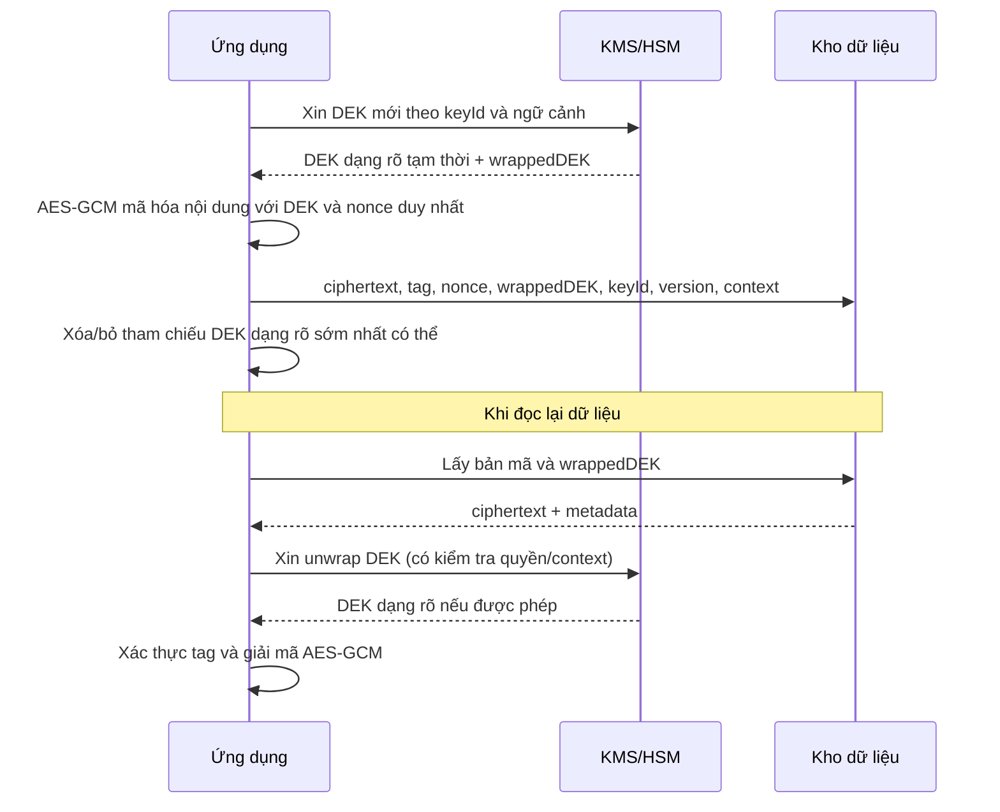

# Vì sao thuật toán mạnh vẫn cần quản lý key

## 1. Vấn đề: mã hóa mạnh nhưng dữ liệu vẫn có thể bị lộ

Giả sử một dịch vụ lưu hóa đơn khách hàng dùng **AES-256-GCM**, thuật toán mã hóa đối xứng hiện đại, để mã hóa mọi bản ghi trước khi ghi xuống cơ sở dữ liệu. Kẻ tấn công lấy được bản sao cơ sở dữ liệu nhưng không có khóa: với cách triển khai đúng, việc khôi phục bản rõ từ bản mã là không khả thi trong thực tế. Tuy nhiên, nếu lập trình viên đã ghi cùng khóa AES vào tệp cấu hình được đẩy lên Git, kẻ tấn công chỉ cần đọc khóa và gọi đúng hàm giải mã mà ứng dụng đang dùng. Không cần phá AES.

Tương tự, một dịch vụ có thể dùng chữ ký số với thuật toán mạnh nhưng vẫn phát hành được chữ ký giả nếu **private key** bị đánh cắp; hoặc mã hóa dữ liệu an toàn hôm nay nhưng không thể khôi phục ngày mai vì đã xóa nhầm khóa cũ.

**Thông điệp cốt lõi:** độ an toàn của hệ thống không chỉ phụ thuộc vào thuật toán. Nó phụ thuộc vào cách **tạo, cấp phát, lưu trữ, sử dụng, xoay vòng, thu hồi và hủy khóa mật mã** trong suốt vòng đời của dữ liệu và ứng dụng.

Sau bài này, người học có thể:

- Giải thích tại sao dùng thuật toán mạnh chưa đủ để giữ bí mật, toàn vẹn và khả năng truy cập dữ liệu.
- Phân biệt mục đích và yêu cầu bảo vệ của khóa đối xứng, public/private key, khóa ký và khóa dùng để bọc khóa.
- Nhận diện các rủi ro tại từng giai đoạn của vòng đời khóa.
- Mô tả cách KMS/HSM, envelope encryption, kiểm soát truy cập và nhật ký kiểm toán phối hợp bảo vệ khóa.
- Phân tích việc xoay vòng, vô hiệu hóa và hủy khóa mà không làm mất khả năng đọc dữ liệu hợp lệ.

## 2. Thuật toán, khóa và quyền sử dụng khóa là ba lớp khác nhau

Trong mã hóa đối xứng, có thể hình dung một phép mã hóa được thực hiện như sau:

```text
plaintext + secretKey + nonce/IV + (AAD) --Encrypt--> ciphertext + authenticationTag
ciphertext + secretKey + nonce/IV + (AAD) + authenticationTag --Decrypt--> plaintext
```

`AAD` (Additional Authenticated Data) là dữ liệu được xác thực nhưng không được mã hóa, ví dụ định danh tenant hoặc loại bản ghi. `nonce/IV` là giá trị dùng cho từng lần mã hóa theo yêu cầu của chế độ mã hóa; trong AES-GCM, **nonce không được lặp lại dưới cùng một khóa**. Nonce không phải khóa bí mật và thường được lưu cùng bản mã.

Thuật toán có thể công khai và được kiểm chứng rộng rãi. Bí mật nằm ở khóa và ở việc người nào, tiến trình nào có thể sử dụng khóa. Vì vậy, cùng một thuật toán có thể cho hai kết quả bảo mật hoàn toàn khác nhau:

| Tình huống | AES-256-GCM có bị phá không? | Kết quả thực tế |
| --- | --- | --- |
| Kẻ tấn công chỉ có bản mã, không có khóa, nonce được dùng đúng | Không | Dữ liệu được bảo vệ trước việc đọc hoặc sửa trái phép. |
| Khóa AES bị lộ từ mã nguồn, log hoặc bản sao cấu hình | Không | Kẻ có khóa giải mã dữ liệu bằng thuật toán hợp lệ. |
| Ứng dụng dùng lại cùng nonce với cùng khóa AES-GCM | Không phải phá thuật toán | Tính bí mật và tính toàn vẹn có thể bị ảnh hưởng nghiêm trọng dù khóa chưa lộ. |
| Khóa được giữ trong KMS nhưng tài khoản ứng dụng có quyền `Decrypt` quá rộng | Không | Kẻ chiếm tài khoản có thể yêu cầu dịch vụ giải mã thay mình. |
| Khóa cũ bị xóa khi dữ liệu cũ chưa được di chuyển | Không | Dữ liệu có thể bị mất khả năng giải mã vĩnh viễn. |

Ở cấp hệ thống, cần quan tâm đồng thời đến:

1. **Confidentiality (bí mật):** chỉ chủ thể được phép mới đọc được bản rõ.
2. **Integrity và authenticity (toàn vẹn, xác thực):** phát hiện dữ liệu bị sửa, và biết dữ liệu hoặc chữ ký đến từ đúng chủ thể tin cậy.
3. **Availability (sẵn sàng):** vẫn truy cập được dữ liệu hợp lệ khi khóa, KMS hoặc thiết bị gặp sự cố.
4. **Accountability (truy vết):** xác định được ai đã tạo, sử dụng, đổi chính sách hoặc yêu cầu hủy khóa.

**Mật mã học bảo vệ phép biến đổi dữ liệu; key management quyết định ai có năng lực thực hiện phép biến đổi đó và trong thời gian nào.**

## 3. Quản lý loại khóa nào?

Từ *key* chỉ nhiều loại vật liệu mật mã có mục đích khác nhau. Đánh đồng tất cả khóa vào một nơi lưu trữ hoặc một chính sách quyền truy cập thường tạo ra lỗ hổng.

| Loại khóa | Vai trò tiêu biểu | Điều cần bảo vệ |
| --- | --- | --- |
| **Symmetric key** (ví dụ khóa AES) | Cùng một khóa dùng để mã hóa và giải mã | Giữ bí mật; hạn chế quyền giải mã; không dùng một khóa cho mọi hệ thống nếu có thể tách phạm vi. |
| **Asymmetric private key** | Giải mã, ký số hoặc thực hiện thỏa thuận khóa tùy giao thức | Không xuất khóa nếu kiến trúc cho phép; hạn chế thao tác ký/giải mã; kiểm soát chủ sở hữu. |
| **Asymmetric public key** | Mã hóa cho người nhận hoặc xác minh chữ ký | Không cần giữ bí mật, nhưng phải xác minh **tính xác thực** của khóa để tránh bị thay thế. |
| **DEK (Data Encryption Key)** | Mã hóa trực tiếp bản ghi, tệp hoặc đối tượng dữ liệu | Giữ bí mật; có thể dùng khóa khác cho mỗi đối tượng hoặc nhóm dữ liệu. |
| **KEK (Key Encryption Key)** | Mã hóa/bọc DEK (key wrapping) | Bảo vệ chặt chẽ vì một KEK có thể mở được rất nhiều DEK. |
| **Root/master key** | Nằm ở tầng cao của hệ phân cấp khóa, bảo vệ khóa bên dưới | Bảo vệ bằng cơ chế tin cậy cao, chính sách tách trách nhiệm, sao lưu và khôi phục có kiểm soát. |

Khóa ký số không tương đương khóa mã hóa. Nếu private key ký hóa đơn bị lộ, kẻ tấn công có thể tạo chữ ký trông hợp lệ; nếu khóa AES bị lộ, kẻ tấn công có thể đọc nội dung. Vì thế nên **tách khóa theo mục đích** (*key separation*): khóa dùng để ký không kiêm luôn khóa giải mã, và khóa của môi trường phát triển không dùng cho môi trường sản xuất.

Với mật mã bất đối xứng, việc biết public key không cho phép suy ra private key khi thuật toán và tham số được chọn đúng. Nhưng nếu public key đến từ nguồn không được xác minh, ứng dụng có thể mã hóa dữ liệu cho khóa của kẻ tấn công hoặc tin vào chữ ký từ một danh tính giả. Chứng chỉ, PKI và quy trình phân phối public key là một phần của bài toán quản lý khóa.

## 4. Vòng đời khóa: sai một khâu có thể làm mất tác dụng cả hệ thống

**Ghi nhớ thuật ngữ:** **Cryptoperiod** là khoảng thời gian mà một khóa được phép dùng cho mục đích mật mã đã định. Thời gian được phép tạo bản mã mới và thời gian được giữ khóa để giải mã dữ liệu cũ có thể khác nhau. **Rotation** là chuyển sang sử dụng khóa mới theo chính sách hoặc do sự cố. **Revocation/disable** là chấm dứt hoặc tạm chặn quyền sử dụng khóa; **destruction** là hủy vật liệu khóa theo quy trình được kiểm soát.

| Giai đoạn | Thực hành cần có | Nếu làm sai |
| --- | --- | --- |
| **1. Tạo khóa** | Sinh bằng bộ sinh số ngẫu nhiên mật mã (CSPRNG/DRBG phù hợp), kích thước và thuật toán được phép; gán ID, chủ sở hữu, mục đích, môi trường và thời hạn. | Khóa đoán được, khóa trùng do seed yếu, dùng sai thuật toán hoặc sai mục đích. |
| **2. Cấp phát/phân phối** | Cấp quyền cho đúng workload, vận chuyển qua kênh xác thực và được bảo vệ; ưu tiên gọi KMS/HSM thay vì sao chép khóa thủ công. | Rò rỉ qua email, chat, script triển khai, cấu hình CI/CD hoặc người nhận không phù hợp. |
| **3. Lưu trữ và sao lưu** | Lưu khóa trong KMS/HSM hoặc kho bí mật phù hợp; mã hóa/bọc khóa xuất được; bảo vệ bản sao lưu bằng quyền độc lập. | Kẻ đọc cơ sở dữ liệu cũng đọc được khóa ở cùng vị trí; mất khóa khi hỏng thiết bị. |
| **4. Kích hoạt và sử dụng** | Chỉ cho phép thao tác cần thiết; sử dụng mode, nonce/IV và AAD đúng; không ghi khóa vào log; giới hạn thời gian khóa hiện diện ở dạng rõ trong bộ nhớ. | Lạm dụng thao tác giải mã/ký; rò rỉ qua log, crash dump; tái sử dụng nonce gây mất an toàn. |
| **5. Xoay vòng và tái mã hóa** | Chuyển dữ liệu mới sang khóa mới; xác định cách đọc, bọc lại hoặc mã hóa lại dữ liệu cũ; theo dõi phiên bản khóa. | Dữ liệu cũ không đọc được, hoặc tiếp tục phơi nhiễm dưới khóa đã lộ. |
| **6. Thu hồi/vô hiệu hóa** | Chặn đúng các chủ thể hoặc phiên bản bị ảnh hưởng; đánh giá dữ liệu, bản sao, token và dịch vụ phụ thuộc. | Kẻ tấn công tiếp tục sử dụng khóa, hoặc dịch vụ ngừng hoạt động vì thu hồi thiếu kế hoạch. |
| **7. Lưu giữ và hủy** | Giữ khóa giải mã cũ đủ lâu theo chính sách lưu trữ; hủy an toàn khi không còn dữ liệu và bản sao cần truy cập. | Không thể khôi phục backup hoặc tài liệu phải lưu giữ; khóa cũ tồn tại quá lâu và tăng diện rủi ro. |

### 4.1. Khóa được sinh ra như thế nào?

Không tạo khóa bằng mật khẩu dễ đoán, timestamp, mã đơn hàng, `Random` thông thường hoặc chuỗi cố định trong mã nguồn. Với khóa AES-256, hệ thống cần 256 bit vật liệu khóa được sinh ngẫu nhiên đúng chuẩn. Với RSA/ECC, phải dùng thư viện mật mã tin cậy để sinh cặp khóa và lựa chọn tham số phù hợp; không tự triển khai thuật toán sinh khóa.

Mỗi khóa nên có metadata có thể quản trị: `keyId`, loại, mục đích, quyền sở hữu, môi trường, trạng thái, ngày tạo, thời gian được phép sử dụng, chính sách xoay vòng và các phụ thuộc. **Metadata không được làm lộ vật liệu khóa**. Việc biết `keyId` thường không cho phép thực hiện giải mã nếu chính sách quyền truy cập được cấu hình đúng.

### 4.2. Khóa nằm ở đâu và đi qua đâu?

Lưu một khóa trong tệp cấu hình, image container, kho mã nguồn hoặc cơ sở dữ liệu chung quyền truy cập với bản mã là rủi ro lớn. Cơ chế an toàn hơn tùy quy mô là secret manager, KMS quản lý khóa hoặc HSM chuyên dụng. Khác biệt quan trọng:

- **Secret manager** giúp lưu và cấp phát các bí mật như API key, mật khẩu hoặc khóa có thể xuất; ứng dụng có thể nhận bí mật ở dạng rõ tùy thiết kế.
- **KMS (Key Management Service)** cung cấp API quản lý vòng đời khóa, chính sách, phiên bản và các thao tác mật mã; một số khóa được giữ trong tầng phần cứng bảo vệ.
- **HSM (Hardware Security Module)** là thiết bị hoặc dịch vụ phần cứng chuyên bảo vệ và thực thi thao tác mật mã với khóa. Khóa không xuất được (*non-exportable*) có thể được sử dụng bên trong ranh giới HSM mà không đưa private key ra tiến trình ứng dụng.

Không phải mọi KMS hoặc HSM đều có cùng tính năng, mức bảo đảm hoặc khả năng xuất khóa. Đặc biệt, **dùng HSM không có nghĩa là mọi thao tác do ứng dụng yêu cầu đều an toàn**: tài khoản có quyền `Sign` hoặc `Decrypt` không giới hạn vẫn có thể bị lợi dụng để ký hoặc giải mã trái phép. Thiết kế IAM và kiểm soát truy cập vẫn cần thiết.

### 4.3. Thời hạn sử dụng và khả năng đọc dữ liệu cũ

Xoay vòng khóa là hoạt động **đổi khóa đang dùng để mã hóa dữ liệu mới**, nhưng thường không thể lập tức xóa khóa cũ nếu bản mã cũ vẫn cần được giải mã. Ví dụ, hệ thống giữ hóa đơn trong bảy năm thì phải thiết kế khả năng giải mã hóa đơn cũ phù hợp thời hạn lưu trữ đó, ngay cả khi khóa ghi mới được thay đổi thường xuyên hơn.

Khác biệt cần nhớ:

| Thao tác | Điều gì thay đổi? | Dữ liệu cũ |
| --- | --- | --- |
| **Rotate KEK** | Đổi khóa dùng để bọc các DEK mới hoặc đổi phiên bản KEK. | Các DEK cũ vẫn phải được mở bằng KEK/phiên bản tương ứng, trừ khi đã được bọc lại. |
| **Rewrap DEK** | Giải bọc rồi bọc lại cùng DEK bằng KEK mới qua quy trình an toàn. | Nội dung đã mã hóa bằng DEK cũ **không đổi**; nếu DEK đã lộ thì rewrap không khắc phục rò rỉ. |
| **Re-encrypt dữ liệu** | Giải mã rồi mã hóa dữ liệu bằng DEK mới, với nonce mới và metadata phù hợp. | Bản mã thay đổi; cần thực hiện an toàn, có kiểm tra toàn vẹn và kế hoạch phục hồi. |
| **Disable/revoke key** | Chặn khả năng dùng khóa hoặc thu hồi quyền của chủ thể. | Có thể mất khả năng giải mã cho đến khi được khôi phục hoặc dữ liệu đã chuyển đổi. |
| **Destroy key** | Hủy vật liệu khóa và các bản sao cần hủy theo quy trình. | Bản mã tương ứng có thể không bao giờ đọc lại được. |

Khi **nghi ngờ khóa bị lộ**, chỉ tạo khóa mới cho dữ liệu mới là không đủ. Cần xác định dữ liệu và bản sao nào từng được bảo vệ bằng khóa lộ, tài khoản nào đã sử dụng nó, có cần tái mã hóa hoặc thay khóa ký hay không, và cách vô hiệu hóa quyền dùng khóa cũ. Kẻ tấn công có thể đã sao chép cả bản mã lẫn khóa trước khi xảy ra rotation; không thể “thu hồi” những bản sao đã nằm ngoài tầm kiểm soát.

## 5. Envelope encryption: tách khóa dữ liệu khỏi khóa bảo vệ khóa

Một hệ thống có hàng triệu hóa đơn không nên buộc phải đưa một master key cố định vào mọi tiến trình xử lý dữ liệu. **Envelope encryption** giải quyết bằng cách dùng hai tầng khóa:

1. **DEK**: khóa mã hóa đối xứng dùng trực tiếp cho nội dung. Có thể sinh DEK cho từng tệp, bản ghi hoặc một phạm vi dữ liệu được giới hạn.
2. **KEK**: khóa dùng để bọc DEK, thường được quản lý bằng KMS/HSM và chỉ sử dụng qua thao tác được cấp quyền.

Một luồng khái niệm:



Sơ đồ mô tả một kiểu API KMS có khả năng trả về DEK dạng rõ cho ứng dụng; từng nhà cung cấp có thể có API và ranh giới bảo vệ khác nhau. Trong cách làm này, DEK chỉ nên nằm ở dạng rõ trong bộ nhớ tin cậy đủ lâu để xử lý bản ghi; đối với Java, việc dọn bộ nhớ nhạy cảm chỉ là nỗ lực giảm thời gian phơi nhiễm, **không bảo đảm** xóa hoàn toàn bản sao do JVM hoặc thư viện tạo ra.

Ví dụ cấu trúc một bản ghi lưu trữ:

```json
{
  "ciphertext": "<base64 bytes of ciphertext and authentication tag>",
  "nonce": "<base64 12-byte unique nonce>",
  "wrappedDek": "<base64 encrypted data key>",
  "kekId": "kms-key-invoices",
  "kekVersion": "v3",
  "algorithm": "AES-256-GCM",
  "tenantId": "tenant-42",
  "documentId": "invoice-981"
}
```

Giá trị trong ví dụ là minh họa cấu trúc, không phải một bản mã có thể giải mã. `nonce`, `kekId`, `kekVersion` và `wrappedDek` thường được lưu cùng bản mã; `wrappedDek` phải được bọc bằng thuật toán hoặc cơ chế key wrapping phù hợp. Dữ liệu ngữ cảnh như `tenantId`/`documentId` nên được ràng buộc vào quá trình xác thực (ví dụ AAD của AES-GCM và encryption context của KMS nếu được hỗ trợ) bằng một cách mã hóa có quy ước ổn định. Ngữ cảnh có thể xuất hiện trong log kiểm toán KMS, nên **không đặt thông tin bí mật vào encryption context**.

**Lợi ích:** lộ kho bản mã không tự động làm lộ DEK; ứng dụng không cần mang KEK ra khỏi KMS; có thể chia phạm vi DEK và xoay KEK theo quy trình. **Giới hạn:** nếu kẻ tấn công chiếm được quyền gọi KMS để giải bọc DEK, hoặc chiếm tiến trình đang có DEK dạng rõ, envelope encryption không tự chặn được việc lấy bản rõ. Đây là lý do các lớp kiểm soát truy cập, phân tách quyền và giám sát không thể thiếu.

## 6. Kiểm soát truy cập quyết định ai được sử dụng khóa

Một tài khoản có quyền giải mã mọi bản ghi chính là đường truy cập tới bản rõ, ngay cả khi không thể xuất KEK ra khỏi KMS. Cần thiết kế quyền theo **principal (người hoặc workload), thao tác, khóa, phạm vi dữ liệu và ngữ cảnh**:

- **Least privilege:** dịch vụ chỉ ghi hóa đơn được quyền `Encrypt`/tạo DEK, không mặc nhiên có quyền giải mã toàn bộ dữ liệu; dịch vụ đọc chỉ được giải mã dữ liệu thuộc phạm vi cần thiết.
- **Tách nhiệm vụ:** người quản trị chính sách khóa không nên đồng thời có quyền đọc toàn bộ dữ liệu ứng dụng; việc xóa khóa hoặc thay chính sách nhạy cảm có thể cần phê duyệt nhiều bên.
- **Tách môi trường và tenant:** khóa của production và non-production phải tách biệt; hạn chế quyền `Decrypt` theo tài nguyên, vai trò và ngữ cảnh tenant khi hạ tầng hỗ trợ.
- **Xác thực workload:** dùng danh tính ngắn hạn, được xác thực và xoay vòng thay vì nhúng thông tin đăng nhập dài hạn vào image hoặc source code.
- **Bảo vệ đường sử dụng:** mã hóa kênh kết nối với KMS, tránh vô tình log plaintext DEK, bản rõ, access token hoặc kết quả giải mã; tránh truyền khóa qua thư mục dùng chung.
- **Quyền khẩn cấp:** có quy trình *break-glass* được phê duyệt, giới hạn thời gian và ghi log để phục hồi khi có sự cố mà không mở quyền thường trực.

Ví dụ, với ba thành phần `invoice-writer`, `invoice-reader` và `key-admin`, một chính sách hợp lý có thể là:

| Danh tính | Thao tác chính | Giới hạn quan trọng |
| --- | --- | --- |
| `invoice-writer` | Xin DEK để mã hóa hóa đơn mới | Không tự động có quyền giải mã mọi hóa đơn hoặc xóa KEK. |
| `invoice-reader` | Giải bọc DEK cần thiết để đọc hóa đơn được phân quyền | Quyền ứng dụng trên hóa đơn và quyền KMS phải được kiểm tra đồng thời. |
| `key-admin` | Quản lý vòng đời khóa, chính sách, rotation | Không đương nhiên được phép truy xuất nội dung hóa đơn. |
| `security-auditor` | Đọc metadata và nhật ký kiểm toán | Không cần quyền `Decrypt`, `Sign` hoặc xuất khóa. |

Đừng chỉ dựa vào `tenantId` do client gửi lên để cấp quyền giải mã: server phải xác định tenant từ danh tính đã xác thực và kiểm tra quyền đối với tài nguyên. Nếu không, người dùng có thể giả mạo ngữ cảnh hợp lệ để yêu cầu giải mã dữ liệu của tenant khác.

## 7. Kiểm toán và giám sát: biết khóa đang được sử dụng ra sao

Nhật ký kiểm toán nên ghi nhận sự kiện tạo, cấp quyền, thay chính sách, dùng, xoay, vô hiệu hóa, khôi phục và hủy khóa. Với mỗi sự kiện, tùy chính sách bảo mật và quyền riêng tư, có thể cần: thời gian, danh tính hoặc workload, ID khóa và phiên bản, thao tác, kết quả, request ID, nguồn yêu cầu và ngữ cảnh không nhạy cảm.

Một số tín hiệu cần cảnh báo:

- Số lượng yêu cầu `Decrypt` hoặc `Sign` tăng đột biến so với hành vi bình thường.
- Workload vốn chỉ mã hóa lại bắt đầu yêu cầu giải mã.
- Có yêu cầu KMS từ danh tính, vùng triển khai hoặc môi trường chưa từng sử dụng khóa đó.
- Chính sách quyền truy cập bị mở rộng, khóa bị disable, yêu cầu xóa hoặc lịch xóa bị thay đổi bất thường.
- Nhiều yêu cầu giải mã thất bại, đặc biệt khi ngữ cảnh/tenant không phù hợp.

Không ghi **plaintext key, private key, DEK dạng rõ, mật khẩu, token, bản rõ dữ liệu hoặc ngữ cảnh chứa bí mật** vào log. Log và cảnh báo cũng cần kiểm soát quyền đọc, lưu giữ có thời hạn, đồng bộ thời gian và biện pháp chống sửa/xóa trái phép. Kiểm toán cho khả năng phát hiện và điều tra; nó không thay thế việc ngăn chặn ngay từ chính sách quyền.

## 8. Tình huống thực tế: thiết kế bảo vệ hóa đơn từ đầu đến cuối

Xét dịch vụ Java `InvoiceService` phục vụ nhiều tenant. Mỗi hóa đơn cần mã hóa để lưu trữ, có thể đọc lại trong thời gian được phép, và phải chống việc tráo bản mã giữa hai tenant.

**Thiết kế có kiểm soát:**

1. Định danh ứng dụng qua workload identity; phân quyền truy cập hóa đơn ở tầng nghiệp vụ trước khi thao tác mật mã.
2. KMS giữ KEK của môi trường production và cấp DEK mới theo phạm vi phù hợp; tài khoản chỉ có những thao tác cần thiết.
3. `InvoiceService` mã hóa nội dung bằng AES-256-GCM. Mỗi lần mã hóa dùng nonce duy nhất dưới DEK, xác thực `tenantId` và `documentId` bằng AAD được mã hóa ổn định.
4. Kho dữ liệu chỉ lưu bản mã, tag, nonce, wrapped DEK và metadata khóa cần thiết. Không lưu DEK dạng rõ trong database, log, message queue hoặc backup.
5. Khi đọc, ứng dụng xác thực quyền người dùng đối với hóa đơn, yêu cầu KMS giải bọc DEK đúng ngữ cảnh, kiểm tra tag AES-GCM rồi mới trả bản rõ.
6. Lịch rotation xác định khóa nào dùng cho dữ liệu mới, khóa nào cần giữ để đọc dữ liệu cũ. Nhật ký và cảnh báo được theo dõi cho cả thao tác ứng dụng lẫn thao tác KMS.

Đoạn mã Java sau minh họa **một bước mã hóa ở tầng ứng dụng**, giả định `dataKey` được cấp an toàn và chính sách quản lý DEK/KEK đã được triển khai bên ngoài đoạn mã:

```java
import java.nio.charset.StandardCharsets;
import java.security.SecureRandom;
import javax.crypto.Cipher;
import javax.crypto.SecretKey;
import javax.crypto.spec.GCMParameterSpec;

byte[] nonce = new byte[12];                   // Nonce 96-bit cho GCM
new SecureRandom().nextBytes(nonce);           // Phải duy nhất với mỗi lần dùng cùng key

Cipher cipher = Cipher.getInstance("AES/GCM/NoPadding");
cipher.init(Cipher.ENCRYPT_MODE, dataKey,
    new GCMParameterSpec(128, nonce));         // Tag 128-bit

// Metadata được xác thực. Hai phía phải tạo cùng chuỗi byte AAD.
String aad = "tenant=" + trustedTenantId + ";document=" + documentId;
cipher.updateAAD(aad.getBytes(StandardCharsets.UTF_8));
byte[] ciphertextAndTag = cipher.doFinal(plaintextBytes);

// Lưu nonce + ciphertextAndTag + wrapped DEK + keyId/version.
// Không lưu dataKey ở dạng rõ.
```

Đây là ví dụ minh họa, không phải chương trình hoàn chỉnh: `dataKey`, `trustedTenantId`, `documentId`, `plaintextBytes` và quy trình cấp phát/lưu trữ khóa phải được cung cấp bởi những thành phần tin cậy. Khi triển khai thật cần một chuẩn mã hóa AAD tránh nhập nhằng giá trị, quản lý giới hạn số lần mã hóa với mỗi khóa, bảo đảm nonce không bị lặp (đặc biệt ở hệ thống phân tán hoặc lưu lượng cao), xử lý lỗi xác thực khi giải mã và giải phóng dữ liệu nhạy cảm ở mức có thể. Không tự viết thuật toán AES hay xây cơ chế key wrapping tùy ý.

**Ba sự cố để đối chiếu:**

| Sự cố | Tại sao thuật toán mạnh không cứu được? | Cách xử lý ở cấp key management |
| --- | --- | --- |
| Bản sao database bị đọc trộm, nhưng wrapped DEK chỉ được mở qua KMS với quyền đúng | Kẻ tấn công chưa có DEK hoặc quyền dùng KEK | Xác nhận logs, đánh giá phạm vi lộ, giữ phân tách quyền và giám sát hành vi bất thường. |
| Danh tính `invoice-reader` bị chiếm, có quyền `Decrypt` trên mọi tenant | KMS thực hiện yêu cầu hợp lệ về kỹ thuật thay kẻ tấn công | Thu hồi credential/phiên, thu hẹp chính sách IAM, điều tra lần giải mã, đánh giá dữ liệu đã lộ và kế hoạch đổi khóa nếu cần. |
| KEK/DEK bị lộ từ quy trình vận hành; ứng dụng chỉ rotate KEK, không xử lý bản mã cũ | Kẻ tấn công vẫn có thể dùng DEK hoặc KEK đã lộ để giải bản sao trước đó | Xác định khóa và bản mã bị ảnh hưởng; phát hành DEK mới, tái mã hóa dữ liệu cần bảo vệ, chặn quyền cũ, kiểm tra backup và phụ thuộc. |

## 9. Những hiểu nhầm thường gặp

**“Khóa dài hơn thì chắc chắn an toàn hơn.”** Độ dài khóa phải tương thích thuật toán và mô hình đe dọa, nhưng khóa 256 bit để lộ trong log không an toàn hơn khóa ngắn được bảo vệ đúng cách. Chọn thuật toán và độ dài chuẩn chỉ là điểm khởi đầu.

**“Dữ liệu đã mã hóa nên không cần kiểm soát ai đọc database.”** Quyền đọc database vẫn quan trọng. Bản mã, metadata, lưu lượng truy vấn và các trường chưa mã hóa có thể chứa thông tin nhạy cảm; hơn nữa nhiều hệ thống vô tình đặt khóa hoặc quyền giải mã gần nơi chứa bản mã.

**“Đưa khóa vào HSM là xong.”** HSM chủ yếu bảo vệ vật liệu khóa và thao tác bên trong ranh giới của nó. Nếu client được cấp quyền ký hay giải mã quá rộng, hành vi lạm dụng API vẫn gây hại. Cần xác thực workload, phân quyền, quota phù hợp, giám sát và quy trình xử lý sự cố.

**“Rotation làm bản mã cũ an toàn lại.”** Rotation thông thường chỉ chuyển các thao tác mới sang khóa mới. Bản mã cũ vẫn gắn với DEK/KEK cũ trừ khi được rewrap hoặc re-encrypt đúng phạm vi; nếu khóa cũ đã bị kẻ tấn công sao chép, rewrap không xóa được rủi ro từ DEK bị lộ.

**“Xóa khóa càng sớm càng tốt.”** Xóa khóa quá sớm có thể làm dữ liệu và backup không thể khôi phục. Nên có chính sách giữ khóa, kiểm kê dữ liệu phụ thuộc, giai đoạn chờ xóa, phê duyệt và thử nghiệm khả năng phục hồi trước khi hủy.

**“Public key công khai nên không cần quản lý.”** Public key không cần bảo mật nội dung, nhưng cần xác minh đúng chủ sở hữu, trạng thái chứng chỉ và chính sách tin cậy; thay một public key hợp lệ bằng public key của kẻ tấn công có thể phá mục tiêu xác thực.

## 10. Checklist khi thiết kế một hệ thống dùng mật mã

Trước khi đưa một dịch vụ vào production, nhóm phát triển và vận hành nên trả lời được các câu hỏi sau:

1. **Phạm vi:** khóa này bảo vệ dữ liệu gì, thuộc tenant/môi trường nào, phục vụ mã hóa, giải mã hay ký?
2. **Sinh khóa:** ai tạo khóa, bằng nguồn ngẫu nhiên nào, độ dài và thuật toán có được phê duyệt không?
3. **Lưu và phân phối:** khóa rõ xuất hiện ở đâu, có thể xuất khỏi KMS/HSM không, backup khóa được bảo vệ ra sao?
4. **Quyền:** danh tính nào được `Encrypt`, `Decrypt`, `Sign`, thay chính sách, disable hoặc destroy? Có tách vai trò quản trị và đọc dữ liệu không?
5. **Sử dụng:** có dùng AEAD đúng cách, quản lý nonce/IV, tag, AAD và phiên bản định dạng bản mã không?
6. **Xoay vòng:** khi thay KEK/DEK, dữ liệu mới và dữ liệu cũ được xử lý như thế nào? Có kiểm thử khả năng giải mã qua các phiên bản không?
7. **Sự cố:** nếu rò rỉ khóa hoặc credential, có biết khóa nào, dữ liệu nào, bản sao nào và workload nào bị ảnh hưởng không?
8. **Khôi phục:** nếu KMS/HSM ngừng hoạt động, mất khóa hoặc xóa nhầm, có phương án backup/restore được kiểm thử và không vi phạm chính sách bảo mật không?
9. **Kiểm toán:** có log truy cập khóa, phát hiện truy cập bất thường và bảo vệ chính log khỏi rò rỉ/sửa/xóa không?
10. **Hủy:** trước khi hủy, đã kiểm tra thời hạn lưu trữ, dữ liệu tồn đọng và backup cần giải mã chưa?

### Câu hỏi tự kiểm tra

**Câu 1.** Một dịch vụ mã hóa bằng AES-256-GCM và lưu `APP_AES_KEY` trong một repository private. Repository bị truy cập trái phép. Tại sao cần xử lý như sự cố lộ dữ liệu dù chưa phát hiện điểm yếu trong AES?

*Gợi ý:* quyền xem repository là một đường dẫn tới khóa; nếu kẻ tấn công có cả bản mã, họ có thể giải mã mà không cần khai thác điểm yếu thuật toán. Phải điều tra phạm vi rò rỉ, thay khóa và xử lý dữ liệu đã mã hóa bằng khóa bị lộ.

**Câu 2.** Một doanh nghiệp thay KEK trong KMS hằng quý. Điều đó có đồng nghĩa mọi hóa đơn năm trước đã được mã hóa lại bằng DEK mới không?

*Đáp án:* không. Rotation KEK, rewrap DEK và re-encrypt dữ liệu là ba việc khác nhau. Cần xem chính xác cơ chế của hệ thống và phiên bản khóa dùng cho từng bản ghi.

**Câu 3.** Một private key ký số được giữ bên trong HSM và không thể xuất. Tại sao vẫn cần giới hạn quyền `Sign`?

*Đáp án:* kẻ chiếm workload có quyền `Sign` có thể yêu cầu HSM tạo chữ ký trên nội dung trái phép mà không cần lấy private key ra ngoài.

**Câu 4.** Vì sao không nên xóa khóa giải mã ngay khi bắt đầu dùng khóa mới?

*Đáp án:* bản mã và backup cũ có thể vẫn phụ thuộc vào khóa cũ; xóa sớm có thể gây mất dữ liệu không thể phục hồi. Chỉ hủy sau khi xác định hết các phụ thuộc và hoàn tất chính sách lưu trữ/chuyển đổi.

## Kết luận

AES, RSA, ECC hay thuật toán chữ ký số mạnh đưa ra các tính chất bảo mật **khi khóa và cách dùng khóa thỏa mãn các giả định an toàn**. Trong hệ thống thật, giả định đó chỉ được duy trì bằng một vòng đời quản lý khóa rõ ràng: sinh đúng, cấp phát đúng người, lưu ở ranh giới tin cậy, sử dụng đúng chế độ, xoay vòng có kế hoạch, thu hồi khi sự cố, hủy khi không còn phụ thuộc và kiểm toán mọi thao tác nhạy cảm.

KMS/HSM và envelope encryption giúp giảm phạm vi rủi ro, nhưng không thay thế IAM, kiểm soát nghiệp vụ hoặc vận hành có kỷ luật. **Thuật toán mạnh bảo vệ dữ liệu trước người không có khóa; quản lý khóa quyết định ai thực sự có khóa hoặc có quyền dùng khóa.**
