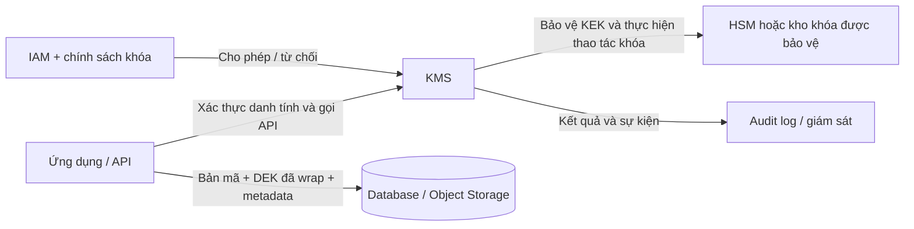
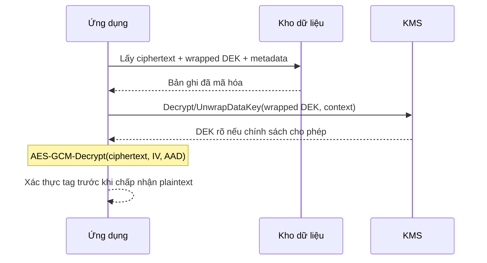

# Key management system (KMS): Hệ thống quản lý khóa mật mã

> **Chương:** Nền tảng key management  
> **Chủ đề:** Key management system  
> **Phạm vi:** Hiểu cách một hệ thống quản lý khóa điều phối toàn bộ vòng đời của khóa, kết hợp mật mã đối xứng, bất đối xứng, chữ ký số, KMS/HSM, envelope encryption, kiểm soát truy cập và kiểm toán.

## 1. Vì sao cần một Key Management System?

Một ứng dụng có thể mã hóa dữ liệu bằng AES-256-GCM, nhưng vẫn không an toàn nếu khóa AES nằm trong mã nguồn, biến môi trường được chia sẻ rộng rãi, file cấu hình công khai hoặc cùng cơ sở dữ liệu với bản mã. Khi người tấn công lấy được cả **bản mã (ciphertext)** và **khóa giải mã**, thuật toán mạnh không còn giúp bảo vệ dữ liệu.

**Key management** là việc quản lý khóa trong toàn bộ vòng đời: tạo, cấp phát, lưu trữ, sử dụng, phân quyền, giám sát, xoay vòng, thu hồi, sao lưu khi cần và hủy an toàn. **Key Management System (KMS)** là hệ thống tập trung cung cấp công cụ, chính sách và giao diện lập trình để thực hiện những việc đó một cách có kiểm soát.

KMS giải quyết ba câu hỏi tách biệt:

1. **Ai được sử dụng khóa?** Danh tính của ứng dụng, dịch vụ, người vận hành hoặc đối tác được xác thực và cấp quyền ở mức thao tác.
2. **Khóa được bảo vệ ở đâu và như thế nào?** Vật liệu khóa (*key material*) được sinh bằng nguồn ngẫu nhiên an toàn, lưu trữ trong vùng tin cậy, hạn chế xuất khóa và bảo vệ khi sao lưu.
3. **Làm sao biết khóa đã được dùng đúng mục đích?** Mọi yêu cầu quan trọng phải được áp chính sách, ghi dấu vết kiểm toán, phát hiện bất thường và có phương án phản ứng sự cố.

Ví dụ: dịch vụ đặt hàng cần mã hóa địa chỉ giao hàng. Thay vì lưu một khóa AES cố định trong cấu hình của mọi máy chủ, dịch vụ gọi KMS để lấy **khóa dữ liệu** dùng cho một bản ghi hoặc nhóm dữ liệu nhỏ. KMS giữ quyền kiểm soát khóa cấp cao, còn ứng dụng chỉ nắm khóa dữ liệu dạng rõ (*plaintext key*) trong bộ nhớ trong thời gian cần thiết.

### Sau bài học, bạn cần phân biệt được

- KMS, HSM, kho bí mật (*secrets manager*) và PKI/chứng thư số.
- Khóa dùng mã hóa dữ liệu (DEK) và khóa dùng bảo vệ khóa khác (KEK).
- Phân quyền sử dụng khóa với việc có thể đọc hoặc xuất vật liệu khóa.
- Xoay vòng khóa, vô hiệu hóa khóa, thu hồi quyền và xóa khóa.
- Mã hóa trực tiếp qua KMS với **envelope encryption**.
- Tính bí mật, tính toàn vẹn, khả năng phục hồi và khả năng kiểm toán của giải pháp.

## 2. Những thành phần cốt lõi

### 2.1. Các loại khóa và vai trò

| Thành phần | Vai trò | Phạm vi sử dụng điển hình |
|---|---|---|
| **DEK – Data Encryption Key** | Mã hóa/giải mã dữ liệu ứng dụng, thường bằng AES-GCM. | Một đối tượng, tệp, bản ghi hoặc tập dữ liệu được giới hạn rõ ràng. |
| **KEK – Key Encryption Key** | Mã hóa hoặc *wrap* DEK để lưu và truyền DEK an toàn. | Khóa chính do KMS quản lý hoặc một tầng khóa trung gian. |
| **Khóa bất đối xứng** | Khóa công khai và khóa riêng có vai trò khác nhau; dùng cho chữ ký số hoặc mã hóa bất đối xứng tùy thuật toán. | Ký mã, tài liệu, token; xác minh chữ ký; một số trường hợp trao đổi khóa. |
| **Phiên bản khóa (*key version*)** | Biểu diễn vật liệu khóa ở một giai đoạn; hỗ trợ thay mới mà vẫn đọc dữ liệu cũ. | Xoay vòng và tương thích ngược. |
| **Alias / tên logic** | Tên ổn định để ứng dụng tham chiếu khóa. | Cấu hình ứng dụng và chuyển đổi khóa có kiểm soát. |

Trong thực tế, tên gọi như *customer-managed key*, *KMS key*, *master key* và *key version* có thể khác nhau giữa các nhà cung cấp. Cần xác nhận **khóa nào thật sự chứa vật liệu mật mã**, khóa nào chỉ là tham chiếu logic, và API có tự chọn đúng phiên bản khi giải mã hay không.

Ví dụ chuỗi bảo vệ:

```text
Khóa gốc của KMS/HSM
          |
          v
     KEK: orders-prod
          |
          +-- wrap(DEK #1) --> mã hóa đơn hàng #1
          |
          +-- wrap(DEK #2) --> mã hóa đơn hàng #2
          |
          +-- wrap(DEK #3) --> mã hóa đơn hàng #3
```

Một KEK có thể bảo vệ nhiều DEK, nhưng mỗi DEK nên có phạm vi sử dụng đủ hẹp để giới hạn thiệt hại nếu bị lộ. Không nên dùng cùng một DEK vô thời hạn cho mọi dữ liệu, mọi môi trường và mọi khách hàng.

### 2.2. KMS, HSM, Secrets Manager và PKI khác nhau thế nào?

| Công cụ | Trách nhiệm chính | Điều cần ghi nhớ |
|---|---|---|
| **KMS** | API quản lý vòng đời khóa, phân quyền, mã hóa/giải mã hoặc wrap/unwrap, ghi log, tích hợp ứng dụng. | Là lớp dịch vụ và chính sách; mức bảo vệ vật liệu khóa tùy kiến trúc và nhà cung cấp. |
| **HSM – Hardware Security Module** | Phần cứng chuyên dụng bảo vệ khóa và thực hiện phép toán mật mã trong ranh giới bảo mật. | Có thể là gốc tin cậy của KMS; không tự thay thế toàn bộ quy trình IAM và vận hành. |
| **Secrets Manager** | Lưu, phân phối và xoay vòng mật khẩu, token, chuỗi kết nối hoặc thông tin xác thực. | Secret là thông tin nhạy cảm nói chung; khóa mật mã cần thêm quản trị thuật toán, quyền sử dụng và vòng đời khóa. |
| **PKI/CA** | Phát hành, xác minh, gia hạn và thu hồi chứng thư số, liên kết khóa công khai với danh tính. | Chứng thư số không tự bảo vệ khóa riêng; KMS/HSM có thể giữ khóa ký. |

**KMS không đồng nghĩa với HSM.** Một KMS có thể sử dụng HSM để giữ khóa gốc hoặc thực hiện phép toán mật mã. Một HSM riêng lẻ có thể bảo vệ khóa rất tốt nhưng vẫn cần hệ thống xung quanh để quản lý người dùng, chính sách, sao lưu, nhật ký và khả năng sẵn sàng cao.

Tương tự, **mã hóa dữ liệu không thay thế kiểm soát truy cập**. Nếu ứng dụng bị chiếm quyền vẫn được phép gọi `Decrypt`, kẻ tấn công có thể yêu cầu KMS giải mã hợp lệ theo danh tính đã bị xâm nhập.

### 2.3. KMS là ranh giới tin cậy, không phải kho chứa mọi bản rõ

Trong mô hình envelope encryption phổ biến:

- KMS bảo vệ KEK và kiểm tra quyền mỗi lần ứng dụng yêu cầu tạo/giải mã DEK.
- Ứng dụng mã hóa dữ liệu bằng DEK trong bộ nhớ, thường dùng thư viện mật mã của hệ điều hành hoặc JVM.
- Cơ sở dữ liệu hoặc object storage lưu bản mã và **DEK đã được wrap**.
- Người quản trị cơ sở dữ liệu có thể đọc bản mã nhưng không mặc nhiên có quyền dùng KEK để giải mã.

Phân tách này giới hạn tác động của sự cố lộ cơ sở dữ liệu. Tuy nhiên, lớp ứng dụng vẫn phải bảo vệ dữ liệu rõ và DEK trong thời gian xử lý.

## 3. Kiến trúc tham chiếu của một KMS



Luồng dữ liệu và luồng quản trị có trách nhiệm khác nhau:

- **Data plane** cung cấp các thao tác `Encrypt`, `Decrypt`, `GenerateDataKey`, `WrapKey`, `UnwrapKey`, `Sign`, `Verify` tùy dịch vụ và loại khóa.
- **Control plane** tạo khóa, thay đổi chính sách, cấp/thu hồi quyền, điều chỉnh trạng thái, xoay vòng và lên lịch xóa.
- **Audit plane** ghi lại người gọi, khóa được tham chiếu, thao tác, kết quả, thời gian và dữ liệu ngữ cảnh không nhạy cảm.

Không phải KMS nào cũng hỗ trợ mọi API trong danh sách. Một số nhà cung cấp có API riêng hoặc giới hạn loại thuật toán, kích thước dữ liệu được mã hóa trực tiếp và cơ chế tạo DEK. Thiết kế cần dựa trên khả năng thực tế của KMS được lựa chọn.

### 3.1. Luồng yêu cầu và các điểm kiểm soát

Một lần gọi KMS thường trải qua:

1. **Nhận diện workload:** ứng dụng chứng minh danh tính qua IAM role, service account, workload identity hoặc phương thức được hỗ trợ.
2. **Xác thực yêu cầu:** KMS kiểm tra phiên, chữ ký yêu cầu, kết nối được bảo vệ và các điều kiện cần thiết.
3. **Đánh giá chính sách:** loại thao tác, khóa đích, tenant, môi trường, vùng và điều kiện sử dụng có hợp lệ không.
4. **Thực hiện phép toán:** hệ thống sử dụng vật liệu khóa theo cơ chế bảo vệ được thiết kế.
5. **Trả kết quả và ghi log:** KMS trả dữ liệu theo API, đồng thời tạo sự kiện kiểm toán.

Ứng dụng thường được trả về **kết quả phép toán**, không được phép xuất KEK gốc. Với envelope encryption, ứng dụng có thể nhận DEK dạng rõ theo một API có chủ đích; vì vậy quyền `GenerateDataKey` hoặc `Decrypt` vẫn là quyền rất nhạy cảm.

### 3.2. Chọn phạm vi khóa

Không có một chiến lược phân chia khóa phù hợp với mọi hệ thống. Có thể cân nhắc KEK riêng theo:

- Môi trường: `development`, `staging`, `production`.
- Miền dữ liệu: thanh toán, hồ sơ người dùng, đơn hàng.
- Tenant hoặc nhóm tenant có yêu cầu tách biệt nghiêm ngặt.
- Vùng triển khai và yêu cầu chủ quyền dữ liệu.
- Mức độ nhạy cảm, lịch xoay vòng hoặc trách nhiệm vận hành.

Tạo quá ít khóa khiến phạm vi ảnh hưởng khi lộ quyền quá rộng; tạo quá nhiều khóa làm tăng độ phức tạp chính sách, chi phí, quota và vận hành. Quy tắc thực dụng là tách khóa ở những ranh giới có **quyền truy cập, trách nhiệm, vòng đời hoặc yêu cầu phục hồi khác nhau**.

## 4. Vòng đời khóa từ khi sinh đến khi hủy

Một KMS tốt phải bảo vệ **khóa trong trạng thái lưu trữ, khi truyền và trong lúc sử dụng**, đồng thời cho phép thay đổi trạng thái một cách có kiểm soát.

| Giai đoạn | Câu hỏi thiết kế | Kiểm soát cần có |
|---|---|---|
| **1. Tạo khóa** | Ai được tạo? Dùng thuật toán/độ dài nào? Nguồn ngẫu nhiên đủ mạnh? | Bộ sinh số ngẫu nhiên mật mã an toàn (CSPRNG), thuật toán được phê duyệt, ghi nhận chủ sở hữu và mục đích. |
| **2. Kích hoạt và cấp quyền** | Workload nào được phép thao tác gì? | IAM, policy theo khóa, hạn chế môi trường và phân tách nhiệm vụ. |
| **3. Lưu trữ và bảo vệ** | Vật liệu khóa nằm ở đâu? Có thể xuất không? Sao lưu thế nào? | HSM/kho khóa được bảo vệ, mã hóa phân tầng, kiểm soát truy cập và phục hồi. |
| **4. Sử dụng** | Có gọi đúng khóa và đúng ngữ cảnh không? | API phù hợp mục đích, authenticated encryption, audit và xử lý lỗi an toàn. |
| **5. Xoay vòng / thay thế** | Khi nào dùng khóa mới? Dữ liệu cũ đọc được ra sao? | Phiên bản khóa, chính sách chuyển đổi, kiểm thử rewrap và re-encrypt. |
| **6. Hạn chế / vô hiệu hóa** | Làm sao dừng một khóa hoặc một danh tính? | Thu hồi quyền, vô hiệu hóa khóa, xử lý cache và ứng dụng phụ thuộc. |
| **7. Hủy khóa** | Có chắc dữ liệu cần giữ đã được chuyển đổi hoặc xóa? | Chờ xác nhận, thời gian bảo lưu phù hợp, kiểm tra backup và quản lý bằng chứng. |

### 4.1. Tạo và nhập khóa

Khóa phải được sinh từ nguồn ngẫu nhiên có chất lượng mật mã. Không dùng `Math.random()`, timestamp, UUID thông thường hoặc chuỗi do người dùng tự nghĩ để tạo khóa AES. Trong Java, `SecureRandom` là công cụ chuẩn để sinh IV và dữ liệu ngẫu nhiên; với khóa cấp cao, nên dùng cơ chế tạo khóa của KMS/HSM theo chính sách tổ chức.

Có ba mô hình lưu giữ vật liệu khóa phổ biến:

- **Do dịch vụ KMS tạo:** nhà cung cấp quản lý quá trình tạo và bảo vệ vật liệu trong dịch vụ.
- **Import/BYOK (*bring your own key*):** tổ chức tạo khóa bên ngoài rồi nhập qua cơ chế được hỗ trợ; cần quản lý vòng đời bản gốc, bản sao, thời hạn vật liệu và khả năng phục hồi.
- **External key store / HYOK (*hold your own key*):** một phần hoặc toàn bộ quyết định dùng khóa phụ thuộc hệ thống kiểm soát bên ngoài; đổi lại có thêm phụ thuộc mạng, độ trễ và vận hành.

Không nên giả định mọi KMS đều cho xuất khóa đã tạo trong HSM, hoặc tự động sao lưu/khôi phục được vật liệu khóa do tổ chức tự nhập.

### 4.2. Xoay vòng có nghĩa gì?

**Rotation** đưa vật liệu khóa mới vào sử dụng theo kế hoạch hoặc sau sự cố. Hai dạng quan trọng:

**Xoay vòng KEK:** dữ liệu được mã hóa bằng DEK, còn DEK được wrap bởi KEK. Khi KEK chuyển sang phiên bản mới, bản mã dữ liệu thường chưa cần mã hóa lại ngay. Tuy nhiên, các DEK đã wrap bằng phiên bản cũ phải được giải mã bằng phiên bản cũ hoặc được **rewrap** sang khóa mới. Cách chọn phiên bản để giải mã phụ thuộc KMS.

**Xoay vòng DEK:** sinh DEK mới và **mã hóa lại chính dữ liệu** dưới DEK mới, tạo IV/nonce mới. Chỉ đổi KEK không đủ nếu DEK cũ đã bị lộ.

Ví dụ:

```text
Trước:
  Ciphertext A <- AES-GCM(DEK-A, dữ liệu A)
  Wrapped DEK-A <- KEK phiên bản 1

Sau khi xoay vòng KEK:
  Ciphertext A giữ nguyên
  Wrapped DEK-A mới <- KEK phiên bản 2

Nếu DEK-A bị lộ:
  Sinh DEK-B
  Ciphertext B <- AES-GCM(DEK-B, dữ liệu A, IV mới)
  Wrapped DEK-B <- KEK đang dùng
```

**Điểm dễ nhầm:** cập nhật alias sang KEK mới không tự đảm bảo mọi DEK cũ đã được rewrap; xóa KEK/phiên bản cũ quá sớm có thể khiến dữ liệu cũ vĩnh viễn không giải mã được.

### 4.3. Thu hồi quyền, vô hiệu hóa khóa và xóa khóa

Ba hành động này không tương đương:

| Hành động | Tác dụng chính | Giới hạn |
|---|---|---|
| **Thu hồi quyền (revoke access)** | Danh tính không được gọi phép toán KMS nữa. | Không thu hồi được bản rõ/DEK đã nằm trong bộ nhớ hoặc được xuất ra trước đó. |
| **Vô hiệu hóa khóa (disable)** | KMS từ chối các phép toán phụ thuộc khóa theo trạng thái dịch vụ. | Ứng dụng có DEK đã giải mã và cache có thể tiếp tục xử lý dữ liệu cho tới khi DEK bị loại bỏ. |
| **Xóa/hủy khóa (destroy)** | Loại bỏ khả năng dùng vật liệu khóa nếu không còn bản sao có thể khôi phục. | Có thể làm mất dữ liệu không thể đảo ngược; phải xét backup, bản sao, dữ liệu cần lưu giữ và quy trình xác nhận. |

**Cryptographic erasure** chỉ đáng tin khi vật liệu khóa cần thiết để khôi phục dữ liệu thực sự không còn khả dụng trong mọi phạm vi liên quan. Nếu bản rõ, DEK, bản sao khóa hoặc backup vẫn tồn tại, xóa một tham chiếu KMS không bảo đảm dữ liệu đã bị xóa an toàn.

Nên dùng trạng thái vô hiệu hóa hoặc lịch chờ xóa nếu nền tảng hỗ trợ, xác nhận các bản sao đã được xử lý, rồi mới thực hiện hủy vĩnh viễn.

## 5. Các thao tác mật mã mà KMS cung cấp

### 5.1. Mã hóa đối xứng

AES-GCM là ví dụ phổ biến của **AEAD – authenticated encryption with associated data**: vừa đảm bảo bí mật, vừa kiểm tra tính toàn vẹn của bản mã và dữ liệu liên kết AAD.

Với AES-GCM cần bảo đảm:

- Dùng khóa AES 128/192/256 bit theo yêu cầu và khả năng nền tảng; AES-256 là một lựa chọn thường gặp.
- **Không tái sử dụng IV/nonce với cùng một khóa.** Một cấu hình phổ biến là nonce 96 bit được sinh ngẫu nhiên an toàn; thiết kế hệ thống phải kiểm soát xác suất va chạm và phạm vi sử dụng khóa.
- Kiểm tra authentication tag khi giải mã; nếu xác thực thất bại, từ chối trả bản rõ.
- Gắn AAD với các trường quan trọng như tenant ID, loại bản ghi hoặc object ID, bằng cách mã hóa các trường theo định dạng nhất quán.
- Không dùng thuật toán hoặc chế độ không có xác thực như AES-ECB để bảo vệ dữ liệu ứng dụng.

AAD **không được mã hóa**, chỉ được xác thực. Không đưa mật khẩu, token hoặc dữ liệu nhạy cảm vào AAD/encryption context vì thông tin ngữ cảnh có thể được lưu kèm bản mã hoặc xuất hiện trong audit log.

### 5.2. Mật mã bất đối xứng và chữ ký số

KMS có thể hỗ trợ cặp khóa bất đối xứng:

- **Sign:** dịch vụ được cấp quyền dùng khóa riêng để ký thông điệp hoặc digest theo quy tắc của thuật toán/API.
- **Verify:** người nhận dùng khóa công khai tương ứng để xác minh chữ ký; thao tác này không cần đọc khóa riêng.
- **Encrypt/Decrypt bất đối xứng:** dùng thuật toán mã hóa tương thích, không dùng tùy tiện khóa dành cho ký.

Chữ ký số bảo vệ **tính toàn vẹn và khả năng xác minh nguồn gốc**, không tự tạo tính bí mật. Một tài liệu được ký vẫn có thể đọc được nếu không mã hóa riêng. Khóa ký phải có chính sách sử dụng riêng với khóa mã hóa dữ liệu; không dùng một cặp khóa cho mọi mục đích chỉ vì API cho phép.

Một KMS không mặc nhiên thay PKI. Nếu ứng dụng cần xác minh danh tính của bên ký qua chứng thư số, còn phải quản lý chứng thư, chuỗi tin cậy, ngày hết hạn và cơ chế thu hồi thích hợp.

### 5.3. Mã hóa trực tiếp và envelope encryption

**Mã hóa trực tiếp qua KMS** phù hợp với dữ liệu nhỏ, khi API hỗ trợ: ứng dụng gửi dữ liệu cần mã hóa/giải mã cho KMS và nhận kết quả. Cần cân nhắc giới hạn payload, tần suất gọi, độ trễ, chi phí và việc dữ liệu rõ đi qua biên dịch vụ.

**Envelope encryption** phù hợp hơn với file, đối tượng hoặc bản ghi có quy mô lớn: KMS chỉ bảo vệ DEK, còn ứng dụng mã hóa dữ liệu tại chỗ bằng thuật toán đối xứng. Cách này tránh phải gửi toàn bộ dữ liệu đến KMS.

## 6. Envelope encryption từng bước

### 6.1. Ghi dữ liệu

```mermaid
sequenceDiagram
    participant App as Ứng dụng
    participant KMS
    participant DB as Kho dữ liệu
    App->>KMS: GenerateDataKey(KEK, context)
    KMS-->>App: DEK rõ + DEK đã wrap
    Note over App: Tạo IV mới; AES-GCM(plaintext, DEK, AAD)
    App->>DB: Lưu ciphertext, IV, tag, wrapped DEK, metadata
    Note over App: Xóa tham chiếu DEK rõ sớm nhất có thể
```

Các bước:

1. Ứng dụng xác thực danh tính và gọi KMS với KEK được phép sử dụng cùng **encryption context** thích hợp.
2. KMS tạo DEK ngẫu nhiên và trả về DEK dạng rõ cùng bản DEK được wrap, nếu API được chọn hỗ trợ mô hình này.
3. Ứng dụng dùng DEK dạng rõ để mã hóa payload bằng AES-GCM, mỗi lần dùng phải bảo đảm nonce hợp lệ và không bị trùng với cùng DEK.
4. Ứng dụng lưu bản mã, IV/nonce, tag xác thực (có thể được ghép vào ciphertext), DEK đã wrap, định danh khóa và metadata phiên bản/thuật toán.
5. Ứng dụng hạn chế thời gian giữ DEK rõ trong bộ nhớ, không lưu vào log, cache phân tán hoặc cơ sở dữ liệu.

### 6.2. Đọc dữ liệu



Ứng dụng phải xác thực người yêu cầu **được phép đọc bản ghi** trước khi giải mã. Chỉ vì có quyền gọi KMS không có nghĩa người dùng cuối được truy cập mọi dữ liệu. Ngữ cảnh dùng cho KMS và AAD phải khớp với thông tin đã dùng khi mã hóa; cần tránh tin hoàn toàn vào metadata do đối tượng không đáng tin cậy cung cấp.

### 6.3. Gói dữ liệu cần lưu

Một cấu trúc minh họa:

```json
{
  "formatVersion": 1,
  "algorithm": "AES-256-GCM",
  "kmsKeyId": "keys/orders-prod",
  "wrappedDek": "<base64-encoded-encrypted-DEK>",
  "iv": "<base64-encoded-12-byte-IV>",
  "ciphertextAndTag": "<base64-encoded-bytes>",
  "tenantId": "tenant-42",
  "objectId": "order-1024"
}
```

Đây là ví dụ về **cấu trúc**, không phải một bản mã thật. Các trường như `kmsKeyId`, `iv`, `wrappedDek` và `algorithm` thông thường có thể lưu cạnh bản mã; bảo mật phụ thuộc vào việc DEK rõ và KEK vẫn được bảo vệ. Metadata cần được xác thực (ví dụ thông qua AAD và chính sách) để tránh tráo đổi dữ liệu giữa hai tenant hoặc hai đối tượng.

**Chú ý về thuật toán:** ciphertext của AES-GCM trong một số thư viện đã bao gồm authentication tag, trong thư viện khác tag tách thành trường riêng. Thiết kế định dạng phải ghi rõ cách đóng gói và không bỏ qua bước xác thực.

## 7. Ví dụ Java: lớp envelope encryption với KMS trừu tượng

Ví dụ dưới đây dùng Java 17+, `javax.crypto` và một giao diện `KmsClient` giả định để tập trung vào kiến trúc. Việc gọi KMS thật phải được triển khai bằng SDK chính thức của nhà cung cấp, bao gồm xác thực workload, retry phù hợp và quy tắc encryption context của nền tảng.

```java
import java.nio.ByteBuffer;
import java.nio.charset.StandardCharsets;
import java.security.GeneralSecurityException;
import java.security.SecureRandom;
import java.util.Arrays;
import java.util.Map;
import javax.crypto.Cipher;
import javax.crypto.spec.GCMParameterSpec;
import javax.crypto.spec.SecretKeySpec;

record GeneratedDataKey(byte[] plaintextKey, byte[] wrappedKey) {}

interface KmsClient {
    GeneratedDataKey generateDataKey(
        String kekId, Map<String, String> encryptionContext);

    byte[] unwrapDataKey(
        String kekId, byte[] wrappedKey, Map<String, String> encryptionContext);
}

record EncryptedBlob(
    String kekId,
    String tenantId,
    String objectId,
    byte[] wrappedDek,
    byte[] iv,
    byte[] ciphertextAndTag
) {}

final class EnvelopeCrypto {
    private static final SecureRandom RANDOM = new SecureRandom();
    private static final int GCM_IV_BYTES = 12;
    private static final int GCM_TAG_BITS = 128;
    private static final int AES_256_BYTES = 32;

    private EnvelopeCrypto() {}

    static EncryptedBlob encrypt(
        KmsClient kms, String kekId, String tenantId,
        String objectId, byte[] plaintext
    ) throws GeneralSecurityException {
        Map<String, String> context = context(tenantId, objectId);
        GeneratedDataKey dataKey = kms.generateDataKey(kekId, context);
        byte[] dek = dataKey.plaintextKey();

        try {
            if (dek.length != AES_256_BYTES) {
                throw new GeneralSecurityException("Expected 256-bit DEK");
            }

            byte[] iv = new byte[GCM_IV_BYTES];
            RANDOM.nextBytes(iv);

            Cipher cipher = Cipher.getInstance("AES/GCM/NoPadding");
            cipher.init(
                Cipher.ENCRYPT_MODE,
                new SecretKeySpec(dek, "AES"),
                new GCMParameterSpec(GCM_TAG_BITS, iv)
            );
            cipher.updateAAD(aad(tenantId, objectId));
            byte[] encrypted = cipher.doFinal(plaintext);

            return new EncryptedBlob(
                kekId, tenantId, objectId,
                dataKey.wrappedKey().clone(), iv, encrypted
            );
        } finally {
            Arrays.fill(dek, (byte) 0);
        }
    }

    static byte[] decrypt(
        KmsClient kms, EncryptedBlob blob,
        String expectedTenantId, String expectedObjectId
    ) throws GeneralSecurityException {
        // Quyền đọc dữ liệu phải được xác thực ở tầng ứng dụng trước lời gọi này.
        if (!expectedTenantId.equals(blob.tenantId())
                || !expectedObjectId.equals(blob.objectId())) {
            throw new SecurityException("Record identity mismatch");
        }

        Map<String, String> context =
            context(expectedTenantId, expectedObjectId);
        byte[] dek = kms.unwrapDataKey(
            blob.kekId(), blob.wrappedDek(), context
        );

        try {
            if (dek.length != AES_256_BYTES
                    || blob.iv().length != GCM_IV_BYTES) {
                throw new GeneralSecurityException("Invalid key or IV");
            }

            Cipher cipher = Cipher.getInstance("AES/GCM/NoPadding");
            cipher.init(
                Cipher.DECRYPT_MODE,
                new SecretKeySpec(dek, "AES"),
                new GCMParameterSpec(GCM_TAG_BITS, blob.iv())
            );
            cipher.updateAAD(aad(expectedTenantId, expectedObjectId));
            return cipher.doFinal(blob.ciphertextAndTag());
        } finally {
            Arrays.fill(dek, (byte) 0);
        }
    }

    private static Map<String, String> context(
        String tenantId, String objectId
    ) {
        return Map.of("tenantId", tenantId, "objectId", objectId);
    }

    private static byte[] aad(String tenantId, String objectId) {
        // Length-prefix tránh nhập nhằng như ("ab", "c") và ("a", "bc").
        byte[] tenant = tenantId.getBytes(StandardCharsets.UTF_8);
        byte[] object = objectId.getBytes(StandardCharsets.UTF_8);
        return ByteBuffer.allocate(8 + tenant.length + object.length)
            .putInt(tenant.length).put(tenant)
            .putInt(object.length).put(object)
            .array();
    }
}
```

**Giải thích những quyết định quan trọng:**

- Mỗi lần `encrypt` yêu cầu DEK mới và IV ngẫu nhiên mới. Với DEK 256 bit được sinh an toàn theo từng đối tượng, phạm vi tác động của việc rò rỉ một DEK được giới hạn.
- Bản ghi lưu `wrappedDek`, không lưu DEK rõ. KMS là bên quyết định workload có được unwrap DEK hay không.
- `encryptionContext` ràng buộc thao tác KMS với tenant và object nếu KMS hỗ trợ, còn `aad(...)` ràng buộc chính bản mã AES-GCM với hai trường đó.
- Hàm giải mã nhận `expectedTenantId` và `expectedObjectId` từ ngữ cảnh truy cập đã kiểm tra, sau đó so với bản ghi. Nếu chỉ dùng giá trị tenant do đối tượng tấn công cung cấp thì kiểm soát tenant có thể bị vượt qua.
- Khi tag không hợp lệ, `Cipher.doFinal` sẽ lỗi; ứng dụng không được trả một phần bản rõ cho người gọi.
- `Arrays.fill` cố gắng giảm thời gian tồn tại của DEK trong mảng ban đầu, nhưng **không bảo đảm mọi bản sao của khóa đã bị xóa khỏi bộ nhớ JVM**. Thư viện/SDK, garbage collector, heap dump và bộ đệm có thể tạo thêm bản sao; vì thế vẫn cần bảo vệ môi trường chạy.
- Ví dụ không bao gồm giới hạn kích thước đầu vào, quản lý phiên bản định dạng, xác thực tổng thể request, retry, telemetry, khóa cache và cơ chế lưu bền vững. Những phần đó là trách nhiệm của hệ thống sản xuất.

**Cảnh báo về IV:** dùng IV ngẫu nhiên 96 bit là cách làm phổ biến khi mỗi DEK chỉ bảo vệ rất ít lần mã hóa. Nếu tái sử dụng DEK cho lượng lớn đối tượng, cần thiết kế cơ chế cấp nonce không trùng và giới hạn số lần dùng khóa theo mô hình đe dọa; không được xem `SecureRandom.nextBytes` là lý do bỏ qua rủi ro va chạm ở quy mô lớn.

## 8. Phân quyền khóa: ít quyền nhất và tách nhiệm vụ

KMS thường kiểm tra nhiều lớp: quyền của danh tính gọi API, chính sách tài nguyên khóa, điều kiện truy cập và đôi khi quyền cấp tạm thời (*grant*). Cấu hình thực tế khác nhau giữa các nền tảng, nhưng các nguyên tắc ổn định.

| Vai trò | Quyền thường cần | Quyền nên tránh |
|---|---|---|
| Dịch vụ ghi đơn hàng | Tạo DEK hoặc mã hóa dữ liệu bằng khóa của miền đơn hàng. | Thay đổi chính sách khóa, lên lịch hủy, xuất vật liệu KEK. |
| Dịch vụ đọc đơn hàng | Giải mã DEK của dữ liệu được phép truy cập. | Giải mã dữ liệu miền khác, tự cấp quyền cho chính mình. |
| Nhân sự quản trị khóa | Tạo, phân quyền, xoay vòng, vô hiệu hóa theo quy trình phê duyệt. | Đọc dữ liệu khách hàng nếu không có nhu cầu nghiệp vụ. |
| Nhân sự kiểm toán | Xem cấu hình, trạng thái và audit log. | Gọi `Decrypt` hoặc tự sửa bằng chứng kiểm toán. |
| Tài khoản ứng cứu sự cố | Quyền khẩn cấp có thời hạn và được ghi nhận. | Quyền lâu dài không giám sát. |

Một chính sách **minh họa khái niệm** (không phải cú pháp của nhà cung cấp cụ thể):

```yaml
principal: service-account/orders-api-prod
resource: keys/orders-prod
allow:
  - GenerateDataKey
  - Decrypt
conditions:
  environment: production
  encryptionContext:
    application: orders-api
audit: enabled
```

Khi triển khai thật, dùng chính sách KMS/IAM chính thức và kiểm tra các điều kiện được **dịch vụ thực sự thực thi**, thay vì tin vào metadata do ứng dụng tự khai.

Những kiểm soát thiết yếu:

1. Dùng danh tính workload ngắn hạn, tránh khóa truy cập tĩnh nhúng trong cấu hình.
2. Tách tài khoản phát triển, kiểm thử và production; không để một quyền decrypt mở rộng qua mọi môi trường.
3. Giới hạn theo khóa, hành động và điều kiện; hạn chế sử dụng wildcard cho tài nguyên và quyền.
4. Phân tách người quản trị quyền với người có thể sử dụng khóa để giải mã, khi mô hình IAM hỗ trợ.
5. Yêu cầu phê duyệt phù hợp đối với thay đổi chính sách nhạy cảm, vô hiệu hóa và xóa khóa.
6. Kiểm tra định kỳ quyền thực tế, grant tồn đọng, khóa không còn sử dụng và tài khoản dịch vụ cũ.

**Tách tenant** phải được kiểm tra ở cả tầng dữ liệu ứng dụng lẫn quyền sử dụng khóa. Encryption context và AAD là lớp bảo vệ bổ sung, không thay thế authorization của API.

## 9. Kiểm toán, giám sát và phản ứng sự cố

### 9.1. Cần ghi log điều gì?

Với mỗi thao tác KMS có ảnh hưởng bảo mật, cố gắng ghi nhận:

- Thời gian, định danh request/correlation ID và kết quả thành công hoặc thất bại.
- Danh tính workload/người gọi và nguồn truy cập theo mức nhà cung cấp hỗ trợ.
- Hành động như `Decrypt`, `GenerateDataKey`, `Sign`, `DisableKey`, `PutKeyPolicy`, `ScheduleDeletion`.
- Định danh khóa, môi trường, vùng triển khai, loại yêu cầu và ngữ cảnh **không nhạy cảm**.
- Thay đổi chính sách, grant, phiên bản/alias, lịch xoay vòng và trạng thái khóa.

Không ghi **DEK dạng rõ, bản rõ dữ liệu, secret, thông tin xác thực** hoặc encryption context có chứa dữ liệu cá nhân vào log. Bản thân audit log cần được bảo vệ quyền ghi/xóa, lưu giữ theo nhu cầu kiểm toán và gửi cảnh báo về hành vi bất thường.

Các tín hiệu đáng chú ý gồm: số lần `Decrypt` tăng đột biến, truy cập trái giờ từ workload lạ, lỗi quyền liên tục, tạo grant bất thường, vô hiệu hóa khóa chính, truy cập đa vùng không dự kiến hoặc thao tác xóa khóa.

### 9.2. Bốn tình huống cần biết

| Tình huống | Rủi ro | Phản ứng ưu tiên |
|---|---|---|
| **Rò rỉ cơ sở dữ liệu** | Kẻ tấn công lấy bản mã và DEK đã wrap. | Xác minh KEK và quyền gọi KMS vẫn an toàn; đánh giá dữ liệu, audit và backup bị truy cập. |
| **Lộ danh tính dịch vụ có quyền Decrypt** | Kẻ tấn công có thể gọi KMS để giải mã dữ liệu mà danh tính được phép. | Cô lập workload, thu hồi phiên/quyền, rà log KMS và mức truy cập dữ liệu, thay thế khóa bị ảnh hưởng nếu cần. |
| **Lộ DEK dạng rõ** | Dữ liệu được mã hóa bởi DEK đó có nguy cơ bị đọc. | Xác định phạm vi, sinh DEK mới và mã hóa lại dữ liệu; chỉ xoay vòng KEK là chưa đủ. |
| **Xóa nhầm KEK** | DEK đã wrap có thể không mở được; dữ liệu trở nên không thể giải mã. | Dừng tác động lan rộng, kiểm tra khả năng khôi phục theo quy trình và bản sao hợp lệ; không giả định có thể đảo ngược. |

Đối với sự cố có khả năng lộ KEK, mức độ xử lý còn tùy vào khả năng kẻ tấn công thực sự lấy được vật liệu khóa, phạm vi quyền decrypt, thời gian phơi lộ và các bản sao DEK. KMS/HSM không xuất khóa và audit tốt giúp giới hạn một số rủi ro, nhưng **không loại trừ** nguy cơ lạm dụng API được cấp quyền.

## 10. Thiết kế vận hành an toàn và đáng tin cậy

### 10.1. Độ trễ, quota và cache

Mỗi lời gọi đến KMS có độ trễ mạng, quota và chi phí. Nếu tải cao, nên dùng envelope encryption để mã hóa payload cục bộ, tổ chức DEK theo phạm vi dữ liệu thích hợp và đo tần suất `GenerateDataKey`/`Decrypt`.

Cache DEK dạng rõ giúp giảm số lần gọi KMS nhưng kéo dài thời gian tồn tại của khóa trong bộ nhớ. Nếu thực sự cần cache:

- Giới hạn đối tượng được dùng, thời gian sống và dung lượng cache.
- Bảo vệ bộ nhớ, heap dump, core dump và quyền truy cập máy chủ.
- Có kế hoạch vô hiệu hóa cache khi thu hồi quyền, sự cố hoặc đổi khóa.
- Chấp nhận thực tế rằng việc disable KEK trong KMS không làm DEK đã cache tự biến mất.

Không dùng cache vô hạn, không đẩy DEK rõ vào Redis/log và không cho nhiều tenant dùng chung DEK chỉ để giảm chi phí.

### 10.2. Xử lý lỗi và tính sẵn sàng

Cần phân biệt các trường hợp:

| Lỗi | Cách xử lý phù hợp |
|---|---|
| `AccessDenied` hoặc sai encryption context | Từ chối, ghi sự kiện và kiểm tra cấu hình/quyền; không tự chuyển sang khóa rộng quyền hơn. |
| Khóa bị disable hoặc đang chờ xóa | Ngăn thao tác mới, xác minh quy trình vận hành và phụ thuộc. |
| KMS timeout/throttling | Retry có giới hạn với backoff và jitter nếu thao tác an toàn để thử lại; điều chỉnh quota và giám sát. |
| AES-GCM authentication failure | Không trả bản rõ; xem xét dữ liệu bị thay đổi, sai AAD hoặc sai khóa/IV. |
| Key/phiên bản không tồn tại | Xác minh metadata, rotation, replication và đường khôi phục đã kiểm chứng. |

**Không bao giờ tự động fallback sang dữ liệu không mã hóa** khi KMS không khả dụng. Thiết kế cần quyết định rõ thao tác nào phải từ chối (*fail closed*), thao tác nào có thể chờ/retry và dữ liệu nào đã được giải mã hợp lệ còn có thể phục vụ trong thời gian rất ngắn theo chính sách.

### 10.3. Backup, khôi phục và nhiều vùng

Một hệ thống chỉ thật sự phục hồi được dữ liệu mã hóa khi **khôi phục được cả bản mã và khả năng sử dụng khóa cần thiết**. Kế hoạch DR phải trả lời:

- Khóa và phiên bản khóa có ở vùng dự phòng không? Cơ chế replication có giữ đúng vật liệu khóa không?
- Dữ liệu cũ ghi `kmsKeyId` nào? Có alias/định danh khác giữa hai vùng không?
- Ai có quyền mở khóa trong môi trường DR? Quyền này được kiểm thử ra sao?
- Khóa BYOK/HYOK và backup có thời hạn, phụ thuộc thiết bị hoặc hệ thống ngoài nào?
- Trong quá trình khôi phục, có nguy cơ mã hóa lại cùng dữ liệu với IV/nonce trùng dưới cùng DEK không?
- Quy trình thử khôi phục có xác minh được bản rõ và tag xác thực, thay vì chỉ kiểm tra rằng file backup tồn tại không?

Phục hồi khóa phải gắn với chính sách lưu giữ dữ liệu và nghĩa vụ xóa; backup cũ chứa khóa bị thu hồi hoặc dữ liệu cần hủy có thể phá vỡ mục tiêu bảo mật nếu không được quản lý.

## 11. Thiết kế mẫu: bảo vệ dữ liệu đơn hàng nhiều tenant

Giả sử nền tảng thương mại điện tử xử lý đơn hàng cho nhiều doanh nghiệp. Dữ liệu nhạy cảm gồm địa chỉ giao hàng và số điện thoại khách hàng.

**Yêu cầu:** nhân viên thuộc tenant A không được xem đơn hàng tenant B; nhân viên quản trị cơ sở dữ liệu không mặc nhiên giải mã dữ liệu; hệ thống vẫn cần phục hồi đơn hàng cũ khi KEK được xoay vòng.

Một thiết kế hợp lý:

1. Tạo KEK riêng cho môi trường production và miền dữ liệu đơn hàng. Nếu yêu cầu cô lập tenant mạnh hơn, cân nhắc KEK theo tenant hoặc theo nhóm phân loại rủi ro.
2. Cấp quyền `GenerateDataKey` cho dịch vụ ghi và `Decrypt` cho dịch vụ đọc, giới hạn khóa và điều kiện sử dụng.
3. Với mỗi đơn hàng, tạo DEK mới, dùng AES-GCM và AAD gồm `tenantId`/`orderId`. Lưu bản mã và DEK đã wrap trong database.
4. Trước khi giải mã, API xác thực người dùng, kiểm tra họ thuộc tenant hợp lệ và có quyền xem đơn hàng cụ thể.
5. Khi xoay vòng KEK, giữ khả năng giải mã DEK cũ; triển khai rewrap theo lô có checkpoint, kiểm tra kết quả trước khi loại bỏ phiên bản cũ.
6. Ghi audit sự kiện gọi KMS và truy cập dữ liệu nhạy cảm; phát hiện số lượng decrypt bất thường theo danh tính ứng dụng.
7. Kiểm thử khôi phục dữ liệu từ backup cùng đúng khóa/phiên bản trước khi coi DR đã hoàn tất.

**Phân tích tình huống:**

- Kẻ tấn công chỉ đọc được database: họ có bản mã và DEK đã wrap, nhưng còn phải vượt qua kiểm soát KMS để lấy DEK rõ.
- Kẻ tấn công chiếm quyền của `orders-api-prod`: nếu workload này có quyền giải mã nhiều bản ghi, KMS vẫn có thể trả DEK hợp lệ; do đó IAM, authorization nghiệp vụ, giám sát và giới hạn quyền đều cần thiết.
- Đội vận hành đổi alias sang KEK mới rồi xóa KEK cũ ngay: bản ghi cũ có thể mất khả năng giải mã. Cần đo phạm vi dữ liệu và xác nhận rewrap/re-encrypt hoàn tất trước khi hủy.

## 12. Các sai lầm thường gặp và cách tránh

| Sai lầm | Vì sao nguy hiểm | Cách làm đúng |
|---|---|---|
| Lưu khóa AES trong Git, image container hoặc cấu hình dùng chung. | Ai lấy được cấu hình có thể giải mã bản mã tương ứng. | Quản lý KEK ở KMS/HSM; cấp quyền động cho workload. |
| Lưu cả bản mã và DEK rõ trong cùng bảng. | Rò rỉ DB đồng nghĩa lộ khóa dữ liệu. | Lưu DEK đã wrap, kiểm soát quyền unwrap ở KMS. |
| Dùng một DEK mãi mãi, tái sử dụng nonce GCM. | Có thể phá vỡ tính bí mật và toàn vẹn. | DEK có phạm vi hẹp, nonce không trùng với cùng DEK, giới hạn vòng đời. |
| Cho mọi dịch vụ quyền `Decrypt` trên mọi khóa. | Một workload bị chiếm quyền ảnh hưởng toàn hệ thống. | Ít quyền nhất, tách miền dữ liệu/tenant/môi trường. |
| Xem rotation là thay alias rồi xóa khóa cũ. | Dữ liệu mã hóa trước đó có thể không đọc được. | Quản lý phiên bản, rewrap, kiểm thử đọc bản ghi cũ. |
| Coi disable KEK là xóa mọi dữ liệu rõ khỏi hệ thống. | DEK rõ có thể còn trong cache/bộ nhớ/bản sao. | Quản trị cache, phiên làm việc, bản rõ và phạm vi thu hồi. |
| Không xác thực tag hoặc bỏ qua AAD. | Dữ liệu có thể bị chỉnh sửa/tráo đổi mà không được phát hiện đúng cách. | Dùng AEAD, xác minh tag và ràng buộc ngữ cảnh bản ghi. |
| Log đầy đủ encryption context và dữ liệu đầu vào. | Audit có thể thành nơi rò rỉ thông tin nhạy cảm. | Chỉ log metadata tối thiểu, kiểm soát quyền log. |
| Chỉ sao lưu database mà không kiểm thử khôi phục khóa. | Có bản mã nhưng không có khả năng giải mã. | Kiểm thử khôi phục end-to-end cùng đúng KEK và phiên bản. |
| KMS lỗi thì chuyển sang lưu plaintext. | Lỗi hạ tầng biến thành lỗ hổng nghiêm trọng. | Từ chối hoặc chờ retry có kiểm soát, thiết kế DR. |

## 13. Checklist trước khi đưa KMS vào production

**Thiết kế mật mã**

- [ ] Phân biệt DEK/KEK, xác định rõ phạm vi của từng khóa và từng loại thao tác.
- [ ] Dùng thuật toán đã được đánh giá; với AES-GCM quản lý nonce và AAD đúng cách.
- [ ] Có định dạng bản mã lưu được thuật toán, khóa tham chiếu, phiên bản khi cần, IV và authentication tag.
- [ ] Có chiến lược rotation/rewrap/re-encrypt và khả năng đọc dữ liệu cũ.

**Phân quyền và bảo vệ khóa**

- [ ] Danh tính workload tách biệt theo môi trường và dịch vụ, quyền ít nhất.
- [ ] Quản trị khóa và quyền sử dụng khóa được phân tách theo rủi ro.
- [ ] Không xuất/lưu DEK rõ hoặc KEK vào log, repository, cơ sở dữ liệu hay cache không kiểm soát.
- [ ] Kiểm tra authorization nghiệp vụ trước khi gọi giải mã.
- [ ] Môi trường ứng dụng có biện pháp bảo vệ bộ nhớ, dump và secret runtime.

**Vận hành**

- [ ] Audit các hành động quan trọng và cảnh báo cho hành vi bất thường.
- [ ] Có quy trình ứng phó lộ danh tính, lộ DEK và thay đổi khóa trái phép.
- [ ] Có giới hạn retry, xử lý throttling, timeout và phương án KMS không khả dụng.
- [ ] Kiểm thử backup/restore cùng phiên bản khóa và quyền decrypt trong vùng DR.
- [ ] Có phê duyệt và kiểm tra tác động trước khi disable hoặc hủy khóa.

## 14. Tổng kết kiến thức

Một Key Management System tạo ra **ranh giới kiểm soát quanh vật liệu khóa** thông qua dịch vụ quản trị vòng đời, API mật mã, phân quyền và kiểm toán. HSM có thể cung cấp phần cứng bảo vệ khóa cho KMS; IAM xác định ai được thao tác; envelope encryption tách khóa bảo vệ (KEK) khỏi khóa mã hóa dữ liệu (DEK) để hệ thống xử lý dữ liệu lớn một cách hiệu quả.

Điều cốt lõi là **bảo vệ khóa trong cả vòng đời**, không chỉ đặt khóa ở một nơi an toàn. Xoay vòng phải giữ được khả năng đọc dữ liệu cũ, thu hồi quyền phải xét DEK đã cache, hủy khóa phải xét backup, và quyền gọi KMS phải đi cùng kiểm soát truy cập dữ liệu nghiệp vụ. Khi các điều kiện đó được thiết kế và kiểm thử cùng nhau, KMS mới thực sự giúp giảm thiểu rủi ro của hệ thống mã hóa.

### Tài liệu nền nên tham khảo

- NIST SP 800-57, *Recommendation for Key Management*: khái niệm vòng đời, phân loại khóa, thời hạn sử dụng và quản trị khóa.
- OWASP, *Key Management Cheat Sheet*: các nguyên tắc bảo vệ, lưu trữ, phân tách và vòng đời khóa trong ứng dụng.
- Tài liệu chính thức của KMS/HSM đang sử dụng: đặc tả API, thuật toán được hỗ trợ, giới hạn dữ liệu, chính sách, rotation, backup, cách ghi audit và tính sẵn sàng theo vùng.
